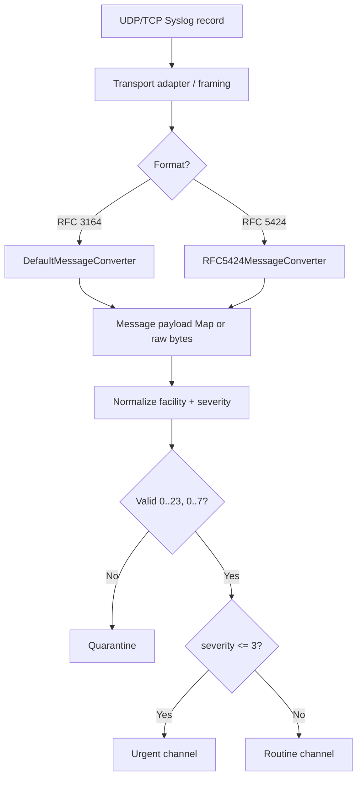

# Facility, severity, and priority

## 1. What problem do facility, severity, and priority solve?

In the **Adapter Syslog** chapter of the **SPRING_INTEGRATION_ADAPTERS** module, Spring Integration receives logs from Linux hosts, firewalls, routers, applications, or collectors via a **Syslog inbound channel adapter** and converts them into `Message<?>` instances on a `MessageChannel`. The flow continues filtering, routing, persisting to a database/file/SFTP, or sending to HTTP, JMS, AMQP, or Kafka per the message contract. Choosing adapters, pollers, or gateways in other parts of the module does not change the meaning of these Syslog fields.

Each Syslog record carries a **PRI (priority value)** that simultaneously encodes two components:

- **Facility**: which **source/functional group** the record belongs to, such as kernel, mail, security/authentication, or `local0`.
- **Severity**: the **severity level** declared by the record, from `0 = Emergency` to `7 = Debug`.
- **Priority/PRI**: an integer representing the **facility + severity pair**, not a single standalone priority scale across all records.

Example:

```text
<134>Nov 23 09:15:10 edge-01 app[2048]: Configuration changed
^^^^^
 PRI
```

In this example, `PRI = 134` means **facility = 16 (`local0`)** and **severity = 6 (`Informational`)**. The value 134 does **not** mean "alert level 134"; it is a combined code.

This lesson will help you:

1. Compute `PRI` from facility and severity, as well as extract both components from PRI.
2. Understand the standard Syslog facility table `0..23` and severity table `0..7`.
3. Distinguish raw codes in RFC 3164/RFC 5424 from payloads produced by Spring Integration converters.
4. Route records properly by severity/facility rather than comparing raw PRI values.
5. Build an example pipeline: Syslog inbound -> parse/validate -> normalized message -> critical/routine channel.
6. Test boundary values, malformed data, trust considerations, timestamps, and reliability.

## 2. How is PRI encoded in a Syslog record?

### 2.1. Wire syntax

At the beginning of an RFC 3164 or RFC 5424 record, PRI appears as a **decimal number enclosed in `<` and `>`**:

```text
<PRI>HEADER MSG
```

With RFC 5424, PRI is immediately followed by the protocol version, for example:

```text
<134>1 2026-11-23T02:15:10Z edge-01 app 2048 EVT42 - Configuration changed
```

Here:

- `<134>` is PRI.
- `1` immediately after `>` is the RFC 5424 **VERSION**; it is **not** severity.
- `2026-11-23T02:15:10Z` is the timestamp.
- `edge-01` is HOSTNAME, recorded in the message by the sender.
- `app`, `2048`, and `EVT42` are APP-NAME, PROCID, and MSGID, respectively.
- `-` indicates STRUCTURED-DATA has no value in this example.
- The remainder is MSG.

**The PRI prefix is independent of the transport.** The record can travel over UDP, TCP (with framing), or TLS/TCP. Enabling TLS does not change the facility/severity formula.

### 2.2. Bidirectional conversion formulas

```text
PRI = facility * 8 + severity

facility = PRI / 8      (integer division)
severity = PRI % 8      (remainder)
```

Value ranges according to the standard Syslog facility system:

| Variable | Valid range | Reason |
|---|---|---|
| `facility` | `0..23` | 24 standard facility groups. |
| `severity` | `0..7` | 8 severity levels. |
| `PRI` | `0..191` | `23 × 8 + 7 = 191`. |

In Java, the `/` operator on non-negative integers performs integer division, and `%` yields the remainder.

Worked example:

```text
facility = 16 (local0)
severity = 6  (informational)

PRI = 16 * 8 + 6 = 134

Decoding:
facility = 134 / 8 = 16
severity = 134 % 8 = 6
```

Some devices use labels like `info`, `warn`, or `err` in configuration, but the **numeric code** is the consistent part inside PRI. Display names/aliases may vary across daemons and libraries.

### 2.3. Crucial pitfall: a higher PRI number does not mean a more severe error

Consider two records:

```text
<27>Nov 23 09:20:00 host-a daemon: Database connection failed
<134>Nov 23 09:20:01 host-b app: Scheduled job started
```

- `PRI 27` -> facility `3` (system daemons), severity `3` (Error).
- `PRI 134` -> facility `16` (`local0`), severity `6` (Informational).

Comparing `134 > 27` and concluding the second line is more severe is **wrong**: most of the difference comes from facility. To triage urgency by Syslog severity, **extract severity first**, then compare `severity <= 3` for Error/Critical/Alert/Emergency.

Even then, severity is a **self-reported value**, not a verified security assessment. Security events must consider source, content, action type, and dedicated detection rules.

## 3. Table of the 24 standard facilities

Facility indicates the **type of application/system** emitting the message or a group designated by sender configuration.

| Code | Common name/group | Notes |
|---:|---|---|
| 0 | `kern` | Kernel messages. |
| 1 | `user` | User-level messages. |
| 2 | `mail` | Mail system. |
| 3 | `daemon` | System daemons. |
| 4 | `auth` | Security/authorization messages. |
| 5 | `syslog` | Messages generated internally by the Syslog daemon. |
| 6 | `lpr` | Line printer subsystem. |
| 7 | `news` | Network news subsystem. |
| 8 | `uucp` | UUCP subsystem. |
| 9 | `cron` / clock daemon | Implementation labels may vary; RFC maps to clock daemon. |
| 10 | `authpriv` | Security/authorization messages, often used in access-controlled logging policies. |
| 11 | `ftp` | FTP daemon. |
| 12 | `ntp` | NTP subsystem. |
| 13 | `audit` | Log audit. |
| 14 | `alert` | Log alert. |
| 15 | `clock` / `cron` (variant) | Clock daemon per standard table; aliases depend on system. |
| 16 | `local0` | Local use 0. |
| 17 | `local1` | Local use 1. |
| 18 | `local2` | Local use 2. |
| 19 | `local3` | Local use 3. |
| 20 | `local4` | Local use 4. |
| 21 | `local5` | Local use 5. |
| 22 | `local6` | Local use 6. |
| 23 | `local7` | Local use 7. |

Two things to keep in mind:

1. **Facility is not the sender's address or verified identity.** A router can be configured to send `local4` and an application can also send `local4`. To identify devices, use metadata verified at the collector/TLS/network boundary alongside inventory.
2. **Facility does not determine severity.** `local0.emerg` and `local0.debug` share facility 16 yet differ completely in urgency.

### 3.1. The `local0` through `local7` group

The eight local facilities are commonly used by operations teams to separate sources or processing pipelines:

| Facility | Value | Example internal policy |
|---|---:|---|
| `local0` | 16 | Application logs for Service A. |
| `local1` | 17 | Routers or network agents. |
| `local2` | 18 | Batch ingestion systems. |
| `local3` | 19 | Reverse proxies. |
| `local4` | 20 | Business Service B. |
| `local5` | 21 | Health-check agents. |
| `local6` | 22 | Internal ops tooling. |
| `local7` | 23 | Controlled test channel. |

These are **example mappings chosen by an organization**, not mandated meanings for each `localN` in the RFC. If two teams independently share `local4` for unrelated sources, facility alone is insufficient for classification.

### 3.2. Watch out for facility labels across operating systems

Different operating systems or log-shipping tools name facilities such as `security`, `auth`, `authpriv`, `cron`, or `clock` slightly differently. Store the **numeric facility code** in the normalized schema and use a name table only for display or monitoring.

When auditing or tracking access is required, **`authpriv` does not secure the data on its own**: it is just a facility code. You still need file permissions, ACLs, TLS/mTLS, retention, and policies for genuinely sensitive events.

## 4. Severity table 0–7

Severity is the **severity level declared by the Syslog source**, which differs from an operations team's handling priority.

| Code | Standard name | Common aliases | Example |
|---:|---|---|---|
| 0 | Emergency | `emerg` / `panic` | System is unusable. |
| 1 | Alert | `alert` | Action must be taken immediately. |
| 2 | Critical | `crit` | Critical component failure. |
| 3 | Error | `err` / `error` | A significant operation failed. |
| 4 | Warning | `warning` / `warn` | Potential risk or abnormal condition. |
| 5 | Notice | `notice` | Significant event. |
| 6 | Informational | `info` | Normal operational status. |
| 7 | Debug | `debug` | Diagnostic details. |

**Smaller numbers indicate higher severity.** Therefore:

```java
boolean urgent = severity <= 3;  // 0, 1, 2, 3
boolean warningOrWorse = severity <= 4;
boolean informational = severity == 6;
boolean debug = severity == 7;
```

These expressions are valid **only after checking that `severity` is within `0..7`**. Never treat `severity == -1` or `null` as "urgent" because `-1 <= 3` accidentally evaluates to `true`.

### 4.1. Severity conventions are not a complete incident map

Using severity for triage prioritization is helpful, but you also need to consider:

- Which service/device emitted the event?
- Does the event impact SLAs, data integrity, or security?
- Is event frequency spiking abnormally, or is it an isolated warning?
- Are there related alerts or active maintenance windows?
- Could the log have been spoofed, forwarded, or mislabeled?

For example, a burst of failed logins might be tagged `notice` or `info` by a sender yet still require a security alert. Conversely, an `error` from an experimental task does not necessarily require paging production on-call.

### 4.2. Choosing routing thresholds

An easy-to-follow practical policy:

| Condition | Decision |
|---|---|
| `severity ∈ {0,1,2,3}` | Send to `urgentSyslog` channel after source validation. |
| `severity ∈ {4,5}` | Send to `routineSyslog` channel and mark for monitoring. |
| `severity ∈ {6,7}` | Store under appropriate retention/rate-limit rules. |
| Invalid or missing severity | Send to `quarantineSyslog`; do not guess severity. |
| Facility in audit group | Retain data under dedicated policy regardless of severity. |

Do not use `severity <= 3` as a reason to **discard** all other records: informational/debug logs can be vital during investigations and sometimes contain attack indicators.

## 5. Java examples for computing and decoding PRI

These are pure Java utilities illustrating the formulas, independent of Spring Integration.

### 5.1. A value object rejecting out-of-range PRI values

```java
package example.syslog;

public record SyslogPriority(
        int pri,
        int facility,
        int severity) {

    public static SyslogPriority decode(int pri) {
        if (pri < 0 || pri > 191) {
            throw new IllegalArgumentException(
                "Syslog PRI must be between 0 and 191");
        }

        return new SyslogPriority(
            pri,
            pri / 8,
            pri % 8);
    }

    public static SyslogPriority encode(
            int facility,
            int severity) {

        if (facility < 0 || facility > 23) {
            throw new IllegalArgumentException(
                "facility must be between 0 and 23");
        }
        if (severity < 0 || severity > 7) {
            throw new IllegalArgumentException(
                "severity must be between 0 and 7");
        }

        int pri = facility * 8 + severity;
        return new SyslogPriority(pri, facility, severity);
    }

    public boolean isUrgent() {
        return severity <= 3;
    }
}
```

Usage:

```java
SyslogPriority info = SyslogPriority.decode(134);
System.out.println(info.facility()); // 16
System.out.println(info.severity()); // 6
System.out.println(info.isUrgent()); // false

SyslogPriority error = SyslogPriority.encode(16, 3);
System.out.println(error.pri()); // 131
System.out.println(error.isUrgent()); // true
```

Accepting only PRI in `0..191` prevents accepting non-standard inputs or generating facilities outside the standard table. Any device using a custom extension must be handled as a **tested contract exception**, not silently fed through the standard path.

### 5.2. Extracting the PRI prefix from a record for testing

Spring Integration already includes Syslog converters; **do not write your own RFC 3164/RFC 5424 parser in production**. However, a small helper helps unit test the formula:

```java
package example.syslog;

import java.util.regex.Matcher;
import java.util.regex.Pattern;

public final class SyslogPriPrefix {

    private static final Pattern PRI_PREFIX =
        Pattern.compile("^<([0-9]{1,3})>");

    private SyslogPriPrefix() {}

    public static SyslogPriority parse(String record) {
        if (record == null) {
            throw new IllegalArgumentException("record is null");
        }

        Matcher matcher = PRI_PREFIX.matcher(record);
        if (!matcher.find()) {
            throw new IllegalArgumentException(
                "Missing or malformed PRI prefix");
        }

        int pri = Integer.parseInt(matcher.group(1));
        return SyslogPriority.decode(pri);
    }
}
```

Example:

```java
SyslogPriority p = SyslogPriPrefix.parse(
    "<131>Nov 23 09:20:00 host-a daemon: Failure");

// p.facility() == 16; p.severity() == 3.
```

This helper only extracts the prefix from an **already-decoded String** and does not validate the entire Syslog record. Never use it as a substitute for an RFC converter or parse RFC 5424 structured data with regexes. For raw `byte[]` data, determine the proper encoding before converting bytes to a `String`.

### 5.3. Worked examples table

| Conceptual label | Facility | Severity | Formula | PRI |
|---|---:|---:|---|---:|
| `kern.emerg` | 0 | 0 | `0×8+0` | 0 |
| `daemon.err` | 3 | 3 | `3×8+3` | 27 |
| `authpriv.warning` | 10 | 4 | `10×8+4` | 84 |
| `local0.info` | 16 | 6 | `16×8+6` | 134 |
| `local0.err` | 16 | 3 | `16×8+3` | 131 |
| `local4.notice` | 20 | 5 | `20×8+5` | 165 |
| `local7.debug` | 23 | 7 | `23×8+7` | 191 |

From this table, `local7.debug` has the **highest PRI at 191** yet its severity is only Debug, while `kern.emerg` has the **lowest PRI at 0** yet its severity is Emergency.

## 6. Does PRI differ between RFC 3164 and RFC 5424?

The formula **does not change**: both RFC 3164 and RFC 5424 place PRI at the start of the record, combining facility and severity. The major differences lie in **the remaining fields** and how converters parse them.

| Aspect | RFC 3164 | RFC 5424 |
|---|---|---|
| PRI | `<134>` at start of record | `<134>` at start of record |
| PRI calculation | `facility × 8 + severity` | Same as RFC 3164 |
| Timestamp | Often lacks year/timezone | Explicit format, supports `-` when absent |
| App/process | Usually a tag inside MSG/header | Separate APP-NAME, PROCID, MSGID |
| Structured data | No standard structure like RFC 5424 | Includes STRUCTURED-DATA |
| Spring Integration parser | `DefaultMessageConverter` / `SyslogToMapTransformer` | `RFC5424MessageConverter` |
| TCP framing | Depends on sender/receiver | Requires RFC 6587 framing; over TLS RFC 5425 uses octet counting |

Example of the same PRI in both formats:

```text
RFC 3164:
<134>Nov 23 09:15:10 edge-01 app[2048]: Job started

RFC 5424:
<134>1 2026-11-23T02:15:10Z edge-01 app 2048 JOB1 - Job started
```

In both, facility is 16 and severity is 6. However, **never force RFC 5424 records through an RFC 3164 parser** just because PRI looks the same; timestamp, app name, MSGID, and structured data can all be misinterpreted.

## 7. Mapping to Spring Integration payloads and headers

### 7.1. Conversion flow



In Spring Integration:

- `DefaultMessageConverter` is used for RFC 3164 Syslog. Its default `asMap=true` mode produces a `Map` payload with parsed fields; fields (excluding the message text) can be placed in message headers with the `syslog_` prefix.
- `asMap=false` preserves a raw `byte[]` payload while decoded metadata may still appear in headers per the converter.
- `RFC5424MessageConverter` handles RFC 5424 records. With `asMap=true`, fields parsed into the payload map **are not all automatically copied to headers** like the RFC 3164 converter does.
- `SyslogToMapTransformer` provides constants `FACILITY`, `SEVERITY`, `HOST`, `TIMESTAMP`, `MESSAGE`, and `UNDECODED` to avoid hardcoding key names.
- For unparseable records, in some cases the converter returns a map containing `UNDECODED` instead of throwing an exception.

**Do not assume the runtime type of each field is invariant across all converters and versions.** Read as `Object`, check for `Number` or numeric strings per contract, normalize into a DTO, and only then route; if a source supplies labels like `INFO` instead of numbers, implement an explicit, tested mapping table rather than guessing casts.

### 7.2. Distinguishing `facility` and `syslog_facility`

Conceptual example:

```text
Spring Integration Message {
  payload: {
    facility: 16,
    severity: 6,
    host: "edge-01",
    message: "Job started"
  },
  headers: {
    id: ...,
    timestamp: ...,
    syslog_facility: 16,
    syslog_severity: 6,
    syslog_host: "edge-01"
  }
}
```

This is a **conceptual diagram**, not a guarantee that those exact keys, value types, or headers are always present. Use framework-published constants instead of guessing field names:

```java
Object facility = fields.get(
    SyslogToMapTransformer.FACILITY);
Object severity = fields.get(
    SyslogToMapTransformer.SEVERITY);
```

When reading headers, use `SyslogHeaders.FACILITY` or `SyslogHeaders.SEVERITY` matching the configured converter. **With the RFC 5424 converter in `asMap=true` mode, do not assume decoded headers are always populated.**

### 7.3. Why not route solely by `MessageHeaders.ID` or timestamp?

`MessageHeaders.ID` identifies a message inside Spring Messaging, not a permanent record ID across all systems. `MessageHeaders.TIMESTAMP` usually reflects internal message creation time, which differs from the timestamp declared by the Syslog sender.

For auditing, store separately:

- `sourceTimestamp` from the record, after validating year/timezone semantics.
- `receivedAt` generated by the receiver.
- `sourceId` from verified network/TLS/collector metadata.
- `claimedHost` from the Syslog record (not fully trusted).
- Numeric `facilityCode` and `severityCode`.
- `eventId` generated by the system or supplied by the source per policy for correlation/replay.

## 8. Spring Integration example: routing by facility/severity

Let's build a Syslog UDP receiver that routes records with severity `0..3` to `urgentSyslog`, remaining valid records to `routineSyslog`, and parse/validation failures to `quarantineSyslog`.

**Assumptions:** Java 17+, Spring Boot with Spring Integration, `spring-integration-ip`, and `spring-integration-syslog`. The example runs on UDP/1514 using `DefaultMessageConverter` for RFC 3164. This is an **internal message processing flow**, producing no HTTP response.

### 8.1. Maven dependencies

With Spring Boot dependency management:

```xml
<dependencies>
    <dependency>
        <groupId>org.springframework.boot</groupId>
        <artifactId>spring-boot-starter-integration</artifactId>
    </dependency>
    <dependency>
        <groupId>org.springframework.integration</groupId>
        <artifactId>spring-integration-ip</artifactId>
    </dependency>
    <dependency>
        <groupId>org.springframework.integration</groupId>
        <artifactId>spring-integration-syslog</artifactId>
    </dependency>
</dependencies>
```

`spring-boot-starter-web` is optional/unnecessary if the application only listens for UDP/TCP Syslog.

### 8.2. Native Syslog inbound XML

File `src/main/resources/syslog-priority.xml`:

```xml
<?xml version="1.0" encoding="UTF-8"?>
<beans xmlns="http://www.springframework.org/schema/beans"
       xmlns:xsi="http://www.w3.org/2001/XMLSchema-instance"
       xmlns:int="http://www.springframework.org/schema/integration"
       xmlns:int-syslog="http://www.springframework.org/schema/integration/syslog"
       xsi:schemaLocation="
         http://www.springframework.org/schema/beans
         https://www.springframework.org/schema/beans/spring-beans.xsd
         http://www.springframework.org/schema/integration
         https://www.springframework.org/schema/integration/spring-integration.xsd
         http://www.springframework.org/schema/integration/syslog
         https://www.springframework.org/schema/integration/syslog/spring-integration-syslog.xsd">

    <int:channel id="syslogInput"/>

    <int-syslog:inbound-channel-adapter
        id="prioritySyslogReceiver"
        channel="syslogInput"
        protocol="udp"
        port="1514"/>
</beans>
```

The Spring Boot application loads the XML with `@ImportResource`:

```java
package example.syslog;

import org.springframework.boot.SpringApplication;
import org.springframework.boot.autoconfigure.SpringBootApplication;
import org.springframework.context.annotation.ImportResource;

@SpringBootApplication
@ImportResource("classpath:syslog-priority.xml")
public class SyslogPriorityApplication {

    public static void main(String[] args) {
        SpringApplication.run(SyslogPriorityApplication.class, args);
    }
}
```

Here the adapter receives datagrams, decodes them with the default RFC 3164 converter, and sends messages to `syslogInput`. No poller is needed on the inbound endpoint because the UDP adapter is **message-driven**.

### 8.3. Declaring the three destination channels

File `SyslogPriorityChannels.java`:

```java
package example.syslog;

import org.springframework.context.annotation.Bean;
import org.springframework.context.annotation.Configuration;
import org.springframework.integration.channel.DirectChannel;
import org.springframework.messaging.MessageChannel;

@Configuration
public class SyslogPriorityChannels {

    @Bean
    public MessageChannel urgentSyslog() {
        return new DirectChannel();
    }

    @Bean
    public MessageChannel routineSyslog() {
        return new DirectChannel();
    }

    @Bean
    public MessageChannel quarantineSyslog() {
        return new DirectChannel();
    }
}
```

`DirectChannel` invokes subscribers on the sending thread. If downstream Kafka/DB publishing is slow, the socket receiver can block; when load decoupling or durable persistence is needed, design a persistent queue/collector rather than assuming `DirectChannel` provides adequate backpressure on its own.

### 8.4. DTOs for normalized events

File `ClassifiedSyslogEvent.java`:

```java
package example.syslog;

import java.time.Instant;

public record ClassifiedSyslogEvent(
    int facility,
    int severity,
    String claimedHost,
    String text,
    Instant receivedAt) {
}
```

File `RejectedSyslogEvent.java`:

```java
package example.syslog;

import java.time.Instant;

public record RejectedSyslogEvent(
    String reason,
    Instant receivedAt) {
}
```

This is a minimal internal contract for learning. Production should add a verified `sourceId`, trace/event ID, source timestamp, schema version, ingestion source, and access-controlled raw storage. Do not forward all original `MessageHeaders` to a broker blindly, as they may contain internal headers or unintended metadata.

### 8.5. Service activator classifying after parsing

File `SyslogPriorityClassifier.java`:

```java
package example.syslog;

import java.time.Instant;
import java.util.Map;

import org.springframework.beans.factory.annotation.Qualifier;
import org.springframework.integration.annotation.ServiceActivator;
import org.springframework.integration.transformer.SyslogToMapTransformer;
import org.springframework.messaging.Message;
import org.springframework.messaging.MessageChannel;
import org.springframework.messaging.support.MessageBuilder;
import org.springframework.stereotype.Service;

@Service
public class SyslogPriorityClassifier {

    private final MessageChannel urgent;
    private final MessageChannel routine;
    private final MessageChannel quarantine;

    public SyslogPriorityClassifier(
            @Qualifier("urgentSyslog") MessageChannel urgent,
            @Qualifier("routineSyslog") MessageChannel routine,
            @Qualifier("quarantineSyslog") MessageChannel quarantine) {
        this.urgent = urgent;
        this.routine = routine;
        this.quarantine = quarantine;
    }

    @ServiceActivator(inputChannel = "syslogInput")
    public void accept(Message<?> incoming) {
        Instant receivedAt = Instant.now();
        Object payload = incoming.getPayload();

        if (!(payload instanceof Map<?, ?> fields)) {
            reject("UNEXPECTED_PAYLOAD_TYPE", receivedAt);
            return;
        }

        if (fields.containsKey(SyslogToMapTransformer.UNDECODED)) {
            reject("UNDECODED_SYSLOG", receivedAt);
            return;
        }

        Integer facility = numeric(
            fields.get(SyslogToMapTransformer.FACILITY));
        Integer severity = numeric(
            fields.get(SyslogToMapTransformer.SEVERITY));

        if (facility == null || facility < 0 || facility > 23
                || severity == null || severity < 0
                || severity > 7) {
            reject("INVALID_FACILITY_OR_SEVERITY", receivedAt);
            return;
        }

        String claimedHost = safeString(
            fields.get(SyslogToMapTransformer.HOST));
        String text = safeString(
            fields.get(SyslogToMapTransformer.MESSAGE));

        ClassifiedSyslogEvent event = new ClassifiedSyslogEvent(
            facility, severity, claimedHost, text, receivedAt);

        MessageChannel destination =
            severity <= 3 ? urgent : routine;

        sendChecked(destination, event);
    }

    private void reject(String reason, Instant receivedAt) {
        // Raw message, if needed, must be stored separately with access control.
        sendChecked(quarantine,
            new RejectedSyslogEvent(reason, receivedAt));
    }

    private static Integer numeric(Object value) {
        if (value instanceof Number number) {
            double v = number.doubleValue();
            if (Double.isFinite(v)
                    && v == Math.rint(v)
                    && v >= Integer.MIN_VALUE
                    && v <= Integer.MAX_VALUE) {
                return (int) v;
            }
            return null;
        }
        if (value instanceof String text
                && text.matches("[0-9]{1,3}")) {
            return Integer.valueOf(text);
        }
        return null;
    }

    private static String safeString(Object value) {
        return value == null ? "" : String.valueOf(value);
    }

    private static void sendChecked(
            MessageChannel destination,
            Object payload) {

        boolean accepted = destination.send(
            MessageBuilder.withPayload(payload).build());

        if (!accepted) {
            throw new IllegalStateException(
                "Syslog output channel did not accept message");
        }
    }
}
```

Here:

1. `UNDECODED` is checked before accessing facility/severity.
2. The code avoids blind casts; it accepts `Number` or short digit strings, then enforces valid ranges.
3. Only when severity is valid does it evaluate `severity <= 3`.
4. `claimedHost` and `text` are sender-supplied data, **not a trusted source of identity**.
5. The newly built message carries only the normalized DTO, without copying all headers that might contain internal metadata.
6. `sendChecked` verifies the result of sending to the channel. Returning `true` only reflects the channel's semantics; **it does not prove the record was durably stored**.

**Limitation of this example:** the `numeric` helper does not accept label strings like `"INFO"`; if your environment's converter provides labels instead of numbers, add a tested label mapping. The helper also accepts only finite integer values within `int` range, and `accept` subsequently validates facility/severity bounds. Vendor-specific value structures require dedicated normalization rather than blind casting.

### 8.6. Subscribers for the three channels

File `SyslogPrioritySink.java`:

```java
package example.syslog;

import org.slf4j.Logger;
import org.slf4j.LoggerFactory;
import org.springframework.integration.annotation.ServiceActivator;
import org.springframework.stereotype.Service;

@Service
public class SyslogPrioritySink {

    private static final Logger log =
        LoggerFactory.getLogger(SyslogPrioritySink.class);

    @ServiceActivator(inputChannel = "urgentSyslog")
    public void urgent(ClassifiedSyslogEvent event) {
        // Production: send to persistent queue/Kafka and alert per policy.
        log.warn("Urgent Syslog event: facility={}, severity={}",
            event.facility(), event.severity());
    }

    @ServiceActivator(inputChannel = "routineSyslog")
    public void routine(ClassifiedSyslogEvent event) {
        // Production: write to batch/index or durable topic.
        log.info("Routine Syslog event: facility={}, severity={}",
            event.facility(), event.severity());
    }

    @ServiceActivator(inputChannel = "quarantineSyslog")
    public void rejected(RejectedSyslogEvent event) {
        // Production: durable quarantine, alert by rate.
        log.warn("Rejected Syslog event: reason={}", event.reason());
    }
}
```

This example focuses on **facility/severity routing** without real storage yet. Writing only to application logs is not a durable sink, and risks creating a feedback loop if application logs are routed back into the same Syslog receiver.

## 9. Testing with a Syslog sender and verifying routing

### 9.1. Sending multiple severities within the same facility

On Linux, `logger` supports the relevant options:

```bash
logger --udp --server 127.0.0.1 --port 1514 \
  --rfc3164 --priority local0.info \
  --tag demo "Application started"

logger --udp --server 127.0.0.1 --port 1514 \
  --rfc3164 --priority local0.err \
  --tag demo "Dependency failed"
```

Expected:

- `local0.info` -> facility 16, severity 6, PRI 134 -> `routineSyslog`.
- `local0.err` -> facility 16, severity 3, PRI 131 -> `urgentSyslog`.

`logger` flags may differ across distributions; check `logger --help`. If the sender runs in another container, `127.0.0.1` is the sender's loopback, not the receiver's.

### 9.2. Sending directly via Java UDP to control PRI

File `SendPrioritySyslog.java`:

```java
package example.syslog;

import java.net.DatagramPacket;
import java.net.DatagramSocket;
import java.net.InetAddress;
import java.nio.charset.StandardCharsets;

public class SendPrioritySyslog {

    private static void send(
            DatagramSocket socket,
            String text) throws Exception {

        byte[] bytes = text.getBytes(StandardCharsets.UTF_8);
        DatagramPacket packet = new DatagramPacket(
            bytes, bytes.length,
            InetAddress.getByName("127.0.0.1"), 1514);
        socket.send(packet);
    }

    public static void main(String[] args) throws Exception {
        try (DatagramSocket socket = new DatagramSocket()) {
            send(socket, "<134>Nov 23 09:15:10 edge-01 app: Job started");
            send(socket, "<131>Nov 23 09:15:11 edge-01 app: Job failed");
            send(socket, "<84>Nov 23 09:15:12 edge-01 auth: Warning");
        }
    }
}
```

For `<84>`, `facility = 84/8 = 10` and `severity = 84%8 = 4`, so per the demo policy it goes to `routineSyslog`, even though facility `authpriv` may require separate security retention.

**UDP has no application acknowledgment.** `DatagramSocket.send(...)` completing only shows Java/OS accepted the send call; verify the receiver and downstream sink actually received the records.

### 9.3. Unit testing the PRI formula

With JUnit Jupiter:

```java
package example.syslog;

import static org.junit.jupiter.api.Assertions.*;

import org.junit.jupiter.api.Test;

class SyslogPriorityTest {

    @Test
    void decodesFacilityAndSeverity() {
        SyslogPriority p = SyslogPriority.decode(134);

        assertEquals(16, p.facility());
        assertEquals(6, p.severity());
        assertFalse(p.isUrgent());
    }

    @Test
    void encodesFacilityAndSeverity() {
        SyslogPriority p = SyslogPriority.encode(16, 3);

        assertEquals(131, p.pri());
        assertTrue(p.isUrgent());
    }

    @Test
    void checksBoundaries() {
        assertEquals(0, SyslogPriority.decode(0).severity());
        assertEquals(23, SyslogPriority.decode(191).facility());
        assertEquals(7, SyslogPriority.decode(191).severity());

        assertThrows(IllegalArgumentException.class,
            () -> SyslogPriority.decode(-1));
        assertThrows(IllegalArgumentException.class,
            () -> SyslogPriority.decode(192));
        assertThrows(IllegalArgumentException.class,
            () -> SyslogPriority.encode(24, 0));
        assertThrows(IllegalArgumentException.class,
            () -> SyslogPriority.encode(16, 8));
    }

    @Test
    void readsPrefix() {
        SyslogPriority p = SyslogPriPrefix.parse(
            "<27>Nov 23 09:20:00 host daemon: Failure");

        assertEquals(3, p.facility());
        assertEquals(3, p.severity());
    }
}
```

With Spring Boot, the test dependency is typically `spring-boot-starter-test`. This is a **unit test suite for the math**; real Spring Integration tests must also send datagrams and assert messages arrive on the right channels, including records with missing fields or invalid formats.

## 10. Multi-source Syslog classification contract

When a system has many senders, a production policy should combine at least:

```text
validated / trusted source identity
        + facility code
        + severity code
        + normalized event attributes
        + tenant/environment
        + rate / frequency / time window
        -> routing, alerting, retention
```

| Rule | Reasonable when | Pitfall |
|---|---|---|
| `severity <= 3` | Routing severe errors from controlled sources | Sender may mislabel severity or intentionally flood. |
| `facility == 10` | Authpriv data needs separate storage | Not inherently secure; can be spoofed. |
| `facility >= 16` | Organization-defined local facility groups | Different teams may assign different local meanings. |
| `sourceId + facility + severity` | Applying per-device/per-tenant policy | `sourceId` must come from inventory/trust boundary. |
| Frequency/window anomaly | Detecting error bursts or attacks | Requires dedup/throttling to avoid alert storms. |
| `severity == 7` | Reducing debug storage volume | May discard vital forensic clues if policy is too simplistic. |

### 10.1. Retention and classifying sensitive data

Facilities `auth`/`authpriv` often carry login and security information, yet many applications log tokens or personal data under facility `local0`. Therefore, retention and redaction **must not rely solely on facility**.

The policy should specify:

- Which event types require raw storage and for how long.
- Who may access auth/audit data.
- Level of sanitization for message text and structured data.
- Whether encryption at rest, integrity checks, or audit trails are required.
- For high-severity alerts, which fields may be sent externally without leaking secrets.

### 10.2. Timestamps and ordering

PRI contains no time data. In RFC 3164, timestamps inside records usually omit year and timezone; in RFC 5424, timestamps can include a timezone or NILVALUE per format.

For event ordering:

- Use the collector's `receivedAt` to record ingress time.
- Keep `sourceTimestamp` separate; avoid assuming all logs from the same host have accurate clocks.
- UDP can reorder or drop packets; TCP guarantees byte order **within each connection**, with no global order.
- When publishing to Kafka, choose partition keys based on `trustedSourceId` if per-source ordering is needed, not PRI.

## 11. Errors and security at the Syslog boundary

### 11.1. Records with out-of-range PRI or undecodable format

Examples of invalid input:

```text
<192>Nov 23 09:15:10 edge-01 app: Out of range
<abc>Nov 23 09:15:10 edge-01 app: Bad prefix
Nov 23 09:15:10 edge-01 app: Missing PRI
```

Expected behavior:

1. Parser/validation rejects the record or marks it undecodable per implementation.
2. Never default to `severity=0` to avoid triggering false urgent alerts.
3. Never dump unbounded raw malformed records into application logs.
4. Increment malformed-rate metrics and store bounded raw records if required by investigation contracts.
5. When many devices fail format checks simultaneously, verify RFC 3164/RFC 5424 format settings and framing before editing routing rules.

`UNDECODED` is **error data inside the payload** in some cases, not necessarily a Java exception. `errorChannel` only receives errors when an adapter/poller/handler actually emits an `ErrorMessage`; Syslog records dropped by the kernel before the listener will not show up there.

### 11.2. Facility/severity are not authentication

Plain UDP/TCP Syslog has no application authentication. Any sender can emit `<0>` (kern.emerg) or `<84>` (authpriv.warning), or even spoof a hostname.

To prevent abuse:

- Open listeners only on trusted networks/allowlists with firewalls and source limits.
- When confidentiality and peer authentication are needed, use syslog-over-TLS/mTLS with an appropriate collector or TLS-enabled transport. Do not assume `protocol="tcp"` is secure on its own.
- Assign `trustedSourceId` from verified network/TLS identity, not merely trusting `HOSTNAME` in the payload.
- Rate-limit and flood-protect severe alerts; apply per-source quotas.
- Escape control characters/newlines to prevent log injection when rendering or forwarding.
- Never allow high severity alone to trigger commands, call sensitive endpoints, or grant access.

### 11.3. Do not confuse the error channel with data durability

An ingestion chain can fail at every step:

```text
Network UDP/TCP
  -> listener / decoder
  -> Syslog Message payload
  -> validation + routing
  -> MessageChannel
  -> Kafka / JMS / AMQP / DB / File / SFTP
  -> destination commit / ack
```

- UDP can drop packets before the listener.
- TCP guarantees an ordered byte stream on the connection, not database commits.
- `DirectChannel` can block or throw when a subscriber fails.
- `QueueChannel` is in-memory by default, not a durable queue.
- Retries can create duplicates after timeouts or lost responses. Syslog usually lacks a reliable global ID, so combine source ID + event ID/fingerprint and deduplication policies.
- For Kafka/JMS/AMQP or DB sinks, treat storage as successful only after reaching the proper ack/commit boundary per contract.

An architecture requiring zero log loss needs durable collectors/buffers, retention, replay, and dedicated monitoring, rather than just bumping priority or pushing every severity-0 record onto a channel.

## 12. Observability and end-to-end testing

### 12.1. Test matrix

| Input | Facility | Severity | Expected result |
|---|---:|---:|---|
| `<0>` | 0 | 0 | Valid, urgent. |
| `<27>` | 3 | 3 | Valid, urgent. |
| `<84>` | 10 | 4 | Valid, routine per demo threshold. |
| `<131>` | 16 | 3 | Valid, urgent. |
| `<134>` | 16 | 6 | Valid, routine. |
| `<165>` | 20 | 5 | Valid, routine. |
| `<191>` | 23 | 7 | Valid, routine. |
| `<192>` | — | — | Invalid, quarantine. |
| `<-1>` / `<abc>` | — | — | Invalid, quarantine. |
| Missing PRI | — | — | No default severity; quarantine. |
| Map with `UNDECODED` | — | — | Quarantine; do not route normally. |
| Map missing severity or wrong type | Possible | — | Quarantine and schema error metric. |
| RFC 5424 entering RFC 3164 parser | Not guaranteed | Not guaranteed | Detect parser/config mismatch; do not guess fields. |

### 12.2. Metrics to observe

| Metric | Meaning |
|---|---|
| `syslog_received_total` by protocol/source | Ingress record volume. |
| `syslog_events_total` by facility/severity | Distribution of Syslog codes. |
| `syslog_undecoded_total` | Count of records the parser could not decode. |
| `syslog_invalid_pri_total` | Count of invalid PRI/facility/severity values. |
| `syslog_urgent_total` | Count of messages routed to the urgent channel. |
| `syslog_quarantine_total` | Volume of data requiring inspection/replay. |
| `syslog_sink_write_failures_total` | Downstream publish/commit failures. |
| UDP drops / TCP reconnects / queue depth | Transport health and backpressure. |

When designing metric labels, avoid high-cardinality labels like arbitrary raw hostnames, message text, user IDs, or filenames. Use normalized source IDs and endpoint groups, and never put sensitive raw payloads into metrics.

### 12.3. Diagnosing misclassified severity

```text
Sender facility/severity config
  -> PRI in raw record (number in <...>)
  -> UDP/TCP/TLS transport and framing
  -> RFC3164 or RFC5424 converter
  -> payload map / raw byte[]
  -> validate field type/range
  -> normalize facility/severity
  -> router threshold and per-source policy
  -> output channel / storage
```

If **PRI is correct but severity is wrong**, inspect the parser and map value types. If **severity is correct but routing is wrong**, inspect the threshold (`<=3`, not `>=3`) and facility/source policy. If **no messages arrive**, check port/protocol/framing, queues, and network before changing the Java router.

## 13. Summary

**Facility** is the Syslog source/functional group (`0..23`), **severity** is the urgency level (`0..7`, smaller numbers are more urgent), and **PRI** is the combined code given by:

```text
PRI = facility * 8 + severity
facility = PRI / 8
severity = PRI % 8
```

For **Spring Integration Syslog inbound**:

- Choose the RFC 3164 or RFC 5424 converter matching the sender's format.
- Read the payload map and `syslog_*` headers according to your converter configuration; do not assume they are always identical.
- Normalize and validate facility/severity before filtering/routing, and handle `UNDECODED` in a separate branch.
- When prioritizing severe errors, compare the **extracted severity**, **never raw PRI** across different facilities.
- Never use facility/severity as authentication, authorization, or proof of persistence.
- Pair trusted sources, idempotency/dedup, timeouts, backpressure, monitoring, and durable sinks when forwarding to Kafka, JMS, AMQP, HTTP, file/SFTP, or databases.

### Official references

- [Spring Integration — Syslog Support](https://docs.spring.io/spring-integration/reference/syslog.html)
- [Spring Integration — SyslogToMapTransformer API](https://docs.spring.io/spring-integration/api/org/springframework/integration/transformer/SyslogToMapTransformer.html)
- [Spring Integration — SyslogHeaders API](https://docs.spring.io/spring-integration/api/org/springframework/integration/syslog/SyslogHeaders.html)
- [IETF RFC 3164 — The BSD Syslog Protocol](https://www.rfc-editor.org/rfc/rfc3164)
- [IETF RFC 5424 — The Syslog Protocol](https://www.rfc-editor.org/rfc/rfc5424)
- [IETF RFC 5425 — Syslog over TLS](https://www.rfc-editor.org/rfc/rfc5425)
- [IETF RFC 6587 — Transmission of Syslog Messages over TCP](https://www.rfc-editor.org/rfc/rfc6587)
