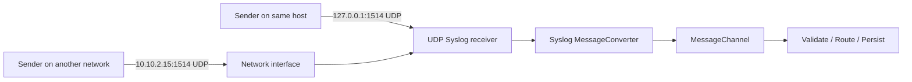
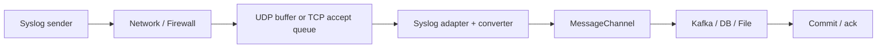

# Listening port and bind address

## 1. Context: where must the Syslog adapter listen?

In the **Adapter Syslog** chapter of the **SPRING_INTEGRATION_ADAPTERS** module, a Syslog inbound channel adapter receives records from routers, firewalls, Linux hosts, applications, or collectors. Data travels over UDP/TCP, is converted into a Spring Integration `Message<?>` by a converter, and is sent to a `MessageChannel`. Downstream flows can then filter, route, persist to a database or file/SFTP, push to JMS/AMQP/Kafka, or call an HTTP API. The correctness of the entire chain depends on **opening the socket listener on the right port and network address**.

Two concepts in this lesson:

- **Listening port**: the port number of the **local socket** used by the Syslog inbound adapter or TCP server connection factory to receive data, such as UDP/1514 or TCP/1515.
- **Bind address** (commonly corresponding to Spring Integration's `local-address` attribute): the **local IP address on the receiver host/container** used to bind the listener, such as `127.0.0.1`, `192.0.2.10`, or wildcard `0.0.0.0`.

These are two **independent** parameters: the same port 1514 bound to `127.0.0.1` vs. `0.0.0.0` has very different connection/datagram reception scopes.



If the receiver only binds `127.0.0.1`, traffic from an external sender to interface `10.10.2.15` will **not** reach that listener. If the receiver binds the wildcard address and the firewall allows it, both paths can reach the socket. With TCP, connections must also be established and framed; with UDP, data consists of one-way datagrams with no application-level ACK.

Lesson goals:

1. Distinguish **port, bind address, sender address, destination address**, and `HOSTNAME` in the Syslog payload.
2. Know when to use loopback, a specific IP, or wildcard.
3. Configure UDP using `<int-syslog:udp-attributes local-address="...">`.
4. Configure TCP using a server `<int-ip:tcp-connection-factory local-address="...">`.
5. Check ports 514/1514/6514, OS privileges, port conflicts, Docker/Kubernetes, firewalls, and TLS.
6. Test end-to-end with a real Syslog sender and monitor listener/recovery behavior.

> **Principle:** Opening a socket only proves the listener is listening. It does **not** prove records were parsed properly, passed through the channel, or were durably written to Kafka/a database.

## 2. IP address, port, and transport form an endpoint

A network-layer socket address can be written as:

```text
(protocol, local IP, local port)

(UDP, 127.0.0.1, 1514)
(TCP, 10.10.2.15, 1515)
(TCP + TLS, 10.10.2.15, 6514)
```

**UDP/1514 and TCP/1514 are not the same listener.** UDP and TCP have separate socket spaces; the same port number can be used by both transports under appropriate conditions, but a receiver listening only on UDP will not receive a TCP byte stream and vice versa.

### 2.1. Common bind addresses

| Bind address | Scope | Suitable when | Watch out for |
|---|---|---|---|
| `127.0.0.1` | IPv4 loopback of the current network namespace | Local testing, collector proxy in the same namespace | Senders from other hosts/containers cannot reach the listener via external IPs. |
| `::1` | IPv6 loopback | Testing or local IPv6 connections | Not synonymous with `127.0.0.1`. |
| `10.10.2.15` | Specific IP belonging to a receiver interface | Exposing only on a chosen internal network | IP must exist on the host/pod at bind time; IP changes will break startup. |
| `0.0.0.0` | IPv4 wildcard: all local IPv4 interfaces | Containers, multi-interface hosts, firewall-protected services | Increases exposure surface; inbound traffic must be controlled. |
| `::` | IPv6 wildcard | Servers needing IPv6 reception | Dual-stack IPv4/IPv6 behavior depends on OS and `IPV6_V6ONLY`/socket implementation. |

**If `local-address` is omitted**, many Spring Integration IP inbound endpoints use the default socket bind to listen across available interfaces. In multi-network environments, explicitly configure a local address or firewall rules rather than relying on defaults when reception scope must be restricted.

The bind address must be an **address on the receiver**, not a sender's IP. If the receiver's IP is `10.10.2.15` and the sender is `10.10.3.20`, setting `local-address="10.10.3.20"` on the receiver will normally fail to bind because that IP does not belong to the receiver machine.

### 2.2. Distinguishing IPs in configuration vs. in records

```text
Sender source IP:             10.10.3.20
Receiver local bind address:  10.10.2.15
Receiver listening port:      1514/UDP
Syslog payload HOSTNAME:      edge-01
Spring Integration channel:   syslogEvents
```

These values come from different sources:

| Value | Where does it come from? | Used for |
|---|---|---|
| Receiver `local-address` | Adapter/connection factory config | Selecting which local interface/IP receives traffic. |
| Receiver `port` | Socket listener config | Selecting the port number senders must target. |
| Packet source IP | IP/UDP/TCP layer | Cross-checking connection origin, observing NAT/proxies. |
| `HOSTNAME`/`HOST` in Syslog | Text placed in the record by the sender | Log metadata, **can be spoofed**. |
| `MessageHeaders.ID` | Spring Messaging | Tracking internal messages, not device identity. |

Do not use `local-address` to "only allow sender 10.10.3.20"; this attribute selects the **local receiving address**, it does not filter remote peers. To restrict senders, use firewalls/ACLs, network policies, a TLS/mTLS proxy, or verified source identity checks.

## 3. Choosing ports: 514, 1514, and 6514

### 3.1. Common Syslog ports

| Port/transport | Typical purpose | Notes |
|---|---|---|
| **UDP/514** | Traditional Syslog over UDP | May already be occupied by an OS syslog daemon; binding low ports on Unix may require special privileges. |
| **TCP/514** | Syslog over TCP per collector/agent config | Not encrypted by itself; requires agreed framing. |
| **UDP/1514** | Unprivileged port for labs or mapped ingress | Used here as a learning example, not a mandatory standard port. |
| **TCP/1515** | Unprivileged port for application TCP Syslog | Sender and server must agree on transport/framing. |
| **TCP/6514** | Syslog over TLS per RFC 5425 | Actually has TLS only when the endpoint/proxy configures TLS; **a port number does not enable TLS**. |

Do not run an entire Spring application as root just to bind UDP/514. Instead consider:

- Having the application listen on `1514`, while a firewall, host proxy, or collector listens on `514` and forwards.
- Granting minimal capabilities (such as `CAP_NET_BIND_SERVICE` on Linux) if binding a low port is truly required.
- Separating the Syslog listener from HTTP/business services that hold broad privileges.

Privilege rules for low ports vary across OSes, containers, and system settings; avoid assuming every modern Unix system always requires root for a given port.

### 3.2. Port 0 for testing

Some IP server components can be configured with `port="0"` so the OS assigns an **ephemeral port** at startup. Spring Integration emits events such as `UdpServerListeningEvent` and `TcpConnectionServerListeningEvent` to detect when the listener is ready and which port was assigned.

This is useful for **parallel integration tests** to avoid hardcoding the same port. However, production senders need a stable endpoint; if dynamic ports are used, there must be service discovery or a mechanism to advertise the port.

**Do not use `port=0` for fixed Syslog devices without a mechanism to advertise the actual port.**

## 4. UDP Syslog inbound: binding on loopback

### 4.1. Dependencies

In a Spring Boot project with dependency management, the two relevant modules are `spring-integration-syslog` and `spring-integration-ip`:

```xml
<dependencies>
    <dependency>
        <groupId>org.springframework.boot</groupId>
        <artifactId>spring-boot-starter-integration</artifactId>
    </dependency>
    <dependency>
        <groupId>org.springframework.integration</groupId>
        <artifactId>spring-integration-ip</artifactId>
    </dependency>
    <dependency>
        <groupId>org.springframework.integration</groupId>
        <artifactId>spring-integration-syslog</artifactId>
    </dependency>
</dependencies>
```

The following example uses **RFC 3164** Syslog over UDP, the default converter, and a `MessageChannel`. Spring MVC/HTTP server is not needed if the application only receives Syslog.

### 4.2. Complete XML configuration for UDP/1514

Create `src/main/resources/syslog-listener.xml`:

```xml
<?xml version="1.0" encoding="UTF-8"?>
<beans xmlns="http://www.springframework.org/schema/beans"
       xmlns:xsi="http://www.w3.org/2001/XMLSchema-instance"
       xmlns:int="http://www.springframework.org/schema/integration"
       xmlns:int-syslog="http://www.springframework.org/schema/integration/syslog"
       xsi:schemaLocation="
         http://www.springframework.org/schema/beans
         https://www.springframework.org/schema/beans/spring-beans.xsd
         http://www.springframework.org/schema/integration
         https://www.springframework.org/schema/integration/spring-integration.xsd
         http://www.springframework.org/schema/integration/syslog
         https://www.springframework.org/schema/integration/syslog/spring-integration-syslog.xsd">

    <int:channel id="syslogUdpEvents"/>

    <int-syslog:inbound-channel-adapter
        id="udpSyslogReceiver"
        channel="syslogUdpEvents"
        auto-startup="true">

        <int-syslog:udp-attributes
            port="1514"
            local-address="127.0.0.1"
            lookup-host="false"/>
    </int-syslog:inbound-channel-adapter>

    <int:service-activator
        input-channel="syslogUdpEvents"
        ref="syslogEventConsumer"
        method="accept"/>

    <bean id="syslogEventConsumer"
          class="example.syslog.SyslogEventConsumer"/>
</beans>
```

**Two important rules in this XML:**

1. When using the child `<int-syslog:udp-attributes>` element, **`port` goes on the child**; do **not** also declare `port` on the parent `inbound-channel-adapter` element.
2. `local-address="127.0.0.1"` binds the UDP socket to loopback. Senders on other hosts/network namespaces cannot send directly via an external IP to this listener.

`lookup-host="false"` disables reverse DNS lookups to avoid unnecessary latency; it is **not** a sender authentication mechanism. Do not turn on `lookup-host=true` and treat DNS hostnames as trustworthy.

If you only need to configure the port and accept the default bind address, you can use the concise native adapter:

```xml
<int-syslog:inbound-channel-adapter
    id="udpSyslogAny"
    channel="syslogUdpEvents"
    port="1514"/>
```

This is an **alternative configuration**; do not instantiate it alongside `udpSyslogReceiver` on the same IP and UDP/1514. When running, select only one matching listener.

### 4.3. Java application loading the XML

```java
package example.syslog;

import org.springframework.boot.SpringApplication;
import org.springframework.boot.autoconfigure.SpringBootApplication;
import org.springframework.context.annotation.ImportResource;

@SpringBootApplication
@ImportResource("classpath:syslog-listener.xml")
public class SyslogListeningApplication {

    public static void main(String[] args) {
        SpringApplication.run(SyslogListeningApplication.class, args);
    }
}
```

Example consumer receiving the Syslog payload produced by the converter:

```java
package example.syslog;

import java.util.Map;
import org.slf4j.Logger;
import org.slf4j.LoggerFactory;
import org.springframework.messaging.Message;

public class SyslogEventConsumer {

    private static final Logger log =
        LoggerFactory.getLogger(SyslogEventConsumer.class);

    public void accept(Message<?> message) {
        if (!(message.getPayload() instanceof Map<?, ?> payload)) {
            log.warn("Unexpected Syslog payload type");
            return;
        }

        // Log only selected raw metadata; do not log raw MSG containing PII.
        Object severity = payload.get("severity");
        log.info("Syslog message arrived; severity={}", severity);

        // Production: normalize/validate and persist or publish.
    }
}
```

`DefaultMessageConverter` creates a `Map` payload from RFC 3164 by default. Actual keys are defined by `SyslogToMapTransformer`; production code should use constants like `SyslogToMapTransformer.SEVERITY`, check types, and handle the `UNDECODED` field rather than blindly relying on string keys.

### 4.4. What changes to receive UDP from an external network?

For a receiver with local IP `10.10.2.15` and a sender at `10.10.3.20`:

```xml
<int-syslog:udp-attributes
    port="1514"
    local-address="10.10.2.15"
    lookup-host="false"/>
```

Requirements:

- IP `10.10.2.15` is actually assigned to the receiver and bindable.
- Firewall/ACL permits the sender to reach **UDP/1514** on that IP.
- The sender targets `10.10.2.15:1514`, not `localhost` by mistake.
- Required network routing across routers/VPNs/NAT exists, and no other process holds an incompatible socket.
- The producer sends the right Syslog record format, assumed here to be RFC 3164.

If the receiver's IP changes frequently, you can bind wildcard `0.0.0.0` and **restrict sources at the firewall/service layer**, or inject the bind address per deployment. Test in the real environment after changing it, as wildcard and IPv4/IPv6 behaviors vary across OSes.

## 5. UDP binding and socket buffers: why can records still be lost when the port is open?

UDP has no connection or application acknowledgment. Three causes are often confused:

1. **Not received due to wrong address/port:** datagrams never reach the socket (sender points to wrong IP, wrong protocol, firewall blocks, or wrong bind address).
2. **Arrived at the host but dropped:** kernel receive buffer is full, datagram is oversized, or CPU/consumer is too slow.
3. **Reached the adapter but the flow failed:** converter cannot parse, no subscriber is wired, or downstream fails.

Key attributes:

| UDP attribute | Effect | What it does NOT replace |
|---|---|---|
| `port` | Which UDP port to listen on. | Does not restrict senders. |
| `local-address` | Which local interface/IP to bind to. | Not a sender allowlist. |
| `receive-buffer-size` | Buffer used to read datagrams; too small can cause truncation. | Not a durable queue. |
| `so-receive-buffer-size` | Requests OS socket receive buffer size. | OS may cap it; does not guarantee zero drops. |
| `lookup-host` | Whether to perform reverse DNS lookup on source address. | Provides no authentication. |
| `error-channel` | Receives errors published by the adapter through messaging error flow. | Does not capture packets dropped before the listener. |
| `send-timeout` | Limit for sending a message to a channel that may block. | Not a socket bind timeout or UDP network timeout. |

Example child configuration with buffer settings (depending on version/OS):

```xml
<int-syslog:udp-attributes
    port="1514"
    local-address="10.10.2.15"
    receive-buffer-size="8192"
    so-receive-buffer-size="262144"
    lookup-host="false"/>
```

These are illustrative values, **not optimal tuning for all devices**. If datagrams are large, check IP fragmentation limits, maximum payload size, throughput, and the actual buffer size granted by the OS. If log loss must be prevented, use an agent/collector with a disk queue and retransmission rather than merely increasing the UDP socket buffer.

## 6. TCP Syslog inbound: binding in the server connection factory

### 6.1. TCP uses a server factory, not the sender's address

For TCP, Spring Integration uses `TcpConnectionFactory` to manage sockets and connections. The **server connection factory** is where the listening port and local bind address are declared.

A simple native TCP configuration:

```xml
<int-syslog:inbound-channel-adapter
    id="tcpSyslogSimple"
    protocol="tcp"
    channel="syslogTcpEvents"
    port="1515"/>
```

When you need to bind to a specific interface, do not guess a `local-address` attribute on the parent Syslog inbound adapter. The explicit approach is declaring an **external server `<int-ip:tcp-connection-factory>`**:

```xml
<int-ip:tcp-connection-factory
    id="tcpSyslogServerFactory"
    type="server"
    local-address="127.0.0.1"
    port="1515"
    using-nio="true"/>

<int-syslog:inbound-channel-adapter
    id="tcpSyslogReceiver"
    protocol="tcp"
    channel="syslogTcpEvents"
    connection-factory="tcpSyslogServerFactory"/>
```

This is an **alternative fragment**; do not run it concurrently with `tcpSyslogSimple` if both factories claim TCP/1515. The XML file must also declare the namespace:

```xml
xmlns:int-ip="http://www.springframework.org/schema/integration/ip"
```

and the corresponding entry in `xsi:schemaLocation`:

```text
http://www.springframework.org/schema/integration/ip
https://www.springframework.org/schema/integration/ip/spring-integration-ip.xsd
```

Two mandatory rules:

1. A `connection-factory` referenced by a Syslog TCP inbound adapter must have **`type="server"`**.
2. When using an **external connection factory**, put `port` and `local-address` on the **factory**, and do not repeat `port` on `int-syslog:inbound-channel-adapter`.

Other attributes such as `backlog`, socket keepalive, TCP/NIO settings, and serializer/deserializer belong on the factory configuration. They do not turn Syslog into HTTP and do not generate a reply message like a TCP inbound gateway.

### 6.2. Port bound properly but TCP still does not parse: check framing

TCP is a **byte stream**. One `Socket.write(...)` call does not equal one Syslog record. Sender and receiver must agree on record boundaries:

- RFC 6587 **octet counting**: byte-length prefix, a space, then the record.
- RFC 6587 **non-transparent framing**: an agreed delimiter, typically LF.
- Syslog over TLS RFC 5425: uses TCP+TLS and **octet counting**.

Example TCP receiver for **RFC 5424 + RFC 6587**:

```xml
<bean id="rfc5424Converter"
      class="org.springframework.integration.syslog.RFC5424MessageConverter"/>

<bean id="rfc6587Deserializer"
      class="org.springframework.integration.syslog.inbound.RFC6587SyslogDeserializer"/>

<int-ip:tcp-connection-factory
    id="rfc5424Server"
    type="server"
    local-address="127.0.0.1"
    port="1516"
    using-nio="true"
    deserializer="rfc6587Deserializer"/>

<int-syslog:inbound-channel-adapter
    id="rfc5424TcpReceiver"
    protocol="tcp"
    connection-factory="rfc5424Server"
    converter="rfc5424Converter"
    channel="syslogTcpEvents"/>
```

This fragment requires the `int-ip` namespace as shown earlier and a subscriber for `syslogTcpEvents`. If using `RFC5424MessageConverter.asMap=false` over TCP, check `retainOriginal` on `RFC6587SyslogDeserializer`.

**Do not misdiagnose:** a TCP listener can `LISTEN` successfully yet emit no messages because the deserializer expects a length prefix or delimiter that does not match what the sender transmits. That is a **framing** issue, not a binding issue.

### 6.3. `backlog` and connection counts

On a TCP server factory, `backlog` affects the socket/server queue of pending connections waiting to be accepted. It is **not** a queue of Syslog messages and does not guarantee a record is processed.

Beyond backlog, the system should bound and monitor:

- Concurrent TCP connections and idle timeouts.
- Connection open/close rates and reconnect counts.
- Read timeouts and maximum frame sizes.
- Executor threads, queue lengths, and socket receive buffers.
- How long downstream handlers block when Kafka/DB slows down.
- Behavior when a sender transmits too fast, closes mid-frame, or resets the connection.

## 7. Java configuration: binding a UDP socket before feeding the flow

Outside the Syslog XML namespace, you can compose a **Spring Integration IP UDP inbound adapter** with a Syslog transformer. This explicitly shows where `setLocalAddress(...)` lives in Java. It is **not the same bean as the native `UdpSyslogReceivingChannelAdapter`**, so parsing and header creation must be configured explicitly.

### 7.1. Java bean UDP receiver

```java
package example.syslog;

import org.springframework.context.annotation.Bean;
import org.springframework.context.annotation.Configuration;
import org.springframework.integration.annotation.EnableIntegration;
import org.springframework.integration.ip.udp.UnicastReceivingChannelAdapter;

@Configuration
@EnableIntegration
public class UdpBindConfiguration {

    @Bean
    public UnicastReceivingChannelAdapter udpReceiver() {
        UnicastReceivingChannelAdapter adapter =
            new UnicastReceivingChannelAdapter(1517);

        // Accept only datagrams arriving on the process's IPv4 loopback.
        adapter.setLocalAddress("127.0.0.1");
        adapter.setOutputChannelName("udpSyslogRaw");
        return adapter;
    }
}
```

`UnicastReceivingChannelAdapter` receives UDP/IP messages, usually with a `byte[]` payload. Ensure the receiver starts and the output channel has a consumer. When using a raw IP adapter instead of the native Syslog adapter, add a transformer to convert raw bytes into Syslog fields.

### 7.2. Wiring the Syslog transformer with Java DSL

```java
package example.syslog;

import org.springframework.context.annotation.Bean;
import org.springframework.context.annotation.Configuration;
import org.springframework.integration.dsl.IntegrationFlow;
import org.springframework.integration.dsl.Transformers;

@Configuration
public class UdpParseConfiguration {

    @Bean
    public IntegrationFlow parseUdpSyslog() {
        return IntegrationFlow
            .from("udpSyslogRaw")
            .transform(Transformers.syslogToMap())
            .channel("parsedSyslog")
            .get();
    }
}
```

For RFC 3164, `Transformers.syslogToMap()` builds a map payload. Add a `@ServiceActivator(inputChannel="parsedSyslog")` to consume the data. **Do not use the RFC 3164 transformer to parse RFC 5424** merely because senders share a port.

Design note: this Java setup and the XML configurations above are **alternatives on different ports**. In a real application, pick one appropriate listener to avoid port conflicts and unintended competing consumers.

## 8. Port binding in Docker

When a Syslog receiver runs inside a container, there are **at least two address layers**:

1. **Bind inside the container's network namespace**: the socket address the JVM actually opens.
2. **Port publishing in the host/container runtime**: mapping from host IP/port to container IP/port.

Example:

```text
Sender on host
   -> 127.0.0.1:1514/udp (host-published)
   -> Docker NAT / port mapping
   -> container-IP:1514/udp
   -> JVM socket listening on 0.0.0.0:1514/udp
```

If the application **inside the container binds `127.0.0.1:1514`**, Docker host port publishing usually forwards packets to the **container network IP**, not the container's loopback. Thus, even with `-p`, a sender on the host will not reach the listener as expected.

A safe lab pattern is:

- **Inside the container**: bind `0.0.0.0` on UDP/1514.
- **On the host**: publish only to the host loopback.

Example Docker command once `syslog-receiver:lab` is built:

```bash
docker run --rm \
  -p 127.0.0.1:1514:1514/udp \
  syslog-receiver:lab
```

The application inside the container must actually listen on UDP/1514 on a reachable container interface. `-p` only maps the transport; **it does not convert UDP to TCP**. If TCP/1515 is needed:

```bash
docker run --rm \
  -p 127.0.0.1:1515:1515/tcp \
  syslog-receiver:lab
```

These two commands illustrate **two separate deployments**; do not run them simultaneously with the same image unless the application configures both listeners internally. When deploying on a public host, never publish a wildcard port to the Internet without firewalls and authentication.

### 8.1. `localhost` is not the same across namespaces

`127.0.0.1` is always the loopback of the network namespace where the process/command runs:

- On the host machine: the host's loopback.
- Inside a bridged container: **that container's** loopback, not the host's.
- Inside a Kubernetes Pod: containers in the **same Pod** normally share a network namespace and can reach each other via loopback; two different Pods do not share loopback.

If the collector and Spring Integration run in separate containers or Pods, use a valid network route/service; do not assume `localhost` points to the application in the other container.

## 9. Port binding in Kubernetes

Kubernetes makes clear the distinction between **application bind port**, **Service port**, **targetPort**, and **protocol**:

```text
Remote/Pod sender
   -> Service:1514/UDP
   -> selected PodIP:1514/UDP
   -> Spring Integration UDP listener
```

Internal Service example:

```yaml
apiVersion: v1
kind: Service
metadata:
  name: syslog-udp
spec:
  type: ClusterIP
  selector:
    app: syslog-receiver
  ports:
    - name: syslog-udp
      port: 1514
      targetPort: 1514
      protocol: UDP
```

**You must set `protocol: UDP`** to send Syslog over UDP; a Kubernetes Service port defaults to **TCP** if omitted. For TCP, define a dedicated port entry with `protocol: TCP` and bind the TCP listener to the matching port.

Notes:

- `containerPort` in a Pod manifest documents the port the container is expected to use; it **does not force the JVM to open a socket**.
- The application inside the Pod should bind wildcard or the **current Pod IP** when receiving traffic from a Service. Binding `127.0.0.1` normally will not receive Service traffic arriving at the PodIP.
- `Service.port` is the port clients target, while `targetPort` is the port inside the Pod. They may differ if explicitly mapped.
- `NetworkPolicy`/firewalls, service meshes/sidecars, load balancers, and ingress controllers can restrict or alter traffic paths. Do not assume an HTTP Ingress handles raw Syslog UDP/TCP.
- Verify true readiness; a `Running` Pod does not guarantee the Syslog listener bound successfully.
- Each Pod has its own network namespace. If a Pod restarts with a new IP while the app hardcodes the old IP, listener startup can fail.

For Syslog over TLS on TCP/6514, there must be an actual TLS-capable endpoint; declaring TCP/6514 on a Kubernetes Service **does not automatically encrypt** traffic.

## 10. Firewalls, bind addresses, and security boundaries

Bind addresses and network ACLs are **two separate layers**:

| Control | Question it answers | Example |
|---|---|---|
| `local-address` | On which local interface/IP does the socket accept? | `127.0.0.1` or `10.10.2.15`. |
| Host firewall / security group | Which remote hosts may send to which port? | Allow only `10.10.3.0/24` to UDP/1514. |
| NetworkPolicy / VPC policy | Which Pod/subnet flows are permitted? | Collector namespace to receiver only. |
| TLS/mTLS | Is the connection encrypted and peer-authenticated? | Syslog-over-TLS TCP/6514. |
| Application/parser validation | Does the record match format/schema and logical source rules? | RFC 3164/5424, facility/severity ranges. |
| Downstream ACL/IAM | Who may write/read received data? | Kafka topic/DB table/bucket policies. |

If you bind `0.0.0.0` and rely solely on an uncommon port like `1514` for security, any machine on the network can still send spoofed records. Plaintext UDP/TCP Syslog normally does not verify sender identity. Hostnames inside records can be spoofed, and reverse DNS is no substitute for authentication.

### 10.1. TLS with TCP Syslog

**TCP/6514** is commonly used for Syslog-over-TLS per RFC 5425. The native `<int-syslog:inbound-channel-adapter protocol="tcp">` **does not enable TLS automatically** just because the port is 6514 or the protocol is TCP.

Two common architectures:

1. A TLS/mTLS collector or TCP proxy listens on `6514`, validates certificates, and forwards properly framed records to the Spring Integration TCP listener over loopback or a private network.
2. Use a Spring Integration IP TCP connection factory with version-compatible SSL/TLS support, configuring trust/key material, peer validation, and framing. Verify the exact APIs and certificate lifecycle.

When the proxy runs on the **same host/namespace**, the backend can bind `127.0.0.1:1515`; if the proxy runs on a different host/Pod, the backend cannot use loopback to receive directly from the proxy and must use a protected private interface.

**TLS termination does not remove the need to secure the plaintext leg behind the proxy.** Protect it with private networks, firewalls, internal mTLS hops, or an appropriate collector design.

## 11. Inspecting listeners on Linux and Windows

Before debugging converters or routing, verify the actual socket first.

### 11.1. Linux

Check UDP sockets:

```bash
ss -lunp | grep ':1514'
```

Check TCP listeners:

```bash
ss -ltnp | grep ':1515'
```

Explanation: `-l` shows listening sockets, `-u` UDP, `-t` TCP, `-n` numeric addresses/ports, and `-p` owning process if OS permissions allow.

Example output:

```text
UNCONN ... 127.0.0.1:1514 ...
LISTEN ... 127.0.0.1:1515 ...
```

If the result shows `0.0.0.0:1514`, the socket listens on the IPv4 wildcard; that does not mean the Internet can necessarily reach it, since firewalls/NAT and routing still apply.

If the socket is missing:

- The application failed to start or the adapter has `auto-startup="false"`.
- Another process already holds the port, causing a `BindException` at startup.
- The configured IP does not belong to any receiver interface.
- The container/pod is not ready or the bind was denied by OS privileges.
- The TCP factory was not referenced/started by an inbound adapter.

### 11.2. Windows PowerShell

Check UDP:

```powershell
Get-NetUDPEndpoint |
    Where-Object { $_.LocalPort -eq 1514 } |
    Select-Object LocalAddress, LocalPort, OwningProcess
```

Check TCP:

```powershell
Get-NetTCPConnection -State Listen |
    Where-Object { $_.LocalPort -eq 1515 } |
    Select-Object LocalAddress, LocalPort, OwningProcess
```

`Test-NetConnection -ComputerName 127.0.0.1 -Port 1515` can test **TCP** connectivity; it **does not verify UDP/1514**. For UDP, send a datagram and verify the receiver actually receives the record.

**The PowerShell and Linux commands here are for observation only.** There is no need to run Gradle/Python or alter external configurations outside this lesson to understand how to inspect sockets.

## 12. Testing with a standalone sender

### 12.1. UDP RFC 3164 sender

A Java program sending a datagram to the loopback receiver:

```java
package example.syslog;

import java.net.DatagramPacket;
import java.net.DatagramSocket;
import java.net.InetAddress;
import java.nio.charset.StandardCharsets;

public final class UdpSyslogSender {

    public static void main(String[] args) throws Exception {
        String record =
            "<134>Nov 23 09:15:10 local-host app[123]: "
            + "Syslog UDP bind smoke test";

        byte[] bytes = record.getBytes(StandardCharsets.UTF_8);
        InetAddress destination =
            InetAddress.getByName("127.0.0.1");

        try (DatagramSocket socket = new DatagramSocket()) {
            DatagramPacket packet =
                new DatagramPacket(
                    bytes, bytes.length, destination, 1514);
            socket.send(packet);
        }
    }
}
```

Before running the sender, start the application with the UDP adapter at `127.0.0.1:1514`. With the RFC 3164 `DefaultMessageConverter`, the handler receives a map payload with facility 16 (`local0`), severity 6 (`informational`), and the corresponding text.

`DatagramSocket.send(...)` succeeding **does not mean the receiver received, parsed, or persisted the message**. Assert at the consumer or storage layer. To test from a sender on another host, use the receiver's real IP and adjust the bind address and firewall accordingly.

### 12.2. TCP RFC 5424 sender with octet counting

Use the snippet below only against a TCP/1516 receiver configured with `RFC6587SyslogDeserializer` + `RFC5424MessageConverter` as in section 6.2:

```java
package example.syslog;

import java.io.OutputStream;
import java.net.Socket;
import java.nio.charset.StandardCharsets;

public final class TcpSyslogSender {

    public static void main(String[] args) throws Exception {
        String record =
            "<134>1 2026-11-23T02:15:10Z local-host app 123 EVT1 - "
            + "Syslog TCP bind smoke test";

        byte[] body = record.getBytes(StandardCharsets.UTF_8);
        byte[] prefix =
            (body.length + " ").getBytes(StandardCharsets.US_ASCII);

        try (Socket socket = new Socket("127.0.0.1", 1516)) {
            socket.setSoTimeout(5_000);
            OutputStream out = socket.getOutputStream();
            out.write(prefix);
            out.write(body);
            out.flush();
        }
    }
}
```

The prefix length is measured in **bytes**, not `String.length()`. TCP `write/flush` succeeding does not confirm durable downstream delivery. If the sender connects but no messages appear, inspect framing and converter configuration before changing the bind address.

### 12.3. Targeted binding test matrix

| Receiver | Sender | Expected outcome |
|---|---|---|
| UDP bound to `127.0.0.1:1514` | Local UDP to `127.0.0.1:1514` | Receives datagram if listener/flow is ready. |
| UDP bound to `127.0.0.1:1514` | Remote UDP to `10.10.2.15:1514` | Does not reach this loopback listener. |
| UDP bound to `10.10.2.15:1514` | Remote UDP to right IP/port, firewall open | Receives if routing, buffers, and parser match. |
| UDP bound to `0.0.0.0:1514` | Local and remote UDP on valid interfaces, firewall open | Can receive across multiple IPv4 interfaces. |
| TCP bound to `127.0.0.1:1516` | Local TCP with valid framing | Connects and parses record. |
| TCP bound to `127.0.0.1:1516` | Remote TCP to external IP | Normally cannot connect to the loopback listener. |
| Only UDP/1514 open | TCP/1514 sender | Not received; transport mismatch. |
| TCP/1516 open but wrong framing | TCP sender connects | No valid messages or parser reports errors. |
| Port bound by another process | Start adapter on same IP/protocol/port | Likely `Address already in use`. |
| Bind an IP not present on receiver | Start adapter | Likely `Cannot assign requested address`. |
| Receiver Pod binds loopback, traffic arrives via Service PodIP | Kubernetes Service | Traffic does not reach loopback listener as intended. |
| TLS sender connects to plaintext TCP on 1516 | Non-TLS receiver | TLS handshake fails; not a PRI error. |

**Note:** behavior when binding the same port on different IPs or using socket reuse depends on OS/socket options. Never rely on those quirks for production HA without controlled configuration and testing.

## 13. Port conflicts, lifecycle, and restartability

### 13.1. `BindException` and port already in use

Example error:

```text
java.net.BindException: Address already in use
```

Possible causes:

- Another Syslog daemon/collector is listening on the same local IP, protocol, and port.
- Two Spring application instances attempt to claim the same port.
- Imported XML/Java configs define duplicate listeners.
- For TCP, a connection factory/lifecycle bean did not close cleanly during an application restart.
- Container runtime port publishing mismatches the actual listener port.

How to resolve:

1. Inspect processes/sockets with `ss` or PowerShell.
2. Decide which listener is authorized to own the port.
3. Keep a single owner, change ports, or place a load balancer/collector in front.
4. For multi-instance HA, use a distribution strategy suited to UDP/TCP and stateful connections.
5. Test repeated startup/shutdown cycles; never disable bind checks or alter machine permissions recklessly.

### 13.2. Binding an IP that does not exist yet

Example error:

```text
java.net.BindException: Cannot assign requested address
```

Usually caused by `local-address="10.10.2.15"` when the host/container does not own that IP at bind time. In cloud/Kubernetes environments with dynamic IPs, prefer wildcard binding paired with NetworkPolicy rather than hardcoding an ephemeral Pod IP.

### 13.3. `auto-startup` and `phase`

The Syslog adapter is a lifecycle-managed endpoint. Two common attributes:

```xml
<int-syslog:inbound-channel-adapter
    id="udpSyslogReceiver"
    channel="syslogUdpEvents"
    auto-startup="true"
    phase="10000">
    <int-syslog:udp-attributes
        port="1514"
        local-address="127.0.0.1"/>
</int-syslog:inbound-channel-adapter>
```

- `auto-startup="true"`: the endpoint starts automatically with the application context.
- `auto-startup="false"`: must be started via lifecycle management before senders can deliver data.
- `phase`: coordinates relative start/stop ordering across lifecycle components.

A started component **does not prove downstream Kafka/databases are healthy**. For zero-loss log ingestion, base readiness on both the receiver and the durable sink, and design buffering, backpressure, and graceful shutdown.

### 13.4. Listening lifecycle events

Spring Integration IP publishes useful events for server/UDP listeners, such as `UdpServerListeningEvent` and `TcpConnectionServerListeningEvent`. They help:

- Confirm the listener completed startup/binding.
- Discover the OS-assigned port when using `port=0`.
- Tie startup diagnostics to lifecycle components.

However, a listener event is **not** proof of health for the converter/parser or downstream consumers. Full verification must send real Syslog records over the network and verify they reach the sink per contract.

## 14. Performance and data-loss considerations

A receiver can bind properly yet still fail to ingest reliably under rising load:



Critical stages:

| Stage | How can it fail? | What to observe |
|---|---|---|
| Sender -> network | Wrong route, firewall drop, packet loss | Network metrics, sender counters. |
| Socket receive | UDP buffer overflow, full TCP backlog | Kernel drops, connection failures. |
| Converter | RFC 3164/5424 mismatch, bad framing, wrong charset | `UNDECODED`, parse failure counts. |
| MessageChannel | No subscriber, handler blocks/rejects | Send failures, queue depth, thread usage. |
| Durable sink | Broker/DB unavailable | Retries, DLQ, outbox, commit latency. |
| Shutdown/restart | In-memory queue lost or in-flight work interrupted | Recovery/replay, duplicate detection. |

**UDP has no application-level delivery acknowledgment**, so even records sent by the sender can be lost before reaching the socket. **TCP** guarantees byte order on an active connection but **does not** guarantee durable downstream writes. **TLS** protects data in transit without changing either of those two facts.

If high log durability is required, use a collector with a **disk queue, retries, and replay**, paired with storage supporting acks/commits. Spring Integration can handle normalization and forwarding to Kafka/JMS/AMQP/DB after durable capture. A default in-JVM `QueueChannel` is not a durable queue.

### 14.1. Recommended metrics

- UDP packets/records received per second per listener.
- Active, accepted, failed, and reconnected TCP connections.
- Bind/startup failure counts and listener readiness time.
- UDP kernel drop counters and datagram truncations.
- Parser `UNDECODED` / malformed RFC counts.
- Queue sizes, channel send latency, and subscriber failures.
- Kafka/DB publish successes, retries, and outbox/DLQ backlogs.
- Sources silent beyond threshold; note Syslog does not guarantee continuous traffic.

Do not use arbitrary raw hostnames or message text as high-cardinality metric labels. Do not log tokens/PII/secrets when enabling transport debug logging.

## 15. Deployment checklist

A practical checklist before deploying a Syslog inbound adapter to production:

1. **Pick the right protocol**: UDP, TCP, or TLS/TCP; never confuse the three.
2. **Pick a stable port**: 514/1514/6514 per collector design and OS policy.
3. **Pick the bind address**: loopback for local proxies; private IP or wildcard + firewall for network traffic.
4. **Configure the right element**: `udp-attributes.port/local-address` for UDP, `tcp-connection-factory.port/local-address` for an external TCP factory.
5. **Do not duplicate `port`** on both parent and child when using `udp-attributes` or an external TCP factory.
6. **Verify IP existence**, interface name, IPv4/IPv6 mode, and the application's network namespace.
7. **Check ACLs/firewalls/NAT** and sender destination IP/port; never use bind address as an allowlist.
8. **Docker/Kubernetes**: verify container bind, host publish / Service `targetPort` / `protocol`, and PodIP.
9. **TCP framing**: confirm RFC 6587 octet counting/delimiter; RFC 5425 requires TLS + octet counting.
10. **Security**: avoid exposing plaintext UDP/TCP unnecessarily; validate certificates when using TLS/mTLS.
11. **Lifecycle**: startup, certificate reload, listener readiness, shutdown, and port conflict handling.
12. **End-to-end testing**: send a real Syslog record, verify payload/headers, and confirm persistence in the durable sink.

## 16. Summary

**Port** selects the Syslog receiving port, while **bind address** selects the receiver's **local** address to attach the socket to. Do not confuse them with the remote sender IP or the hostname self-declared inside the Syslog record.

With Spring Integration:

- **UDP**: the native `<int-syslog:inbound-channel-adapter>` can use `<int-syslog:udp-attributes port="1514" local-address="127.0.0.1" />`.
- **TCP**: when an explicit bind is needed, declare a **server** `<int-ip:tcp-connection-factory type="server" local-address="..." port="...">` and reference it from the Syslog inbound adapter; do not set `port` again on the adapter.
- **Wildcard `0.0.0.0`** fits many container setups but must be paired with firewalls/NetworkPolicies; **loopback `127.0.0.1`** works only for senders in the same network namespace.
- **Docker/Kubernetes port mappings** and firewalls can prevent senders from reaching the listener even when the Java application has started.
- **UDP/TCP/TLS** have different semantics; an open port does not prove the converter, framing, or downstream processing succeeded.

Because this module connects to many external systems, design **message contracts, security, error handling, lifecycle, and durability** across the entire pipeline—Syslog -> MessageChannel -> Kafka/AMQP/JMS, HTTP, file/SFTP, or database—rather than stopping once `ss` shows an open socket.

### Official references

- [Spring Integration — Syslog Support](https://docs.spring.io/spring-integration/reference/syslog.html)
- [Spring Integration — IP Configuration Attributes (`local-address`, `port`)](https://docs.spring.io/spring-integration/reference/ip/endpoint-reference.html)
- [Spring Integration — UDP Adapters](https://docs.spring.io/spring-integration/reference/ip/udp-adapters.html)
- [Spring Integration — TCP Connection Factories](https://docs.spring.io/spring-integration/reference/ip/tcp-connection-factories.html)
- [Spring Integration — TCP Adapters](https://docs.spring.io/spring-integration/reference/ip/tcp-adapters.html)
- [IETF RFC 3164 — BSD Syslog](https://www.rfc-editor.org/rfc/rfc3164)
- [IETF RFC 5424 — Syslog Protocol](https://www.rfc-editor.org/rfc/rfc5424)
- [IETF RFC 5425 — Syslog over TLS](https://www.rfc-editor.org/rfc/rfc5425)
- [IETF RFC 6587 — Syslog over TCP](https://www.rfc-editor.org/rfc/rfc6587)
