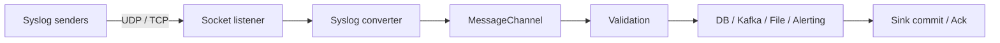
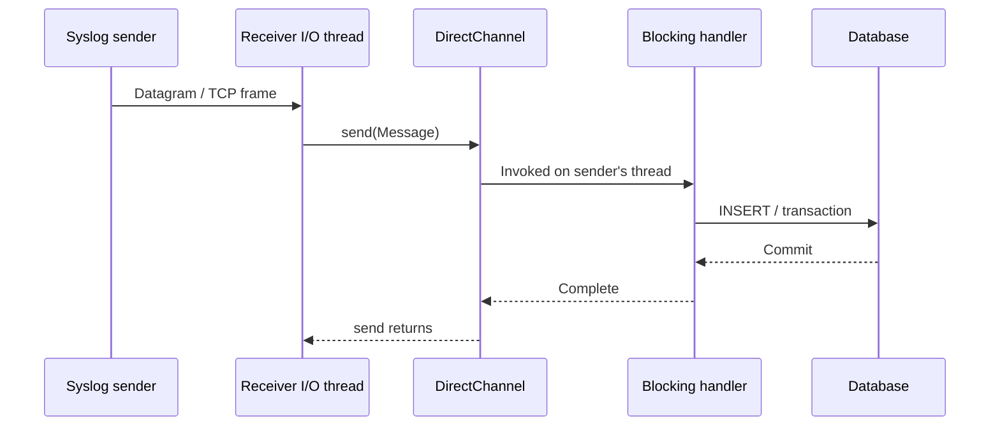
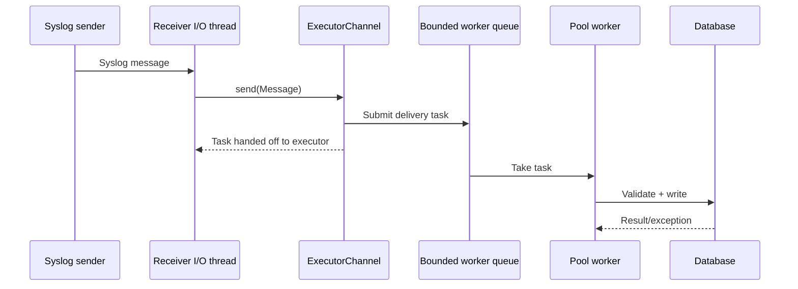
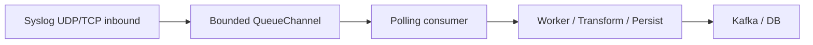
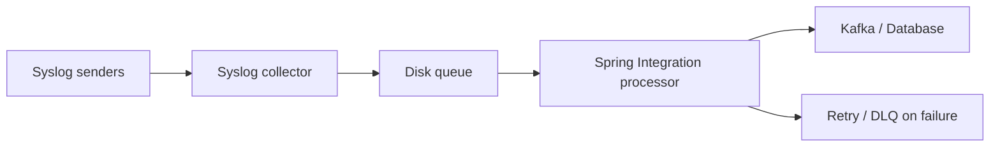

# Thread pool for Syslog receivers

## 1. Why does a Syslog receiver need to care about thread pools?

In the **Adapter Syslog** chapter of the **SPRING_INTEGRATION_ADAPTERS** module, the Syslog inbound channel adapter receives logs over UDP/TCP, uses a converter to create a Spring Integration `Message<?>`, and sends it to a `MessageChannel`. Downstream, flows may filter/normalize logs, write to a database, transfer files or SFTP, send to JMS/AMQP/Kafka, or call an HTTP service. Like other inbound/outbound adapters, gateways, and pollers, every stage must have clear message contracts, error handling, and connection lifecycles.

A very practical issue: devices can send thousands of log records per second, while writing to a database or calling an HTTP API can take many milliseconds or even seconds. If socket reception and business processing are coupled too tightly, **slow workers can stall the receive path or fill buffers**, causing lost UDP datagrams, higher latency, or pressure on TCP connections.



A **thread pool** is a reusable set of worker threads for executing tasks; proper configuration bounds concurrency and isolates heavy work from the log ingestion path. However, we must distinguish:

- **Socket listener I/O threads**: receive datagrams, read TCP streams, or perform framing/decoding as implemented by Spring Integration IP adapters.
- **Message flow executor threads**: run filters, routers, transformers, service activators, or blocking downstream operations after a message is dispatched.
- **Poller threads**: pull messages from a `QueueChannel` or polling source, distinct from a message-driven Syslog socket listener.
- **HTTP client/Kafka/DB pool threads**: depending on the library, these introduce separate limits, queues, and timeouts.

Placing an `ExecutorChannel` after a Syslog adapter **offloads downstream processing**; it **does not automatically reconfigure the UDP/TCP adapter's internal task executor**, does not increase the kernel receive buffer size, and does not create a durable queue on its own.

### What will you learn?

1. Understand the relationship between UDP/TCP listeners, message channels, executors, queues, and pollers.
2. Choose when to use `DirectChannel`, `ExecutorChannel`, or `QueueChannel`.
3. Configure a **bounded `ThreadPoolTaskExecutor`** for Syslog processing.
4. Build a flow: Syslog inbound -> `ExecutorChannel` -> worker service activator -> error channel.
5. Do initial sizing for worker counts, queue capacity, and overload thresholds.
6. Handle rejections, asynchronous errors, shutdown, ordering, and log delivery guarantees.
7. Test concurrency, overload, TCP/UDP loss, and downstream failures.

## 2. Separating the "receiver thread" from the "worker thread"

### 2.1. Default synchronous flow with DirectChannel

A Syslog inbound adapter can publish messages to a `DirectChannel`. With a direct channel, subscribers normally execute on **the same thread that calls `send()`**:



Advantage: simple pipeline, easy synchronous error tracing, no separate worker queue. In return, if the database is slow, the handler holds the dispatching thread; depending on the implementation and adapter setup, this can slow down receiving new data.

**Exact note:** not every Syslog receiver configuration uses only one socket thread, nor does every TCP connection use a single thread. The threading model depends on UDP/TCP, blocking/NIO mode, and the connection factory. What is certain about `DirectChannel` is that **the handler runs synchronously on the thread calling the channel**, rather than any fixed claim about the number of I/O threads.

### 2.2. Flow with ExecutorChannel



This lets the receive path **avoid waiting for each DB/HTTP operation to finish** as long as the executor still has capacity to accept tasks. However:

- `send()` succeeding only means the task was accepted per dispatch contract, **not that the log was durably written**.
- Tasks may have to wait in the queue before a worker runs them.
- When the pool/queue is full, the executor may reject tasks or apply another policy; pressure pushes back onto the thread sending the message.
- Exceptions on worker threads no longer unwind directly onto the receiver's original call stack as with `DirectChannel`.
- Concurrency can cause processing and completion order to **differ from reception order**.

### 2.3. Comparing DirectChannel, ExecutorChannel, and QueueChannel

| Channel | Subscriber execution thread | Buffering | Errors and load pressure |
|---|---|---|---|
| `DirectChannel` | Usually caller thread | No separate task queue in the channel | Subscriber blocks/throws back to caller. |
| `ExecutorChannel` | Worker from `Executor`/`TaskExecutor` | Depends on executor: pool queue may be bounded or unbounded | Worker exceptions typically follow error publishing; tasks can be rejected under overload. |
| `QueueChannel` | Consumer/poller thread | Message queue (can be bounded) | Producer enqueues, poller reads later; not durable by default. |
| `PublishSubscribeChannel` | Sync or async depending on executor | Depends on configuration | Broadcasts to multiple subscribers; must consider failure/retry and ordering. |

A **bounded `ThreadPoolTaskExecutor` + `ExecutorChannel`** is a solid way to bound concurrent processing inside the JVM, but it does not replace a durable broker, persistent message store, or a Syslog collector's disk queue.

## 3. UDP and TCP specifics when workers are slow

### 3.1. UDP: packet loss happens before workers can process

UDP uses datagrams and has no application acknowledgment:

```text
Sender -> Network -> OS UDP receive buffer
       -> Syslog adapter -> Executor queue -> Worker -> Storage
```

Points where data can be lost:

1. Datagrams dropped in transit or by firewalls/routing.
2. Kernel receive buffer fills before the application reads it.
3. Adapter/converter fails to receive or parse the data.
4. Task dispatch is rejected when the executor queue/pool is full.
5. Worker fails, JVM crashes, or shuts down while messages sit in the in-memory queue.
6. Destination has not committed even though the message was received.

**There is no `ErrorMessage` for packets dropped by the kernel/network before reaching the adapter.** Therefore, `errorChannel` metrics cannot represent total lost Syslog records.

A very large pool can absorb brief backlogs, but if downstream only writes 500 logs/sec while incoming traffic is 2,000 logs/sec, adding workers will not remove the bottleneck. The solution must account for true DB/Kafka limits, batching, queues, rate limits, and durable storage.

### 3.2. TCP: flow control without business acknowledgment

TCP guarantees byte ordering on a live connection, but **does not** guarantee a record was placed onto a `MessageChannel` or committed to a sink.

When workers are slow, the application can accumulate a backlog. TCP flow control can slow down the sender if the receiver's read layer/buffer stops draining data; however, if the adapter reads quickly and enqueues into a large queue, **pressure may simply shift from the socket to the heap** rather than being solved.

For TCP, monitor:

- Concurrent connections, accept backlog, and reconnect counts.
- Blocking/NIO mode, framing, and deserializer behavior.
- Frame sizes, read/idle timeouts, and connection lifecycles.
- Downstream flow queue/pool utilization.
- Per-source/per-connection ordering when multiple workers run concurrently.

For RFC 5424 over TCP, use RFC 6587-style framing; for Syslog-over-TLS RFC 5425, use TLS and octet counting. **A thread pool will not fix framing bugs or TLS handshake failures.**

## 4. Capacity planning before writing configuration

### 4.1. A simple throughput model

Suppose:

- Incoming rate: `800 records/second`.
- Each blocking downstream operation averages `20 ms = 0.02 second`.
- Ignoring queueing, contention, network jitter, and spikes.

The theoretical concurrency needed to keep up with average load is roughly:

```text
Required concurrency ≈ arrival_rate × average_service_time

800 records/s × 0.02 s = 16 concurrently executing tasks
```

This is only a **starting estimate** using Little's Law logic, not an automatic formula for choosing production thread counts. If records are batched or the work is CPU-bound, the model changes. For blocking downstream I/O, worker counts can exceed CPU cores, but must respect actual HTTP/DB connection pool limits. For CPU-bound parsers, raising workers beyond core count usually does not boost throughput and can add context-switching overhead.

### 4.2. Queue capacity and time to fill

An executor with `queueCapacity=600`, incoming `800/s`, and maximum worker throughput `500/s` grows its backlog at roughly:

```text
backlog_growth = 800 - 500 = 300 tasks/s
time_to_fill   ≈ 600 / 300 = 2 seconds
```

This calculation ignores in-flight tasks, bursts, GC, and latency variance, yet demonstrates that **a finite queue only absorbs brief bursts**, and cannot cure sustained load imbalance.

An overly large queue is also dangerous:

- Increases wait times and heap usage.
- Delays monitoring visibility.
- When the JVM restarts, the in-memory queue is lost.
- Can mask a downstream outage until resources are exhausted.

Choose queue capacity based on **allowed burst duration, maximum latency, and memory limits**, rather than picking an arbitrarily huge number.

### 4.3. Sizing principles

| Component | Starting rule | Harm if misconfigured |
|---|---|---|
| `corePoolSize` | Based on concurrency needed for steady load | Too low causes backlog; too high wastes threads. |
| `maxPoolSize` | Bounds controlled growth during bursts | Too high overloads DB/HTTP/broker and increases context switching. |
| `queueCapacity` | Short-term buffer limit | Too small rejects early; too large increases latency/memory risk. |
| Rejection policy | Behavior when pool/queue is full | Silently dropping messages or blocking the receiver too long are both dangerous. |
| Downstream connection pool | Aligned with workers allowed to block | Many workers waiting on a tiny pool increases latency without improving throughput. |
| HTTP/DB timeouts | Bound waiting time | Hung handlers pin all worker slots indefinitely. |
| Shutdown wait | Aligned with stop deadline and durable handling | Waiting forever or abrupt termination loses queued work. |

`ThreadPoolTaskExecutor` typically wraps `ThreadPoolExecutor`. With a positive-capacity queue, the executor uses core threads, then prefers **enqueuing** before scaling workers above core (per its execution algorithm); `maxPoolSize` only engages once the queue is full. Thus, setting `core=4, max=32, queue=100,000` **does not mean** it will quickly scale up to 32 workers as load begins rising.

## 5. Complete example: UDP Syslog -> ExecutorChannel -> worker

This example uses:

- **Java 17+** and Spring Boot with Spring Integration Syslog/IP.
- **RFC 3164** Syslog received over **UDP/1514**.
- Native Syslog inbound adapter in XML, feeding an internal channel.
- Java configuration creating a **bounded `ThreadPoolTaskExecutor`** and **`ExecutorChannel`**.
- `@ServiceActivator` processing payloads on workers.
- An error channel attached **before the async boundary** to report downstream errors.

This is an **educational example about thread pools**, without real persistence/broker integration. In production, persist durably before treating a record as safely ingested.

### 5.1. Dependencies

With Spring Boot dependency management:

```xml
<dependencies>
    <dependency>
        <groupId>org.springframework.boot</groupId>
        <artifactId>spring-boot-starter-integration</artifactId>
    </dependency>
    <dependency>
        <groupId>org.springframework.integration</groupId>
        <artifactId>spring-integration-ip</artifactId>
    </dependency>
    <dependency>
        <groupId>org.springframework.integration</groupId>
        <artifactId>spring-integration-syslog</artifactId>
    </dependency>
</dependencies>
```

`spring-integration-ip` provides UDP/TCP receiving endpoints. `spring-integration-syslog` provides the native Syslog inbound adapter and converters. No HTTP server is needed if the application only receives Syslog.

### 5.2. Native Syslog receiver and ingress channel

Create `src/main/resources/syslog-receiver.xml`:

```xml
<?xml version="1.0" encoding="UTF-8"?>
<beans xmlns="http://www.springframework.org/schema/beans"
       xmlns:xsi="http://www.w3.org/2001/XMLSchema-instance"
       xmlns:int="http://www.springframework.org/schema/integration"
       xmlns:int-syslog="http://www.springframework.org/schema/integration/syslog"
       xsi:schemaLocation="
         http://www.springframework.org/schema/beans
         https://www.springframework.org/schema/beans/spring-beans.xsd
         http://www.springframework.org/schema/integration
         https://www.springframework.org/schema/integration/spring-integration.xsd
         http://www.springframework.org/schema/integration/syslog
         https://www.springframework.org/schema/integration/syslog/spring-integration-syslog.xsd">

    <int:channel id="syslogIngress"/>

    <int-syslog:inbound-channel-adapter
        id="udpSyslogReceiver"
        channel="syslogIngress"
        auto-startup="true">
        <int-syslog:udp-attributes
            port="1514"
            local-address="127.0.0.1"
            lookup-host="false"/>
    </int-syslog:inbound-channel-adapter>
</beans>
```

The adapter binds the UDP socket on loopback `127.0.0.1:1514` of the current network namespace. Senders on another host **cannot use an external IP to reach this loopback listener**. In Docker/Kubernetes, to accept external traffic, configure the proper bind address, firewall, Service, and port publishing. The XML only defines the ingress channel; the Java beans below wire this channel to the worker pool.

Do not place `task-executor` directly on the Syslog namespace element without verifying support in your framework version. In this lesson, **the concurrency control point is the `ExecutorChannel`'s executor**, a clear and measurable contract.

### 5.3. Application loading the XML

```java
package example.syslog;

import org.springframework.boot.SpringApplication;
import org.springframework.boot.autoconfigure.SpringBootApplication;
import org.springframework.context.annotation.ImportResource;

@SpringBootApplication
@ImportResource("classpath:syslog-receiver.xml")
public class SyslogPoolApplication {

    public static void main(String[] args) {
        SpringApplication.run(SyslogPoolApplication.class, args);
    }
}
```

Place the following Java classes in package `example.syslog` or a subpackage so Spring Boot component scanning discovers them.

### 5.4. Configuring a bounded ThreadPoolTaskExecutor

Create `SyslogExecutorConfiguration.java`:

```java
package example.syslog;

import java.util.concurrent.ThreadPoolExecutor;

import org.springframework.context.annotation.Bean;
import org.springframework.context.annotation.Configuration;
import org.springframework.integration.channel.DirectChannel;
import org.springframework.integration.channel.ExecutorChannel;
import org.springframework.messaging.MessageChannel;
import org.springframework.scheduling.concurrent.ThreadPoolTaskExecutor;

@Configuration
public class SyslogExecutorConfiguration {

    @Bean("syslogWorkerExecutor")
    public ThreadPoolTaskExecutor syslogWorkerExecutor() {
        ThreadPoolTaskExecutor executor =
            new ThreadPoolTaskExecutor();

        executor.setCorePoolSize(4);
        executor.setMaxPoolSize(8);
        executor.setQueueCapacity(200);
        executor.setThreadNamePrefix("syslog-worker-");

        // Do not silently drop tasks when capacity is exhausted.
        executor.setRejectedExecutionHandler(
            new ThreadPoolExecutor.AbortPolicy());

        // Allow bounded time for workers to finish on shutdown.
        executor.setWaitForTasksToCompleteOnShutdown(true);
        executor.setAwaitTerminationSeconds(20);

        // Bean is managed and initialized by Spring lifecycle.
        return executor;
    }

    @Bean("syslogWorkers")
    public MessageChannel syslogWorkers(
            ThreadPoolTaskExecutor syslogWorkerExecutor) {
        return new ExecutorChannel(syslogWorkerExecutor);
    }

    @Bean("syslogWorkErrors")
    public MessageChannel syslogWorkErrors() {
        return new DirectChannel();
    }
}
```

Meaning:

- `corePoolSize=4`: baseline worker count.
- `maxPoolSize=8`: growth cap when the queue and core threads are insufficient.
- `queueCapacity=200`: maximum waiting tasks in the executor's queue, **not persisted record count**.
- `AbortPolicy`: when full, the executor rejects tasks with an exception rather than silently discarding them.
- `ThreadNamePrefix`: makes worker threads easy to spot in thread dumps and logs.
- `waitForTasks...` and `awaitTerminationSeconds`: waits during graceful shutdown, yet **does not guarantee in-progress work is durably saved** if the process dies or times out.

**Important:** `AbortPolicy` only surfaces the failure; it does not automatically create retries or a dead-letter queue. If upstream is UDP, the sender receives no application ack to retransmit the record. Production needs a dedicated overflow/fallback strategy with storage and monitoring.

### 5.5. Java DSL bridging ingress to the executor channel

Create `SyslogDispatchFlowConfiguration.java`:

```java
package example.syslog;

import org.springframework.context.annotation.Bean;
import org.springframework.context.annotation.Configuration;
import org.springframework.integration.annotation.EnableIntegration;
import org.springframework.integration.dsl.IntegrationFlow;
import org.springframework.messaging.MessageHeaders;

@Configuration
@EnableIntegration
public class SyslogDispatchFlowConfiguration {

    @Bean
    public IntegrationFlow syslogDispatchFlow() {
        return IntegrationFlow.from("syslogIngress")
            // Let worker-side error publishers locate the error channel.
            .enrichHeaders(headers -> headers.header(
                MessageHeaders.ERROR_CHANNEL, "syslogWorkErrors"))
            .channel("syslogWorkers")
            .get();
    }
}
```

Notes:

1. `syslogIngress` is the channel declared in XML. `IntegrationFlow.from("syslogIngress")` attaches a subscriber to that channel.
2. `enrichHeaders(...)` sets the **internal Spring Messaging header** `errorChannel`, not a Syslog facility/header or an HTTP header.
3. `channel("syslogWorkers")` passes the message to `ExecutorChannel`, submitting a task to the bounded `ThreadPoolTaskExecutor`.
4. Any handler registered with `@ServiceActivator(inputChannel="syslogWorkers")` runs on a worker thread once the executor executes the task.
5. The error channel header allows asynchronous error handling **when used by Spring Integration's error publisher** to send an `ErrorMessage` to `syslogWorkErrors`. This does not mean every network error, converter issue, or rejection is routed here.

**Important boundary:** errors before `ExecutorChannel` can happen synchronously on the receiver thread and follow a different path. Rejection during task submission can occur immediately on the thread calling `send()`, so do not assume the worker error flow catches every incident.

### 5.6. Worker service activator

Create `SyslogProcessingService.java`:

```java
package example.syslog;

import java.util.Map;

import org.slf4j.Logger;
import org.slf4j.LoggerFactory;
import org.springframework.integration.annotation.ServiceActivator;
import org.springframework.integration.transformer.SyslogToMapTransformer;
import org.springframework.messaging.Message;
import org.springframework.stereotype.Service;

@Service
public class SyslogProcessingService {

    private static final Logger log =
        LoggerFactory.getLogger(SyslogProcessingService.class);

    @ServiceActivator(inputChannel = "syslogWorkers")
    public void handle(Message<?> message) {
        Object payload = message.getPayload();

        if (!(payload instanceof Map<?, ?> fields)) {
            throw new IllegalArgumentException(
                "Expected parsed RFC3164 Syslog Map");
        }

        if (fields.containsKey(SyslogToMapTransformer.UNDECODED)) {
            // In production: send raw message to a quarantine store
            // with controlled retention and access control.
            throw new IllegalArgumentException(
                "Undecoded Syslog record");
        }

        Object facility =
            fields.get(SyslogToMapTransformer.FACILITY);
        Object severity =
            fields.get(SyslogToMapTransformer.SEVERITY);

        if (!(facility instanceof Number)
                || !(severity instanceof Number)) {
            throw new IllegalArgumentException(
                "Missing facility/severity");
        }

        int facilityCode = ((Number) facility).intValue();
        int severityCode = ((Number) severity).intValue();

        if (facilityCode < 0 || facilityCode > 23
                || severityCode < 0 || severityCode > 7) {
            throw new IllegalArgumentException(
                "Invalid facility/severity");
        }

        // Worker thread: example normalization and processing step.
        log.info("Processed syslog: thread={}, facility={}, severity={}",
            Thread.currentThread().getName(),
            facilityCode, severityCode);

        // Production: batch/persist/publish to DB or
        // Kafka/JMS/AMQP. Count as success only after true commit/ack.
        // Do not use Thread.sleep(...) to simulate production work.
    }
}
```

This example intentionally omits raw MSG text from logs because Syslog can carry tokens, IPs, usernames, or sensitive data. Workers must manage concurrency safely over shared state; if invoking an `EntityManager`/transaction or JDBC connection, follow the thread-safety and transaction-scope rules of that technology.

**Do not equate `@ServiceActivator` with an HTTP endpoint.** It consumes internal messages; it does not automatically return an HTTP status to a UDP/TCP Syslog sender.

### 5.7. Worker errors on asynchronous threads

Create `SyslogWorkerErrorHandler.java`:

```java
package example.syslog;

import org.slf4j.Logger;
import org.slf4j.LoggerFactory;
import org.springframework.integration.annotation.ServiceActivator;
import org.springframework.messaging.Message;
import org.springframework.messaging.MessagingException;
import org.springframework.messaging.support.ErrorMessage;
import org.springframework.stereotype.Service;

@Service
public class SyslogWorkerErrorHandler {

    private static final Logger log =
        LoggerFactory.getLogger(SyslogWorkerErrorHandler.class);

    @ServiceActivator(inputChannel = "syslogWorkErrors")
    public void handle(ErrorMessage error) {
        Throwable failure = error.getPayload();
        Message<?> failed = error.getOriginalMessage();

        if (failed == null && failure instanceof MessagingException ex) {
            failed = ex.getFailedMessage();
        }

        String type = failure.getClass().getSimpleName();
        Object correlationId = failed == null
            ? "unavailable"
            : failed.getHeaders()
                .getOrDefault("correlationId", "unavailable");

        // Log only safe metadata; do not print exception.toString()
        // or raw payload/headers that may contain secrets.
        log.error("Syslog worker failed: type={}, correlationId={}",
            type, correlationId);

        // Production: write failure + redacted original message
        // to durable storage/DLQ, or route to a recovery flow.
    }
}
```

An `ErrorMessage` carries a `Throwable` as its payload; it differs from a **business message containing an error field**. Along the `ExecutorChannel` path, Spring Integration provides error publishing for exceptions thrown by workers; the `errorChannel` message header or global error channel may be used depending on the component and configuration.

However, the error handler above **only logs**; it **cannot rescue records after a JVM crash**, and an original message is not guaranteed to be present for every exception type. For critical Syslog data, use a persistent failure sink and monitor failures of the error handler/DLQ writer itself.

### 5.8. What to expect in thread-name logs

When a valid record arrives while the pool is running, sample output looks like:

```text
Processed syslog: thread=syslog-worker-1, facility=16, severity=6
```

Seeing the `syslog-worker-` prefix confirms the handler ran on the configured executor pool. However:

- It does not guarantee only a single worker ran.
- It does not guarantee outputs appear in arrival order when multiple workers run.
- It does not guarantee the message was persisted.
- It does not prove UDP lost no packets, because lost packets produce no log entries.

## 6. Why must pool, queue, and rejection policy be designed together?

### 6.1. Behavior when the pool is overloaded

Suppose the executor has:

- `corePoolSize = 4`.
- `maxPoolSize = 8`.
- `queueCapacity = 200`.
- Workers are blocking due to a very slow database.

Typical progression:

```text
4 core workers busy
    -> new tasks enter the queue (up to 200)
    -> when queue is full: executor spawns extra workers (up to 8)
    -> both pool and queue full: new tasks are rejected
```

Exact ordering depends on the executor implementation and runtime-mutable settings, but this is the standard `ThreadPoolExecutor` behavior with a bounded queue. Consequently, **`maxPoolSize` has no effect while core threads are busy as long as the queue still has room**.

Under overload:

- `ExecutorChannel.send(...)` can encounter task rejection. It does not turn data into a durable queue automatically.
- If retry logic retries immediately without limits, the system can trigger a retry storm.
- With UDP, the sender usually has no idea the record was rejected at the application layer.
- With TCP, the impact also depends on the upstream socket/connection factory and exception propagation.

### 6.2. Common rejection policies

| Policy | Behavior when full | Risk for Syslog |
|---|---|---|
| **AbortPolicy** | Rejects task with an exception | Avoids silent loss at submission, but requires error storage/alerting; UDP senders usually do not auto-retry. |
| **CallerRunsPolicy** | Runs task on caller thread if executor is not shut down | Can pull blocking handlers back onto the receiver thread, increasing UDP drops or TCP latency. |
| **DiscardPolicy** | Drops task silently | **Avoid** for important records; silent data loss. |
| **DiscardOldestPolicy** | Drops oldest queued task and retries enqueue | Can lose or reorder records; especially dangerous for auditing. |

**Do not pick `CallerRunsPolicy` just because it sounds like backpressure:** with UDP, running heavy handlers on the receiver thread can overflow the kernel receive buffer and cause packet loss before the adapter even sees the data. With TCP, it can act as a throttling mechanism, yet still requires connection limits, timeouts, and clear error contracts.

### 6.3. Rejection vs. worker exception

| Error type | Occurs when | Observability |
|---|---|---|
| **Task rejection** | Executor refuses more work | Usually on the submitting thread; catch/monitor at the dispatch/adapter point. |
| **Worker exception** | Task already ran and handler threw | `ExecutorChannel` error publishing and header/global `errorChannel` per config. |
| **UDP drop** | Datagrams lost before receiver | OS/kernel/network counters; no Spring Integration message exists. |
| **TCP framing error** | Stream split wrongly or incomplete frame | Deserializer/connection events/logs, not pool sizing. |
| **Downstream timeout** | Worker blocks on HTTP/DB/Kafka | Client/driver timeouts, slow-call metrics, and queue backlog. |
| **JVM crash** | Process dies while queue is non-durable | Recoverable only with a disk queue or persistent store. |

Monitor **both rejection counts and worker failure counts**. An error channel whose subscriber only logs does not replace a mechanism to recover source data during overload.

## 7. QueueChannel + poller: an alternative architecture

When you want to decouple receiver and workers using a **message queue** instead of an executor's task queue, you can use `QueueChannel` with an active poller:



Key differences:

- With **`ExecutorChannel`**, tasks running the subscriber are submitted directly to the executor when scheduled; the internal queue holds *tasks*.
- With **`QueueChannel`**, the queue holds *Spring Integration messages*; the poller controls polling frequency and batch pull rate.
- A poller can use a `TaskExecutor` to run tasks concurrently when supported and configured properly, but **configuring a poller executor is not configuring the Syslog receiver's I/O executor**.
- `QueueChannel` uses an in-memory queue by default; for durability, back it with a persistent message store or route through a broker/collector supporting persistence.

A conceptual configuration:

```text
UDP Syslog receiver
  -> QueueChannel(capacity = 500)
  -> PollingConsumer(maxMessagesPerPoll / poll interval)
  -> Service activator
  -> durable sink
```

If the queue is full, sending to `QueueChannel` may block or fail per `sendTimeout`; with UDP, that can cause datagram drops at the socket layer. Never mistake a bounded in-memory queue for a "zero-loss" guarantee.

### 7.1. When to choose ExecutorChannel vs. QueueChannel?

| Requirement | Suitable approach |
|---|---|
| Simply offload handlers from the dispatch thread | `ExecutorChannel` + bounded `ThreadPoolTaskExecutor`. |
| Pull in controlled batches or on a fixed cadence | `QueueChannel` + poller. |
| Decouple receiver and downstream across multiple JVMs | Durable broker/collector, not just an in-memory channel. |
| Retry and dead-letter replayable after restart | Persistent queue, database outbox, or message broker with DLQ. |
| Preserve per-source ordering | Partitioned processing / consistent routing by trusted source, not just a big pool. |

## 8. Does the TCP listener have its own thread pool?

**There are thread resources at the Spring Integration IP layer**, though their configuration differs from the worker pool in `ExecutorChannel`.

With native TCP Syslog:

```xml
<int-ip:tcp-connection-factory
    id="tcpSyslogServerFactory"
    type="server"
    using-nio="true"
    port="1516"
    deserializer="rfc6587Deserializer"/>

<int-syslog:inbound-channel-adapter
    id="tcpSyslogReceiver"
    protocol="tcp"
    connection-factory="tcpSyslogServerFactory"
    converter="rfc5424Converter"
    channel="syslogIngress"/>
```

This fragment requires the converter/deserializer beans, `int-ip` namespace, and matching schema:

```xml
<bean id="rfc5424Converter"
      class="org.springframework.integration.syslog.RFC5424MessageConverter"/>

<bean id="rfc6587Deserializer"
      class="org.springframework.integration.syslog.inbound.RFC6587SyslogDeserializer"/>
```

`using-nio="true"` enables NIO for TCP connections per Spring Integration IP capabilities. However, this **does not mean** socket handling and downstream handlers automatically share the same `syslogWorkerExecutor`. To configure task executors at the IP adapter/connection factory layer, check the exact API/XML attributes of **the Spring Integration version in use**; avoid inventing `task-executor` attributes on arbitrary elements just because the name sounds plausible.

Distinction:

| Resource | Layer | Purpose |
|---|---|---|
| TCP server connection factory | Spring Integration IP | Binds/accepts connections, handles framing/serialization, manages socket lifecycle. |
| Transport task executors | Spring Integration IP implementation | Runs I/O tasks per the version's blocking/NIO design. |
| `ExecutorChannel` + `ThreadPoolTaskExecutor` | Spring Integration messaging flow | Executes downstream message subscribers/handlers. |
| Kafka/HTTP/DB connection pools | Client libraries | Manages concurrent requests/connections to sinks. |

### 8.1. Thread safety and ordering with multiple TCP connections

If multiple TCP connections feed into an `ExecutorChannel` with multiple workers, completion order can differ from arrival order. Even within **a single** connection, if messages A then B arrive and are dispatched to multiple workers, B can finish before A.

Example:

```text
Connection X:  A -> B -> C
Executor:      W1(A)  W2(B)  W3(C)
Complete:      B -> C -> A  (possible)
```

If the business requires preserving per-device ordering:

1. Identify a **trusted source ID** (mTLS/collector/inventory, never trusting only sender-declared `HOSTNAME`).
2. Route consistently to a fixed partition per source.
3. Use a sequential consumer per partition/key or an ordering-aware system by key.
4. Prevent duplicate processing by two workers without dedup/idempotency.
5. Use Kafka partition keys or partitioned queues when forwarding if local ordering is needed.

Global ordering across all devices is **not guaranteed by Syslog/TCP or thread pools**.

## 9. Asynchronous errors, delivery, and data durability

A Syslog record passes through multiple milestones:

```text
Socket receives bytes
  -> Syslog converter produces Message
  -> Executor accepts task
  -> Worker starts
  -> Business validation succeeds
  -> Database/Kafka/File adapter writes
  -> Durable commit/ack is confirmed
```

These milestones are **not equivalent**. If the JVM stops after the executor accepts the task but before Kafka commits, a UDP source has no way of knowing it must resend the record.

### 9.1. ErrorMessage and errorChannel

In Spring Integration:

- `ErrorMessage` carries a `Throwable` payload.
- `MessageHeaders.ERROR_CHANNEL` can specify where errors are published when the component emitting `ErrorMessage` honors that header.
- `MessagingException` may hold `failedMessage`, though not always.
- `ExecutorChannel` handles async exceptions differently from `DirectChannel`.
- The global `errorChannel` is not automatically a durable DLQ.

**Do not assume every malformed Syslog record goes to the error channel**: the RFC 3164 parser may produce a map containing `SyslogToMapTransformer.UNDECODED` instead of throwing an exception. Add an explicit validation/quarantine branch.

### 9.2. Recovery requires a durable sink

If critical logs cannot be lost, better options than an in-memory executor queue are:

- A Syslog collector (rsyslog/syslog-ng or equivalent) with a **disk queue**, capacity limits, retries, and replay.
- A Kafka/JMS/AMQP broker with acknowledgments, retention, retries, and DLQs.
- A database inbox/outbox with transactions, unique keys, and retry jobs.
- A persistent `MessageStore`/queue when appropriate for Spring Integration requirements.

A practical design:



Even with a disk queue, know exactly when the collector considers a record accepted, when ack/commit happens, and the possibility of duplicates during replay. Never loosely claim "exactly once" without proving every protocol boundary.

### 9.3. Transaction context across an async boundary

`ExecutorChannel` switches execution to another thread; transaction context bound to the caller thread **does not automatically propagate to the worker**. If a database write needs a transaction, place the transaction boundary on the worker or configure it per the technology in use.

Avoid this situation:

```text
Caller transaction starts
  -> ExecutorChannel accepts async task
  -> Caller transaction commits
  -> Worker starts (outside original transaction)
  -> Database write fails
```

A sound async pattern is: incoming Syslog is stored in an inbox/durable queue with an explicit transaction/ack, and then a worker starts its own transaction to normalize and publish. Using a thread pool does not create a distributed transaction across UDP, a database, and Kafka.

## 10. Shutdown, restart, and tuning the thread pool

### 10.1. Graceful shutdown

`ThreadPoolTaskExecutor` supports shutdown/await-termination settings, but keep in mind:

1. First **stop accepting new work** or drain traffic away from the instance; if the receiver keeps accepting logs while the executor is shutting down, task rejections will occur.
2. Wait for workers to finish within a bounded timeout.
3. If unfinished messages remain in an in-memory queue, you need a replay/durable persistence strategy; there is no magic mechanism flushing a task queue to disk.
4. Close TCP connections, release UDP sockets, HTTP clients, Kafka producers, and DB resources cleanly.
5. Log/alert if in-flight tasks do not reach 0 before the shutdown deadline.

If the application receives `SIGKILL`, loses power, or suffers a JVM crash, shutdown hooks are not guaranteed to run. **Do not rely on `waitForTasksToCompleteOnShutdown(true)` to guarantee zero log loss.**

### 10.2. Adjusting configuration under shifting load

Some `ThreadPoolTaskExecutor` properties can be observed or tuned at runtime depending on framework and ops tooling, but that does not replace:

- Stress testing with burst rates and downstream outages.
- Sizing queue memory and latency budgets.
- Limiting DB/Kafka/HTTP connection pools in tandem.
- Measuring rejected task counts and UDP drops.
- Defining alert thresholds before SLAs are breached.

Do not autoscale worker counts indefinitely when downstream is slow, as that can overload the dependency further and exhaust connection pools.

## 11. Testing thread pools and reliability

### 11.1. Sending RFC 3164 Syslog over UDP

A simple Java sender:

```java
package example.syslog;

import java.net.DatagramPacket;
import java.net.DatagramSocket;
import java.net.InetAddress;
import java.nio.charset.StandardCharsets;

public final class SyslogUdpSender {

    public static void main(String[] args) throws Exception {
        try (DatagramSocket socket = new DatagramSocket()) {
            for (int i = 0; i < 10; i++) {
                String record =
                    "<134>Nov 23 09:15:10 app-host demo[42]: "
                    + "Syslog worker pool test " + i;

                byte[] bytes =
                    record.getBytes(StandardCharsets.UTF_8);

                DatagramPacket packet = new DatagramPacket(
                    bytes, bytes.length,
                    InetAddress.getByName("127.0.0.1"),
                    1514);
                socket.send(packet);
            }
        }
    }
}
```

Ensure the application has started UDP/1514 in the same network namespace before sending. If the sender runs in a different container, `127.0.0.1` points to the sender's own container.

To verify bounded concurrency, log the worker thread names and count the messages **actually processed**. Do not treat `DatagramSocket.send()` succeeding as proof that 10/10 messages were ingested; UDP has no application ack.

### 11.2. Test matrix

| Scenario | What to verify |
|---|---|
| One valid record | Handler runs on `syslog-worker-*`, not on the receiver dispatch thread. |
| 10 records under light load | Workers process received messages without throwing exceptions. |
| Brief slow handler | Queue grows up to a bound, then drains to 0 when downstream recovers. |
| Burst exceeding pool/queue | Rejections are counted/alerted; not silently discarded. |
| Downstream DB timeout | Workers do not block indefinitely; exceptions reach the right error flow when applicable. |
| Malformed RFC 3164 | `UNDECODED`/validation path handles it; not treated as a normal record. |
| ThreadPoolTaskExecutor shutdown | Rejects new tasks after stop; operations have a drain/replay plan. |
| JVM restart with queued tasks | With an in-memory queue only, tasks may be lost; test to confirm the risk. |
| UDP kernel buffer overload | Observe packet drops outside the Spring error channel. |
| TCP multiple frames on one connection | Framing works cleanly; also test ordering under parallel workers. |
| Messages from same source needing order | Do not use an unpartitioned multi-worker pool without affinity. |
| Pool of 8 workers with 2 DB connections | Monitor connection waits and latency; do not expect linear throughput scaling. |
| Handler throws and error handler also fails | Alerting/fallback path exists; avoid infinite error loops. |
| Input containing tokens/PII/control chars | No raw payload logging; redaction and log injection safeguards active. |

### 11.3. Repeatable testing of executor rejection

When verifying a bounded executor, write a dedicated unit test using `CountDownLatch` rather than generating uncontrolled UDP load. Approach:

1. Create an executor with `core=1, max=1, queueCapacity=1`.
2. Use a latch to hold the first task running.
3. Submit a second task to occupy the queue.
4. Submit a third task and assert the executor **rejects** it under `AbortPolicy`.
5. Release the latch and shut down the executor so the test never hangs.
6. Run a separate integration test verifying that rejection at `ExecutorChannel` does not silently lose errors.

This test verifies **executor capacity**, not Syslog UDP transport or Kafka commits. Separate test layers to pinpoint failures accurately.

### 11.4. When throughput fails to rise after growing the pool

```text
UDP/TCP receiver
 -> Syslog parser
 -> MessageChannel dispatch
 -> executor queue / active workers
 -> DB/HTTP/Kafka connection pool
 -> remote server / disk write / broker ack
```

Diagnose in order:

- If **socket receives fewer than sender sends**: check network, bind address, UDP buffers, firewall, and receive-path CPU.
- If **executor queue grows and all workers are busy**: check handler latency or slow dependencies.
- If **workers are busy but connection pool is exhausted**: adding workers may worsen contention; throttle calls or size pools appropriately.
- If **CPU is 100% with high context switches**: parsing/transforming is CPU-bound; reduce workers or optimize batching/format.
- If **Kafka/DB commits are slow**: optimize sink batching/partitions or add a durable buffer, not just a larger thread pool.
- If **rejections rise**: load exceeds capacity; apply load shedding with alerts and clear recovery.

## 12. Monitoring and runbook

Metrics and logs to observe:

| Metric | Purpose |
|---|---|
| Executor active thread count | Know how many workers are currently busy. |
| Executor pool size / max pool size | Track compute capacity utilization. |
| Executor queue size / remaining capacity | Spot backlogs and estimate time-to-fill. |
| Task rejection count | Never miss overload when the pool saturates. |
| Processing latency / queue wait time | Separate queue wait time from handler execution time. |
| Syslog received/parsed/undecoded counts | Track ingestion volume and record quality. |
| UDP kernel drops / TCP reconnects | Catch failures outside Spring message/error channels. |
| Worker exceptions + error channel deliveries | Know which tasks failed. |
| DB/Kafka/HTTP connection pool saturation | Locate downstream bottlenecks. |
| Persistent queue / DLQ backlog | Measure recovery readiness during incidents. |

Outage runbook:

1. Confirm UDP/TCP listeners are still bound to the right IP/port and the app is started.
2. Check incoming rate, dropped datagrams, and TCP connection events.
3. Check active worker counts, queue backlog, and rejection rates.
4. Classify worker errors; distinguish malformed inputs from downstream outages.
5. If downstream is unreachable, engage load shedding/circuit breakers or route to the designed durable collector/queue.
6. Avoid growing queues unboundedly or triggering massive immediate retries.
7. After recovery, replay records from the durable queue/DLQ with dedup/idempotency while watching backlog drain.
8. Post-incident, evaluate the loss window and update capacity/burst budgets.

**Security:** Syslog records may contain sensitive data. Never place raw message text, tokens, passwords, arbitrary hostnames, or user IDs into metric labels or error-handler logs. Use controlled trusted source IDs and trace/event IDs.

## 13. Common misconceptions

| Misconception | Accurate understanding |
|---|---|
| "Adding ExecutorChannel increases socket receive threads." | ExecutorChannel offloads **downstream handlers**; I/O threads are managed separately by the adapter/connection factory. |
| "8 workers means always processing 8 messages concurrently." | Concurrency depends on core size, queue behavior, scheduling, bottlenecks, and arrival rate. |
| "`queueCapacity=200` preserves 200 records across restarts." | That is an **in-memory** task queue, not a disk or persistent queue. |
| "Successfully sending to ExecutorChannel means Kafka saved it." | Send only indicates task acceptance/dispatch, not a sink commit. |
| "AbortPolicy automatically retries messages." | It signals rejection; replay is another mechanism's job. |
| "CallerRunsPolicy is always safer." | It can block the receiver and cause UDP datagram loss. |
| "errorChannel catches every lost packet." | Packets dropped before the adapter do not generate a Spring Integration ErrorMessage. |
| "TCP guarantees each Syslog record was committed." | TCP guarantees a byte stream on the connection, not application-level durable acks. |
| "Bigger pool always means faster." | When CPU, DB, Kafka, or HTTP is the bottleneck, adding workers can hurt throughput. |
| "Log order is preserved with ExecutorChannel." | Async workers can finish out of order; partition by source if ordering is mandatory. |

## 14. Summary

**Thread pooling for a Syslog receiver** is about decoupling network reception from business processing and bounding concurrent execution. With Spring Integration Syslog:

- **UDP/TCP inbound adapters** receive records and convert them into messages.
- **`DirectChannel`** executes subscribers synchronously; slow handlers can stall the dispatch path.
- **`ExecutorChannel` + bounded `ThreadPoolTaskExecutor`** offloads downstream handlers, bounds pool/queue capacity, and enforces an explicit overload/rejection policy.
- **`QueueChannel` + poller** is an alternative when message buffering and active pulling are needed, though non-durable by default.
- **TCP/UDP connection factory I/O executors differ from message flow executors**; configure the right layer per your framework version without guessing XML attributes.
- **Error channels, metrics, and durable sinks** are essential to detect and recover from failures; an executor alone does not solve packet loss, ordering, transactions, or exactly-once delivery.
- When forwarding to databases, Kafka/JMS/AMQP, HTTP, files, or SFTP, account for commits/acks, connection limits, timeouts, idempotency, and shutdown lifecycles.

**Practical formula:** size the worker pool to match the measured bottleneck, size a finite queue to your burst budget, make rejections explicit, add thorough monitoring, and persist durably before handing critical logs to asynchronous processing.

### Official references

- [Spring Integration — Syslog Support](https://docs.spring.io/spring-integration/reference/syslog.html)
- [Spring Integration — Message Channels](https://docs.spring.io/spring-integration/reference/channel.html)
- [Spring Integration — ExecutorChannel](https://docs.spring.io/spring-integration/reference/channel/implementations.html)
- [Spring Integration — Error Handling](https://docs.spring.io/spring-integration/reference/error-handling.html)
- [Spring Integration — Polling Consumer](https://docs.spring.io/spring-integration/reference/endpoint.html)
- [Spring Integration — TCP Connection Factories](https://docs.spring.io/spring-integration/reference/ip/tcp-connection-factories.html)
- [Spring Framework — Task Execution and Scheduling](https://docs.spring.io/spring-framework/reference/integration/scheduling.html)
- [Spring Framework API — ThreadPoolTaskExecutor](https://docs.spring.io/spring-framework/docs/current/javadoc-api/org/springframework/scheduling/concurrent/ThreadPoolTaskExecutor.html)
- [IETF RFC 3164 — BSD Syslog](https://www.rfc-editor.org/rfc/rfc3164)
- [IETF RFC 5424 — Syslog Protocol](https://www.rfc-editor.org/rfc/rfc5424)
- [IETF RFC 6587 — Syslog over TCP](https://www.rfc-editor.org/rfc/rfc6587)
