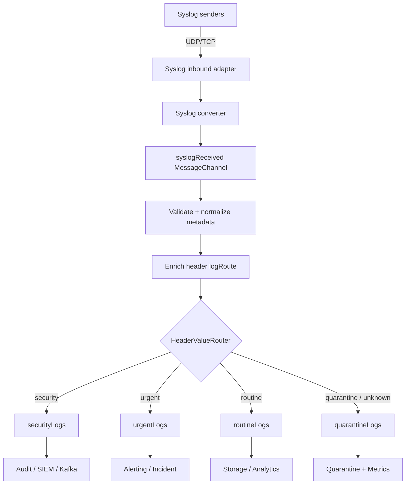
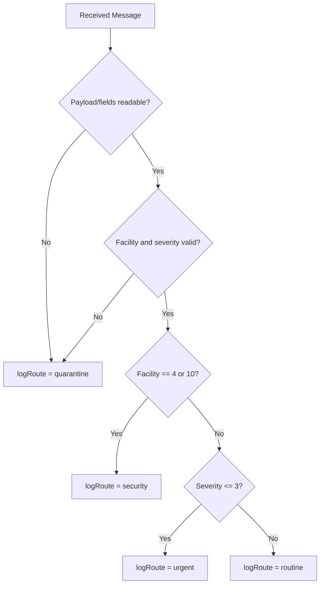

# Routing logs by header

## 1. Problem: one Syslog stream, multiple processing destinations

In the **SPRING_INTEGRATION_ADAPTERS** module, Spring Integration connects external systems using inbound/outbound adapters, gateways, pollers, and `MessageChannel`. The **Adapter Syslog** chapter focuses on receiving system log records over UDP/TCP, converting them into Spring Integration messages, and processing or distributing them to files, SFTP, HTTP, JMS, AMQP, Kafka, or databases.

Suppose an application receives Syslog from servers, routers, and firewalls. Records **should not always go to the same destination**:

- Login/authentication events need to go to a **security audit sink**.
- Records with severity `0..3` may go to an **urgent handling channel**.
- Routine operational events can go to a **Kafka topic or storage** optimized for querying.
- Undecodable data or records missing metadata need to go to **quarantine**, rather than being silently dropped.

One way to build this flow is **routing by message header**: extract Syslog fields, validate them, set a stable internal control header, and use `HeaderValueRouter` to pick the destination channel.



**Lesson goals**:

1. Distinguish **Syslog record fields**, `Message.payload`, and `Message.headers`.
2. Understand `syslog_*` headers and why not all converters populate them identically.
3. Design routing rules based on **facility, severity**, and verified sources.
4. Configure **`HeaderValueRouter`** in the Spring Integration XML namespace.
5. Use a Java `@Transformer` to normalize and enrich a stable `logRoute` header.
6. Write subscribers, unit tests, and integration tests for the routes.
7. Handle missing/invalid headers, spoofed sources, error channels, backpressure, and durable storage.

> **Core takeaway:** a header used for *routing decisions* is not synonymous with *trusted* data. A header may reflect Syslog fields self-declared by a device. Verify the source and normalize values before allowing them to affect access, processing priority, or retention.

## 2. Which Syslog fields are commonly used for routing?

### 2.1. From PRI to facility and severity

Example of an RFC 3164 record:

```text
<134>Nov 23 09:15:10 edge-01 app[2048]: Background job started
```

The `134` code at the start of the record is **PRI**, formed by:

```text
PRI = facility * 8 + severity

facility = PRI / 8    (integer division)
severity = PRI % 8
```

In this example:

- `134 / 8 = 16`: facility `local0`.
- `134 % 8 = 6`: severity `Informational`.

Standard ranges commonly used:

| Field | Range | Meaning |
|---|---|---|
| `facility` | `0..23` | Source/functional group of the record: kernel, auth, daemon, local0–local7... |
| `severity` | `0..7` | Severity level: 0 Emergency, 1 Alert, 2 Critical, 3 Error, 4 Warning, 5 Notice, 6 Informational, 7 Debug. |
| `PRI` | `0..191` | Combined facility/severity code, **not** a linear urgency scale. |

Example table:

| PRI | Facility | Severity | Illustrative rule |
|---:|---|---|---|
| 27 | 3, `daemon` | 3, Error | `urgent` |
| 84 | 10, `authpriv` | 4, Warning | `security` |
| 131 | 16, `local0` | 3, Error | `urgent` |
| 134 | 16, `local0` | 6, Informational | `routine` |
| 191 | 23, `local7` | 7, Debug | `routine` |

**Do not compare raw PRI values to determine severity.** `191` is `local7.debug`, while `0` is `kern.emerg`; treating a larger number as higher priority will route logs to the wrong destination.

### 2.2. Other fields that can drive routing

Beyond facility and severity, some policies need:

| Field | Can be used for | What must be verified |
|---|---|---|
| `HOST`/`HOSTNAME` | Selecting per-device policy | Sender-declared values can be spoofed. |
| `TAG` or `APP-NAME` | Classifying applications, subsystems | Never grant access to a topic based solely on application name. |
| `MSGID` in RFC 5424 | Routing event types per device contract | Must be parsed and validated, not guessed from free text. |
| `STRUCTURED-DATA` | Extracting event type, tenant code, or correlation fields | May contain malicious input or sensitive data. |
| Adapter IP or connection metadata | Cross-checking sender origin | Proxies/NAT can make source IP differ from the original device. |
| mTLS identity at collector | Identifying trusted sources | Trustworthy only if certificate chain, mapping, and policy are actually enforced. |
| Application header `logRoute` | Selecting internal channel | Must be recomputed by the **receiver/normalizer** after validation; never trust caller-supplied values. |

**Facility `auth` (4) or `authpriv` (10) does not authenticate the sender.** It is merely a content label chosen by the sender. Routing all `authpriv` traffic to a `security` channel is only a **retention/routing rule**, not an authorization policy for sensitive resources.

## 3. Payloads and headers in Spring Integration Syslog

### 3.1. A Syslog record becomes a Spring Integration message

```text
UDP datagram or TCP frame
    -> Syslog receiving adapter
    -> MessageConverter
    -> Message<?> {
         payload: Map<String, ?> or byte[],
         headers: id, timestamp, syslog_... depending on converter
       }
    -> MessageChannel
```

**Payload** is the primary data of the message. **Headers** are metadata attached to the message that routers, filters, or handlers can read without re-decoding the entire payload.

Spring Integration Syslog has two common converters:

- `DefaultMessageConverter` for **RFC 3164**, defaulting to `asMap=true` and using `SyslogToMapTransformer`.
- `RFC5424MessageConverter` for **RFC 5424**, with a different field set and header-mapping behavior.

### 3.2. Key table: the converter determines whether headers exist

| Converter | `asMap` | Payload | Do headers contain decoded fields? |
|---|---|---|---|
| `DefaultMessageConverter`, RFC 3164 | `true` (default) | Parsed `Map` | Decoded fields, **excluding message text**, are added to headers as `syslog_*`. |
| `DefaultMessageConverter`, RFC 3164 | `false` | Raw `byte[]` | Decoded fields can still appear in `syslog_*` headers. |
| `RFC5424MessageConverter` | `true` (default) | Parsed `Map` | Decoded fields are **not automatically copied to headers** as in the RFC 3164 converter. |
| `RFC5424MessageConverter` | `false` | Raw `byte[]` | Decoded fields are placed in headers per converter rules; for TCP, configure retaining original data. |

**Consequence:** a router reading the `syslog_severity` header directly may work when the receiver uses `DefaultMessageConverter`, yet receive null after switching to `RFC5424MessageConverter` with `asMap=true`. That is a **message contract** bug, not necessarily a socket or router bug.

In this lesson, we create an **internal `logRoute` header** after normalization. Downstream components always see a valid string from a defined set, regardless of how the decoder initially placed data in the payload or headers.

### 3.3. Constants to use

For RFC 3164, avoid guessing `Map` key names:

```java
import org.springframework.integration.transformer.SyslogToMapTransformer;

Object facility = fields.get(SyslogToMapTransformer.FACILITY);
Object severity = fields.get(SyslogToMapTransformer.SEVERITY);
Object host = fields.get(SyslogToMapTransformer.HOST);
Object messageText = fields.get(SyslogToMapTransformer.MESSAGE);
boolean malformed =
    fields.containsKey(SyslogToMapTransformer.UNDECODED);
```

When reading fields placed into headers by the converter, use `SyslogHeaders`:

```java
import org.springframework.integration.syslog.SyslogHeaders;
import org.springframework.messaging.Message;

Object facility =
    message.getHeaders().get(SyslogHeaders.FACILITY);
Object severity =
    message.getHeaders().get(SyslogHeaders.SEVERITY);
```

Constants in `SyslogToMapTransformer` represent **map key names**, whereas `SyslogHeaders` represents **message header names**. Do not assume the two sets of constants share identical string values.

For a message carrying a `byte[]` payload along with `syslog_*` metadata, a router can inspect headers without re-parsing text. However, that is safe only if you have verified the exact converter and how it populates headers.

### 3.4. Syslog headers, transport headers, and business headers

| Header group | Examples | Origin |
|---|---|---|
| Spring Messaging | `id`, `timestamp` | Generated by the framework; not the Syslog source timestamp. |
| Spring Integration internal | `errorChannel`, `replyChannel` | Message/error orchestration; should not be blindly forwarded across brokers. |
| Syslog metadata | `SyslogHeaders.SEVERITY`, `FACILITY`, `HOST` | Mapped by the converter from the Syslog record. |
| IP transport metadata | Source address, connection ID (if present) | IP adapter/connection factory; depends on transport and config. |
| Application normalized headers | `logRoute`, `logSeverity`, `logFacility`, `trustedSourceId` | Validated and set by the application with its own contract. |

A header named `syslog_host` is not the same as the socket-verified IP address. Likewise, `trustedSourceId` is only trustworthy if derived from an authenticated origin—for example, mTLS connection details verified by a TLS terminator across a protected boundary.

## 4. Choosing a clear routing policy

Before configuring the router, define the precedence order among rules.

This lesson uses an **illustrative policy**:

1. If the record cannot be decoded, lacks facility/severity, or has out-of-range values -> `quarantine`.
2. If facility belongs to `auth` (4) or `authpriv` (10) -> `security`, **regardless of severity**.
3. If validated severity is in `0..3` -> `urgent`.
4. Otherwise -> `routine`.



Because facility is checked before severity, an `authpriv.error` record goes to `security`, not `urgent`. In production, the security sink can further **sub-route by severity**, or you can use `RecipientListRouter` to send a record to **multiple destinations simultaneously** when both audit and alerting need it. Never accidentally register two subscribers on one `DirectChannel` expecting both to receive every message.

### 4.1. Why use a `logRoute` header?

When the router reads a normalized header:

- PRI parsing logic is not duplicated across multiple handlers.
- Every route value belongs to an allowed set: `security`, `urgent`, `routine`, `quarantine`.
- The contract works consistently even if input switches between `Map` and `byte[]`, provided normalization supports it.
- The classifier can be unit tested independently of Syslog network transport.
- You can switch the routing mechanism to `@Router` or Java DSL without rewriting the parser.

**Note:** creating a new header **does not automatically make the data more trustworthy**. `logRoute` still originates from sender-declared fields; the normalizer must validate types, value ranges, and source policies.

## 5. Practice architecture and dependencies

This practice setup uses:

- Java 17+, Spring Boot 3.x, and a compatible Spring Integration version.
- Spring Integration Syslog native inbound XML receiving **RFC 3164 over UDP/1514**.
- `DefaultMessageConverter` creating a `Map` payload by default.
- A Java `@Transformer` reading payload/headers, validating, and adding `logRoute`.
- XML `<int:header-value-router>` forwarding based on `logRoute`.
- `@ServiceActivator` subscribers on the destination channels.

In a Maven project with Spring Boot dependency management:

```xml
<dependencies>
    <dependency>
        <groupId>org.springframework.boot</groupId>
        <artifactId>spring-boot-starter-integration</artifactId>
    </dependency>
    <dependency>
        <groupId>org.springframework.integration</groupId>
        <artifactId>spring-integration-ip</artifactId>
    </dependency>
    <dependency>
        <groupId>org.springframework.integration</groupId>
        <artifactId>spring-integration-syslog</artifactId>
    </dependency>
</dependencies>
```

`spring-integration-ip` provides TCP/UDP endpoints, and `spring-integration-syslog` provides Syslog adapters/converters. No HTTP server is required for Syslog ingestion alone unless the application also has other inbound/outbound HTTP flows.

### 5.1. Message flow diagram in the application

```text
UDP 127.0.0.1:1514
  -> native Syslog inbound adapter
  -> syslogReceived
  -> @Transformer SyslogHeaderClassifier
  -> syslogClassified
  -> HeaderValueRouter(logRoute)
       security -> securityLogs -> security sink
       urgent   -> urgentLogs   -> incident sink
       routine  -> routineLogs  -> storage sink
       unknown  -> quarantineLogs -> quarantine sink
```

`HeaderValueRouter` is a **single-destination router** keyed off a header value; it does not copy messages to every subscriber. If broadcasting is required, intentionally use `RecipientListRouter` or `PublishSubscribeChannel`.

## 6. Configuring native Syslog inbound and HeaderValueRouter in XML

Create `src/main/resources/syslog-routing.xml`:

```xml
<?xml version="1.0" encoding="UTF-8"?>
<beans xmlns="http://www.springframework.org/schema/beans"
       xmlns:xsi="http://www.w3.org/2001/XMLSchema-instance"
       xmlns:int="http://www.springframework.org/schema/integration"
       xmlns:int-syslog="http://www.springframework.org/schema/integration/syslog"
       xsi:schemaLocation="
          http://www.springframework.org/schema/beans
          https://www.springframework.org/schema/beans/spring-beans.xsd
          http://www.springframework.org/schema/integration
          https://www.springframework.org/schema/integration/spring-integration.xsd
          http://www.springframework.org/schema/integration/syslog
          https://www.springframework.org/schema/integration/syslog/spring-integration-syslog.xsd">

    <!-- Channel receiving data after the Syslog converter. -->
    <int:channel id="syslogReceived"/>

    <!-- Channel after the classifier adds the logRoute header. -->
    <int:channel id="syslogClassified"/>

    <!-- Destinations of HeaderValueRouter. -->
    <int:channel id="securityLogs"/>
    <int:channel id="urgentLogs"/>
    <int:channel id="routineLogs"/>
    <int:channel id="quarantineLogs"/>

    <!-- RFC 3164, UDP, bound only to local loopback in the lab. -->
    <int-syslog:inbound-channel-adapter
        id="syslogUdpInbound"
        channel="syslogReceived"
        auto-startup="true">
        <int-syslog:udp-attributes
            port="1514"
            local-address="127.0.0.1"
            lookup-host="false"/>
    </int-syslog:inbound-channel-adapter>

    <!-- Router reads only the normalized internal header. -->
    <int:header-value-router
        input-channel="syslogClassified"
        header-name="logRoute"
        default-output-channel="quarantineLogs"
        resolution-required="false">
        <int:mapping value="security" channel="securityLogs"/>
        <int:mapping value="urgent" channel="urgentLogs"/>
        <int:mapping value="routine" channel="routineLogs"/>
        <int:mapping value="quarantine" channel="quarantineLogs"/>
    </int:header-value-router>
</beans>
```

Notable points:

1. `syslogReceived` and `syslogClassified` are two **separate** channels. A Java transformer connects them in the next section.
2. `local-address="127.0.0.1"` receives UDP only on the process's loopback. To receive from other networks, configure the appropriate local IP/interface and protect it with a firewall/ACL.
3. Because child `udp-attributes` is used, **port goes on the child**, not duplicated on the parent Syslog inbound element.
4. `HeaderValueRouter` inspects only the **`logRoute` header value**. It does not need to know whether the payload is a Map or raw bytes.
5. `default-output-channel="quarantineLogs"` routes any unmapped route value to the fallback channel instead of silently dropping it.
6. `resolution-required="false"` enables routing to the default output channel when no matching mapping resolves. Do not use this to hide configuration errors: increment a metric for unexpected routes.

**Use only one router per input channel.** If you also register a `@Router(inputChannel="syslogClassified")` alongside the XML router on the same `DirectChannel`, the subscribers will compete for messages and produce unpredictable behavior.

### 6.1. Bootstrapping the XML configuration in Spring Boot

```java
package example.syslog;

import org.springframework.boot.SpringApplication;
import org.springframework.boot.autoconfigure.SpringBootApplication;
import org.springframework.context.annotation.ImportResource;
import org.springframework.integration.annotation.EnableIntegration;

@SpringBootApplication
@EnableIntegration
@ImportResource("classpath:syslog-routing.xml")
public class SyslogRoutingApplication {

    public static void main(String[] args) {
        SpringApplication.run(SyslogRoutingApplication.class, args);
    }
}
```

The `@Component` classes used in the example should reside in package `example.syslog` or a subpackage so Spring Boot component scanning discovers them.

## 7. Java @Transformer: read headers, validate, and set logRoute

### 7.1. Classifier principles

Because we are using default RFC 3164 Syslog, the converter can provide both:

- `SyslogHeaders.FACILITY` / `SyslogHeaders.SEVERITY` in headers.
- `SyslogToMapTransformer.FACILITY` / `SEVERITY` in the Map payload.

The example below prefers reading **headers** (matching the lesson's focus), falling back to payload fields when headers are absent. If both are present yet **contradictory**, the message goes to `quarantine` rather than silently picking one side.

The classifier also:

- Detects `UNDECODED` and wrong payload types.
- Accepts only facility `0..23` and severity `0..7`.
- Prevents a pre-existing `logRoute` header on an incoming message from dictating routing: it always overwrites it.
- Attaches `Integer` headers `logFacility` and `logSeverity` when valid so downstream has a consistent contract.

### 7.2. Full code

Create `SyslogHeaderClassifier.java`:

```java
package example.syslog;

import java.util.Map;

import org.springframework.integration.annotation.Transformer;
import org.springframework.integration.syslog.SyslogHeaders;
import org.springframework.integration.transformer.SyslogToMapTransformer;
import org.springframework.messaging.Message;
import org.springframework.messaging.support.MessageBuilder;
import org.springframework.stereotype.Component;

@Component
public class SyslogHeaderClassifier {

    public static final String ROUTE = "logRoute";
    public static final String FACILITY = "logFacility";
    public static final String SEVERITY = "logSeverity";

    @Transformer(
        inputChannel = "syslogReceived",
        outputChannel = "syslogClassified")
    public Message<?> classify(Message<?> source) {

        Object payload = source.getPayload();
        if (!(payload instanceof Map<?, ?> fields)) {
            // Demo uses DefaultMessageConverter.asMap=true.
            return quarantine(source, "UNEXPECTED_PAYLOAD_TYPE");
        }

        if (fields.containsKey(SyslogToMapTransformer.UNDECODED)) {
            return quarantine(source, "UNDECODED_SYSLOG");
        }

        Object headerFacility =
            source.getHeaders().get(SyslogHeaders.FACILITY);
        Object headerSeverity =
            source.getHeaders().get(SyslogHeaders.SEVERITY);

        Object mapFacility =
            fields.get(SyslogToMapTransformer.FACILITY);
        Object mapSeverity =
            fields.get(SyslogToMapTransformer.SEVERITY);

        Integer hFacility = toInteger(headerFacility);
        Integer hSeverity = toInteger(headerSeverity);
        Integer pFacility = toInteger(mapFacility);
        Integer pSeverity = toInteger(mapSeverity);

        // Header present but unparseable: fail closed.
        boolean invalidHeader =
            (headerFacility != null && hFacility == null)
            || (headerSeverity != null && hSeverity == null);

        // Both header and payload present but disagree:
        // do not silently trust one side.
        boolean conflict =
            (hFacility != null && pFacility != null
                && !hFacility.equals(pFacility))
            || (hSeverity != null && pSeverity != null
                && !hSeverity.equals(pSeverity));

        if (invalidHeader || conflict) {
            return quarantine(source, "INCONSISTENT_SYSLOG_FIELDS");
        }

        Integer facility =
            hFacility != null ? hFacility : pFacility;
        Integer severity =
            hSeverity != null ? hSeverity : pSeverity;

        if (facility == null || facility < 0 || facility > 23
                || severity == null || severity < 0
                || severity > 7) {
            return quarantine(source, "INVALID_FACILITY_SEVERITY");
        }

        String route;
        if (facility == 4 || facility == 10) {
            route = "security";
        } else if (severity <= 3) {
            route = "urgent";
        } else {
            route = "routine";
        }

        return MessageBuilder.fromMessage(source)
            .setHeader(ROUTE, route)
            .setHeader(FACILITY, facility)
            .setHeader(SEVERITY, severity)
            .removeHeader("logRejectReason")
            .build();
    }

    private Message<?> quarantine(
            Message<?> source, String reason) {
        return MessageBuilder.fromMessage(source)
            .setHeader(ROUTE, "quarantine")
            .setHeader("logRejectReason", reason)
            .removeHeader(FACILITY)
            .removeHeader(SEVERITY)
            .build();
    }

    private static Integer toInteger(Object value) {
        if (value == null) {
            return null;
        }

        if (value instanceof Number number) {
            double d = number.doubleValue();
            if (Double.isFinite(d)
                    && d == Math.rint(d)
                    && d >= Integer.MIN_VALUE
                    && d <= Integer.MAX_VALUE) {
                return (int) d;
            }
            return null;
        }

        if (value instanceof String text
                && text.matches("[0-9]{1,3}")) {
            try {
                return Integer.valueOf(text);
            } catch (NumberFormatException ex) {
                return null;
            }
        }

        return null;
    }
}
```

Explanation of key choices:

1. The `@Transformer` method accepts the full `Message<?>` so it can read **both payload and headers**, returning a message with new headers.
2. `MessageBuilder.fromMessage(source)` preserves the payload and existing headers while **overwriting `logRoute`** so incoming messages cannot spoof routing control.
3. For malformed records, the classifier **does not throw an exception**, instead setting `logRoute=quarantine` and `logRejectReason`. This is a policy choice; infrastructure failures still go to the error channel.
4. `toInteger(...)` avoids blind casts and rejects fractional numbers, non-finite doubles, and out-of-`int`-range values.
5. `security` is checked **before** `urgent`. This reflects the defined policy precedence, not any built-in Spring priority.
6. Headers `logFacility` / `logSeverity` are an **internal contract**. Do not assume every internal header will be safely serialized when publishing to Kafka/JMS.

**Limitation:** this code targets **DefaultMessageConverter RFC 3164, `asMap=true`**. If you switch to raw `byte[]` or `RFC5424MessageConverter`, update normalization to read the corresponding payload/headers. Never change the converter in XML while leaving the classifier unchanged without testing.

### 7.3. When should you avoid copying every header?

`MessageBuilder.fromMessage(...)` works well for internal routing, but when sending messages out to Kafka, JMS, AMQP, or HTTP, **do not map all headers by default**. A message can carry `errorChannel`, `replyChannel`, transport metadata, or sensitive values.

On outbound adapters, configure an explicit header mapper/allowlist. Forward only truly needed metadata such as `eventId`, `trustedSourceId`, `logFacility`, `logSeverity`, and `schemaVersion`; never forward `Authorization` or secrets from earlier steps in the flow.

## 8. Subscribers: consuming the right channel and executing business logic

Create `SyslogRouteConsumers.java`:

```java
package example.syslog;

import org.slf4j.Logger;
import org.slf4j.LoggerFactory;
import org.springframework.integration.annotation.ServiceActivator;
import org.springframework.messaging.Message;
import org.springframework.stereotype.Component;

@Component
public class SyslogRouteConsumers {

    private static final Logger log =
        LoggerFactory.getLogger(SyslogRouteConsumers.class);

    @ServiceActivator(inputChannel = "securityLogs")
    public void security(Message<?> message) {
        // Production: store security events in a protected SIEM/audit sink.
        // facility=authpriv does not imply an authenticated sender.
        log.info("Security syslog: facility={}, severity={}",
            message.getHeaders().get("logFacility"),
            message.getHeaders().get("logSeverity"));
    }

    @ServiceActivator(inputChannel = "urgentLogs")
    public void urgent(Message<?> message) {
        // Production: alert + rate-limited durable queue/topic.
        log.warn("Urgent syslog: facility={}, severity={}",
            message.getHeaders().get("logFacility"),
            message.getHeaders().get("logSeverity"));
    }

    @ServiceActivator(inputChannel = "routineLogs")
    public void routine(Message<?> message) {
        // Production: persist/inbox or batch to Kafka/DB.
        log.debug("Routine syslog: facility={}, severity={}",
            message.getHeaders().get("logFacility"),
            message.getHeaders().get("logSeverity"));
    }

    @ServiceActivator(inputChannel = "quarantineLogs")
    public void quarantine(Message<?> message) {
        // Production: store failed records/metadata in a quarantine store
        // with retention and access controls; do not log raw payload.
        log.warn("Quarantined syslog: reason={}",
            message.getHeaders().get("logRejectReason"));
    }
}
```

In this lab, each channel has one subscriber that logs only **selected metadata**. These handlers are **not yet durable storage**. In a real deployment:

- `securityLogs` can connect to access-controlled audit storage or a SIEM.
- `urgentLogs` can publish to a dedicated topic and alerting system with alert-storm protection.
- `routineLogs` can use cost-optimized batching and retention.
- `quarantineLogs` must **safely** persist failed messages with bounded capacity and controlled replay.

### 8.1. What if an event needs to go to two destinations?

`HeaderValueRouter` selects **one channel** by header value by default. For example, an `authpriv.critical` event might need both auditing and alerting.

Options:

1. Route all security events into the security channel; **inside the security flow**, also emit an alert when severity warrants it.
2. Use **`RecipientListRouter`** to select multiple destinations with predicates, ensuring rules do not overlap accidentally or misroute.
3. Use **`PublishSubscribeChannel`** when every subscriber should receive each message, accounting for per-subscriber error handling and delivery semantics.

**Never** register two service activators on the same `DirectChannel` expecting both to receive every message. `DirectChannel` dispatches to a single subscriber; broadcasting is the responsibility of publish-subscribe.

## 9. Alternative: Java `@Router` based on headers

If you prefer not to declare `HeaderValueRouter` in XML, you can replace it with a Java method:

```java
package example.syslog;

import java.util.Set;

import org.springframework.integration.annotation.Router;
import org.springframework.messaging.Message;
import org.springframework.stereotype.Component;

@Component
public class SyslogRouteMethod {

    private static final Set<String> ALLOWED = Set.of(
        "security", "urgent", "routine", "quarantine");

    @Router(inputChannel = "syslogClassified")
    public String destination(Message<?> message) {
        Object route = message.getHeaders().get("logRoute");

        if (!(route instanceof String name)
                || !ALLOWED.contains(name)) {
            return "quarantineLogs";
        }

        return switch (name) {
            case "security" -> "securityLogs";
            case "urgent" -> "urgentLogs";
            case "routine" -> "routineLogs";
            default -> "quarantineLogs";
        };
    }
}
```

This is an **alternative approach**; do not deploy it simultaneously with the XML header-value-router on the same `syslogClassified` channel. If you choose Java `@Router`:

- **Remove or omit** the XML `<int:header-value-router>`.
- Keep the corresponding output channels and `@ServiceActivator` handlers.
- Test that returned route channels exist; the method must choose destinations explicitly rather than returning arbitrary channel names from input.
- Trust `logRoute` only after the normalizer, never directly from a raw Syslog body or an unauthenticated remote HTTP header.

**Quick comparison:**

| Routing approach | Strengths | Limitations |
|---|---|---|
| XML `HeaderValueRouter` | Clear mapping config, easy-to-read channel contract. | Does not perform validation; requires an upstream normalization step. |
| Java `@Router` | Easy to write complex predicates/logic and unit tests. | Risk of mixing business policy with framework plumbing if responsibilities aren't separated. |
| `RecipientListRouter` | Explicitly supports selecting multiple destinations. | Must manage duplicates, error handling, and broadcast semantics. |
| `PublishSubscribeChannel` | Fits fixed broadcasting to multiple subscribers. | Not rule-based routing by facility/severity. |

## 10. RFC 5424 and raw bytes: what must change?

### 10.1. With RFC 5424 over UDP

An RFC 5424 record looks like:

```text
<134>1 2026-11-23T02:15:10Z edge-01 app 2048 EVT1 - Background job started
```

When using `RFC5424MessageConverter.asMap=true`, fields reside in the **Map payload**, but are **not automatically copied to headers** by default as in RFC 3164. Therefore:

1. Configure `RFC5424MessageConverter` to match the sender.
2. Write a normalizer reading the exact keys/parser contract of RFC 5424.
3. Map facility/severity into `logFacility`/`logSeverity` and apply the `logRoute` policy.
4. Keep the downstream `HeaderValueRouter` unchanged, since it depends only on `logRoute`.

Example converter configuration (replacement fragment for the default receiver):

```xml
<bean id="rfc5424Converter"
      class="org.springframework.integration.syslog.RFC5424MessageConverter"/>

<int-syslog:inbound-channel-adapter
    id="syslogUdpRfc5424"
    channel="syslogReceived"
    protocol="udp"
    port="1515"
    converter="rfc5424Converter"/>
```

Do not register two receivers with the same ID/port side by side. RFC 5424 and RFC 3164 have different syntax; when devices emit multiple formats, dedicate explicit listeners/converters to each.

### 10.2. With RFC 5424 over TCP

TCP is a **byte stream** and does not preserve record boundaries. RFC 5424 over TCP requires consistent framing, such as `RFC6587SyslogDeserializer` for octet counting or agreed delimiter-based framing.

```text
TCP socket
 -> RFC6587 frame decoder
 -> RFC5424MessageConverter
 -> Map/raw bytes
 -> Normalizer
 -> logRoute header
 -> HeaderValueRouter
```

TLS over TCP per RFC 5425 additionally requires certificate validation and octet counting. **Do not confuse TLS transport with automatic generation of the `logRoute` header**; transport only determines how and how reliably bytes are received.

### 10.3. With `asMap=false`

When the converter preserves raw `byte[]`:

- `syslog_*` headers may hold decoded fields per converter rules.
- The `Map`-based classifier in section 7 **will quarantine every raw message** because it requires a `Map` payload.
- To support raw mode, design a normalizer with matching logic: read trusted metadata from converter headers, check decode status, and compute `logRoute`.
- Store raw bytes in controlled storage if forensics requires them; do not print them to logs or copy them indiscriminately into message headers.
- Specifically for RFC 5424 over TCP, inspect the `retainOriginal` option on the framing deserializer if the raw record must be preserved.

**Architectural rule:** a router driven by normalized headers stays relatively stable; the parser/normalizer **ahead of the router** is where you adapt to RFCs, vendors, payload types, and framework versions.

## 11. Unit testing routing logic

You can test `SyslogHeaderClassifier` with JUnit Jupiter without binding a UDP socket. This suite verifies **rules and header contracts**, while the Syslog receiver must be integration tested separately.

Example `SyslogHeaderClassifierTest.java`:

```java
package example.syslog;

import static org.junit.jupiter.api.Assertions.assertEquals;

import java.util.HashMap;
import java.util.Map;

import org.junit.jupiter.api.Test;
import org.springframework.integration.syslog.SyslogHeaders;
import org.springframework.integration.transformer.SyslogToMapTransformer;
import org.springframework.messaging.Message;
import org.springframework.messaging.support.MessageBuilder;

class SyslogHeaderClassifierTest {

    private final SyslogHeaderClassifier classifier =
        new SyslogHeaderClassifier();

    private Message<?> record(int facility, int severity) {
        Map<String, Object> fields = new HashMap<>();
        fields.put(SyslogToMapTransformer.FACILITY, facility);
        fields.put(SyslogToMapTransformer.SEVERITY, severity);

        return MessageBuilder.withPayload(fields)
            .setHeader(SyslogHeaders.FACILITY, facility)
            .setHeader(SyslogHeaders.SEVERITY, severity)
            .build();
    }

    @Test
    void routesAuthprivRegardlessOfSeverity() {
        Message<?> result = classifier.classify(record(10, 6));

        assertEquals("security",
            result.getHeaders().get("logRoute"));
        assertEquals(10,
            result.getHeaders().get("logFacility"));
    }

    @Test
    void routesHighSeverityToUrgent() {
        Message<?> result = classifier.classify(record(16, 3));

        assertEquals("urgent",
            result.getHeaders().get("logRoute"));
        assertEquals(3,
            result.getHeaders().get("logSeverity"));
    }

    @Test
    void routesNormalEventToRoutine() {
        Message<?> result = classifier.classify(record(16, 6));

        assertEquals("routine",
            result.getHeaders().get("logRoute"));
    }

    @Test
    void quarantinesInvalidSeverity() {
        Message<?> result = classifier.classify(record(16, 8));

        assertEquals("quarantine",
            result.getHeaders().get("logRoute"));
        assertEquals("INVALID_FACILITY_SEVERITY",
            result.getHeaders().get("logRejectReason"));
    }

    @Test
    void quarantinesConflictingHeaderAndPayload() {
        Map<String, Object> fields = Map.of(
            SyslogToMapTransformer.FACILITY, 16,
            SyslogToMapTransformer.SEVERITY, 6);

        Message<?> input = MessageBuilder.withPayload(fields)
            .setHeader(SyslogHeaders.FACILITY, 16)
            .setHeader(SyslogHeaders.SEVERITY, 3)
            .build();

        Message<?> result = classifier.classify(input);

        assertEquals("quarantine",
            result.getHeaders().get("logRoute"));
        assertEquals("INCONSISTENT_SYSLOG_FIELDS",
            result.getHeaders().get("logRejectReason"));
    }

    @Test
    void rejectsUndecodedMessage() {
        Map<String, Object> fields = Map.of(
            SyslogToMapTransformer.UNDECODED,
            "not a valid Syslog record");

        Message<?> input =
            MessageBuilder.withPayload(fields).build();

        Message<?> result = classifier.classify(input);

        assertEquals("quarantine",
            result.getHeaders().get("logRoute"));
        assertEquals("UNDECODED_SYSLOG",
            result.getHeaders().get("logRejectReason"));
    }

    @Test
    void overwritesUntrustedRouteHeader() {
        Message<?> input = MessageBuilder
            .fromMessage(record(16, 6))
            .setHeader("logRoute", "security")
            .build();

        Message<?> result = classifier.classify(input);

        assertEquals("routine",
            result.getHeaders().get("logRoute"));
    }
}
```

These assertions verify:

- Policy precedence: auth facility routes to security before severity is checked.
- Route values come from the **internal header**, not raw PRI comparisons.
- Inconsistent payload/header values go to quarantine.
- Pre-existing incoming `logRoute` is overwritten.
- `UNDECODED` is never routed as a valid log.

These are **illustrative test snippets**. Compilation and test execution belong in your project's build pipeline matching its Spring Integration and JUnit versions; a Markdown lesson alone does not prove the snippets were compiled.

## 12. Integration testing with a Syslog UDP sender

### 12.1. Sending different severity levels

While the application listens on loopback UDP/1514, use Linux `logger` if supported by your version:

```bash
logger --udp --server 127.0.0.1 --port 1514 \
  --rfc3164 --priority local0.info \
  --tag demo "Background job started"

logger --udp --server 127.0.0.1 --port 1514 \
  --rfc3164 --priority local0.err \
  --tag demo "Background job failed"

logger --udp --server 127.0.0.1 --port 1514 \
  --rfc3164 --priority authpriv.info \
  --tag demo "Authentication event"
```

Expected results:

| Sender facility/severity | PRI | `logRoute` | Output channel |
|---|---:|---|---|
| `local0.info` | 134 | `routine` | `routineLogs` |
| `local0.err` | 131 | `urgent` | `urgentLogs` |
| `authpriv.info` | 86 | `security` | `securityLogs` |

Depending on `logger` version and device, options/formats can differ; check `logger --help` before running. If sender and receiver run in different containers, `127.0.0.1` is each container's own loopback and will not reach the other container.

### 12.2. Sending from Java to control PRI

```java
package example.syslog;

import java.net.DatagramPacket;
import java.net.DatagramSocket;
import java.net.InetAddress;
import java.nio.charset.StandardCharsets;

public final class TestSyslogSender {

    private static void send(
            DatagramSocket socket, String record) throws Exception {

        byte[] bytes = record.getBytes(StandardCharsets.UTF_8);

        DatagramPacket packet = new DatagramPacket(
            bytes, bytes.length,
            InetAddress.getByName("127.0.0.1"),
            1514);

        socket.send(packet);
    }

    public static void main(String[] args) throws Exception {
        try (DatagramSocket socket = new DatagramSocket()) {
            send(socket,
                "<134>Nov 23 09:15:10 edge-01 app: Job started");
            send(socket,
                "<131>Nov 23 09:15:11 edge-01 app: Job failed");
            send(socket,
                "<86>Nov 23 09:15:12 edge-01 auth: Login event");
        }
    }
}
```

`86 = 10 × 8 + 6`, which is `authpriv.info`. Remember **UDP has no application-level acknowledgment**: `DatagramSocket.send()` returning does not guarantee the receiver got or routed the message. Assert results using test sinks/counters on each channel or at the persistent sink once processing completes.

### 12.3. End-to-end test matrix

| Test | Expected |
|---|---|
| RFC 3164 valid facility/severity | Produces matching `logRoute` and delivers to one output channel. |
| `authpriv.info` | Routes to `security` even though severity = 6. |
| `local0.err` | Routes to `urgent`. |
| `local0.info` | Routes to `routine`. |
| Map with `UNDECODED` | Routes to `quarantine`, never routine. |
| Map missing severity | Routes to `quarantine`. |
| Conflicting header and payload severity | Routes to `quarantine`. |
| Pre-existing invalid `logRoute` header | Overwritten by classifier. |
| RFC 5424 converter with `asMap=true` | Dedicated normalizer reads payload before routing; does not depend on `syslog_*`. |
| Raw `byte[]` mode | Does not reuse Map classifier directly; uses dedicated raw normalizer. |
| Unmapped route value | Default output channel receives message with alert metric. |
| UDP packet dropped before adapter | No message; rely on network/OS metrics rather than error flow. |
| Downstream worker/Kafka/DB failure | Error channel and durable recovery per config; never equate routing success with persistence success. |

## 13. Security: how can header-based routing be abused?

### 13.1. Log sources can spoof facility, severity, and hostname

Plaintext UDP/TCP Syslog does not authenticate senders. A malicious source can transmit:

```text
<80>Nov 23 09:15:10 trusted-host app: Pretend to be authpriv
```

`80 = 10 × 8 + 0` means `authpriv.emergency` by PRI. If the system trusts facility/severity and hostname alone to grant privileged actions, an attacker can trigger unintended routing.

Therefore:

1. Restrict UDP/TCP sources via firewalls/ACLs, rate limits, and network policies.
2. When device authentication is needed, use Syslog-over-TLS/mTLS or a collector with tested identity mapping.
3. Never treat `HOSTNAME` inside the message as verified identity.
4. Derive `trustedSourceId` from a controlled boundary, not arbitrary headers or raw text.
5. Separate **storage/routing decisions** from **authorization or command-execution decisions**.
6. Bound record sizes, attribute counts, and metric cardinality.

### 13.2. Do not copy raw messages into headers arbitrarily

Some records may contain tokens, usernames, IPs, cookies, request bodies, or secrets accidentally logged by applications. Handle them under strict policies:

- Never build `logRoute` directly from raw `MESSAGE` text without normalization/validation.
- Never log entire `MessageHeaders` or `ErrorMessage.failedMessage`.
- Never forward `errorChannel`/`replyChannel` or sensitive raw payloads to brokers via a wide-open mapper.
- Escape newlines/control characters in UI/log outputs to prevent log injection.
- Set retention, encryption at rest, and read permissions appropriate to the log class.
- Never use raw hostnames or user IDs as unbounded-cardinality metric labels.

### 13.3. Preventing routing loops and unintended destinations

If output channel names come directly from untrusted headers:

```text
untrusted header -> arbitrary channel name -> unauthorized sink
```

The application risks sending messages to wrong channels or creating loops. Safeguards:

- Enforce an **allowlist** of route values: `security`, `urgent`, `routine`, `quarantine`.
- Have the normalizer overwrite the route header.
- Configure XML `HeaderValueRouter` with explicit mappings to declared channels.
- Route unrecognized values to a default output channel and emit alerts.
- Avoid arbitrary dynamic channel resolution from unchecked `String` values.
- Test messages with missing, null, wrong-typed, or spoofed headers.

## 14. Error channel, backpressure, and data guarantees

**Routing and error handling are distinct responsibilities**:

- The router decides which channel a message should go to.
- The error channel handles exceptions when a component actually publishes an `ErrorMessage`.
- Quarantine receives messages **failing validation**, even when no exception is thrown.
- Persistent queues/DLQs provide failure recovery when downstream cannot process a message.

### 14.1. `UNDECODED` does not automatically emit an `ErrorMessage`

With the RFC 3164 parser, an undecodable record can become a `Map` containing `SyslogToMapTransformer.UNDECODED`. That is why the classifier explicitly sets `logRoute=quarantine`.

Conversely, socket, framing, or downstream handler errors may throw exceptions. Configure appropriate error channels on adapters, executors, or pollers depending on where errors occur; **do not assume every exception automatically reaches the global `errorChannel`**.

### 14.2. Synchronous vs. asynchronous dispatch

The example uses simple `DirectChannel` instances. If the `securityLogs` subscriber writes slowly to a database, it holds the dispatching thread; depending on transport/implementation, this slows reception of new logs.

You can use `ExecutorChannel` or `QueueChannel` + poller to decouple processing, but remember:

- `ExecutorChannel` uses an in-memory worker pool and task queue per executor; it can reject under overload.
- `QueueChannel` uses an in-memory queue by default; it is not durable across restarts.
- UDP can drop datagrams before a message is even created, with no application ack.
- TCP guarantees byte order on a connection, not durable commits.
- With multiple workers, completion order can differ from per-device arrival order.
- Downstream retries can create duplicates without event IDs and deduplication policies.

For critical audit logs, place a **collector with a disk queue** or a **persistent inbox/broker** at the right boundary ahead of slow, fallible processing. Verify the ack/commit boundary of each external system.

### 14.3. One record may need multiple durable destinations

If security events must go to both Kafka and a database, be explicit:

```text
Syslog -> security route
   -> durable event queue/topic
   -> independent Kafka/DB consumers
   -> separate acknowledgements / retries / DLQs
```

Do not assume a synchronous `PublishSubscribeChannel` calling two DB/Kafka handlers creates an atomic transaction. Remote destinations do not automatically join a unified transaction just because they are invoked from the same Spring Integration flow.

## 15. Observability and routing troubleshooting

### 15.1. Metrics to collect

| Metric | Meaning |
|---|---|
| `syslog_received_total` | Records pushed into the flow by the adapter. |
| `syslog_route_total{route}` | Messages routed to `security`, `urgent`, `routine`, `quarantine`. |
| `syslog_invalid_fields_total` | Invalid facility/severity/header errors. |
| `syslog_undecoded_total` | Rate of records the parser could not decode. |
| `syslog_header_conflict_total` | Mismatches between payload and headers. |
| `syslog_route_default_total` | Router received an unlisted or missing route. |
| `syslog_downstream_failure_total` | Destination handler failures. |
| Queue depth / rejected tasks | Backpressure and downstream overload. |
| UDP packet drops / TCP reconnects | Data-loss risks at the transport layer. |
| Durable sink commit latency | Time until the record is actually persisted. |

Never put raw message text or unbounded sender-declared hostnames into metric labels. Use bounded route/facility/severity names and normalized trusted source groups.

### 15.2. Common issues

| Symptom | Possible cause | Resolution |
|---|---|---|
| No messages on any channel | Wrong UDP/TCP port, bind IP, firewall, adapter not started | Check socket binding and send a Syslog record end-to-end. |
| Map payload present but `syslog_severity` header missing | Different converter or different `asMap` setting | Verify converter, read payload per contract, enrich internal headers. |
| RFC 5424 logs routed incorrectly | Using RFC 3164 parser or missing normalization | Use `RFC5424MessageConverter` and matching mapping logic. |
| Every message goes to `quarantine` | Classifier expects different payload type or keys | Assert actual payload/headers in tests; avoid guessing keys. |
| `authpriv.info` goes to routine | Severity rule evaluated before facility | Enforce explicit policy precedence. |
| Router returns channel name with no consumer | Channel undeclared or subscriber not registered | Check bean registration and message flow wiring. |
| Events go randomly to different targets | Two competing subscribers on a `DirectChannel` | Use a single router or explicit recipient/broadcast mechanism. |
| Router never sees `logRoute` | Transformer wired to wrong input/output channels | Check channel names and component scanning. |
| Routing works but data lost on JVM restart | In-memory queues without durable sink | Add durable storage/collector with replay. |
| Routing succeeds but worker exception returns no response | Syslog is one-way and failure is async | Use error channel, alerts, and recovery; do not expect an HTTP reply. |

### 15.3. Ordered troubleshooting runbook

```text
Sender format/PRI
  -> UDP/TCP/TLS transport and port
  -> Syslog receiver lifecycle
  -> RFC-matching MessageConverter
  -> Map/raw payload + SyslogHeaders
  -> classifier validation + logRoute
  -> HeaderValueRouter mapping/default
  -> target output channel/subscriber
  -> persist/ack at Kafka/DB/File
  -> error channel/DLQ/monitoring
```

If **messages arrive yet all go to quarantine**, check the **actual payload type and keys produced by the converter** first. If **events take the right route yet never show up in Kafka/DB**, inspect the subscriber, connection pools, and commit/ack boundaries rather than tweaking the facility/severity parser.

## 16. Production deployment checklist

1. Lock down Syslog format (RFC 3164 or RFC 5424), transport (UDP/TCP/TLS), and converter.
2. Verify actual payload type and header set under `asMap`; add regression tests for framework upgrades.
3. Use `SyslogToMapTransformer`/`SyslogHeaders` constants; never hardcode field names from guesswork.
4. Validate facility `0..23` and severity `0..7` before routing.
5. Normalize into internal header `logRoute` using an allowlist and documented policy precedence.
6. Always configure a default `quarantine` route or equivalent handling; never drop silently.
7. Never use self-declared hostname/facility/severity to authorize access.
8. For multiple targets, distinguish **single-target routing** from **broadcast/recipient lists** per contract.
9. Guard against log injection, redact secrets, and restrict raw payload/header forwarding.
10. Bound threads, queues, message sizes, and alert rates; monitor backpressure.
11. Ensure durable storage, retries, DLQ/replay, and idempotency tailored to each sink.
12. Unit test the classifier, test XML routing, test with real UDP/TCP senders, and test malformed records, overload, and restarts.
13. Monitor route counts, unknown headers, parser failures, transport drops, and downstream commits.
14. Enforce TLS/mTLS and trusted source identity whenever routing drives audit or security policies.

## 17. Summary

**Routing logs by header** in Spring Integration Syslog means inspecting **Spring Integration message metadata**, applying policy, and forwarding messages to the right channel.

- RFC 3164 `DefaultMessageConverter` can generate `syslog_*` headers from parsed fields; `RFC5424MessageConverter` with `asMap=true` maps headers differently, so never assume identical headers across converters.
- **`HeaderValueRouter`** selects a channel from a single header value. This example uses an application header `logRoute` rather than letting the router interpret raw severity/facility directly.
- A **`@Transformer`** ahead of the router validates inputs, cross-checks payload/headers, and normalizes the route in precedence order: `quarantine` -> `security` -> `urgent` -> `routine`.
- When **multiple destinations** are needed, deliberately use `RecipientListRouter` or publish-subscribe; `DirectChannel` does not broadcast.
- **Successful routing is not durable commitment.** Messages from Syslog inbound can continue to Kafka, JMS, AMQP, HTTP, databases, or files/SFTP, and each destination requires its own error handling, timeouts, retries, acks, retention, and security.

### Official references

- [Spring Integration — Syslog Support](https://docs.spring.io/spring-integration/reference/syslog.html)
- [Spring Integration — Router Implementations](https://docs.spring.io/spring-integration/reference/router/implementations.html)
- [Spring Integration — Header Value Router](https://docs.spring.io/spring-integration/reference/router/implementations.html)
- [Spring Integration — Message Headers](https://docs.spring.io/spring-integration/reference/message.html)
- [Spring Integration — Message Channels](https://docs.spring.io/spring-integration/reference/channel.html)
- [Spring Integration — Error Handling](https://docs.spring.io/spring-integration/reference/error-handling.html)
- [Spring Integration API — SyslogToMapTransformer](https://docs.spring.io/spring-integration/api/org/springframework/integration/transformer/SyslogToMapTransformer.html)
- [Spring Integration API — SyslogHeaders](https://docs.spring.io/spring-integration/api/org/springframework/integration/syslog/SyslogHeaders.html)
- [IETF RFC 3164 — BSD Syslog Protocol](https://www.rfc-editor.org/rfc/rfc3164)
- [IETF RFC 5424 — The Syslog Protocol](https://www.rfc-editor.org/rfc/rfc5424)
- [IETF RFC 6587 — Syslog over TCP](https://www.rfc-editor.org/rfc/rfc6587)
