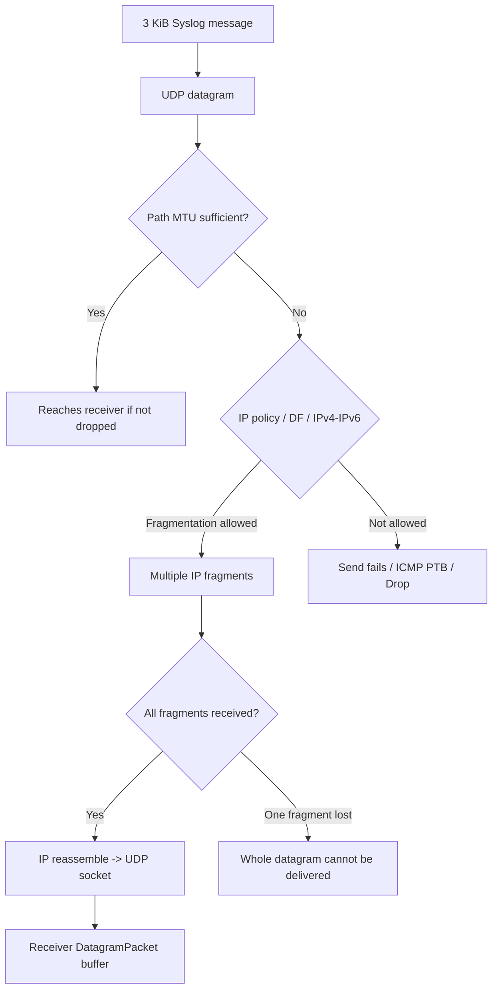
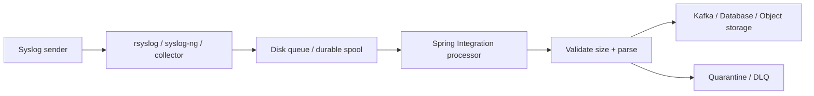

# Datagram size limits

## 1. Why does UDP datagram size matter for Syslog?

In the **SPRING_INTEGRATION_ADAPTERS** module, Spring Integration connects external systems using inbound/outbound adapters, gateways, pollers, and `MessageChannel`. The **Adapter Syslog** chapter focuses on log records pushed by network devices, servers, or applications to a UDP/TCP socket and converted into messages for filtering, normalization, routing, and persistence to files, SFTP, HTTP, JMS, AMQP, Kafka, or databases.

For **Syslog over UDP**, the size of **a single record on the wire** directly affects whether it can be received and processed successfully:

- If a message exceeds the **path MTU**, IP may have to fragment it or fail to transmit the datagram.
- If the buffer used to receive a `DatagramPacket` is too small, **data can be truncated** before the Syslog converter reads it.
- If the OS socket receive buffer fills up under a high send rate, **entire datagrams can be dropped**.
- If the parser receives only the beginning of a record, the record may fail syntax checks, lose its message body, or still look valid despite missing its tail.
- If received data exceeds **business policy limits**, the receiver must reject/quarantine it cleanly rather than silently passing an oversized message to Kafka/DB.

```mermaid
flowchart LR
    S[Syslog sender] --> P[Create message bytes]
    P --> U[UDP datagram]
    U --> N[Network MTU / IP fragmentation]
    N --> O[Kernel UDP socket queue]
    O --> B[DatagramPacket receive buffer]
    B --> C[Syslog MessageConverter]
    C --> M[MessageChannel]
    M --> V[Size policy / Validation]
    V --> D[Kafka / DB / File / SFTP]
```



Each boundary has **a different kind of limit**. Increasing a Java-layer buffer cannot recover packets dropped on the network; increasing the OS socket receive buffer will not make a decoder understand an already-truncated record; and adding more workers does not change the size limit of a single datagram.

### Learning objectives

After this lesson, you will be able to:

1. Understand **one Syslog message per UDP datagram** and the thresholds from RFC 5426.
2. Distinguish `IP MTU`, `UDP payload`, `receive-buffer-size`, `so-receive-buffer-size`, and business limits.
3. Explain **IP fragmentation**, **UDP drops**, **datagram truncation**, and **malformed Syslog**.
4. Configure a Spring Integration Syslog UDP receiver with an appropriate receive buffer.
5. Handle records exceeding limits **after reception** and test boundary values.
6. Understand the limitations of `check-length` with **standard Syslog**, as well as TCP/TLS and collector-with-disk-queue alternatives.
7. Set up metrics, alerts, security, and a runbook for long logs.

> **Key message:** "UDP supports large datagrams" does not mean "sending large Syslog messages over the Internet is safe." For Syslog, size policies must align from **sender -> network -> socket -> parser -> durable sink**.

## 2. Units of measurement: octet, byte, character, and datagram

RFC 5426 uses the term **octet**, meaning **8 bits**. In Java, a byte is an 8-bit unit, and `String` does not directly tell you how many bytes will be transmitted after UTF-8 encoding.

Example:

```java
import java.nio.charset.StandardCharsets;

String ascii = "INFO";
String unicode = "Đăng nhập thất bại";

int asciiChars = ascii.length();
int asciiBytes = ascii.getBytes(StandardCharsets.UTF_8).length;

int unicodeChars = unicode.length();
int unicodeBytes = unicode.getBytes(StandardCharsets.UTF_8).length;
```

With Unicode characters, `unicodeBytes` can be larger than `unicodeChars`. If a sender limits a message using `String.length()` instead of the **final byte array to be transmitted**, it can exceed the UDP budget unnoticed.

### 2.1. What counts toward the limit?

A standard Syslog datagram over UDP has the conceptual form:

```text
IP header
  UDP header (8 bytes)
    UDP payload = Syslog message:
      PRI + HEADER + STRUCTURED-DATA (if any) + MSG
```

**All bytes of the Syslog message** count toward the UDP payload budget, including:

- `<PRI>` and the header section.
- Timestamp, hostname, app name, process ID, message ID.
- Structured data in RFC 5424 (if present).
- Message text, spaces, UTF-8 BOM, or encoding markers if put on the wire by the sender.

Do not count only `MSG` while ignoring PRI/header/structured data.

### 2.2. A datagram is not a stream

RFC 5426 specifies **one UDP datagram per Syslog message**; do not pack multiple independent Syslog records into a single datagram. A record may be truncated by the sender per format rules, but that means the tail content is lost—not that the receiver reassembles it from a subsequent datagram.

Comparison:

| Transport | Record boundary | Key limit concepts |
|---|---|---|
| **Syslog UDP** | Each datagram is one message | UDP payload, MTU, receive packet buffer, UDP socket queue. |
| **Syslog TCP** | Byte stream; framing required | Frame length, deserializer limit, connection timeout/backpressure. |
| **Syslog over TLS** | Encrypted TCP stream; RFC 5425 uses octet counting | A TLS record is not a Syslog record; frame length must still be bounded. |

Do not try to solve oversized logs by "splitting them into multiple UDP datagrams and expecting the parser to reassemble them." Standard Syslog UDP **provides no application-level fragmentation or record reassembly**. Network-layer IP fragmentation is separate and provides no application guarantee.

## 3. Numbers in RFC 5426

RFC 5426, section **3.2 Message Size**, establishes important interoperability milestones:

| Target | Syslog message size | Requirement level |
|---|---:|---|
| Syslog receiver on **IPv4** | **480 octets** | **MUST** support receiving up to and including this size. |
| Syslog receiver on **IPv6** | **1,180 octets** | **MUST** support receiving up to and including this size. |
| Syslog receiver on **IPv4/IPv6** | **2,048 octets** | **SHOULD** support receiving up to and including this size. |
| Larger messages | Depends on receiver/path | Encouraged to support, with no interoperability guarantee. |

**MUST** and **SHOULD** are specification requirement levels, not thresholds automatically enforced by the framework by default.

### 3.1. Why 480 bytes for IPv4?

The RFC chose 480 octets to accommodate networks with low MTU limits, reducing the likelihood of IP fragmentation. For IPv4, the traditional minimum MTU is 576 bytes; IP/UDP headers and potential IP options consume overhead.

When the actual network path is unknown, **480 bytes for IPv4** and **1,180 bytes for IPv6** give senders a higher chance of interoperability, per RFC 5426 guidance.

This **does not mean** a 481-byte packet is guaranteed to fail or a 480-byte packet is guaranteed to arrive: UDP has no delivery guarantee, and packets can still be dropped by firewalls or an overloaded receiver.

### 3.2. IPv6 and the 1,180-byte threshold

IPv6 requires supporting a 1,280-byte MTU at the IP layer per its foundational specs. RFC 5426 sets **1,180 octets** as the threshold receivers must support, leaving headroom for headers and overhead.

In real IPv6 networks, extension headers, tunnels/encapsulation, or firewall policies can make the **effective path MTU** differ from simple assumptions. Do not treat 1,180 as a "guaranteed safe size" for every network without measuring.

### 3.3. Why 2,048 bytes does not mean "no fragmentation"

The RFC states receivers **SHOULD** support up to **2,048 octets**, yet a 2 KiB Syslog message over UDP exceeds the path MTU on a 1,500-byte Ethernet network. It may still be fragmented—or fail to transmit depending on path settings and IP stack behavior.

**Whether the receiver can parse 2 KiB** and **whether the network can deliver a 2 KiB datagram without losing fragments** are two independent questions.

### 3.4. The theoretical UDP limit is not a safe budget

With a minimum 20-byte IPv4 header and 8-byte UDP header:

```text
IPv4 total-length field max   = 65,535 bytes
IPv4 header (minimum)        =     20 bytes
UDP header                   =      8 bytes
Max UDP payload (IPv4 basic) = 65,507 bytes
```

The limit can be lower if IPv4 options or other network conditions apply. For IPv6, the standard IPv6 header's payload length field imposes its own limit and extension headers shrink the remaining UDP payload; never use "65 KB" as a logging budget. Jumbograms are a special case outside normal Syslog UDP deployments.

**Summary:** `65,507` is **a limit derived from the IPv4 header structure**, not a "guaranteed Syslog size" or a recommended value for `receive-buffer-size`.

## 4. Path MTU and fragmentation

### 4.1. What is MTU?

**MTU (Maximum Transmission Unit)** generally indicates the largest IP packet size a hop/interface can carry without IP-layer fragmentation.

Example of an Ethernet path with a 1,500-byte MTU:

```text
IPv4: 1500 - 20 (IPv4 header) - 8 (UDP header)
    = 1472 bytes UDP payload, without IPv4 options

IPv6: 1500 - 40 (base IPv6 header) - 8 (UDP header)
    = 1452 bytes UDP payload, without extension headers
```

This is a **simple calculation for a single 1,500-MTU link**, not an end-to-end path MTU guarantee. VPNs, IPsec, VXLAN, GRE, service meshes, or network tunneling add overhead, shrinking the usable payload.

### 4.2. What happens when a datagram exceeds the path MTU?



With **IPv4**, routers or the source can create IP fragments when permitted, though DF/PMTUD or firewalls may reject packets or signal that packet size must shrink.

With **IPv6**, routers along the path do not fragment packets as in IPv4; the sender must adapt to Path MTU and use a fragmentation header when appropriate. Losing even one fragment prevents the receiver from reassembling the UDP datagram.

### 4.3. Higher packet loss probability with multiple fragments

If a message is split into multiple fragments, **losing just one fragment** prevents the entire datagram from being delivered to the UDP socket. Consequently, even when a path can carry large messages, **successful delivery probability drops** as fragment count rises.

Do not cite a fixed loss rate: actual probability depends on the network, packet loss, fragment filtering, MTU, load, and OS behavior.

### 4.4. Dropped datagrams produce no Spring Integration error

If a packet fails IP reassembly or is dropped by the kernel UDP queue:

```text
Sender -> IP fragments -> [missing fragment] -> NO UDP datagram
                                      |
                                      X
                              Spring Integration
```

There is no `Message<?>`, no `ErrorMessage`, and no message payload to quarantine. That is why you need network/kernel counters and measurement at the sender/collector, **not just reading the global `errorChannel`**.

## 5. Three commonly confused buffers

### 5.1. Overview

In Spring Integration IP UDP, there are at least two distinct buffers:

1. **`receive-buffer-size`**: the buffer size **used for each `DatagramPacket` when the adapter reads data**.
2. **`so-receive-buffer-size`**: the requested OS **socket receive buffer** capacity (corresponding to `SO_RCVBUF`).

Plus an application-defined limit:

3. **`maxAllowedSyslogBytes`**: a **business policy** capping how many Syslog bytes the flow accepts after reception.

```text
OS socket receive queue (SO_RCVBUF)
   -> receive DatagramPacket(byte[receive-buffer-size])
   -> Syslog converter
   -> byte[] / Map payload
   -> application maxAllowedSyslogBytes validation
   -> accepted or rejected
```

### 5.2. Comparison

| Limit | Layer | When too small | Protects against packet loss? |
|---|---|---|---|
| **Path MTU** | Network | Packets must fragment/shrink or fail | Keeping messages within MTU reduces fragmentation risk, does not guarantee delivery. |
| **`receive-buffer-size`** | Java/IP receiving adapter | A large datagram can be **truncated** before the converter | Cannot fix packets lost on the network; raising it prevents local truncation. |
| **`so-receive-buffer-size`** | OS UDP socket queue | During bursts, queue fills and **whole datagrams are dropped** | Raising it absorbs bursts; does not fix per-packet buffer truncation. |
| **Application max bytes** | Validation/normalization | Rejects or quarantines messages violating policy | Effective **after full bytes arrive**; cannot reliably detect earlier truncation. |
| **Executor/QueueChannel capacity** | Downstream messaging | Worker queue fills, rejects/blocks | Does not replace network/socket buffers or durable queues. |
| **Broker max record size** | Kafka/JMS/AMQP/DB/File sink | Publish/serialize/store fails | Requires its own policy at the destination. |

For example, setting `receive-buffer-size=1024` and `so-receive-buffer-size=262144` **will not** let the receiver read a 3,000-byte datagram intact. The large OS buffer only holds more queued packets; the 1,024-byte per-packet buffer still truncates the record.

Conversely, setting `receive-buffer-size=8192` with a tiny `SO_RCVBUF` and slow handlers can still drop entire datagrams during bursts.

### 5.3. Truncation in `DatagramSocket.receive`

Per Java's `DatagramSocket.receive(DatagramPacket)`, if a message exceeds the **packet's allowed receive buffer length**, the datagram may be **truncated**; `DatagramPacket.getLength()` after `receive` reflects only the **number of bytes received**, not the original length.

Standalone example to illustrate:

```java
import java.net.DatagramPacket;
import java.net.DatagramSocket;

public final class TinyUdpReceiver {

    public static void main(String[] args) throws Exception {
        byte[] target = new byte[256];

        try (DatagramSocket socket = new DatagramSocket(1519)) {
            DatagramPacket packet =
                new DatagramPacket(target, target.length);

            socket.receive(packet);

            // If the sender sent > 256 bytes, data may already
            // have been truncated before the program processes it.
            System.out.println("Observed bytes: " +
                packet.getLength());
        }
    }
}
```

**You cannot conclude** "the packet was originally exactly 256 bytes" just because `getLength()==256`. It could equally have been a longer packet truncated down to 256. Without a trusted original length in the protocol or external telemetry, the receiver cannot reliably tell the two cases apart.

## 6. Spring Integration Syslog UDP configuration example

### 6.1. Dependencies

Assuming Java 17+, Spring Boot 3.x, and Spring Integration 6.x compatible with the Spring Boot BOM. With Maven dependency management:

```xml
<dependencies>
    <dependency>
        <groupId>org.springframework.boot</groupId>
        <artifactId>spring-boot-starter-integration</artifactId>
    </dependency>
    <dependency>
        <groupId>org.springframework.integration</groupId>
        <artifactId>spring-integration-ip</artifactId>
    </dependency>
    <dependency>
        <groupId>org.springframework.integration</groupId>
        <artifactId>spring-integration-syslog</artifactId>
    </dependency>
</dependencies>
```

`spring-boot-starter-web` is unnecessary if the application only receives Syslog and exposes no HTTP endpoints. This is a **one-way UDP inbound adapter**, with no HTTP status or response body for the sender.

### 6.2. XML configuration with intentional buffer sizing

File `src/main/resources/syslog-datagram.xml`:

```xml
<?xml version="1.0" encoding="UTF-8"?>
<beans xmlns="http://www.springframework.org/schema/beans"
       xmlns:xsi="http://www.w3.org/2001/XMLSchema-instance"
       xmlns:int="http://www.springframework.org/schema/integration"
       xmlns:int-syslog="http://www.springframework.org/schema/integration/syslog"
       xsi:schemaLocation="
         http://www.springframework.org/schema/beans
         https://www.springframework.org/schema/beans/spring-beans.xsd
         http://www.springframework.org/schema/integration
         https://www.springframework.org/schema/integration/spring-integration.xsd
         http://www.springframework.org/schema/integration/syslog
         https://www.springframework.org/schema/integration/syslog/spring-integration-syslog.xsd">

    <int:channel id="rawSyslogInput"/>

    <bean id="rawSyslogConverter"
          class="org.springframework.integration.syslog.DefaultMessageConverter">
        <property name="asMap" value="false"/>
    </bean>

    <int-syslog:inbound-channel-adapter
        id="udpSyslog"
        channel="rawSyslogInput"
        converter="rawSyslogConverter"
        auto-startup="true">

        <int-syslog:udp-attributes
            port="1514"
            local-address="127.0.0.1"
            receive-buffer-size="8192"
            so-receive-buffer-size="262144"
            lookup-host="false"/>
    </int-syslog:inbound-channel-adapter>

</beans>
```

Breakdown:

- `port="1514"`: actual UDP port the receiver binds. External senders on other containers/hosts need the right address, routing, and firewall; this lab binds loopback only.
- `receive-buffer-size="8192"`: reserves space to read **one datagram up to 8 KiB** in the adapter's buffer under ideal conditions. It **does not enable the network path to carry 8 KiB without fragmentation**.
- `so-receive-buffer-size="262144"`: **requests** a ~256 KiB OS receive socket buffer to absorb bursts. The OS may clamp or adjust the actual value; it is not a durable reservation.
- `asMap=false`: retains the raw Syslog record as `byte[]`, allowing us to **inspect the observed byte count after reception** before normalization.
- `lookup-host=false`: avoids unnecessary reverse DNS lookups; not a source authentication mechanism.
- Do not enable `check-length` for standard Syslog UDP from regular devices, as that feature uses Spring Integration IP's proprietary framing (see section 8).

**Why is the 8 KiB buffer larger than the 2 KiB policy?** In this demo, the receiver needs a chance to read a **complete** 3 KiB or 4 KiB datagram so it can actively reject it per policy, instead of truncating it to 2 KiB before validation. However, messages over 8 KiB can still be truncated, and even at 4 KiB the network can still drop fragments.

With the child `udp-attributes`, place `port` on the **child**, not again on the parent `inbound-channel-adapter` element.

### 6.3. Loading the XML in Spring Boot

```java
package example.syslog;

import org.springframework.boot.SpringApplication;
import org.springframework.boot.autoconfigure.SpringBootApplication;
import org.springframework.context.annotation.ImportResource;

@SpringBootApplication
@ImportResource("classpath:syslog-datagram.xml")
public class SyslogDatagramApplication {

    public static void main(String[] args) {
        SpringApplication.run(SyslogDatagramApplication.class, args);
    }
}
```

Once the app starts, the Syslog adapter receives UDP datagrams on `127.0.0.1:1514` and sends Spring Integration messages to `rawSyslogInput`.

**Limitation of the example:** the RFC 3164 converter may still inspect the input per its implementation. `asMap=false` is a raw payload contract, **not** a promise that every malformed record bypasses the parser without throwing an exception. When you must store **every datagram including malformed ones** before parsing, consider using a raw IP UDP adapter and parsing only after persistence per policy.

## 7. Validating size after reception

### 7.1. An illustrative policy

Set:

```text
RECEIVE_PACKET_BUFFER = 8192 bytes
MAX_ALLOWED_SYSLOG    = 2048 bytes
UDP PORT              = 1514
```

In this example:

- Records from 1 to 2,048 bytes may be accepted after passing other checks.
- Records larger than 2,048 bytes **that arrive intact at the receiver** are rejected/quarantined.
- Messages larger than the 8,192-byte buffer risk truncation before the guard runs, so application code **cannot guarantee** detecting every oversized message.
- Packets lost on the network or in the kernel never reach the guard, even if upstream sent them.

This is an **application policy**, not an RFC limit that every sender must obey. On low-MTU paths, the sender policy may need a threshold **much lower** than 2,048.

### 7.2. DTOs for processing outcomes

File `SyslogSizeResult.java`:

```java
package example.syslog;

public final class SyslogSizeResult {
    private SyslogSizeResult() {}

    public record Accepted(byte[] raw, int bytes) {}

    public record Rejected(
        String reason, int observedBytes) {}
}
```

Here `Accepted` carries raw bytes for demonstration, which is not ideal to send directly to Kafka at large scale. Production systems can persist raw bytes to object storage/inbox first and pass only an event ID or reference to the broker.

### 7.3. Service activator checking raw bytes

File `SyslogDatagramSizeGuard.java`:

```java
package example.syslog;

import java.util.Arrays;

import org.springframework.beans.factory.annotation.Qualifier;
import org.springframework.integration.annotation.ServiceActivator;
import org.springframework.messaging.Message;
import org.springframework.messaging.MessageChannel;
import org.springframework.messaging.support.MessageBuilder;
import org.springframework.stereotype.Component;

@Component
public class SyslogDatagramSizeGuard {

    static final int MAX_ALLOWED_BYTES = 2048;

    private final MessageChannel accepted;
    private final MessageChannel rejected;

    public SyslogDatagramSizeGuard(
            @Qualifier("acceptedSyslog") MessageChannel accepted,
            @Qualifier("rejectedSyslog") MessageChannel rejected) {
        this.accepted = accepted;
        this.rejected = rejected;
    }

    @ServiceActivator(inputChannel = "rawSyslogInput")
    public void inspect(Message<?> received) {
        if (!(received.getPayload() instanceof byte[] raw)) {
            sendOrThrow(rejected,
                new SyslogSizeResult.Rejected(
                    "WRONG_PAYLOAD_TYPE", -1));
            return;
        }

        int observed = raw.length;

        if (observed == 0) {
            sendOrThrow(rejected,
                new SyslogSizeResult.Rejected(
                    "EMPTY_DATAGRAM", observed));
            return;
        }

        if (observed > MAX_ALLOWED_BYTES) {
            sendOrThrow(rejected,
                new SyslogSizeResult.Rejected(
                    "OVERSIZED_SYSLOG", observed));
            return;
        }

        // Copy to prevent other components from mutating the original array.
        byte[] safeCopy = Arrays.copyOf(raw, raw.length);

        sendOrThrow(accepted,
            new SyslogSizeResult.Accepted(safeCopy, observed));
    }

    private static void sendOrThrow(
            MessageChannel channel, Object value) {

        boolean sent = channel.send(
            MessageBuilder.withPayload(value).build());

        if (!sent) {
            throw new IllegalStateException(
                "Syslog routing channel did not accept message");
        }
    }
}
```

**Explanation of safety limits:**

- `observed` is the **number of bytes present in the received payload**, not necessarily the original datagram length if truncated at the socket/decoder layer.
- With an 8 KiB buffer, if a sender sends more than 8 KiB, the receiver may get a record truncated to 8 KiB; the guard sees 8 KiB and rejects it under the 2 KiB policy, yet **cannot deduce the original length**.
- If a dangerous configuration sets the receive buffer **smaller than the policy limit**—for example, 1,024 bytes while `MAX_ALLOWED_BYTES=2048`—a datagram over 2 KiB can be truncated to 1,024 bytes and **wrongly accepted**. Keep buffer and policy aligned.
- `Accepted` only means "passed the size guard"; it does not guarantee valid Syslog format or persistence. Run an RFC parser/validator downstream.
- Rejections here become a **business message**, not an `ErrorMessage<Throwable>`, and do not generate a UDP acknowledgment.

### 7.4. Demo channels and subscribers

File `SyslogSizeChannels.java`:

```java
package example.syslog;

import org.springframework.context.annotation.Bean;
import org.springframework.context.annotation.Configuration;
import org.springframework.integration.channel.DirectChannel;
import org.springframework.messaging.MessageChannel;

@Configuration
public class SyslogSizeChannels {

    @Bean("acceptedSyslog")
    public MessageChannel acceptedSyslog() {
        return new DirectChannel();
    }

    @Bean("rejectedSyslog")
    public MessageChannel rejectedSyslog() {
        return new DirectChannel();
    }
}
```

File `SyslogSizeConsumers.java`:

```java
package example.syslog;

import org.slf4j.Logger;
import org.slf4j.LoggerFactory;
import org.springframework.integration.annotation.ServiceActivator;
import org.springframework.stereotype.Component;

@Component
public class SyslogSizeConsumers {

    private static final Logger log =
        LoggerFactory.getLogger(SyslogSizeConsumers.class);

    @ServiceActivator(inputChannel = "acceptedSyslog")
    public void accept(SyslogSizeResult.Accepted event) {
        log.info("Syslog size accepted: bytes={}", event.bytes());

        // Production: parse/validate, persist, or enqueue to a
        // durable sink. Do not log raw bytes containing sensitive data.
    }

    @ServiceActivator(inputChannel = "rejectedSyslog")
    public void reject(SyslogSizeResult.Rejected event) {
        log.warn("Syslog record rejected: reason={}, observedBytes={}",
            event.reason(), event.observedBytes());

        // Production: metrics + quarantine metadata; store raw bytes
        // with quotas and access controls if policy permits.
    }
}
```

The example logs only **selected metadata**, not entire raw records. Whenever a record must be kept for investigation, enforce access control, encryption at rest, retention, and storage quotas.

**Important point:** `DirectChannel` dispatches subscribers synchronously on the sending thread. If a downstream sink is slow, the UDP receiver can stall. Insert a broker/persistent queue or a collector with a disk queue; merely adding an in-memory `ExecutorChannel` queue **does not guarantee zero log loss**.

## 8. Should Spring Integration IP's `check-length` be used for standard Syslog?

### 8.1. The `check-length` mechanism

Spring Integration's **IP UDP adapter** supports `check-length=true` when **both sender and receiver are controlled components speaking this proprietary format**. When enabled on an outbound IP UDP adapter, it prepends **a 4-byte network-byte-order length prefix ahead of the payload**. The corresponding inbound IP UDP adapter uses that prefix to detect whether data was truncated on reception.

```text
Proprietary Spring Integration UDP envelope:
[4-byte network-order length][message body]
```

If both sender and receiver agree on this envelope, the receiver can compare expected length against bytes read to catch certain truncation cases.

### 8.2. Why not enable it blindly for RFC 5426 Syslog?

**Standard Syslog UDP** requires each datagram to carry a **Syslog message**, normally starting with `<PRI>`:

```text
RFC 5426 Syslog UDP payload:
<134>1 2026-11-23T02:15:10Z edge-01 app 123 EVT1 - Device changed
```

If you prepend Spring Integration IP's 4-byte length prefix before `<134>`, the wire payload **is no longer a Syslog message starting at byte 0** per the standard format. Standard Syslog devices or receivers expecting RFC 5426 will misparse it.

| Scenario | `check-length` | Conclusion |
|---|---|---|
| Device/router sending standard RFC 3164/5424 UDP Syslog | **Do not enable** | Sender does not emit Spring IP's 4-byte prefix. |
| Two Spring Integration **IP UDP adapters** you control, using a custom envelope | Can enable **on both ends** | This is an agreed proprietary protocol; do not call it standard Syslog UDP on the wire. |
| Need to guarantee zero lost Syslog records | `check-length` is **not enough** | Only detects some packet truncation after receipt; cannot recover packets lost on the network/kernel. |
| Syslog source can send large messages | Manage size on sender and receiver | If exceeding path MTU, consider TCP/TLS or a collector. |

Do not put `check-length="true"` into the Syslog XML example from section 6 when the sender is a normal router or Linux `logger`. If you want a custom length-prefixed protocol, use **plain IP UDP adapters** at both ends and document the wire contract explicitly.

### 8.3. Can a parser detect truncation in standard Syslog?

A parser can catch **some cases**:

- Missing closing bracket `]` in RFC 5424 structured data.
- Header cut off mid-field.
- Broken multibyte encoding sequence.
- Malformed PRI/timestamp or unparseable syntax.

However, a parser **cannot guarantee catching every truncation**. For instance, log text truncated at the end can still leave a syntactically valid RFC 3164 prefix. Without a trusted length, checksum, or application sequence number from the sender, the receiver cannot know bytes were lost.

**Never treat "parsed successfully" as proof that the datagram arrived intact.**

## 9. Testing senders with exact byte sizes

### 9.1. Generating an RFC 3164 Syslog message of exactly `N` bytes

A Java sender controlling the **total message byte count**, including the header, using ASCII `x` so each character equals one UTF-8 byte.

File `SyslogDatagramSender.java`:

```java
package example.syslog;

import java.net.DatagramPacket;
import java.net.DatagramSocket;
import java.net.InetAddress;
import java.nio.charset.StandardCharsets;

public final class SyslogDatagramSender {

    private static byte[] syslogOfSize(int targetBytes) {
        String prefix =
            "<134>Nov 23 09:15:10 sender-01 app: ";

        int prefixBytes =
            prefix.getBytes(StandardCharsets.UTF_8).length;

        if (targetBytes < prefixBytes) {
            throw new IllegalArgumentException(
                "Requested size is smaller than Syslog header");
        }

        String message =
            prefix + "x".repeat(targetBytes - prefixBytes);

        byte[] result =
            message.getBytes(StandardCharsets.UTF_8);

        if (result.length != targetBytes) {
            throw new IllegalStateException(
                "Wrong number of encoded bytes");
        }

        return result;
    }

    public static void main(String[] args) throws Exception {
        int[] sizes = {
            479, 480, 481,
            1179, 1180, 1181,
            2047, 2048, 2049,
            4096, 4097
        };

        InetAddress receiver =
            InetAddress.getByName("127.0.0.1");

        try (DatagramSocket socket = new DatagramSocket()) {
            for (int size : sizes) {
                byte[] raw = syslogOfSize(size);

                DatagramPacket packet = new DatagramPacket(
                    raw, raw.length, receiver, 1514);

                socket.send(packet);

                System.out.println(
                    "Sent UDP Syslog bytes=" + raw.length);
            }
        }
    }
}
```

**Significance of the thresholds**:

- `479/480/481`: tests around the IPv4 MUST-support threshold.
- `1179/1180/1181`: around the IPv6 MUST-support threshold (though the demo sender uses IPv4 loopback; configure real IPv6 to test IPv6 behavior).
- `2047/2048/2049`: around the SHOULD-support threshold and demo policy.
- `4096/4097`: tests datagrams exceeding the policy yet still smaller than the 8 KiB receive packet buffer.

**Important note:** all messages in this sender travel over **IPv4 loopback**. Testing on loopback validates sizing/pipeline logic, **not** delivery across VPNs, Wi-Fi, Kubernetes, or the Internet with smaller path MTUs. Never assume 4,097 bytes will reliably reach the receiver over a real network.

### 9.2. Expected behavior of the 2,048-byte size guard

When the datagram arrives intact, expected logic behavior:

| Sent size | Exceeds 2,048 policy? | Route in demo |
|---:|---|---|
| 479 | No | `acceptedSyslog` |
| 480 | No | `acceptedSyslog` |
| 481 | No | `acceptedSyslog` |
| 1,179 | No | `acceptedSyslog` |
| 1,180 | No | `acceptedSyslog` |
| 1,181 | No | `acceptedSyslog` |
| 2,047 | No | `acceptedSyslog` |
| 2,048 | No | `acceptedSyslog` |
| 2,049 | Yes | `rejectedSyslog` |
| 4,096 | Yes | `rejectedSyslog` |
| 4,097 | Yes | `rejectedSyslog` |

This table shows **expected validation logic when all payload bytes arrive**, not a promise that UDP delivers every datagram. If the network/kernel drops a packet or the converter produces no message, the guard is never invoked.

### 9.3. When the receiver buffer is smaller than the message

Try an **intentionally unsafe** configuration in a lab environment:

```xml
<int-syslog:udp-attributes
    port="1514"
    local-address="127.0.0.1"
    receive-buffer-size="512"
    so-receive-buffer-size="262144"
    lookup-host="false"/>
```

If the sender transmits a 2,048-byte message:

- IP/UDP may deliver the full datagram to the socket.
- `DatagramPacket` has only a 512-byte buffer; forwarded content may be truncated to 512 bytes.
- The parser may return `UNDECODED`, throw an exception, or emit a message with missing content depending on format/converter.
- `so-receive-buffer-size=262144` **does not fix** the 512-byte per-packet buffer.
- The receiver cannot accurately determine the original length without a trusted length field at the protocol/application layer.

**Never keep a 512-byte configuration for production Syslog if senders can emit longer records.** This example only illustrates the failure mode.

### 9.4. Testing Unicode and structured data

Add test cases with content such as:

```text
<134>Nov 23 09:15:10 edge-01 app: Đăng nhập thất bại — người dùng thử
```

Measure bytes using `getBytes(StandardCharsets.UTF_8).length`. Never use `String.length()` for size checks when text contains Vietnamese, emoji, or non-ASCII characters. For RFC 5424, include bytes from structured data and format escaping.

A record with a short `MSG` yet many attributes/structured data elements can still exceed the budget.

## 10. Testing at the network and OS layers

### 10.1. Observing the socket listener

On Linux:

```bash
ss -lunp | grep ':1514'
```

The output only confirms the UDP/1514 listener exists; **it does not prove 2 KiB/4 KiB messages are arriving intact**.

You can use packet capture in authorized test environments:

```bash
sudo tcpdump -n -s 0 -i lo 'udp port 1514'
```

Depending on the OS, the loopback interface may have a different name. `-s 0` captures all available packet bytes instead of a small snapshot length. Protect PCAP files since Syslog can contain IPs, accounts, or secrets.

### 10.2. Reading UDP drop statistics

Some Linux systems provide:

```bash
netstat -su
```

or:

```bash
nstat -az
```

Counters such as UDP receive errors, packet receive errors, or buffer errors depend on kernel/distribution and privileges. They are generally **OS-wide statistics** that aggregate across sockets. To measure a single application, combine socket telemetry, collector metrics, and end-to-end probes.

### 10.3. Distinguishing three loss locations

| Location | Symptom | Where to investigate |
|---|---|---|
| **Network fragmentation/drop** | Sender transmits, receiver never sees datagram | Path MTU, tunnel overhead, firewall, IPv4 DF/IPv6 PMTUD, packet capture. |
| **Kernel socket queue drop** | Traffic reaches host but Java receives fewer messages | `SO_RCVBUF`, CPU, receiver thread/blocking handlers, OS counters. |
| **Per-packet buffer truncation** | Receiver gets message but content is short/missing tail | `receive-buffer-size`, observed bytes, raw mode, test with known-length packets. |
| **Parser format mismatch** | Full raw bytes received yet fails to parse | RFC 3164/5424 converter, charset, TCP framing. |
| **Downstream reject** | Message passes parser but is not persisted | MessageChannel subscribers, queue capacity, Kafka/DB limits, error/retry/DLQ. |

Do not raise `SO_RCVBUF` when the root cause is an RFC parser mismatch; do not tweak the converter when senders are hitting the wrong port; and do not only raise the Java packet buffer when path MTU is the bottleneck.

## 11. Sender strategies for long records

### 11.1. Prefer shrinking size before transmission

When the sender can be configured:

1. **Avoid logging unbounded payloads** such as full HTTP bodies, multi-MB stack traces, base64 blobs, or binary data.
2. **Bound dynamic fields**: query strings, user agents, arbitrary headers, structured data.
3. **Preserve key context**: error codes, event IDs, source, timestamp, and summary; do not chop off identifiers needed for investigation.
4. **Compute byte size after encoding** and after building PRI/header/structured data.
5. **Prefer an explicit policy**: drop, truncate with a marker, split into separate correlated events with IDs, or switch transports.
6. **Never split one Syslog message into multiple UDP chunks** expecting a Syslog receiver to reassemble them.
7. **Keep secrets/PII out of logs**; truncation is not a reliable redaction method.

### 11.2. When to truncate cleanly?

If truncation is necessary to stay within limits, the sender needs a consistent policy:

- Avoid splitting inside a multibyte UTF-8 character.
- Do not break RFC 5424 header/structured data syntax.
- Whenever possible, flag the record as **truncated** via dedicated metadata or a system-defined marker instead of pretending it is complete.
- Keep event ID/source ID so the full payload can be looked up in separate storage.
- Never silently truncate mandatory audit/compliance fields.
- Use a bounded formatter to avoid memory pressure before sending UDP.

When **complete long records** are required, switching to **Syslog TCP/TLS**, a collector with a disk queue, or a proper durable storage pipeline is usually far better than pushing UDP datagrams to their maximum limits.

### 11.3. Reasonable sizes when path MTU is unknown

Starting guidance:

| Context | Design direction |
|---|---|
| Devices supporting only RFC 5426/UDP over unknown-MTU networks | Target sender limits **<=480 bytes IPv4** or **<=1,180 bytes IPv6** when broad interoperability is the goal. |
| Centrally managed receiver on a measured network | Can support 2,048 bytes or higher, provided fragmentation risk, loss, and limits are tested. |
| Need to retain very long JSON/stack traces | Shrink logs, store details separately, or use TCP/TLS/collectors. |
| Need zero audit loss across restarts/outages | Use a durable collector/queue, replay, acks, and dedup; plain UDP is insufficient. |

Do not treat 480 bytes as a "hard RFC maximum": it is the threshold IPv4 receivers **MUST support**, while supporting larger sizes remains valid.

## 12. When to switch to TCP or TLS?

If logs routinely exceed a few KB, require encryption/authentication, or need to avoid IP fragmentation, consider Syslog TCP/TLS.

### 12.1. TCP removes datagram limits but adds new responsibilities

```text
Syslog sender -> TCP connection -> framing
              -> Spring Integration TCP Syslog inbound
              -> MessageConverter -> MessageChannel
```

TCP operates on a **byte stream**. Data can span multiple TCP segments without squeezing a Syslog record into one UDP datagram. However:

- The receiver must configure matching **framing** (RFC 6587 octet counting or delimiter).
- Enforce a **maximum frame length** to prevent memory exhaustion.
- Configure read timeouts, connection limits, and handling for slow clients or mid-frame disconnects.
- A successful TCP write **does not confirm** the Syslog record was committed to Kafka or a database.
- When retrying/replaying after disconnects, define event IDs and deduplication policies.

### 12.2. TLS does not automatically raise message limits

RFC 5425 defines Syslog-over-TLS using TCP and **octet counting**. TLS handles encryption and certificate-based authentication; TLS record sizes and TCP segmentation are **not** application-level Syslog message size limits.

To accept large frames safely, you must still configure **frame size limits, timeouts, buffers, memory bounds, and downstream quotas**. Never treat TLS/6514 as an unbounded pipe for arbitrary payloads.

### 12.3. Collector with a disk queue

A design worth considering:



The collector can:

- Enforce per-source message size limits.
- Spool records to disk before passing them to the processor.
- Retry/replay when Spring Integration or downstream has an outage.
- Enforce TLS/mTLS, access controls, and rate limits.
- Measure dropped/oversized/truncated counts.

Even with a disk queue, understand exact **ack and fsync boundaries**, full-disk behavior, and duplicate risks during replay. Never loosely label the entire chain "exactly-once."

## 13. Error channel and malformed records

### 13.1. Records exceeding business thresholds

In the demo from section 7, a message **received intact** and longer than 2,048 bytes turns into:

```text
SyslogSizeResult.Rejected {
    reason = "OVERSIZED_SYSLOG",
    observedBytes = 4096
}
```

This is a **business classification message** sent to `rejectedSyslog`. It is **not** an `ErrorMessage` carrying a `Throwable`.

Advantages:

- Increment metrics by rejection reason.
- Quarantine with its own retention policy.
- Avoid throwing exceptions for an expected boundary condition.
- Avoid leaking raw payloads into logs.

### 13.2. Truncation or parser exceptions

If the adapter/converter throws an exception, Spring Integration can report it via the configured `error-channel`. However:

- Not every malformed record throws an exception: the RFC 3164 parser may place undecodable raw data under `UNDECODED`.
- `errorChannel` never sees packets dropped by the network or kernel.
- An error message may lack the original bytes when failure occurs very early.
- An in-JVM error channel **is not automatically a durable DLQ**.
- If the error handler only logs, records needed for investigation are still lost.

If every record must be captured, add a persistent ingress buffer/store **before** parsing where permitted, or use a collector capable of raw capture and replay.

### 13.3. Do not expect automatic UDP sender retries

With traditional UDP Syslog, the sender has no application acknowledgment. It normally has no idea whether the receiver rejected a record in a size guard, parser, or DB write.

If senders need confirmation that records reached storage, define **another protocol/collector with acks and replay**. Do not assume an `errorChannel` header or Spring Integration `check-length` generates acks for a router emitting RFC 5426 Syslog.

## 14. Security and resource protection

Oversized datagrams are not just misconfigurations; they can stress or abuse the receiver:

- **IP fragmentation** can force the kernel to hold many fragments awaiting reassembly.
- **UDP flooding** can saturate socket queues and spike parsing CPU.
- **Raw log text** can contain tokens, usernames, IPs, and personal data.
- **Unexpected binary/control chars** can enable log injection when rendered downstream.
- **Excessive structured data** can exhaust parser CPU/memory if unbounded.
- **Long-lived raw payloads** can fill databases, Kafka topics, or disk queues.

Appropriate controls:

1. Restrict senders via firewalls/network ACLs; use Syslog over TLS/mTLS via a trusted collector when encryption/authentication is needed.
2. Apply quotas/rate limits per verified source, not just self-declared `HOSTNAME`.
3. Enforce maximum sizes across **sender, network ingress, receiver, and downstream sinks**.
4. Set `receive-buffer-size` large enough for valid messages plus headroom to reject policy violations cleanly—never raise it indefinitely.
5. Cap active connections/threads/queues and message sizes before decoding or persisting.
6. Never log full raw bytes upon rejection; log only reason, observed size, and trusted source group if permitted.
7. Escape/normalize control characters before storing or forwarding to UIs or other logging systems.
8. Redact secrets, and set retention and access controls for raw payloads.
9. Monitor memory, socket errors, UDP drops, parser failures, rejected oversized records, and DLQs.
10. Guard against loops if the receiver sends its own application logs back to the same Syslog listener.

**Do not treat TLS as a size filter or comprehensive DoS shield.** TLS protects the transport leg, yet the receiver must still process bytes and enforce resource bounds.

## 15. Monitoring and capacity planning

### 15.1. Metrics to track

| Metric | What it tells you |
|---|---|
| `syslog_datagrams_received_total` | Datagrams reaching the pipeline, not total datagrams the sender attempted. |
| `syslog_record_observed_bytes` histogram | Distribution of observed payload sizes. |
| `syslog_oversized_rejected_total` | Complete messages rejected by the size guard. |
| `syslog_undecoded_total` | Messages the parser could not decode. |
| UDP socket/kernel receive errors | Risk of datagram drops before the adapter. |
| IP fragmentation/reassembly failures | Large packets hitting network-stack issues. |
| `syslog_downstream_publish_failures_total` | Syslog received yet failed to persist. |
| Queue depth and oldest message age | Processor/broker backpressure. |
| JVM heap/GC and listener CPU | System load and OOM/latency risks. |
| Sender/collector dropped/truncated counters | Data loss upstream of the receiver. |

For histograms, use **byte-size buckets** around `480`, `1180`, `2048`, `4096`, and `8192` to clearly visualize distributions; never put raw message text or unbounded hostnames into metric labels.

### 15.2. Throughput estimation

Suppose a sender emits:

```text
Rate              = 2,000 records/second
Average bytes      = 1,000 bytes/record
Approx. body rate  = 2,000,000 bytes/second
                   ≈ 2 MB/s payload
```

This is **payload bandwidth excluding** IP/UDP headers, link overhead, encryption/encapsulation, retries, fragmentation, and downstream serialization. If average log size jumps to 4 KiB, payload bandwidth scales proportionally, while fragmentation risk can climb even faster than raw byte volume.

For throughput planning, measure:

- Average, p95, and p99 **message sizes**.
- Peak events/second and burst durations.
- Path MTU and network packet loss.
- Parse/converter/validation throughput.
- DB/Kafka record size limits and publish latency.
- Queue retention, retry/replay rates, and acceptable log-loss windows.

### 15.3. Priority alerts

- Sudden spike in oversized rejection rate.
- High CPU and reassembly errors coinciding with large message sizes.
- Rising socket receive errors/drops during bursts.
- Jump in `UNDECODED` or parser failures after sender configuration changes.
- High sender count alongside an unusual drop in receiver count.
- Rising downstream Kafka/DB failures and growing DLQ backlogs.
- P99 receive-to-commit latency breaching SLAs.

Do not alert solely on size-guard rejections: oversized packets may be **lost before creating a message** and never increment that counter.

## 16. End-to-end test matrix

| Scenario | What to confirm |
|---|---|
| 480-byte IPv4 Syslog | Receiver configured properly receives/parses per contract; RFC MUST milestone. |
| 1,180-byte IPv6 Syslog | Tested over real IPv6 with matching bind/network; RFC MUST milestone. |
| 2,048-byte Syslog | Receiver supports per SHOULD; test both transport path and parser. |
| Sender 2,049 bytes, receiver buffer 8,192, app max 2,048 | If received intact, guard rejects with `OVERSIZED_SYSLOG`. |
| Sender 4,096 bytes | If received intact, guard rejects; watch fragmentation on real networks. |
| Sender >8,192 bytes | May truncate before guard; never treat observed bytes as original length. |
| `receive-buffer-size=512` | Easily truncates long messages; controlled failure test only, never production. |
| Large `so-receive-buffer-size` with small per-packet buffer | Truncation still occurs from per-packet buffer. |
| High-rate UDP burst | Watch OS drops/receive errors and backlogs, not just app counters. |
| IPv4 + DF + packet larger than PMTU | May fail to send or require shrinking; verify path MTU handling per OS. |
| IPv6 over low-MTU tunnel | Check packet-too-big/reassembly/drops and sender policy. |
| Raw bytes with Vietnamese/emoji | Measure UTF-8 byte count, never `String.length()`. |
| Long RFC 5424 structured data | Count full header/SD/MSG bytes, not just MSG text. |
| `check-length=true` with standard `logger` sender | Do not enable; proprietary length prefix is incompatible. |
| Parser gets truncated record with valid syntax | Never treat "parsed successfully" as proof of complete data. |
| Kafka/DB record size limit | Outbound adapter has error/recovery policy; no silent drops. |
| JVM restart with tasks in memory queue | Tasks may be lost; requires durable queue/replay. |

### 16.1. Investigation runbook when logs are missing or truncated

```text
Sender generated full record?
  -> UTF-8 byte length / sender-side truncation?
  -> UDP datagram size vs path MTU?
  -> IP fragmentation / DF / firewall?
  -> Kernel socket UDP drops?
  -> Spring receive-buffer-size vs SO_RCVBUF?
  -> Syslog converter / UNDECODED / format?
  -> App size policy (accept / reject)?
  -> MessageChannel subscriber/backpressure?
  -> Kafka / DB / File commit acknowledged?
  -> DLQ / replay / retention?
```

If **no messages reach the receiver**, check bind IP, UDP port, firewalls, packet captures, and IP reassembly/drops first. If **messages arrive truncated**, inspect sender-side truncation and `receive-buffer-size`. If **messages arrive intact yet are not stored**, inspect downstream adapters, broker limits, and commit/ack status.

## 17. Pre-production checklist

1. **Survey senders:** Syslog RFC 3164/5424, UDP ports, encoding, message-size distributions, and truncation policies.
2. **Budget in bytes:** include PRI, timestamp, structured data, message text, and UTF-8 encoding.
3. **Verify the network:** path MTU, tunnels/VPNs, fragmentation policies, and drop counters.
4. **Distinguish buffers:** per-datagram `receive-buffer-size` vs. socket queue `so-receive-buffer-size`.
5. **Size the receive buffer adequately:** never smaller than the largest valid message; add headroom if rejecting oversized payloads after reception.
6. **Set application size limits:** separate "received bytes" from "declared original size", and never promise catching every truncation.
7. **Do not enable SI `check-length` for standard Syslog senders** without an explicit wire-format agreement.
8. **Handle malformed and `UNDECODED`:** dedicated validation/quarantine branch without waiting for exceptions.
9. **Do not rely on UDP ACKs:** add a collector/durable queue when replay or delivery guarantees are required.
10. **Standardize and secure:** TLS/mTLS where appropriate, firewalls/allowlists, rate limits, log redaction/escaping, and retention.
11. **Test boundary values:** 480, 1,180, 2,048 bytes, and policy limits.
12. **Test on real deployment networks:** localhost never replaces testing across VPNs, Kubernetes, or real devices.
13. **Monitor both OS and application:** network drops, reassembly failures, received sizes, rejection counts, queue depths, and downstream commits.
14. **Design failure recovery:** quota-bounded oversized/quarantine stores, retry/DLQ, and long-record handling policies.
15. **Never equate "socket received" with "durably persisted":** verify commit/ack boundaries at each downstream adapter.

## 18. Summary

UDP Syslog **datagram size limits** are not a single number. You must distinguish:

- **RFC 5426:** IPv4 receivers **MUST** accept up to 480 octets, IPv6 receivers **MUST** accept up to 1,180 octets, and receivers in general **SHOULD** accept up to 2,048 octets.
- **IP/path MTU:** oversized datagrams can be fragmented or dropped before reaching the receiver; never confuse this with Java buffer capacity.
- **`receive-buffer-size`:** buffer for reading **a single `DatagramPacket`**; too small truncates records.
- **`so-receive-buffer-size`:** OS socket receive queue; absorbs bursts without fixing truncated datagrams.
- **Application max bytes:** rejects only when messages arrive intact; observed bytes do not always equal original length.
- **Spring Integration IP `check-length`:** uses a proprietary 4-byte prefix; **do not enable it by default for RFC 5426 UDP Syslog**.
- **TCP/TLS:** suitable when records are long or security is needed, while still requiring frame limits, timeouts, memory bounds, and downstream capacity planning.

In **SPRING_INTEGRATION_ADAPTERS**, design the full chain—**sender -> UDP/IP -> Syslog inbound adapter -> converter -> MessageChannel -> Kafka/JMS/AMQP, file/SFTP, HTTP, or database**—defining error boundaries, security, backpressure, retention, and durable commits. Sizing a large buffer addresses only **one piece** of the reliability puzzle.

### Official references

- [IETF RFC 5426 — Transmission of Syslog Messages over UDP](https://www.rfc-editor.org/rfc/rfc5426)
- [IETF RFC 5424 — The Syslog Protocol](https://www.rfc-editor.org/rfc/rfc5424)
- [IETF RFC 3164 — The BSD Syslog Protocol](https://www.rfc-editor.org/rfc/rfc3164)
- [IETF RFC 768 — User Datagram Protocol](https://www.rfc-editor.org/rfc/rfc768)
- [IETF RFC 8200 — Internet Protocol, Version 6](https://www.rfc-editor.org/rfc/rfc8200)
- [Spring Integration — Syslog Support](https://docs.spring.io/spring-integration/reference/syslog.html)
- [Spring Integration — UDP Adapters, `check-length`](https://docs.spring.io/spring-integration/reference/ip/udp-adapters.html)
- [Spring Integration — IP Configuration Attributes, receive buffers](https://docs.spring.io/spring-integration/reference/ip/endpoint-reference.html)
- [Java SE — DatagramSocket](https://docs.oracle.com/en/java/javase/21/docs/api/java.base/java/net/DatagramSocket.html)
- [Java SE — DatagramPacket](https://docs.oracle.com/en/java/javase/21/docs/api/java.base/java/net/DatagramPacket.html)
- [Spring Integration — Error Handling](https://docs.spring.io/spring-integration/reference/error-handling.html)
