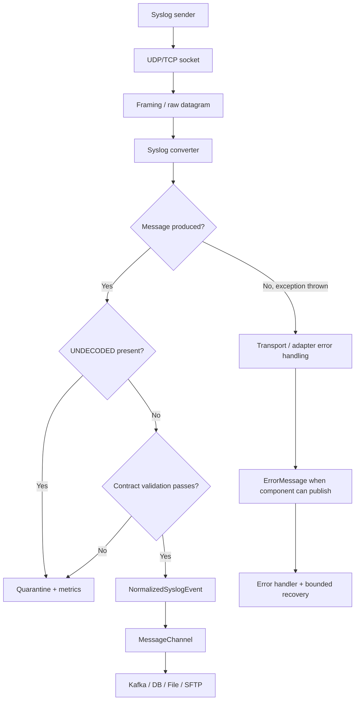
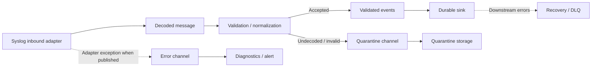
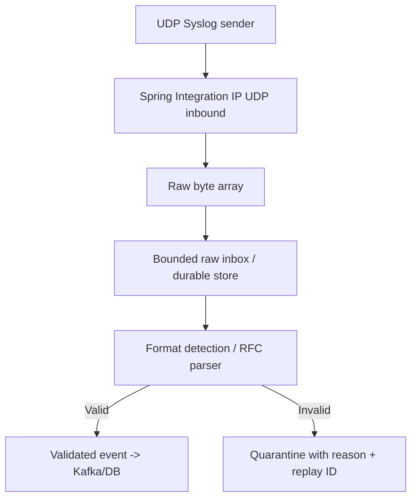

# Handling malformed Syslog messages

## 1. Context: receiving Syslog does not mean the record is valid

In **SPRING_INTEGRATION_ADAPTERS**, Spring Integration connects external systems using inbound/outbound adapters, gateways, pollers, and `MessageChannel`. The **Adapter Syslog** chapter handles log messages sent by routers, firewalls, applications, Linux hosts, and collectors over UDP or TCP. Once received, the flow can route, filter, write to databases/files/SFTP, send to Kafka, JMS, or AMQP, or call HTTP APIs according to message, error, and connection lifecycle contracts.

At this boundary, incoming data is **untrusted by default**. A Syslog message may:

- Lack a PRI or format PRI with invalid syntax.
- Have an invalid facility/severity, or lack a hostname, timestamp, or tag required by the business contract.
- Carry an **RFC 5424** record while the receiver uses an **RFC 3164** converter, or vice versa.
- Have wrong TCP framing, an incorrect length prefix, or get cut off across reads.
- Contain data truncated by the UDP receive buffer, IP fragmentation, or sender-side truncation before sending.
- Contain bad escape sequences, control characters, or invalid Unicode under the agreed charset.
- Parse syntactically yet **violate schema, source policy, or security rules**.

Not every case leads to a Java exception. In particular, Spring Integration's `SyslogToMapTransformer` for **RFC 3164** can return a `Map` containing the **`UNDECODED`** key when it cannot decode the entire record. Meanwhile, some errors in the TCP deserializer, converter, or downstream handlers flow through exceptions and `ErrorMessage`.



**Lesson objectives**:

1. Distinguish **malformed syntax**, **invalid semantics**, **transport/framing errors**, and **downstream errors**.
2. Recognize `SyslogToMapTransformer.UNDECODED`, `Map` payloads, and `syslog_*` headers.
3. Understand the different limitations of `DefaultMessageConverter` and `RFC5424MessageConverter`.
4. Configure a Syslog inbound adapter with **two independent handling paths**: quarantine for invalid records and an error channel for exceptions.
5. Write a Java service activator that validates data before routing to external systems.
6. Organize raw storage/replay, error-rate measurement, size limits, and log-injection protection.
7. Build unit tests and integration tests for valid records, missing fields, bad PRI, wrong formats, and framing.

> **Principle:** "The parser threw no exception" does not mean "the record is valid"; "the error channel has no errors" also does not prove the sender lost no packets.

## 2. What constitutes malformed Syslog?

### 2.1. Syntax errors in RFC 3164

A typical BSD Syslog record:

```text
<134>Nov 23 09:15:10 edge-01 sshd[42]: Login failed
```

`<134>` represents `PRI`, where:

```text
PRI = facility * 8 + severity
facility = PRI / 8      // integer division
severity = PRI % 8
```

For `134`: facility = `16` (`local0`), severity = `6` (`Informational`). Per the standard facility table, facility is in `0..23` and severity is in `0..7`, so PRI lies in `0..191`.

Inputs to test:

```text
<134>Nov 23 09:15:10 edge-01 app: OK
<abc>Nov 23 09:15:10 edge-01 app: Bad PRI digits
<192>Nov 23 09:15:10 edge-01 app: PRI out of range
Nov 23 09:15:10 edge-01 app: Missing PRI
<134>broken-header
```

Do not assume the last two lines are guaranteed to become `UNDECODED` because of missing headers: exact behavior depends on the parser, library version, and how the converter handles the relatively permissive RFC 3164 format.

**Practical note:** RFC 3164 is a legacy format with many vendor variants and timestamps missing year/timezone. An overly strict regex can reject valid logs from older devices. Define per-source contracts and test with real logs sanitized of sensitive data.

### 2.2. Syntax errors in RFC 5424

RFC 5424 has a stricter structure:

```text
<134>1 2026-11-23T02:15:10Z edge-01 app 42 AUTH1 - Login failed
```

Basic fields in order:

```text
<PRI>VERSION TIMESTAMP HOSTNAME APP-NAME PROCID MSGID STRUCTURED-DATA MSG
```

A few invalid or suspicious cases:

```text
<134>1 2026-11-23T02:15:10Z edge-01 app 42 AUTH1 [id@32473 x="unclosed] failed
<134>1 BAD-TIME edge-01 app 42 AUTH1 - failed
<134>1 2026-11-23T02:15:10Z edge-01 app 42 AUTH1
```

The first line has incomplete `STRUCTURED-DATA`. The second line has a suspicious timestamp that must be checked against RFC/implementation rules. The third line is missing mandatory `STRUCTURED-DATA`; `MSG` may be empty/absent per format, but earlier fields cannot be omitted.

RFC 5424 uses `-` (NILVALUE) for certain absent fields. **Do not conflate a valid NILVALUE with a field missing due to a truncated record.** Also, `STRUCTURED-DATA` has escaping rules for double quotes, backslashes, and closing brackets; using `split(" ")` to parse full RFC 5424 is unsafe.

### 2.3. "Parseable yet violates contract" errors

Not every business-invalid record is malformed at the RFC level. Examples:

- Severity `6` is valid, yet the source is not authorized to send to a sensitive audit channel.
- Facility `local0` is valid, yet the application contract requires `local4` for a signed-off event class.
- Hostname in the payload differs from verified source inventory.
- Timestamp has valid syntax, yet skews by hours or days from `receivedAt`.
- `MSGID` or structured data lacks a value required downstream.
- Log content exceeds size policy, contains control characters, or poses a log-injection risk.
- Duplicate event ID during collector replay.

These are **validation/policy failures** and should be classified separately from **syntax parsing failures** to avoid conflating root causes.

## 3. Identifying errors at the right layer

| Layer | Example | Does Spring Integration receive a `Message<?>`? | Handling direction |
|---|---|---|---|
| Network UDP | Packet dropped by firewall or kernel | **No**, if packet never enters adapter | Network/OS metrics, sender/collector counters. |
| UDP packet buffer | Long datagram truncated | May produce a message **missing bytes** | Test sizes, buffers, and raw captures; do not assume the parser notices. |
| TCP connection | Connection reset, timeout, mid-frame close | Possibly not | Connection events, deserializer diagnostics. |
| TCP framing | Wrong RFC 6587 octet count/delimiter | Possibly not, or wrong record boundaries | Inspect framing ahead of converter. |
| Converter RFC 3164 | Cannot decode entire record | **May produce a Map with `UNDECODED`** | Quarantine via validation. |
| Converter RFC 5424 | Record fails parser | Implementation-dependent: error or non-standard record | Distinguish parse failures from exceptions. |
| Contract validation | Missing facility, severity, or source identity | **Message exists but is rejected** | Quarantine with reason code. |
| MessageChannel/handler | Subscriber exception, channel rejected | Message exists for part of flow | Error handling per sync/async semantics. |
| Sink | Kafka/DB/HTTP/File failure | Message reached deep into flow | Retry/backoff, bounded recovery, DLQ/inbox. |

**Do not use a single `syslog_errors_total` counter for everything.** Separate `undecoded`, `invalid_fields`, `framing_errors`, `transport_drops`, and `downstream_failures`, because each requires a different remediation.

### 3.1. When errors occur before the adapter

UDP has no business acknowledgment. Packets lost before the receiver cannot be reconstructed as a Spring Integration `ErrorMessage`. Similarly, if a TCP receiver rejects a connection because a TLS handshake fails at a proxy, no Syslog business message is necessarily produced.

For critical logs, use a collector supporting disk queues/replay and monitor both sender and receiver; never infer dropped packets from `UNDECODED` counts.

### 3.2. When errors occur after the adapter

A record may pass the converter and channel yet fail when:

- Mapping to a DTO because facility/severity has the wrong type.
- Writing to a database loses connectivity or violates a unique constraint.
- Publishing to Kafka/JMS/AMQP times out.
- Calling an HTTP outbound gateway returns 4xx/5xx.
- Writing a file/SFTP fails due to permissions or full disk.

These are not Syslog syntax errors. Route them to an appropriate **downstream recovery flow** with correlation/event IDs for replay, rather than altering the parser or discarding the original record.

## 4. `SyslogToMapTransformer.UNDECODED`

### 4.1. Key behavior of the RFC 3164 transformer

Spring Integration's API docs describe `SyslogToMapTransformer`: for RFC 3164 Syslog that **cannot be decoded**, the entire packet is returned as a String in the `Map` under the `UNDECODED` key. Illustrative example:

```text
Message<?> {
  payload: {
    UNDECODED-key: "<abc>Nov 23 09:15:10 edge-01 app: Bad PRI"
  },
  headers: {
    id: ...,
    timestamp: ...
  }
}
```

This is a **conceptual diagram**, not a guarantee of literal key strings or accompanying headers. Application code should use:

```java
import org.springframework.integration.transformer.SyslogToMapTransformer;

boolean undecoded =
    fields.containsKey(SyslogToMapTransformer.UNDECODED);
```

**Common pitfall:** `UNDECODED` is a **field in the `Map` payload**, not automatically an exception; listening only to `errorChannel` will miss this branch.

### 4.2. Do not assume every invalid record produces `UNDECODED`

Three other possibilities exist:

1. The parser produces a **partial** map: facility/severity are present, yet timestamp, host, or tag is missing.
2. The parser returns a field with a **different type than expected**: timestamp may be `Date` or `String`; some values may be absent.
3. The converter/deserializer throws an exception or emits no business message when input is severely broken.

Therefore, validation must have **at least two steps**:

```text
Map contains UNDECODED?
    -> Yes: quarantine MALFORMED_RFC3164
    -> No: validate required fields / types / ranges / source policy
           -> Pass: normalized event
           -> Fail: quarantine INVALID_FIELDS
```

Avoid doing:

```java
// Unsafe: field may be missing or not an Integer.
int severity =
    (Integer) fields.get(SyslogToMapTransformer.SEVERITY);
```

A `ClassCastException` or `NullPointerException` here is an avoidable application bug, not a sound way to classify malformed Syslog.

## 5. Which converter will be used?

Spring Integration Syslog offers two common choices:

| Converter | Expected format | Default payload | Behavior to watch |
|---|---|---|---|
| `DefaultMessageConverter` | **RFC 3164** | `Map` created by `SyslogToMapTransformer` | Decoded fields, except message text, are copied into `syslog_*` headers. |
| `DefaultMessageConverter` with `asMap=false` | RFC 3164 | Raw `byte[]` | Retains raw record and decoded headers; still check for parser errors. |
| `RFC5424MessageConverter` | **RFC 5424** | Parsed `Map` | Does not copy decoded fields to headers by default when `asMap=true`. |
| `RFC5424MessageConverter` with `asMap=false` | RFC 5424 | Raw `byte[]` | Decoded fields in headers; over TCP, configure raw retention on deserializer. |

Do not assume:

- RFC 5424 records parse validly with `DefaultMessageConverter`.
- A router reading `SyslogHeaders.SEVERITY` behaves identically across both converters.
- `asMap=false` skips all parsing and preserves arbitrary malformed datagrams.
- An exception from the converter guarantees the error channel always receives the original raw message.

**Separate contracts:** transport/framing -> converter -> validation/normalization -> route. When a device switches from RFC 3164 to RFC 5424, swap to the right parser and run regression tests rather than merely tweaking downstream field names.

## 6. Options for handling invalid records

An ingestion system must decide clearly **which errors to persist, which to drop, and which to alert on**.

### 6.1. Four recommended classification outcomes

| Outcome | When | Action |
|---|---|---|
| **ACCEPTED** | Valid parse, required fields pass validation | Forward to normalized flow and durable sink. |
| **UNDECODED** | RFC 3164 transformer returns `UNDECODED` | Quarantine raw/metadata per policy; increment metric. |
| **INVALID_FIELDS** | Missing/wrong-typed facility/severity, source policy, size, or timestamp failure | Quarantine/flag for review; never silently fix. |
| **PROCESSING_FAILURE** | Exception during conversion, routing, persistence, or connectivity | Error flow, bounded retries, DLQ/persistent recovery if original data exists. |

Beyond these four outcomes, measure **TRANSPORT_DROPPED/FRAMING_FAILED** via network/receiver telemetry. Those cases may produce no message to classify.

### 6.2. Reason codes must be stable

Example internal code set:

```text
UNDECODED_RFC3164
UNEXPECTED_PAYLOAD_TYPE
MISSING_FACILITY
MISSING_SEVERITY
INVALID_FACILITY
INVALID_SEVERITY
UNTRUSTED_SOURCE
TIMESTAMP_POLICY_VIOLATION
OVERSIZED_RECORD
DECODE_EXCEPTION
TCP_FRAMING_FAILURE
DOWNSTREAM_WRITE_FAILURE
```

Benefit: metrics, alerts, and replay workflows can group incidents without reading sensitive raw payloads. **Never put raw exception messages or records into metric labels**, as that can leak secrets and explode cardinality.

### 6.3. Quarantine is not the global `errorChannel`

**Quarantine** is a business channel receiving messages that explicitly failed checks, often without throwing an exception. **Error channel** is the channel receiving exceptions published by Spring Integration components as `ErrorMessage`.

A production system typically needs both:



Never treat an in-JVM `QueueChannel` as durable quarantine storage. To replay after restarts, use a persistent message store, database inbox, object storage, or broker/collector with real retention and acks.

## 7. Practice: UDP RFC 3164 Syslog -> validate -> quarantine

This example uses **Java 17+**, Spring Boot with a compatible Spring Integration version, a native UDP Syslog inbound adapter on **127.0.0.1:1514**, a Java service activator validating the `Map` payload, two output channels for `accepted` and `quarantine`, plus a dedicated **error channel** for adapter-published errors.

The practice focuses on **classifying inputs and avoiding silent error loss**, without wiring real Kafka/DB persistence. Demo sinks only log metadata; critical records require durable persistence in real systems.

### 7.1. Maven dependencies

When the Spring Boot BOM manages versions:

```xml
<dependencies>
    <dependency>
        <groupId>org.springframework.boot</groupId>
        <artifactId>spring-boot-starter-integration</artifactId>
    </dependency>
    <dependency>
        <groupId>org.springframework.integration</groupId>
        <artifactId>spring-integration-ip</artifactId>
    </dependency>
    <dependency>
        <groupId>org.springframework.integration</groupId>
        <artifactId>spring-integration-syslog</artifactId>
    </dependency>
</dependencies>
```

`spring-integration-ip` provides the UDP/TCP foundation; `spring-integration-syslog` provides Syslog converters and inbound adapters. `spring-boot-starter-web` is not needed if the application only receives Syslog and exposes no HTTP endpoints.

### 7.2. XML configuring Syslog inbound and the error channel

Create `src/main/resources/syslog-malformed.xml`:

```xml
<?xml version="1.0" encoding="UTF-8"?>
<beans xmlns="http://www.springframework.org/schema/beans"
       xmlns:xsi="http://www.w3.org/2001/XMLSchema-instance"
       xmlns:int="http://www.springframework.org/schema/integration"
       xmlns:int-syslog="http://www.springframework.org/schema/integration/syslog"
       xsi:schemaLocation="
          http://www.springframework.org/schema/beans
          https://www.springframework.org/schema/beans/spring-beans.xsd
          http://www.springframework.org/schema/integration
          https://www.springframework.org/schema/integration/spring-integration.xsd
          http://www.springframework.org/schema/integration/syslog
          https://www.springframework.org/schema/integration/syslog/spring-integration-syslog.xsd">

    <int:channel id="decodedSyslog"/>
    <int:channel id="syslogAdapterErrors"/>

    <int-syslog:inbound-channel-adapter
        id="syslogUdpReceiver"
        channel="decodedSyslog"
        error-channel="syslogAdapterErrors"
        auto-startup="true">

        <int-syslog:udp-attributes
            port="1514"
            local-address="127.0.0.1"
            receive-buffer-size="8192"
            lookup-host="false"/>
    </int-syslog:inbound-channel-adapter>
</beans>
```

**Explanation:**

- `decodedSyslog` receives messages produced by the Syslog converter.
- `syslogAdapterErrors` receives `ErrorMessage` instances emitted by the adapter via `error-channel` in applicable error scenarios.
- `receive-buffer-size=8192` is an illustrative setting; it does not guarantee receiving arbitrarily large datagrams or prevent UDP packet loss.
- `local-address=127.0.0.1` accepts traffic only from loopback in the current network namespace.
- `lookup-host=false` avoids unnecessary reverse DNS lookups; not a sender authentication mechanism.
- Because child `udp-attributes` is used, `port` is placed on the child, not simultaneously on the parent element.

**Important:** `syslogAdapterErrors` does not automatically receive records containing `UNDECODED` if the converter returned a normal message. Likewise, a UDP packet lost before reaching the receiver goes to neither `decodedSyslog` nor `syslogAdapterErrors`.

### 7.3. Application bootstrapping the XML

```java
package example.syslog;

import org.springframework.boot.SpringApplication;
import org.springframework.boot.autoconfigure.SpringBootApplication;
import org.springframework.context.annotation.ImportResource;
import org.springframework.integration.annotation.EnableIntegration;

@SpringBootApplication
@EnableIntegration
@ImportResource("classpath:syslog-malformed.xml")
public class SyslogMalformedApplication {

    public static void main(String[] args) {
        SpringApplication.run(SyslogMalformedApplication.class, args);
    }
}
```

Place the following classes in package `example.syslog` for Spring Boot component scanning.

### 7.4. DTOs for accepted and rejected events

File `SyslogEvents.java`:

```java
package example.syslog;

import java.time.Instant;

public final class SyslogEvents {

    private SyslogEvents() {}

    public record Accepted(
        String eventId,
        int facility,
        int severity,
        String claimedHost,
        Instant receivedAt,
        Instant sourceTimestamp) {
    }

    public record Rejected(
        String reason,
        Instant receivedAt,
        String ingressId,
        int observedCharacters) {
    }
}
```

Design notes:

- `eventId` is generated by the receiver for correlation; it is **not** a unique ID capable of reliably deduplicating a record re-sent after a restart.
- `claimedHost` is the sender-declared hostname, unverified.
- `receivedAt` is captured by the application at processing time.
- `sourceTimestamp` may be `null` for RFC 3164 if year/timezone context is insufficient.
- `observedCharacters` is only the character count observed in an undecoded String, **not the original byte length of the UDP datagram**.
- Raw log text is omitted from this DTO. If business needs require storing message text, add redaction and clear policies; never assume incoming messages are safe to log or forward to a SIEM.

### 7.5. Channel beans

File `SyslogTriageChannels.java`:

```java
package example.syslog;

import org.springframework.context.annotation.Bean;
import org.springframework.context.annotation.Configuration;
import org.springframework.integration.channel.DirectChannel;
import org.springframework.messaging.MessageChannel;

@Configuration
public class SyslogTriageChannels {

    @Bean("acceptedSyslog")
    public MessageChannel acceptedSyslog() {
        return new DirectChannel();
    }

    @Bean("quarantinedSyslog")
    public MessageChannel quarantinedSyslog() {
        return new DirectChannel();
    }
}
```

`DirectChannel` dispatches to subscribers synchronously. If a sink is slow, the channel's sending thread blocks until the handler completes or throws. For UDP, blocking the receiver for long periods can cause datagrams to be dropped before the app reads them.

When a durable queue/broker is truly needed, configure it **at the storage layer** rather than merely replacing `DirectChannel` with an in-memory `QueueChannel`.

### 7.6. Validator/triage service activator

File `SyslogTriageService.java`:

```java
package example.syslog;

import java.time.Instant;
import java.util.Date;
import java.util.Map;
import java.util.UUID;

import org.springframework.beans.factory.annotation.Qualifier;
import org.springframework.integration.annotation.ServiceActivator;
import org.springframework.integration.transformer.SyslogToMapTransformer;
import org.springframework.messaging.Message;
import org.springframework.messaging.MessageChannel;
import org.springframework.messaging.support.MessageBuilder;
import org.springframework.stereotype.Component;

@Component
public class SyslogTriageService {

    private final MessageChannel accepted;
    private final MessageChannel quarantined;

    public SyslogTriageService(
            @Qualifier("acceptedSyslog") MessageChannel accepted,
            @Qualifier("quarantinedSyslog") MessageChannel quarantined) {
        this.accepted = accepted;
        this.quarantined = quarantined;
    }

    @ServiceActivator(inputChannel = "decodedSyslog")
    public void inspect(Message<?> message) {
        Instant receivedAt = Instant.now();
        Object payload = message.getPayload();

        if (!(payload instanceof Map<?, ?> fields)) {
            reject("UNEXPECTED_PAYLOAD_TYPE", receivedAt, -1);
            return;
        }

        Object undecoded =
            fields.get(SyslogToMapTransformer.UNDECODED);

        if (fields.containsKey(SyslogToMapTransformer.UNDECODED)) {
            // Count characters only; do not write raw string to application logs.
            int chars = undecoded instanceof String text
                ? text.length() : -1;

            reject("UNDECODED_RFC3164", receivedAt, chars);
            return;
        }

        Integer facility =
            integerValue(fields.get(SyslogToMapTransformer.FACILITY));
        Integer severity =
            integerValue(fields.get(SyslogToMapTransformer.SEVERITY));

        if (facility == null) {
            reject("MISSING_OR_INVALID_FACILITY", receivedAt, -1);
            return;
        }

        if (severity == null) {
            reject("MISSING_OR_INVALID_SEVERITY", receivedAt, -1);
            return;
        }

        if (facility < 0 || facility > 23) {
            reject("INVALID_FACILITY", receivedAt, -1);
            return;
        }

        if (severity < 0 || severity > 7) {
            reject("INVALID_SEVERITY", receivedAt, -1);
            return;
        }

        Object host = fields.get(SyslogToMapTransformer.HOST);
        String claimedHost = host == null
            ? "unknown" : String.valueOf(host);

        // Do not treat claimedHost as a trusted identity.
        // Do not log raw message text or grant privileges from hostname.
        if (claimedHost.length() > 255) {
            reject("HOST_TOO_LONG", receivedAt, -1);
            return;
        }

        Instant sourceTime =
            sourceTime(fields.get(SyslogToMapTransformer.TIMESTAMP));

        SyslogEvents.Accepted event = new SyslogEvents.Accepted(
            UUID.randomUUID().toString(),
            facility,
            severity,
            claimedHost,
            receivedAt,
            sourceTime);

        sendOrThrow(accepted, event);
    }

    private void reject(
            String reason, Instant receivedAt, int chars) {

        SyslogEvents.Rejected rejected =
            new SyslogEvents.Rejected(
                reason, receivedAt, "udp-listener-1514", chars);

        sendOrThrow(quarantined, rejected);
    }

    private static Integer integerValue(Object value) {
        if (value instanceof Number number) {
            double n = number.doubleValue();
            if (Double.isFinite(n)
                    && n == Math.rint(n)
                    && n >= Integer.MIN_VALUE
                    && n <= Integer.MAX_VALUE) {
                return (int) n;
            }
            return null;
        }

        if (value instanceof String text
                && text.matches("[0-9]{1,3}")) {
            try {
                return Integer.valueOf(text);
            } catch (NumberFormatException ex) {
                return null;
            }
        }

        return null;
    }

    private static Instant sourceTime(Object value) {
        if (value instanceof Date date) {
            return date.toInstant();
        }
        if (value instanceof Instant instant) {
            return instant;
        }

        // RFC 3164 timestamps often lack year/timezone.
        // Apply source policy before interpreting String as Instant.
        return null;
    }

    private static void sendOrThrow(
            MessageChannel channel, Object value) {

        boolean delivered = channel.send(
            MessageBuilder.withPayload(value).build());

        if (!delivered) {
            throw new IllegalStateException(
                "Syslog result channel rejected message");
        }
    }
}
```

**Key points:**

1. The validator checks **`UNDECODED` first** before reading facility/severity.
2. A `Map` without `UNDECODED` **must still validate** required fields, types, and ranges.
3. The code intentionally avoids `Integer.parseInt(...)` on arbitrary strings and avoids blind `(Integer)` casts.
4. `sourceTime` is populated only when the converter returned a recognized time type; RFC 3164 timestamps may lack context to determine UTC accurately.
5. `claimedHost` is used only as log metadata; verified identity must come separately from a TLS/collector/network boundary.
6. The business failure channel `quarantinedSyslog` receives a `Rejected` event with a reason code, **not an `ErrorMessage`**.
7. `sendOrThrow` checks the dispatch result, yet `true` does not guarantee durable storage in Kafka/a database.
8. `observedCharacters` must not be mistaken for original byte length. If truncated at the UDP socket, the parser may have no knowledge of the original length.

**Code sample scope:** this example accepts records having valid facility/severity and a non-excessive hostname. Real production setups may require APP-NAME/TAG, MSGID, source identity, timestamp policies, message size bounds, and structured event IDs. Define contracts **per source and ingestion purpose** before rejecting all legacy Syslog variants.

### 7.7. Subscribers for classified data

File `SyslogTriageConsumers.java`:

```java
package example.syslog;

import org.slf4j.Logger;
import org.slf4j.LoggerFactory;
import org.springframework.integration.annotation.ServiceActivator;
import org.springframework.stereotype.Component;

@Component
public class SyslogTriageConsumers {

    private static final Logger log =
        LoggerFactory.getLogger(SyslogTriageConsumers.class);

    @ServiceActivator(inputChannel = "acceptedSyslog")
    public void accept(SyslogEvents.Accepted event) {
        log.info("Syslog accepted: facility={}, severity={}, eventId={}",
            event.facility(), event.severity(), event.eventId());

        // Production: normalize further + publish/persist to a durable sink.
        // Do not log raw MSG or forward all headers indiscriminately.
    }

    @ServiceActivator(inputChannel = "quarantinedSyslog")
    public void quarantine(SyslogEvents.Rejected event) {
        log.warn("Syslog quarantined: reason={}, observedChars={}",
            event.reason(), event.observedCharacters());

        // Production: store metadata in quota-bounded quarantine storage,
        // alert on error rate; replay requires controlled raw storage.
    }
}
```

This example suffices for learning **malformed record routing**, yet only logs metadata. **There is no durable Kafka/DB/quarantine storage here**; do not call this a zero-loss production solution.

## 8. Catching exceptions with `ErrorMessage`

### 8.1. How does the error channel differ from the quarantine branch?

`SyslogTriageService` explicitly emits `Rejected` when a payload fails the contract. Meanwhile, errors may be published by the adapter via `error-channel="syslogAdapterErrors"`, and failures such as converter exceptions or downstream handler exceptions follow paths determined by sync/async boundaries.

In Spring Integration:

- `ErrorMessage.getPayload()` is a `Throwable`.
- `ErrorMessage.getOriginalMessage()` may reference the message being processed when the error occurred, **if the component/error strategy retained it**.
- `MessagingException.getFailedMessage()` may supply the failed message.
- The `MessageHeaders.ERROR_CHANNEL` header is honored by async error-publishing mechanisms when the corresponding context applies.
- The global `errorChannel` is not a durable queue and does not necessarily observe every exception on a synchronous `DirectChannel`.

### 8.2. Service activator handling adapter errors

File `SyslogAdapterErrorConsumer.java`:

```java
package example.syslog;

import org.slf4j.Logger;
import org.slf4j.LoggerFactory;
import org.springframework.integration.annotation.ServiceActivator;
import org.springframework.messaging.Message;
import org.springframework.messaging.MessagingException;
import org.springframework.messaging.support.ErrorMessage;
import org.springframework.stereotype.Component;

@Component
public class SyslogAdapterErrorConsumer {

    private static final Logger log =
        LoggerFactory.getLogger(SyslogAdapterErrorConsumer.class);

    @ServiceActivator(inputChannel = "syslogAdapterErrors")
    public void onError(ErrorMessage error) {
        Throwable failure = error.getPayload();
        Message<?> failed = error.getOriginalMessage();

        if (failed == null && failure instanceof MessagingException ex) {
            failed = ex.getFailedMessage();
        }

        String failureType = failure.getClass().getSimpleName();
        boolean hasOriginalMessage = failed != null;

        log.error(
            "Syslog adapter error: type={}, hasOriginalMessage={}",
            failureType, hasOriginalMessage);

        // Production: exception counter/alert, bounded recovery store.
        // Do not log raw failedMessage or Throwable.toString()
        // by default, as exceptions may contain sender data.
    }
}
```

**Do not assume** `failed != null`: errors can occur in the socket/framing/converter before any business message is created.

**Do not assume** configuring `error-channel` automatically sends every error there. Components must actually use the `ErrorMessage` publishing mechanism. An exception on a synchronous `DirectChannel` may propagate back to the caller or be handled by the adapter; a worker on an `ExecutorChannel`/poller has different semantics.

### 8.3. Exceptions in asynchronous flows

If after validation you pass messages through an `ExecutorChannel`:

```text
Syslog adapter
 -> decodedSyslog
 -> validation
 -> ExecutorChannel
 -> downstream handler
       throws exception
 -> ErrorMessage to errorChannel header or global errorChannel,
    when the executor's message error publisher is used
```

When an async segment needs its own error channel, use a **header enricher** step (such as `MessageHeaders.ERROR_CHANNEL`) ahead of the async boundary and register an error handler on that channel. When retrying, use backoff, max attempts, and persistent recovery; never retry deterministic malformed payloads forever.

`UNDECODED` is a validation failure; do not force throwing an exception just to route it into `ErrorMessage` when normal classification/quarantine handles it cleanly.

## 9. Retaining raw bytes to investigate malformed records

### 9.1. Why is a parsed Map not always enough?

Investigating a failed decode may require inspecting:

- Actual byte sequences of PRI/header.
- Charset/encoding, BOM, control characters, or line endings.
- Truncation ahead of the converter or inconsistent size limits.
- RFC 5424 structured data escaping and TCP framing.
- The parser/converter version that processed it.
- Source identity and reception timestamp.

Once data has been turned into a `Map`, reconstructing the **exact original bytes** is not guaranteed.

With `DefaultMessageConverter`, `asMap=false` keeps raw `byte[]` as the payload, yet the converter may still parse fields to populate headers. Therefore, **do not assume merely setting `asMap=false` ensures every invalid datagram reaches the business flow**.

### 9.2. A raw-first architecture suited for auditing

Another design captures raw datagrams using an **IP UDP adapter** first, persists them cleanly, and only then parses:



Java DSL example receiving raw UDP on **1515** so it **does not conflict with port 1514** of the native Syslog adapter:

```java
package example.syslog;

import org.springframework.context.annotation.Bean;
import org.springframework.context.annotation.Configuration;
import org.springframework.integration.annotation.EnableIntegration;
import org.springframework.integration.dsl.IntegrationFlow;
import org.springframework.integration.ip.dsl.Udp;

@Configuration
@EnableIntegration
public class RawUdpSyslogConfiguration {

    @Bean
    public IntegrationFlow rawUdpSyslogFlow() {
        return IntegrationFlow.from(Udp.inboundAdapter(1515))
            .channel("rawSyslogDatagrams")
            .get();
    }
}
```

A service activator checking raw types:

```java
package example.syslog;

import org.springframework.integration.annotation.ServiceActivator;
import org.springframework.messaging.Message;
import org.springframework.stereotype.Component;

@Component
public class RawSyslogIngress {

    @ServiceActivator(inputChannel = "rawSyslogDatagrams")
    public void receive(Message<?> message) {
        if (!(message.getPayload() instanceof byte[] raw)) {
            throw new IllegalArgumentException(
                "Expected raw UDP bytes");
        }

        if (raw.length == 0 || raw.length > 8192) {
            // Increment metric and apply rejection/quarantine policy.
            return;
        }

        // Production: persist raw bytes + trusted receive metadata
        // in a bounded, access-controlled store before parsing.
        // Then parse/replay according to the source's format.
    }
}
```

**Important limitation:** `raw.length` is the byte count **received by the adapter**, not proof the packet was not truncated earlier. The raw UDP adapter is **not durable on its own**, and `return` in the snippet only illustrates a size guard without persisting the rejection. When preventing data loss, design storage/retry before considering a record safely captured.

If deploying **both native Syslog on 1514 and raw IP on 1515**, they are **two independent sources on two ports**. Do not assume a datagram sent to 1514 automatically appears on 1515; if you need both raw and parsed views of the same traffic, design **a single ingress** that captures raw bytes and dispatches onward after persistence.

### 9.3. Do not store raw bytes indefinitely

Raw logs may contain IPs, usernames, tokens, paths, or personal data. A quarantine store needs:

- Storage quotas and per-record size limits.
- Encryption at rest, ACLs/IAM, and retention policies.
- Trusted ingress ID, timestamps, parser version, and hash/checksum if auditing requires them.
- Reason code, retry count, review status, and expiry.
- Controlled replay policies with idempotency/dedup.
- Redaction when displayed in UIs or exported in reports.

**Never print entire failed messages or raw bytes to application logs** for diagnostics. That risks leaking data or triggering feedback loops if application logs are forwarded back to the same Syslog receiver.

## 10. RFC 5424, TCP framing, and errors easily mistaken for malformed records

### 10.1. RFC 5424 must use the matching converter

Example RFC 5424 record:

```text
<134>1 2026-11-23T02:15:10Z edge-01 app 123 EVT1 - Configuration changed
```

For RFC 5424 Syslog, configure `RFC5424MessageConverter` instead of the RFC 3164 parser. Example XML fragment:

```xml
<bean id="rfc5424Converter"
      class="org.springframework.integration.syslog.RFC5424MessageConverter"/>

<int:channel id="rfc5424Events"/>

<int-syslog:inbound-channel-adapter
    id="rfc5424UdpReceiver"
    channel="rfc5424Events"
    protocol="udp"
    port="1516"
    converter="rfc5424Converter"/>
```

This is an **additional setup on a separate port**, requiring a subscriber on `rfc5424Events` and validation logic matching the RFC 5424 converter's payload. Do not reuse `SyslogTriageService` written for RFC 3164 verbatim without verifying the corresponding Map keys.

### 10.2. TCP requires RFC 6587 framing

```text
TCP bytes -> frame decoder -> complete Syslog record
          -> RFC5424MessageConverter -> Message<?> -> validation
```

One `Socket.read` or one TCP segment is **not** one Syslog message. For RFC 5424 Syslog over TCP, Spring Integration specifies `RFC6587SyslogDeserializer`:

```xml
<bean id="rfc6587Deserializer"
      class="org.springframework.integration.syslog.inbound.RFC6587SyslogDeserializer"/>

<int-ip:tcp-connection-factory
    id="rfc5424TcpServer"
    type="server"
    using-nio="true"
    port="1517"
    deserializer="rfc6587Deserializer"/>

<int-syslog:inbound-channel-adapter
    id="rfc5424TcpReceiver"
    protocol="tcp"
    connection-factory="rfc5424TcpServer"
    converter="rfc5424Converter"
    channel="rfc5424Events"/>
```

This fragment requires the namespace:

```xml
xmlns:int-ip="http://www.springframework.org/schema/integration/ip"
```

and schema location:

```text
http://www.springframework.org/schema/integration/ip
https://www.springframework.org/schema/integration/ip/spring-integration-ip.xsd
```

`RFC6587SyslogDeserializer` supports octet counting and non-transparent framing using LF by default. Sender and receiver must agree on framing:

- **Octet counting**: `<length-in-bytes> SP <syslog-record>`, where length is in bytes, not `String.length()`.
- **Non-transparent framing**: a delimiter, typically LF.
- RFC 5425 (Syslog over TLS): TLS + TCP and octet counting; TLS record boundaries are not Syslog record boundaries.

A wrong length prefix, oversized frame, missing bytes, or delimiter mismatch causes errors at the **transport/framer ahead of the converter**, not the RFC 3164 `UNDECODED` field.

### 10.3. When is retaining the original needed with raw RFC 5424?

Per Spring Integration docs, when using `RFC5424MessageConverter.asMap=false` with TCP RFC 6587, configure `retainOriginal` appropriately on `RFC6587SyslogDeserializer` so the converter receives the original record. That is a **framing-layer** setting, not business validation.

### 10.4. Malformed due to truncation: hard to prove

An undersized UDP receive buffer can truncate a datagram **before** the converter reads it; losing the tail of the message text while preserving PRI/header leaves a record that **still parses**. Therefore:

- Absence of `UNDECODED` does not mean all received data is complete.
- The parser returning a valid record does not prove the record is intact.
- Test senders with **known byte lengths**, and monitor `receive-buffer-size` and OS receive errors.
- When completeness must be verified, use transports/collectors with explicit framing, size contracts, persistence, and replay.
- Spring Integration IP UDP's 4-byte `check-length` prefix is an **extra wire protocol**, incompatible by default with standard RFC 5426 Syslog senders.

## 11. Advanced validation: timestamps, charsets, size, and structure

### 11.1. Timestamp policy

For RFC 3164, timestamps may lack year and timezone; the converter may return a `Date` if decoded or a `String` if not. Do not blindly force every timestamp into an `Instant` and treat it as accurate source time.

A safe strategy:

1. Always store `receivedAt` set by the receiver.
2. Store `sourceTimestampRaw` in access-controlled storage if auditing needs it.
3. Populate `sourceTimestamp` only after parsing per the source's timezone/year/clock-skew policy.
4. Record a distinct reason when timestamps lack context or exceed skew thresholds.
5. Do not mark a log as malformed merely because a legacy device uses a timestamp matching an agreed contract rather than an ideal format.

### 11.2. Charset and Unicode

For content expected to be UTF-8 under a **specific contract**, a `CharsetDecoder` with `CodingErrorAction.REPORT` can detect invalid byte sequences:

```java
import java.nio.ByteBuffer;
import java.nio.charset.CharacterCodingException;
import java.nio.charset.CodingErrorAction;
import java.nio.charset.StandardCharsets;

public final class Utf8Policy {

    public static void validate(byte[] raw)
            throws CharacterCodingException {

        StandardCharsets.UTF_8.newDecoder()
            .onMalformedInput(CodingErrorAction.REPORT)
            .onUnmappableCharacter(CodingErrorAction.REPORT)
            .decode(ByteBuffer.wrap(raw));
    }
}
```

This is **policy-based encoding validation**, not a Syslog parser. RFC 5424 has specific rules for `MSG` and UTF-8/BOM; do not enforce "all Syslog bytes must be UTF-8" on legacy senders without prior agreement.

If a converter already replaced invalid bytes with replacement characters, later stages may no longer detect that original information was lost. For byte-level analysis, preserve raw bytes **before conversion**.

### 11.3. Size limits and structured data

- Bound the **entire Syslog record**, not just `MSG`.
- RFC 5424 structured data can be large even when text is short.
- UDP datagrams are vulnerable to IP fragmentation or socket truncation.
- Never use `String.length()` as a byte-size limit for UTF-8 containing Vietnamese or emoji.
- Bound key/attribute counts and maximum nesting/length if converting to JSON.
- For very long logs, prefer TCP/TLS or a collector with a disk queue instead of raising UDP buffers indefinitely.
- Process malformed `Map` payloads or very large raw byte arrays within **bounded memory**.

### 11.4. Log injection and sensitive data

A record may contain newlines, carriage returns, or escape sequences to spoof UI/log entries. When writing content elsewhere:

- Escape control characters and use proper structured logging.
- Never pass message text into template strings, shell commands, or SQL.
- Never put raw messages into metric labels.
- Redact tokens, passwords, cookies, API keys, and personal data per policy.
- Never treat sender-declared hostname, facility, or severity as verified identity.
- Restrict access to quarantine storage.

## 12. Testing parsers and validation without opening sockets

Before UDP/TCP integration tests, write **unit tests for the triage policy** independent of packet loss.

### 12.1. Testing with `QueueChannel` to capture results

With JUnit Jupiter, create `SyslogTriageServiceTest.java`:

```java
package example.syslog;

import static org.junit.jupiter.api.Assertions.*;

import java.util.HashMap;
import java.util.Map;

import org.junit.jupiter.api.Test;
import org.springframework.integration.channel.QueueChannel;
import org.springframework.integration.transformer.SyslogToMapTransformer;
import org.springframework.messaging.Message;
import org.springframework.messaging.support.MessageBuilder;

class SyslogTriageServiceTest {

    @Test
    void routesUndecodedToQuarantine() {
        QueueChannel accepted = new QueueChannel(2);
        QueueChannel rejected = new QueueChannel(2);
        SyslogTriageService triage =
            new SyslogTriageService(accepted, rejected);

        Map<String, Object> fields = Map.of(
            SyslogToMapTransformer.UNDECODED,
            "<abc>Nov 23 09:15:10 invalid");

        Message<?> incoming =
            MessageBuilder.withPayload(fields).build();

        triage.inspect(incoming);

        Message<?> result = rejected.receive(1000);
        assertNotNull(result);
        assertInstanceOf(
            SyslogEvents.Rejected.class, result.getPayload());

        SyslogEvents.Rejected event =
            (SyslogEvents.Rejected) result.getPayload();

        assertEquals("UNDECODED_RFC3164", event.reason());
        assertNull(accepted.receive(0));
    }

    @Test
    void routesInvalidSeverityToQuarantine() {
        QueueChannel accepted = new QueueChannel(2);
        QueueChannel rejected = new QueueChannel(2);
        SyslogTriageService triage =
            new SyslogTriageService(accepted, rejected);

        Map<String, Object> fields = new HashMap<>();
        fields.put(SyslogToMapTransformer.FACILITY, 16);
        fields.put(SyslogToMapTransformer.SEVERITY, 9);

        triage.inspect(MessageBuilder
            .withPayload(fields).build());

        Message<?> result = rejected.receive(1000);
        assertNotNull(result);

        SyslogEvents.Rejected event =
            (SyslogEvents.Rejected) result.getPayload();

        assertEquals("INVALID_SEVERITY", event.reason());
        assertNull(accepted.receive(0));
    }

    @Test
    void acceptsValidFields() {
        QueueChannel accepted = new QueueChannel(2);
        QueueChannel rejected = new QueueChannel(2);
        SyslogTriageService triage =
            new SyslogTriageService(accepted, rejected);

        Map<String, Object> fields = new HashMap<>();
        fields.put(SyslogToMapTransformer.FACILITY, 16);
        fields.put(SyslogToMapTransformer.SEVERITY, 6);
        fields.put(SyslogToMapTransformer.HOST, "edge-01");

        triage.inspect(MessageBuilder
            .withPayload(fields).build());

        Message<?> result = accepted.receive(1000);
        assertNotNull(result);

        SyslogEvents.Accepted event =
            (SyslogEvents.Accepted) result.getPayload();

        assertEquals(16, event.facility());
        assertEquals(6, event.severity());
        assertEquals("edge-01", event.claimedHost());
        assertNull(rejected.receive(0));
    }

    @Test
    void rejectsUnexpectedPayloadType() {
        QueueChannel accepted = new QueueChannel(2);
        QueueChannel rejected = new QueueChannel(2);
        SyslogTriageService triage =
            new SyslogTriageService(accepted, rejected);

        triage.inspect(MessageBuilder
            .withPayload(new byte[]{1, 2, 3}).build());

        Message<?> result = rejected.receive(1000);
        assertNotNull(result);

        SyslogEvents.Rejected event =
            (SyslogEvents.Rejected) result.getPayload();

        assertEquals("UNEXPECTED_PAYLOAD_TYPE", event.reason());
        assertNull(accepted.receive(0));
    }
}
```

These tests verify **business validation**, not the RFC 3164 parser's correctness directly. In particular, building a Map with `UNDECODED` **simulates transformer output** rather than proving every malformed string produces the same branch in the current converter.

### 12.2. Unit testing the transformer directly

Add actual parser tests pinned to your Spring Integration version by invoking `SyslogToMapTransformer` on sample RFC 3164 records and asserting the resulting fields.

At minimum, cover:

- Valid RFC 3164 with PRI `<134>`, hostname, tag, and message.
- Missing or variant timestamps from real devices.
- Non-numeric PRI, missing `>`, or out-of-range PRI.
- Non-UTF-8 bytes per source contract.
- Logs with newlines/control chars, within and exceeding size limits.
- Syntactically parseable records missing an application-required field.

**Do not assert that every malformed input throws an exception**; verify the actual `UNDECODED`/message/error behavior of your framework version.

## 13. Integration testing with a UDP sender

### 13.1. Sending valid and malformed records

While the application listens on loopback UDP/1514, send several datagrams from Java:

```java
package example.syslog;

import java.net.DatagramPacket;
import java.net.DatagramSocket;
import java.net.InetAddress;
import java.nio.charset.StandardCharsets;

public final class MalformedSyslogSender {

    private static void send(
            DatagramSocket socket,
            InetAddress target,
            String record) throws Exception {

        byte[] bytes = record.getBytes(StandardCharsets.UTF_8);
        DatagramPacket packet = new DatagramPacket(
            bytes, bytes.length, target, 1514);
        socket.send(packet);
    }

    public static void main(String[] args) throws Exception {
        InetAddress target =
            InetAddress.getByName("127.0.0.1");

        try (DatagramSocket socket = new DatagramSocket()) {
            send(socket, target,
                "<134>Nov 23 09:15:10 edge-01 app: Job started");

            send(socket, target,
                "<abc>Nov 23 09:15:10 edge-01 app: Bad PRI");

            send(socket, target,
                "<192>Nov 23 09:15:10 edge-01 app: PRI out of range");

            send(socket, target,
                "Missing PRI and malformed record");

            send(socket, target,
                "<134>broken-header");
        }
    }
}
```

`socket.send(...)` succeeding **does not prove the UDP receiver received all packets**. End-to-end tests must check receiver metrics and storage/routing outcomes rather than comparing `send` calls to processed counts as a zero-loss guarantee.

### 13.2. Which outcomes should you observe?

For each input, record **what actually happened**:

1. Did the adapter receive the datagram?
2. Did the converter produce a `Message<?>` or throw an exception?
3. Did the payload contain `UNDECODED`?
4. Were required fields present with valid types?
5. Did the message go to `acceptedSyslog` or `quarantinedSyslog`?
6. Did an `ErrorMessage` appear on `syslogAdapterErrors`?
7. Was an accepted record actually committed to the sink?

Example test table:

| Test case | Test layer | Outcome to verify |
|---|---|---|
| Valid RFC 3164 | Converter + validator | Valid fields -> accepted. |
| PRI `<abc>` | Converter | `UNDECODED` or error per actual parser; never accepted with bad PRI. |
| PRI `<192>` | Converter/validator | Rejected or parse failure; never accept out-of-range facility. |
| Missing PRI | Converter | Never silently synthesize default facility/severity. |
| Message missing TAG | Policy validation | Reject only if source contract mandates TAG. |
| Unparseable timestamp | Parser/policy | Preserve raw/`receivedAt`; handle per policy without guessing UTC. |
| Severity field has wrong type | Validator | Quarantine with stable reason code. |
| `byte[]` payload when validator expects Map | Validator | `UNEXPECTED_PAYLOAD_TYPE`. |
| RFC 5424 sent to RFC 3164 converter | Converter | Catch format mismatch in tests; do not assume standard fields. |
| TCP RFC 5424 bad octet count | Framing/transport | Observe deserializer error; do not expect `UNDECODED`. |
| Oversized UDP datagram | Network/receive buffer | Measure truncation/drops; do not infer from parser exceptions. |
| Worker/database exception | Downstream | Error handling + appropriate retry/DLQ. |
| App restart with messages in memory queue | Durability | Requires a replay source; in-memory queues offer no guarantee. |

### 13.3. Do not force every case into a single outcome

A record missing TAG yet valid in legacy format may be accepted by the parser; a bad timestamp may remain a raw string; a malformed RFC 5424 record may be rejected by the parser before any Spring message is built. **Tests must lock down contracts per version and sender**, rather than expecting one uniform exception.

## 14. Reliability: malformed records are not just a parser issue

An end-to-end Syslog pipeline:

```text
Syslog sender
 -> network delivery
 -> UDP socket / TCP connection
 -> frame extraction
 -> Syslog converter
 -> validation / quarantine
 -> MessageChannel
 -> durable sink
 -> commit / ack
 -> downstream consumer
```

Each stage has its own failure modes and confirmation checkpoints.

### 14.1. UDP has no application acknowledgment

One-way UDP Syslog has no business ACK. The sender never knows automatically whether the receiver:

- Received the datagram.
- Parsed it successfully.
- Placed it onto a channel.
- Quarantined it as malformed.
- Committed it to Kafka or a database.

If lost records must be retransmitted, design senders/collectors with disk queues and a separate protocol/ack. `errorChannel` in Spring Integration does not turn UDP Syslog into a reliable delivery protocol.

### 14.2. TCP also lacks durable commit acknowledgments

TCP guarantees byte ordering on a live connection, not that a record was **durably persisted**. When TCP stream framing is wrong, a sender may connect cleanly while the receiver fails to split messages properly.

RFC 5425 TLS adds confidentiality/integrity and peer certificate verification per policy; **it does not fix malformed content** or guarantee Kafka commits.

### 14.3. Retries must match the error type

| Error | Auto-retry? | Explanation |
|---|---|---|
| Bad PRI syntax / `UNDECODED` | **Do not retry raw payload repeatedly** | Deterministic error; quarantine and fix source or parser. |
| RFC 5424 parser mismatch | **Do not retry indefinitely** | Fix converter/config/version. |
| TCP framing mismatch | **Do not retry with same broken framing** | Fix sender/deserializer; retrying just generates more errors. |
| Transient Kafka/DB timeout | Yes, with backoff/limits | Requires idempotency and persistent failure storage. |
| Expired cert / mTLS rejection | Do not hammer retries | Fix truststore/certificate/policy. |
| UDP packet dropped before receiver | Retry only if sender/collector supports it | Application has no knowledge of lost packets. |
| Quarantine storage unavailable | Dedicated recovery path | Never silently drop failed records needed for audits. |

### 14.4. Idempotency and replay

Traditional Syslog does not guarantee a global event ID. If a collector replays and the receiver generates a fresh `UUID` each time, receiver-UUID deduplication **will not** catch duplicates.

Options:

- Prefer contract-supplied event IDs from the sender.
- Attach `trustedSourceId`, `sourceTimestamp`, and a content checksum/fingerprint where appropriate.
- Define deduplication windows and false-collision risks.
- Never use payload hostname as sole source identity.
- Tag malformed records that can be replayed after a parser fix, without blindly re-broadcasting to every destination.

## 15. Security and defending against malformed Syslog attacks

A log ingestion system is a multi-source input boundary. Malicious senders can exploit malformed records to trigger CPU/memory pressure or poison forensic data.

### 15.1. Common risks

| Risk | Example | Mitigation |
|---|---|---|
| Log injection | MSG contains CR/LF to forge extra log lines | Escape/structure outputs; never log raw input. |
| Parser abuse | Huge inputs, structured data with excessive parameters | Bound bytes, field counts, and timeouts. |
| Header spoofing | Sender writes trusted hostname or emergency facility | Use trusted identity from TLS/collector; validate separately. |
| Sensitive data exposure | Raw logs contain tokens/PII | ACL-protected quarantine, redaction, encryption, retention. |
| Alert flood | One source sends many `severity=0` records | Rate limits and policies per verified source. |
| Infinite retry | Deterministic parse failure retried forever | Bounded quarantine; never retry indefinitely. |
| Dead-letter overflow | Parser errors spike during a bad rollout | Bounded DLQ, quotas, alerts, spill/recovery policy. |
| Looping logs | Receiver logs to a Syslog daemon feeding back to receiver | Isolate internal diagnostics from the ingestion route. |

### 15.2. Trust by source

Plaintext UDP/TCP Syslog does not authenticate senders. `HOSTNAME`, `APP-NAME`, `facility`, and `severity` inside the payload can all be spoofed.

- Restrict IPs/ports via firewalls and network segmentation.
- When authentication and encryption are needed, use Syslog over TLS/mTLS or an appropriate collector/proxy.
- Bind client certificate identities to vetted inventory or tenant policies.
- Never treat a proxied source IP as sole proof of the original device.
- Never allow malformed messages to trigger commands, privileged webhooks, or resource access based on self-reported fields.

### 15.3. Quarantine UIs also need defense

When an operator opens failed records in a web console or SIEM:

- Use output escaping rather than rendering raw HTML or ANSI control sequences.
- Never auto-execute links, shell commands, or expressions found in logs.
- Restrict export/download permissions for raw bytes.
- Apply retention and audit trails when viewing sensitive records.
- Clearly label "truncated/undecoded/untrusted" states instead of presenting incomplete records as valid.

## 16. Observability, alerting, and runbook

### 16.1. Recommended metrics

| Metric | Meaning |
|---|---|
| `syslog_received_total` | Records pushed into the pipeline by listeners. |
| `syslog_undecoded_total` | RFC 3164 records containing `UNDECODED`. |
| `syslog_invalid_fields_total{reason}` | Missing/wrong-type/out-of-range fields; `reason` uses an allowlist. |
| `syslog_converter_errors_total` | Exceptions from converters/adapters where instrumented. |
| `syslog_tcp_framing_errors_total` | Bad frame lengths/delimiters per transport telemetry. |
| `syslog_udp_kernel_drops_total` | OS/kernel stats if available. |
| `syslog_quarantine_write_failures_total` | Failures writing to rejected-record storage. |
| `syslog_quarantine_backlog` | Records awaiting triage/replay. |
| `syslog_downstream_failures_total` | Sink failures (Kafka/DB/HTTP/File). |
| `syslog_persist_latency_seconds` | Latency to commit/ack checkpoint. |

Never use raw message text, user IDs, or arbitrary hostnames as labels; use normalized source groups, parser version, reason codes, and protocol.

### 16.2. Alerts should distinguish error classes

- `UNDECODED` spikes after sender firmware/config changes -> check RFC 3164/RFC 5424 format.
- TCP framing errors rise -> check RFC 6587 octet counting/delimiters, byte lengths, and connection resets.
- Invalid severity/facility rises without parse exceptions -> inspect validation rules and map types.
- UDP drops/reassembly errors rise -> check MTU, network loss, receive buffers, and CPU.
- Quarantine backlog grows rapidly -> throttle/enforce limits and scale persistent quarantine per plan.
- Error channel is quiet yet sender count exceeds receiver count -> investigate transport drops; **do not conclude the pipeline is healthy**.

### 16.3. Incident response procedure

```text
1. Verify sender destination IP / UDP-TCP-TLS port
2. Verify listener bind, firewall, packet/connection counters
3. If TCP: inspect RFC6587 framing ahead of parser
4. Determine whether records are RFC3164 or RFC5424
5. Compare converter and asMap/raw payload contract
6. Check Map.UNDECODED and required fields
7. Check quarantine reasons and write success
8. Check adapter error channel / transport exceptions
9. Check downstream Kafka/DB/File commit/ack
10. Recover from durable queue if available; apply idempotency and metrics
```

### 16.4. Post-mortem questions

1. Did the record reach the kernel/receiver, or was it lost on the network?
2. Did failure occur in framing, converter, validation, or sink?
3. Are raw records and parser versions preserved for reprocessing?
4. When did the parser return `UNDECODED` without throwing an exception?
5. Did the error handler persist a recovery event or merely log?
6. Did retries keep re-sending an unparseable payload?
7. Is there any risk of leaking PII/secrets in DLQs, diagnostics, or metrics?
8. Were legitimate events wrongly rejected when tightening validation?
9. After fixing the parser, will replay cause duplicates or ordering issues?
10. Can the data-loss window be quantified when UDP senders have no ACKs?

## 17. Complete test matrix

| Group | Test | Verification |
|---|---|---|
| RFC 3164 parser | Valid PRI `<134>` | Map contains facility/severity; passes validation. |
| RFC 3164 parser | Alphabetic PRI, missing closing bracket | `UNDECODED` or parse failure per version; never passes wrongly. |
| RFC 3164 parser | PRI above 191 | Out-of-range facility never enters normalized events. |
| RFC 3164 parser | No valid header | Quarantine/parse failure; no dangerous defaults. |
| Legacy format | `String` timestamp | Policy keeps raw/`receivedAt`; never guesses UTC. |
| RFC 5424 | Valid record with structured data | RFC5424 converter parses expected keys/schema. |
| RFC 5424 | Bad structured-data escaping | Parser/validator rejects cleanly. |
| TCP transport | Valid RFC6587 octet count | Each frame produces one separate message. |
| TCP transport | Wrong prefix length / mid-frame close | Framing error/timeout observed; do not expect `UNDECODED`. |
| UDP transport | Payload larger than packet buffer | May truncate; inspect raw byte length/metrics. |
| UDP transport | Packet lost before adapter | No message; inspect OS/sender counters. |
| Validation | Map payload has `UNDECODED` | `quarantinedSyslog` receives `UNDECODED_RFC3164`. |
| Validation | Wrong payload type | `quarantinedSyslog` receives `UNEXPECTED_PAYLOAD_TYPE`. |
| Validation | Missing or wrong-type facility | Quarantined with matching reason. |
| Validation | Severity equals 8 | Quarantined as `INVALID_SEVERITY`. |
| Validation | Oversized hostname | Quarantined as `HOST_TOO_LONG`. |
| Security | Record with newlines/control chars | No log injection; no raw bytes leaked. |
| Security | Sender spoofs hostname/facility | No privileges granted from self-reported fields. |
| Recovery | Quarantine storage offline | Error/alert and bounded retry policy. |
| Recovery | Downstream DB/Kafka timeout | Bounded retry/DLQ; dispatch not treated as commit. |
| Recovery | App restart with messages in memory queue | Potential loss; verify persistent replay design. |
| Regression | Framework/converter upgrade | Re-test Map payloads, headers, UNDECODED, and parsing. |

## 18. Production deployment checklist

1. **Inventory sources:** RFC 3164 vs. 5424, UDP/TCP/TLS, framing, and charset per sender.
2. **Separate causes:** transport loss, parse exceptions, `UNDECODED`, invalid fields, and downstream errors.
3. **Validate right after the converter:** never use facility/severity/hostname before validation.
4. **Have a quarantine branch:** handle invalid payloads without needing exceptions.
5. **Have an `ErrorMessage` branch:** track true exceptions and original/failed messages when present.
6. **Do not treat the error channel as sufficient:** OS packet drops and parser `UNDECODED` may emit no exception.
7. **Enforce size limits:** network/receive buffers, record sizes, structured data, and quarantine storage.
8. **Distrust raw headers:** keep verified identity separate from Syslog hostnames.
9. **Protect data:** redaction/escaping, ACLs, encryption at rest, and retention.
10. **Capture raw deliberately:** ahead of the parser if forensics requires it, strictly in a bounded durable store.
11. **Retry selectively:** never replay deterministic malformed records infinitely.
12. **Design idempotency:** event IDs/source IDs and deduplication for collector replay.
13. **Observe every layer:** network/OS, converter, validation, channels, and downstream commits.
14. **Test with real senders and vectors:** RFC 3164/5424, malformed PRI, framing, Unicode, and truncation.
15. **Record parser version in metadata:** enables replay and auditing after upgrades.
16. **Never equate receiving a message with durable persistence:** enforce destination commit/ack contracts.

## 19. Summary

**Handling malformed Syslog messages** requires distinguishing **what is broken** and **which layer broke**:

- RFC 3164 `SyslogToMapTransformer` can return a `Map` payload containing `UNDECODED` when it fails to parse. That is a **validation branch**, not necessarily an exception.
- `DefaultMessageConverter` and `RFC5424MessageConverter` have different formats and header contracts. Do not share one parser across incompatible senders.
- For RFC 5424/TCP, `RFC6587SyslogDeserializer` must extract frames cleanly; framing failures occur before the parser sees a record.
- Validate required fields, types, ranges, timestamps, sizes, and source policies before routing.
- The **quarantine channel** handles contract-failing data, whereas **`errorChannel`** handles framework-published `ErrorMessage` exceptions.
- For critical logs, raw persistence, durable queues, retries/DLQs, security, and monitoring must be engineered separately. Neither UDP nor TCP proves database/Kafka commits.
- When forwarding to Kafka, JMS, AMQP, HTTP, files/SFTP, or databases, verify ack/commit checkpoints and replay capability rather than trusting Spring Integration channel status alone.

**Practical mindset:** receive -> extract frame -> parse -> check `UNDECODED` -> validate -> accept/quarantine -> commit -> observe/replay. You cannot do the final step well if earlier stages silently drop data without telemetry.

### Official references

- [Spring Integration — Syslog Support](https://docs.spring.io/spring-integration/reference/syslog.html)
- [Spring Integration — SyslogToMapTransformer API](https://docs.spring.io/spring-integration/docs/6.5.0/api/org/springframework/integration/transformer/SyslogToMapTransformer.html)
- [Spring Integration — DefaultMessageConverter API](https://docs.spring.io/spring-integration/docs/6.5.x/api/org/springframework/integration/syslog/DefaultMessageConverter.html)
- [Spring Integration — RFC5424MessageConverter API](https://docs.spring.io/spring-integration/docs/6.5.x/api/org/springframework/integration/syslog/RFC5424MessageConverter.html)
- [Spring Integration — Error Handling](https://docs.spring.io/spring-integration/reference/error-handling.html)
- [Spring Integration — UDP Adapters](https://docs.spring.io/spring-integration/reference/ip/udp-adapters.html)
- [Spring Integration — TCP Connection Factories](https://docs.spring.io/spring-integration/reference/ip/tcp-connection-factories.html)
- [IETF RFC 3164 — The BSD Syslog Protocol](https://www.rfc-editor.org/rfc/rfc3164)
- [IETF RFC 5424 — The Syslog Protocol](https://www.rfc-editor.org/rfc/rfc5424)
- [IETF RFC 5426 — Syslog over UDP](https://www.rfc-editor.org/rfc/rfc5426)
- [IETF RFC 6587 — Syslog over TCP](https://www.rfc-editor.org/rfc/rfc6587)
