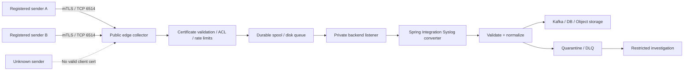
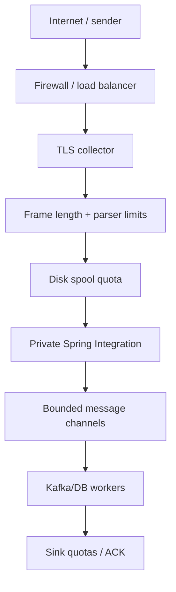

# Securing public log ingestion

## 1. Why is a public Syslog receiver an attack surface?

In **SPRING_INTEGRATION_ADAPTERS**, Spring Integration receives data from external systems using inbound/outbound adapters, gateways, pollers, and `MessageChannel`. The **Adapter Syslog** chapter supports receiving logs from servers, firewalls, routers, applications, and collectors over UDP/TCP, then converting them into `Message<?>` instances for filtering, normalization, routing, and persistence to files/SFTP, HTTP, JMS, AMQP, Kafka, or databases.

When a listener is reachable from untrusted networks—especially the Internet—every Syslog record must be treated as **externally controlled input**, not trustworthy evidence. Senders can spoof facility, severity, hostname, timestamps, and text; transmit oversized or malformed messages; try to exhaust CPU or socket queues; or attempt to inject malicious data into observability and storage pipelines.

A receiver that "runs, parses, and logs" is **not necessarily secure**. The design must answer:

1. Who is allowed to connect and send logs?
2. Is the transport encrypted and peer-authenticated?
3. After TLS termination, does Spring Integration know the **true source identity**?
4. How are inputs bounded in size, rate, framing, and parser cost?
5. When the parser hits malformed data or downstream slows down, where does data go?
6. Could records contain tokens, PII, or log-injection payloads?
7. Can you prove a record was **durably persisted**?

This lesson focuses on **securing external Syslog ingestion**, not merely writing a post-parser validator. Defense layers must be placed both **in front of and behind** the Spring Integration adapter.

### Learning objectives

After this lesson, you will be able to:

- Build a threat model for UDP Syslog, plaintext TCP, and TLS/mTLS.
- Choose designs that avoid exposing the Spring Integration listener directly to the Internet unnecessarily.
- Bind the listener solely to loopback/private interfaces paired with firewalls/ACLs and collectors.
- Understand RFC 5425, certificate validation, mTLS, trust boundaries, and octet counting.
- Distinguish self-declared Syslog `HOSTNAME` from **authenticated transport identity**.
- Bound record size, send rate, connections, queues, and parsing cost.
- Handle `UNDECODED`, malformed input, log injection, PII, the error channel, and quarantine.
- Write XML/Java configuration examples, security tests, operations procedures, and incident response runbooks.

## 2. "Public" can mean several things

| Deployment style | Trust boundary | Preferred direction |
|---|---|---|
| Same process/host only | Loopback or Unix-local collector | Internal listener, restricted OS privileges. |
| Controlled internal network | VLAN/subnet, VPN, ACL | IP allowlists, segmentation; TLS when data is sensitive. |
| External partners over private links | WAN/VPN/private connectivity | TLS/mTLS, explicit source identities, and per-source quotas. |
| Internet with registered senders | Public-facing controlled ingress | TLS/mTLS gateway or collector; private backend; rate limits. |
| Internet open to anyone | Unauthenticated | **Do not use** for security/audit logs; lacks trusted origin and is easily abused. |

Having a public IP or open port does not mean the application should accept arbitrary senders. **Public-facing** should mean only that a **hardened edge entry point** is reachable externally; Spring Integration processing and storage belong in a private network zone.

For legacy devices supporting only UDP/514, reduce exposure with VPNs/private networks, an allowlisted ingress relay, and disk queues. If you are forced to accept UDP over the Internet, accept the residual packet-loss and spoofing risks and **never treat such data as verified identity proof**.

## 3. Threat model: what attackers control

### 3.1. Threat table

| Threat | Attack vector | Impact | Appropriate controls |
|---|---|---|---|
| Source spoofing | Arbitrary UDP source IP/`HOSTNAME`/facility | Corrupted audits, spoofed alerts, tenant mixing | TLS/mTLS, network ACLs, trusted source mapping. |
| Eavesdropping | Plaintext UDP/TCP Syslog across untrusted networks | Leaks IPs, usernames, configs, secrets | TLS 1.2+/1.3 per policy, VPN/IPsec where appropriate. |
| Message tampering | No integrity protection on plaintext UDP/TCP | Logs altered in transit | TLS per hop, storage protection, and provenance. |
| Flood/DoS | High-rate UDP datagrams, bursts of TCP connections/handshakes | Exhausts CPU, queues, socket buffers, disk | Rate limits, firewalls, connection quotas, bounded queues. |
| Malformed parser input | Bad PRI, broken RFC5424 structured data, wrong framing | Exceptions, CPU/memory pressure, loss | Pre-parse frame/size limits, strict validation, quarantine. |
| Log injection | `MSG` with CR/LF, ANSI/HTML/control chars | Forges fake log lines, attacks log viewers | Structured storage, output escaping, never print raw text. |
| Cardinality explosion | Arbitrary host/user/tenant in metric labels | Overloads monitoring systems | Label allowlists; never use raw MSG/hostname. |
| Data exfiltration | Uncontrolled forwarding of raw logs to HTTP/SFTP/Kafka | Leaks PII/tokens | Outbound ACLs, header allowlists, redaction, IAM. |
| Disk exhaustion | Unbounded growth of quarantine/DLQ or raw logs | Prevents ingesting legitimate logs | Quotas, retention, alerts, bounded recovery. |
| Replay/duplicates | Collector replays after outage without event ID | Duplicate alerts, skewed counts | Contract-based dedup/idempotency, durable inbox. |
| Pivot through receiver | Over-privileged app or unrestricted egress | Lateral movement into DB/cluster | Least-privilege service accounts, egress policies, hardening. |

### 3.2. Three things parser code alone cannot solve

**First:** UDP packets dropped before the Java receiver **never create** a `Message<?>` or `ErrorMessage`. The parser cannot recover messages it never saw.

**Second:** `HOSTNAME`, `APP-NAME`, PRI, facility, and severity are **sender-declared** fields. The parser can confirm syntax, **not** verify who sent the record.

**Third:** `MessageChannel.send(...)` succeeding **does not mean** the log was committed to Kafka/a database or will survive a JVM restart. Persistence guarantees must be engineered separately using durable collectors/queues, acks, and retry/replay.

## 4. Choose the transport before opening ports

### 4.1. UDP, TCP, and TLS

| Characteristic | UDP/514 | Plaintext TCP | TLS/TCP/6514 |
|---|---|---|---|
| Connection | No | Yes | TCP + TLS handshake |
| Transport authentication | No | No | Certificate-based, optionally mTLS |
| Confidentiality/integrity | No | No | Yes, per TLS hop |
| Message boundary | One datagram / one Syslog record | Requires framing | RFC 5425 uses octet counting |
| Application-level delivery ack | No | No | No |
| Per-connection rate limiting | Limited | Possible | Possible per client identity |
| Expose publicly directly? | **Avoid** | **Avoid** | Only at a hardened ingress with auth/limits |

RFC 5426 advises **against using UDP Syslog on unprotected networks** due to lack of strong sender authentication and risks of spoofing, tampering/loss, and DoS.

RFC 5425 specifies Syslog-over-TLS and default port **TCP/6514**. TLS provides encryption, in-transit integrity, and peer verification. Yet **TLS does not verify Syslog content correctness**, does not prove `HOSTNAME` belongs to the certificate identity, and provides no application-level persistence acknowledgment.

### 4.2. TCP/6514 does not turn on TLS automatically

Never write the following configuration and call it secure Syslog:

```xml
<!-- THIS IS PLAINTEXT TCP ONLY, EVEN THOUGH THE PORT IS 6514. -->
<int-syslog:inbound-channel-adapter
    id="notReallyTls"
    protocol="tcp"
    port="6514"
    channel="syslogEvents"/>
```

Native `protocol="tcp"` only selects TCP. TLS requires **TLS-enabled connection support** compatible with your Spring Integration IP version or a **real TLS collector/terminator** in front. Never invent `protocol="tls"` on the Syslog namespace.

### 4.3. Port numbers are conventions, not security mechanisms

- `UDP/514`: traditional UDP Syslog port.
- `TCP/514`: plain TCP Syslog in certain deployments.
- `TCP/6514`: default for Syslog-over-TLS per RFC 5425.
- `TCP/1516` or `UDP/1514`: application/lab internal ports, **not mandatory standards**.

Changing port 514 to 1514 does not add authentication or encryption. Nor should you run the JVM as root solely to bind a low port when a collector, port forwarding, or minimal capabilities can handle it.

## 5. Recommended architecture: TLS collector at the edge, Spring Integration in the private zone

### 5.1. Reference diagram



Defense layers in order:

1. **Edge ingress** exposes only required transports/ports (preferring TLS TCP/6514), blocking or throttling traffic before parsing.
2. **Mutual TLS** verifies sender certificates, trust chains, SANs, and identity policies, allowing per-sender revocation/rotation.
3. **Per-source quotas** bound connections, handshakes, and frame sizes, isolating distinct sender groups or risk tiers.
4. **Collector with disk queue** provides outage buffering, controlled retry/replay, and bounded disk usage.
5. **Spring Integration backend listener bound only to private/loopback**, never exposed casually via public NodePorts or host ports.
6. **Validation + quarantine** handles malformed inputs without dumping raw payloads to logs.
7. **Durable sinks** such as brokers/storage enforce IAM/ACLs and explicit ack/commit checkpoints.

A collector does **not automatically** perform every function or provide persistence. Inspect the actual setup: a pure TLS terminator that decrypts and forwards bytes differs from a Syslog-aware collector with parsing, source policies, and disk queues.

### 5.2. Each hop needs its own contract

```text
Sender
  -(authenticated TLS, RFC5425 frames)->
Edge collector
  -(durable spool / replay contract)->
Private Syslog TCP backend
  -(Spring MessageChannel)->
Normalized event
  -(Kafka/DB commit/ack)->
Storage
```

**Contract questions to answer:** when the collector reports receipt, has it flushed to disk or only buffered in memory? When the backend finishes processing, has storage committed? On timeouts, which segment may produce duplicates? Never call a pipeline "exactly once" without proving every boundary.

### 5.3. Fallback path when devices only support UDP

```text
Legacy device --UDP/514--> private VPN / restricted collector
                                |
                                v
                           durable spool
                                |
                                v
                     authenticated private transport
                                |
                                v
                       Spring Integration processor
```

Never turn a public UDP Syslog listener into a trusted authentication service. IP allowlists reduce exposure yet are not strong authentication, especially when NAT, shared IPs, or packet spoofing can occur. For devices lacking TLS support, VPN/IPsec/private links improve transport safety; add real source controls at the tunnel/collector.

## 6. Proper TLS/mTLS for public Syslog

### 6.1. RFC 5425 TLS flow

1. The sender (TLS client) connects to the receiver/collector (TLS server), typically on **TCP/6514**.
2. Both sides complete a TLS handshake and validate certificates per policy.
3. The sender **must** verify server identity (trust chain and expected name); with **mTLS**, the server also verifies the client certificate and maps it to a registered sender.
4. The sender transmits Syslog records over the encrypted TLS stream using **octet counting**.
5. The collector decrypts TLS, splits frames, enforces limits, and forwards per the backend contract.

RFC 5425 frame syntax:

```text
<decimal-byte-length> SP <RFC5424-SYSLOG-MSG>
```

The `<...>` angle brackets here illustrate structure only, not literal wire bytes. The length prefix is the **octet count of the Syslog message**, not Java character count. One TLS record may carry multiple Syslog frames or part of one frame, so never treat TLS record boundaries as message boundaries.

### 6.2. Certificate components

| Component | Location | Function |
|---|---|---|
| Server certificate + private key | Edge TLS receiver | Proves server endpoint identity. |
| Sender CA/trust anchors | Sender/agent | Validates receiver's certificate. |
| Client certificate + private key | Sender (mTLS) | Allows receiver to authenticate the client. |
| Receiver trust anchors | Edge collector | Validates client certificate chains. |
| Allowlist/authorization mapping | Collector or controlled receiver | Maps cert identity -> sender/tenant/quota. |
| Revocation/rotation policy | PKI and ops | Rejects revoked certs and rotates before expiry. |

**Never enable** validation-bypass modes (such as trust-all or disabled hostname verification). Use dedicated CAs and certificates with proper SANs for each environment. Support TLS 1.2/1.3 and cipher suites matching your organization's current security baseline; do not treat an old RFC cipher mention as a reason to keep deprecated ciphers enabled.

### 6.3. TLS identity and Syslog `HOSTNAME` are not the same

RFC 5425 notes that **the transport sender's identity does not necessarily match the Syslog message's `HOSTNAME` field**.

Example:

```text
TLS peer identity:  device-742@organization.example
Syslog HOSTNAME:    edge-01
Syslog APP-NAME:    sshd
Syslog severity:    0
```

Even if `HOSTNAME` says `finance-db-prod`, that is only a **sender-declared value**, not proof that the sender is authorized to emit logs for that host.

Policy should:

- Derive `trustedSenderId` or `tenantId` from the verified certificate identity.
- Compare `HOSTNAME` against the sender's inventory/allowlist if provenance verification is needed.
- On mismatch, flag `IDENTITY_MISMATCH`, quarantine, or apply a dedicated policy.
- Never grant tenant permissions, trigger privileged webhooks, or delete data based on `HOSTNAME`/`APP-NAME` or `severity`.
- Never assume a valid client cert for tenant A may log on behalf of tenant B.

### 6.4. Identity can be lost after TLS termination

If a TLS terminator forwards only **raw Syslog bytes** to Spring Integration, the backend **does not automatically know** which certificate was verified at the edge. The `HOSTNAME` field cannot bridge that gap.

Sound ways to propagate provenance:

1. **Separate ingress/backend per sender group**: the collector maps allowed certs to distinct backend ports/topics, and the backend assigns source groups per protected port/route.
2. **Authenticated metadata envelope** between collector and processor: `trustedSenderId` travels over an integrity-protected protocol, **not simply stuffed into raw Syslog text**.
3. **Collector parses/normalizes and publishes to a durable broker** using collector-assigned principals/ACLs, source identity, and message headers.
4. If using proxy protocol/internal headers, ensure both ends speak the protocol and accept connections only from the trusted proxy; **the native Syslog adapter does not inherently trust arbitrary forwarded headers**.

Never merely prepend `trustedSenderId=...` to `MSG` assuming Spring Integration can authenticate the sender. An attacker could supply that same string before TLS termination unless the collector strips/signs metadata.

### 6.5. Testing the TLS handshake

In a lab with a valid CA and TLS receiver:

```bash
openssl s_client \
  -connect syslog.example.internal:6514 \
  -servername syslog.example.internal \
  -verify_hostname syslog.example.internal \
  -CAfile ./trusted-ca.pem \
  -verify_return_error
```

If mTLS is required by the receiver, add `-cert ./client.crt -key ./client.key` to the **same command**. Private key files must be ACL-protected and never committed to repositories or logged.

A successful handshake **tests TLS only**; it does not prove the collector parses RFC 5424 or publishes to Kafka/DB. End-to-end tests must send an **octet-counted Syslog frame** and verify the record at the sink, while also negative-testing missing client certs, untrusted CAs, wrong hostnames, and expired certs to ensure they are **rejected**.

## 7. Shrinking the network surface: bind address and firewall

### 7.1. Loopback, private IPs, and wildcards

| Bind address | Effect | Security notes |
|---|---|---|
| `127.0.0.1` | IPv4 loopback in the current network namespace | Fits when collector/proxy shares the same host/namespace. |
| `10.x.x.x` or specific private interface | Listens only on the selected interface | IP must belong to the receiver; pair with firewall/NetworkPolicy. |
| `0.0.0.0` | All IPv4 local interfaces | **Not secure by default**; exposes service if ACLs are misconfigured. |
| `::1` / `::` | IPv6 loopback/wildcard | Verify IPv6 policies, dual-stack behavior, and firewalls separately. |

The adapter's `local-address` selects the **local address to bind**, not a remote sender allowlist. If the receiver binds `127.0.0.1:1516`, a proxy on another host/Pod cannot reach that loopback; use a controlled private network or co-locate in the same network namespace.

### 7.2. Firewall rules must match the protocol

Illustrative rule matrix, not OS-specific commands:

| Boundary | Allow | Deny |
|---|---|---|
| Public edge | TCP/6514 from authorized client groups (with mTLS) | Any unapproved Syslog ports. |
| Private collector -> backend | TCP/1516 from exact collector identity/subnet | All other sources to backend port. |
| Storage | Only required broker/DB traffic from backend service account | Arbitrary admin access or unrestricted egress. |
| Legacy UDP | UDP/514 only from VPN/private collectors/allowlisted senders | Open Internet UDP/514 without compelling justification. |

**A network allowlist does not replace mTLS**: IPs can be NATed or reassigned, and a compromised internal host can still spoof payloads. Conversely, mTLS does not replace network segmentation or rate limiting.

### 7.3. Docker/Kubernetes: two port layers

When a JVM inside a container binds `127.0.0.1`, host port publishing normally forwards traffic to the container IP, not the container's internal loopback. Therefore:

- Collector in the same Pod/network namespace: can call the backend via `127.0.0.1`.
- Collector in a different Pod: backend must bind the private Pod IP or wildcard appropriately, guarded by NetworkPolicy.
- Container `-p 1516:1516/tcp` or a Kubernetes Service **does not enable TLS automatically**.
- `containerPort` only documents the expected port; it does not force the app to open a socket.
- Do not use a standard HTTP Ingress expecting it to proxy raw UDP/TCP Syslog.
- Check IPv6 as well if the cluster runs dual-stack.

## 8. Securing the Spring Integration backend behind a collector

This practical example uses **RFC 5424 over TCP** on **loopback TCP/1516**, receiving bytes **already decrypted by a TLS collector**. The upstream collector must genuinely verify client certificates and forward proper RFC 6587 **octet counting** to the backend. The XML below does **not** perform TLS termination.

### 8.1. Dependencies

With the Spring Boot BOM managing versions:

```xml
<dependencies>
    <dependency>
        <groupId>org.springframework.boot</groupId>
        <artifactId>spring-boot-starter-integration</artifactId>
    </dependency>
    <dependency>
        <groupId>org.springframework.integration</groupId>
        <artifactId>spring-integration-ip</artifactId>
    </dependency>
    <dependency>
        <groupId>org.springframework.integration</groupId>
        <artifactId>spring-integration-syslog</artifactId>
    </dependency>
</dependencies>
```

Spring MVC/HTTP endpoints are unnecessary solely for receiving Syslog. Conversely, Spring Security's HTTP `SecurityFilterChain` **does not protect a TCP/UDP Syslog listener**, because it operates on a different socket transport.

### 8.2. Native Syslog inbound XML

Create `src/main/resources/secure-syslog-backend.xml`:

```xml
<?xml version="1.0" encoding="UTF-8"?>
<beans xmlns="http://www.springframework.org/schema/beans"
       xmlns:xsi="http://www.w3.org/2001/XMLSchema-instance"
       xmlns:int="http://www.springframework.org/schema/integration"
       xmlns:int-ip="http://www.springframework.org/schema/integration/ip"
       xmlns:int-syslog="http://www.springframework.org/schema/integration/syslog"
       xsi:schemaLocation="
          http://www.springframework.org/schema/beans
          https://www.springframework.org/schema/beans/spring-beans.xsd
          http://www.springframework.org/schema/integration
          https://www.springframework.org/schema/integration/spring-integration.xsd
          http://www.springframework.org/schema/integration/ip
          https://www.springframework.org/schema/integration/ip/spring-integration-ip.xsd
          http://www.springframework.org/schema/integration/syslog
          https://www.springframework.org/schema/integration/syslog/spring-integration-syslog.xsd">

    <int:channel id="syslogParsed"/>
    <int:channel id="syslogAdapterErrors"/>

    <bean id="rfc5424Converter"
          class="org.springframework.integration.syslog.RFC5424MessageConverter"/>

    <bean id="rfc6587Deserializer"
          class="org.springframework.integration.syslog.inbound.RFC6587SyslogDeserializer"/>

    <!-- Localhost only: the TLS collector MUST share this namespace/host. -->
    <int-ip:tcp-connection-factory
        id="syslogBackendServer"
        type="server"
        local-address="127.0.0.1"
        port="1516"
        using-nio="true"
        deserializer="rfc6587Deserializer"/>

    <int-syslog:inbound-channel-adapter
        id="privateSyslogInbound"
        protocol="tcp"
        connection-factory="syslogBackendServer"
        converter="rfc5424Converter"
        channel="syslogParsed"
        error-channel="syslogAdapterErrors"
        auto-startup="true"/>
</beans>
```

**Boundary explanations:**

- `local-address="127.0.0.1"` ensures the listener binds only the process's IPv4 loopback (assuming no port forwarding/proxy exposes another path).
- `port="1516"` lives on the **server connection factory** because the adapter uses an external `connection-factory`.
- `RFC6587SyslogDeserializer` splits TCP frames per agreed framing before `RFC5424MessageConverter` parses the message.
- `RFC5424MessageConverter` does not map decoded fields to Syslog headers by default when `asMap=true`; downstream must understand the converter's payload.
- `syslogAdapterErrors` only receives failures that the adapter or related infrastructure actually publishes as `ErrorMessage`; it **does not** capture network drops or all malformed records.
- This XML **does not verify sender certificates itself**; that belongs to the TLS edge collector above. Protect the proxy->backend link and provenance policy.

**Never expose TCP/1516** to the Internet; if the edge collector runs on another host, use private IPs, firewalls/internal mTLS, and trusted source mapping instead of loopback.

### 8.3. Java application loading the XML

```java
package example.syslog;

import org.springframework.boot.SpringApplication;
import org.springframework.boot.autoconfigure.SpringBootApplication;
import org.springframework.context.annotation.ImportResource;
import org.springframework.integration.annotation.EnableIntegration;

@SpringBootApplication
@EnableIntegration
@ImportResource("classpath:secure-syslog-backend.xml")
public class SecureSyslogApplication {

    public static void main(String[] args) {
        SpringApplication.run(SecureSyslogApplication.class, args);
    }
}
```

In a real deployment, the backend must register subscribers for `syslogParsed` and `syslogAdapterErrors`; otherwise message dispatch will fail. We add those beans next.

## 9. Protecting parsers, payloads, and business contracts

### 9.1. Do not place every limit after the parser

A Java validator running **after** `RFC5424MessageConverter` cannot stop the parser from processing an oversized frame first. Defense order:

1. **Edge** bounds connection rates, message/frame sizes, input bandwidth, and client counts.
2. **TCP framer** bounds lengths/timeouts per your version and configuration; avoid allocating arbitrary memory from an attacker-controlled length prefix.
3. **Converter** parses RFC 5424 or RFC 3164 matching the source format.
4. **Application validator** checks fields, size/cost, and source/tenant policies.
5. **Downstream adapters** bound payloads/headers, batches, queues, retries, and sink capacity.

For legacy UDP: cap datagram size/bursts at the collector, set `receive-buffer-size` large enough for valid records; `so-receive-buffer-size` governs only the OS socket queue and will not fix truncated datagrams. UDP packets lost before the listener never produce an `ErrorMessage`.

### 9.2. PRI, facility, severity, and malformed messages

Syslog formulas:

```text
PRI = facility * 8 + severity
facility = PRI / 8
severity = PRI % 8

0 <= facility <= 23
0 <= severity <= 7
0 <= PRI <= 191
```

Examples:

```text
<134>1 2026-11-23T02:15:10Z edge-01 app 42 EVT1 - System ready
<192>1 2026-11-23T02:15:10Z edge-01 app 42 EVT1 - Invalid PRI
```

Reject or quarantine records outside contract bounds; never default to severity 0 and trigger false urgent alerts. **Never compare raw PRI integers across facilities to judge urgency.**

For RFC 3164, `SyslogToMapTransformer` may return a `Map` payload containing `UNDECODED` for unparseable records. That is a **message to quarantine**, not necessarily an exception.

For RFC 5424, use `RFC5424MessageConverter`; structured data has escaping rules and `NILVALUE`. Never replace an RFC-compliant parser with `String.split(" ")` or naive regexes.

### 9.3. Untrusted payload/header data

| Data | Source | Policy |
|---|---|---|
| `HOSTNAME`/`APP-NAME` | Written in record by sender | Validate length/format; never use as a security principal. |
| `facility`/`severity` | Written in PRI by sender | Validate ranges; never treat as absolute privilege. |
| `sourceTimestamp` | Sender's clock | Compare with `receivedAt`; handle clock skew and NILVALUE. |
| `MessageHeaders.ID` | Spring Messaging | Internal correlation only; not a globally unique event ID. |
| `syslog_*` | Mapped from Syslog by converter | Depends on converter/`asMap`; contents remain untrusted. |
| `trustedSenderId` | Derived after auth at collector | Trust only if the link to the backend has integrity and access control. |
| Error/reply channels | Spring Integration internal | Never forward indiscriminately over Kafka/JMS/HTTP. |

A `<0>` (`kern.emergency`) record does not prove it came from a real kernel. Never let a severity-0 message automatically trigger webhooks carrying secrets, restart services, or execute admin commands.

## 10. Post-parser Java validation and safe quarantine

To illustrate a complete flow, we use a `@ServiceActivator` to process parsed payloads. In the RFC 5424 backend setup from section 8, the keys in the `Map` depend on `RFC5424MessageConverter`. Before deploying to production, test the exact keys and types produced by your converter version.

The example below chooses a **fail-closed business policy**: only maps with valid numeric facility/severity reach the accepted channel. Other messages go to quarantine, while transport/adapter exceptions go to a separate error handler.

### 10.1. DTO omitting raw log text

Create `SecureSyslogEvents.java`:

```java
package example.syslog;

import java.time.Instant;

public final class SecureSyslogEvents {

    private SecureSyslogEvents() {}

    public record Accepted(
        String eventId,
        String ingressId,
        int facility,
        int severity,
        Instant receivedAt) {
    }

    public record Rejected(
        String ingressId,
        String reason,
        Instant receivedAt,
        int observedFields) {
    }
}
```

In this demo, `ingressId` is an **internal listener identifier**, not a certificate-verified sender identity. To obtain a true `trustedSenderId`, integrate verified metadata from the collector across the section 6.4 boundary.

### 10.2. Channel beans

Create `SecureSyslogChannels.java`:

```java
package example.syslog;

import org.springframework.context.annotation.Bean;
import org.springframework.context.annotation.Configuration;
import org.springframework.integration.channel.DirectChannel;
import org.springframework.messaging.MessageChannel;

@Configuration
public class SecureSyslogChannels {

    @Bean("acceptedSyslog")
    public MessageChannel acceptedSyslog() {
        return new DirectChannel();
    }

    @Bean("quarantinedSyslog")
    public MessageChannel quarantinedSyslog() {
        return new DirectChannel();
    }
}
```

`DirectChannel` dispatches synchronously; slow subscribers can block the sending thread. When decoupling with `ExecutorChannel`, use a bounded executor and a recovery policy. In either case, default channels **do not persist durably**.

### 10.3. Validation service activator

Create `SecureSyslogValidator.java`:

```java
package example.syslog;

import java.time.Instant;
import java.util.Map;
import java.util.UUID;

import org.springframework.beans.factory.annotation.Qualifier;
import org.springframework.integration.annotation.ServiceActivator;
import org.springframework.messaging.Message;
import org.springframework.messaging.MessageChannel;
import org.springframework.messaging.support.MessageBuilder;
import org.springframework.stereotype.Component;

@Component
public class SecureSyslogValidator {

    private static final int MAX_FIELDS = 64;

    private final MessageChannel accepted;
    private final MessageChannel quarantined;

    public SecureSyslogValidator(
            @Qualifier("acceptedSyslog") MessageChannel accepted,
            @Qualifier("quarantinedSyslog") MessageChannel quarantined) {
        this.accepted = accepted;
        this.quarantined = quarantined;
    }

    @ServiceActivator(inputChannel = "syslogParsed")
    public void inspect(Message<?> incoming) {
        Instant receivedAt = Instant.now();
        Object payload = incoming.getPayload();

        if (!(payload instanceof Map<?, ?> fields)) {
            reject("UNEXPECTED_PAYLOAD_TYPE", 0, receivedAt);
            return;
        }

        if (fields.size() > MAX_FIELDS) {
            reject("TOO_MANY_FIELDS", fields.size(), receivedAt);
            return;
        }

        // RFC5424MessageConverter: verify exact keys using a
        // contract test for your framework version.
        Object facilityValue = fields.get("facility");
        Object severityValue = fields.get("severity");

        Integer facility = strictInteger(facilityValue);
        Integer severity = strictInteger(severityValue);

        if (facility == null || facility < 0 || facility > 23
                || severity == null || severity < 0
                || severity > 7) {
            reject("INVALID_PRI_FIELDS", fields.size(), receivedAt);
            return;
        }

        // A fresh UUID is for internal correlation; it is not a
        // durable dedup key for records replayed by the collector.
        SecureSyslogEvents.Accepted event =
            new SecureSyslogEvents.Accepted(
                UUID.randomUUID().toString(),
                "private-tcp-1516",
                facility,
                severity,
                receivedAt);

        sendChecked(accepted, event);
    }

    private void reject(
            String reason, int count, Instant receivedAt) {
        sendChecked(quarantined,
            new SecureSyslogEvents.Rejected(
                "private-tcp-1516", reason, receivedAt, count));
    }

    private static Integer strictInteger(Object value) {
        if (value instanceof Number number) {
            double n = number.doubleValue();
            if (Double.isFinite(n)
                    && n == Math.rint(n)
                    && n >= Integer.MIN_VALUE
                    && n <= Integer.MAX_VALUE) {
                return (int) n;
            }
            return null;
        }

        if (value instanceof String str
                && str.matches("[0-9]{1,3}")) {
            try {
                return Integer.parseInt(str);
            } catch (NumberFormatException ex) {
                return null;
            }
        }

        return null;
    }

    private static void sendChecked(
            MessageChannel channel, Object payload) {
        boolean sent = channel.send(
            MessageBuilder.withPayload(payload).build());

        if (!sent) {
            throw new IllegalStateException(
                "Syslog output channel rejected message");
        }
    }
}
```

**Important points about this code:**

- The `"facility"` and `"severity"` keys here are **illustrative schema assumptions**, **not** a guaranteed API contract of `RFC5424MessageConverter`. In real deployments, replace them with exact keys/constants verified against tests on your Spring Integration version. Alternatively, place a **dedicated RFC 5424 normalizer** ahead of this step to map inputs into a stable DTO with `facilityCode`/`severityCode`.
- `MAX_FIELDS=64` is a **post-parse application guard** and cannot stop the parser from reading a huge frame; enforce limits earlier at the collector/framer.
- The demo omits raw `MSG` and `STRUCTURED-DATA` from outputs, reducing accidental secret leakage. Production needs schema and redaction policies that retain required event details safely.
- `UUID.randomUUID()` only aids correlation; it **cannot** deduplicate collector replays of the same raw record.
- `sendChecked` checks channel dispatch, **not** database/Kafka commit.

For RFC 3164 senders, use `DefaultMessageConverter` and `SyslogToMapTransformer.FACILITY`/`SEVERITY`/`UNDECODED`. Never keep the RFC 5424 map-key example unchanged while swapping converters without regression tests.

### 10.4. Consumers logging only selected metadata

Create `SecureSyslogConsumers.java`:

```java
package example.syslog;

import org.slf4j.Logger;
import org.slf4j.LoggerFactory;
import org.springframework.integration.annotation.ServiceActivator;
import org.springframework.stereotype.Component;

@Component
public class SecureSyslogConsumers {

    private static final Logger log =
        LoggerFactory.getLogger(SecureSyslogConsumers.class);

    @ServiceActivator(inputChannel = "acceptedSyslog")
    public void accept(SecureSyslogEvents.Accepted event) {
        log.info("Syslog accepted: ingress={}, facility={}, severity={}",
            event.ingressId(), event.facility(), event.severity());

        // Production: persist / publish with explicit IAM, quotas, and acks.
        // Do not forward all message headers.
    }

    @ServiceActivator(inputChannel = "quarantinedSyslog")
    public void quarantine(SecureSyslogEvents.Rejected event) {
        log.warn("Syslog quarantined: ingress={}, reason={}",
            event.ingressId(), event.reason());

        // Production: bounded persistent quarantine, access
        // controls, retention, alerts, and policy-driven retry/replay.
    }
}
```

This is **practice code without a durable sink yet**. A successful log entry does not prove the Syslog record is safely persisted in storage. Never use application logs as investigative storage for raw payloads, especially if those logs are shipped back to the same receiver in a loop.

## 11. Exceptions, `ErrorMessage`, and quarantine quotas

### 11.1. Two distinct failure classes

- **Contract violations**: record parses, yet facility/severity is missing, fields exceed limits, or source policy fails -> build `Rejected` and route to `quarantinedSyslog`.
- **Receive or processing exceptions**: socket, deserializer, converter, subscriber, or broker/DB failures -> handled via component-specific error handling, potentially producing `ErrorMessage`.

For RFC 3164 Syslog, an unparseable record may appear in the `Map` under `SyslogToMapTransformer.UNDECODED` without throwing an exception. Thus, **never rely solely** on `errorChannel` to capture malformed records.

### 11.2. Error channel consumer

Create `SecureSyslogErrorConsumer.java`:

```java
package example.syslog;

import org.slf4j.Logger;
import org.slf4j.LoggerFactory;
import org.springframework.integration.annotation.ServiceActivator;
import org.springframework.messaging.Message;
import org.springframework.messaging.MessagingException;
import org.springframework.messaging.support.ErrorMessage;
import org.springframework.stereotype.Component;

@Component
public class SecureSyslogErrorConsumer {

    private static final Logger log =
        LoggerFactory.getLogger(SecureSyslogErrorConsumer.class);

    @ServiceActivator(inputChannel = "syslogAdapterErrors")
    public void handle(ErrorMessage error) {
        Throwable cause = error.getPayload();
        Message<?> original = error.getOriginalMessage();

        if (original == null && cause instanceof MessagingException ex) {
            original = ex.getFailedMessage();
        }

        log.error("Syslog ingest error: type={}, originalPresent={}",
            cause.getClass().getSimpleName(),
            original != null);

        // Production: classify exceptions, emit metrics, and recover
        // safely. Never log Throwable.toString(), stack traces with raw
        // payloads, or entire failedMessage objects by default.
    }
}
```

**Never promise** that an error channel catches every network/transport failure. UDP drops before the socket, TLS handshake rejections at a proxy, or TCP failures before a business message exists typically lie outside the business error flow. Synchronous subscribers on `DirectChannel` may throw directly; async workers on `ExecutorChannel` follow separate error-publishing mechanics.

### 11.3. Quarantine itself can be DoSed

If someone sends millions of bad records, a quarantine policy that "keeps everything forever" can fill disks and cause legitimate events to be lost.

Required policies:

1. Cap **bytes/record**, records/source, and total storage capacity.
2. Enforce per-trusted-sender/tenant quotas and retention/TTL.
3. Never log raw input by default; record only reason, bytes, authenticated source group, and a controlled correlation ID.
4. When quota is reached, enforce an **explicit policy**: throttle/shed the offending source, sample only, spill to an isolated durable tier, or drop with metrics/alerts. Never silently pretend all records were saved.
5. Maintain review/replay workflows and restricted access for sensitive raw data.
6. Never infinitely retry deterministic malformed records; retry only transient storage/network errors with backoff and limits.

## 12. Stopping DoS with multi-layer limits

### 12.1. Where to enforce limits?



| Layer | Recommended limits | What it does NOT solve |
|---|---|---|
| Firewall / edge ACL | Source networks, ports, bandwidth | Does not validate Syslog contents. |
| TLS termination | Connections, handshakes/sec, timeouts, certificate policies | Does not guarantee record commit. |
| Syslog framing | Max frame bytes, read timeouts, malformed-length handling | Does not filter PII/secrets. |
| Parser / normalizer | Record bytes, field counts, charset, CPU/processing budget | Cannot rescue dropped UDP packets. |
| `ExecutorChannel` | Bounded pool/queue, rejection policy | Not a durable queue. |
| Collector disk queue | Capacity, retention, retries, fsync/ack semantics | Does not create exactly-once across all sinks. |
| Kafka/JMS/AMQP/DB | Message/batch quotas, timeouts, IAM, retry limits | Does not protect the edge from upstream flooding. |

**Sizing warning:** even with an 8 KiB max frame, if one client can open thousands of connections, per-connection buffers and connection lifetimes can still consume huge memory. Never pick "8 KiB" alone and assume DoS protection is complete.

### 12.2. CPU-bound vs. I/O-bound work

- **Parser/regex/structured-data** can be CPU-bound: adding more workers than CPU cores rarely increases throughput.
- **Kafka/DB/HTTP writes** can be I/O-bound: bound connection pools, timeouts, and maximum in-flight calls.
- **TLS handshakes** add crypto and certificate-validation overhead: connection reuse, handshake rate limits, and client quotas are critical.
- **Unbounded queues** mask overload and lead to OOMs or runaway latency.
- **TCP backpressure** can slow senders down without confirming durable application storage; UDP typically drops traffic once receive capacity is exceeded.

### 12.3. Do not choose `CallerRunsPolicy` blindly

When a worker pool fills up, `CallerRunsPolicy` runs slow handlers on the receiver thread. For UDP, that can overflow the socket receive buffer and drop datagrams before Spring Integration even reads them. `DiscardPolicy` silently loses tasks; `AbortPolicy` surfaces errors without saving the message. Choose policies around **durability checkpoints, telemetry, and failure contracts**, not just to "silence exceptions."

## 13. Post-ingestion data integrity and security

### 13.1. Encrypt on every hop

TLS protects data **between the two endpoints of a TLS session**. If a collector terminates TLS and forwards plaintext over an untrusted network, the backend leg is no longer protected by that first session.

Options:

- Edge and Spring Integration in the same namespace: backend can bind loopback.
- Edge and backend on separate hosts: private network with firewalls, or **internal mTLS between hops**.
- Edge or backend publishing to Kafka: use TLS/SASL/ACLs per broker policy; never assume sender TLS covers the Kafka hop.
- Raw/quarantine storage: encryption at rest, IAM, access auditing, and retention.
- HTTP alerting: HTTPS, credentials in secret stores, outbound allowlists, and redaction.

### 13.2. Avoid indiscriminate header forwarding and log injection

Never pass all Spring `MessageHeaders` blindly to external systems. A message may contain:

- `replyChannel`, `errorChannel` — internal framework references.
- Transport metadata, debug info, or headers unsuitable for export.
- Sender-controlled text fields containing control chars/newlines or tokens.

Enforce an outbound header allowlist and separate normalized payloads from original raw bytes. When rendering `MSG` in UIs/SIEMs, apply context-appropriate escaping (HTML, terminal, JSON), and never concatenate raw text into log lines or SQL queries. Use parameterized queries and structured logging.

### 13.3. Never turn log events into control commands

This is an anti-pattern:

```text
if severity == 0:
    execute privileged remediation command
```

Any sender can claim severity 0 without a trust boundary. Even with mTLS, high-impact actions require policies anchored in **trusted sender + event type + allowlists + approvals/guardrails**, never triggered directly from raw Syslog text.

### 13.4. Multi-tenant isolation

If a receiver serves multiple tenants:

- Map certificate identity to tenant inside the controlled collector.
- Use isolated queues/topics/storage namespaces or per-tenant ACLs.
- Enforce per-tenant quotas for bytes/second, connections, retention, and DLQs.
- Never trust a `tenantId` placed inside `MSG` or `STRUCTURED-DATA` by the sender without verification.
- Never dump all raw messages into a shared quarantine readable by multiple tenants.
- Maintain audit trails whenever operators access sensitive records.

## 14. Layered security testing

### 14.1. TLS/mTLS negative tests

| Case | Expected |
|---|---|
| Client with valid allowlisted cert | Collector accepts TLS session and applies matching sender quota. |
| Missing client cert when mTLS is mandatory | Rejected before reaching the Syslog backend pipeline. |
| Cert signed by untrusted CA | Rejected. |
| Expired or revoked cert per policy | Rejected / access revoked. |
| Sender verifies wrong server hostname | TLS client rejects mismatched server identity. |
| TLS handshake succeeds then non-Syslog bytes sent | Framer/parser rejects without crashing backend. |
| Valid TLS yet `HOSTNAME` spoofs another machine | Not promoted to `trustedSourceId`; mismatch flagged. |
| Client exceeds connection/handshake quota | Edge throttles/rejects with metrics; no OOM. |

**Never use** trust-all or skip hostname verification for "quick testing" and accidentally carry it into production.

### 14.2. Input validation tests

| Input | Expected behavior |
|---|---|
| Valid RFC 5424 with PRI 134 | Parsed, facility=16/severity=6 validated, processed per policy. |
| Non-numeric PRI | Parse failure/quarantine; no fake severity created. |
| PRI 192 | Out-of-range facility rejected. |
| Structured data missing quote/bracket | Parser rejects or classifies as malformed. |
| Record exceeds field count limit | Quarantined/capped without unbounded allocation. |
| Bad TCP octet-count prefix | Deserializer detects/closes connection per policy; no hang. |
| Huge TCP frame length | Blocked at framer/edge before large allocations. |
| Invalid UTF-8 per source policy | Raw quarantined safely; raw bytes never printed. |
| `MSG` with newlines/ANSI controls | Escaped on output; never rendered as forged log lines. |
| Payload with tokens/PII | Redacted and access-controlled in sink/quarantine. |
| RFC 3164 map with `UNDECODED` | Quarantined; does not require `ErrorMessage`. |
| UDP packet lost before adapter | Network counters alert; no business message created. |
| Transient Kafka/DB failure | Bounded retries, durable DLQ/inbox; channel send not treated as commit. |

### 14.3. Buffer and backpressure tests

Simulate slow downstream sinks in an isolated test environment to observe:

1. Queue depth and end-to-end receiver-to-sink latency.
2. Active workers and executor rejection counts.
3. UDP kernel drops / TCP flow control and reconnects.
4. TLS handshake failures and connection limits.
5. Disk spool utilization and oldest queued message age.
6. Recovery/replay after restarts and duplicate counts.
7. Shutdown behavior while in-flight messages remain.

The goal is to **verify resource bounds and commit checkpoints**, without generating load that disrupts shared systems.

## 15. Unit testing validation without opening public ports

Because the sample `SecureSyslogValidator` operates solely on `Message<?>`, we can test its policy using `QueueChannel` in a unit test. This **does not test** TLS handshakes, Kafka commits, or the actual RFC 5424 parser; those layers require separate integration tests.

```java
package example.syslog;

import static org.junit.jupiter.api.Assertions.*;

import java.util.HashMap;
import java.util.Map;
import org.junit.jupiter.api.Test;
import org.springframework.integration.channel.QueueChannel;
import org.springframework.messaging.Message;
import org.springframework.messaging.support.MessageBuilder;

class SecureSyslogValidatorTest {

    @Test
    void rejectsInvalidSeverity() {
        QueueChannel accepted = new QueueChannel(2);
        QueueChannel rejected = new QueueChannel(2);
        SecureSyslogValidator validator =
            new SecureSyslogValidator(accepted, rejected);

        Map<String, Object> fields = new HashMap<>();
        fields.put("facility", 16);
        fields.put("severity", 9);

        validator.inspect(
            MessageBuilder.withPayload(fields).build());

        Message<?> result = rejected.receive(1000);
        assertNotNull(result);

        SecureSyslogEvents.Rejected event =
            (SecureSyslogEvents.Rejected) result.getPayload();

        assertEquals("INVALID_PRI_FIELDS", event.reason());
        assertNull(accepted.receive(0));
    }

    @Test
    void acceptsValidNormalizedFields() {
        QueueChannel accepted = new QueueChannel(2);
        QueueChannel rejected = new QueueChannel(2);
        SecureSyslogValidator validator =
            new SecureSyslogValidator(accepted, rejected);

        Map<String, Object> fields = Map.of(
            "facility", 16,
            "severity", 6);

        validator.inspect(
            MessageBuilder.withPayload(fields).build());

        Message<?> result = accepted.receive(1000);
        assertNotNull(result);

        SecureSyslogEvents.Accepted event =
            (SecureSyslogEvents.Accepted) result.getPayload();

        assertEquals(16, event.facility());
        assertEquals(6, event.severity());
        assertNull(rejected.receive(0));
    }

    @Test
    void rejectsUnexpectedPayloadType() {
        QueueChannel accepted = new QueueChannel(2);
        QueueChannel rejected = new QueueChannel(2);
        SecureSyslogValidator validator =
            new SecureSyslogValidator(accepted, rejected);

        validator.inspect(
            MessageBuilder.withPayload(new byte[]{1, 2, 3})
                .build());

        Message<?> result = rejected.receive(1000);
        assertNotNull(result);

        SecureSyslogEvents.Rejected event =
            (SecureSyslogEvents.Rejected) result.getPayload();

        assertEquals("UNEXPECTED_PAYLOAD_TYPE", event.reason());
        assertNull(accepted.receive(0));
    }

    @Test
    void rejectsExcessiveFields() {
        QueueChannel accepted = new QueueChannel(2);
        QueueChannel rejected = new QueueChannel(2);
        SecureSyslogValidator validator =
            new SecureSyslogValidator(accepted, rejected);

        Map<String, Object> fields = new HashMap<>();
        for (int i = 0; i < 65; i++) {
            fields.put("custom" + i, "x");
        }

        validator.inspect(
            MessageBuilder.withPayload(fields).build());

        Message<?> result = rejected.receive(1000);
        assertNotNull(result);

        SecureSyslogEvents.Rejected event =
            (SecureSyslogEvents.Rejected) result.getPayload();

        assertEquals("TOO_MANY_FIELDS", event.reason());
        assertNull(accepted.receive(0));
    }
}
```

These tests use the validator's **illustrative map schema** and do not replace contract tests for `RFC5424MessageConverter`. In real projects, add tests invoking the converter on valid RFC 5424 records to verify Map keys and Java types before wiring them into your normalizer.

## 16. Operational metrics and alerting

### 16.1. What to observe

| Metric | Purpose |
|---|---|
| TLS handshakes accepted/rejected | Verify peer identity policy enforcement. |
| Active TCP connections and handshake rate | Detect connection floods/bursts. |
| Bytes/sec and frames/sec per source group | Track ingress load and quotas. |
| Malformed/frame-size rejections | Detect protocol mismatches and input abuse. |
| `UNDECODED` count/rate | Track RFC 3164 payload quality. |
| Invalid PRI/required-field counts | Track validation failures. |
| Quarantine/DLQ backlog and disk fill ratio | Monitor exhaustion risk on error storage. |
| UDP kernel drops/reassembly failures | Catch packet loss ahead of the message adapter. |
| Executor active/queue/rejections | Measure Spring Integration backpressure. |
| Kafka/DB commit latency/failures | Track post-routing durability. |
| Certificate expiry and failed rotations | Prevent mTLS outages. |

Never label metrics with raw hostnames, message text, arbitrary user IDs, unnormalized certificate subjects, or free-form paths. Use bounded source-group/tenant IDs to prevent cardinality explosions.

### 16.2. Behavioral alert rules

- TLS client certificate failures spike from the same source group.
- Unknown/unauthorized senders repeatedly attempt connections.
- Handshake/connection rates climb while valid Syslog frames drop.
- Frame-size rejections or malformed ratios exceed baseline.
- Quarantine disk nears capacity, or persistent queue oldest-message age climbs.
- Kafka/DB write failures rise while incoming rate stays flat or grows.
- Critical devices stop sending data beyond expected silence thresholds.
- One tenant breaches its quota and impacts other tenants.

Prevent alert storms using aggregation, cooldowns, and quotas keyed on trusted identity rather than sender-declared severity 0.

## 17. Runbook when public Syslog ingress is under attack

### 17.1. Sudden surge in log volume

1. Pinpoint whether pressure hits **TLS ingress, framing, parser, validation, quarantine, or sink**.
2. Inspect verified certificate identities and source groups before trusting `HOSTNAME` in Syslog.
3. Measure connection rates, bytes/sec, malformed ratios, queue backlogs, and storage commit latency.
4. Throttle quotas or temporarily block offending sources at the edge per operational policy.
5. Keep priority ingestion open for critical legitimate senders; avoid dropping all audit logs indiscriminately.
6. Enforce capacity budgets on persistent spools/quarantine and alert early when nearing full.
7. Save minimum permitted evidence (timestamp, verified sender, reason, hashes) without leaking PII.
8. Once stable, replay carefully with dedup/idempotency and estimate the loss window from sender/collector counters.

### 17.2. Certificate rotation breaks senders

1. Identify which server cert, client cert, or trust CA changed.
2. Inspect expiry, SAN/hostname, chain, truststore, and client authorization mappings.
3. Verify compatible TLS versions, ciphers, and certificate policies.
4. Roll back or reissue certificates properly; **never disable certificate verification**.
5. Run negative handshake tests and send a valid Syslog frame.
6. Watch collector backlogs drain after recovery.
7. Check for log gaps and replay duplicates downstream.

### 17.3. Backend sees valid Syslog with mismatched identity

1. Inspect the TLS collector identity map, tenant/source config, and backend forwarding path.
2. Check whether provenance was lost after TLS termination.
3. Compare sender-declared `HOSTNAME` against inventory; never trust hostnames automatically.
4. Quarantine/isolate the source on policy mismatch.
5. Never alter source identity by overwriting raw Syslog without keeping an audit trail.
6. Audit affected sinks for any cross-tenant data leakage.

## 18. Pre-production hardening checklist

| Area | Verification question |
|---|---|
| Exposure | Must Syslog truly be received over the Internet? Is an edge collector used instead of exposing the JVM directly? |
| Protocol | Is TLS/TCP 6514 used wherever possible? Is legacy UDP restricted to VPNs/private networks? |
| Authentication | Does mTLS validate chains, SAN/identity, authorization mappings, and revocation/rotation? |
| Backend isolation | Does Spring Integration bind only loopback/private IPs behind firewalls/NetworkPolicies? |
| Provenance | Does `trustedSenderId` genuinely originate at the auth boundary with integrity preserved past termination? |
| Frame/size limits | Are max message/frame sizes, handshakes, connection lifetimes, and parser resources bounded before large allocations? |
| Format | Do senders match RFC 3164/5424? Does TCP use RFC 6587 framing and TLS use RFC 5425 octet counting? |
| Validation | Are facility/severity/required fields, charset/structured data, `UNDECODED`, and timestamps covered by policy? |
| Error flow | Are exceptions, malformed/quarantine records, network drops, and downstream write failures handled separately? |
| Resilience | Are bounded queues, durable spools, retry/backoff, DLQs, idempotency, quotas, and backpressure metrics in place? |
| Storage | Do Kafka/DB/File/SFTP/HTTP outbound adapters enforce TLS/IAM/ACLs, encryption at rest, retention, and header allowlists? |
| Privacy | Are raw secrets kept out of logs, with redaction/escaping and restricted quarantine access? |
| Multi-tenant | Are quotas, storage, and ACLs isolated per tenant using authenticated identity? |
| Lifecycle | Are readiness probes, certificate renewal, graceful drain/shutdown, and incident runbooks tested? |
| Testing | Have mTLS fail-closed, source spoofing, malformed/oversized frames, controlled flooding, and replay been tested? |
| Observability | Do edge/network, framework, queue, and durable sink metrics provide full coverage without PII or high-cardinality labels? |

## 19. Summary

To **secure public log ingestion**, protect the **entire ingestion chain**, not just the Syslog adapter:

- **Prefer a TLS/mTLS collector at the network edge** instead of exposing Spring Integration listeners directly; enforce firewalls/ACLs, source quotas, and timeouts.
- **RFC 5425** specifies Syslog over TLS on TCP/6514 with **octet counting**; port 6514 or `protocol="tcp"` **does not enable TLS automatically**.
- **TLS transport identity differs from sender-declared `HOSTNAME`.** After termination, propagate trusted identity to the backend over an authenticated channel or isolated routing.
- **Stop dangerous inputs early** via frame/message length caps, connection/rate limits, bounded buffers, and the right RFC 3164/5424 parser.
- **Quarantine and the error channel serve different roles**: malformed messages can arrive as `UNDECODED` in a Map payload without throwing an exception.
- **Never let raw Syslog drive authorization or privileged actions**; escape log-injection characters, redact PII, and restrict outbound headers and egress.
- **Data durability** requires durable spools/queues, acks/commits, retries, DLQs, and contracted idempotency; UDP/TCP/TLS alone never confirm Kafka or database writes.

When continuing downstream to files, SFTP, HTTP, JMS, AMQP, Kafka, or databases in **SPRING_INTEGRATION_ADAPTERS**, each outbound adapter requires its own timeouts, authentication, encryption, resource bounds, and error policy. **Syslog security does not end at the receiving port; it is complete only when data reaches the right destination, under the right permissions, with verifiable durability.**

### References

- [Spring Integration — Syslog Support](https://docs.spring.io/spring-integration/reference/syslog.html)
- [Spring Integration — IP TCP Connection Factories](https://docs.spring.io/spring-integration/reference/ip/tcp-connection-factories.html)
- [Spring Integration — Error Handling](https://docs.spring.io/spring-integration/reference/error-handling.html)
- [Spring Integration — Message Channels](https://docs.spring.io/spring-integration/reference/channel.html)
- [Spring Framework — Task Execution and Scheduling](https://docs.spring.io/spring-framework/reference/integration/scheduling.html)
- [RFC 5424 — The Syslog Protocol](https://www.rfc-editor.org/rfc/rfc5424)
- [RFC 5425 — Transport Layer Security (TLS) Transport Mapping for Syslog](https://www.rfc-editor.org/rfc/rfc5425)
- [RFC 5426 — Transmission of Syslog Messages over UDP](https://www.rfc-editor.org/rfc/rfc5426)
- [RFC 6587 — Transmission of Syslog Messages over TCP](https://www.rfc-editor.org/rfc/rfc6587)
- [OWASP — Logging Cheat Sheet](https://cheatsheetseries.owasp.org/cheatsheets/Logging_Cheat_Sheet.html)
