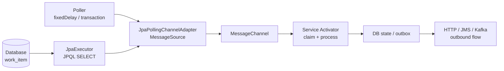
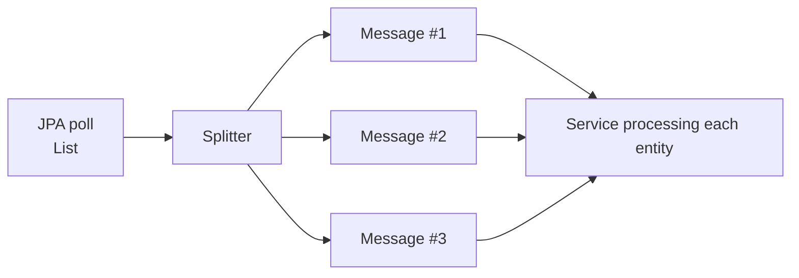
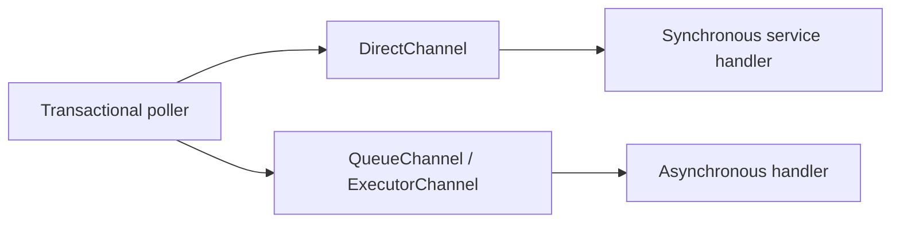
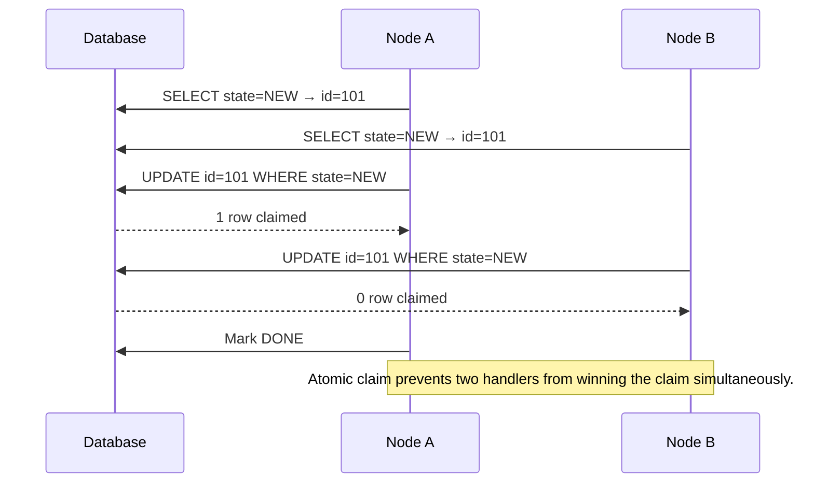

# JPA inbound channel adapter

## 1. Context and Goals

In the **SPRING_INTEGRATION_ADAPTERS** module, external systems are brought into Spring Integration via inbound/outbound adapters, gateways, pollers, and `MessageChannel`. After file-, SFTP-, HTTP-, JMS-, AMQP-, or Kafka-oriented adapters, the database adapter group enables the system to **fetch stored data to initiate an Integration Flow**.

The **JPA inbound channel adapter** lesson, part of the **Adapter JPA** chapter, focuses on **periodically reading data from a database via Jakarta Persistence (JPA)** and turning the result into a Spring Message for downstream processing.

After studying this lesson, you will be able to:

- Explain the roles of `JpaPollingChannelAdapter`, `JpaExecutor`, `MessageSource`, `SourcePollingChannelAdapter`, and `MessageChannel`.
- Distinguish **polling with JPA** from event-driven reading, JPA outbound adapters/gateways, and CDC (Change Data Capture).
- Configure JPQL to fetch a single entity or a list of entities; understand `expectSingleResult`, `maxResults`, and the impact of the poller.
- Build a Spring Boot 3.x + Spring Integration 6.x application using `@InboundChannelAdapter` and `@Poller`.
- Handle the fact that unchanged rows may be read again on subsequent polls.
- Apply transactions, idempotency, atomic claims, and error management for multi-worker/multi-node data sources.
- Control pagination, lazy loading, record counts, backlog, latency, and operational metrics.
- Design tests proving that data is received correctly, not processed repeatedly by mistake, and not lost when downstream fails.

> **Focus:** The JPA inbound adapter is a **polling consumer** for *querying data*, not a real-time database event listener. It does not automatically know which rows have already been processed, does not guarantee exactly-once delivery on its own, and does not replace an appropriate transaction coordination strategy.

## 2. What Is a JPA Inbound Adapter?

A JPA inbound channel adapter executes a JPA query (typically a JPQL `SELECT`) at times determined by a **poller**. The query result is placed into the **payload** of a Spring `Message<?>` and sent to a `MessageChannel` for downstream components to process.

Imagine a `work_item` table storing incomplete requests:

| id | state | body |
| ---: | --- | --- |
| 101 | NEW | `{"orderId":"ORD-101"}` |
| 102 | NEW | `{"orderId":"ORD-102"}` |
| 103 | DONE | `{"orderId":"ORD-103"}` |

A query:

```sql
select w from WorkItem w
where w.state = 'NEW'
order by w.id
```

will select entities whose state is `NEW`. The adapter places a `List<WorkItem>` into the message (under the default configuration returning a list result) so the downstream service can decide how to process it.

### Data Flow Diagram



Easily confused names:

- **`JpaExecutor`**: declares and executes the required JPA operations such as queries, pagination, or post-poll delete/update if configured.
- **`JpaPollingChannelAdapter`**: a `MessageSource` that uses `JpaExecutor` to fetch data and construct a Spring Message.
- **`@InboundChannelAdapter` / polling endpoint**: schedules calls to `MessageSource.receive()` and pushes messages onto the channel.
- **`MessageChannel`**: the boundary between the data source and the integration processing step.
- **`@ServiceActivator`**: processes the payload, invokes business services, and forwards when needed.

JPA is executed by a persistence provider such as Hibernate through `EntityManagerFactory` and `EntityManager`. Spring Integration itself is **not** a JPA provider.

## 3. Distinguishing JPA Inbound, Outbound, and Other Data Retrieval Approaches

| Component / Approach | Trigger | When to Use |
| --- | --- | --- |
| **JPA inbound channel adapter** | Scheduled poller, with no incoming request message | Periodically fetch entities from the database and create messages |
| **JPA outbound channel adapter** | A message arriving at the endpoint | Persist/merge/delete entities, typically as the end of a branch |
| **JPA retrieving outbound gateway** | A request message containing query criteria | Fetch data **on demand** in the middle of a flow and continue processing |
| **JPA updating outbound gateway** | A request message requesting data modification | Update/persist and then continue the flow with a reply |
| **JDBC inbound channel adapter** | Poller and SQL query | Work directly with SQL/`RowMapper` without needing JPA entities |
| **CDC / Debezium / database log stream** | Database transaction log changes | Need near-real-time change tracking and reduced polling |
| **Custom Repository + `@Scheduled`** | Application scheduler | Need a custom workflow outside built-in integration configurations |

**Do not equate polling with CDC:** if a user updates the DB between two polls, the JPA inbound adapter only sees the state matching the query at the next query execution. It does not automatically detect every intermediate version of the same row changing rapidly.

**Do not use an outbound gateway instead of an inbound adapter when you only need a scheduled source:** a retrieving gateway fits when a message already exists to trigger the query. An inbound adapter creates messages itself via the poller.

## 4. Message Contract: Single Entity or List?

A JPA query result can produce:

```java
// expectSingleResult = false (usually the default)
Message<List<WorkItem>>

// expectSingleResult = true, when only one row is selected
Message<WorkItem>
```

This describes the **conceptual payload type**, not a static type that a handler will always receive from the framework. `Message<?>` at runtime holds a concrete payload depending on the query, converter/adapter, and configuration.

| Configuration | Meaning | What to Watch Out For |
| --- | --- | --- |
| `expectSingleResult(false)` | Keeps the result as a list | One Spring Message can contain multiple entities |
| `expectSingleResult(true)` | Extracts a single entity as the payload | If the query actually returns multiple entities, a `MessagingException` may be thrown |
| `maxResults(25)` / `setMaxNumberOfResults(25)` | Limits the number of rows queried per invocation | Does **not** mean the poller runs 25 times |
| `maxMessagesPerPoll = 1` | Limits the number of message receives in a single poll cycle | Does not restrict each message to containing only one row |
| `deleteAfterPoll(true)` | Allows the adapter to delete the read entities per configuration | Destructive action; must evaluate transaction and failure semantics |

If you want each entity to go through separate processing steps, you can use a **Splitter** after the inbound channel:



Spring Integration `split()` can normally split a collection into individual messages. However, to protect integrity, you need to decide on **partial failure handling**: whether one bad record blocks the whole batch, whether the batch retries, and which entities are considered DONE.

### What If There Are No Rows?

When the query finds no data, `JpaPollingChannelAdapter.doReceive()` returns `null` if the result from `JpaExecutor.poll()` is empty (per the Spring Integration 6.x API), so the polling endpoint **does not emit a message containing an empty list** just to report "no data". Handlers should still guard against empty collections when receiving messages from other sources or when the flow contract changes. Never assume each poll tick corresponds to one Spring Message.

## 5. Poller: The Heartbeat of the Inbound Adapter

`JpaPollingChannelAdapter` does not actively spin up an infinite thread to query. It is a `MessageSource`; the Spring Integration **polling endpoint** invokes it according to a trigger.

Java annotation example:

```java
@InboundChannelAdapter(
    channel = "workItemsChannel",
    poller = @Poller(fixedDelay = "2000", maxMessagesPerPoll = "1"))
public MessageSource<?> jpaSource() {
    return new JpaPollingChannelAdapter(jpaExecutor);
}
```

Where:

- `fixedDelay = "2000"`: waits roughly 2,000 ms after the previous poll completes before starting the next one (per the trigger schedule).
- `maxMessagesPerPoll = "1"`: each cycle performs at most one receive from `MessageSource`, though that receive can contain a **`List` of multiple entities**.
- `fixedRate`: schedules periodically from the expected start time; differs in cadence and load when queries take a long time.
- `cron`: suitable when execution is needed at specific times.
- **Task executor**: affects concurrency, DB load, and processing order; must be configured deliberately if used.

Do not set a short poll interval just to feel "realtime". If a query takes 10 seconds and the poller runs every 100 ms, you risk putting unnecessary pressure on the connection pool and database, especially when multiple instances poll together.

### The Poller Does Not Automatically Mark Rows as Read

With the query `where w.state = 'NEW'`, if you do not update `state` or delete the record, the next poll **will still select the same rows**. This is not a poller bug: it is the exact result of the query condition.

The decision to **mark, claim, delete, or store a watermark** must come from the business contract and error handling design.

## 6. Complete Spring Boot Example: Periodically Reading the work_item Table

The example builds a small application:

1. Seed three demo records with state `NEW`.
2. The JPA adapter polls every 2 seconds, fetching at most 25 `NEW` entities.
3. Inbound places `List<WorkItem>` onto `workItemsChannel`.
4. The handler iterates over the list and calls a `@Transactional` service.
5. The service uses an **atomic claim** (`UPDATE ... WHERE state = 'NEW'`) to prevent two workers from claiming the same row.
6. The example only updates the database from `NEW → PROCESSING → DONE` inside the transaction; there are no side effects outside the DB.
7. Subsequent polls will no longer read entities transitioned to `DONE`.

The example uses **Java 17+, Spring Boot 3.x, Spring Integration 6.x, and Jakarta Persistence**. In-memory H2 is used **only for learning and testing**.

### 6.1. Maven Dependencies

```xml
<dependencies>
    <dependency>
        <groupId>org.springframework.boot</groupId>
        <artifactId>spring-boot-starter</artifactId>
    </dependency>
    <dependency>
        <groupId>org.springframework.boot</groupId>
        <artifactId>spring-boot-starter-data-jpa</artifactId>
    </dependency>
    <dependency>
        <groupId>org.springframework.boot</groupId>
        <artifactId>spring-boot-starter-integration</artifactId>
    </dependency>
    <dependency>
        <groupId>org.springframework.integration</groupId>
        <artifactId>spring-integration-jpa</artifactId>
    </dependency>
    <dependency>
        <groupId>com.h2database</groupId>
        <artifactId>h2</artifactId>
        <scope>runtime</scope>
    </dependency>
    <dependency>
        <groupId>org.springframework.boot</groupId>
        <artifactId>spring-boot-starter-test</artifactId>
        <scope>test</scope>
    </dependency>
</dependencies>
```

- `spring-boot-starter-data-jpa` provides Spring Data JPA, a transaction manager, and Hibernate (in the common setup).
- `spring-integration-jpa` contains `JpaExecutor` and `JpaPollingChannelAdapter`; it is not sufficient without a JPA provider/EntityManagerFactory.
- `spring-boot-starter-integration` provides the Spring Integration foundation.
- H2 provides the demo database; production should use PostgreSQL, MySQL, or an appropriate DB with schema migrations and a properly sized connection pool.
- With Spring Boot 3.x/Spring Framework 6.x, the standard JPA package is **`jakarta.persistence`**, not `javax.persistence` from older Spring versions.

Use the Spring Boot BOM to manage versions and avoid mixing incompatible Spring Integration/Hibernate/JPA versions manually.

### 6.2. WorkItem Entity

File `WorkItem.java`:

```java
package com.example.jpainbound;

import jakarta.persistence.Column;
import jakarta.persistence.Entity;
import jakarta.persistence.GeneratedValue;
import jakarta.persistence.GenerationType;
import jakarta.persistence.Id;
import jakarta.persistence.Table;

@Entity
@Table(name = "work_item")
public class WorkItem {

    @Id
    @GeneratedValue(strategy = GenerationType.IDENTITY)
    private Long id;

    @Column(nullable = false, length = 32)
    private String state;

    @Column(nullable = false, length = 512)
    private String body;

    protected WorkItem() {
        // JPA requires a no-arg constructor.
    }

    public WorkItem(String body) {
        this.body = body;
        this.state = "NEW";
    }

    public Long getId() {
        return id;
    }

    public String getState() {
        return state;
    }

    public String getBody() {
        return body;
    }

    public void setState(String state) {
        this.state = state;
    }
}
```

JPA queries use the **Java entity name `WorkItem` and field `state`**, not the table name `work_item` and arbitrary SQL columns. This is the difference between **JPQL** and **native SQL**.

States in this lesson:

```text
NEW        : awaiting poll
PROCESSING : claimed in an active transaction
DONE       : demo DB processing succeeded
```

In the sample code, `PROCESSING` and `DONE` are written in the **same transaction**, so other applications usually do not see the committed intermediate `PROCESSING` state. If production needs to hold a `PROCESSING` lease longer for async processing, an appropriate claim/lease/timeout mechanism must be added.

### 6.3. Spring Data Repository with Atomic Claim

File `WorkItemRepository.java`:

```java
package com.example.jpainbound;

import org.springframework.data.jpa.repository.JpaRepository;
import org.springframework.data.jpa.repository.Modifying;
import org.springframework.data.jpa.repository.Query;
import org.springframework.data.repository.query.Param;

public interface WorkItemRepository
        extends JpaRepository<WorkItem, Long> {

    @Modifying
    @Query("""
            update WorkItem w
               set w.state = 'PROCESSING'
             where w.id = :id
               and w.state = 'NEW'
            """)
    int claimIfNew(@Param("id") Long id);
}
```

This is a **database-level atomic claim condition**:

- If the row is still `NEW`, `UPDATE` changes the state and returns `1`.
- If another worker already claimed/completed it, the condition does not match and returns `0`.
- When multiple workers claim concurrently, the DB is responsible for locking/synchronizing the update according to transaction isolation.
- `@Modifying` marks the method as executing an update query within a transaction; the `@Transactional` service below provides that transaction.

**This guards against duplicate processing at the claim step**, and does not by itself guarantee that a side effect outside the DB (sending email, Kafka, HTTP) occurs only once. To guarantee event delivery, combine this with an outbox, idempotency, and contract-defined retries.

### 6.4. Transactional Processing Service

File `WorkItemProcessor.java`:

```java
package com.example.jpainbound;

import org.springframework.stereotype.Service;
import org.springframework.transaction.annotation.Transactional;

@Service
public class WorkItemProcessor {

    private final WorkItemRepository repository;

    public WorkItemProcessor(WorkItemRepository repository) {
        this.repository = repository;
    }

    @Transactional
    public void process(Long id) {
        // One worker wins the claim; the other skips.
        if (repository.claimIfNew(id) != 1) {
            return;
        }

        WorkItem item = repository.findById(id)
                .orElseThrow();

        // Demo only updates the DB. Do not send Kafka/HTTP here,
        // because those side effects are not part of the same DB transaction.
        System.out.println("Processing id=" + item.getId()
                + ", payload=" + item.getBody());

        item.setState("DONE");
        // JPA dirty checking writes state DONE when the transaction commits.
    }
}
```

This approach is useful because:

1. A transaction wraps the claim, entity reload, and state update.
2. The bulk update query ensures only one worker wins the claim.
3. Subsequent polls only fetch rows still in `NEW`.
4. The handler does not directly mutate the entity received from the message, avoiding reliance on whether the entity is attached or detached in the poll's persistence context.

**Important:** if the service throws an exception before commit, the transaction rolls back and the row can return to `NEW`. If a side effect outside the DB occurred before rollback, a retry can cause that side effect to run multiple times. Production solutions typically use a transactional outbox, idempotent consumers, and retry state tracking.

### 6.5. Configuring the JPA Inbound Channel Adapter

File `JpaInboundConfiguration.java`:

```java
package com.example.jpainbound;

import java.util.List;

import jakarta.persistence.EntityManagerFactory;

import org.springframework.context.annotation.Bean;
import org.springframework.context.annotation.Configuration;
import org.springframework.integration.annotation.InboundChannelAdapter;
import org.springframework.integration.annotation.Poller;
import org.springframework.integration.annotation.ServiceActivator;
import org.springframework.integration.config.EnableIntegration;
import org.springframework.integration.jpa.core.JpaExecutor;
import org.springframework.integration.jpa.inbound.JpaPollingChannelAdapter;
import org.springframework.integration.core.MessageSource;
import org.springframework.messaging.MessageHandler;
import org.springframework.messaging.MessagingException;

@Configuration
@EnableIntegration
public class JpaInboundConfiguration {

    @Bean
    public JpaExecutor workItemJpaExecutor(
            EntityManagerFactory entityManagerFactory) {

        JpaExecutor executor =
                new JpaExecutor(entityManagerFactory);

        executor.setJpaQuery("""
                select w from WorkItem w
                where w.state = 'NEW'
                order by w.id
                """);

        executor.setMaxNumberOfResults(25);
        executor.setExpectSingleResult(false);
        executor.setDeleteAfterPoll(false);

        return executor;
    }

    @Bean
    @InboundChannelAdapter(
            channel = "workItemsChannel",
            poller = @Poller(
                    fixedDelay = "2000",
                    maxMessagesPerPoll = "1"))
    public MessageSource<?> workItemSource(
            JpaExecutor workItemJpaExecutor) {

        return new JpaPollingChannelAdapter(workItemJpaExecutor);
    }

    @Bean
    @ServiceActivator(inputChannel = "workItemsChannel")
    public MessageHandler processPolledRows(
            WorkItemProcessor processor) {

        return message -> {
            if (!(message.getPayload() instanceof List<?> rows)) {
                throw new MessagingException(
                        message, "Expected List<WorkItem> payload");
            }

            for (Object row : rows) {
                if (!(row instanceof WorkItem workItem)) {
                    throw new MessagingException(
                            message, "Unexpected entity type");
                }

                processor.process(workItem.getId());
            }
        };
    }
}
```

**Key points to understand in the code:**

1. `JpaExecutor(entityManagerFactory)` is delegated query execution by Spring Integration. Use the factory rather than sharing a raw `EntityManager` across multiple threads.
2. `setJpaQuery(...)` accepts **JPQL** with Java entity/field names, not SQL table names.
3. `setMaxNumberOfResults(25)` limits each query to at most 25 entities.
4. `setExpectSingleResult(false)` keeps the payload as a `List`; the handler is responsible for iterating.
5. `setDeleteAfterPoll(false)` preserves rows; marking DONE belongs in the business service.
6. `@InboundChannelAdapter` creates a polling endpoint and sends output to `workItemsChannel`.
7. `@Poller(maxMessagesPerPoll = "1")` does not restrict the payload to a single entity.
8. `@ServiceActivator` is the downstream consumer; because this is a default direct channel for a synchronous processing endpoint, consider execution duration and error handling so the polling thread is not blocked for too long.
9. `process(id)` manages its own transaction without assuming the adapter's entity is still attached.
10. `@EnableIntegration` is declared explicitly; Spring Boot starters may also configure Integration automatically when appropriate.

**Scope note:** this snippet demonstrates DB-level claim protection. It does not yet include retry/lease/backoff for external errors, Kafka publishing, or end-to-end exactly-once guarantees.

### 6.6. Bootstrapping and Seeding Demo Data

File `JpaInboundApplication.java`:

```java
package com.example.jpainbound;

import java.util.List;
import org.springframework.boot.CommandLineRunner;
import org.springframework.boot.SpringApplication;
import org.springframework.boot.autoconfigure.SpringBootApplication;
import org.springframework.context.annotation.Bean;

@SpringBootApplication
public class JpaInboundApplication {

    public static void main(String[] args) {
        SpringApplication.run(JpaInboundApplication.class, args);
    }

    @Bean
    CommandLineRunner sampleRows(WorkItemRepository repository) {
        return args -> {
            if (repository.count() == 0) {
                repository.saveAll(List.of(
                        new WorkItem("{\"orderId\":\"ORD-101\"}"),
                        new WorkItem("{\"orderId\":\"ORD-102\"}"),
                        new WorkItem("{\"orderId\":\"ORD-103\"}")
                ));
            }
        };
    }
}
```

File `application.properties` for the **demo environment**:

```properties
spring.datasource.url=jdbc:h2:mem:jpa_inbound_demo;DB_CLOSE_DELAY=-1
spring.datasource.driver-class-name=org.h2.Driver
spring.datasource.username=sa
spring.datasource.password=

spring.jpa.hibernate.ddl-auto=create-drop
spring.jpa.open-in-view=false
logging.level.org.springframework.integration=INFO
```

With in-memory H2 and `create-drop`, data is erased on restart. This is a choice for learning, **not applicable** to production. Production requires migrations via Flyway/Liquibase, backups, pool sizing, and proper database permissions.

Running the application, you will see `NEW` records selected, processed, and transitioned to `DONE`. Once no `NEW` records remain, subsequent polls create no further processing work. If a new `WorkItem` is inserted, the poller picks it up on the next cycle.

**Startup behavior:** `CommandLineRunner` runs after the application context is created, so an early poll may occur before seeding finishes; that is not an error. For tighter startup sequencing, control endpoint startup order, seed data, and readiness.

## 7. Three Configuration Styles: Java Annotation, Java DSL, and XML

This lesson used **Java annotations**. Spring Integration also supports Java DSL and XML namespaces to describe the same mechanism. **Choose only one style for a given real endpoint**; configuring all three simultaneously will create multiple pollers reading from the same source.

### 7.1. Java DSL

The following **replaces** `@InboundChannelAdapter` and the handler annotation in section 6.5 rather than running alongside them:

```java
import jakarta.persistence.EntityManagerFactory;
import java.time.Duration;
import org.springframework.context.annotation.Bean;
import org.springframework.integration.dsl.IntegrationFlow;
import org.springframework.integration.dsl.Pollers;
import org.springframework.integration.jpa.dsl.Jpa;

@Bean
IntegrationFlow jpaPollingFlow(
        EntityManagerFactory entityManagerFactory,
        WorkItemProcessor processor) {

    return IntegrationFlow
            .from(
                    Jpa.inboundAdapter(entityManagerFactory)
                            .jpaQuery("""
                                    select w from WorkItem w
                                    where w.state = 'NEW'
                                    order by w.id
                                    """)
                            .maxResults(25),
                    endpoint -> endpoint.poller(
                            Pollers.fixedDelay(Duration.ofSeconds(2))))
            .split()
            .handle((payload, headers) -> {
                WorkItem row = (WorkItem) payload;
                processor.process(row.getId());
                return null;
            })
            .get();
}
```

- `Jpa.inboundAdapter(entityManagerFactory)` creates a spec wrapping `JpaPollingChannelAdapter`.
- `jpaQuery(...)` and `maxResults(25)` configure the JPA source.
- `Pollers.fixedDelay(Duration.ofSeconds(2))` controls the data fetch schedule.
- `split()` turns `List<WorkItem>` into individual messages so the handler operates on one entity at a time.
- `handle(...)` returns `null` to end the demo flow after processing; no reply message is produced.

If you want downstream flow to continue to Kafka/JMS/HTTP, design subsequent message outputs/transformers instead of always terminating with `null`.

### 7.2. XML Namespace

An XML configuration illustrating the same polling concept:

```xml
<int-jpa:inbound-channel-adapter
        id="workItemJpaInbound"
        channel="workItemsChannel"
        entity-manager-factory="entityManagerFactory"
        jpa-query="select w from WorkItem w where w.state = 'NEW' order by w.id"
        max-results="25"
        expect-single-result="false"
        delete-after-poll="false">

    <int:poller fixed-delay="2000"
                max-messages-per-poll="1"/>
</int-jpa:inbound-channel-adapter>
```

This assumes you have declared the `int`/`int-jpa` namespaces, schemas, and `entityManagerFactory` bean in your Spring XML context. This is an **endpoint XML snippet**, not a standalone XML file with full root/namespace declarations.

**Choosing a query source:** Java DSL/XML allow `entityClass`, `jpaQuery`, `namedQuery`, or `nativeQuery` in supported combinations; do not declare conflicting options together. If a query takes parameters, use a safely configured `ParameterSource`/JPA parameters, and **never concatenate client data into JPQL**.

### 7.3. When to Use expectSingleResult?

If each poll should fetch only a single entity:

```java
executor.setJpaQuery("""
        select w from WorkItem w
        where w.state = 'NEW'
        order by w.id
        """);

executor.setMaxNumberOfResults(1);
executor.setExpectSingleResult(true);
```

Then the handler receives **`WorkItem`** instead of `List<WorkItem>`. Update the handler to match that payload type.

**Do not set `expectSingleResult(true)` without limiting the query when multiple rows exist:** the adapter can throw an exception when the result contains multiple entities. `expectSingleResult` does not automatically split a list or automatically claim a single row in the DB.

## 8. Transactions: What Scope Is Actually Guaranteed?

### 8.1. Poll Transaction and Business Transaction

JPA operations that modify data (update/delete) must run inside a transaction. In the sample, `JpaExecutor` only queries, while `WorkItemProcessor.process(...)` uses `@Transactional` to claim and update state.

If the adapter configures `deleteAfterPoll(true)` or performs updates tied to the poll itself, an appropriate **transaction for the polling endpoint** is required. Spring Integration supports poller transactional advice, for example in XML:

```xml
<int-jpa:inbound-channel-adapter
        channel="workItemsChannel"
        entity-manager-factory="entityManagerFactory"
        jpa-query="select w from WorkItem w where w.state = 'NEW'"
        delete-after-poll="true">
    <int:poller fixed-delay="2000">
        <int:transactional propagation="REQUIRED"
                           transaction-manager="transactionManager"/>
    </int:poller>
</int-jpa:inbound-channel-adapter>
```

This is a **transaction semantics example**, and should not be applied to real business tables solely to avoid re-reading. `deleteAfterPoll(true)` can delete data **before all downstream processing actually finishes** (especially with asynchronous channels), and when the transaction commits, it cannot infer that a Kafka/HTTP consumer succeeded.

### 8.2. DirectChannel and QueueChannel Boundaries



- `DirectChannel` normally invokes the handler on the **sender's thread**; transactional advice wrapping the poll can include synchronous downstream work within the call scope.
- `QueueChannel` or `ExecutorChannel` hands off work across an asynchronous boundary; the poller's transaction **does not automatically extend** to the downstream consumer.
- `@Transactional` on a service invoked via a Spring proxy from another bean is a clear way to establish a transaction per DB processing call.
- If using a transaction meant to roll back an entire flow, verify channel boundaries, exception propagation, and retry policies carefully.

**There is no default transaction spanning DB, Kafka, HTTP, and WebSocket just because all components live in the same Integration Flow.** Define each transaction and coordination mechanism explicitly.

### 8.3. Why Is delete-after-poll Dangerous?

Suppose the adapter reads 10 records, deletes them in one transaction, and sends a `List` to a queue for another worker to process. The downstream worker crashes before finishing. If the delete transaction already committed, the records may be gone from the source.

Use `deleteAfterPoll` only if the data can genuinely be deleted per business rules, processing stays within an appropriate transaction/path, and you have verified failure and recovery behavior. For critical workflows, **state machine + claim + outbox** is usually easier to observe and recover.

## 9. Repeated Reads, Multiple Workers, and Processing Guarantees

### 9.1. Repeated Polling Is Normal Behavior

JPQL `where state = 'NEW'` does not know which rows were processed downstream. If the service does not update the row, the next poll will still return the same `WorkItem`.

To prevent unintended repetition, you can choose:

- Update `state` after successful processing.
- Atomic claim via `UPDATE ... WHERE state='NEW'`.
- Add `@Version`/optimistic locking on appropriate domain entities.
- Use outbox/inbox tables and an idempotency key.
- Use explicit consumer/partition ownership, or DB locking when truly required.

### 9.2. Two Nodes Polling Concurrently

Suppose Spring Node A and Node B read the same table:



**Be careful about transactions:** the diagram above shows the logical flow. When two transactions update the same row concurrently, one may have to wait on a lock; claim behavior depends on isolation level and the DB engine. You need integration tests against your actual production database to verify behavior and check for deadlocks/timeouts.

**Without a claim**, both A and B can execute side effects before either marks the row `DONE`.

### 9.3. Mid-Flight Failures and Leases

If you claim to `PROCESSING` and **commit before** calling an external service, a crash can leave the row stuck in `PROCESSING`. Keeping a transaction open while calling slow HTTP/Kafka endpoints increases lock duration and risks DB contention.

Production systems often need additional fields:

| Field | Purpose |
| --- | --- |
| `state` | `NEW`, `PROCESSING`, `DONE`, `FAILED` |
| `claimed_by` | Instance/worker currently processing |
| `claimed_until` or `lease_until` | Lease expiration time, allowing recovery of stuck work |
| `attempt_count` | Number of attempts to enforce retry limits |
| `next_attempt_at` | Retry/backoff schedule |
| `event_id` or `idempotency_key` | Prevents duplicate downstream side effects |
| `last_error_code` | Observes failure reasons without storing secrets |

Claim/lease design depends on the database: native SQL `SELECT ... FOR UPDATE SKIP LOCKED` can be used on supported DBs, or atomic updates with version/lease columns. Plain JPQL has no portable syntax for all advanced row-locking features; consider compatibility.

### 9.4. Outbox for Critical Events

If the goal is "read new order and send a Kafka event", never assume Kafka received the event just because the DB transaction committed.

One approach:

1. Within the DB transaction, write/update the entity state and insert an **outbox event** with a unique `eventId`.
2. Another polling adapter/worker reads eligible outbox rows and publishes them to Kafka/JMS.
3. Once the broker acknowledges per contract, mark the outbox row `SENT`.
4. If a crash occurs before marking `SENT`, the event may be published again; the consumer must be **idempotent** on `eventId`.
5. Use retries with backoff, dead-letter handling, and alerts for excessive backlog.

This typically provides **at-least-once delivery + idempotency**, not automatic exactly-once delivery from database to external systems.

## 10. Tuning Queries and Resources

### 10.1. maxResults Is Not Full Pagination

`setMaxNumberOfResults(25)` only limits the number of entities per query. If there are 100,000 `NEW` rows, the adapter selects at most 25 rows per poll. It does not guarantee all rows are visited if you keep reading the first 25 rows **without changing their state**.

Use `order by` with a stable key such as `id` to reduce nondeterminism per batch. However, `order by` alone does not guarantee fairness across concurrent workers and updates.

Avoid mechanically incrementing `firstResult`/OFFSET over a mutating set: when rows transition to `DONE` between polls, offsets can skip or re-read records. **State-based polling** and proper keyset/watermark strategies are usually easier to control.

### 10.2. Lazy Loading and Detached Entities

After the JPA adapter completes its query, entities may no longer be attached to a persistence context where downstream handlers run. If an asynchronous handler accesses a `LAZY` association, you can hit `LazyInitializationException`.

Solutions:

- Pass only **IDs/immutable DTOs** across asynchronous channels.
- Use controlled fetch joins/entity graphs if related data must be loaded.
- Inside a `@Transactional` service, reload the entity by ID when needed.
- Do not dump an entire entity graph onto Kafka/JMS/JSON indiscriminately.
- For large datasets, projections/queries selecting only needed fields reduce overhead.

The sample receives the entity but **reads only `id`** and lets the service reload the row inside a transaction. This is a simple way to avoid relying on the attached state of polled entities.

### 10.3. Indexes and Database Connection Pool

JPQL:

```sql
select w from WorkItem w
where w.state = 'NEW'
order by w.id
```

should be evaluated using execution plans and indexes on the real database. Depending on the engine, a composite index `(state, id)` can help both filtering and sorting. Do not create indexes just because a query looks simple; measure write overhead and the selectivity of `state`.

If 10 nodes each poll 10 times/second, DB load can be high even with no new rows. Consider:

- An appropriate fixed delay, increasing intervals when there is no work.
- Reasonable batch sizes and proper indexes.
- Connection pool max size, query timeouts, and DB resource limits.
- Backoff/jitter so instances do not query at the exact same instant.
- Avoiding unbounded poller threads or executors.
- CDC/outbox/log streaming if high event rates and very low latency are required.

### 10.4. Poller and Service Activator Do Not Have End-to-End Backpressure by Default

`DirectChannel` processes synchronously, so slow downstream work can stretch out poll duration; this sometimes acts as a natural throttle. If you insert an `ExecutorChannel`/`QueueChannel`, the poller can keep enqueuing while the consumer lags, growing the queue. Set explicit capacities, overflow/rejection policies, and metrics.

For large datasets or long-running jobs, design a dedicated job queue/outbox rather than simply raising `maxMessagesPerPoll`.

## 11. Error Handling and Retries

### 11.1. Common Failure Modes

| Error | Example | Handling Strategy |
| --- | --- | --- |
| DB connection failure | Database restart, connection pool exhausted | Bounded backoff/retry, health alert |
| Invalid JPQL | Wrong entity/field name or syntax | Fix configuration, do not retry forever |
| Query returns too many rows | Missing `maxResults` or unselective query | Limit batch size, optimize index/query |
| Entity mapping failure | Incompatible DB schema | Migrations, database testing |
| Lazy loading error | Async handler accesses detached proxy | DTO/ID or proper transaction/fetch |
| Multiple results when single expected | `expectSingleResult(true)` but query returns many | Set `maxResults(1)` or fix contract |
| Competing claims | Two nodes pick the same row | Atomic update/locking and idempotency |
| Business service throws error | Validation failure, downstream unavailable | Transaction rollback, retry/`FAILED` state |
| Poison data | Malformed JSON payload, oversized content | Schema validation, size limits |
| Endless re-polling | Row remains `NEW` after success | Mark DONE/claim; verify transaction commit |

### 11.2. Polling Error Channel Does Not Automatically Handle Business Recovery

In Spring Integration, synchronous poller/handler errors can flow through error handling/error channels depending on endpoint and task scheduler configuration. **Never assume** there is a safe infinite retry mechanism or that a row automatically becomes `FAILED` when an exception occurs.

A clear strategy:

1. Classify **transient** errors (DB/network timeout) vs. **non-retryable** errors (schema/validation).
2. Log `eventId`/`rowId`, attempt count, and error code; avoid logging PII/tokens.
3. On DB transaction errors, allow rollback and retry only after a backoff delay.
4. For repeatedly failing poison records, transition to `FAILED`/quarantine after N attempts so one row does not block every batch.
5. Monitor waiting record age, backlog, and processing latency.
6. For external side effects, use outbox/idempotency to prevent duplicate actions.

Never write `catch (Exception e) { }` and then mark `DONE`; that can cause **silent data loss**.

## 12. Testing the JPA Inbound Adapter

### 12.1. Unit Testing the Atomic Claim

Test the repository at the JPA layer with a test database:

```java
package com.example.jpainbound;

import static org.assertj.core.api.Assertions.assertThat;

import org.junit.jupiter.api.Test;
import org.springframework.beans.factory.annotation.Autowired;
import org.springframework.boot.test.autoconfigure.orm.jpa.DataJpaTest;

@DataJpaTest
class WorkItemRepositoryTest {

    @Autowired
    WorkItemRepository repository;

    @Test
    void claimOnlyOnce() {
        WorkItem row = repository.saveAndFlush(
                new WorkItem("{\"orderId\":\"ORD-T01\"}"));

        int first = repository.claimIfNew(row.getId());
        int second = repository.claimIfNew(row.getId());

        assertThat(first).isEqualTo(1);
        assertThat(second).isZero();
    }
}
```

`@DataJpaTest` normally runs each test in a transaction that rolls back automatically. This test proves **a claim cannot win twice sequentially in the same DB state**, not a true race between two real transactions. A real concurrency test requires two independent transactions/connections against the target database.

### 12.2. Poller Integration Tests

A meaningful integration test should:

1. Boot the Spring context with an H2/PostgreSQL test database.
2. Seed two `NEW` rows and one `DONE` row.
3. Wait for the poller to run (using Awaitility or a test latch/event with a timeout), rather than arbitrary fixed sleeps.
4. Verify the two `NEW` rows are processed and transitioned to `DONE`, and the already-`DONE` row is not reprocessed.
5. Insert a new row while the application is running; verify the poller picks it up in a later cycle.
6. Insert more rows than `maxResults` and verify the next batch processes the remainder.
7. Force a row to throw an exception; verify transaction rollback and retry/`FAILED` policy.
8. Run two instances polling concurrently to test contention; this requires a real DB or production-like test environment.
9. Slow down downstream processing and measure its impact on the poll schedule.
10. Verify metrics/logs, lifecycle stop/start, and graceful shutdown while polling.

Asserting only `Processing ...` logs is not enough to prove DB state committed. Inspect rows in a separate transaction/connection when needed.

### 12.3. Testing with a Real Database

H2 can differ from PostgreSQL/MySQL in SQL dialect, data types, transaction isolation, locking, indexes, timeouts, and `SKIP LOCKED`. Use Testcontainers or a real-database integration environment for multi-worker, claim, and retry scenarios.

**Specifically:** test crashes at critical points (after claim, before commit, after publish, before marking `SENT`) to understand the risk of lost/duplicated events. Without those tests, do not claim "exactly-once" in your SLA.

## 13. Observability and Operations

Useful metrics:

| Metric | Meaning |
| --- | --- |
| `jpa_poll_duration_seconds` | Duration of each query/poll |
| `jpa_poll_results_count` | Number of rows fetched per poll |
| `jpa_poll_errors_total` | Count of query/connection/transaction errors |
| `work_items_new_count` | Unclaimed backlog |
| `work_items_processing_count` | Rows currently processing or holding a lease |
| `work_items_oldest_age_seconds` | Age of the oldest waiting record |
| `work_item_claim_conflicts_total` | Count of atomic claims returning 0 |
| `work_item_retry_total` | Retry count by error category |
| `db_connection_pool_active` | Pressure on the connection pool |
| `outbox_unsent_events` | Events written but not yet successfully published |

Do not use individual `rowId` or `eventId` values as metric labels due to high cardinality. Place IDs in traces/logs according to data protection policies.

### Pre-Deployment Checklist

- [ ] JPQL uses correct entity/field names and has indexes matching the workload.
- [ ] `maxResults`, poll interval, and timeouts are properly sized.
- [ ] A mechanism marks processed rows; no infinite re-polling.
- [ ] Transactions cover the right scope; no assumption that transactions span queues/HTTP/Kafka.
- [ ] Multi-worker setups have atomic claim/idempotency or equivalent work partitioning.
- [ ] Retry/backoff/`FAILED` state exists for failing records; poison rows cannot stall the pipeline.
- [ ] Slow downstream consumers have bounded queues/buffers and overflow policies.
- [ ] Lazy entities are never accessed outside a persistence context.
- [ ] Metrics exist for backlog, claim conflicts, errors, and row age.
- [ ] Tested against a production-like database, including reconnect/restart/crash cases.

## 14. Practice Exercises

### Exercise A — Single Entity vs. List

Modify the adapter so each poll fetches only one `WorkItem` using `setMaxNumberOfResults(1)` and `setExpectSingleResult(true)`. Update the handler to accept `WorkItem` instead of `List<WorkItem>`. Then remove `maxResults(1)` while keeping `expectSingleResult(true)` on a table with multiple `NEW` rows; observe the error and explain the cause.

### Exercise B — Poller Effects

Compare `fixedDelay`, `fixedRate`, and `maxMessagesPerPoll` in a scenario with a 300 ms query, 1,500 ms handler, and 1,000 `NEW` rows. Explain why `maxMessagesPerPoll=1` does not restrict a batch to a single row.

### Exercise C — Transactions and delete-after-poll

Create a deletable demo data table, configure `deleteAfterPoll(true)`, and add a transactional poller. Insert a `QueueChannel` before the consumer and intentionally fail the consumer. Observe the transaction boundary and explain why delete-after-poll can cause lost work if misused.

### Exercise D — Two Workers Polling Together

Run two instances against the same database. Remove `claimIfNew` and observe how both can process the same row. Re-enable atomic claim, measure how often claims return 0, and write a concurrency test using two independent connections/transactions.

### Exercise E — Outbox to Kafka/JMS

Replace the simple handler with a transaction writing `WorkItem` and `OutboxEvent`. Create a publisher that reads the outbox with an appropriate adapter, sends to Kafka/JMS, and marks `SENT` upon broker acknowledgment. Design `eventId`, retries, idempotency, and handling for a crash after publish but before marking `SENT`.

### Exercise F — Query and Backlog Optimization

Seed 100,000 `WorkItem` rows, set `maxResults(100)`, and add an appropriate index. Measure query latency, backlog age, connection pool utilization, and throughput. Compare continuous polling vs. increased delay, and propose when to switch to CDC or event-based integration.

**Completion criteria:** you can configure a JPA source producing messages via a poller, distinguish row vs. batch messages, prevent re-polling using state/claims, manage transactions, and explain why JPA polling does not automatically guarantee exactly-once delivery between a database and an external broker.

## 15. Summary

- **JPA inbound channel adapter** is `JpaPollingChannelAdapter`, using `JpaExecutor` to periodically read JPA data and emit messages to a `MessageChannel`.
- `@InboundChannelAdapter`/poller determines when queries run; `maxMessagesPerPoll` is not the query row limit.
- `expectSingleResult` determines single-entity vs. list payload; `maxResults` limits rows returned from the DB.
- If the query always selects `NEW` without transitioning state, the same rows can reappear across multiple polls.
- `deleteAfterPoll` requires caution: deleting data does not mean downstream succeeded, especially with async channels.
- Transactions apply only within their configured scope; they do not automatically extend across Kafka, JMS, HTTP, or WebSocket.
- Multi-node deployments need **atomic claims, leases/locking, or partition assignment**, along with idempotency.
- JPA entities may be detached downstream; passing IDs/DTOs or reloading inside a transaction is a safe choice.
- Durability for critical events requires an outbox, retries, error handling, and backlog monitoring.
- When you need every DB change with low latency, evaluate CDC instead of reducing the poll interval indefinitely.

## References

- [Spring Integration Reference — JPA Support](https://docs.spring.io/spring-integration/reference/jpa.html)
- [Spring Integration Reference — JPA Inbound Channel Adapter](https://docs.spring.io/spring-integration/reference/jpa/inbound-channel-adapter.html)
- [Spring Integration Reference — JPA Namespace and Transactions](https://docs.spring.io/spring-integration/reference/jpa/namespace-support.html)
- [Spring Integration API — JpaExecutor](https://docs.spring.io/spring-integration/docs/6.4.2/api/org/springframework/integration/jpa/core/JpaExecutor.html)
- [Spring Integration API — JpaPollingChannelAdapter](https://docs.spring.io/spring-integration/docs/latest-ga/api/org/springframework/integration/jpa/inbound/JpaPollingChannelAdapter.html)
- [Spring Integration API — JpaInboundChannelAdapterSpec](https://docs.spring.io/spring-integration/docs/6.1.x/api/org/springframework/integration/jpa/dsl/JpaInboundChannelAdapterSpec.html)
- [Spring Integration Reference — Polling Consumer](https://docs.spring.io/spring-integration/reference/endpoint.html)
- [Spring Framework Reference — Transaction Management](https://docs.spring.io/spring-framework/reference/data-access/transaction.html)
- [Spring Data JPA Reference — JPA Query Methods](https://docs.spring.io/spring-data/jpa/reference/jpa/query-methods.html)
