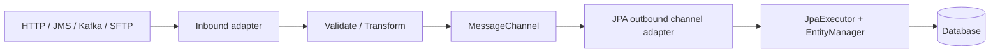
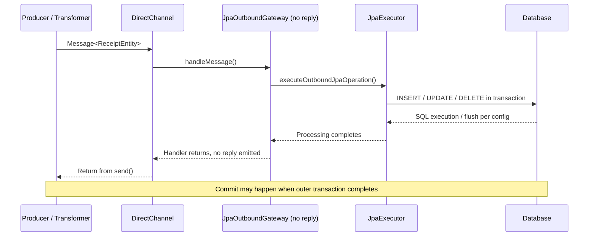
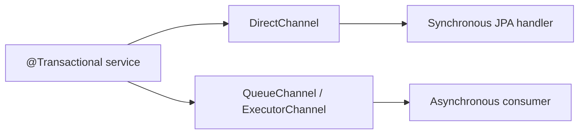
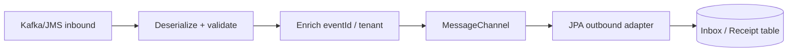
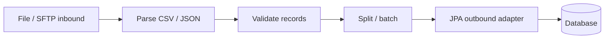

# JPA outbound channel adapter

## 1. Context and Goals

In the **SPRING_INTEGRATION_ADAPTERS** module, data is exchanged with external systems using inbound/outbound adapters, gateways, pollers, and `MessageChannel`. An event may arrive from a file, SFTP, HTTP, JMS, AMQP, or Kafka, then be cleaned, validated, and finally **written to a database** by a Spring Integration endpoint.

The **JPA outbound channel adapter** lesson, part of the **Adapter JPA** chapter, explains how to pass a Spring Message into the persistence layer through **Jakarta Persistence (JPA)**. This is the opposite data direction from the JPA inbound adapter: instead of polling the database to create messages, the outbound adapter **receives messages to perform database writes or updates**.

After this lesson, you will be able to:

- Explain the path `MessageChannel → JpaOutboundGateway → JpaExecutor → EntityManager → database`.
- Distinguish the **JPA outbound channel adapter** from the **JPA updating outbound gateway**, retrieving gateway, and inbound polling adapter.
- Choose the right `PersistMode.PERSIST`, `PersistMode.MERGE`, or `PersistMode.DELETE` for business scenarios.
- Configure Java annotations, Java DSL, and XML namespaces for a JPA write endpoint.
- Use entities directly or JPQL `UPDATE`/`DELETE` with parameters taken from message payload/headers.
- Build a Spring Boot 3.x + Spring Integration 6.x + Jakarta Persistence example with transactions and tests.
- Understand the exact difference between **flush**, **commit**, the `MessageChannel.send(...)` result, and source system ACK.
- Handle duplicate records, transaction rollbacks, DB errors, `Iterable` batches, batch flush, optimistic locking, and idempotency.
- Recognize when you need an outbox/inbox, retries, DLQ, or delivery guarantees between the database and JMS/Kafka/HTTP.

> **Scope:** an outbound channel adapter is an **event-driven message handler** and does not query periodically on its own. A **poller** is only needed if the upstream flow pulls data from a polling source or if you intentionally place a `QueueChannel` between steps.

## 2. How Does the JPA Outbound Channel Adapter Work?

A typical flow:



There are two main cases:

1. The payload **is an entity or an `Iterable` of entities**. The adapter asks JPA to execute `persist`, `merge`, or `delete` depending on `PersistMode`.
2. The payload/headers **contain query parameters**. The adapter executes configured JPQL or native SQL, typically to update/delete multiple records.

Naming that can be confusing:

- **`JpaExecutor`** is the central execution class, managing entity/query configuration, persist mode, flushing, and parameter binding.
- **`JpaOutboundGateway`** is Spring Integration's JPA message handler. When **`setProducesReply(false)`** is set, this handler acts as a **one-way outbound channel adapter**, emitting no reply.
- **`@ServiceActivator`** (or `.handle(...)` in Java DSL) attaches the handler to an input channel.
- **`EntityManagerFactory`** creates/provides an `EntityManager` bound to the transaction; the persistence provider, usually Hibernate, performs the actual database work.
- **`MessageChannel`** is the pipeline boundary; it does not persist data on its own without a JPA handler attached.

In Java configuration, **you do not need a class named `JpaOutboundChannelAdapter`**. A common outbound channel adapter setup is `JpaOutboundGateway` configured in no-reply mode. Java DSL provides the explicit factory `Jpa.outboundAdapter(...)`.

### Processing Timeline



**Important:** if the transaction is opened at the service calling `channel.send(...)`, commit can happen **after `send()` returns**, when the `@Transactional` method finishes. Therefore, relying solely on `send() == true` cannot confirm the row is committed.

## 3. Choosing the Right JPA Component

| Component | Has Input? | Produces Reply? | Purpose |
| --- | --- | --- | --- |
| **JPA inbound channel adapter** | No request message from an upstream flow | Emits messages from poll results | Periodically read DB to start a flow |
| **JPA outbound channel adapter** | Receives a Spring Message | **No** | Write/update/delete as a branch-ending endpoint |
| **JPA updating outbound gateway** | Receives a Spring Message | **Yes** | Persist/merge/delete or run update query and return a result so the flow continues |
| **JPA retrieving outbound gateway** | Receives a Spring Message | **Yes** | On-demand SELECT returning entity/list |
| **Spring Data repository** | Java method call | Per method | Direct service CRUD; can also be used inside an Integration Flow |
| **JDBC outbound adapter** | Receives a Spring Message | No | Write via SQL/JDBC without JPA entities |

Decision examples:

- **Kafka event → parse into `OrderReceipt` → write table → end:** JPA outbound channel adapter.
- **HTTP command → update database → need affected row count:** JPA updating outbound gateway.
- **Message contains order ID → need to read order and forward:** retrieving outbound gateway.
- **Periodically find unsent orders:** JPA inbound channel adapter + poller, or CDC/outbox depending on requirements.

Do not use an outbound adapter to run a `SELECT` when you need to read the result: by contract, the adapter **does not send `SELECT` results** downstream. When a reply is needed, use a retrieving/updating gateway.

## 4. PersistMode: PERSIST, MERGE, DELETE

Spring Integration provides the enum `org.springframework.integration.jpa.support.PersistMode` with three values:

| Mode | JPA Meaning | Typical Use Case | What to Watch Out For |
| --- | --- | --- | --- |
| **`PERSIST`** | Adds a new entity to the persistence context and schedules an INSERT | Saving new events/receipts | Duplicate IDs can cause errors at persist/flush/commit |
| **`MERGE`** | Copies the state of the supplied entity onto a managed entity and returns the managed entity | Updating state from a valid snapshot | May insert a new row depending on entity state; not strictly "UPDATE-only" |
| **`DELETE`** | Removes the entity from the database | Deleting entities per business rules | Must identify the exact entity/ID and cascades; never delete arbitrarily from client input |

**The default is `MERGE`**, not `PERSIST`. If the business rule only permits inserting a non-existent receipt, set it explicitly:

```java
executor.setPersistMode(PersistMode.PERSIST);
```

### 4.1. PERSIST: Saving a New Entity

```java
OrderReceipt receipt =
        new OrderReceipt("evt-1001", "ORD-42", "ACCEPTED");

// Handler will use EntityManager.persist(receipt)
// when executor has PersistMode.PERSIST.
receiptWritesChannel.send(
        MessageBuilder.withPayload(receipt).build());
```

This example assumes `receiptWritesChannel` is an injected `MessageChannel` bean and the call runs inside an **appropriate transaction**. If `eventId` is the primary key, resending the same event ID can trigger a constraint violation — **`PERSIST` does not automatically deduplicate successfully**.

### 4.2. MERGE: Updating State

```java
JpaExecutor executor = new JpaExecutor(entityManagerFactory);
executor.setEntityClass(OrderReceipt.class);
executor.setPersistMode(PersistMode.MERGE);
```

A key detail of JPA `merge`: the passed entity **does not necessarily become managed**. JPA may return a **different managed instance** holding the copied state. If you need the merged object/ID or post-update version, consider an **updating outbound gateway** with a reply, or handle it in a `@Transactional` service/JPA repository.

Do not treat `merge` as a solution for all concurrent updates. Use `@Version`/optimistic locking, version predicates, unique constraints, and business rules to prevent overwriting newer data.

### 4.3. DELETE: Destructive Operation

```java
executor.setPersistMode(PersistMode.DELETE);
```

Use only after the flow has verified delete authorization, target record identity, and safe deletion conditions. For detached entities, deletion may require finding or attaching the entity to the persistence context as supported by the implementation. When conditional deletes or affected row counts are needed, an explicit JPQL `DELETE WHERE ...` or updating gateway is usually easier to verify.

### 4.4. Iterable Payload

Spring Integration has long supported an `Iterable` of entities for `PERSIST` and `MERGE`. Null values in the iterator are skipped. Spring Integration 5.5.4+ also supports `Iterable` with `DELETE` per `JpaExecutor`/`JpaOutboundGateway` behavior.

```java
List<OrderReceipt> receipts = List.of(
        new OrderReceipt("evt-1001", "ORD-42", "ACCEPTED"),
        new OrderReceipt("evt-1002", "ORD-43", "ACCEPTED")
);

receiptWritesChannel.send(
        MessageBuilder.withPayload(receipts).build());
```

The payload is **one Spring Message** containing a list of entities, not two separate messages. If you want per-entity transactions/retries, consider a `Splitter` before the adapter or choose an explicit batch policy.

## 5. Spring Message Contract and Trust Boundaries

A `Message<OrderReceipt>` consists of:

| Part | Example | Notes |
| --- | --- | --- |
| `payload` | `OrderReceipt` or `List<OrderReceipt>` | In entity mode, this is the JPA object to persist/merge/delete |
| `headers["eventId"]` | `evt-1001` | Supports correlation, logging, idempotency |
| `headers["tenantId"]` | `tenant-7` | Must be authorized in the service; never let clients self-assign permissions |
| `headers["sourceSystem"]` | `kafka-orders` | For audit/diagnostics, not an authentication source by default |
| `MessageHeaders.ID` | Spring Message UUID | Not the entity's primary key |
| `replyChannel` | Channel receiving a reply if any | One-way adapter emits no reply |
| `errorChannel` | Flow error-handling channel | Does not automatically guarantee true retries or rollbacks |

Example:

```java
Message<OrderReceipt> message =
        MessageBuilder
                .withPayload(new OrderReceipt(
                        "evt-1001", "ORD-42", "ACCEPTED"))
                .setHeader("sourceSystem", "kafka-orders")
                .setHeader("traceId", "trace-301")
                .build();
```

**Do not use `MessageHeaders.ID` directly as a business event deduplication key.** If Kafka/JMS redelivers the same event, Spring can create a new message with a different ID. A durable key should be `eventId`/an idempotency key defined in the source contract.

In query mode, headers/payload can also act as **parameter sources**. That does not mean all headers are trustworthy. Any update involving `tenantId` or `orderId` must be validated/authorized before use.

## 6. Complete Example: Writing OrderReceipt from an Integration Flow

The sample uses **Java 17+, Spring Boot 3.x, Spring Integration 6.x, Spring Data JPA/Jakarta Persistence, and H2**. The input is an `OrderReceipt` with an event ID assigned by a trusted source system. The adapter performs **PERSIST** and ends the branch.

Why use a source-assigned string ID instead of an auto-increment ID? Because an event from Kafka/JMS can be replayed; a unique business ID lets the DB constraint detect duplicates. **Idempotent/successful duplicate handling** still requires its own service/consumer policy; the demo below intentionally lets duplicate errors surface rather than silently inserting two rows.

### 6.1. Maven Dependencies

```xml
<dependencies>
    <dependency>
        <groupId>org.springframework.boot</groupId>
        <artifactId>spring-boot-starter</artifactId>
    </dependency>
    <dependency>
        <groupId>org.springframework.boot</groupId>
        <artifactId>spring-boot-starter-data-jpa</artifactId>
    </dependency>
    <dependency>
        <groupId>org.springframework.boot</groupId>
        <artifactId>spring-boot-starter-integration</artifactId>
    </dependency>
    <dependency>
        <groupId>org.springframework.integration</groupId>
        <artifactId>spring-integration-jpa</artifactId>
    </dependency>
    <dependency>
        <groupId>com.h2database</groupId>
        <artifactId>h2</artifactId>
        <scope>runtime</scope>
    </dependency>
    <dependency>
        <groupId>org.springframework.boot</groupId>
        <artifactId>spring-boot-starter-test</artifactId>
        <scope>test</scope>
    </dependency>
</dependencies>
```

`spring-boot-starter-data-jpa` provides Jakarta Persistence, Spring transaction support, and Hibernate ORM in standard Boot configurations. `spring-integration-jpa` provides `JpaExecutor` and `JpaOutboundGateway`; `spring-boot-starter-integration` provides the Integration runtime. The Spring Boot BOM should manage compatible versions; do not mix random Spring/Hibernate versions manually.

In-memory H2 is only for learning and testing. For real databases, use migrations (Flyway/Liquibase), proper DB permissions, and connection pool tuning.

### 6.2. OrderReceipt Entity

File `OrderReceipt.java`:

```java
package com.example.jpaoutbound;

import jakarta.persistence.Column;
import jakarta.persistence.Entity;
import jakarta.persistence.Id;
import jakarta.persistence.Table;

@Entity
@Table(name = "order_receipt")
public class OrderReceipt {

    @Id
    @Column(name = "event_id", nullable = false, length = 80)
    private String eventId;

    @Column(name = "order_id", nullable = false, length = 80)
    private String orderId;

    @Column(nullable = false, length = 32)
    private String status;

    protected OrderReceipt() {
        // JPA requires a no-arg constructor.
    }

    public OrderReceipt(String eventId, String orderId, String status) {
        if (eventId == null || eventId.isBlank()
                || orderId == null || orderId.isBlank()
                || status == null || status.isBlank()) {
            throw new IllegalArgumentException("Invalid receipt");
        }
        this.eventId = eventId;
        this.orderId = orderId;
        this.status = status;
    }

    public String getEventId() {
        return eventId;
    }

    public String getOrderId() {
        return orderId;
    }

    public String getStatus() {
        return status;
    }
}
```

This entity uses `eventId` as its **primary key**. Inserting `evt-1001` and then inserting `evt-1001` again must hit a database uniqueness/primary-key constraint unless another deduplication policy is implemented.

Never store an enum/status string taken straight from a client in the DB without validation. In this lesson `status` is hardcoded by the demo service to simplify the contract.

### 6.3. Repository for Reading and Verifying Results

File `OrderReceiptRepository.java`:

```java
package com.example.jpaoutbound;

import org.springframework.data.jpa.repository.JpaRepository;

public interface OrderReceiptRepository
        extends JpaRepository<OrderReceipt, String> {
}
```

The repository is used to **verify results** and can also work alongside business services. Writes in the flow below are still performed by the **JPA outbound channel adapter**, not `repository.save(...)` calls.

### 6.4. Configuring MessageChannel and the JPA Outbound Adapter

File `JpaOutboundConfiguration.java`:

```java
package com.example.jpaoutbound;

import jakarta.persistence.EntityManagerFactory;

import org.springframework.context.annotation.Bean;
import org.springframework.context.annotation.Configuration;
import org.springframework.integration.annotation.ServiceActivator;
import org.springframework.integration.channel.DirectChannel;
import org.springframework.integration.config.EnableIntegration;
import org.springframework.integration.jpa.core.JpaExecutor;
import org.springframework.integration.jpa.outbound.JpaOutboundGateway;
import org.springframework.integration.jpa.support.PersistMode;
import org.springframework.messaging.MessageChannel;
import org.springframework.messaging.MessageHandler;

@Configuration
@EnableIntegration
public class JpaOutboundConfiguration {

    @Bean
    public MessageChannel receiptWritesChannel() {
        return new DirectChannel();
    }

    @Bean
    public JpaExecutor receiptJpaExecutor(
            EntityManagerFactory entityManagerFactory) {

        JpaExecutor executor =
                new JpaExecutor(entityManagerFactory);

        executor.setEntityClass(OrderReceipt.class);
        executor.setPersistMode(PersistMode.PERSIST);

        // Flush surfaces SQL/constraint errors early
        // within the current transaction, NOT a commit.
        executor.setFlush(true);

        return executor;
    }

    @Bean
    @ServiceActivator(inputChannel = "receiptWritesChannel")
    public MessageHandler receiptJpaOutbound(
            JpaExecutor receiptJpaExecutor) {

        JpaOutboundGateway handler =
                new JpaOutboundGateway(receiptJpaExecutor);

        // This setting turns the gateway handler
        // into a one-way outbound channel adapter.
        handler.setProducesReply(false);
        return handler;
    }
}
```

**Explanation of key APIs:**

- `new JpaExecutor(entityManagerFactory)` builds a JPA executor over the active persistence configuration.
- `setEntityClass(OrderReceipt.class)` specifies the entity accepted by the adapter.
- `setPersistMode(PERSIST)` requests inserting a new entity; the adapter defaults to `MERGE` if omitted.
- `setFlush(true)` calls `EntityManager.flush()` after the operation per configuration, **without confirming the DB transaction committed**.
- `new JpaOutboundGateway(executor)` constructs the JPA message handler.
- `setProducesReply(false)` stops the handler from emitting a result message.
- `@ServiceActivator(inputChannel=...)` consumes Spring Messages from `receiptWritesChannel`.
- **No poller here:** whenever a message arrives on the channel, the handler is invoked.

### 6.5. Service Sending Messages Inside a Transaction

File `ReceiptWriter.java`:

```java
package com.example.jpaoutbound;

import org.springframework.beans.factory.annotation.Qualifier;
import org.springframework.messaging.MessageChannel;
import org.springframework.messaging.support.MessageBuilder;
import org.springframework.stereotype.Service;
import org.springframework.transaction.annotation.Transactional;

@Service
public class ReceiptWriter {

    private final MessageChannel receiptWritesChannel;

    public ReceiptWriter(
            @Qualifier("receiptWritesChannel") MessageChannel channel) {
        this.receiptWritesChannel = channel;
    }

    @Transactional
    public void record(OrderReceipt receipt) {
        // DirectChannel invokes the JPA handler synchronously,
        // inside this method's transaction.
        boolean accepted = receiptWritesChannel.send(
                MessageBuilder.withPayload(receipt)
                        .setHeader("eventId", receipt.getEventId())
                        .build());

        if (!accepted) {
            throw new IllegalStateException(
                    "JPA channel did not accept message");
        }
        // Transaction commits when the @Transactional proxy exits.
        // Commit may still throw an exception after send() returns true.
    }
}
```

`@Transactional` is placed on a **public service method** so the Spring proxy can open a transaction. Sending to `DirectChannel` and running the JPA handler happen synchronously on the same thread; thus they share the active transaction. If you replace `DirectChannel` with `QueueChannel` or `ExecutorChannel`, `record(...)`'s transaction **does not automatically propagate** to the async handler. In that case, place the transaction on the appropriate **consumer endpoint**.

Define the transaction boundary in one clear place (service, integration endpoint advice, or gateway) rather than assuming every message inherently has a transaction.

### 6.6. Bootstrapping the Application and Sending Events

File `JpaOutboundApplication.java`:

```java
package com.example.jpaoutbound;

import org.springframework.boot.CommandLineRunner;
import org.springframework.boot.SpringApplication;
import org.springframework.boot.autoconfigure.SpringBootApplication;
import org.springframework.context.annotation.Bean;

@SpringBootApplication
public class JpaOutboundApplication {

    public static void main(String[] args) {
        SpringApplication.run(JpaOutboundApplication.class, args);
    }

    @Bean
    CommandLineRunner demo(ReceiptWriter writer,
                           OrderReceiptRepository repository) {
        return args -> {
            writer.record(new OrderReceipt(
                    "evt-1001", "ORD-42", "ACCEPTED"));

            repository.findById("evt-1001").ifPresent(row -> {
                System.out.println("Persisted: "
                        + row.getEventId() + ", "
                        + row.getOrderId() + ", "
                        + row.getStatus());
            });
        };
    }
}
```

File `application.properties` specifically for the practice environment:

```properties
spring.main.web-application-type=none
spring.datasource.url=jdbc:h2:mem:jpa_outbound_demo;DB_CLOSE_DELAY=-1
spring.datasource.driver-class-name=org.h2.Driver
spring.datasource.username=sa
spring.datasource.password=

spring.jpa.hibernate.ddl-auto=create-drop
spring.jpa.open-in-view=false
logging.level.org.springframework.integration=INFO
```

With `spring.jpa.hibernate.ddl-auto=create-drop` and in-memory H2, data exists only for the demo run. Never use `create-drop` on a database containing important data.

When running, you will see one `order_receipt` row created. Sending the **same `eventId`** again (e.g., calling `writer.record(...)` a second time in the same application context) raises a primary-key/constraint error at flush or commit. That is **expected behavior to handle**, not proof that the application has implemented full idempotency.

## 7. Writing the Same Flow with Java DSL or XML

There are three configuration styles. **Do not enable them simultaneously on the same channel** unless you intentionally design multiple consumers, as doing so can cause a message to be handled unexpectedly.

### 7.1. Java DSL

Replace `@ServiceActivator` from section 6.4 with an `IntegrationFlow`:

```java
package com.example.jpaoutbound;

import jakarta.persistence.EntityManagerFactory;
import org.springframework.context.annotation.Bean;
import org.springframework.context.annotation.Configuration;
import org.springframework.integration.dsl.IntegrationFlow;
import org.springframework.integration.jpa.dsl.Jpa;
import org.springframework.integration.jpa.support.PersistMode;

@Configuration
public class JpaOutboundDslConfiguration {

    @Bean
    IntegrationFlow receiptPersistenceFlow(
            EntityManagerFactory entityManagerFactory) {

        return IntegrationFlow.from("receiptWritesChannel")
                .handle(
                        Jpa.outboundAdapter(entityManagerFactory)
                                .entityClass(OrderReceipt.class)
                                .persistMode(PersistMode.PERSIST)
                                .flush(true),
                        endpoint -> endpoint.transactional())
                .get();
    }
}
```

Explanation:

1. `IntegrationFlow.from("receiptWritesChannel")` consumes messages from the channel.
2. `Jpa.outboundAdapter(entityManagerFactory)` creates the JPA outbound adapter spec.
3. `entityClass(...).persistMode(PERSIST)` defines the operation.
4. `flush(true)` requests a flush after the persistence operation.
5. `endpoint.transactional()` adds transaction advice to the integration consumer; this DSL is equivalent to configuring a transactional endpoint. When the producer already has a synchronous `@Transactional`, align propagation and transaction manager settings.
6. Since this is an outbound adapter, the flow **ends** at the JPA handler with no JPA reply message for a next step.

**Replace, do not append:** keeping `receiptJpaOutbound` from section 6.4 while adding a DSL flow reading the same channel causes two consumers to compete for messages on `DirectChannel`, leading to unpredictable results.

### 7.2. XML Namespace

A similar illustrative XML configuration:

```xml
<int-jpa:outbound-channel-adapter
        id="receiptJpaOutbound"
        channel="receiptWritesChannel"
        entity-manager-factory="entityManagerFactory"
        entity-class="com.example.jpaoutbound.OrderReceipt"
        persist-mode="PERSIST"
        flush="true">

    <int-jpa:transactional
            transaction-manager="transactionManager"/>
</int-jpa:outbound-channel-adapter>
```

This snippet assumes the application declares the `int-jpa` namespace, schemas, `entityManagerFactory`, `transactionManager`, and matching channel beans; it is not a complete XML file. Declaring a transaction on the adapter is just **one** way to set the boundary; if an outer service uses `@Transactional`, check propagation to avoid unintended duplicate configuration.

### 7.3. When Do You Not Need an Outbound Adapter?

If a service just needs a simple `repository.save(...)` and does not need Integration Flow benefits, calling Spring Data JPA directly can be clearer. The JPA outbound adapter shines when **the DB write is an endpoint inside a message pipeline**, connecting with channels, routers, transformers, filters, error flows, metrics, and other adapters.

Do not force JPA just because you use Spring Integration: if the logic requires complex SQL or relational bulk work, the JDBC adapter or a repository/native query may fit better.

## 8. Using JPQL, Named Queries, and Native SQL Instead of Entities

The JPA outbound adapter does not only persist entities. It can also run **JPQL UPDATE/DELETE** or native SQL with parameters drawn from the message.

### 8.1. Parameterized JPQL UPDATE

Suppose you need to transition a receipt from `PENDING` to `SENT`, but only for a matching event ID and prior status. Here is an XML endpoint snippet **replacing** the entity-persist configuration above:

```xml
<int-jpa:outbound-channel-adapter
        id="markReceiptSent"
        channel="markReceiptSentChannel"
        entity-manager-factory="entityManagerFactory"
        jpa-query="update OrderReceipt r
                   set r.status = :newStatus
                   where r.eventId = :eventId
                   and r.status = :expectedStatus">

    <int-jpa:parameter
            name="newStatus"
            expression="payload['newStatus']"/>
    <int-jpa:parameter
            name="eventId"
            expression="payload['eventId']"/>
    <int-jpa:parameter
            name="expectedStatus"
            value="PENDING"/>

    <int-jpa:transactional
            transaction-manager="transactionManager"/>
</int-jpa:outbound-channel-adapter>
```

The payload can be a Map:

```java
Map<String, String> values = Map.of(
        "eventId", "evt-1001",
        "newStatus", "SENT");

Message<Map<String, String>> message =
        MessageBuilder.withPayload(values).build();
```

**Limitation:** because this endpoint is a **one-way outbound adapter**, it does not return the affected `UPDATE` row count. If the application must know whether `0` or `1` row was updated to decide the next step, choose a **JPA updating outbound gateway**, repository method, or DAO that returns a result.

Note that `payload['newStatus']` is a **parameter expression**, not arbitrary SQL string concatenation. Untrusted inputs must be validated before entering the query; when tenant/resource permissions apply, update conditions must include full authorization boundaries.

### 8.2. Using Headers as Parameter Sources

If a query needs `headers.tenantId` or `headers.traceId`, Spring Integration supports parameter configuration with SpEL expressions or `ParameterSourceFactory`. Depending on `use-payload-as-parameter-source`, the default parameter source can be payload bean properties or the **entire Spring Message**.

Example expression reading from a header:

```xml
<int-jpa:parameter
        name="tenantId"
        expression="headers['tenantId']"/>
```

Never assume a client-supplied `tenantId` represents granted permission: the server must resolve/verify the tenant before allowing the query. Proper parameter binding avoids concatenating user data into query strings.

### 8.3. Named Queries

You can define `@NamedQuery` on an entity or in `orm.xml` and set `named-query="..."` on the JPA adapter. This is useful when a query is reused and you want to separate query definitions from the Integration Flow.

Notes:

- The named query must exist with the exact name and matching parameters.
- Choose among `jpa-query`, `named-query`, `native-query`, and entity mode in valid combinations.
- `PersistMode` applies to **entity operations**; it is ignored when executing an explicit JPQL/native/named query.

### 8.4. Native SQL

Native SQL allows DB-specific operations such as complex INSERTs or vendor-specific syntax. The trade-off is lower portability across databases. For native queries, named parameter support varies by persistence provider; when portability matters, check JPA positional binding and test on the target DB.

**Do not put a JPQL `SELECT` in an outbound adapter expecting to retrieve rows.** Even if the query is valid, the adapter emits no result; use a **retrieving outbound gateway**.

## 9. Transactions, Flush, Commit, and What Happens on Failure

### 9.1. JPA Operations Need a Transaction

`EntityManager.persist`, `merge`, `remove`, and JPQL update/delete normally require a transaction. Options:

- Put `@Transactional` on the **service** sending the message into `DirectChannel`, such as `ReceiptWriter.record(...)`.
- Put transaction advice on the integration endpoint, such as `e -> e.transactional()` in DSL.
- Use `<int-jpa:transactional>` in XML configuration.
- Use `@Transactional` on a service/repository performing DB work directly within a flow.

The chosen transaction manager (`JpaTransactionManager` in a standard Spring Data JPA app) and propagation/isolation must fit the actual operations. Do not assume JMS/Kafka/HTTP sources share a transaction with the database.

### 9.2. Flush Is Not Commit

| Action | Meaning | Does Not Prove |
| --- | --- | --- |
| `persist(entity)` | Adds new entity to persistence context, schedules write | SQL has run and committed |
| `flush()` | Synchronizes pending changes to the DB within the transaction | Transaction has durably committed |
| `commit()` | Completes the DB transaction if successful | Kafka/JMS/HTTP/WebSocket processed the event |
| `channel.send(...) == true` | Channel accepted the message per contract | Resulting transaction succeeded |
| JPA outbound adapter finishes handler | JPA handler ended without producing a reply | External non-DB side effects succeeded |
| Kafka/JMS ACK/offset | Source completed its acknowledgment step | Receiving database certainly needs no retry |

**Failure example:** the adapter called `flush()` with no exception, yet at commit time the database encounters a deadlock, dropped connection, or rollback from another error. The row is not durably persisted. Therefore, never publish a final business ACK based solely on `flush()`.

### 9.3. DirectChannel and Async Boundaries



- With `DirectChannel`, the service proxy calls `send()` and the JPA handler executes **on the current thread**. One transaction can span both.
- With `QueueChannel` or `ExecutorChannel`, the transaction context usually **does not cross the thread/queue boundary**.
- If a DB transaction is needed in the async consumer, attach transactional advice or a `@Transactional` service on the **consumer side**.
- If a retry re-executes the message, you need business keys to prevent duplicates.
- For Kafka/JMS sources, define **source ACK timing** relative to DB commit rather than assuming the framework creates a distributed transaction.

### 9.4. Boundaries Between the Database and Other Side Effects

A flow:

```text
Kafka inbound → validate → JPA outbound → HTTP outbound
```

does not mean the JPA commit and the HTTP call belong to a single transaction. If JPA commits and the HTTP call fails, retrying the whole flow could write to the DB again. If HTTP succeeds and the DB rolls back, an unrecorded external side effect can occur.

A common durable pattern:

1. Write business data and an **outbox event** in the **same DB transaction**.
2. A separate publisher reads the outbox and sends to Kafka/JMS/HTTP per contract.
3. Once delivery is confirmed, mark the outbox entry as sent.
4. If a crash occurs after sending but before updating state, the event may be resent.
5. Consumers use `eventId`/idempotency keys to handle replays safely.

This is typically **at-least-once + idempotency**, not system-wide exactly-once.

## 10. Batching and flush-size: Optimizing Under Control

For `Iterable` payloads, `JpaExecutor` supports these properties:

| Property | Meaning | What to Watch Out For |
| --- | --- | --- |
| `setFlush(true)` | Triggers flush after the operation | Can increase roundtrips/overhead |
| `setFlushSize(50)` | Flushes every 50 entities when processing a batch, plus the remainder | Does not automatically change ID generation or JDBC batching behavior |
| `setClearOnFlush(true)` | Clears the persistence context after flush | Entities may become detached; do not rely on lazy state after clear |
| `setDeleteInBatch(true)` | Optimizes deleting a collection of entities per implementation | Verify cascade/callback behavior and DB semantics |
| `Iterable` payload | One message containing multiple entities | Decide whether commit/retry is per batch or per entity |

Example configuration for small batches:

```java
JpaExecutor executor = new JpaExecutor(entityManagerFactory);
executor.setEntityClass(OrderReceipt.class);
executor.setPersistMode(PersistMode.PERSIST);
executor.setFlushSize(50);
executor.setClearOnFlush(true);
```

Do not set both `setFlush(true)` and `setFlushSize(50)` assuming they stack; Spring Integration documentation specifies `flush-size > 0` takes precedence over the `flush` flag. Use `flush-size` deliberately and test how batches chunk an `Iterable`.

### Multi-Layered JPA Batch Tuning

`setFlushSize` **does not mean Hibernate JDBC batching is automatically enabled**. True JDBC batching depends on provider settings (e.g., `hibernate.jdbc.batch_size`), ID generation strategy, transactions, and the database driver. `GenerationType.IDENTITY` can limit Hibernate's ability to batch inserts.

With 10,000 entities, you should not necessarily put all of them in a single Spring Message:

- A huge transaction holds locks longer and makes rollbacks expensive.
- A large persistence context consumes substantial heap.
- One invalid record can roll back the whole batch.
- Retrying a batch can repeatedly hit unique-key collisions.
- Oversized outbound messages increase serializer/channel pressure.

Choose batch sizes based on real measurements and the error-handling contract.

## 11. Idempotency, Duplicates, and Concurrent Updates

### 11.1. Why Can Events Arrive Again?

Sources have different retry mechanisms:

- Kafka can redeliver messages after a rebalance or consumer restart before offset commit.
- JMS/AMQP can redeliver messages after rollback/nack or lost ACKs.
- HTTP clients can retry on response timeout even when the server already committed.
- SFTP/file pollers can re-read files if metadata/filters/acks are reset.
- An Integration Flow can retry a handler on transient DB connection errors.

Therefore, the JPA outbound adapter **does not automatically prevent duplicate business operations**.

### 11.2. Choosing a Durable Idempotency Key

In the example, `OrderReceipt.eventId` is the primary key. On a retried `PERSIST` with the same event ID, the database rejects a duplicate key row.

That is only **duplicate detection**. For truly idempotent behavior, the service must know:

1. Does the row exist because the event **already succeeded**, or because incompatible data tried to reuse the same ID?
2. Can it safely return "already processed" or must it report a conflict?
3. Is there an uncommitted or concurrent transaction in flight?
4. Can the source message be ACKed when a duplicate is detected?
5. Might other side effects have occurred before the failure?

For instance, two Kafka deliveries with the same event ID but different payloads must be treated as a **data conflict**, not silently swallowed as a duplicate. Storing a payload hash and processing status enables comparison.

### 11.3. MERGE Is Not a "Safe for All Cases" Upsert

`MERGE` can insert when an entity does not exist, and can overwrite newer updates if version/state checks are missing. When multiple workers update the same entity, use:

- `@Version` and optimistic locking.
- JPQL `UPDATE ... WHERE version = :expectedVersion` and check affected rows via an **updating gateway**.
- Pessimistic locking when truly needed, weighing transaction/throughput impact.
- Valid state transition checks, e.g., disallowing `SHIPPED → NEW`.
- Database unique constraints and idempotency keys.

**Do not equate PERSIST/MERGE with database-specific UPSERT syntax** such as `ON CONFLICT DO NOTHING` or `ON DUPLICATE KEY UPDATE`. If your business rules require those semantics, choose the corresponding JPA/repository/native SQL approach and test on the target DB.

### 11.4. DELETE and Auditing

A `DELETE` message may be redelivered after a successful deletion. On the second attempt the entity may no longer exist, depending on the JPA implementation and entity lookup. When you need "delete exactly 1 row if still authorized", a JPQL `DELETE ... WHERE id=:id AND tenantId=:tenantId` returning affected rows (via a gateway) makes detection clearer.

For sensitive data, consider **soft delete** (`deletedAt`, `state`) and audit logs instead of physical deletion, especially when compliance or data recovery is required.

## 12. Error Handling and Retries

| Error Type | Example | Handling Strategy |
| --- | --- | --- |
| Invalid entity | Missing primary key/required fields | Validate before adapter; do not retry forever |
| Duplicate key | Two events share `eventId` | Distinguish already-processed vs. conflict; do not swallow all errors |
| Optimistic lock | Update with stale version | Re-read/reconcile or report conflict |
| Constraint violation | FK/NOT NULL/UNIQUE failure | Fix data/flow, quarantine record |
| Deadlock / lock timeout | Concurrent transaction contention | Bounded retry with backoff/jitter |
| Database unavailable | Connection loss, pool exhausted | Circuit breaker/bounded retry, alert |
| Invalid JPQL | Wrong entity/field name, missing parameter | Fix config; do not auto-retry indefinitely |
| Bloated persistence context | Batch has too many entities | Reduce batch size, controlled flush/clear |
| Wrong payload type | DTO sent directly to entity-mode adapter | Add transformer/validator |
| External downstream error | DB write succeeded but HTTP/Kafka call failed | Outbox, compensation/idempotency |

### Sync vs. Async Determines Where Errors Are Observed

With `DirectChannel` and a synchronous JPA handler, exceptions propagate back to the producer; if the transaction rolls back, the source adapter/gateway decides ACK/retry per contract. With `ExecutorChannel`, errors happen on a worker thread after the producer may already have returned. In that case, configure an error channel, retry advice, backoff, and redelivery/recovery handling.

**Do not do this:**

```java
try {
    receiptWritesChannel.send(message);
} catch (Exception ignored) {
    // Wrong: swallowing error then ACKing source as success.
}
```

An exception may signal that the DB did not commit. Swallowing errors drops events or causes the system to falsely report success.

### Error Channel Does Not Automatically Create a DLQ

Spring Integration supports `errorChannel` and `ErrorMessage` per processing context; this **does not mean** a message was saved to a dead-letter queue or retried a bounded number of times. Define a real policy: how many retries, which errors are retryable, which records go to `FAILED`, who handles the DLQ, and what metadata must be preserved.

## 13. Practical Architectures with Other Adapters

### 13.1. Kafka/JMS → JPA Outbound



When processing events from a broker, define:

- **ACK/offset commit timing:** after DB transaction commit or before?
- **Redelivery behavior:** does the source resend if the app crashes?
- **Idempotency:** enforce a unique event ID in the database.
- **Trusted parameters:** tenant/permissions must be verified from the source and service.
- **Unrecoverable errors:** send poison messages to a DLQ/quarantine so they do not block the consumer forever.
- **Backpressure:** source ingress rate must not exceed DB write capacity and connection pool limits.

A Kafka offset commit is **not** a database commit; a JDBC/JPA transaction is **not** a broker acknowledgment. Pick explicit semantics and avoid claiming "exactly-once" without proper coordination mechanisms.

### 13.2. HTTP → JPA Outbound → Return Response

```text
HTTP request → validate → JPA persistence → HTTP response
```

A plain JPA outbound channel adapter **does not emit a reply**. To build an HTTP response after saving, you can:

1. Use a **JPA updating outbound gateway** that replies (with the managed entity or affected row count depending on the operation).
2. Use a transactional application service invoking the persistence flow synchronously, then return a result after commit.
3. Structure a higher-level request–reply gateway ensuring exceptions and transactions are handled properly.

Do not attach a `replyChannel` header expecting the JPA outbound adapter to send a response automatically. This is the crucial distinction between an **adapter** and a **gateway**.

### 13.3. Bulk File/SFTP Imports



For large files, decide between per-row vs. per-batch transactions, how to quarantine bad records, idempotency by file checksum + row identity, and how to resume interrupted imports. **Never load a multi-GB file into a single `Iterable`** without memory bounds and a batching strategy.

### 13.4. JPA Outbound and Poller in the Same System

An inbound adapter can poll `NEW` rows and a transformer can route them to another database via a JPA outbound adapter. That involves two transactions and potentially two databases; updating the source and inserting into the target is **not automatically atomic**. Consider CDC, outbox, sagas, or reconciliation.

## 14. Testing the JPA Outbound Adapter

### 14.1. Unit Testing the Entity Contract

`OrderReceipt` should be tested for validation and ID stability:

```java
package com.example.jpaoutbound;

import static org.junit.jupiter.api.Assertions.*;
import org.junit.jupiter.api.Test;

class OrderReceiptTest {

    @Test
    void requiresStableEventId() {
        assertThrows(IllegalArgumentException.class,
                () -> new OrderReceipt(
                        " ", "ORD-42", "ACCEPTED"));
    }

    @Test
    void storesValidFields() {
        OrderReceipt receipt =
                new OrderReceipt("evt-001", "ORD-42", "ACCEPTED");

        assertEquals("evt-001", receipt.getEventId());
        assertEquals("ORD-42", receipt.getOrderId());
    }
}
```

This unit test **does not** prove the adapter writes to the DB. You need an integration test with `EntityManagerFactory` and a transaction.

### 14.2. Integration Testing with H2

File `JpaOutboundIntegrationTest.java`:

```java
package com.example.jpaoutbound;

import java.util.UUID;
import org.junit.jupiter.api.Test;
import org.springframework.beans.factory.annotation.Autowired;
import org.springframework.boot.test.context.SpringBootTest;

import static org.assertj.core.api.Assertions.*;

@SpringBootTest
class JpaOutboundIntegrationTest {

    @Autowired
    private ReceiptWriter writer;

    @Autowired
    private OrderReceiptRepository repository;

    @Test
    void persistsThroughChannelAdapter() {
        String id = "test-" + UUID.randomUUID();

        writer.record(new OrderReceipt(
                id, "ORD-TEST", "ACCEPTED"));

        // record() exited @Transactional; commit succeeded
        // so data can be read back from another transaction.
        assertThat(repository.findById(id))
                .isPresent()
                .get()
                .extracting(OrderReceipt::getOrderId)
                .isEqualTo("ORD-TEST");
    }

    @Test
    void doesNotSilentlyInsertSameIdTwice() {
        String id = "test-" + UUID.randomUUID();

        writer.record(new OrderReceipt(
                id, "ORD-TEST", "ACCEPTED"));

        assertThatThrownBy(() -> writer.record(
                new OrderReceipt(id, "ORD-OTHER", "ACCEPTED")))
                .isInstanceOf(RuntimeException.class);

        assertThat(repository.findById(id))
                .isPresent()
                .get()
                .extracting(OrderReceipt::getOrderId)
                .isEqualTo("ORD-TEST");
    }
}
```

`@SpringBootTest` boots the full flow, H2 database, and transaction manager. Use a unique ID per test to avoid order dependencies. The duplicate test confirms the **database does not silently insert the same key twice**. It does not yet test application-defined "already processed" handling; that is a follow-up exercise.

Note that if the test method itself is annotated with `@Transactional` (which auto-rolls back), behavior may differ because the **service transaction joins the test transaction**. This lesson intentionally omits `@Transactional` on the test class to observe the service's commit.

### 14.3. Other Important Integration Tests

| Scenario | What to Verify |
| --- | --- |
| Send valid entity | Row appears after transaction commit |
| Send duplicate primary key | Error or proper idempotency handling; no wrong row created |
| Send non-entity DTO | Validation/transformer rejects before adapter |
| JPA constraint violation | Transaction rolls back; source does not falsely ACK success |
| `MERGE` with stale version | Optimistic locking/conflict per policy |
| Unauthorized `DELETE` | Data is not deleted; audit recorded |
| Batch `Iterable` of 100 entities | Flush/batch matches configured limits |
| One batch item fails | Clear transaction rollback or partial semantics |
| JPQL UPDATE matches 0 rows | If count is needed, use an updating gateway |
| Temporary database outage | Retry/backoff does not drop events |
| Replace DirectChannel with async | Transaction/error propagation is redefined |
| Multiple workers share event ID | Unique constraint + idempotency prevent duplicate writes |
| Kafka source redelivery | DB state stays correct and source ACKs only after chosen condition |

For real PostgreSQL/MySQL locking and isolation behavior, use Testcontainers or an equivalent environment. H2 is not sufficient evidence for production database concurrency, SQL dialect, transaction isolation, or unique constraint timing.

## 15. Operations, Security, and Observability

### 15.1. Performance Tuning

- Measure DB write latency and connection pool utilization.
- Use reasonable batch sizes/flush sizes; avoid unbounded `Iterable` payloads.
- Check indexes/unique constraints for `eventId`, `orderId`, and query modes.
- Avoid `MERGE` on large entity graphs unnecessarily; use DTOs/projections or JPQL updates where appropriate.
- Never hold transactions open during slow HTTP calls or user waits.
- Bound concurrency when multiple Kafka/JMS consumers write concurrently.
- Monitor deadlocks, lock waits, serialization failures, and retries.
- Use an outbox when events must be emitted reliably after a DB commit.

### 15.2. Authorization and Sensitive Data

Entity mode should only receive entities controlled by the application. When data arrives from HTTP/JSON or untrusted brokers:

1. Parse into an explicit DTO/contract.
2. Authenticate the source and principal/tenant.
3. Validate schema, lengths, types, and resource permissions.
4. Map allowed fields onto a fresh entity.
5. Never let clients self-assign `role`, `tenantId`, or another user's business keys.
6. Never concatenate input parameters into JPQL strings; use parameter binding.
7. Never log raw payloads containing tokens/PII.
8. Apply least-privilege DB permissions: only the SELECT/INSERT/UPDATE/DELETE rights actually needed.

For JPQL bulk UPDATE/DELETE, check tenant/resource conditions directly in the query or inside an authorized transactional service. Never treat `where id=:id` alone as sufficient authorization.

### 15.3. Metrics

| Suggested Metric | Question Answered |
| --- | --- |
| `jpa_outbound_messages_total` | How many messages reached the JPA handler? |
| `jpa_outbound_writes_total` | How many write operations were accepted/verified? |
| `jpa_outbound_failures_total` | Which failure types occur, and are they spiking? |
| `jpa_transaction_commit_duration_seconds` | Are DB commits slow? |
| `jpa_batch_size` | How large are actual batches? |
| `jpa_duplicate_event_total` | How many duplicate event IDs were received? |
| `jpa_constraint_violations_total` | Are schema/key constraint errors increasing? |
| `db_connection_pool_active` | Is the connection pool exhausted? |
| `outbox_pending_events` | Is there a backlog of events waiting to publish? |
| `event_processing_lag_seconds` | What is the lag from event receipt to DB commit? |

Do not use `eventId`, `orderId`, or raw payloads as metric tags (high cardinality, potentially sensitive). Put them in controlled logs/traces when needed for investigation.

### 15.4. Production Checklist

- [ ] `PersistMode` is chosen deliberately, not accidentally left as default `MERGE`.
- [ ] Entity/JPQL parameters match the contract and are validated/authorized.
- [ ] A real transaction wraps the DB operation.
- [ ] `flush` is distinguished from `commit`; never ACK falsely on commit failure.
- [ ] Primary key/unique constraints and redelivery idempotency policies are in place.
- [ ] No replies expected from a one-way adapter; a gateway is used when results are needed.
- [ ] Transactions are not assumed to cross async channels without consumer-side transaction design.
- [ ] Batch/`flush-size`/`clear-on-flush` behavior is tested on a real DB.
- [ ] Retry/backoff/DLQ aligns with the source protocol.
- [ ] Outbox/reconciliation exists when the source and database do not share a transaction.
- [ ] Tested for DB outages, duplicate IDs, optimistic locks, and shutdown/restart.
- [ ] Metrics, tracing, and alerts cover backlog and commit errors.

## 16. Practice Exercises

### Exercise A — PERSIST vs. MERGE

Start with a `PersistMode.PERSIST` adapter, send a new `OrderReceipt`, then resend the same `eventId`. Observe the constraint error. Switch to `MERGE` in a test environment and explore insert/update behavior; explain why `MERGE` is not a complete idempotency solution.

### Exercise B — Creating an Updating Gateway

Replace the JPA outbound adapter with `Jpa.updatingGateway(...)` or `JpaOutboundGateway` with `producesReply(true)`. Execute a JPQL `UPDATE` checking `eventId` and `status='PENDING'`. Return the affected row count downstream and handle the case where count equals 0.

### Exercise C — Transactions and Async Channels

Keep `@Transactional` on `ReceiptWriter.record(...)`, replace `DirectChannel` with `ExecutorChannel` or `QueueChannel`, and inject a DB error intentionally. Show that transactions and exceptions no longer propagate as they did synchronously; propose consumer-side transaction advice and a retry policy.

### Exercise D — Importing a Multi-Entity Iterable

Send a `List<OrderReceipt>` of 100 entities with `flushSize(25)` and `clearOnFlush(true)`. Cause an error on an entity near the end. Verify whether the whole batch rolls back or partially commits based on the transaction boundary, while measuring memory and throughput.

### Exercise E — Kafka/JMS and Idempotency

An event `evt-1001` is delivered twice because the consumer crashed after DB commit but before source ACK. Design an inbox/receipt table and an "already processed" policy based on event ID + payload hash. Distinguish a valid duplicate from two different payloads sharing the same ID.

### Exercise F — Transactional Outbox

Design a transaction writing `OrderReceipt` and `OutboxEvent` into the same database, then poll the outbox to send to Kafka/HTTP. Simulate a crash after publish but before marking `SENT`. Propose idempotent consumers, backoff, DLQ, and backlog metrics.

**Completion criteria:** you can demonstrate a Spring Message flowing through a JPA outbound channel adapter to execute a DB operation inside a transaction, accurately distinguish `PERSIST`/`MERGE`/`DELETE`, know when a reply gateway is needed, and design safely for retries/redeliveries.

## 17. Summary

- **JPA outbound channel adapter** receives Spring Messages and uses `JpaExecutor` to persist, merge, delete, or run JPQL/native/named queries.
- In Java configuration, `JpaOutboundGateway` with `setProducesReply(false)` implements a **no-reply outbound adapter**; Java DSL uses `Jpa.outboundAdapter(...)`.
- Default `PersistMode` is `MERGE`. Choose `PERSIST` when only creating new entities; `DELETE` requires checking authorization and failure semantics.
- Entity mode accepts `Iterable`; `flushSize` and `clearOnFlush` help manage the persistence context but require transactions and measurement.
- JPQL `UPDATE`/`DELETE` can bind parameters from payload/headers; if you need the affected row count or returned entity, choose an **updating outbound gateway**.
- `flush()` is not `commit()`; `MessageChannel.send(...)` returning successfully does not guarantee data committed.
- `DirectChannel` can share the caller's transaction; `QueueChannel`/`ExecutorChannel` introduce an async boundary requiring a separate transaction.
- Database constraints detect duplicates but do not automatically create proper business idempotency.
- With Kafka/JMS/HTTP/SFTP, explicitly design ACK/retry, event IDs, and outbox/inbox across system boundaries.
- Do not deploy to production without testing duplicates, rollbacks, concurrency, batching, permissions, and sensitive data handling.

## References

- [Spring Integration 6.5 — JPA Support](https://docs.spring.io/spring-integration/reference/6.5/jpa.html)
- [Spring Integration 6.5 — JPA Outbound Channel Adapter](https://docs.spring.io/spring-integration/reference/6.5/jpa/outbound-channel-adapter.html)
- [Spring Integration 6.5 — JPA Outbound Gateways](https://docs.spring.io/spring-integration/reference/6.5/jpa/outbound-gateways.html)
- [Spring Integration 6.5 — JPA Java Implementation](https://docs.spring.io/spring-integration/reference/6.5/jpa/java-implementation.html)
- [Spring Integration API — JpaExecutor](https://docs.spring.io/spring-integration/docs/6.5.0/api/org/springframework/integration/jpa/core/JpaExecutor.html)
- [Spring Integration API — JpaOutboundGateway](https://docs.spring.io/spring-integration/docs/6.5.0/api/org/springframework/integration/jpa/outbound/JpaOutboundGateway.html)
- [Spring Integration API — PersistMode](https://docs.spring.io/spring-integration/docs/6.5.0/api/org/springframework/integration/jpa/support/PersistMode.html)
- [Spring Integration API — JpaUpdatingOutboundEndpointSpec](https://docs.spring.io/spring-integration/docs/6.5.0/api/org/springframework/integration/jpa/dsl/JpaUpdatingOutboundEndpointSpec.html)
- [Spring Framework Reference — Transaction Management](https://docs.spring.io/spring-framework/reference/data-access/transaction.html)
- [Spring Data JPA Reference — Entity Persistence](https://docs.spring.io/spring-data/jpa/reference/jpa/entity-persistence.html)
