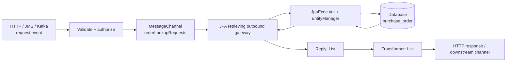
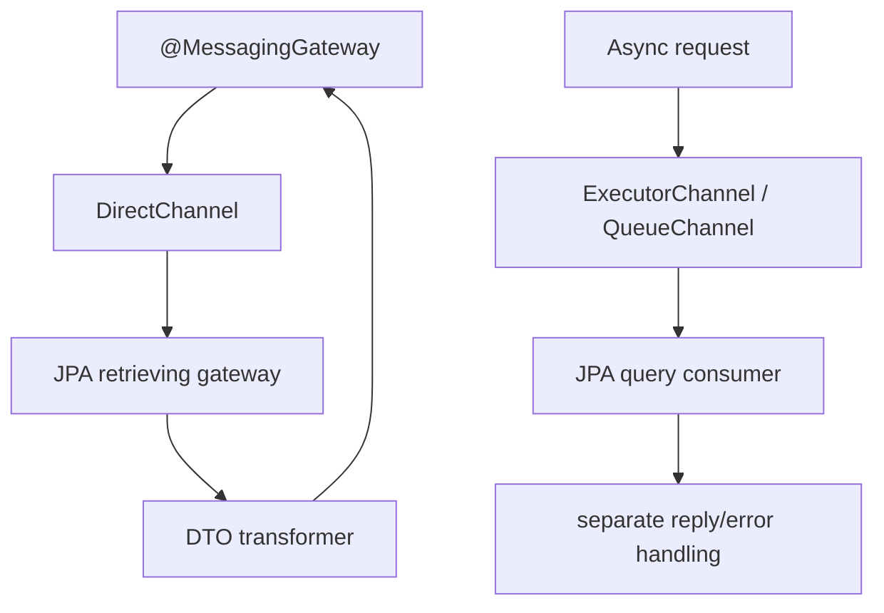

# JPA retrieving outbound gateway

## 1. Context and Goals

In the **SPRING_INTEGRATION_ADAPTERS** module, Spring Integration connects external systems via inbound/outbound adapters, gateways, pollers, and `MessageChannel`. A message may arrive from HTTP, a file, SFTP, JMS, AMQP, or Kafka, and the flow then needs to **query data already stored in the database** to decide the next processing step.

The **JPA retrieving outbound gateway** is the right component for that case: it receives **a request message**, executes a Jakarta Persistence (JPA) query, and places the **query result** into a reply message so the flow continues. This lesson belongs to the **Adapter JPA** chapter.

After studying this lesson, you will be able to:

- Distinguish the retrieving outbound gateway from the JPA inbound channel adapter, outbound channel adapter, and updating outbound gateway.
- Explain the contract `requestChannel → JpaOutboundGateway → JpaExecutor → EntityManager → replyChannel`.
- Configure `JPQL SELECT`, named queries, native SQL, or primary-key entity lookups.
- Pass parameters from `payload` and `headers` using proper binding, without SQL string concatenation.
- Choose `expectSingleResult`, `maxResults`, `firstResult`, `idExpression`, and handle empty results.
- Build a working example on **Java 17+, Spring Boot 3.x, and Spring Integration 6.x** with `@MessagingGateway`, Java DSL, and JPA.
- Convert entities into DTOs before returning them over HTTP/Kafka/JMS or asynchronous flows.
- Control transactions, lazy loading, pagination, multi-tenant authorization, result limits, and performance.
- Design tests for 0/1/many rows, database errors, access permissions, and timeouts.

> **Key idea:** the retrieving gateway is triggered **when a request message arrives**; it does not poll the database on a schedule. Because it is a **request–reply gateway**, the retrieved data does not stop at the adapter but becomes the input for the next step.

## 2. Role of the Retrieving Gateway in an Integration Flow

Consider an ordering system: a message containing `customerId` travels through an Integration Flow to fetch up to 50 orders for that customer. The result is transformed into DTOs, which can be returned over HTTP or sent to an external adapter.



Depending on the design, request–reply can run synchronously on the same thread or be coordinated across other channels. The retrieval component only reads authorized data; other side effects (sending to Kafka, JPA updates, HTTP calls) belong in downstream steps.

### Core Classes and APIs

| Component | Role |
| --- | --- |
| `JpaExecutor` | Executes JPA SELECT/find with query, parameter source, result limits, and entity manager |
| `JpaOutboundGateway` | Message handler using `JpaExecutor` to process requests |
| `OutboundGatewayType.RETRIEVING` | Selects retrieval mode rather than update mode |
| `Jpa.retrievingGateway(...)` | Convenient factory/spec for Java DSL |
| `MessageChannel` | Transfers requests/replies between components |
| `@MessagingGateway` | Request–reply interface letting application code invoke an Integration Flow like a service |
| `@ServiceActivator` | Attaches `JpaOutboundGateway` to an input channel in Java config |
| `@Transformer` / `.transform(...)` | Converts entity/list into DTOs to prevent leaking the JPA graph |
| `EntityManagerFactory` | JPA infrastructure creating an entity manager bound to the transaction |

**Do not look for a class named `JpaRetrievingOutboundGateway`.** Spring Integration uses `JpaOutboundGateway` with `OutboundGatewayType.RETRIEVING`; Java DSL uses `Jpa.retrievingGateway(...)`.

## 3. Comparison with Other JPA Adapters/Gateways

| Component | Has Request Input? | Primary Operation | Produces Reply? |
| --- | --- | --- | --- |
| **JPA inbound channel adapter** | No; triggered by poller | Scheduled SELECT | Emits new messages from poll results |
| **JPA outbound channel adapter** | Yes | PERSIST/MERGE/DELETE or UPDATE/DELETE query | No; ends the branch |
| **JPA updating outbound gateway** | Yes | Write/update/delete DB | Yes; entity or affected-row count depending on operation |
| **JPA retrieving outbound gateway** | **Yes** | **On-demand SELECT/find** | **Yes; entity or result list** |
| Direct Spring Data repository | Java method call | Interface/service CRUD/query | Per method return type |
| JDBC retrieving gateway | Yes | SQL/JDBC, `RowMapper` | Yes |
| CDC | Not request–reply | Streams changes from transaction log | Change event stream |

Two contrasting scenarios:

- **Every 5 seconds fetch `NEW` rows and publish to Kafka:** consider JPA inbound adapter + poller, or CDC/outbox.
- **On receiving a request "fetch orders for C-101", query and return the list:** JPA **retrieving outbound gateway**.

If the business logic needs to **modify data** and know how many rows were updated, use an **updating** gateway instead of retrieving. A `JPQL UPDATE` is not a SELECT query, and the retrieving gateway has no contract to return an affected-row count for that operation.

## 4. Request Message, Reply Message, and Correlation

A request can carry a payload as parameter values along with headers for routing/coordination:

```text
Request Message
  payload = "C-101"
  headers:
    traceId = "tr-101"
    replyChannel = <temporary reply channel>
    errorChannel = <error channel if present>

         ↓

Jpa retrieving outbound gateway
  JPQL: where o.customerId = :customerId
  parameter customerId ← request.payload

         ↓

Reply Message
  payload = List<PurchaseOrder>
  headers:
    traceId / headers permitted to forward
```

When invoked via `@MessagingGateway`, Spring Integration can create a **temporary reply channel** on the request to synchronize the return value back to the caller. If you configure an explicit output channel, ensure the flow still routes the reply back to the corresponding caller; do not strip `replyChannel`/correlation headers during transformations.

### Payload Is Not Necessarily a Single Entity

For the JPQL query:

```sql
select o from PurchaseOrder o
where o.customerId = :customerId
order by o.id
```

The returned payload can be:

- `List<PurchaseOrder>` when `expectSingleResult(false)`.
- A single `PurchaseOrder` when `expectSingleResult(true)` and the result has exactly one row.
- An empty list when the query returns no rows in **the retrieving gateway from Spring Integration 6.0+** in list mode.
- Other tuple/projection forms if the SELECT query does not return full entities.

**Do not infer the type from the gateway's name.** The runtime type depends on the query, `expectSingleResult`, the JPA provider, and how transformers process the result.

## 5. Ways to Select Data with JpaExecutor

### 5.1. JPQL SELECT

JPQL uses **Java entity and property names**, not SQL table/column names:

```sql
select o from PurchaseOrder o
where o.customerId = :customerId
  and o.status = :status
order by o.id
```

Both parameters `:customerId` and `:status` must be bound with validated values. Never write:

```java
// DO NOT: concatenate untrusted data into the query!
String query = "select o from PurchaseOrder o where "
        + "o.customerId = '" + userInput + "'";
```

Use JPQL parameters and Spring Integration's `ParameterSource` mechanism.

### 5.2. Named Query

JPA supports `@NamedQuery` or mapping definitions:

```java
@NamedQuery(
    name = "PurchaseOrder.findByCustomer",
    query = """
        select o from PurchaseOrder o
        where o.customerId = :customerId
        order by o.id
        """)
```

The named query name is referenced in the gateway, for example:

```java
Jpa.retrievingGateway(entityManagerFactory)
        .namedQuery("PurchaseOrder.findByCustomer")
        .parameterExpression("customerId", "payload")
        .maxResults(50);
```

This snippet is a **Java DSL configuration fragment**, not a complete Java source file. The query must be declared under the exact name and the entity class must be scanned by JPA.

### 5.3. Native SQL

When vendor-specific SQL is needed, the query can use `nativeQuery(...)`. Verify parameter binding and result mapping support for your JPA provider and target database. Native SQL can return scalars, arrays, DTO mappings, or entities if configured properly.

**Do not assume native SQL returns `PurchaseOrder` by default.** If the query selects multiple columns without an entity/result mapping, check the actual result type and transform it into an explicit DTO.

### 5.4. Looking Up an Entity by ID

With a primary key, `idExpression(...)` calls `EntityManager.find(EntityClass, key)` instead of running a query:

```java
Jpa.retrievingGateway(entityManagerFactory)
        .entityClass(PurchaseOrder.class)
        .idExpression("payload");
```

This assumes the request payload is `String orderId`. `idExpression` is evaluated against the **request message**. In this mode, specify `entityClass` explicitly and do not mix incompatible query options (JPQL/named/native) with lookup-by-id.

If the ID does not exist, define an appropriate **not found** policy: return an empty/optional result at the facade layer, raise a controlled business exception, or handle the missing reply. Never assume `null` from JPA can always be placed directly into `Message.payload`.

## 6. Parameters from Payload and Headers

The gateway receives the full incoming Spring `Message<?>`, so queries can draw parameters from the payload, headers, or a `ParameterSourceFactory` depending on the design.

### 6.1. Explicit Parameter Expressions

Java DSL example:

```java
.handle(Jpa.retrievingGateway(entityManagerFactory)
        .jpaQuery("""
            select o from PurchaseOrder o
            where o.customerId = :customerId
            and o.status = :status
            order by o.id
            """)
        .parameterExpression("customerId", "payload")
        .parameterExpression("status", "headers['orderStatus']")
        .maxResults(50))
```

In this example:

- `customerId` comes from `payload`.
- `status` comes from the `orderStatus` header.
- Expressions are evaluated against the message per the DSL JPA parameter configuration.
- The system must validate `customerId`/`status`, especially when messages originate from untrusted clients.

**Do not treat a `tenantId` header as an authenticated permission** just because it appears in the message. Only use server-verified tenant/principal identities.

### 6.2. Bean Property Parameter Source

If the query is:

```sql
select o from PurchaseOrder o
where o.customerId = :customerId and o.status = :status
```

and the payload is a record:

```java
public record OrderSearchRequest(
        String customerId,
        String status) {
}
```

you can use `BeanPropertyParameterSourceFactory` or configure `usePayloadAsParameterSource(true)` to map payload properties to parameter names per the corresponding API. When parameter expressions are defined, the default may switch so the entire `Message` becomes the evaluation root.

Do not assume both mechanisms can be mixed unconditionally: **parameter-source-factory** and an explicit parameter expression list have mutual exclusivity constraints in Spring Integration. Use one clear binding strategy.

### 6.3. Static Parameters and Types

In XML, a parameter can be a constant:

```xml
<int-jpa:parameter
        name="status"
        value="PAID"/>
```

For non-`String` literals, you can specify `type` in XML depending on the API. Always verify the type passed to `EntityManager.setParameter(...)`: for instance, `Long` differs from `String`, enums may require enum binding, and date/time values must have matching types.

### 6.4. Result Limits and Pagination

| Property | Purpose | What to Watch Out For |
| --- | --- | --- |
| `expectSingleResult(true)` | Requires exactly one result and unwraps the entity from the list | Multiple rows → `MessagingException` |
| `expectSingleResult(false)` | Returns a list of results | Suitable for search/list endpoints |
| `maxResults(50)` | Caps the number of rows queried | Does not replace business authorization |
| `firstResult(100)` | Skips the first 100 rows per query ordering | Large OFFSETs can be slow |
| `firstResultExpression(...)` | Dynamic offset read from request message | Validate non-negative, cap page depth |
| `maxResultsExpression(...)` | Dynamic limit read from request message | **Must cap the limit server-side** |
| `idExpression(...)` | Finds one entity by primary key | Do not mix with JPQL query mode |
| `deleteAfterPoll(true)` | Can delete retrieved objects | **Never enable for ordinary read queries** |

**Never configure `maxResultsExpression("payload.limit")` without blocking a client from sending `limit = 100000000`.** Even if a client sends a syntactically valid number, the server must enforce a verified upper bound.

## 7. Hands-On Example: Querying Orders and Returning DTOs

The complete example uses:

- Java 17+
- Spring Boot 3.x
- Spring Integration 6.x
- Spring Data JPA and Jakarta Persistence
- In-memory H2 for hands-on practice
- `@MessagingGateway` as the request–reply facade
- `Jpa.retrievingGateway(...)` for JPQL SELECT
- `GenericTransformer` to convert entities into DTOs

We intentionally return **`List<OrderSummary>`** instead of entities so JPA state and lazy relationships are never exposed to external consumers.

### 7.1. Maven Dependencies

```xml
<dependencies>
    <dependency>
        <groupId>org.springframework.boot</groupId>
        <artifactId>spring-boot-starter</artifactId>
    </dependency>
    <dependency>
        <groupId>org.springframework.boot</groupId>
        <artifactId>spring-boot-starter-data-jpa</artifactId>
    </dependency>
    <dependency>
        <groupId>org.springframework.boot</groupId>
        <artifactId>spring-boot-starter-integration</artifactId>
    </dependency>
    <dependency>
        <groupId>org.springframework.integration</groupId>
        <artifactId>spring-integration-jpa</artifactId>
    </dependency>
    <dependency>
        <groupId>com.h2database</groupId>
        <artifactId>h2</artifactId>
        <scope>runtime</scope>
    </dependency>
    <dependency>
        <groupId>org.springframework.boot</groupId>
        <artifactId>spring-boot-starter-test</artifactId>
        <scope>test</scope>
    </dependency>
</dependencies>
```

The Spring Boot BOM manages compatible versions. `spring-integration-jpa` supplies the gateway/executor; `spring-boot-starter-data-jpa` supplies the JPA provider, transaction manager, and datasource auto-configuration. When using PostgreSQL/MySQL, replace H2 with the appropriate driver and migrations.

### 7.2. PurchaseOrder Entity

File `PurchaseOrder.java`:

```java
package com.example.jpaquery;

import java.math.BigDecimal;
import jakarta.persistence.Column;
import jakarta.persistence.Entity;
import jakarta.persistence.Id;
import jakarta.persistence.Index;
import jakarta.persistence.Table;

@Entity
@Table(name = "purchase_order",
       indexes = @Index(
               name = "idx_order_customer",
               columnList = "customer_id"))
public class PurchaseOrder {

    @Id
    @Column(name = "order_id", length = 60)
    private String id;

    @Column(name = "customer_id", nullable = false, length = 60)
    private String customerId;

    @Column(nullable = false, length = 24)
    private String status;

    @Column(name = "total_amount", nullable = false,
            precision = 12, scale = 2)
    private BigDecimal totalAmount;

    protected PurchaseOrder() {
        // Required by JPA.
    }

    public PurchaseOrder(
            String id, String customerId,
            String status, BigDecimal totalAmount) {
        this.id = id;
        this.customerId = customerId;
        this.status = status;
        this.totalAmount = totalAmount;
    }

    public String getId() {
        return id;
    }

    public String getCustomerId() {
        return customerId;
    }

    public String getStatus() {
        return status;
    }

    public BigDecimal getTotalAmount() {
        return totalAmount;
    }
}
```

JPQL uses **`PurchaseOrder`**, `customerId`, `status`, and `id` — do not write the table name `purchase_order` or column `customer_id` in JPQL.

The example uses only scalar fields for simplicity. For entities with `LAZY` collections, do not pass the raw entity across asynchronous channels or JSON APIs without an explicit DTO projection.

### 7.3. DTO for Results Outside the Persistence Layer

File `OrderSummary.java`:

```java
package com.example.jpaquery;

import java.math.BigDecimal;

public record OrderSummary(
        String orderId,
        String status,
        BigDecimal totalAmount) {

    public static OrderSummary from(PurchaseOrder row) {
        return new OrderSummary(
                row.getId(),
                row.getStatus(),
                row.getTotalAmount());
    }
}
```

The DTO omits `customerId` to illustrate exposing only the fields consumers need. Production DTOs may include verified versions/timestamps, and must never arbitrarily serialize the entire entity graph to clients.

### 7.4. Repository for Seeding and Testing

File `PurchaseOrderRepository.java`:

```java
package com.example.jpaquery;

import org.springframework.data.jpa.repository.JpaRepository;

public interface PurchaseOrderRepository
        extends JpaRepository<PurchaseOrder, String> {
}
```

The repository here **does not replace the retrieving gateway**. It is only used to prepare test data; request–reply retrieval still runs through `JpaOutboundGateway` in the Integration Flow.

### 7.5. @MessagingGateway Interface

File `OrderLookupGateway.java`:

```java
package com.example.jpaquery;

import java.util.List;
import org.springframework.integration.annotation.MessagingGateway;

@MessagingGateway(
        defaultRequestChannel = "orderLookupRequests",
        defaultReplyTimeout = "5000")
public interface OrderLookupGateway {

    List<OrderSummary> findByCustomerId(String customerId);
}
```

To the caller, the method looks like a normal Java service call. Internally:

1. Spring Integration builds a request `Message` with `customerId` as payload.
2. Sends the message into `orderLookupRequests`.
3. Waits for the flow reply up to the configured timeout.
4. Returns the `List<OrderSummary>` payload as the method return value.

**Gateway timeout is not a query timeout:** `defaultReplyTimeout` limits how long the gateway waits for a reply in certain cases; it does not actively cancel every running JDBC query or DB-side transaction. Query timeouts must be configured separately at the JPA/JDBC/provider/DB level.

### 7.6. IntegrationFlow Using Jpa.retrievingGateway

File `OrderLookupIntegrationConfiguration.java`:

```java
package com.example.jpaquery;

import java.util.List;
import jakarta.persistence.EntityManagerFactory;

import org.springframework.context.annotation.Bean;
import org.springframework.context.annotation.Configuration;
import org.springframework.integration.config.EnableIntegration;
import org.springframework.integration.dsl.IntegrationFlow;
import org.springframework.integration.jpa.dsl.Jpa;
import org.springframework.integration.core.GenericTransformer;

@Configuration
@EnableIntegration
public class OrderLookupIntegrationConfiguration {

    @Bean
    IntegrationFlow orderLookupFlow(
            EntityManagerFactory entityManagerFactory) {

        return IntegrationFlow.from("orderLookupRequests")
                .handle(
                        Jpa.retrievingGateway(entityManagerFactory)
                                .jpaQuery("""
                                        select o from PurchaseOrder o
                                        where o.customerId = :customerId
                                        order by o.id
                                        """)
                                .parameterExpression(
                                        "customerId", "payload")
                                .maxResults(50)
                                .expectSingleResult(false))
                .transform(
                        (GenericTransformer<
                                List<PurchaseOrder>,
                                List<OrderSummary>>) rows ->
                                rows.stream()
                                        .map(OrderSummary::from)
                                        .toList())
                .get();
    }
}
```

**Detailed explanation:**

1. `IntegrationFlow.from("orderLookupRequests")` consumes requests produced by `@MessagingGateway`.
2. `Jpa.retrievingGateway(entityManagerFactory)` builds a handler that fetches results and emits a reply, instead of a one-way adapter.
3. `jpaQuery(...)` runs JPQL SELECT and binds `:customerId` without string concatenation.
4. `parameterExpression("customerId", "payload")` reads the customer ID from the request message payload.
5. `maxResults(50)` prevents a single lookup from loading unbounded rows.
6. `expectSingleResult(false)` requests a list payload, cleanly handling empty results.
7. `transform(...)` converts `List<PurchaseOrder>` to `List<OrderSummary>` **before returning to the caller**.
8. No fixed output channel is declared because `@MessagingGateway` provides a temporary reply channel; the flow routes the final reply back there.
9. In this example there is **no poller**: the query runs when `findByCustomerId(...)` is invoked.

`GenericTransformer` only reads scalar fields already loaded. If mapping needs lazy associations, see the transaction/DTO section below.

### 7.7. Facade with Read Transaction and Input Validation

File `OrderReadService.java`:

```java
package com.example.jpaquery;

import java.util.List;
import org.springframework.stereotype.Service;
import org.springframework.transaction.annotation.Transactional;

@Service
public class OrderReadService {

    private final OrderLookupGateway gateway;

    public OrderReadService(OrderLookupGateway gateway) {
        this.gateway = gateway;
    }

    @Transactional(readOnly = true)
    public List<OrderSummary> findForAuthorizedCustomer(
            String authorizedCustomerId) {

        if (authorizedCustomerId == null
                || authorizedCustomerId.isBlank()
                || authorizedCustomerId.length() > 60) {
            throw new IllegalArgumentException(
                    "Invalid authorized customer");
        }

        return gateway.findByCustomerId(authorizedCustomerId);
    }
}
```

The parameter name `authorizedCustomerId` emphasizes that the caller must obtain the customer ID from a **trusted server-side principal/ACL**, not directly from a query parameter allowing a user to read someone else's data. The console demo below passes fixed values; production must enforce authentication/authorization at the service or API boundary.

`@Transactional(readOnly = true)` wraps the synchronous `DirectChannel` flow invocation. It keeps the persistence context consistent and lets the transformer read entities inside the transaction. If an `ExecutorChannel` is placed in between, this transaction **does not automatically cross to another thread**; the consumer/query needs its own appropriate transaction.

### 7.8. Startup and Sample Data

File `JpaQueryApplication.java`:

```java
package com.example.jpaquery;

import java.math.BigDecimal;
import java.util.List;
import org.springframework.boot.CommandLineRunner;
import org.springframework.boot.SpringApplication;
import org.springframework.boot.autoconfigure.SpringBootApplication;
import org.springframework.context.annotation.Bean;
import org.springframework.integration.annotation.IntegrationComponentScan;

@SpringBootApplication
@IntegrationComponentScan
public class JpaQueryApplication {

    public static void main(String[] args) {
        SpringApplication.run(JpaQueryApplication.class, args);
    }

    @Bean
    CommandLineRunner demo(
            PurchaseOrderRepository repository,
            OrderReadService readService) {

        return args -> {
            if (repository.count() == 0) {
                repository.saveAll(List.of(
                        new PurchaseOrder(
                                "ORD-101", "C-101", "PAID",
                                new BigDecimal("125.50")),
                        new PurchaseOrder(
                                "ORD-102", "C-101", "SHIPPED",
                                new BigDecimal("39.00")),
                        new PurchaseOrder(
                                "ORD-103", "C-102", "PAID",
                                new BigDecimal("99.99"))
                ));
            }

            List<OrderSummary> result =
                    readService.findForAuthorizedCustomer("C-101");

            System.out.println("C-101 orders: " + result);

            List<OrderSummary> none =
                    readService.findForAuthorizedCustomer("C-999");

            System.out.println("C-999 orders: " + none);
        };
    }
}
```

File `application.properties`:

```properties
spring.main.web-application-type=none

spring.datasource.url=jdbc:h2:mem:jpa_query_demo;DB_CLOSE_DELAY=-1
spring.datasource.driver-class-name=org.h2.Driver
spring.datasource.username=sa
spring.datasource.password=

spring.jpa.hibernate.ddl-auto=create-drop
spring.jpa.open-in-view=false
logging.level.org.springframework.integration=INFO
```

In-memory H2 and `ddl-auto=create-drop` are **strictly for learning**; never use them to manage production schemas. Use Flyway/Liquibase and an appropriate database in real deployments.

When running successfully, you get two `OrderSummary` items for `C-101` and an empty list for `C-999`. This demonstrates:

- Parameterized query driven by payload.
- Hard limit of at most 50 rows, even if the database holds more.
- No direct exposure of `PurchaseOrder` entities to the caller.
- Request–reply executes only when code invokes `OrderReadService`/`OrderLookupGateway`, without automatic polling.

## 8. Empty Results: Key Change Since Spring Integration 6.0

Before Spring Integration 6.0, a query returning no entities could yield `null`, causing the flow to **terminate without a reply** or throw an exception if `requiresReply` was enabled. Starting in Spring Integration **6.0**, `Jpa.retrievingGateway()` returns an **empty list** when a query matches no entities.

This allows the flow to handle empty results explicitly:

```java
List<OrderSummary> summaries =
        readService.findForAuthorizedCustomer("C-999");

if (summaries.isEmpty()) {
    System.out.println("No orders found");
}
```

If business logic should not continue with an empty list, add a `filter` with a discard flow after the gateway, or a transformer turning an empty list into a standard response. For example:

```java
.filter((List<?> rows) -> !rows.isEmpty())
```

However, **think carefully**: filtering out a request without sending a reply can leave a `@MessagingGateway` caller waiting until timeout. For HTTP/search APIs, returning `[]` is usually clearer; for a **lookup-by-ID** operation expecting a single entity, translate not-found into a business exception and HTTP `404` at the API layer.

### Does expectSingleResult Mean Optional?

No. When `expectSingleResult(true)`:

- One row → payload is typically a single entity.
- Multiple rows → `MessagingException` for violating the single-result contract.
- Zero rows → behavior depends on lookup/query path and version/configuration; never assume it is always `Optional.empty()`.

Therefore, if an API needs "0 or 1 order", explicitly test the absence path and normalize it in a facade/transformer. When strictly "at most one row" is required, enforce uniqueness in the schema, use `idExpression`, or query on a unique key; simply setting `maxResults(1)` can **mask** duplicate data instead of failing loudly.

## 9. Plain Java Configuration with JpaExecutor and @ServiceActivator

If you prefer not to use Java DSL, you can configure `JpaExecutor` and `JpaOutboundGateway` directly. This is an **alternative approach** — do not enable it alongside `orderLookupFlow` in section 7.

Example:

```java
package com.example.jpaquery;

import java.util.List;
import jakarta.persistence.EntityManagerFactory;
import org.springframework.context.annotation.Bean;
import org.springframework.context.annotation.Configuration;
import org.springframework.integration.annotation.ServiceActivator;
import org.springframework.integration.jpa.core.JpaExecutor;
import org.springframework.integration.jpa.outbound.JpaOutboundGateway;
import org.springframework.integration.jpa.support.OutboundGatewayType;
import org.springframework.integration.jpa.support.JpaParameter;
import org.springframework.messaging.MessageHandler;

@Configuration
public class JavaJpaRetrievingGatewayConfiguration {

    @Bean
    JpaExecutor orderJpaExecutor(
            EntityManagerFactory entityManagerFactory) {

        JpaExecutor executor =
                new JpaExecutor(entityManagerFactory);

        executor.setJpaQuery("""
                select o from PurchaseOrder o
                where o.customerId = :customerId
                order by o.id
                """);

        executor.setJpaParameters(
                List.of(new JpaParameter(
                        "customerId", null, "payload")));

        executor.setUsePayloadAsParameterSource(false);
        executor.setExpectSingleResult(false);
        executor.setMaxNumberOfResults(50);
        return executor;
    }

    @Bean
    @ServiceActivator(inputChannel = "orderLookupRequests")
    MessageHandler retrievingJpaHandler(
            JpaExecutor orderJpaExecutor) {

        JpaOutboundGateway handler =
                new JpaOutboundGateway(orderJpaExecutor);

        handler.setGatewayType(OutboundGatewayType.RETRIEVING);

        // Default producesReply = true.
        // Do not call setProducesReply(false) like an outbound adapter.
        return handler;
    }
}
```

This snippet returns **`List<PurchaseOrder>`** from the JPA handler. If using `OrderLookupGateway` expecting `List<OrderSummary>`, you must add a **transformer along the reply path** (or change the gateway interface return type to `List<PurchaseOrder>` in a separate demo). Avoid combining this plain Java configuration directly with `OrderLookupGateway`/DSL from section 7 without aligning reply types.

**Package note:** `JpaParameter` lives in `org.springframework.integration.jpa.support.JpaParameter`. Parameter expressions are evaluated by Spring Integration against the source controlled by `setUsePayloadAsParameterSource(...)`.

If the gateway has no explicit output channel, replies go to the request's `replyChannel` header. To route results to a fixed channel for transformation, set `handler.setOutputChannelName("...")` and make sure the final reply still reaches the caller per contract.

## 10. XML Namespace Configuration

Spring Integration provides an XML namespace element for the retrieving outbound gateway.

```xml
<int-jpa:retrieving-outbound-gateway
        id="ordersJpaRetriever"
        request-channel="orderLookupRequests"
        reply-channel="ordersRetrieved"
        entity-manager-factory="entityManagerFactory"
        jpa-query="select o from PurchaseOrder o
                   where o.customerId = :customerId
                   order by o.id"
        max-results="50"
        expect-single-result="false">

    <int-jpa:parameter
            name="customerId"
            expression="payload"/>
</int-jpa:retrieving-outbound-gateway>
```

The snippet above assumes the XML application context declares the `int` and `int-jpa` namespaces/schemas, the `entityManagerFactory` bean, and matching channels. It is an **endpoint configuration snippet**, not a complete XML file.

When both payload and headers are needed:

```xml
<int-jpa:retrieving-outbound-gateway
        request-channel="ordersByStatusRequest"
        reply-channel="ordersByStatusReply"
        entity-manager-factory="entityManagerFactory"
        jpa-query="select o from PurchaseOrder o
                   where o.customerId = :customerId
                   and o.status = :status"
        max-results="50">

    <int-jpa:parameter
            name="customerId"
            expression="payload"/>
    <int-jpa:parameter
            name="status"
            expression="headers['orderStatus']"/>
</int-jpa:retrieving-outbound-gateway>
```

**Important:** when setting an explicit `reply-channel` in XML, results are sent to that channel. If the caller is a `@MessagingGateway` with a temporary reply channel, route the response through downstream steps while preserving `replyChannel`/correlation metadata so it ultimately returns to the caller. For a single-step request–reply, omit `reply-channel` so the handler uses the request's `replyChannel` header.

### id-expression in XML

Direct lookup by primary key:

```xml
<int-jpa:retrieving-outbound-gateway
        request-channel="lookupByIdRequests"
        reply-channel="lookupByIdReplies"
        entity-manager-factory="entityManagerFactory"
        entity-class="com.example.jpaquery.PurchaseOrder"
        id-expression="payload"/>
```

In this case, the payload must have a type compatible with the JPA primary key (`String` in this example). Do not combine `jpa-query`/`native-query`/`named-query` when `id-expression` is specified.

## 11. Transactions and Persistence Context

### 11.1. SELECT Still Requires a Transaction Boundary Decision

JPA reads can run without an explicit application `@Transactional` in some configurations; however, when you need **multiple consistent reads**, lazy loading, or to avoid detached entities downstream, design the transaction explicitly.

| Approach | Consequence |
| --- | --- |
| `@Transactional(readOnly = true)` around synchronous facade | Query and DTO transformer share a transaction over `DirectChannel` |
| Transactional advice on the gateway endpoint | Ensures a transaction wraps query execution at the consumer |
| No explicit application transaction | Persistence context lifetime depends on provider/config; prone to lazy/detach issues |
| `ExecutorChannel`/`QueueChannel` between steps | Caller's transaction **does not propagate** to a consumer on another thread |
| Sending JPA entities to Kafka/JMS/WebSocket after query | Do not serialize the entity graph directly; convert to DTOs before async boundaries |

`readOnly = true` is an **optimization/hint** to the transaction manager and persistence provider, not an ACL, and does not guarantee updates are impossible in every environment.

### 11.2. Lazy Loading and N+1

Suppose `PurchaseOrder` has `@OneToMany(fetch = LAZY) List<OrderLine>`. If the gateway returns the entity and a consumer on a different thread tries to access `getLines()`, it may throw `LazyInitializationException` or issue unexpected DB queries.

Strategies:

1. Query a DTO projection directly using a JPQL constructor expression.
2. Transform inside the transaction, reading only required fields.
3. Use `JOIN FETCH`/entity graphs selectively; watch out for unintended row multiplication.
4. Never pass entities straight into an HTTP/JSON serializer without a DTO.
5. Measure N+1 queries and actual SQL statement counts in integration tests.
6. When substantial relational data is needed, choose separate queries or appropriate batch fetching.

Example JPQL projection:

```sql
select new com.example.jpaquery.OrderSummary(
    o.id, o.status, o.totalAmount)
from PurchaseOrder o
where o.customerId = :customerId
order by o.id
```

The constructor expression returns `OrderSummary` without loading full entities. When using projections, update the transformer/return type so you no longer cast the payload to `List<PurchaseOrder>`.

### 11.3. Do Not Conflate Read Transactions with Source ACKs

A flow:

```text
Kafka/JMS inbound → JPA retrieving gateway → HTTP outbound
```

does not automatically share a single transaction across Kafka/JMS, the database, and HTTP. A successful `SELECT` does not prove the HTTP client received the data or that the broker offset was committed. Design error handling and acknowledgments at each boundary.

## 12. Pagination, Large Results, and Performance

### 12.1. Why Must maxResults Be Set?

If a customer has 100,000 orders and the gateway does not cap results, the application could:

- Query and load tens of thousands of entities onto the heap.
- Hold database connections/transactions open for a long time.
- Flood transformers and reply messages with huge payloads.
- Produce oversized JSON responses or Kafka messages.
- Exhaust the connection pool under concurrent requests.

For example, setting `maxResults(50)` ensures each query returns at most 50 rows. **Limits must be enforced by the server**; never trust clients to send a safe limit.

### 12.2. Offset Pagination

Example with a stable sort order:

```sql
select o from PurchaseOrder o
where o.customerId = :customerId
order by o.id
```

With `firstResult(100)` and `maxResults(50)`, the gateway fetches a page after the first 100 records. When rows are inserted/deleted between requests, OFFSET can cause duplicates or skipped rows. Deeper pages also tend to get slower depending on the DB and query plan.

If clients can control offset/page size:

- Validate that offset is non-negative.
- Cap page size server-side (e.g., max 50).
- Order deterministically by a unique key.
- Never pass arbitrary client expressions into SpEL; pass only validated **values**.
- For deep pagination, consider **keyset/cursor pagination**.

### 12.3. Keyset Pagination

Instead of large offsets, track the last seen key:

```sql
select o from PurchaseOrder o
where o.customerId = :customerId
  and o.id > :afterId
order by o.id
```

With `maxResults(50)`, the client only passes a validated `afterId` cursor. To prevent cursor tampering, use signed/HMAC tokens or opaque server-issued cursors, and bind the cursor to the tenant and filter. The cursor must align with the exact sort order, especially with composite keys or duplicate timestamps.

### 12.4. Indexes and Query Plans

For queries frequently filtering on `customerId` and ordering by `id`, an index like `(customer_id, order_id)` can help on supported DBs. However, indexes add write and storage overhead; base decisions on execution plans, cardinality, and workload.

Metrics to watch:

- Query duration and p95/p99 latency.
- Rows returned by query type.
- Cache hit rate if caching is used.
- Connection pool active/waiting counts.
- SQL statement counts caused by N+1 queries.
- Page depth/cursor usage.
- Gateway reply timeouts and error rates.
- Heap/GC pressure during DTO serialization.

Do not simply increase the connection pool size when queries are slow; a missing index or N+1 pattern can exhaust any pool as concurrency grows.

## 13. Security and Multi-Tenancy

### 13.1. Parameter Binding Does Not Replace Authorization

Even when using `:customerId` to prevent SQL concatenation, an unauthorized user could still request another customer's data if the service does not verify permissions.

Example request:

```json
{
  "customerId": "C-SECRET",
  "limit": 50
}
```

If the caller is not authenticated/authorized for `C-SECRET`, **never** forward this value to the retrieving gateway just because it is syntactically valid. Instead:

1. Authenticate the caller at the HTTP/JMS/Kafka boundary.
2. Derive `authorizedCustomerId` or allowed resource scope from the server-side principal/ACL.
3. Enforce tenant/resource predicates inside the query.
4. Return only authorized fields using DTOs.
5. Check permissions even when the query serves an internal gateway.
6. Rate-limit and size-limit queries per principal/tenant.
7. Avoid logging sensitive personal/PII values from query parameters.

### 13.2. Multi-Tenant Query Design

If the entity has `tenantId`, include the tenant in the query:

```sql
select o from PurchaseOrder o
where o.tenantId = :tenantId
  and o.customerId = :customerId
order by o.id
```

`tenantId` must come from the **security context/server principal** or an authorized service, never from an easily spoofed header. You can pass an authenticated tenant via `@Header` on a messaging gateway, provided the trusted origin is clearly defined.

If caching is enabled, the cache key must also include the tenant/permission scope. Caching by `customerId` alone can leak data across tenants if different tenants share local IDs.

### 13.3. Query DSL/SpEL and Injection

A fixed query with JPA parameters separates data from code. But if you let users supply arbitrary SpEL/JPQL fragments as the query, the framework cannot protect you:

```java
// DO NOT accept arbitrary JPQL from an HTTP request:
executor.setJpaQuery(untrustedQueryText);
```

Keep queries developer-defined, and pass dynamic values through validators, allowlists/enums, and parameter binding.

## 14. Error Handling and Timeouts

| Scenario | Symptom | Handling |
| --- | --- | --- |
| 0 rows | `[]` in list mode (6.0+) | Return empty list or normalize not-found |
| Multiple rows with `expectSingleResult(true)` | `MessagingException` | Fix uniqueness/query/contract |
| Invalid query syntax/field | Exception from JPA provider | Fix query; do not retry forever |
| Missing or wrong-type parameter | Parameter binding fails | Validate request, log error code |
| DB temporarily unavailable | JDBC/JPA connection timeout | Bounded retry + backoff, circuit breaker |
| Connection pool exhausted | Requests stall | Tune pool, indexes, concurrency limits |
| Lazy loading outside transaction | `LazyInitializationException` | Map to DTO in transaction, projection |
| Gateway waits too long | Reply timeout or hung query | Configure both gateway timeout and JDBC query timeout |
| Unauthorized client | Business authorization failure | Reject before querying and leak no data |
| Response too large | Heap/message limit or transport rejection | Pagination, `maxResults`, DTOs |
| Async consumer fails after reply | Misaligned ACK timing | Distinguish reply from downstream side effects |

### 14.1. Synchronous vs. Asynchronous

`DirectChannel` executes the handler on the caller's thread; JPA exceptions propagate back to the caller. With `ExecutorChannel` or `QueueChannel`, exceptions happen in another consumer thread; configure an error channel/retry advice and timely reply handling.

Example:



When switching flows to async, test both timeouts and failure paths so callers do not hang indefinitely. Never treat database timeout and reply timeout as two names for the same setting.

### 14.2. Retrying the Right Errors

- Transient network/DB errors: retry a bounded number of times with backoff and total time cap.
- Missing index/invalid JPQL: do not retry; fix code/configuration.
- Unauthorized: do not retry as an infrastructure failure.
- Oversized query: require the client to narrow filters or paginate.
- Not found: usually not a transport error; define semantics in the API contract.

With request–reply, caller retries can also re-run the query. Pure `SELECT` has no write side effects so it is easier to retry than updates, but heavy client retries can still overload the database.

## 15. Testing the Retrieving Gateway

### 15.1. Unit Testing the DTO

`OrderSummary.from(...)` is pure logic and easy to test:

```java
package com.example.jpaquery;

import static org.junit.jupiter.api.Assertions.assertEquals;
import java.math.BigDecimal;
import org.junit.jupiter.api.Test;

class OrderSummaryTest {

    @Test
    void mapsOnlyPublicFields() {
        PurchaseOrder order = new PurchaseOrder(
                "ORD-1", "C-1", "PAID",
                new BigDecimal("25.50"));

        OrderSummary dto = OrderSummary.from(order);

        assertEquals("ORD-1", dto.orderId());
        assertEquals("PAID", dto.status());
        assertEquals(new BigDecimal("25.50"), dto.totalAmount());
    }
}
```

This unit test does not prove the JPA query works, but verifies the DTO exposes only the defined fields.

### 15.2. Query/Reply Integration Test

Use `@SpringBootTest` with demo H2 or a database container:

```java
package com.example.jpaquery;

import static org.assertj.core.api.Assertions.assertThat;

import java.math.BigDecimal;
import java.util.List;
import java.util.UUID;

import org.junit.jupiter.api.Test;
import org.springframework.beans.factory.annotation.Autowired;
import org.springframework.boot.test.context.SpringBootTest;

@SpringBootTest
class OrderLookupIntegrationTest {

    @Autowired
    PurchaseOrderRepository repository;

    @Autowired
    OrderReadService readService;

    @Test
    void retrievesOnlySelectedCustomer() {
        String customerId = "test-" + UUID.randomUUID();

        repository.saveAllAndFlush(List.of(
                new PurchaseOrder(
                        "a-" + UUID.randomUUID(),
                        customerId,
                        "PAID",
                        new BigDecimal("10.00")),
                new PurchaseOrder(
                        "b-" + UUID.randomUUID(),
                        customerId,
                        "SHIPPED",
                        new BigDecimal("20.00"))));

        List<OrderSummary> result =
                readService.findForAuthorizedCustomer(customerId);

        assertThat(result).hasSize(2);
        assertThat(result)
                .extracting(OrderSummary::totalAmount)
                .containsExactlyInAnyOrder(
                        new BigDecimal("10.00"),
                        new BigDecimal("20.00"));
    }

    @Test
    void returnsEmptyListWhenThereAreNoRows() {
        List<OrderSummary> result =
                readService.findForAuthorizedCustomer(
                        "none-" + UUID.randomUUID());

        assertThat(result).isEmpty();
    }
}
```

**Note:** `@SpringBootTest` runs the full Integration Flow. `repository.saveAllAndFlush(...)` seeds data in the repository's own transaction. Because the test method is not annotated with `@Transactional`, it mirrors real request–reply transaction boundaries more closely.

### 15.3. Additional Scenarios to Test

| Test | Goal |
| --- | --- |
| Multiple customers with orders | Query never leaks another customer's data |
| Single row + `expectSingleResult(true)` | Payload is the exact entity |
| Two rows + `expectSingleResult(true)` | Expected exception is thrown |
| Zero rows in list mode | Reply is an empty list (6.0+) |
| Lookup for nonexistent ID | Standardized not-found policy |
| `maxResults(50)` with 200 rows | Returns no more than 50 items |
| Offset pagination + stable order | Returns exact page without exceeding bounds |
| Invalid/blank/oversized customer ID | Rejected before querying |
| Unauthorized tenant/customer | No SQL returns unauthorized data |
| Temporary DB outage | Clear error/retry/circuit breaker behavior |
| Gateway timeout | Requests do not hang indefinitely |
| Lazy relation | Projection avoids `LazyInitializationException` |
| N+1 | SQL query count is measured and bounded |
| Async channel | Reply/correlation/transactions still function properly |
| Native query | Results map accurately on the real provider/DB |

For PostgreSQL/MySQL, run integration tests with Testcontainers or an equivalent environment because H2 differs in SQL dialect, locking, transaction isolation, and execution plans.

## 16. Operations and Monitoring

Useful metrics:

| Suggested Metric | Meaning |
| --- | --- |
| `jpa_retrieve_requests_total` | Number of requests entering the retrieving gateway |
| `jpa_retrieve_duration_seconds` | Query and mapping latency |
| `jpa_retrieve_rows_returned` | Number of rows returned |
| `jpa_retrieve_empty_total` | Requests returning zero results |
| `jpa_retrieve_errors_total` | Errors grouped by DB/timeout/validation |
| `jpa_retrieve_timeout_total` | Query/gateway timeouts |
| `jpa_retrieve_result_size_bytes` | Serialized size of reply DTOs |
| `db_connection_pool_active` | Active database connections |
| `db_connection_pool_pending` | Threads waiting for a connection |
| `jpa_n_plus_one_query_count` | Signal of repeated queries from lazy associations |

Do not use `customerId`, `orderId`, `tenantId`, or raw SQL parameters as metric labels because of high cardinality and sensitivity. Put correlation IDs in controlled traces/logs, and mask user data when debugging.

### Production Checklist

- [ ] Chosen retrieving gateway for **request–reply SELECT**, not an inbound poller or updating gateway by mistake.
- [ ] Queries are application-defined; dynamic values use JPA parameter binding.
- [ ] Principal/tenant/resource authorization runs before reading private data.
- [ ] `maxResults`/pagination limits are enforced; queries have stable ordering and supporting indexes.
- [ ] Empty lists are handled according to Spring Integration 6.0+ semantics.
- [ ] `expectSingleResult` aligns with uniqueness guarantees and the use case.
- [ ] `deleteAfterPoll` is never enabled on ordinary SELECT queries.
- [ ] Entities are transformed to DTOs inside a proper transaction; no lazy entity graphs leak outward.
- [ ] Both JDBC/JPA query timeouts **and** reply timeouts are configured sensibly.
- [ ] Tested for result caps, timeouts, DB outages, lazy loading, and N+1 queries.
- [ ] Metrics, tracing, privacy-safe logging, and rate/concurrency limits are in place.
- [ ] If downstream updates or emits events, transactions and acknowledgments are designed per system.

## 17. Practice Exercises

### Exercise A — JPQL and Request Parameters

Run the demo, then add a `status` field to the request record. Update the query to return only orders matching both `customerId` and `status`, binding parameters with `parameterExpression(...)`. Explain why client strings must never be concatenated into JPQL.

### Exercise B — Single Result vs. List

Set `expectSingleResult(true)` and query by a unique key. Test 0, 1, and 2 rows (with a non-unique query). Observe the exceptions, replies, and `@MessagingGateway` wait time. Propose an `Optional<OrderSummary>` API or explicit not-found handling.

### Exercise C — Pagination

Seed 1,000 orders for one customer. Use `firstResult`/`maxResults` to paginate 50 items at a time and also try keyset cursor pagination on `id`. Measure query latency as the offset grows; add page-size caps and stable ordering.

### Exercise D — Tenant Isolation

Add `tenantId` to the entity and query. Create two customers in different tenants sharing the same local customer ID. Derive the tenant from the authenticated principal rather than trusting a client header. Write an integration test proving no cross-tenant data leakage occurs.

### Exercise E — DTOs and Lazy Loading

Add a `LAZY` `OrderLine` association. Try returning the entity directly across an async channel and observe errors/latency. Replace it with a JPQL DTO projection or proper fetch; count SQL queries and eliminate N+1.

### Exercise F — Integrating HTTP/Kafka/JMS

Have an HTTP request or JMS message trigger an order lookup and forward results to an HTTP outbound or Kafka outbound endpoint. Design request–reply, error channel, timeouts, correlation IDs, pagination, and downstream failure handling. Explain why a successful `SELECT` does not prove the client/broker received the reply.

**Completion criteria:** you can configure a retrieving gateway to query data from a request message, receive replies with the right type, handle empty results and timeouts, enforce query bounds and authorization, and avoid turning a `SELECT` into an unintended mutation.

## 18. Summary

- **JPA retrieving outbound gateway** serves **on-demand SELECT** queries inside an Integration Flow, producing a reply for downstream steps.
- `JpaOutboundGateway` with `OutboundGatewayType.RETRIEVING` is the core handler; Java DSL provides `Jpa.retrievingGateway(...)`.
- Query options include JPQL, named queries, native SQL, and `idExpression` for primary-key lookups.
- `payload`/`headers` can supply parameters, but always use parameter binding and server-side authorization.
- `expectSingleResult(true)` is not equivalent to `Optional`; multiple matching rows raise an error.
- Since Spring Integration 6.0, the retrieving gateway returns an **empty list** in list mode when no rows match.
- `maxResults` and pagination prevent oversized loads; indexes, stable ordering, query timeouts, and metrics support operations.
- With `@MessagingGateway`, preserve reply correlation and handle timeouts; a request–reply gateway is not a poller.
- Do not send entities or lazy graphs directly over HTTP/Kafka/JMS when DTOs/projections are safer.
- `@Transactional(readOnly=true)` helps synchronous flows; async channels require separate transaction/timeout/error design.
- A successful query does not mean downstream adapters or brokers acknowledged the message; those systems have separate delivery contracts.

## References

- [Spring Integration 6.5 — JPA Support](https://docs.spring.io/spring-integration/reference/6.5/jpa.html)
- [Spring Integration 6.5 — JPA Outbound Gateways](https://docs.spring.io/spring-integration/reference/6.5/jpa/outbound-gateways.html)
- [Spring Integration 6.5 — JPA Java Implementation](https://docs.spring.io/spring-integration/reference/6.5/jpa/java-implementation.html)
- [Spring Integration 6.5 — JPA Namespace Support](https://docs.spring.io/spring-integration/reference/6.5/jpa/namespace-support.html)
- [Spring Integration API — JpaOutboundGateway](https://docs.spring.io/spring-integration/docs/6.5.0/api/org/springframework/integration/jpa/outbound/JpaOutboundGateway.html)
- [Spring Integration API — JpaExecutor](https://docs.spring.io/spring-integration/docs/6.5.0/api/org/springframework/integration/jpa/core/JpaExecutor.html)
- [Spring Integration API — JpaRetrievingOutboundGatewaySpec](https://docs.spring.io/spring-integration/docs/6.5.0/api/org/springframework/integration/jpa/dsl/JpaRetrievingOutboundGatewaySpec.html)
- [Spring Integration API — OutboundGatewayType](https://docs.spring.io/spring-integration/docs/6.5.0/api/org/springframework/integration/jpa/support/OutboundGatewayType.html)
- [Spring Integration Reference — Messaging Gateways](https://docs.spring.io/spring-integration/reference/gateway.html)
- [Spring Framework Reference — Transaction Management](https://docs.spring.io/spring-framework/reference/data-access/transaction.html)
- [Spring Data JPA Reference — Projections](https://docs.spring.io/spring-data/jpa/reference/repositories/projections.html)
