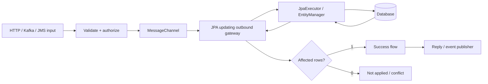
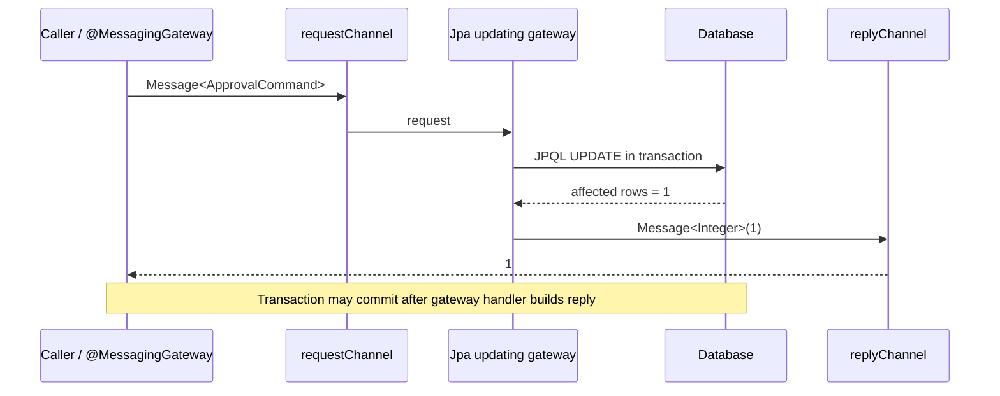
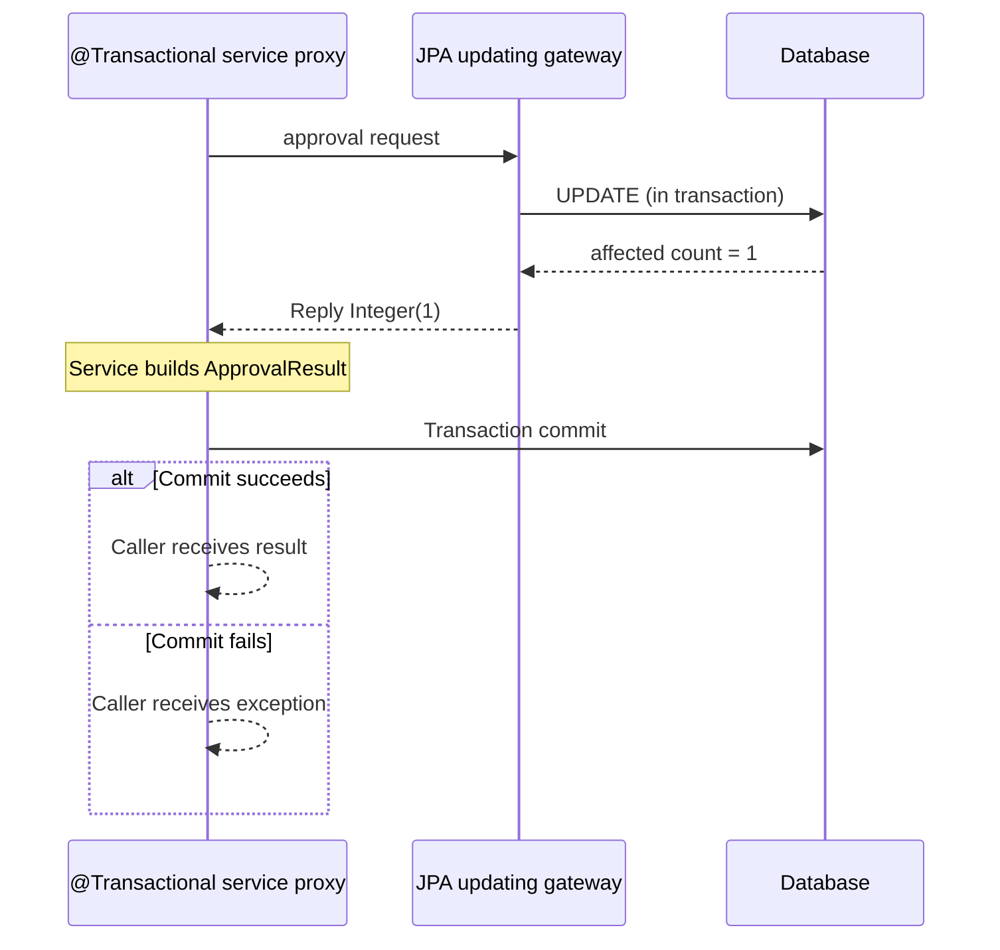
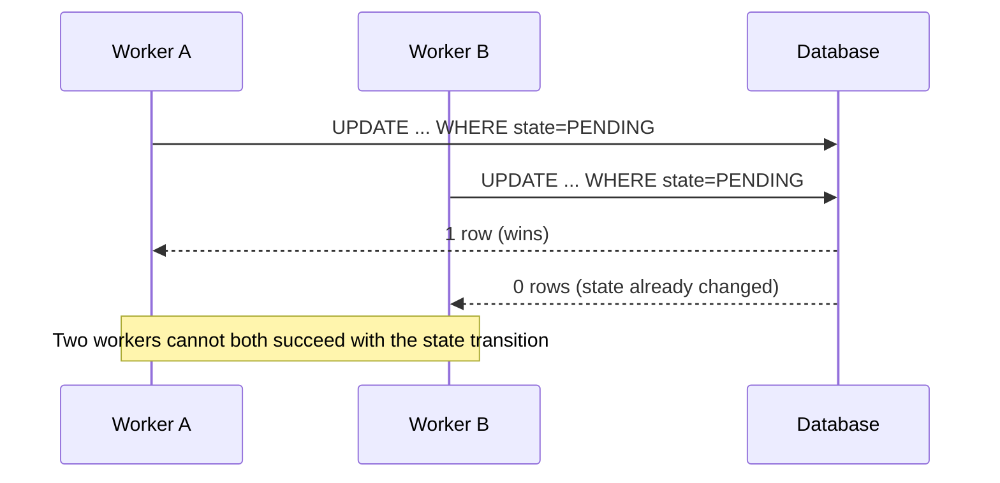
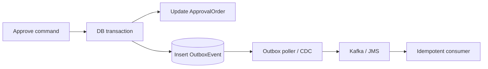
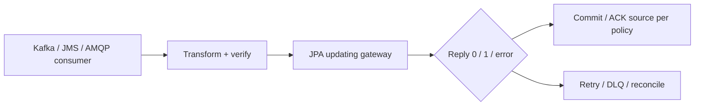

# JPA updating outbound gateway

## 1. Context and Goals

In the **SPRING_INTEGRATION_ADAPTERS** module, Spring Integration connects external systems through inbound/outbound adapters, gateways, pollers, and `MessageChannel`. An event may arrive from HTTP, a file, SFTP, JMS, AMQP, or Kafka; after being validated, normalized, and routed, the application needs to **modify data in the database** and use the **result of that modification** to decide the next step of the Integration Flow.

The **JPA updating outbound gateway**, part of the **Adapter JPA** chapter, serves this exact scenario: it receives a Spring Message, executes a JPA **persist/merge/delete** or JPQL/SQL **UPDATE/DELETE**, and sends a **reply message** containing the result. Unlike a one-way JPA outbound channel adapter, an updating gateway can sit **in the middle** of a flow rather than having to end it.

After this lesson, you will be able to:

- Distinguish the JPA updating outbound gateway from the JPA outbound channel adapter, retrieving gateway, and inbound polling adapter.
- Understand `JpaOutboundGateway`, `JpaExecutor`, `OutboundGatewayType.UPDATING`, and `Jpa.updatingGateway(...)`.
- Know when the reply is an **entity** and when it is the **number of updated/deleted rows** (`Integer`).
- Write conditional JPQL `UPDATE/DELETE` statements binding parameters from payload/headers without SQL string concatenation.
- Choose `PersistMode.PERSIST`, `MERGE`, or `DELETE` for entity mode.
- Build a Java 17+, Spring Boot 3.x, Spring Integration 6.x, Spring Data JPA, and H2 example using `@MessagingGateway`, Java DSL, transactions, and affected-row counts.
- Handle a `0` result safely, optimistic locking, conditional updates, and tenant authorization checks.
- Distinguish `flush`, `commit`, the gateway reply, Kafka/JMS/HTTP ACKs, and idempotency.
- Test rollbacks, duplicates, multi-worker contention, timeouts, invalid queries, outbound events, and backpressure.

> **Key point:** the updating gateway provides a **business reply from the JPA operation**, but a reply emitted by the handler **does not by itself prove the transaction committed durably** if an outer transaction is still open. Nor does it mean the message has been acknowledged by Kafka/JMS/HTTP clients.

## 2. Where Does the Updating Outbound Gateway Fit in an Integration Flow?

Consider an order approval flow. The input is `orderId` and an authenticated tenant; the application only updates orders currently in `PENDING`. A result of `1` means one row matched the condition, and `0` means no row matched; a router after the gateway decides whether to send an ACK or handle a conflict.



Depending on the operation, the gateway produces two categories of results:

1. **Entity mode**: an entity is persisted or merged; the gateway returns the persisted/merged entity per the adapter contract. With `MERGE`, it may be a **different managed instance** from the input object.
2. **Query update/delete mode**: JPQL/native/named update or delete returns the **affected row count** (typically `Integer`), enabling branching or building a response.

Spring Integration documentation draws a clear line: the **updating** gateway is used to save, update, or delete; the **retrieving** gateway is used for SELECTs. The updating gateway is similar to the outbound channel adapter, except it **produces a reply**.

### Responsibilities by Component

| Component | Responsibility |
| --- | --- |
| `JpaExecutor` | Configures entity/query, persist mode, parameter binding, flushing, and JPA execution |
| `JpaOutboundGateway` | Handler receiving requests and building replies from `JpaExecutor` |
| `OutboundGatewayType.UPDATING` | Selects the **write/update** branch instead of retrieval |
| `Jpa.updatingGateway(...)` | Java DSL builder for updating request–reply |
| `MessageChannel` | Passes requests/replies between steps |
| `@MessagingGateway` | Request–reply interface letting Java code invoke an Integration Flow |
| `EntityManagerFactory` | JPA infrastructure providing an EntityManager bound to the transaction |
| `@Transactional` / transactional advice | Establishes the transaction scope for DB mutations |

**There is no requirement to look for a class named `JpaUpdatingOutboundGateway`.** The implementation uses `JpaOutboundGateway` in `UPDATING` mode, or the DSL factory `Jpa.updatingGateway(...)`.

## 3. Distinguishing the Four JPA Endpoints

| Component | When It Runs | DB Effect | Reply |
| --- | --- | --- | --- |
| **JPA inbound channel adapter** | Invoked periodically by a poller | Typically SELECT; optional cleanup | Emits new messages from query results |
| **JPA outbound channel adapter** | Message arrives on channel | Persist/merge/delete/update | **Does not** emit a reply |
| **JPA retrieving outbound gateway** | Request message arrives | On-demand SELECT/find | Entity, list, or query result |
| **JPA updating outbound gateway** | Request message arrives | **PERSIST/MERGE/DELETE, UPDATE/DELETE query** | **Entity or affected-row count** |

Common decisions:

- **Kafka event → write a receipt → no further steps:** use outbound channel adapter.
- **HTTP command → update status → need to know whether a row changed:** use updating outbound gateway.
- **Message contains order ID → look up order → return DTO:** use retrieving outbound gateway.
- **Every 5 seconds scan `NEW` rows:** use JPA inbound channel adapter and poller.
- **Simple business service just calling `repository.save(...)`:** sometimes direct Spring Data JPA is clearer; Spring Integration helps when you have channels, routers, transformers, other adapters, and error flows.

**A gateway needs no poller** when requests arrive on a `DirectChannel` from the application. A poller is only needed if the input itself is a pollable channel/message source, such as a `QueueChannel` or another polling inbound adapter.

## 4. Request–Reply Contract and Return Payload Types

### 4.1. Entity Mode

```text
Request payload:
  PurchaseOrder(id="ORD-101", state="PAID")

Jpa updating gateway:
  PersistMode.MERGE

Reply payload:
  PurchaseOrder (merged entity)
```

Spring Integration returns the entity processed by JPA per the chosen mode. Distinguish between the **input** entity and the **managed object returned** by `EntityManager.merge(...)`. If you need a generated ID, version, or new state, inspect flush/commit timing and map within the same transaction.

### 4.2. JPQL UPDATE/DELETE Mode

```sql
update ApprovalOrder o
   set o.state = 'APPROVED'
 where o.id = :id
   and o.tenantId = :tenantId
   and o.state = 'PENDING'
```

When the gateway executes this query, the reply is the number of rows modified.

| Reply | What You Can Conclude | What You Cannot Conclude Yet |
| ---: | --- | --- |
| `1` | One row matched the condition and JPA returned an affected count of 1 | Whether the outer transaction committed or external messages were delivered |
| `0` | No row matched the update predicate | Whether the ID is missing, already `APPROVED`, or unauthorized for the tenant — **not distinguishable from 0 alone** |
| `>1` | The query modified multiple rows | Not an error if intentional bulk update; **dangerous** if the contract only allows 1 |
| Exception | JPA/provider/transaction rejected a step | Does not automatically mean external side effects rolled back |

**Important:** `0` does not mean "already processed successfully earlier". The order might not exist, might belong to another tenant, or might be in an invalid state. Do not treat `0` as an automatic `200 OK`/source ACK if the contract requires distinguishing causes.

### 4.3. How the Reply Returns to the Caller



When a `@MessagingGateway` interface builds a request, it usually attaches a temporary `replyChannel` header. If the handler has no fixed output channel, the reply can travel back over that channel to the caller.

If you configure an explicit output channel, preserve correlation/reply headers across intermediate steps and eventually route the reply back to the caller. **Do not set `replyChannel` expecting a one-way outbound channel adapter to return a result**; only updating/retrieving gateways are responsible for replying.

## 5. Choosing Entity Operations vs. JPQL Bulk Updates

### 5.1. PersistMode.PERSIST

Use when creating new entities. `EntityManager.persist(...)` makes the entity managed and schedules an INSERT on flush/commit.

```java
import org.springframework.integration.jpa.support.PersistMode;

executor.setEntityClass(OrderAudit.class);
executor.setPersistMode(PersistMode.PERSIST);
```

Saving a new `OrderAudit` with a stable event ID can trigger a unique constraint violation when the event is redelivered. **`PERSIST` does not automatically guarantee idempotency**: you must distinguish valid duplicates from conflicting payloads.

### 5.2. PersistMode.MERGE

`MERGE` is the default on `JpaExecutor`/JPA updating gateway. It copies the supplied entity's state onto a managed entity and returns the managed object.

```java
executor.setEntityClass(OrderAudit.class);
executor.setPersistMode(PersistMode.MERGE);
```

Key caveats:

- `merge` does not mean "UPDATE only"; depending on identity/entity state, JPA may INSERT.
- Without `@Version`, a stale snapshot can overwrite newer state.
- The passed entity may be detached; only the object returned by merge is the managed entity.
- To prevent stale updates, check version/state with proper locking rather than expecting `merge` to resolve races automatically.

### 5.3. PersistMode.DELETE

`DELETE` removes entities according to JPA rules. Check authorization, cascade/foreign-key effects, and detached-entity behavior.

```java
executor.setEntityClass(OrderAudit.class);
executor.setPersistMode(PersistMode.DELETE);
```

For conditional bulk deletes where an affected count is needed, JPQL `DELETE WHERE ...` is usually easier to reason about than entity mode. Never let clients send an arbitrary entity to delete and treat that identity as authorization.

### 5.4. JPQL UPDATE/DELETE

Direct update query:

```sql
update ApprovalOrder o
   set o.state = 'APPROVED'
 where o.id = :id
   and o.state = 'PENDING'
```

Advantages:

- Evaluates predicates **atomically in the `WHERE` clause** inside the database.
- Returns the affected-row count as the reply for conflict handling.
- Avoids loading an entity, mutating fields, and flushing just to change a couple of columns.
- Can enforce tenant/version/state constraints directly.

Trade-off: **JPQL bulk UPDATE/DELETE bypasses dirty checking and many standard entity lifecycle hooks**, which can leave entities already loaded in the persistence context **stale**. Bulk operations also do not automatically increment `@Version` the way entity updates do. Refresh/clear/increment versions explicitly by design rather than assuming the update count handles all concurrency.

## 6. Passing Parameters Safely into JPQL

### 6.1. Separating Query Structure from Data

**Do not do this:**

```java
String query =
        "update ApprovalOrder o set o.state='APPROVED' where o.id='"
        + clientOrderId + "'";
```

Instead, write:

```sql
update ApprovalOrder o
   set o.state = 'APPROVED'
 where o.id = :id
   and o.tenantId = :tenantId
   and o.state = 'PENDING'
```

With Java DSL:

```java
Jpa.updatingGateway(entityManagerFactory)
        .jpaQuery("""
            update ApprovalOrder o
               set o.state = 'APPROVED'
             where o.id = :id
               and o.tenantId = :tenantId
               and o.state = 'PENDING'
            """)
        .parameterExpression("id", "payload.orderId()")
        .parameterExpression(
                "tenantId", "payload.authorizedTenantId()");
```

`payload.orderId()` and `payload.authorizedTenantId()` are evaluated against a Java record payload. With standard beans, you can use getters/properties like `payload.orderId` following JavaBeans conventions.

**Parameter binding prevents data from being interpolated into query syntax**, but **does not** automatically enforce tenant authorization or resource bounds. `authorizedTenantId` in the example must come from server-side authentication/ACL, not just a client-claimed string.

### 6.2. Using Headers as Parameter Sources

Example of a header attached by a trusted service:

```java
.parameterExpression("tenantId", "headers['verifiedTenantId']")
```

This is useful when the payload is `orderId` and the tenant resides in security metadata. However, headers on a Spring Message can still be set arbitrarily by untrusted producers; **the header's origin must be controlled**. Never let HTTP/Kafka inputs inject `verifiedTenantId` without authentication/authorization.

### 6.3. ParameterSourceFactory and usePayloadAsParameterSource

The JPA gateway supports `ParameterSourceFactory` to supply values for named/indexed query parameters. When no explicit `JpaParameter` entries are declared, `usePayloadAsParameterSource` typically defaults to `true` and payload bean properties act as the source. When explicit `JpaParameter`/SpEL expressions are used, the appropriate default evaluates against the **entire Spring Message**, exposing both payload and headers.

Do not mix the two styles carelessly:

- **Explicit parameter expressions**: clear mapping per `:id`/`:tenantId`.
- **ParameterSourceFactory**: bulk property mapping per contract.

Avoid declaring `parameter-source-factory` alongside `<int-jpa:parameter>` elements in XML; Spring Integration documentation notes the two are mutually exclusive.

### 6.4. Named Queries and Native SQL

`@NamedQuery` allows defining UPDATE/DELETE queries on entities; the gateway selects one with `namedQuery("...")`. `nativeQuery("...")` uses database-specific SQL syntax, such as PostgreSQL-specific conditional updates.

Do not set `jpaQuery`, `nativeQuery`, and `namedQuery` simultaneously on one endpoint if they conflict; pick **one** clear query mode. For native queries, test parameter binding and result semantics on your actual persistence provider and database, especially the affected-row count type.

## 7. Complete Hands-On Example: Conditional Order Approval

Build a demo application:

1. Create an `approval_order` table holding `PENDING`/`APPROVED` states.
2. Receive `ApprovalCommand(orderId, authorizedTenantId)` through a `@MessagingGateway`.
3. JPQL transitions `PENDING → APPROVED` **only if the order belongs to the right tenant**.
4. The updating gateway replies with an `Integer` representing updated rows.
5. A `@Transactional` facade runs the query, inspects the count, and commits within the same synchronous call.
6. Reply `1` returns `APPLIED`; reply `0` returns `NOT_APPLIED` (without guessing the cause).
7. Use a Spring Data JPA repository to seed/verify data, while **the actual update executes through the Spring Integration gateway**.

The example uses Java 17+, Spring Boot 3.x, Spring Integration 6.x, and in-memory H2, with no web server required. Classes live in package `com.example.jpaupdate`.

### 7.1. Maven Dependencies

```xml
<dependencies>
    <dependency>
        <groupId>org.springframework.boot</groupId>
        <artifactId>spring-boot-starter</artifactId>
    </dependency>
    <dependency>
        <groupId>org.springframework.boot</groupId>
        <artifactId>spring-boot-starter-data-jpa</artifactId>
    </dependency>
    <dependency>
        <groupId>org.springframework.boot</groupId>
        <artifactId>spring-boot-starter-integration</artifactId>
    </dependency>
    <dependency>
        <groupId>org.springframework.integration</groupId>
        <artifactId>spring-integration-jpa</artifactId>
    </dependency>
    <dependency>
        <groupId>com.h2database</groupId>
        <artifactId>h2</artifactId>
        <scope>runtime</scope>
    </dependency>
    <dependency>
        <groupId>org.springframework.boot</groupId>
        <artifactId>spring-boot-starter-test</artifactId>
        <scope>test</scope>
    </dependency>
</dependencies>
```

The Spring Boot BOM should manage compatible versions. Spring Boot 3.x uses **`jakarta.persistence`**, not `javax.persistence` from older Spring projects. `spring-integration-jpa` provides `JpaExecutor`, `JpaOutboundGateway`, and DSL; Spring Data JPA/ORM provider execute database operations.

### 7.2. ApprovalOrder Entity

File `ApprovalOrder.java`:

```java
package com.example.jpaupdate;

import jakarta.persistence.Column;
import jakarta.persistence.Entity;
import jakarta.persistence.Id;
import jakarta.persistence.Table;

@Entity
@Table(name = "approval_order")
public class ApprovalOrder {

    @Id
    @Column(name = "order_id", length = 80, nullable = false)
    private String id;

    @Column(name = "tenant_id", length = 80, nullable = false)
    private String tenantId;

    @Column(length = 24, nullable = false)
    private String state;

    protected ApprovalOrder() {
        // JPA requires a no-argument constructor.
    }

    public ApprovalOrder(String id, String tenantId, String state) {
        this.id = id;
        this.tenantId = tenantId;
        this.state = state;
    }

    public String getId() {
        return id;
    }

    public String getTenantId() {
        return tenantId;
    }

    public String getState() {
        return state;
    }
}
```

This is a simple entity illustrating JPQL bulk updates. Production requires schema migrations, business validation, column/index/unique constraints, audit fields, and an appropriate locking strategy.

**Why is there no `setState` setter?** This lesson changes state via the **JPQL updating gateway** rather than mutating JPA objects directly via the repository. The entity keeps a constructor and getters for testing.

### 7.3. Command and Result DTOs

File `ApprovalCommand.java`:

```java
package com.example.jpaupdate;

public record ApprovalCommand(
        String orderId,
        String authorizedTenantId) {
}
```

File `ApprovalResult.java`:

```java
package com.example.jpaupdate;

public record ApprovalResult(
        String orderId,
        String outcome,
        int affectedRows) {

    public boolean applied() {
        return affectedRows == 1;
    }
}
```

`authorizedTenantId` expresses the **contract intent**: the value must be **issued server-side** by an authentication/authorization service. The console demo uses a fixed tenant with no HTTP authentication. If a client freely supplies both `orderId` and `authorizedTenantId` and the service uses them verbatim, that remains a cross-tenant vulnerability.

### 7.4. Repository for Seeding and Verification

File `ApprovalOrderRepository.java`:

```java
package com.example.jpaupdate;

import org.springframework.data.jpa.repository.JpaRepository;

public interface ApprovalOrderRepository
        extends JpaRepository<ApprovalOrder, String> {
}
```

The repository is only for seeding and assertions. State transitions in the workflow still run through `Jpa.updatingGateway(...)`.

### 7.5. @MessagingGateway Interface

File `ApprovalJpaGateway.java`:

```java
package com.example.jpaupdate;

import org.springframework.integration.annotation.MessagingGateway;

@MessagingGateway(
        defaultRequestChannel = "approvalRequests",
        defaultReplyTimeout = "5000")
public interface ApprovalJpaGateway {

    Integer approve(ApprovalCommand command);
}
```

Spring Integration builds a request message from `ApprovalCommand`, sends it to `approvalRequests`, awaits the reply, and returns the `Integer` to the caller. There is no scheduled query; calling `approve(...)` **triggers the flow**.

`defaultReplyTimeout` is not a DB query timeout or transaction timeout. On a synchronous `DirectChannel`, the handler call can run longer than the reply timeout if the DB hangs; manage timeouts separately at JDBC/JPA/DB level.

### 7.6. Java DSL Configuring the Updating Gateway

File `ApprovalIntegrationConfiguration.java`:

```java
package com.example.jpaupdate;

import jakarta.persistence.EntityManagerFactory;
import org.springframework.context.annotation.Bean;
import org.springframework.context.annotation.Configuration;
import org.springframework.integration.config.EnableIntegration;
import org.springframework.integration.dsl.IntegrationFlow;
import org.springframework.integration.jpa.dsl.Jpa;

@Configuration
@EnableIntegration
public class ApprovalIntegrationConfiguration {

    @Bean
    IntegrationFlow approvalFlow(
            EntityManagerFactory entityManagerFactory) {

        return IntegrationFlow.from("approvalRequests")
                .handle(
                        Jpa.updatingGateway(entityManagerFactory)
                                .jpaQuery("""
                                        update ApprovalOrder o
                                           set o.state = 'APPROVED'
                                         where o.id = :id
                                           and o.tenantId = :tenantId
                                           and o.state = 'PENDING'
                                        """)
                                .parameterExpression(
                                        "id", "payload.orderId()")
                                .parameterExpression(
                                        "tenantId",
                                        "payload.authorizedTenantId()"))
                .get();
    }
}
```

Key points:

- `Jpa.updatingGateway(entityManagerFactory)` is the **updating request–reply** spec.
- JPQL `update ApprovalOrder` uses the Java entity name, not the table name `approval_order`.
- `set ... where ...` both performs the update and guards state/tenant invariants.
- `parameterExpression(...)` uses SpEL to extract record fields for **binding**, never SQL string concatenation.
- The query returns `Integer affectedRows`; the flow routes the reply back to `@MessagingGateway`'s temporary reply channel.
- No `@Poller`: the flow runs on incoming messages.
- This code does not authenticate identities itself; it relies on the upstream service to supply a verified `authorizedTenantId`.

**Do not add `Jpa.outboundAdapter(...)` on the same channel** unless intentionally designing multiple consumers. A one-way adapter will not return `Integer` to `ApprovalJpaGateway`.

### 7.7. Facade Creating the Transaction and Interpreting the Reply

File `ApprovalService.java`:

```java
package com.example.jpaupdate;

import org.springframework.stereotype.Service;
import org.springframework.transaction.annotation.Transactional;

@Service
public class ApprovalService {

    private final ApprovalJpaGateway gateway;

    public ApprovalService(ApprovalJpaGateway gateway) {
        this.gateway = gateway;
    }

    @Transactional
    public ApprovalResult approve(ApprovalCommand command) {
        if (command == null
                || command.orderId() == null
                || command.orderId().isBlank()
                || command.orderId().length() > 80
                || command.authorizedTenantId() == null
                || command.authorizedTenantId().isBlank()
                || command.authorizedTenantId().length() > 80) {
            throw new IllegalArgumentException(
                    "Invalid authorized approval request");
        }

        // @MessagingGateway -> DirectChannel -> JPA handler
        // share the same thread and active transaction.
        Integer affected = gateway.approve(command);

        if (affected == null) {
            throw new IllegalStateException(
                    "Updating gateway did not return affected count");
        }

        if (affected < 0 || affected > 1) {
            throw new IllegalStateException(
                    "Unexpected affected row count: " + affected);
        }

        return new ApprovalResult(
                command.orderId(),
                affected == 1 ? "APPLIED" : "NOT_APPLIED",
                affected);
        // @Transactional commits when the proxy finishes the call.
        // Commit failure => caller sees exception, does not receive success result.
    }
}
```

Because `ApprovalService.approve(...)` is a **public method** on a Spring bean called via a proxy, `@Transactional` opens a transaction before the gateway runs. The default `DirectChannel` keeps processing synchronous. When the service method returns, the Spring transaction interceptor commits before returning control to the external caller.

Transaction notes:

- **Inside** the method, an affected count of `1` is not committed yet.
- **Outside** the service proxy, if the method returns normally then the service transaction committed (per configured manager/infrastructure); this still says nothing about external broker side effects.
- If the gateway/DB throws an exception, the transaction can roll back; callers must classify errors to decide on retries.
- If switched to `ExecutorChannel`/`QueueChannel`, the service transaction **does not automatically cross** to the consumer on another thread; transactions must be configured at the handler/consumer separately.

### 7.8. Spring Boot Main and Seed Data

File `JpaUpdatingApplication.java`:

```java
package com.example.jpaupdate;

import java.util.List;
import org.springframework.boot.CommandLineRunner;
import org.springframework.boot.SpringApplication;
import org.springframework.boot.autoconfigure.SpringBootApplication;
import org.springframework.context.annotation.Bean;
import org.springframework.integration.annotation.IntegrationComponentScan;

@SpringBootApplication
@IntegrationComponentScan
public class JpaUpdatingApplication {

    public static void main(String[] args) {
        SpringApplication.run(JpaUpdatingApplication.class, args);
    }

    @Bean
    CommandLineRunner demo(
            ApprovalOrderRepository repository,
            ApprovalService service) {

        return args -> {
            if (repository.count() == 0) {
                repository.saveAll(List.of(
                        new ApprovalOrder(
                                "ORD-101", "TENANT-A", "PENDING"),
                        new ApprovalOrder(
                                "ORD-102", "TENANT-A", "APPROVED"),
                        new ApprovalOrder(
                                "ORD-103", "TENANT-B", "PENDING")));
            }

            ApprovalResult first = service.approve(
                    new ApprovalCommand("ORD-101", "TENANT-A"));
            ApprovalResult again = service.approve(
                    new ApprovalCommand("ORD-101", "TENANT-A"));
            ApprovalResult wrongTenant = service.approve(
                    new ApprovalCommand("ORD-103", "TENANT-A"));

            System.out.println("First: " + first);
            System.out.println("Again: " + again);
            System.out.println("Wrong tenant: " + wrongTenant);

            repository.findById("ORD-101")
                    .ifPresent(row -> System.out.println(
                            "State now: " + row.getState()));
        };
    }
}
```

File `application.properties` for the learning environment:

```properties
spring.main.web-application-type=none

spring.datasource.url=jdbc:h2:mem:jpa_updating_demo;DB_CLOSE_DELAY=-1
spring.datasource.driver-class-name=org.h2.Driver
spring.datasource.username=sa
spring.datasource.password=

spring.jpa.hibernate.ddl-auto=create-drop
spring.jpa.open-in-view=false
logging.level.org.springframework.integration=INFO
```

Expected output when running:

| Call | Result | Explanation |
| --- | --- | --- |
| `ORD-101`, `TENANT-A` first time | `APPLIED`, affected `1` | Row matched ID + tenant + `PENDING` state |
| `ORD-101` second time | `NOT_APPLIED`, affected `0` | Row is already `APPROVED`, fails `PENDING` check |
| `ORD-103` with `TENANT-A` | `NOT_APPLIED`, affected `0` | Row belongs to `TENANT-B` |
| Read `ORD-101` afterward | `APPROVED` | Query committed successfully in the demo |

**Never write logic assuming "`affected=0` means already approved"** in a real service. Here two different causes both yield `0` and are normalized to `NOT_APPLIED`. If business logic must distinguish causes, check authorization/read state after updating with appropriate transaction/isolation, while avoiding leaking whether an order belonging to another tenant exists.

### 7.9. What Is the Gateway and What Is the Service?

Each class has a single role:

- `ApprovalJpaGateway` is the **messaging facade**, never touching the DB directly.
- `ApprovalIntegrationConfiguration` defines the message flow and query.
- `JpaExecutor` is created by the DSL from `EntityManagerFactory` to execute JPA.
- `ApprovalService` validates inputs, opens the transaction, checks the affected count, and builds the business result.
- `ApprovalOrderRepository` seeds and verifies in tests; it does not perform workflow updates.
- `@IntegrationComponentScan` enables discovery of `@MessagingGateway` interfaces.
- H2 + `create-drop` is strictly a demo database; production requires schema migrations and the target DB.

## 8. Writing the Gateway with Java Annotations (Without DSL)

If you need explicit configuration of `JpaExecutor` and `JpaOutboundGateway`, use `@ServiceActivator`. **This is an alternative** to Java DSL in section 7.6; do not register both listening on `approvalRequests`.

```java
package com.example.jpaupdate;

import java.util.List;
import jakarta.persistence.EntityManagerFactory;
import org.springframework.context.annotation.Bean;
import org.springframework.context.annotation.Configuration;
import org.springframework.integration.annotation.ServiceActivator;
import org.springframework.integration.jpa.core.JpaExecutor;
import org.springframework.integration.jpa.outbound.JpaOutboundGateway;
import org.springframework.integration.jpa.support.JpaParameter;
import org.springframework.integration.jpa.support.OutboundGatewayType;
import org.springframework.messaging.MessageHandler;

@Configuration
public class ApprovalJpaJavaConfiguration {

    @Bean
    JpaExecutor approvalJpaExecutor(
            EntityManagerFactory entityManagerFactory) {

        JpaExecutor executor =
                new JpaExecutor(entityManagerFactory);

        executor.setJpaQuery("""
                update ApprovalOrder o
                   set o.state = 'APPROVED'
                 where o.id = :id
                   and o.tenantId = :tenantId
                   and o.state = 'PENDING'
                """);

        executor.setJpaParameters(List.of(
                new JpaParameter(
                        "id", null, "payload.orderId()"),
                new JpaParameter(
                        "tenantId", null,
                        "payload.authorizedTenantId()")));
        executor.setUsePayloadAsParameterSource(false);
        return executor;
    }

    @Bean
    @ServiceActivator(inputChannel = "approvalRequests")
    MessageHandler approvalJpaHandler(
            JpaExecutor approvalJpaExecutor) {

        JpaOutboundGateway gateway =
                new JpaOutboundGateway(approvalJpaExecutor);

        gateway.setGatewayType(OutboundGatewayType.UPDATING);

        // Do not call setProducesReply(false): that makes it an outbound adapter.
        return gateway;
    }
}
```

Here:

1. `JpaExecutor.setJpaQuery` accepts the JPQL UPDATE.
2. `JpaParameter(name, null, expression)` binds named parameters with SpEL expressions.
3. `setUsePayloadAsParameterSource(false)` evaluates against the **entire Spring Message** (both `payload` and `headers`).
4. `setGatewayType(UPDATING)` selects write/update mode and emits a reply.
5. `JpaOutboundGateway` produces replies by default; **`setProducesReply(false)` is only for an outbound channel adapter**.
6. `@ServiceActivator` attaches the handler to the input channel just like the DSL option.

If switching to entity mode, replace `jpaQuery/setJpaParameters` with `setEntityClass`/`setPersistMode`.

## 9. XML Namespace Configuration

Spring Integration provides the `int-jpa` namespace for the updating outbound gateway. Alternative to DSL:

```xml
<int-jpa:updating-outbound-gateway
        id="approvalUpdatingGateway"
        request-channel="approvalRequests"
        entity-manager-factory="entityManagerFactory"
        jpa-query="update ApprovalOrder o
                   set o.state = 'APPROVED'
                   where o.id = :id
                   and o.tenantId = :tenantId
                   and o.state = 'PENDING'">

    <int-jpa:parameter
            name="id"
            expression="payload.orderId()"/>
    <int-jpa:parameter
            name="tenantId"
            expression="payload.authorizedTenantId()"/>

    <int-jpa:transactional
            transaction-manager="transactionManager"/>
</int-jpa:updating-outbound-gateway>
```

This is an **XML snippet** assuming `int-jpa` namespaces/schemas, channels, `entityManagerFactory`, and `transactionManager` are already declared. Do not run XML beans alongside Java DSL/annotation beans consuming the same request channel without deliberate design.

If `reply-channel` is omitted, the request message needs a `replyChannel` header (such as `@MessagingGateway` creates), or proper output routing. When a fixed `reply-channel` is specified, results go there; downstream steps must forward the reply back to the caller/final destination while preserving correlation metadata.

### Entity Mode in XML

Simple variant example:

```xml
<int-jpa:updating-outbound-gateway
        request-channel="orderAuditUpdates"
        reply-channel="orderAuditResults"
        entity-manager-factory="entityManagerFactory"
        entity-class="com.example.jpaupdate.OrderAudit"
        persist-mode="MERGE">

    <int-jpa:transactional
            transaction-manager="transactionManager"/>
</int-jpa:updating-outbound-gateway>
```

`OrderAudit` here is just an illustrative class name; define the actual entity and input/reply channels if running it. The gateway returns the processed entity per entity mode; if returning into a `@MessagingGateway` method, align the return type mapping.

### Named Query UPDATE

With `@NamedQuery(name = "ApprovalOrder.approve", query = "...")`, you can write:

```xml
<int-jpa:updating-outbound-gateway
        request-channel="approvalRequests"
        entity-manager-factory="entityManagerFactory"
        named-query="ApprovalOrder.approve">

    <int-jpa:parameter
            name="id"
            expression="payload.orderId()"/>
    <int-jpa:parameter
            name="tenantId"
            expression="payload.authorizedTenantId()"/>
</int-jpa:updating-outbound-gateway>
```

Ensure the named query is actually declared and all parameters match. Never put a `SELECT` in an updating gateway expecting an entity list; use a **retrieving gateway** for reads.

## 10. Transactions, Flush, and Commit

### 10.1. UPDATE/DELETE Requires a Transaction

JPA bulk UPDATE/DELETE and entity persistence normally require a transaction. Places to establish a transaction:

- **Synchronous facade** `@Transactional` such as `ApprovalService.approve(...)`.
- **Integration endpoint advice**: `.handle(Jpa.updatingGateway(...), endpoint -> endpoint.transactional())`.
- **XML** `<int-jpa:transactional transaction-manager="..."/>`.
- **Service/repository** invoked downstream if mutation is delegated to another step.

Choose the boundary deliberately and measure transaction duration; avoid spanning transactions across slow network calls unnecessarily.

### 10.2. A Gateway Reply Does Not Guarantee Commit



Within an outer transaction, the gateway emits its reply as soon as JPA `executeUpdate` returns the row count. At that moment, the DB transaction **can still roll back** due to constraints, commit failures, or downstream exceptions. If the reply already went onto an **asynchronous** channel to a client/broker before commit, you risk emitting a "success" event for an uncommitted change.

Therefore:

- Return responses **only after the transactional facade proxy exits cleanly**.
- If an event must be sent to Kafka/JMS reliably after commit, consider a **transactional outbox**.
- Never treat `MessageChannel.send(...) == true` or reply `1` as a Kafka/JMS ACK.
- When upstream sources can redeliver messages, enforce idempotency using `eventId`/business keys.

### 10.3. Flush Is Not Commit

| Operation | What Actually Happens |
| --- | --- |
| `persist(entity)` | Registers entity in persistence context; SQL may run at flush/commit |
| `merge(entity)` | Copies state onto a managed entity; SQL may run later |
| `flush()` | Synchronizes pending changes with the DB **inside the transaction** |
| `executeUpdate()` | Runs JPQL bulk UPDATE/DELETE, returns affected count |
| `commit()` | Durably completes the DB transaction |
| Gateway reply | Returns the JPA operation's object/row count; **does not commit outer transactions** |

`JpaExecutor.setFlush(true)`/`JpaUpdatingOutboundEndpointSpec.flush(true)` controls flushing for **entity persistence operations** as configured. For JPQL `UPDATE`, `executeUpdate` runs the query itself; do not mistake the flush flag for a commit command.

### 10.4. DirectChannel and Async Boundaries

`DirectChannel` usually invokes the handler on the sender's thread; `@Transactional` on the facade wraps both the update and the affected-count check.

If replaced with `ExecutorChannel` or `QueueChannel`:

- Transaction context generally does not cross threads/queues.
- The caller can receive message-acceptance feedback before the DB update even executes.
- The JPA consumer needs its own transaction and error handling.
- A synchronous `@MessagingGateway` awaiting a reply needs valid reply routing and a bounded timeout.
- If an HTTP response must wait for commit, revisit request–reply architecture and ACK timing.

## 11. Bulk UPDATE and Optimistic Locking

### 11.1. A Conditional WHERE Is a Simple Atomic Claim

With the query:

```sql
update ApprovalOrder o
   set o.state = 'APPROVED'
 where o.id = :id
   and o.tenantId = :tenantId
   and o.state = 'PENDING'
```

If two workers try to approve the same `PENDING` order simultaneously:



This diagram shows the **expected logical outcome** on a database with proper locking/isolation. In practice, the second worker may block on a lock or receive a deadlock/serialization failure and retry; verify on your target DB. A `0` result can also mean wrong ID/tenant, not necessarily contention.

### 11.2. @Version Does Not Auto-Increment on JPQL Bulk Updates

For an entity with:

```java
@Version
private long version;
```

Optimistic locking on entity updates relies on the version field. However, **bulk UPDATE/DELETE queries do not automatically apply dirty checking or version increments of managed entities**.

If you need version-based CAS in JPQL, you can write illustratively:

```sql
update ApprovalOrder o
   set o.state = :newState,
       o.version = o.version + 1
 where o.id = :id
   and o.tenantId = :tenantId
   and o.version = :expectedVersion
   and o.state = :expectedState
```

The query must match an actual `version` field on the entity and table; the main demo omits this field. When count is `0`, treat it as a **version/state/permission/ID mismatch** and reconcile explicitly. Avoid blindly retrying with the same stale `expectedVersion`.

### 11.3. Bulk Updates Can Leave the Persistence Context Stale

Example:

```java
ApprovalOrder managed = entityManager.find(
        ApprovalOrder.class, "ORD-101");

// Bulk JPQL updates o.state to APPROVED in the database
// but managed.getState() may still be PENDING.

entityManager.refresh(managed);
```

Do not treat this as standalone runnable code; it illustrates that entities **loaded before a bulk update** must be refreshed/cleared/reloaded if you need the updated state. In long transactions, `clear()` detaches other entities and can discard pending changes; use deliberately.

### 11.4. Business State Machine Constraints

Transitioning `PENDING → APPROVED` is only valid if business rules permit it:

- Block `CANCELLED → APPROVED`.
- Block modifying orders belonging to another tenant.
- Check workflow roles/approval permissions.
- Allow at most one approval per `orderId`.
- Audit approver/`approvedAt`/reason without logging unnecessary PII.
- If multiple tables must change together, wrap them in an appropriate transaction and verify invariants in a service.

Never pass a raw user status command straight into `set o.state = :newState` without allowlisting permitted states.

## 12. When affectedRows = 0: Designing Error Semantics

A reply of `0` has several possible meanings:

| Possible Cause | Example |
| --- | --- |
| Does not exist | `orderId` is not in the table |
| Wrong tenant | Row belongs to another tenant |
| Invalid state | Already `APPROVED`/`CANCELLED` |
| Optimistic conflict | Stale version |
| Race condition | Another worker already updated it |
| Filter policy | Query blocked by another business predicate |

**Not being able to distinguish causes from affected count alone** is an inherent property of conditional updates, not a Spring Integration bug.

Choosing the business response:

- For **idempotent commands with proof** that the event already ran, you can return "already applied" after verifying state and event ID.
- For confidential resources, return a response that does not leak whether another tenant's resource exists.
- If an exact cause is needed, read state **after** updating inside the same or suitable transaction with locking and authorization, recognizing potential races if isolation is insufficient.
- When indeterminate, return `CONFLICT`/`NOT_APPLIED` per API contract rather than casually ACKing the source.
- Record `affected=0` metrics separately from DB errors; `0` can be a normal business outcome.

In the example, `ApprovalService` returns `NOT_APPLIED` rather than turning `0` into an exception automatically.

## 13. Retries, Idempotency, and Cross-Adapter Transactions

### 13.1. Why Can the Same Request Be Redelivered?

Sources can redeliver when:

- A Kafka consumer crashes before committing offsets.
- A JMS/AMQP consumer rolls back/nacks or times out acknowledgment.
- An HTTP caller retries after a timeout even though the server succeeded.
- A File/SFTP poller re-reads a file if metadata/filter state is lost.
- Retry advice re-runs the handler after a transient DB error.

**The updating gateway performs a JPA operation; it does not provide end-to-end exactly-once semantics.**

### 13.2. Conditional State Transitions Are One Layer of Idempotency

`where state='PENDING'` stops the same approval command from updating the row a second time after it becomes `APPROVED`. However, two distinct requests might still compete to approve, or one event ID might replay with a different payload.

For stronger business idempotency, store:

```text
inbox_event
-----------
event_id        PK/UNIQUE
payload_hash
business_key
processing_state
processed_at
result_code
```

And:

1. Authenticate the source and verify signatures/ACLs.
2. Record the unique `eventId` in the same DB transaction as the business update (where the model fits).
3. If the same `eventId` and matching payload hash arrive again, return the recorded outcome.
4. If the same ID arrives with a different payload, report a conflict rather than swallowing it.
5. If the transaction rolls back, let the source retry per policy.
6. If post-commit events are needed, write an **outbox event** in the transaction and publish separately.

`MessageHeaders.ID` is not an idempotency key: each delivery can produce a new Spring Message with a fresh ID.

### 13.3. Transactional Outbox

A safer flow for DB + Kafka coordination:



If a crash happens after broker publish but before marking the outbox `SENT`, the publisher may resend. Consumers must deduplicate by `eventId`. This is typically **at-least-once + idempotency**, and must not be advertised as exactly-once without an end-to-end design that genuinely achieves it.

**Separate ACKs:** DB commit, Kafka producer acknowledgment, JMS consumer acknowledgment, and HTTP 200 each have distinct contracts. Never equate them simply because they share an Integration Flow.

## 14. Entity Mode: Batching, Flushing, and Performance

Besides JPQL bulk UPDATE, the updating gateway supports `Iterable` entities with persist/merge/delete depending on version/configuration. One Spring Message can carry `List<Entity>`, though it does not automatically produce one reply per item.

### 14.1. Batch Entity Mode

Example replacing the JPQL configuration:

```java
Jpa.updatingGateway(entityManagerFactory)
        .entityClass(OrderAudit.class)
        .persistMode(PersistMode.PERSIST)
        .flushSize(50)
        .clearOnFlush(true);
```

This assumes `@Entity OrderAudit` exists and the input payload is an entity or `Iterable<OrderAudit>`. This is a DSL fragment, not intended to run alongside the `ApprovalOrder` demo in section 7.

Options:

| Option | Purpose | Trade-Off |
| --- | --- | --- |
| `persistMode(PERSIST)` | Inserts new entities | Duplicate keys may throw errors |
| `persistMode(MERGE)` | Merges entity state | May insert; requires version checks |
| `persistMode(DELETE)` | Deletes entities | Can affect cascades/audits |
| `flush(true)` | Flushes after persistence operation | Not a commit |
| `flushSize(50)` | Flushes every N entities in a batch | Does not enable JDBC batching on its own |
| `clearOnFlush(true)` | Clears persistence context after flush | Entities become detached; watch lazy access |

When `flushSize > 0`, it takes precedence over the `flush` flag. `clearOnFlush` only applies when flushing occurs. Flushing/clearing does not split one large transaction into smaller transactions; commit still depends on the transaction boundary.

### 14.2. Hibernate JDBC Batching Is a Separate Layer

`flushSize(50)` is the adapter's persistence-context flush policy. For the provider to batch SQL INSERT/UPDATE statements at the JDBC layer, check Hibernate/driver/DB settings such as `hibernate.jdbc.batch_size`. ID generation strategies like `IDENTITY` can inhibit JDBC batching.

Never stuff millions of entities into one `Iterable` message expecting `flushSize` to absorb all memory/transaction cost. Chunk into bounded batches, track partial failures, and consider per-batch transactions.

### 14.3. Batch Replies Need an Explicit Contract

Entity mode generally returns the processed entity per `JpaExecutor` results, but with `Iterable`, verify the returned object types and managed scope for your adapter version and transaction. Never blindly cast the reply to `List<ManagedEntity>` without testing. When per-item success/failure reporting is required, a dedicated service/orchestrator or a splitter with explicit transaction boundaries is usually clearer.

## 15. Error Handling and Timeouts

| Error Type | Example | Handling Strategy |
| --- | --- | --- |
| Validation error | Blank ID/tenant, invalid state | Reject before gateway; do not retry indefinitely |
| Permission failure | User cannot approve tenant/order | Return forbidden without leaking data |
| Affected count = 0 | State mismatch, not found, wrong tenant | Business `NOT_APPLIED` or controlled conflict |
| DB unavailable | Network, pool exhaustion, failover | Bounded retry, backoff/jitter, health alert |
| Deadlock / lock timeout | Concurrent workers updating same row | Bounded retry and idempotency |
| Optimistic lock | Stale version | Reload/reconcile; never overwrite blindly |
| Constraint violation | Unique/FK/NOT NULL | Fix data/schema; quarantine poison event |
| JPQL syntax error | Wrong entity/field or query mode | Fix code; do not retry |
| Parameter mismatch | Missing `:tenantId`, wrong type/SpEL | Verify binding with unit/integration tests |
| Transaction commit failure | Query returned `1` but commit rolled back | Do not send success ACK; allow policy-driven retry |
| Async reply timeout | Reply missed channel/deadline | Fix routing/correlation; measure bottlenecks |
| Broker send failure after DB commit | Kafka/JMS unavailable | Use outbox and publisher retries |

### Which Timeout Controls What?

| Configuration | What It Bounds |
| --- | --- |
| `@MessagingGateway(defaultReplyTimeout=...)` | Wait time for a reply via the messaging gateway depending on context |
| `JpaOutboundGateway reply-timeout` | Time spent **sending the reply to a channel** if the channel can block (e.g., full bounded QueueChannel) |
| JDBC/JPA query timeout | Statement/query execution time at database/driver/provider |
| `@Transactional(timeout=...)` | Transaction timeout enforced by the transaction manager |
| HTTP client timeout | How long the caller waits for the server response |

A messaging gateway timeout **does not necessarily interrupt an active JDBC query** on a synchronous thread. Test bounds at each layer. When requests/responses have SLAs, combine query timeouts, pool timeouts, bounded concurrency, and proper failure handling.

### Error Channel Is Not Automatically a DLQ

Spring Integration supports `errorChannel`/`ErrorMessage` and retry advice, but an exception does not automatically become durable retry logic. For Kafka/JMS sources, define when to ACK/NACK/seek/DLQ. For HTTP inputs, map exceptions to appropriate status codes and never report success before commit.

## 16. Integrating HTTP, JMS, AMQP, Kafka, SFTP, and Databases

### 16.1. HTTP Request–Reply

```text
HTTP POST /orders/ORD-101/approve
    ↓ authenticate + resolve tenant + validate
ApprovalService.approve(...)
    ↓ JPA updating gateway → Integer affectedRows
transaction commit
    ↓ API maps ApprovalResult → HTTP response
```

Recommended semantics:

- `APPLIED`: return success **after commit**.
- `NOT_APPLIED`: return conflict/not found per information-disclosure policy.
- Unauthorized: `401`/`403` or security-designed response.
- Database unavailable: `5xx` with client retry guidance and idempotency keys.
- Duplicate identical request: rely on inbox/idempotency records, not solely `affectedRows=0`.

### 16.2. Kafka/JMS/AMQP Inbound



- If the database rolls back, never ACK the source as a successful update.
- If affected is `0` because a duplicate event already ran, require **idempotency evidence** before ACKing.
- If affected is `0` due to unauthorized access or invalid state transition, follow business policy; do not retry infinitely.
- If affected is `1` but the transaction has not committed yet, never commit the Kafka offset or ACK JMS before DB commit succeeds.
- If a result event must go to a broker, use an outbox or explicit orchestration.

### 16.3. File/SFTP Imports

If a file contains 100,000 records to update, never fire an unchecked table-wide bulk `UPDATE`. Instead:

1. Validate the file and source.
2. Parse into DTOs and split into bounded batches.
3. For each record, run a query keyed by business ID plus version/state/tenant predicates.
4. Collect affected counts per batch.
5. Quarantine `0`-count or schema-invalid records per policy.
6. Use file checksum/row ID as an idempotency key in case the poller re-reads the file.
7. Monitor update throughput, lock waits, and backlog.

For very large updates, consider JDBC batching/native SQL or dedicated bulk jobs rather than unbounded request–reply gateway calls.

## 17. Testing the JPA Updating Gateway

### 17.1. Unit Testing Business Results

Because `ApprovalResult` is a pure record, test it directly:

```java
package com.example.jpaupdate;

import static org.junit.jupiter.api.Assertions.*;
import org.junit.jupiter.api.Test;

class ApprovalResultTest {

    @Test
    void appliedRequiresOneAffectedRow() {
        assertTrue(new ApprovalResult(
                "ORD-101", "APPLIED", 1).applied());

        assertFalse(new ApprovalResult(
                "ORD-101", "NOT_APPLIED", 0).applied());
    }
}
```

This unit test does not prove the JPA gateway executes properly. Run integration tests with `EntityManagerFactory`, transactions, and a DB.

### 17.2. End-to-End @SpringBootTest

File `ApprovalIntegrationTest.java`:

```java
package com.example.jpaupdate;

import static org.assertj.core.api.Assertions.assertThat;

import java.util.UUID;
import org.junit.jupiter.api.Test;
import org.springframework.beans.factory.annotation.Autowired;
import org.springframework.boot.test.context.SpringBootTest;

@SpringBootTest
class ApprovalIntegrationTest {

    @Autowired
    ApprovalOrderRepository repository;

    @Autowired
    ApprovalService service;

    @Test
    void approvesOnceAndReturnsAffectedCount() {
        String id = "test-" + UUID.randomUUID();
        repository.saveAndFlush(
                new ApprovalOrder(id, "TENANT-A", "PENDING"));

        ApprovalResult first = service.approve(
                new ApprovalCommand(id, "TENANT-A"));
        ApprovalResult second = service.approve(
                new ApprovalCommand(id, "TENANT-A"));

        assertThat(first.outcome()).isEqualTo("APPLIED");
        assertThat(first.affectedRows()).isEqualTo(1);
        assertThat(second.outcome()).isEqualTo("NOT_APPLIED");
        assertThat(second.affectedRows()).isZero();

        // Read from repository after service transaction commits.
        assertThat(repository.findById(id))
                .isPresent()
                .get()
                .extracting(ApprovalOrder::getState)
                .isEqualTo("APPROVED");
    }

    @Test
    void doesNotUpdateAnotherTenant() {
        String id = "test-" + UUID.randomUUID();
        repository.saveAndFlush(
                new ApprovalOrder(id, "TENANT-B", "PENDING"));

        ApprovalResult result = service.approve(
                new ApprovalCommand(id, "TENANT-A"));

        assertThat(result.affectedRows()).isZero();
        assertThat(repository.findById(id))
                .isPresent()
                .get()
                .extracting(ApprovalOrder::getState)
                .isEqualTo("PENDING");
    }

    @Test
    void missingOrderReturnsZero() {
        ApprovalResult result = service.approve(
                new ApprovalCommand(
                        "missing-" + UUID.randomUUID(), "TENANT-A"));

        assertThat(result.affectedRows()).isZero();
    }
}
```

The tests omit `@Transactional` on the test class so auto-rollback in tests does not mask service commit issues. `repository.saveAndFlush(...)` seeds data in its own transaction, then the service updates and commits before assertions query the DB again.

### 17.3. Extended Test Matrix

| Case | What to Verify |
| --- | --- |
| Existing ID, right tenant, `PENDING` | affected `1`, state `APPROVED` after commit |
| Resending same approval | affected `0`, no unintended update |
| Wrong tenant | affected `0`, state unchanged |
| Nonexistent ID | affected `0`, no false success |
| Already `CANCELLED` order | affected `0`, state machine respected |
| Missing/blank tenant or order ID | Rejected before querying |
| JPQL query with wrong property name | Exception logged/classified, no success ACK |
| DB failure during commit | Caller gets exception, no success response |
| Two instances approve concurrently | Only one update wins or conflict triggers retry |
| Stale `@Version` | Conflict raised cleanly, newer snapshot preserved |
| Entity mode `PERSIST` duplicate PK | Constraint error or proper idempotency handling |
| `MERGE` detached entity | Valid entity reply, version checked properly |
| JPQL bulk update with loaded persistence context | Know to refresh/reload to avoid stale state |
| Kafka/JMS redelivery | Deduplicate/ACK accurately using event ID |
| Async channel | Transactions/reply/error routing reconfigured properly |
| SQL/native query | Tested on real PostgreSQL/MySQL, not H2 alone |
| Query timeout | JDBC/DB timeout distinguished from gateway timeout |

### 17.4. Concurrency Testing with a Real Database

H2 can differ from PostgreSQL/MySQL in locking/isolation, timeouts, and bulk-update semantics. For two workers, spawn **two independent transactions/connections** updating the same row simultaneously. Measure affected counts, lock waits, rollbacks, and retries; Testcontainers with the target database is very effective.

Never claim "exactly-once" based solely on sequential unit tests; concurrent updates, source redeliveries, and crashes right after commit expose the critical failure windows.

## 18. Security, Monitoring, and Operations

### 18.1. Access Control Before and Inside the Query

A JPQL query with `where o.tenantId=:tenantId` is **only safe if `tenantId` is authenticated/authorized**. If a caller passes someone else's tenant and the server uses it verbatim, a SQL `WHERE` clause cannot save the app from broken access control.

Production should:

- Obtain principal and tenant scope from server-side authentication/ACL.
- Verify the `APPROVE` action, resource ownership, business state, and valid inputs.
- Allow only explicitly defined status transitions; never accept arbitrary user SpEL/JPQL.
- Include tenant/version/state predicates inside the update query.
- Enforce rate/concurrency limits per user/tenant/source.
- Use least-privilege DB grants and audit approver and timestamp changes.
- Never log tokens, PII, or full sensitive commands on failure.
- Protect `WHERE` clauses on bulk updates: one minor oversight can modify **the entire table**.

### 18.2. Metrics to Track

| Metric | Meaning |
| --- | --- |
| `jpa_update_requests_total` | Total requests entering the updating gateway |
| `jpa_update_affected_rows` | Distribution of affected row counts |
| `jpa_update_not_applied_total` | Count of `affected=0` outcomes |
| `jpa_update_duration_seconds` | Query/handler latency |
| `jpa_update_commit_failures_total` | Transaction commit failures |
| `jpa_update_conflicts_total` | Conflicts per version/state/tenant policy |
| `db_connection_pool_active` | Connection pool utilization |
| `db_lock_wait_seconds` | Time spent waiting on DB locks |
| `integration_gateway_reply_timeouts_total` | Gateway reply timeouts |
| `inbox_duplicate_events_total` | Redelivered events detected |
| `outbox_pending_events` | Backlog of outbox events awaiting publish |

Do not use `orderId`, `eventId`, or `tenantId` as high-cardinality **metric labels**; keep those in controlled logs/traces. Dashboards should separate `0` business outcomes from infrastructure errors to prevent false alarms.

### 18.3. Production Checklist

- [ ] Endpoint is an **updating gateway** because an update result is needed, not a one-way outbound adapter.
- [ ] Appropriate entity mode or JPQL/native/named UPDATE/DELETE is chosen.
- [ ] Queries include `WHERE` bounds on resource/tenant/state/version.
- [ ] Uses JPA parameter binding, never string concatenation of client input.
- [ ] A transaction wraps the update operation and reply processing.
- [ ] Never emits a success ACK before commit; uses an outbox for broker events if needed.
- [ ] Explicit policy handles `affected` `0`, `1`, and `>1`.
- [ ] `MERGE` is not treated as an idempotent UPSERT.
- [ ] Stale persistence context and optimistic locking are accounted for in bulk updates.
- [ ] Uses DTOs/records for commands; validates inputs and permissions server-side.
- [ ] JDBC/query, transaction, and messaging gateway timeouts are set at the right layers.
- [ ] Multi-worker setups have race tests and bounded retry/backoff.
- [ ] Event IDs/inbox/outbox are persisted when broker sources can redeliver.
- [ ] Lock waits, affected counts, commit failures, and backlogs are measured.
- [ ] Uses schema migrations and tests against the production DB engine rather than H2 alone.

## 19. Practice Exercises

### Exercise A — Update Counts and State Transitions

Run the approval demo. Send commands sequentially: matching tenant and `PENDING`, repeat, wrong tenant, missing ID, and `CANCELLED` order. Record affected counts and final states; explain why `0` does not automatically mean "already approved".

### Exercise B — Java DSL, Java Annotations, and XML

Convert `Jpa.updatingGateway(...)` to `JpaOutboundGateway` with `OutboundGatewayType.UPDATING`, and then to XML `<int-jpa:updating-outbound-gateway>`. Enable only one endpoint at a time. Verify the reply remains `Integer` and routes back to `@MessagingGateway`.

### Exercise C — Entity Mode PERSIST/MERGE

Create an `OrderAudit` entity with `eventId` as primary key and `@Version`. Configure an updating gateway in entity mode and test `PERSIST` then `MERGE`. Inspect the returned entity, duplicate primary keys, optimistic-lock conflicts, and differences between detached objects and managed instances.

### Exercise D — Concurrency with Version

Add `version` to `ApprovalOrder` and use a CAS query `where version=:expectedVersion`, `set version=version+1`. Run two transactions with the same expected version. Prove one worker succeeds while the other encounters conflict/retry without overwriting newer data.

### Exercise E — Kafka/JMS and Transactional Outbox

A command `eventId=evt-901` from Kafka/JMS updates the database and must also publish `order.approved`. Design the inbox/outbox tables, transaction boundaries, source ACKs, bounded retries, DLQ, and crash handling after DB commit but before Kafka publish.

### Exercise F — Security and Bulk Updates

Write a JPQL UPDATE enforcing tenant/state/permission predicates and write tests confirming other tenants' data stays untouched. Then craft a bulk update query intentionally missing `WHERE` in a rolled-back test environment; observe the affected count and propose guardrails, review processes, and metrics to prevent similar mistakes in production.

**Completion criteria:** you can configure an updating gateway **that produces replies**, distinguish entity vs. affected-row count replies, explain `0/1/>1`, place transactions and authorization checks properly, handle retries/idempotency, and avoid confusing a reply with a commit or broker ACK.

## 20. Summary

- **JPA updating outbound gateway** receives a Spring Message, executes a JPA write/update/delete, and returns a **reply** so the flow continues.
- Spring Integration uses `JpaOutboundGateway` with `OutboundGatewayType.UPDATING`; Java DSL provides `Jpa.updatingGateway(...)`.
- **Entity mode** returns the persisted/merged entity; **JPQL UPDATE/DELETE mode** returns the affected-row count.
- `PersistMode` offers `PERSIST`, `MERGE`, and `DELETE`, defaulting to `MERGE`; each has distinct semantics and risks.
- `parameterExpression`/`JpaParameter` binds data from payload/headers, but **never replaces authorization**.
- `UPDATE ... WHERE id/tenant/state/version` enforces state transitions and concurrency safety.
- Affected `0` cannot distinguish not-found, conflict, already-processed, or wrong tenant on its own.
- JPQL bulk updates can leave managed entities stale and do not automatically increment `@Version` like dirty checking.
- `@Transactional` or transaction advice governs commits; **gateway replies/flushes do not guarantee commit**.
- `DirectChannel` usually shares the caller's thread/transaction; async boundaries need dedicated transaction/reply/error handling.
- With Kafka/JMS/HTTP/SFTP, design ACK/retry per system, using idempotency keys and outboxes where needed.
- In operations, monitor affected counts, commit failures, lock waits, reply timeouts, and business conflicts.

## References

- [Spring Integration 6.5 — JPA Support](https://docs.spring.io/spring-integration/reference/6.5/jpa.html)
- [Spring Integration 6.5 — JPA Outbound Gateways](https://docs.spring.io/spring-integration/reference/6.5/jpa/outbound-gateways.html)
- [Spring Integration 6.5 — JPA Java Implementation](https://docs.spring.io/spring-integration/reference/6.5/jpa/java-implementation.html)
- [Spring Integration 6.5 — JPA Namespace Support](https://docs.spring.io/spring-integration/reference/6.5/jpa/namespace-support.html)
- [Spring Integration API — JpaOutboundGateway](https://docs.spring.io/spring-integration/docs/6.5.0/api/org/springframework/integration/jpa/outbound/JpaOutboundGateway.html)
- [Spring Integration API — JpaExecutor](https://docs.spring.io/spring-integration/docs/6.5.0/api/org/springframework/integration/jpa/core/JpaExecutor.html)
- [Spring Integration API — JpaUpdatingOutboundEndpointSpec](https://docs.spring.io/spring-integration/docs/6.5.0/api/org/springframework/integration/jpa/dsl/JpaUpdatingOutboundEndpointSpec.html)
- [Spring Integration API — JpaBaseOutboundEndpointSpec](https://docs.spring.io/spring-integration/docs/6.5.0/api/org/springframework/integration/jpa/dsl/JpaBaseOutboundEndpointSpec.html)
- [Spring Integration API — OutboundGatewayType](https://docs.spring.io/spring-integration/docs/6.5.0/api/org/springframework/integration/jpa/support/OutboundGatewayType.html)
- [Spring Integration API — PersistMode](https://docs.spring.io/spring-integration/docs/6.5.0/api/org/springframework/integration/jpa/support/PersistMode.html)
- [Spring Framework Reference — Transaction Management](https://docs.spring.io/spring-framework/reference/data-access/transaction.html)
- [Jakarta Persistence Specification](https://jakarta.ee/specifications/persistence/)
- [Spring Data JPA Reference — Entity Persistence](https://docs.spring.io/spring-data/jpa/reference/jpa/entity-persistence.html)
