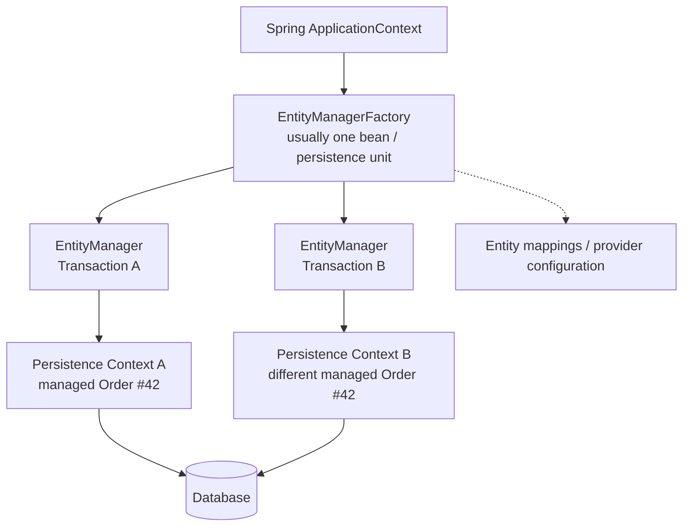
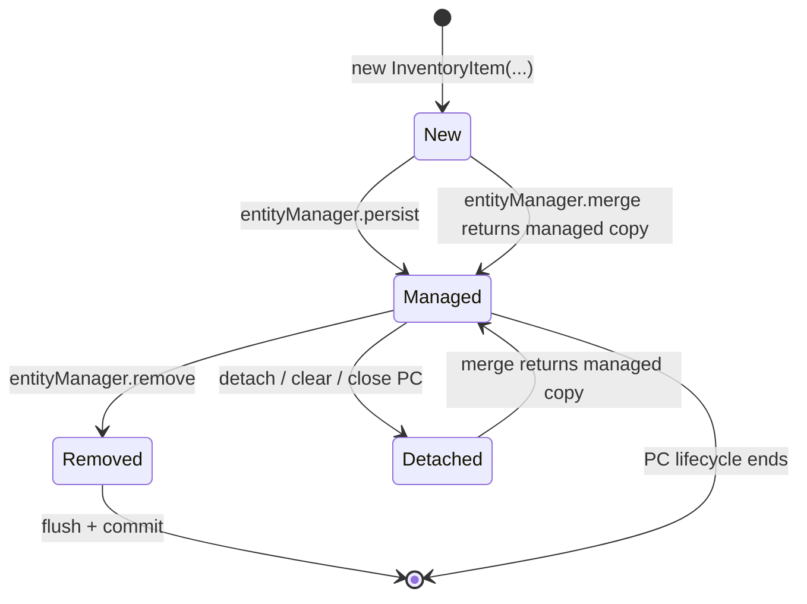
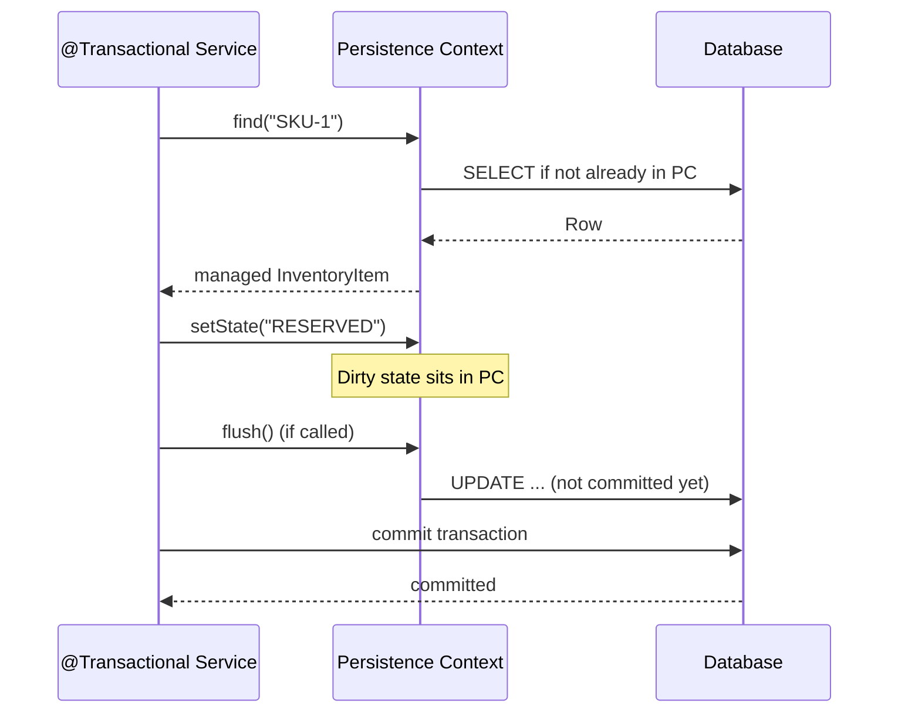
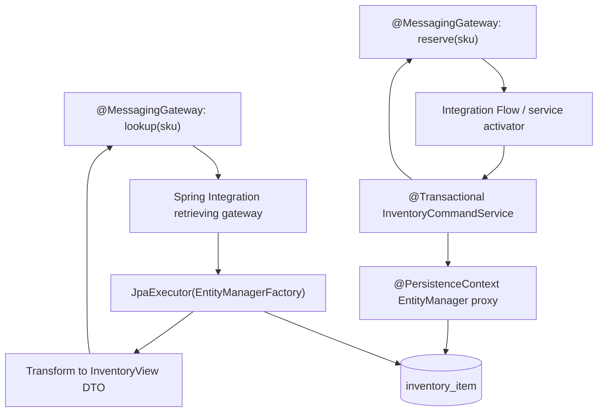
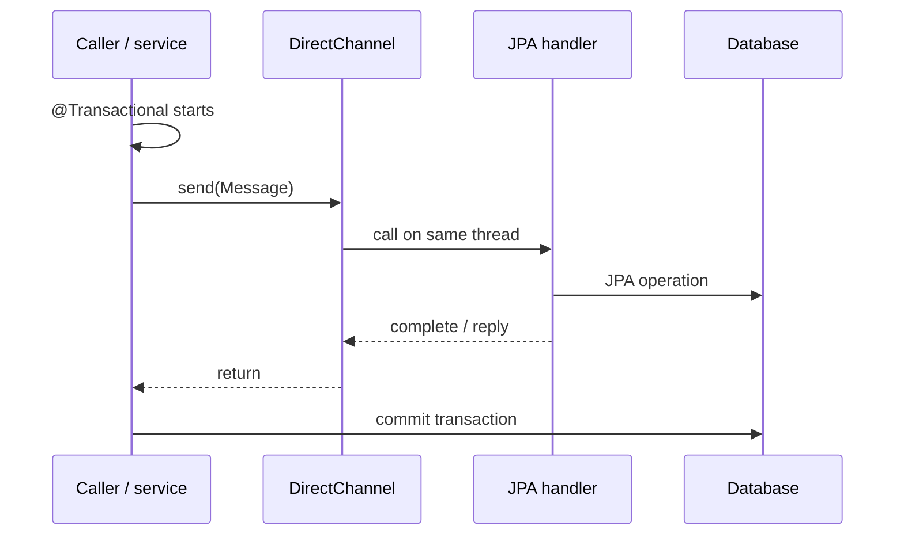
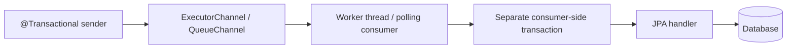
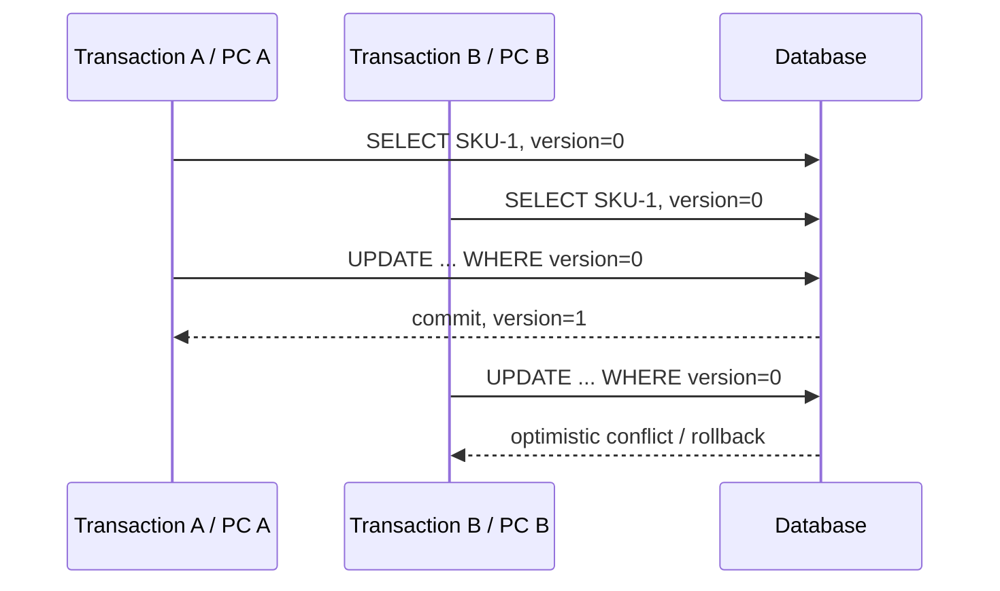
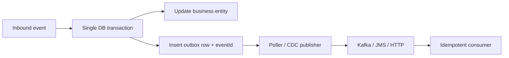

# EntityManagerFactory and Persistence Context

## 1. Goals and Context

In the **SPRING_INTEGRATION_ADAPTERS** module, applications connect external systems via inbound/outbound adapters, gateways, pollers, and `MessageChannel`. Data may arrive from files, SFTP, HTTP, JMS, AMQP, Kafka, or databases and pass through business processing steps before saving/querying data with JPA. When building such flows, you must know not only **which JPA operation runs**, but also **which persistence context owns an entity, how far the transaction extends, and whether the entity remains managed**.

The **EntityManagerFactory and Persistence Context** lesson belongs to the **Adapter JPA** chapter. It lays the foundation for using JPA adapters and gateways properly and avoiding bugs when messages cross synchronous or asynchronous boundaries.

After this lesson, you will be able to:

- Explain how **`EntityManagerFactory`**, **`EntityManager`**, and the **persistence context** differ.
- Understand why `EntityManagerFactory` can be shared across threads, while an actual `EntityManager` must not be used concurrently.
- Distinguish **transaction-scoped** vs. **extended persistence contexts**, as well as **application-managed** vs. **container/Spring-managed** entity managers.
- Understand `@PersistenceUnit`, `@PersistenceContext`, `JpaTransactionManager`, the shared `EntityManager` proxy, and `EntityManagerFactory` in Spring Boot.
- Track an entity's **transient/new**, **managed**, **detached**, and **removed** states.
- Explain the **first-level cache**, identity map, dirty checking, `persist`, `merge`, `remove`, `flush`, `clear`, `detach`, and `refresh`.
- Build a Spring Boot 3.x, Spring Integration 6.x, and Jakarta Persistence example querying via a JPA retrieving gateway, updating via a message flow, and using a `@Transactional` service.
- Avoid `LazyInitializationException`, stale entities after JPQL bulk updates, oversized persistence contexts, and sharing sessions across workers.
- Identify transaction boundaries across `DirectChannel`, `ExecutorChannel`, `QueueChannel`, Kafka/JMS/HTTP, and JPA.
- Test managed/detached behavior, rollbacks, optimistic locking, and DTO mapping inside an Integration Flow.

> **Focus:** `EntityManagerFactory` is the infrastructure creating/coordinating entity managers; **a persistence context is neither the database nor an application-wide shared cache**. A message carrying a JPA entity does not guarantee that entity stays managed when it reaches the next handler.

## 2. The Big Picture: Factory, Manager, and Context

### 2.1. Three Layers with Distinct Responsibilities

| Concept | Nature | Typical Lifecycle | Role |
| --- | --- | --- | --- |
| **`EntityManagerFactory` (EMF)** | Factory bound to a persistence unit/provider/config | Created at app startup, closed when application context shuts down | Supplies entity managers; manages metadata and JPA resources |
| **`EntityManager` (EM)** | JPA API operating on a persistence context | Typically scoped to a transaction/unit of work | `find`, `persist`, `merge`, `remove`, queries, `flush` |
| **Persistence context (PC)** | Set of entity instances managed by JPA by identity | Typically spans a transaction in Spring | Maintains the identity map, tracks changes, and syncs state with DB |

An `EntityManagerFactory` **does not hold all read entities in a shared Java table**. Each persistence context has its own first-level cache; an entity can be managed in context A while detached or absent in context B.



Two distinct Java instances can represent the same `Order#42` record if loaded in two separate persistence contexts. Within the **same** persistence context, JPA guarantees uniqueness by entity identity (entity type and primary key) for managed instances.

### 2.2. Simple Comparison Example

```java
EntityManager em = entityManagerFactory.createEntityManager();

try {
    InventoryItem first = em.find(InventoryItem.class, "SKU-1");
    InventoryItem second = em.find(InventoryItem.class, "SKU-1");

    // Same persistence context, same persistent identity.
    assert first == second;
} finally {
    em.close();
}
```

This is a read-only **application-managed EntityManager** example, not a recommendation to create a new EM inside every Spring Integration handler. For manual write transactions, you would also need to begin/commit/rollback the transaction explicitly. In Spring Boot, most cases should rely on `JpaTransactionManager` with `@PersistenceContext` or a properly configured JPA adapter/gateway.

## 3. EntityManagerFactory: Long-Lived and Thread-Safe Infrastructure

### 3.1. EMF Is Bound to a Persistence Unit

`EntityManagerFactory` creates or supplies `EntityManager` instances belonging to a **persistence unit**. It is constructed from components such as:

- The JPA provider (e.g., Hibernate ORM).
- Entity mappings, `@Entity` annotations, and relationship metadata.
- The DataSource and connection pool.
- SQL dialect, batching, caching, and JPA/Hibernate settings.
- Transaction integration and entity manager creation facilities.

A Spring Boot app with one datasource/JPA unit typically has one EMF bean, whereas multi-database systems may have multiple EMFs with multiple transaction managers. **Never assume a single JPA transaction can commit atomically across multiple independent EMFs or databases.**

`EntityManagerFactory` is designed to be **thread-safe**. However, creating a new EMF per message is prohibitively expensive and can leak connection pools and metadata resources.

### 3.2. @PersistenceUnit Injects EntityManagerFactory

In a Spring DAO/service:

```java
import jakarta.persistence.EntityManagerFactory;
import jakarta.persistence.PersistenceUnit;
import org.springframework.stereotype.Component;

@Component
public class PersistenceInfrastructureInfo {

    @PersistenceUnit
    private EntityManagerFactory entityManagerFactory;

    public boolean isFactoryOpen() {
        return entityManagerFactory.isOpen();
    }
}
```

`@PersistenceUnit` is the Jakarta Persistence annotation Spring recognizes to inject the matching EMF. In Spring Boot, you can also use constructor injection:

```java
@Service
public class SomeService {

    private final EntityManagerFactory emf;

    public SomeService(EntityManagerFactory emf) {
        this.emf = emf;
    }
}
```

When multiple EMFs exist, select deliberately using bean names/qualifiers or persistence unit names. Never pick an arbitrary EMF and query entities managed by another database.

### 3.3. How Does Spring Boot Typically Create EMF?

With `spring-boot-starter-data-jpa`, a configured datasource, and scanned entities, Spring Boot normally auto-configures:

- `DataSource` / connection pool.
- `EntityManagerFactory` backed by Spring ORM and the persistence provider.
- `JpaTransactionManager` or an appropriate transaction manager.
- Spring Data JPA repository infrastructure.

In plain Spring XML/Java config, `LocalContainerEntityManagerFactoryBean` is commonly used to build an EMF supporting Spring-managed transactions. When Spring Boot auto-configuration fits your needs, **you do not need to declare EMF manually**.

Do not confuse `LocalContainerEntityManagerFactoryBean` (the Spring `FactoryBean` configured at bootstrap) with the `jakarta.persistence.EntityManagerFactory` interface used by application components.

## 4. EntityManager: Operation Entry Point and Thread-Safety Limits

### 4.1. Real EntityManager Instances Are Not Thread-Safe

Per Jakarta Persistence, a real `EntityManager` and its persistence context **are not required to be thread-safe**. Never store an instance created via `emf.createEntityManager()` inside a singleton Spring bean and share it across HTTP requests, Kafka listeners, or pollers.

**Wrong:**

```java
@Component
public class UnsafeJpaWriter {

    private final EntityManager em;

    public UnsafeJpaWriter(EntityManagerFactory emf) {
        this.em = emf.createEntityManager();
    }

    // If multiple threads call this, the same real EM is accessed concurrently.
    public void write(Object entity) {
        em.persist(entity);
    }
}
```

That snippet also fails to manage transactions and close the EM; **never use this in a real application**.

**Right for Spring-managed JPA:** inject a shared transactional proxy via `@PersistenceContext` and invoke it inside a `@Transactional` service.

```java
@Service
public class SafeJpaWriter {

    @PersistenceContext
    private EntityManager entityManager;

    @Transactional
    public void persist(InventoryItem item) {
        entityManager.persist(item);
    }
}
```

Here, the `entityManager` field in the singleton is a **proxy** Spring creates/delegates to the EM bound to the current transaction, **not** a single raw `EntityManager` shared across all threads. Injecting the proxy into a singleton is therefore valid, though **managed entities and transactions still cannot be shared across threads**.

### 4.2. @PersistenceContext and SharedEntityManager

`@PersistenceContext` defaults to `PersistenceContextType.TRANSACTION`. In Spring, the injected proxy behaves like `SharedEntityManagerCreator`:

1. If the current thread has an active matching JPA transaction, it delegates to the transactional EntityManager bound to that transaction.
2. Without a transaction, certain read operations may use a temporary EM per operation; returned entities cannot be treated as long-lived managed objects outside that operation.
3. Write operations requiring a transaction can throw `TransactionRequiredException` if no valid transaction is active.

**Do not call `entityManager.close()` on a `@PersistenceContext` proxy.** Spring manages EM resources alongside the transaction. Let the transaction manager clean up the context when it finishes.

### 4.3. Manually Created EntityManagers

If for a standalone Java SE task you write:

```java
EntityManager em = emf.createEntityManager();
try {
    // Read data/unit of work with self-managed lifecycle.
    InventoryItem item = em.find(InventoryItem.class, "SKU-1");
} finally {
    em.close();
}
```

you are responsible for closing it. For writes with a **resource-local transaction** in Java SE, you must use `em.getTransaction()` begin/commit/rollback properly. In a Spring Boot app using `JpaTransactionManager`, **never mix manual `EntityTransaction` carelessly** with Spring-managed transactions.

## 5. Persistence Context and Entity Lifecycle

### 5.1. Four Common States

| State | Condition | Characteristics |
| --- | --- | --- |
| **Transient/new** | Java object not yet managed by JPA, no JPA-assigned persistent identity | Field changes do not automatically write to DB |
| **Managed** | Entity lives inside the active persistence context | Dirty checking; same identity returns the same managed instance |
| **Detached** | Entity was previously managed but is no longer in the active PC | Field changes do not automatically flush/commit to DB |
| **Removed** | Entity has been marked for deletion in the PC | DELETE is typically synced on flush/commit |



**Subtle detail:** `merge(detached)` usually **does not make the passed instance managed again**; it returns a managed instance with the same persistent identity. Keep the **return value** if you continue operating inside the persistence context.

### 5.2. contains and Identity Map

Inside a transaction with a live context:

```java
InventoryItem a = em.find(InventoryItem.class, "SKU-1");
InventoryItem b = em.find(InventoryItem.class, "SKU-1");

boolean sameInstance = a == b;     // usually true, same PC
boolean managed = em.contains(a);  // true if a is managed
```

`contains` tells you whether an entity instance belongs to the **current persistence context**. It **does not** prove the DB still has a row matching that exact object state or that another transaction has not committed changes.

### 5.3. First-Level Cache vs. Second-Level Cache

- **First-level cache** is scoped to **a single persistence context**; the identity map is a core JPA mechanism.
- **Second-level cache** (if enabled by the provider and application) has a broader scope and can be shared across persistence contexts of the same EMF.
- **Query cache** is a provider-specific feature and is not enabled automatically just because JPA is active.

Do not say "JPA caches data for the whole application" when referring to the first-level cache. Two independent transactions can hold two managed instances with the same primary key but different states when data changes. Isolation/cache/refresh govern visibility of changes.

## 6. Dirty Checking, Flush, Clear, and Commit

### 6.1. Dirty Checking

Inside a transaction, modifying a managed entity is tracked by the JPA provider and synchronized to the database at flush time:

```java
@Transactional
public void reserve(String sku) {
    InventoryItem item = entityManager.find(
            InventoryItem.class, sku);

    item.setState("RESERVED");

    // Calling repository.save(item) is not strictly needed.
    // item is managed; provider syncs state at flush/commit.
}
```

This illustrative snippet assumes `InventoryItem` is a valid entity, `entityManager` is injected, and `item` is non-null. **There is no mandatory "update" call for a managed entity.** In Spring Data JPA, `save` may still be useful for other API reasons, but it is not required for dirty checking to work.

### 6.2. When Does SQL Execute?



Distinguish clearly:

| Action | Meaning |
| --- | --- |
| `persist(entity)` | Adds a new entity to the PC and schedules an INSERT |
| `merge(entity)` | Copies state onto a managed instance, returns the managed instance |
| `flush()` | Syncs pending changes to DB **within the transaction**, without committing |
| `commit()` | Completes the transaction; changes become durable only if commit succeeds |
| `clear()` | Detaches **all** managed entities from the PC; does not commit |
| `detach(entity)` | Detaches one specific entity |
| `refresh(entity)` | Reloads a managed entity's state from DB, potentially discarding local changes |
| `close()` | Ends an application-managed EM's lifecycle; does not commit uncommitted changes |

**Caution:** calling `clear()` while **unflushed** changes remain can cause those changes **never to be persisted**. Call `flush()` deliberately before `clear()` when needed, keeping in mind a flush can still roll back.

### 6.3. FlushModeType.AUTO and COMMIT

`FlushModeType.AUTO` is normally the default. The provider may flush before a query if needed so query results reflect relevant pending changes. `COMMIT` defers flushing until commit, though visibility of pending changes to pre-commit queries follows provider rules.

Example:

```java
entityManager.setFlushMode(FlushModeType.COMMIT);
```

Do not change flush mode system-wide just to reduce SQL statements without profiling. Latency often stems from N+1 queries, missing indexes, row locks, or oversized messages/batches rather than flush mode alone.

### 6.4. Transaction Rollback

If a service throws a runtime exception and Spring rolls back the transaction per default rules, already-flushed SQL is **rolled back**. A log line saying "SQL UPDATE executed" does not mean data committed.

In an Integration Flow, if events were already sent to Kafka/JMS or HTTP before the DB transaction committed, a DB rollback **does not automatically undo** those external side effects. For critical data, consider a **transactional outbox**.

## 7. Transaction-Scoped vs. Extended Persistence Context

### 7.1. Transaction-Scoped Is the Right Default

In typical Spring Boot apps, `@PersistenceContext` provides a **transaction-scoped EntityManager proxy**. Each transaction has its corresponding persistence context. Once the transaction finishes, managed entities become detached to external code holding references to them.

```text
Transaction A
  find SKU-1 → managed item A
  update state → flush/commit
  context A ends
  item A (retained reference) → detached

Transaction B
  find SKU-1 → managed item B
  item A != item B is normal
```

Never assume a Java object carried in a `Message<?>` stays managed just because the sender recently queried it.

### 7.2. Extended Persistence Context

Jakarta Persistence also defines `PersistenceContextType.EXTENDED`, allowing a context to span multiple transactions in suitable container-managed models (e.g., stateful bean conversations). This is **not** the typical configuration for singleton Spring Integration handlers.

Risks if misapplied:

- Accumulating large numbers of managed entities over time.
- State becoming stale after updates from other transactions.
- Thread-unsafe sharing of one real context across concurrent threads.
- Confusion over when flush/rollback/reconciliation happens.

For message-driven applications, **an explicit transaction per message or batch** is far easier to control than a long-lived session/user extended context.

### 7.3. Propagation and Different Contexts

| Configuration | Consequence to Understand |
| --- | --- |
| `PROPAGATION_REQUIRED` | Joins the current transaction if present; otherwise opens a new one |
| `PROPAGATION_REQUIRES_NEW` | Suspends the current transaction and opens a new one with its own resources/context |
| `PROPAGATION_SUPPORTS` | Joins if a transaction exists; otherwise can run non-transactionally |
| `@Transactional(readOnly=true)` | Hint for transaction manager/provider; **not** authorization and not a guarantee against all updates |
| Async channel / another thread | Does not automatically carry thread-bound transactions/JPA contexts to the new worker |

`REQUIRES_NEW` may acquire an extra database connection while the outer transaction still holds one, putting pressure on the pool. Avoid overusing it to "force per-step commits" without accounting for consistency and pool capacity.

## 8. How Does Spring Integration Relate to the Persistence Context?

### 8.1. JPA Components Use JpaExecutor

Spring Integration provides four JPA endpoint groups:

| Endpoint | Trigger | JPA Operation | Output Message |
| --- | --- | --- | --- |
| **JPA inbound channel adapter** | Poller calls source | Periodic SELECT, optional post-poll mutation | Emits results onto a channel |
| **JPA outbound channel adapter** | Incoming message | Persist/merge/delete or update query | Produces no reply |
| **JPA retrieving outbound gateway** | Request message | On-demand SELECT/find | Returns entity/list/result |
| **JPA updating outbound gateway** | Request message | Persist/merge/delete or UPDATE/DELETE | Returns entity/affected rows |

These endpoints use `JpaExecutor` and `JpaOperations` (default `DefaultJpaOperations`) to perform JPA work. Spring Integration lets you construct `JpaExecutor` from:

1. `EntityManagerFactory`.
2. `EntityManager`.
3. `JpaOperations`.

### 8.2. Why Prefer Passing EntityManagerFactory?

In Spring Integration's JPA module, the most common and convenient configuration is:

```java
@Bean
JpaExecutor inventoryJpaExecutor(
        EntityManagerFactory entityManagerFactory) {

    JpaExecutor executor =
            new JpaExecutor(entityManagerFactory);

    executor.setJpaQuery("""
            select i from InventoryItem i
            where i.sku = :sku
            """);
    return executor;
}
```

`EntityManagerFactory` is a thread-safe bean safe to inject into a singleton `JpaExecutor`. The adapter/gateway obtains/manages an EM per operation/transaction via `JpaOperations`. Never create **a raw `EntityManager`** and keep it in a singleton executor when multiple messages may execute concurrently.

If you use the constructor taking `EntityManager` or XML `entity-manager`, Spring Integration documentation advises supplying a **shared transactional EntityManager proxy**, such as `SharedEntityManagerBean`, instead of an unmanaged real EM.

### 8.3. Java Config, @PersistenceContext, and SharedEntityManagerBean

Three common options:

**Option A — recommended for JPA adapters/gateways:**

```java
JpaExecutor executor =
        new JpaExecutor(entityManagerFactory);
```

**Option B — inside application services/DAOs:**

```java
@PersistenceContext
private EntityManager entityManager;
```

**Option C — when an explicit EntityManager bean is needed:**

```xml
<bean id="sharedEntityManager"
      class="org.springframework.orm.jpa.support.SharedEntityManagerBean">
    <property name="entityManagerFactory"
              ref="entityManagerFactory"/>
</bean>
```

Option C provides a proxy analogous to `@PersistenceContext`. Never expose a raw `emf.createEntityManager()` bean as a singleton.

### 8.4. Not All Inbound/Outbound Channels Have the Same Transaction Semantics

- A JPA inbound poller can wrap the poll in transactional advice when performing writes/deletes or needing consistency.
- JPA outbound adapters/gateways require transactions for write operations.
- A JPA retrieving gateway runs SELECTs, yet still requires transaction planning for lazy loading and read consistency.
- If messages traverse a synchronous `DirectChannel`, the sender's transaction can wrap the JPA handler.
- If messages traverse an `ExecutorChannel`/`QueueChannel`, design transactions at the consumer. You cannot rely on the sending thread's JPA context.

## 9. Complete Example: Spring Boot + Spring Integration + JPA

### 9.1. Problem Statement

An inventory service. A request–reply gateway uses JPA to look up an `InventoryItem` by SKU and transforms it into a DTO. Another flow invokes a `@Transactional` service to transition an item from `AVAILABLE` to `RESERVED` via dirty checking.

The goal is not to build a full commercial inventory app, but to **observe EMF/EM/persistence context behavior directly on both the read and write sides**.



The example uses **Java 17+, Spring Boot 3.x, Spring Integration 6.x, Spring Data JPA/Jakarta Persistence, and in-memory H2**.

### 9.2. Maven Dependencies

```xml
<dependencies>
    <dependency>
        <groupId>org.springframework.boot</groupId>
        <artifactId>spring-boot-starter</artifactId>
    </dependency>
    <dependency>
        <groupId>org.springframework.boot</groupId>
        <artifactId>spring-boot-starter-data-jpa</artifactId>
    </dependency>
    <dependency>
        <groupId>org.springframework.boot</groupId>
        <artifactId>spring-boot-starter-integration</artifactId>
    </dependency>
    <dependency>
        <groupId>org.springframework.integration</groupId>
        <artifactId>spring-integration-jpa</artifactId>
    </dependency>
    <dependency>
        <groupId>com.h2database</groupId>
        <artifactId>h2</artifactId>
        <scope>runtime</scope>
    </dependency>
    <dependency>
        <groupId>org.springframework.boot</groupId>
        <artifactId>spring-boot-starter-test</artifactId>
        <scope>test</scope>
    </dependency>
</dependencies>
```

The Spring Boot BOM manages compatible versions. `spring-integration-jpa` adds `JpaExecutor` and JPA gateways; `spring-boot-starter-data-jpa` provides the persistence provider and transaction infrastructure. Avoid defining manual `EntityManagerFactory`/`JpaTransactionManager` beans that duplicate Boot auto-configuration unless specifically needed.

### 9.3. InventoryItem Entity

File `InventoryItem.java`:

```java
package com.example.jpacontext;

import jakarta.persistence.Column;
import jakarta.persistence.Entity;
import jakarta.persistence.Id;
import jakarta.persistence.Table;
import jakarta.persistence.Version;

@Entity
@Table(name = "inventory_item")
public class InventoryItem {

    @Id
    @Column(nullable = false, length = 60)
    private String sku;

    @Column(nullable = false, length = 24)
    private String state;

    @Version
    private Long version;

    protected InventoryItem() {
        // JPA requires a no-arg constructor.
    }

    public InventoryItem(String sku, String state) {
        this.sku = sku;
        this.state = state;
    }

    public String getSku() {
        return sku;
    }

    public String getState() {
        return state;
    }

    public Long getVersion() {
        return version;
    }

    public void setState(String state) {
        this.state = state;
    }
}
```

`@Version` helps the provider detect certain overwrites when concurrent transactions update the same entity under optimistic locking. It **does not** automatically handle duplicate Kafka events or JPQL bulk updates.

### 9.4. Repository for Seeding and Verification

File `InventoryRepository.java`:

```java
package com.example.jpacontext;

import org.springframework.data.jpa.repository.JpaRepository;

public interface InventoryRepository
        extends JpaRepository<InventoryItem, String> {
}
```

The repository here is mainly for seeding data/tests. SELECT requests in the flow use `Jpa.retrievingGateway(...)`, while state updates are performed via `@PersistenceContext` in the service.

### 9.5. DTO Preventing Managed Entities from Escaping

File `InventoryView.java`:

```java
package com.example.jpacontext;

public record InventoryView(
        String sku,
        String state,
        Long version) {

    public static InventoryView from(InventoryItem item) {
        return new InventoryView(
                item.getSku(), item.getState(), item.getVersion());
    }
}
```

Returning DTOs provides several benefits:

- No dependency on a closed persistence context.
- No accidental triggering of lazy associations during serialization.
- No exposure of internal fields, cascades, or entity metadata.
- Stable return contract even as the JPA schema evolves.
- Easy payload validation/bounding when forwarding to HTTP, JMS, Kafka, or WebSocket.

### 9.6. Two @MessagingGateway Interfaces

File `InventoryLookupGateway.java`:

```java
package com.example.jpacontext;

import java.util.List;
import org.springframework.integration.annotation.MessagingGateway;

@MessagingGateway(
        defaultRequestChannel = "inventoryLookupRequests",
        defaultReplyTimeout = "5000")
public interface InventoryLookupGateway {

    List<InventoryView> lookup(String sku);
}
```

File `InventoryReservationGateway.java`:

```java
package com.example.jpacontext;

import org.springframework.integration.annotation.MessagingGateway;

@MessagingGateway(
        defaultRequestChannel = "inventoryReserveRequests",
        defaultReplyTimeout = "5000")
public interface InventoryReservationGateway {

    Boolean reserve(String sku);
}
```

Both gateway interfaces send messages to separate request channels. `defaultReplyTimeout` is a messaging-layer reply wait limit; do not confuse it with a DB query timeout. On a synchronous `DirectChannel`, a stalled database call can block the caller regardless of the reply timeout.

### 9.7. Service Updating Inside a Persistence Context

File `InventoryCommandService.java`:

```java
package com.example.jpacontext;

import jakarta.persistence.EntityManager;
import jakarta.persistence.PersistenceContext;
import org.springframework.stereotype.Service;
import org.springframework.transaction.annotation.Transactional;

@Service
public class InventoryCommandService {

    @PersistenceContext
    private EntityManager entityManager;

    @Transactional
    public boolean reserve(String sku) {
        if (sku == null || sku.isBlank() || sku.length() > 60) {
            throw new IllegalArgumentException("Invalid SKU");
        }

        InventoryItem managed =
                entityManager.find(InventoryItem.class, sku);

        if (managed == null
                || !"AVAILABLE".equals(managed.getState())) {
            return false;
        }

        // Entity is managed in the current transaction.
        if (!entityManager.contains(managed)) {
            throw new IllegalStateException(
                    "Expected managed InventoryItem");
        }

        managed.setState("RESERVED");

        // No need for entityManager.merge(managed) since it is already managed.
        // Dirty checking syncs changes at flush/commit.
        return true;
    }
}
```

**Explanation:**

1. `@PersistenceContext` injects the shared transactional EM proxy into the singleton service.
2. `@Transactional` starts a transaction when another Spring bean calls the method through its proxy.
3. `find(...)` returns a managed entity within that transaction's context.
4. `contains(managed)` lets us assert managed status directly.
5. Mutating `state` is tracked by the provider; `merge` is unnecessary for an already managed instance.
6. If the transaction commits, the state is persisted. On rollback, changes never become committed data.
7. If two transactions read `AVAILABLE` concurrently, `@Version` detects the conflict on update; catch and handle optimistic lock exceptions per policy.

In production, "reserving a SKU" may require an atomic `UPDATE ... WHERE state='AVAILABLE'` checking affected count, or explicit locking when inventory quantities matter. This example is designed to demonstrate persistence context mechanics rather than replace a full concurrent reservation system.

### 9.8. IntegrationFlow Using EntityManagerFactory and the Service

File `InventoryIntegrationConfiguration.java`:

```java
package com.example.jpacontext;

import java.util.List;
import jakarta.persistence.EntityManagerFactory;

import org.springframework.context.annotation.Bean;
import org.springframework.context.annotation.Configuration;
import org.springframework.integration.config.EnableIntegration;
import org.springframework.integration.core.GenericTransformer;
import org.springframework.integration.dsl.IntegrationFlow;
import org.springframework.integration.jpa.dsl.Jpa;

@Configuration
@EnableIntegration
public class InventoryIntegrationConfiguration {

    @Bean
    IntegrationFlow inventoryLookupFlow(
            EntityManagerFactory entityManagerFactory) {

        return IntegrationFlow
                .from("inventoryLookupRequests")
                .handle(
                        Jpa.retrievingGateway(entityManagerFactory)
                                .jpaQuery("""
                                        select i from InventoryItem i
                                        where i.sku = :sku
                                        """)
                                .parameterExpression("sku", "payload")
                                .maxResults(1)
                                .expectSingleResult(false))
                .transform((
                        GenericTransformer<
                                List<InventoryItem>,
                                List<InventoryView>>) rows ->
                        rows.stream()
                                .map(InventoryView::from)
                                .toList())
                .get();
    }

    @Bean
    IntegrationFlow inventoryReserveFlow(
            InventoryCommandService commandService) {

        return IntegrationFlow
                .from("inventoryReserveRequests")
                .handle((payload, headers) ->
                        commandService.reserve((String) payload))
                .get();
    }
}
```

**Read flow:**

- `Jpa.retrievingGateway(entityManagerFactory)` uses the factory configured by Spring Boot.
- JPQL with parameter `:sku` binds the value from the message payload.
- `maxResults(1)` caps each query; `expectSingleResult(false)` preserves the list contract and returns an empty list when no rows match in Spring Integration 6.x.
- The transformer maps entities to DTOs right after the gateway so entities never leave the flow.
- Because the DTO only reads scalar entity fields here, the mapper triggers no lazy associations.

**Write flow:**

- `InventoryReservationGateway.reserve` sends a Spring Message into `inventoryReserveRequests`.
- `handle(...)` calls the public method `InventoryCommandService.reserve(...)` on another bean, allowing the Spring transaction proxy to run.
- The service uses `@PersistenceContext` instead of creating a raw EM manually.
- The returned Boolean becomes the reply back to the messaging gateway.
- `InventoryCommandService`'s transaction commits before the Spring service proxy call returns; if commit fails, the exception propagates along the synchronous call path.

**Note:** the Spring Integration JPA retrieving gateway is not an automatic scheduled producer. `@MessagingGateway` invokes it on demand; if you want periodic table polling, use the **JPA inbound channel adapter** with a poller.

### 9.9. Spring Boot Main and H2 Configuration

File `JpaContextApplication.java`:

```java
package com.example.jpacontext;

import java.util.List;

import org.springframework.boot.CommandLineRunner;
import org.springframework.boot.SpringApplication;
import org.springframework.boot.autoconfigure.SpringBootApplication;
import org.springframework.context.annotation.Bean;
import org.springframework.integration.annotation.IntegrationComponentScan;

@SpringBootApplication
@IntegrationComponentScan
public class JpaContextApplication {

    public static void main(String[] args) {
        SpringApplication.run(JpaContextApplication.class, args);
    }

    @Bean
    CommandLineRunner demo(
            InventoryRepository repository,
            InventoryLookupGateway lookup,
            InventoryReservationGateway reservation) {

        return args -> {
            if (repository.count() == 0) {
                repository.saveAll(List.of(
                        new InventoryItem("SKU-1", "AVAILABLE"),
                        new InventoryItem("SKU-2", "AVAILABLE")));
            }

            System.out.println("Before: " + lookup.lookup("SKU-1"));

            Boolean first = reservation.reserve("SKU-1");
            Boolean second = reservation.reserve("SKU-1");

            System.out.println("First reserve: " + first);
            System.out.println("Second reserve: " + second);
            System.out.println("After: " + lookup.lookup("SKU-1"));
            System.out.println("Missing: " + lookup.lookup("SKU-999"));
        };
    }
}
```

File `application.properties` for the demo environment:

```properties
spring.main.web-application-type=none

spring.datasource.url=jdbc:h2:mem:jpa_context_demo;DB_CLOSE_DELAY=-1
spring.datasource.driver-class-name=org.h2.Driver
spring.datasource.username=sa
spring.datasource.password=

spring.jpa.hibernate.ddl-auto=create-drop
spring.jpa.open-in-view=false
logging.level.org.springframework.integration=INFO
```

**Expected results:**

- Before reserving: `SKU-1` has `state=AVAILABLE`.
- First reserve: returns `true` and commits `RESERVED`.
- Second reserve: returns `false` because the item is no longer `AVAILABLE`.
- Subsequent lookup gateway call returns the `RESERVED` DTO with the updated version.
- Looking up `SKU-999` returns an empty list without crashing on a null entity.

In-memory H2 and `ddl-auto=create-drop` are strictly for practice; production uses schema migrations (Flyway/Liquibase), an appropriate database/pool, and timeout/concurrency limits.

## 10. Observing Lifecycle with a Diagnostic Service

To directly inspect `contains`, the identity map, and `clear`, create a small diagnostic service. Invoke these public methods **from another bean via the Spring proxy**; self-invocation inside the same class can bypass `@Transactional`.

File `InventoryPersistenceDiagnostics.java`:

```java
package com.example.jpacontext;

import jakarta.persistence.EntityManager;
import jakarta.persistence.PersistenceContext;
import org.springframework.stereotype.Service;
import org.springframework.transaction.annotation.Transactional;

@Service
public class InventoryPersistenceDiagnostics {

    @PersistenceContext
    private EntityManager em;

    @Transactional(readOnly = true)
    public boolean sameManagedInstance(String sku) {
        InventoryItem first = em.find(InventoryItem.class, sku);
        InventoryItem again = em.find(InventoryItem.class, sku);

        return first != null
                && first == again
                && em.contains(first);
    }

    @Transactional
    public boolean detachedAfterClear(String sku) {
        InventoryItem row = em.find(InventoryItem.class, sku);
        if (row == null) {
            return false;
        }

        em.clear();
        return !em.contains(row);
    }
}
```

In `sameManagedInstance`, two `find` calls for the same identity inside one transaction-scoped PC return the exact same Java object. That **does not mean the entire application shares one object**.

In `detachedAfterClear`, `clear` detaches all entities from the context. Since this method modifies no state, there are no pending changes to flush. If you called `row.setState(...)` before `clear()` without flushing, those changes could be lost without reaching the DB.

### Merging a Detached Entity

```java
@Transactional
public void renameDetached(
        InventoryItem detached, String newState) {

    detached.setState(newState);

    InventoryItem managedCopy = em.merge(detached);

    // Do not assume managedCopy == detached.
    if (!em.contains(managedCopy)) {
        throw new IllegalStateException("Merge did not manage entity");
    }
}
```

This illustrates **merge semantics**, not a recommendation to accept arbitrary entities from clients and merge them straight into the DB. Real systems must verify permissions, allowed fields, `@Version`, business state, and idempotency. Merging a stale detached entity can overwrite unintended fields.

## 11. MessageChannel Boundaries Determine Transactions and Persistence Context

### 11.1. DirectChannel: Usually Synchronous



With `DirectChannel`, the handler runs on the sender's thread. If a transaction is already open on that thread and JPA uses the same transaction manager/EMF, the handler can join it. Still, **when `send(...)` returns, the outer transaction may not have committed yet**.

### 11.2. QueueChannel/ExecutorChannel: Asynchronous Boundary



A thread-local transaction or JPA persistence context **does not automatically cross** an `ExecutorChannel` or a consumer polling a `QueueChannel`. If the poller/worker performs JPA writes, establish a transaction at the consumer (transactional advice, `@Transactional` service, or equivalent).

**Never place a managed JPA entity onto a QueueChannel assuming the consumer will still treat it as managed.** Once the producer transaction ends, the entity is usually detached; accessing a `LAZY` association in the consumer can fail. Passing immutable IDs/DTOs and reloading inside the consumer's transaction is much safer.

### 11.3. JPA Inbound Poller and Transactions

A JPA inbound channel adapter can follow:

```text
@Poller / transactional polling endpoint
      → JpaPollingChannelAdapter
      → Message<List<Entity>>
      → DirectChannel / QueueChannel
      → service
```

If the poller transaction wraps both the query and **synchronous** downstream work on `DirectChannel`, entities can stay managed within that transaction. If forwarded through a queue/async thread, they no longer share the context. Especially with `deleteAfterPoll` or post-poll state updates, examine rollback/ACK semantics to prevent data loss.

### 11.4. Outbound Adapter/Gateway and JpaExecutor

`JpaExecutor` accepts `EntityManagerFactory`, `EntityManager`, or `JpaOperations`. With `EntityManagerFactory`, the JPA component manages the EM properly; never share one real EM across consumer threads.

Example Java configuration for JPA outbound:

```java
@Bean
JpaExecutor inventoryPersistExecutor(
        EntityManagerFactory entityManagerFactory) {

    JpaExecutor executor =
            new JpaExecutor(entityManagerFactory);
    executor.setEntityClass(InventoryItem.class);
    executor.setPersistMode(PersistMode.MERGE);
    return executor;
}

@Bean
@ServiceActivator(inputChannel = "inventoryPersistChannel")
MessageHandler inventoryPersistHandler(
        JpaExecutor inventoryPersistExecutor) {

    JpaOutboundGateway handler =
            new JpaOutboundGateway(inventoryPersistExecutor);
    handler.setProducesReply(false);
    return handler;
}
```

This is a **different illustrative option** from the demo flow; it requires the channel bean, imports, and a consumer-side transaction to run. `setProducesReply(false)` creates a **one-way outbound channel adapter**; if you need the entity or affected rows returned, use an updating outbound gateway. Do not attach both handlers to the same channel unless multiple consumers are intentional.

## 12. Lazy Loading, DTOs, and the "Closed Session" Problem

### 12.1. How Does LazyInitializationException Happen?

Suppose an `Order` entity has:

```java
@OneToMany(mappedBy = "order", fetch = FetchType.LAZY)
private List<OrderLine> lines;
```

If a request–reply JPA retrieving gateway returns `Order`, the transaction/context ends, and a handler on another thread calls `order.getLines().size()`, Hibernate can throw `LazyInitializationException` because the collection was never loaded and the context is gone.

**Solutions:**

- Pass **IDs/DTOs** across asynchronous channels.
- Inside a `@Transactional(readOnly=true)` service, load needed fields/relations and construct DTOs before the transaction finishes.
- Use JPQL projections or constructor expressions.
- Use `JOIN FETCH`/entity graphs **selectively**, avoiding unintended row multiplication and uncontrolled memory growth.
- Never turn on Open Session in View just to mask flow boundary issues; keep persistence boundaries explicit.

### 12.2. Open Session in View Is Not for Message Flows

Spring Boot web applications can enable Open EntityManager in View by configuration to keep an EM open across an HTTP request. However:

- It is not an automatic business write transaction.
- It does not protect asynchronous Kafka/JMS/SFTP consumers.
- It can trigger DB queries while a serializer renders JSON.
- It can hide N+1 problems and hold DB resources longer.
- In our demo, `spring.jpa.open-in-view=false` is set to avoid relying on it.

Returning DTOs from services/gateways after authorization checks is cleaner for APIs and outbound adapters.

### 12.3. DTO Projections Can Reduce Queries and RAM

JPQL:

```sql
select new com.example.jpacontext.InventoryView(
    i.sku, i.state, i.version)
from InventoryItem i
where i.sku = :sku
```

lets JPA return DTOs directly from the query when constructor mapping matches. In that case, change the `Jpa.retrievingGateway` transformer/return type from `List<InventoryItem>` to `List<InventoryView>`.

Never cast a projection result to an entity; it is a different contract.

## 13. Bulk JPQL UPDATE/DELETE Can Leave the Persistence Context Stale

### 13.1. Mechanism

JPA bulk updates execute directly against the DB, generally **bypassing per-entity dirty checking**. If an entity is already loaded in the PC, that managed object may still hold old values after the bulk update.

```java
@Transactional
public void bulkUpdateExample() {
    InventoryItem item =
            em.find(InventoryItem.class, "SKU-1");

    em.createQuery("""
            update InventoryItem i
               set i.state = 'RESERVED'
             where i.sku = :sku
            """)
        .setParameter("sku", "SKU-1")
        .executeUpdate();

    // item.getState() may still be "AVAILABLE"
    // if item was loaded before the bulk update.

    em.refresh(item); // reload state from DB if needed.
}
```

**Note:** this snippet is illustrative inside a service with injected `EntityManager em` and an active transaction. `refresh` discards unflushed local changes on the object; avoid calling it carelessly.

### 13.2. Bulk Updates and @Version

Entity-lifecycle `@Version`/optimistic locking rules **do not automatically apply to JPQL bulk updates the way they do to managed entity updates**. If optimistic compare-and-set is required, encode the condition explicitly:

```sql
update InventoryItem i
   set i.state = :newState,
       i.version = i.version + 1
 where i.sku = :sku
   and i.version = :expectedVersion
   and i.state = :expectedState
```

An affected-row reply of `1` or `0` indicates whether the row matched, though `0` still has multiple possible causes (missing ID, stale version, different state). In Spring Integration, the **JPA updating outbound gateway** is suited for returning that affected count.

### 13.3. clear, refresh, and Reload: Use at the Right Time

| Operation | Benefit | Risk |
| --- | --- | --- |
| `em.refresh(entity)` | Reloads a managed entity | Can discard local changes; needs proper transaction/locks |
| `em.clear()` | Evicts all managed entries from the PC | Unflushed changes may be lost; all entities become detached |
| `em.detach(entity)` | Detaches a single entity | Does not write pending changes |
| `em.flush(); em.clear()` | Syncs first, then shrinks PC | SQL ran without commit; can still roll back |
| Reload in another transaction | Reads state under fresh isolation | Does not eliminate races across transactions |

Do not treat `clear()` as a universal "fix stale data" button when query/transaction isolation or a provider cache is the true cause.

## 14. Batch Processing and Persistence Context Size

### 14.1. Why Do Large Batches Consume Heavy Memory?

A single transaction processing 50,000 entities can hold:

- Managed entity instances.
- Snapshots for dirty checking.
- Collection/association proxies.
- SQL statements/batching state.
- Event objects, message payloads, and metadata.

Thus, even when JDBC batching cuts network roundtrips, an oversized persistence context still causes GC pressure and slow flushes.

### 14.2. Batch Flushing and Clearing

Example JPA loop inside a transactional service:

```java
@Transactional
public void saveBatch(List<InventoryItem> items) {
    int batchSize = 50;

    for (int index = 0; index < items.size(); index++) {
        em.persist(items.get(index));

        if ((index + 1) % batchSize == 0) {
            em.flush();
            em.clear();
        }
    }

    em.flush();
    em.clear();
}
```

**Note:** this example is strictly for **new entities** and suitable batch flows; for existing entities with duplicate primary keys, `persist` can throw an exception. `clear` detaches *all* managed objects, not only those from the current batch. If the transaction holds other entities with pending changes, avoid clearing blindly.

### 14.3. Spring Integration JpaExecutor with flushSize

In entity-mode JPA outbound adapters/updating gateways, Spring Integration supports:

```java
JpaExecutor executor =
        new JpaExecutor(entityManagerFactory);

executor.setEntityClass(InventoryItem.class);
executor.setPersistMode(PersistMode.PERSIST);
executor.setFlushSize(50);
executor.setClearOnFlush(true);
```

- `flushSize` sets the flush interval when processing an `Iterable` of entities.
- `clearOnFlush` prunes managed instances after each flush.
- They **do not automatically enable Hibernate JDBC batching**.
- They **do not split one transaction into 50 transactions**; commit still happens at the configured transaction boundary.
- When one entity fails, decide whether to roll back the whole batch or isolate items.

To enable true JDBC batching, configure provider properties (e.g., Hibernate `hibernate.jdbc.batch_size`), verify ID generation strategy, driver, and DB, and benchmark.

### 14.4. Chunking and Message Boundaries

When data comes from large files/SFTP, never load a multi-GB file into one `List<Entity>` inside a single Spring Message. Use streaming parsers, validate, split into bounded chunks, guard memory, and store checkpoints/idempotency keys. For Kafka/JMS, balance concurrent message processing against DB connection pool limits.

Very long transactions hold locks longer, make rollbacks costly, and hurt throughput; overly tiny transactions add overhead. Tune batch sizes based on benchmarks, failure rates, and recovery needs.

## 15. Concurrency, Optimistic Locking, and Connection Pools

### 15.1. Two Separate Persistence Contexts

Suppose nodes A and B both load `SKU-1`:



The two nodes do not share an `EntityManager`. Each transaction has an independent context; `@Version` lets JPA detect conflicts during entity updates. Exceptions may surface at `flush` or `commit`; **do not assume the exception fires immediately at `setState`**.

### 15.2. Do Not Store Managed Entities in a Static Cache

**Wrong:**

```java
static final Map<String, InventoryItem> cached = new HashMap<>();

// Store managed entity object from transaction A for thread B to use.
cached.put(item.getSku(), item);
```

After transaction A ends, the object is detached and potentially stale; sharing mutable Java objects across threads is unsafe; and lazy proxies cannot load.

If caching is needed, cache immutable DTO snapshots with version/TTL, or use a proper cache provider. Avoid turning long-lived JPA entities into global mutable state.

### 15.3. Connection Pool Size Is Not EntityManager Count

An `EntityManager` does not necessarily hold an exclusive JDBC connection for its entire lifetime across all providers/configs. Connections are acquired and released depending on transaction and provider behavior. However, long transactions, slow queries, and `REQUIRES_NEW` can still exhaust the pool.

Do not size the pool solely by messages/second. Measure:

- Active/idle/pending DB connections.
- Transaction duration.
- Query latency and lock waits.
- Number of concurrent pollers/consumers.
- Number of transactions per message.
- N+1 query counts.
- Pending retries and backlog.

## 16. Consistency Across DB and External Adapters

### 16.1. MessageChannel Does Not Create Distributed Transactions

```text
Kafka inbound → validate → JPA update → HTTP outbound
```

does not automatically share an atomic transaction across Kafka, the database, and HTTP. A database commit does not mean the HTTP call succeeded; a Kafka offset commit does not mean the DB committed.

**Rules:**

- With `DirectChannel`, synchronous handlers can participate in the sender's transaction, yet external side effects still do not roll back with the DB.
- With `QueueChannel` or `ExecutorChannel`, transaction contexts do not cross the boundary automatically.
- With Kafka/JMS/AMQP, align ACK/NACK/offset commits with DB commits and retry semantics.
- With File/SFTP, metadata filters do not prove DB writes succeeded.
- With HTTP/WebSocket, sending a reply/frame does not prove the client processed the event.

### 16.2. Transactional Outbox

A more durable design when writing to DB and emitting events:



- Business row and outbox row commit in the same DB transaction.
- The publisher sends to the broker and marks `SENT` upon receiving the contract ACK.
- If a crash occurs after publish but before marking `SENT`, the event may be resent.
- Consumers use `eventId`/idempotency keys to prevent duplicate processing.
- This provides **at-least-once delivery + idempotency**, not automatic end-to-end exactly-once.

### 16.3. Gateway Results Do Not Prove Outer Commits

A JPA retrieving gateway returns entities/lists; an updating gateway returns managed entities/affected counts. A JPA result is a **message reply**, not confirmation that Kafka received a message or an outer transaction committed. Emit "reservation completed" events **after the DB commit succeeds** or via an outbox.

## 17. Security and Multi-Tenancy

A transaction-scoped persistence context does not solve authorization. Consider JPQL:

```sql
select i from InventoryItem i
where i.sku = :sku
```

If the SKU belongs to another tenant, the gateway can still read it unless the service enforces tenant checks. Production systems must:

1. Authenticate callers at the HTTP/JMS/Kafka boundary.
2. Derive tenant/resource scope from trusted server-side principals/ACLs.
3. Enforce tenant predicates in queries/atomic updates or use appropriate provider multi-tenancy features.
4. Never trust client-supplied `tenantId`, `role`, or `userId` in payloads/headers for authorization.
5. Validate inputs, cap rows/sizes/rates, and disallow arbitrary queries.
6. Convert entities into DTOs containing only permitted fields.
7. Never log tokens/PII or dump sensitive entity graphs in exceptions.
8. Use least-privilege DB credentials; isolate persistence units/datasources when stronger boundaries are needed.

**The first-level cache is not a security boundary.** Once an entity is loaded in a context, accessing its fields does not re-check permissions. Authorization must occur at the appropriate service/query/endpoint boundary.

## 18. Testing EntityManagerFactory and Persistence Context

### 18.1. Entity State Unit Tests Do Not Replace JPA Integration Tests

Unit tests can verify pure Java mapping logic like `InventoryView.from(...)`, but they **do not** prove dirty checking, flushing, persistence context identity, transaction rollbacks, or optimistic locking.

Example:

```java
import static org.junit.jupiter.api.Assertions.*;
import org.junit.jupiter.api.Test;

class InventoryViewTest {

    @Test
    void mapsScalarFields() {
        InventoryItem item =
                new InventoryItem("SKU-T", "AVAILABLE");

        InventoryView view = InventoryView.from(item);

        assertEquals("SKU-T", view.sku());
        assertEquals("AVAILABLE", view.state());
    }
}
```

`item.getVersion()` may still be unset since the object has not been persisted; the test only checks Java mapping.

### 18.2. Integration Tests Under Real Transactions

File `JpaContextIntegrationTest.java`:

```java
package com.example.jpacontext;

import static org.assertj.core.api.Assertions.assertThat;

import java.util.List;
import java.util.UUID;

import org.junit.jupiter.api.Test;
import org.springframework.beans.factory.annotation.Autowired;
import org.springframework.boot.test.context.SpringBootTest;

@SpringBootTest
class JpaContextIntegrationTest {

    @Autowired
    InventoryRepository repository;

    @Autowired
    InventoryLookupGateway lookup;

    @Autowired
    InventoryReservationGateway reservation;

    @Autowired
    InventoryPersistenceDiagnostics diagnostics;

    @Test
    void firstLevelCacheKeepsIdentityInsideOneTransaction() {
        String sku = "test-" + UUID.randomUUID();
        repository.saveAndFlush(
                new InventoryItem(sku, "AVAILABLE"));

        assertThat(diagnostics.sameManagedInstance(sku)).isTrue();
        assertThat(diagnostics.detachedAfterClear(sku)).isTrue();
    }

    @Test
    void integrationFlowReturnsDtoAndCommitsDirtyState() {
        String sku = "test-" + UUID.randomUUID();
        repository.saveAndFlush(
                new InventoryItem(sku, "AVAILABLE"));

        Boolean first = reservation.reserve(sku);
        Boolean second = reservation.reserve(sku);

        assertThat(first).isTrue();
        assertThat(second).isFalse();

        List<InventoryView> result = lookup.lookup(sku);

        assertThat(result).hasSize(1);
        assertThat(result.get(0).state())
                .isEqualTo("RESERVED");

        assertThat(repository.findById(sku))
                .isPresent()
                .get()
                .extracting(InventoryItem::getState)
                .isEqualTo("RESERVED");
    }

    @Test
    void unknownSkuReturnsEmptyList() {
        List<InventoryView> result =
                lookup.lookup("missing-" + UUID.randomUUID());

        assertThat(result).isEmpty();
    }
}
```

These tests omit `@Transactional` on test methods. If an entire test runs inside an auto-rolling-back test transaction, service transaction boundary bugs can stay hidden. `repository.saveAndFlush(...)` seeds the row, and the command service then opens and commits its own transaction along the real call path.

### 18.3. Additional Tests to Write

| Case | What to Prove |
| --- | --- |
| Two `find` calls for same ID in one transaction | Same Java instance and `contains == true` |
| `em.clear()` | Previously managed entity becomes detached |
| Mutate managed entity in transaction then commit | DB stores new state via dirty checking |
| Mutate detached entity without merging | DB is not automatically updated |
| `merge(detached)` | Returns managed copy; version/authorization valid |
| `flush()` then rollback | SQL executed yet DB retains no changes |
| JPQL bulk update on already-loaded entity | PC can be stale; refresh/reload needed |
| `@Version` across two independent transactions | Conflict detected by provider |
| Send entity across `ExecutorChannel` | No longer shares the persistence context |
| Lazy association outside transaction | Avoided via DTO/projection |
| Thousands of entities in one batch | Memory/flush/clear and rollback semantics verified |
| Kafka/JMS redelivery | Idempotency/outbox prevents duplicate side effects |
| Multiple EMFs/datasources | Correct entity manager and transaction manager selected |

H2 can differ from PostgreSQL/MySQL in locking, isolation, SQL dialect, and JDBC batching. Use Testcontainers or a real DB environment for concurrency/optimistic locking and bulk update tests.

## 19. Common Issues and How to Diagnose Them

| Symptom | Possible Cause | Resolution |
| --- | --- | --- |
| `TransactionRequiredException` on `persist`/`remove` | No JPA transaction at consumer | Add `@Transactional`/transactional advice at the right boundary |
| `LazyInitializationException` in Kafka/HTTP handler | Entity detached, lazy relation unloaded | Map to DTO/projection in transaction, or reload by ID |
| Mutated JPA entity fields do not persist | Entity not managed or transaction rolled back | Check `em.contains`, transaction scope, and commit |
| Called `flush()` yet row missing after error | Transaction rolled back | Distinguish flush from commit |
| Multiple threads hit bizarre JPA errors | Shared raw `EntityManager` | Use EMF + Spring shared proxy/transaction |
| Query returns stale state after bulk update | Persistence context holds stale instance | Controlled `refresh`/`clear`/reload |
| `@Transactional` does not fire | Self-invocation or non-proxied call | Call public method on another bean; check proxy/config |
| Gateway returns entity and serializer fails | Lazy association or cyclic entity graph | Return selective DTOs |
| Retries insert duplicate rows | Missing event ID/idempotency | Unique constraint, inbox/outbox, deduplication |
| Query runs many SQL statements for 10 entities | N+1 lazy loading | Projections, fetch plans, SQL logging |
| Large batch causes `OutOfMemoryError` | PC holds too many managed entities | Bounded chunks + flush/clear |
| Multi-node app overwrites same row | Missing version/claim/locking | `@Version`, conditional updates, retry policy |
| Connection pool exhausted | Long transactions, too many consumers | Tune pool, batches, concurrency, timeouts |
| JPA handler runs on worker thread without transaction | `Executor`/`QueueChannel` async boundary | Consumer-side transaction |
| User sees another tenant's entity | Query by ID without authorization check | Tenant-aware queries + server-side ACL |

### Diagnostic Checklist

1. Which EMF is injected? Are there multiple persistence units/datasources?
2. Is a transaction active during the write? Is the transaction manager of the right type?
3. Is `@PersistenceContext` a Spring shared proxy or a manually created raw EM?
4. Does the message flow over `DirectChannel` or an asynchronous boundary?
5. Is the entity actually managed? Check `em.contains(entity)` **in the right context**.
6. Was the entity detached by `clear`, `close`, transaction end, or serialization?
7. Did SQL run due to flush? Did the transaction actually commit?
8. Is the query hitting first-level cache, second-level cache, or provider query cache?
9. Did a bulk UPDATE/DELETE make entities in the PC stale?
10. Is a lazy relation accessed outside a transaction? Are DTOs/projections used?
11. Do `@Version`, isolation/locking, and retries handle multi-worker contention?
12. Do source ACKs and outbound events happen after commit per contract?

## 20. Metrics and Operations

| Suggested Metric | Purpose |
| --- | --- |
| `jpa_transaction_duration_seconds` | JPA transaction duration |
| `jpa_transaction_rollbacks_total` | Count of transaction rollbacks |
| `jpa_flush_duration_seconds` | Flush overhead |
| `jpa_query_duration_seconds` | Query latency |
| `jpa_query_statements_total` | Detect N+1/excessive queries |
| `jpa_entities_loaded_total` | Entities loaded/managed per workload |
| `jpa_optimistic_lock_conflicts_total` | Version/race conflicts |
| `jpa_batch_size` | Actual batch size |
| `db_pool_active_connections` | Active connections in use |
| `db_pool_pending_threads` | Threads waiting for a connection |
| `integration_message_errors_total` | Errors by adapter/channel |
| `outbox_pending_events` | Backlog waiting to publish after DB commit |

Never attach `entityId`, `sessionId`, `eventId`, or `tenantId` as high-cardinality tags on metrics. Keep sensitive identifiers in access-controlled traces/logs with proper retention.

### Pre-Production Checklist

- [ ] One or a small number of EMFs matching designed persistence units; never create an EMF per request.
- [ ] Raw `EntityManager` is never shared across threads/consumers.
- [ ] `@PersistenceContext`/transactional proxy is used properly; never manually `close` the proxy.
- [ ] Deliberate transaction boundaries at services/pollers/endpoints.
- [ ] DTOs/IDs are used across async/Kafka/JMS/HTTP boundaries.
- [ ] Does not rely on Open Session in View to mask lazy loading.
- [ ] `flush` is never confused with commit; rollbacks are tested.
- [ ] `clear` never discards unflushed pending changes.
- [ ] Bulk UPDATE/DELETE flows have refresh/clear policies and version/tenant predicates.
- [ ] Batch flush/clear is bounded so the persistence context cannot grow indefinitely.
- [ ] Concurrent updates use `@Version`/claims/appropriate locking.
- [ ] Clear error handling, retries, and idempotency per source adapter.
- [ ] Outbox/reconciliation exists when DB commits and broker publishes must stay consistent.
- [ ] Metrics cover transactions, queries, flushes, connection pool, and backlogs.
- [ ] Integration tests run on a database close to production.

## 21. Practice Exercises

### Exercise A — Distinguishing EMF, EM, and Persistence Context

Diagram one EMF serving two transactions A and B. Read the same `SKU-1` in each transaction and compare object identity and `em.contains`. Explain why two transactions can hold two distinct managed instances for the same row.

### Exercise B — Lifecycle and Merge

Create a new `InventoryItem`, `persist`, `flush`, `detach`, modify a field, and `merge`. Verify that `merge`'s return value can differ from the input instance, check `contains`, and inspect the version after commit. Try calling `clear` before `flush` to observe how pending changes can be lost.

### Exercise C — Synchronous vs. Asynchronous Transactions

Use `DirectChannel` to call a JPA handler inside a `@Transactional` facade. Switch to `ExecutorChannel` and observe differences in transactions, threads, and lazy loading. Add consumer-side transactions and verify error channel/timeout behavior.

### Exercise D — DTOs and Lazy Associations

Add `@OneToMany(fetch=LAZY)` to an entity. Attempt to serialize the entity outside the transaction, then replace it with a DTO projection or mapping inside `@Transactional(readOnly=true)`. Count SQL statements and explain the N+1 problem.

### Exercise E — JPQL Bulk UPDATE and @Version

Add a bulk query transitioning `AVAILABLE → RESERVED`. Load an entity before the update and observe its stale state in the PC. Rewrite the query as compare-and-set with version and affected-row count; test two concurrent transactions on a PostgreSQL/MySQL test database.

### Exercise F — Outbox and Retries from Kafka/JMS

A Kafka/JMS event updates `InventoryItem` and must emit `inventory.reserved`. Design a DB transaction writing both the business entity and an outbox record, a separate publisher, an idempotent consumer, post-commit source ACKs, and recovery from a crash after publish but before marking `SENT`.

**Completion criteria:** you can explain who owns EMF/EM/PC, how far transactions extend, when entities are managed vs. detached, why `flush()` is not commit, and how to use JPA safely inside Integration Flows mixing synchronous and asynchronous channels.

## 22. Summary

- `EntityManagerFactory` is a thread-safe factory tied to a persistence unit; it is not an application-wide persistence context.
- A raw `EntityManager`/persistence context **is not thread-safe**; never share it across consumer threads.
- Spring `@PersistenceContext` typically injects a **shared transactional EntityManager proxy** delegating to the current transaction's EM.
- The persistence context maintains the identity map/first-level cache and tracks managed entities within its scope.
- `persist`, `merge`, `remove`, `detach`, `clear`, and `refresh` manage entity lifecycle transitions; `merge` returns a managed copy.
- Dirty checking syncs state at flush/commit; **flush is not commit**, and rollbacks undo flushed SQL.
- Transaction-scoped PCs suit most message-driven workflows; extended PCs require extreme care.
- Spring Integration JPA adapters/gateways use `JpaExecutor`, usually initialized with `EntityManagerFactory`.
- `DirectChannel` can keep a transaction on the same thread, whereas async channels introduce a boundary; never send managed entities over a queue expecting them to remain attached.
- Returning IDs/DTOs over HTTP/JMS/Kafka/WebSocket prevents lazy loading failures and sensitive data leaks.
- JPQL bulk updates can make the persistence context stale and do not auto-increment versions like dirty checking.
- With multiple workers, use `@Version`, atomic claims/predicates, idempotency, and clear transaction boundaries.
- When coordinating DB state with external systems, define explicit ACK/retry/outbox contracts instead of assuming distributed transactions.

## References

- [Spring Integration Reference — JPA Support](https://docs.spring.io/spring-integration/reference/jpa.html)
- [Spring Integration 6.5 — JPA Java Implementation](https://docs.spring.io/spring-integration/reference/6.5/jpa/java-implementation.html)
- [Spring Integration Reference — JPA Namespace Support and Transactions](https://docs.spring.io/spring-integration/reference/jpa/namespace-support.html)
- [Spring Integration API — JpaExecutor](https://docs.spring.io/spring-integration/docs/6.5.0/api/org/springframework/integration/jpa/core/JpaExecutor.html)
- [Spring Integration API — JpaOutboundGateway](https://docs.spring.io/spring-integration/docs/6.5.0/api/org/springframework/integration/jpa/outbound/JpaOutboundGateway.html)
- [Spring Framework Reference — JPA](https://docs.spring.io/spring-framework/reference/data-access/orm/jpa.html)
- [Spring Framework API — SharedEntityManagerCreator](https://docs.spring.io/spring-framework/docs/6.2.15/javadoc-api/org/springframework/orm/jpa/SharedEntityManagerCreator.html)
- [Spring Framework Reference — Transaction Management](https://docs.spring.io/spring-framework/reference/data-access/transaction.html)
- [Jakarta Persistence 3.1 Specification](https://jakarta.ee/specifications/persistence/3.1/jakarta-persistence-spec-3.1)
- [Jakarta Persistence API — EntityManager](https://jakarta.ee/specifications/persistence/3.1/apidocs/jakarta.persistence/jakarta/persistence/EntityManager.html)
- [Spring Data JPA Reference — Entity Persistence](https://docs.spring.io/spring-data/jpa/reference/jpa/entity-persistence.html)
