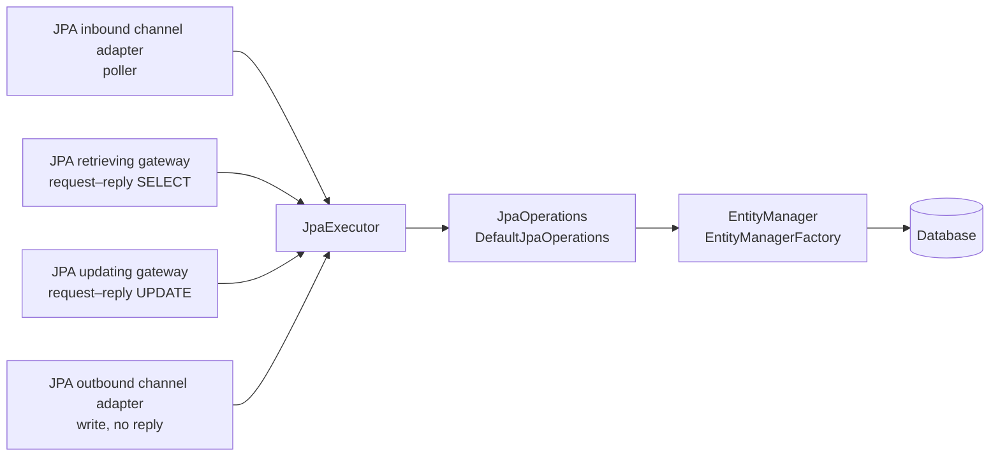
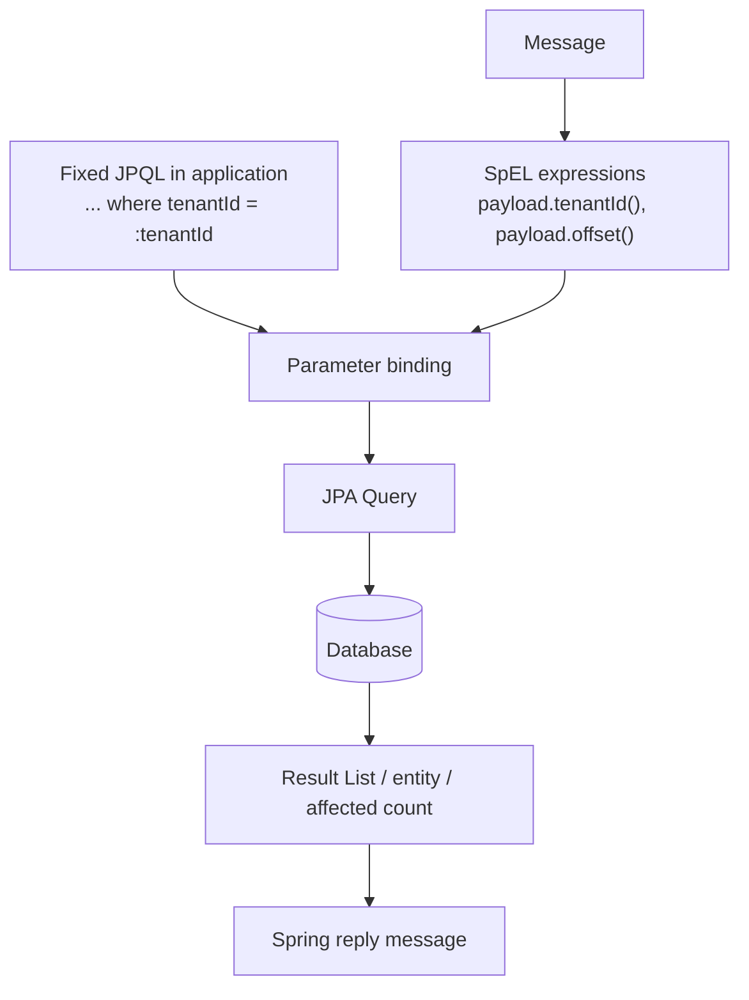
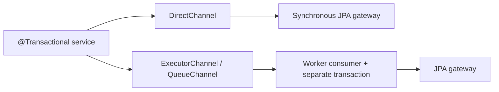

# JpaExecutor and Query Expressions

## 1. Context and Goals

In the **SPRING_INTEGRATION_ADAPTERS** module, applications connect external systems via inbound/outbound adapters, gateways, pollers, and `MessageChannel`. An event can travel from a file, SFTP, HTTP, JMS, AMQP, Kafka, or database into an Integration Flow, get transformed and validated, and then be stored or queried in another system.

Within **Adapter JPA**, endpoints such as the JPA inbound channel adapter, outbound channel adapter, retrieving outbound gateway, and updating outbound gateway all share a common JPA execution component: **`JpaExecutor`**. This lesson, **JpaExecutor and Query Expressions**, focuses on how `JpaExecutor` selects operations and queries, extracts **parameter values** from a Spring Message via **SpEL**, tunes query bounds, and returns results.

After this lesson, you will be able to:

- Describe the relationship among `JpaExecutor`, `JpaOperations`, `DefaultJpaOperations`, `EntityManagerFactory`, and JPA adapters/gateways.
- Distinguish configurations using `entityClass`, `jpaQuery`, `namedQuery`, `nativeQuery`, and `idExpression` lookups.
- Separate **developer-defined JPQL/SQL** from **message-supplied parameter values**.
- Write static parameters, named parameters, positional parameters, and `JpaParameter` instances with SpEL expressions.
- Explain why `payload` and `headers` are accessed differently depending on `usePayloadAsParameterSource` and `ParameterSourceFactory`.
- Configure `firstResultExpression` and `maxResultsExpression` for validated request-driven pagination.
- Understand `expectSingleResult`, empty results, `maxNumberOfResults`, payload types, and how retrieving/updating gateways build replies.
- Build a Spring Boot 3.x, Spring Integration 6.x, and Jakarta Persistence example using `@MessagingGateway` and Java DSL.
- Configure the same logic using plain Java `JpaExecutor` and XML namespaces without activating multiple competing handlers on one channel.
- Establish transactions, error handling, tenant security, result caps, and tests for safe operation under concurrent load.

> **Key point:** "query expression" in this lesson primarily refers to **SpEL expressions computing parameter values, IDs, or pagination bounds**. It **does not mean** accepting arbitrary JPQL/SQL strings from clients and executing them. Query text must be controlled by the application.

## 2. Where Does JpaExecutor Live in Spring Integration?

`JpaExecutor` belongs to the package:

```java
org.springframework.integration.jpa.core.JpaExecutor
```

It consolidates configuration and execution of the JPA operations needed by multiple adapters and gateways. Instead of every endpoint implementing its own query runner, Spring Integration uses `JpaExecutor` to coordinate operations through `JpaOperations`.



Key constructors provided by Spring Integration 6.x:

```java
new JpaExecutor(entityManagerFactory);
new JpaExecutor(entityManager);
new JpaExecutor(jpaOperations);
```

In Spring Boot applications, the standard pattern is passing a Spring-managed **`EntityManagerFactory`**. `EntityManagerFactory` is designed to be shared across threads; **never** create a real `EntityManager` and hold it in a singleton when multiple messages can execute concurrently.

### 2.1. Roles Not to Confuse

| Component | Role | Does Not Replace |
| --- | --- | --- |
| `JpaExecutor` | Configures queries/modes/parameters and invokes JPA operations | Is not an HTTP controller or scheduler |
| `JpaOperations` | Abstraction over `find`, `persist`, `executeUpdate`, etc. | Is not a `MessageChannel` |
| `DefaultJpaOperations` | Standard implementation for adapters/gateways | Does not replace business authorization |
| `JpaPollingChannelAdapter` | Uses executor as a `MessageSource` | Does not automatically track processed rows |
| `JpaOutboundGateway` | Handler receiving Spring Messages and running executor | Does not create distributed transactions across Kafka/HTTP |
| `@InboundChannelAdapter`/poller | Decides when to pull data | Does not enforce tenant filters in queries |
| `@MessagingGateway` | Facade sending requests and awaiting replies | Does not run JPA without a wired flow |
| `EntityManagerFactory` | Infrastructure supplying entity managers | Is not a global persistence context |

`JpaExecutor` is not an arbitrary "query builder". Its configured fields are used by the Spring Integration lifecycle to execute JPA operations with the matching message and transaction.

### 2.2. Key Execution Entry Points

Javadoc distinguishes:

- `poll()`: fetches data when an inbound source has no specific request message.
- `poll(Message<?> requestMessage)`: executes retrieval with request context, letting queries read payload/headers.
- `executeOutboundJpaOperation(Message<?> message)`: executes JPA operations for outbound/updating message branches.

These are **executor APIs**, not methods business services should call directly to bypass Integration Flows. Normally you configure an adapter or gateway and let the framework call the executor at the right moment within the chosen lifecycle and transaction.

## 3. From Message to JPA Query: Three Different Kinds of "Expression"

In message-driven systems, the terms "query" and "expression" are often mixed up.



Distinguish carefully:

1. **Query text**: e.g., `select o from PurchaseOrder o where o.tenantId = :tenantId`. This is **JPQL**, not SpEL; query structure is application-defined.
2. **Query parameter expression**: e.g., `payload.tenantId()` or `headers['verifiedTenantId']`. This is **SpEL** extracting the *value* bound to `:tenantId`, never raw SQL text replacement.
3. **Control expression**: e.g., `firstResultExpression("payload.offset()")` or `maxResultsExpression("payload.limit()")`. This is SpEL computing the start position and max row count.
4. **ID expression**: e.g., `idExpression("payload")`, used to look up an entity by primary key via `EntityManager.find(...)`, not an arbitrary JPQL SELECT.

**Example request message:**

```text
payload:
  tenantId   = "TENANT-A"
  customerId = "C-101"
  status     = "PAID"
  offset     = 0
  limit      = 20

headers:
  traceId = "tr-101"
```

**Fixed configured query:**

```sql
select o from PurchaseOrder o
where o.tenantId = :tenantId
  and o.customerId = :customerId
  and o.status = :status
order by o.id
```

**Expressions/bindings:**

```text
:tenantId    ← payload.tenantId()
:customerId  ← payload.customerId()
:status      ← payload.status()

firstResult  ← payload.offset()
maxResults   ← payload.limit()
```

Each incoming message can carry different *values*, while the query keeps the exact same structure. This makes flows easier to test and prevents concatenating untrusted data into queries.

## 4. Choosing the Right Query Source in JpaExecutor

### 4.1. Configuration Methods

| Java Configuration | Meaning | Use Case |
| --- | --- | --- |
| `setEntityClass(PurchaseOrder.class)` | Selects entity class | Entity-mode persist/merge/delete or entity/ID retrieval |
| `setJpaQuery("select ...")` | Supplies fixed JPQL | JPQL SELECT or UPDATE/DELETE |
| `setNamedQuery("PurchaseOrder.findByCustomer")` | Uses a registered named query | Reuses queries declared on entities/ORM metadata |
| `setNativeQuery("select ...")` | Supplies native SQL | Requires DB-specific syntax, functions, or features |
| `setIdExpression(expression)` | Computes primary key then calls `EntityManager.find` | Look up a single entity by key |
| `setPersistMode(PersistMode.MERGE)` | Selects write operation mode | Persist/merge/delete |
| `setExpectSingleResult(boolean)` | Single entity vs. list | Retrieval contract |
| `setJpaParameters(List<JpaParameter>)` | Declares static values/SpEL parameter bindings | JPQL/named/native queries |
| `setParameterSourceFactory(...)` | Creates a `ParameterSource` per message | Bean/map/header parameter binding |
| `setMaxNumberOfResults(int)` | Fixed row cap | Bounded loading |
| `setMaxResultsExpression(Expression)` | Computes limit from message | Validated dynamic pagination |
| `setFirstResultExpression(Expression)` | Computes offset from message | Validated dynamic pagination |

**Pick only one valid query strategy** per executor. `jpaQuery`, `namedQuery`, `nativeQuery`, and `entityClass`/`idExpression` have operation-specific constraints; never declare conflicting query sources simultaneously.

### 4.2. JPQL Is Not SQL

JPQL operates on **Java entity names and Java fields**.

Suppose an entity has:

```java
@Entity
@Table(name = "purchase_order")
public class PurchaseOrder {

    @Id
    @Column(name = "order_id")
    private String id;

    @Column(name = "tenant_id")
    private String tenantId;

    // ...
}
```

Correct JPQL:

```sql
select o from PurchaseOrder o
where o.tenantId = :tenantId
order by o.id
```

Do not write `select * from purchase_order` in `jpaQuery`; that is SQL, not JPQL. When SQL is genuinely needed, use `nativeQuery` and verify result mapping with your persistence provider.

### 4.3. Named Query

An entity can declare:

```java
@NamedQuery(
    name = "PurchaseOrder.findPaidByCustomer",
    query = """
        select o from PurchaseOrder o
        where o.customerId = :customerId
          and o.status = 'PAID'
        order by o.id
        """)
```

And the gateway selects it:

```java
Jpa.retrievingGateway(entityManagerFactory)
        .namedQuery("PurchaseOrder.findPaidByCustomer")
        .parameterExpression("customerId", "payload");
```

The query name must be registered accurately, and parameter names must match. Named queries organize reusable queries cleanly, but **never** bypass validation or authorization.

### 4.4. Native Queries and Result Mapping

Native SQL can look like:

```java
Jpa.retrievingGateway(entityManagerFactory)
        .nativeQuery("""
            select order_id, status
            from purchase_order
            where tenant_id = :tenantId
            """)
        .parameterExpression("tenantId", "payload");
```

A native query result is **not automatically a `PurchaseOrder`**. Depending on `entityClass`/result mappings/provider, you may receive scalars, `Object[]`, tuples, or entities. With native SQL, named/positional parameter binding and dialect details must be verified by integration tests on the target database.

Never build native SQL strings by concatenating client parameters; both JPQL and native SQL require JPA parameter binding.

### 4.5. idExpression for Primary Key Lookup

`idExpression` performs lookup-by-ID:

```java
Jpa.retrievingGateway(entityManagerFactory)
        .entityClass(PurchaseOrder.class)
        .idExpression("payload");
```

This assumes the payload is the primary key `String orderId`, not a request DTO. For a DTO with `orderId()`, the expression is `payload.orderId()`.

Keep in mind:

- `idExpression` is evaluated against the **request message**; the entity class must be specified explicitly or as supported by the framework.
- It executes `EntityManager.find`, not a JPQL query.
- Do not mix `idExpression` with `jpaQuery`/`nativeQuery`/`namedQuery` or incompatible query attributes.
- When the ID is missing, design explicit not-found semantics; do not assume `null` can always serve as a valid message payload.

## 5. JpaParameter: Binding Data to Queries Explicitly

### 5.1. Named Parameters

JPQL:

```sql
select o from PurchaseOrder o
where o.tenantId = :tenantId
  and o.status = :status
```

Using Java DSL:

```java
Jpa.retrievingGateway(entityManagerFactory)
        .jpaQuery("""
            select o from PurchaseOrder o
            where o.tenantId = :tenantId
              and o.status = :status
            """)
        .parameterExpression(
                "tenantId", "payload.tenantId()")
        .parameterExpression(
                "status", "payload.status()");
```

`parameterExpression("tenantId", "...")` **does not alter the query text**; it provides an expression computing the value for `:tenantId` when handling each request.

### 5.2. Direct Configuration with JpaParameter

`JpaParameter` lives in:

```java
org.springframework.integration.jpa.support.JpaParameter
```

Common constructors:

```java
new JpaParameter(
        "tenantId", null, "payload.tenantId()");

new JpaParameter(
        "status", "PAID", null);
```

Arguments are `name`, `value`, and `expression` in order. For a single parameter, specify either a **static value** or an **expression**, never both inconsistently.

`JpaExecutor` accepts a list:

```java
executor.setJpaParameters(List.of(
        new JpaParameter(
                "tenantId", null, "payload.tenantId()"),
        new JpaParameter(
                "status", null, "payload.status()")
));

executor.setUsePayloadAsParameterSource(false);
```

This assumes `executor` was created from `EntityManagerFactory` and already configured with the matching JPQL. When explicit expressions use `payload`/`headers`, setting `false` explicitly clarifies that the evaluation root is the entire **Spring Message**.

### 5.3. Positional Parameters

JPA also supports positional parameters. For JPQL using positional binding:

```sql
select o from PurchaseOrder o
where o.tenantId = ?1
  and o.status = ?2
```

DSL supports:

```java
Jpa.retrievingGateway(entityManagerFactory)
        .jpaQuery("""
            select o from PurchaseOrder o
            where o.tenantId = ?1
              and o.status = ?2
            """)
        .parameterExpression("payload.tenantId()")
        .parameterExpression("payload.status()");
```

Declaration order must match the positional placeholders in the query, and your JPA provider must support the syntax/types used. With many parameters, **named parameters** are usually easier to maintain.

### 5.4. Static Parameters

To restrict queries strictly to `PAID` orders without letting clients change status:

```java
Jpa.retrievingGateway(entityManagerFactory)
        .jpaQuery("""
            select o from PurchaseOrder o
            where o.tenantId = :tenantId
              and o.status = :status
            """)
        .parameterExpression(
                "tenantId", "payload.tenantId()")
        .parameter("status", "PAID");
```

Using a static value for `status` enforces a fixed filter, though **tenant authorization** must still be verified in the service.

### 5.5. XML Expression-Based and Value-Based Parameters

```xml
<int-jpa:retrieving-outbound-gateway
        request-channel="orderSearchRequests"
        entity-manager-factory="entityManagerFactory"
        jpa-query="select o from PurchaseOrder o
                   where o.tenantId = :tenantId
                     and o.status = :status"
        expect-single-result="false">

    <int-jpa:parameter
            name="tenantId"
            expression="payload.tenantId()"/>

    <int-jpa:parameter
            name="status"
            value="PAID"/>
</int-jpa:retrieving-outbound-gateway>
```

This is an endpoint XML snippet; a full XML context needs the appropriate namespaces/schemas and Spring beans. Both value-based and expression-based parameters are supported by the namespace, and the same parameter name must not be declared twice.

## 6. SpEL Root: Payload or the Whole Message?

A frequent mistake is writing `payload.customerId` while configuring the framework so that the SpEL root **is already the payload**. Then `payload` does not exist on the root as expected and evaluation fails.

### 6.1. Two Evaluation Models

| `usePayloadAsParameterSource` | Parameter Evaluation Root/Source | Example Expression |
| --- | --- | --- |
| `true` | Spring Message payload | `customerId` or `#this` for suitable payloads |
| `false` | Entire Spring Message | `payload.customerId()` or `headers['verifiedTenantId']` |

Per Spring Integration documentation:

- **Without explicit JPA parameters:** defaults to `true`; `BeanPropertyParameterSourceFactory` reads properties from the payload.
- **With explicit `JpaParameter` SpEL expressions:** the appropriate default is `false` so both `payload` and `headers` are accessible.
- If you intentionally set `usePayloadAsParameterSource(true)` with `#this`, the root is the payload; do not prefix with `payload.` as when the root is the Message.

**Why does this matter?**

Suppose the request payload is:

```java
public record OrderSearch(
        String customerId, String status) {
}
```

With a bean-property parameter source on the payload, parameter `customerId` can resolve from the matching property. With explicit SpEL `payload.customerId()`, however, the root must be the Spring Message.

### 6.2. Reading Headers

When reading a server-attached header:

```java
.parameterExpression(
        "tenantId", "headers['verifiedTenantId']")
```

Example message:

```java
Message<OrderSearch> message =
        MessageBuilder.withPayload(
                new OrderSearch("C-101", "PAID"))
            .setHeader("verifiedTenantId", "TENANT-A")
            .build();
```

However, **the header name `verifiedTenantId` does not make the value trustworthy on its own**. Any message producer can set headers. Ensure the value comes from an authenticated principal/ACL/tenant resolver on the **server**, never copied verbatim from user-supplied HTTP headers or JSON.

### 6.3. BeanPropertyParameterSourceFactory

Spring Integration provides the `ParameterSourceFactory` interface and `BeanPropertyParameterSourceFactory` implementation in `org.springframework.integration.jpa.support.parametersource`.

Concept:

```text
Spring Message
    payload = OrderSearch(customerId="C-101", status="PAID")
        ↓
usePayloadAsParameterSource = true
        ↓
BeanPropertyParameterSourceFactory
        ↓
:customerId = "C-101"
:status     = "PAID"
```

This is concise when query parameter names match payload properties. When mixing payload fields and headers, explicit parameter expressions are easier to read and audit.

### 6.4. ParameterSourceFactory Is Mutually Exclusive with Explicit Parameters

The two configuration approaches are generally **mutually exclusive**:

1. `parameter-source-factory`: generates parameter values per the factory contract.
2. `<int-jpa:parameter>` or `setJpaParameters`: lists explicit parameter values/expressions.

Do not configure both expecting Spring to "merge" lists and resolve precedence. If complex mapping is needed, write a transformer/enricher producing a **validated request DTO** and bind consistently with one strategy.

### 6.5. Never Treat SpEL as Client Input

**Do not do this:**

```java
// Risk: accepting a raw SpEL expression from HTTP/JMS payload.
String expression = untrustedRequest.getExpression();
executor.setJpaParameters(
        List.of(new JpaParameter(
                "tenantId", null, expression)));
```

SpEL expressions can access properties, invoke methods, and evaluate logic depending on the evaluation context. Users must never supply expression text or query strings. **Developers define fixed expressions; users supply only values** validated for type and authorization.

## 7. firstResultExpression and maxResultsExpression

### 7.1. Pagination Is Both a Performance and Security Concern

If a customer has 500,000 orders, an unbounded query can load huge entity graphs onto the heap, hold DB connections open, slow JPA transactions, and build massive Spring Messages.

`JpaExecutor` supports two approaches:

| Configuration | Java DSL | Java Executor | Effect |
| --- | --- | --- | --- |
| Fixed limit | `maxResults(50)` | `setMaxNumberOfResults(50)` | Returns at most 50 rows |
| Message-driven limit | `maxResultsExpression("payload.limit()")` | `setMaxResultsExpression(Expression)` | Computes limit per request |
| Fixed offset | `firstResult(100)` | `setFirstResultExpression(...)` with constant expression | Starts at offset 100 |
| Message-driven offset | `firstResultExpression("payload.offset()")` | `setFirstResultExpression(Expression)` | Computes offset per request |

In Java DSL, `maxResults` **cannot be combined** with `maxResultsExpression` on the same spec; likewise `firstResult` **cannot be combined** with `firstResultExpression` on the same endpoint.

### 7.2. Dynamic SpEL with a Sanitized DTO

```java
Jpa.retrievingGateway(entityManagerFactory)
        .jpaQuery("""
                select o from PurchaseOrder o
                where o.tenantId = :tenantId
                order by o.id
                """)
        .parameterExpression(
                "tenantId", "payload.tenantId()")
        .firstResultExpression("payload.offset()")
        .maxResultsExpression("payload.limit()");
```

This **does not mean** clients can request unlimited page sizes. If `payload.limit()` passes a huge number unchecked, the app can DoS its own database.

**Validate before the gateway:**

```java
public static int safePageSize(int requestedLimit) {
    if (requestedLimit <= 0) {
        throw new IllegalArgumentException(
                "Limit must be positive");
    }
    return Math.min(requestedLimit, 50);
}

public static int safeOffset(int requestedOffset) {
    if (requestedOffset < 0
            || requestedOffset > 10_000) {
        throw new IllegalArgumentException(
                "Offset out of range");
    }
    return requestedOffset;
}
```

Here `50` and `10_000` are **illustrative** thresholds; production systems choose limits based on SLAs, DTO size, indexes, and load. For very large page counts, prefer **keyset pagination**.

### 7.3. Expression Values and Types

`firstResultExpression`/`maxResultsExpression` must evaluate to valid integer values usable for pagination; never pass arbitrary strings like `"abc"` or negative numbers. With a Java record exposing `int` `offset()`/`limit()` as shown, pre-gateway validation is straightforward.

JPQL must include a deterministic `order by` (usually ending with a unique key) for predictable pagination. Without ordering, offset simply skips "N results in whatever order the DB chooses", which can shift across requests.

### 7.4. OFFSET vs. Keyset

Consider the query:

```sql
select o from PurchaseOrder o
where o.tenantId = :tenantId
order by o.id
```

With `offset=10_000` and `limit=50`, the DB may have to scan many rows before returning 50 records depending on the execution plan. If the table changes between page requests, OFFSET can skip or duplicate rows.

A keyset query uses a cursor:

```sql
select o from PurchaseOrder o
where o.tenantId = :tenantId
  and o.id > :afterId
order by o.id
```

Cap with `maxResults(50)`; `afterId` is bound as a normal query parameter. Cursors must be validated, scoped to the tenant/filter, and handle tie-breaking when sort columns are not unique. Here the query expression only supplies the **cursor value**, never altering JPQL text.

## 8. expectSingleResult and Empty Results

### 8.1. Single Entity or List?

`setExpectSingleResult(false)` is the standard mode for multi-row SELECT queries.

```java
executor.setExpectSingleResult(false);
```

Downstream contract:

```java
Message<List<PurchaseOrder>>
```

This is the **conceptual** type, since at runtime `Message<?>` carries the concrete payload produced by the executor and JPA provider mapping.

If:

```java
executor.setExpectSingleResult(true);
```

then:

- Exactly 1 result → payload is that entity/result.
- Multiple results → framework may throw `MessagingException` for contract violation.
- Zero results → test behavior per query/lookup path, version, and policy; **do not assume `Optional.empty()`**.

### 8.2. Spring Integration 6.0+ and Empty Lists

For a **list-mode retrieving outbound gateway**, Spring Integration 6.0+ returns an **empty list** when the query matches no entities. Older versions could return `null` and terminate the flow or fail `requiresReply`.

Example result:

```json
[]
```

If the application needs different not-found semantics, handle them at the facade/API contract. Note: filtering out an empty list **without sending a reply** can cause a `@MessagingGateway` caller to block until timeout. For search APIs, returning an empty list is usually simpler and more consistent.

### 8.3. maxResults(1) Does Not Prove Query Uniqueness

Example:

```java
Jpa.retrievingGateway(entityManagerFactory)
        .jpaQuery("""
                select o from PurchaseOrder o
                where o.customerId = :customerId
                """)
        .parameterExpression(
                "customerId", "payload")
        .maxResults(1)
        .expectSingleResult(true);
```

This might return one order even when thousands exist for that customer. `maxResults(1)` **masks** the existence of multiple rows. When business rules require "strictly 1 row", enforce uniqueness via a unique key/ID or unique query criteria; when you want "the latest row", add explicit ordering so taking one row is part of the contract.

### 8.4. JpaPollingChannelAdapter Differs from Retrieving Gateway

A periodically polled JPA inbound adapter emits no message when no rows exist, whereas a 6.0+ retrieving gateway can return **`List.of()`** for a query with zero matches. Never extrapolate polling-source "no rows" behavior to a request–reply facade.

## 9. Complete Practical Example: Query Expressions for Orders

Build a Spring Boot demo application featuring:

1. `@MessagingGateway` receiving a service-validated request.
2. A JPA retrieving gateway executing JPQL by tenant/customer/status.
3. SpEL binding parameters from the request record.
4. `firstResultExpression` and `maxResultsExpression` reading **bounded** offset/limit values.
5. A transformer converting `List<PurchaseOrder>` into `List<OrderView>` so JPA entities never escape.
6. A `@Transactional(readOnly=true)` service validating inputs and invoking the gateway synchronously.
7. In-memory H2 seeded with sample rows to demonstrate filtering, pagination, and empty results.

The example uses **Java 17+, Spring Boot 3.x, Spring Integration 6.x, and Spring Data JPA/Jakarta Persistence**. Java classes live in package `com.example.jpaexpressions`. `tenantId` and `customerId` in the service are assumed **already authenticated by an upstream layer**; the console demo supplies fixed values.

### 9.1. Maven Dependencies

```xml
<dependencies>
    <dependency>
        <groupId>org.springframework.boot</groupId>
        <artifactId>spring-boot-starter</artifactId>
    </dependency>
    <dependency>
        <groupId>org.springframework.boot</groupId>
        <artifactId>spring-boot-starter-data-jpa</artifactId>
    </dependency>
    <dependency>
        <groupId>org.springframework.boot</groupId>
        <artifactId>spring-boot-starter-integration</artifactId>
    </dependency>
    <dependency>
        <groupId>org.springframework.integration</groupId>
        <artifactId>spring-integration-jpa</artifactId>
    </dependency>
    <dependency>
        <groupId>com.h2database</groupId>
        <artifactId>h2</artifactId>
        <scope>runtime</scope>
    </dependency>
    <dependency>
        <groupId>org.springframework.boot</groupId>
        <artifactId>spring-boot-starter-test</artifactId>
        <scope>test</scope>
    </dependency>
</dependencies>
```

The Spring Boot BOM manages compatible versions. `spring-boot-starter-data-jpa` provides the JPA provider and transaction manager, while `spring-integration-jpa` supplies `JpaExecutor`/gateways. H2 and `ddl-auto=create-drop` are strictly for practice.

### 9.2. PurchaseOrder Entity

File `PurchaseOrder.java`:

```java
package com.example.jpaexpressions;

import java.math.BigDecimal;

import jakarta.persistence.Column;
import jakarta.persistence.Entity;
import jakarta.persistence.Id;
import jakarta.persistence.Index;
import jakarta.persistence.Table;

@Entity
@Table(name = "purchase_order",
       indexes = @Index(
               name = "idx_order_scope",
               columnList = "tenant_id, customer_id, status"))
public class PurchaseOrder {

    @Id
    @Column(name = "order_id", length = 80)
    private String id;

    @Column(name = "tenant_id", nullable = false, length = 60)
    private String tenantId;

    @Column(name = "customer_id", nullable = false, length = 60)
    private String customerId;

    @Column(nullable = false, length = 24)
    private String status;

    @Column(name = "total_amount", nullable = false,
            precision = 12, scale = 2)
    private BigDecimal totalAmount;

    protected PurchaseOrder() {
        // Jakarta Persistence requires a no-arg constructor.
    }

    public PurchaseOrder(
            String id, String tenantId, String customerId,
            String status, BigDecimal totalAmount) {

        this.id = id;
        this.tenantId = tenantId;
        this.customerId = customerId;
        this.status = status;
        this.totalAmount = totalAmount;
    }

    public String getId() {
        return id;
    }

    public String getTenantId() {
        return tenantId;
    }

    public String getCustomerId() {
        return customerId;
    }

    public String getStatus() {
        return status;
    }

    public BigDecimal getTotalAmount() {
        return totalAmount;
    }
}
```

JPQL references `PurchaseOrder`, while the physical table is `purchase_order`. This illustrative index does not replace examining execution plans and measuring load on the real database.

### 9.3. Request Record and DTO

File `AuthorizedOrderQuery.java`:

```java
package com.example.jpaexpressions;

public record AuthorizedOrderQuery(
        String tenantId,
        String customerId,
        String status,
        int offset,
        int limit) {
}
```

The record represents an **internally normalized request**, not raw JSON straight from a client. `tenantId`/`customerId` must come from an authenticated service, and offset/limit must be validated.

File `OrderView.java`:

```java
package com.example.jpaexpressions;

import java.math.BigDecimal;

public record OrderView(
        String id,
        String status,
        BigDecimal totalAmount) {

    public static OrderView from(PurchaseOrder entity) {
        return new OrderView(
                entity.getId(),
                entity.getStatus(),
                entity.getTotalAmount());
    }
}
```

The DTO omits tenant/customer IDs in the demo result; real APIs define permitted fields per authorization policy. Never push raw JPA entity graphs straight over Kafka/JMS/HTTP/WebSocket.

### 9.4. Repository for Seeding and Testing

File `PurchaseOrderRepository.java`:

```java
package com.example.jpaexpressions;

import org.springframework.data.jpa.repository.JpaRepository;

public interface PurchaseOrderRepository
        extends JpaRepository<PurchaseOrder, String> {
}
```

In this lesson, the repository **does not run request–reply queries**. It only seeds and inspects test data; main queries execute through Spring Integration's `JpaExecutor`.

### 9.5. Messaging Gateway Facade

File `OrderSearchGateway.java`:

```java
package com.example.jpaexpressions;

import java.util.List;
import org.springframework.integration.annotation.MessagingGateway;

@MessagingGateway(
        defaultRequestChannel = "orderSearchRequests",
        defaultReplyTimeout = "5000")
public interface OrderSearchGateway {

    List<OrderView> search(AuthorizedOrderQuery query);
}
```

Spring Integration builds a request Spring Message and temporary reply channel, returning `List<OrderView>` once the flow replies. `defaultReplyTimeout` is **not a JDBC statement timeout**, especially during synchronous execution on a `DirectChannel`.

### 9.6. IntegrationFlow and Query Expressions

File `OrderSearchIntegrationConfiguration.java`:

```java
package com.example.jpaexpressions;

import java.util.List;

import jakarta.persistence.EntityManagerFactory;

import org.springframework.context.annotation.Bean;
import org.springframework.context.annotation.Configuration;
import org.springframework.integration.config.EnableIntegration;
import org.springframework.integration.core.GenericTransformer;
import org.springframework.integration.dsl.IntegrationFlow;
import org.springframework.integration.jpa.dsl.Jpa;

@Configuration
@EnableIntegration
public class OrderSearchIntegrationConfiguration {

    @Bean
    IntegrationFlow orderSearchFlow(
            EntityManagerFactory entityManagerFactory) {

        return IntegrationFlow.from("orderSearchRequests")
                .handle(
                        Jpa.retrievingGateway(entityManagerFactory)
                                .jpaQuery("""
                                        select o from PurchaseOrder o
                                        where o.tenantId = :tenantId
                                          and o.customerId = :customerId
                                          and o.status = :status
                                        order by o.id
                                        """)
                                .parameterExpression(
                                        "tenantId",
                                        "payload.tenantId()")
                                .parameterExpression(
                                        "customerId",
                                        "payload.customerId()")
                                .parameterExpression(
                                        "status",
                                        "payload.status()")
                                .firstResultExpression(
                                        "payload.offset()")
                                .maxResultsExpression(
                                        "payload.limit()")
                                .expectSingleResult(false))
                .transform((
                        GenericTransformer<
                                List<PurchaseOrder>,
                                List<OrderView>>) rows ->
                        rows.stream()
                                .map(OrderView::from)
                                .toList())
                .get();
    }
}
```

There are four contract layers here:

**First — query:** fixed JPQL authored by the application; never accepts client SQL strings.

**Second — parameters:** three `parameterExpression` entries pull normalized fields from the payload without string concatenation. `:tenantId`/`:customerId` enforce mandatory business scope.

**Third — pagination:** `firstResultExpression` and `maxResultsExpression` evaluate offset/limit from the internal record **already capped by the service**; they do not enforce caps on their own if the service skips validation.

**Fourth — reply:** the retrieving gateway emits `List<PurchaseOrder>`, and the transformer converts it to `List<OrderView>` and routes it back to `@MessagingGateway`'s temporary reply channel.

No `@Poller` is needed because this is a **retrieving outbound gateway** driven by request messages. Switching to a JPA inbound channel adapter would require a polling schedule and different parameter-source/no-message handling.

### 9.7. Service Validating Scope and Pagination Bounds

File `OrderSearchService.java`:

```java
package com.example.jpaexpressions;

import java.util.List;
import java.util.Set;

import org.springframework.stereotype.Service;
import org.springframework.transaction.annotation.Transactional;

@Service
public class OrderSearchService {

    private static final int MAX_PAGE_SIZE = 50;
    private static final int MAX_OFFSET = 10_000;
    private static final Set<String> ALLOWED_STATUSES =
            Set.of("PAID", "SHIPPED");

    private final OrderSearchGateway gateway;

    public OrderSearchService(OrderSearchGateway gateway) {
        this.gateway = gateway;
    }

    @Transactional(readOnly = true)
    public List<OrderView> searchForAuthorizedScope(
            String verifiedTenantId,
            String authorizedCustomerId,
            String status,
            int offset,
            int requestedLimit) {

        // In production, tenant/customer must come from
        // an authenticated principal/ACL, never client-supplied.
        if (verifiedTenantId == null
                || verifiedTenantId.isBlank()
                || verifiedTenantId.length() > 60
                || authorizedCustomerId == null
                || authorizedCustomerId.isBlank()
                || authorizedCustomerId.length() > 60) {
            throw new IllegalArgumentException(
                    "Invalid authorized scope");
        }

        if (!ALLOWED_STATUSES.contains(status)) {
            throw new IllegalArgumentException(
                    "Unsupported order status");
        }

        if (offset < 0 || offset > MAX_OFFSET) {
            throw new IllegalArgumentException(
                    "Invalid offset");
        }

        if (requestedLimit <= 0) {
            throw new IllegalArgumentException(
                    "Limit must be positive");
        }

        int safeLimit = Math.min(
                requestedLimit, MAX_PAGE_SIZE);

        AuthorizedOrderQuery query =
                new AuthorizedOrderQuery(
                        verifiedTenantId,
                        authorizedCustomerId,
                        status,
                        offset,
                        safeLimit);

        return gateway.search(query);
    }
}
```

**Critical security point:** `searchForAuthorizedScope` assumes `verifiedTenantId` and `authorizedCustomerId` were resolved by a trusted security layer. In a real HTTP controller, **never** read both fields from query parameters and pass them straight into this method. Resolve them from the security context/tenant authorization service and verify access before querying.

`@Transactional(readOnly=true)` wraps the **synchronous** gateway call over `DirectChannel`. If a queue/executor sits in between, this transaction does not cross the thread boundary automatically.

### 9.8. Spring Boot Application and Sample Data

File `JpaQueryExpressionApplication.java`:

```java
package com.example.jpaexpressions;

import java.math.BigDecimal;
import java.util.List;

import org.springframework.boot.CommandLineRunner;
import org.springframework.boot.SpringApplication;
import org.springframework.boot.autoconfigure.SpringBootApplication;
import org.springframework.context.annotation.Bean;
import org.springframework.integration.annotation.IntegrationComponentScan;

@SpringBootApplication
@IntegrationComponentScan
public class JpaQueryExpressionApplication {

    public static void main(String[] args) {
        SpringApplication.run(
                JpaQueryExpressionApplication.class, args);
    }

    @Bean
    CommandLineRunner demo(
            PurchaseOrderRepository repository,
            OrderSearchService service) {

        return args -> {
            if (repository.count() == 0) {
                repository.saveAll(List.of(
                        new PurchaseOrder(
                                "ORD-101", "TENANT-A", "C-101",
                                "PAID", new BigDecimal("10.00")),
                        new PurchaseOrder(
                                "ORD-102", "TENANT-A", "C-101",
                                "PAID", new BigDecimal("20.00")),
                        new PurchaseOrder(
                                "ORD-103", "TENANT-A", "C-101",
                                "SHIPPED", new BigDecimal("30.00")),
                        new PurchaseOrder(
                                "ORD-104", "TENANT-B", "C-101",
                                "PAID", new BigDecimal("40.00"))
                ));
            }

            System.out.println("Page 1: "
                    + service.searchForAuthorizedScope(
                            "TENANT-A", "C-101",
                            "PAID", 0, 1));

            System.out.println("Page 2: "
                    + service.searchForAuthorizedScope(
                            "TENANT-A", "C-101",
                            "PAID", 1, 1));

            System.out.println("No rows: "
                    + service.searchForAuthorizedScope(
                            "TENANT-A", "C-999",
                            "PAID", 0, 20));
        };
    }
}
```

File `application.properties`:

```properties
spring.main.web-application-type=none

spring.datasource.url=jdbc:h2:mem:jpa_expression_demo;DB_CLOSE_DELAY=-1
spring.datasource.driver-class-name=org.h2.Driver
spring.datasource.username=sa
spring.datasource.password=

spring.jpa.hibernate.ddl-auto=create-drop
spring.jpa.open-in-view=false
logging.level.org.springframework.integration=INFO
```

H2 and `create-drop` are solely for learning. Production requires schema migrations (Flyway/Liquibase), a real database/pool, and proper authorization.

**Expected results:**

| Call | Reply | Explanation |
| --- | --- | --- |
| TENANT-A/C-101/PAID, offset 0, limit 1 | `ORD-101` | First page per `order by o.id` |
| TENANT-A/C-101/PAID, offset 1, limit 1 | `ORD-102` | Second page |
| TENANT-A/C-999/PAID | `[]` | No rows; list mode returns empty |
| TENANT-A/C-101/SHIPPED | `ORD-103` | Different status filter |
| TENANT-A/C-101/PAID never returns ORD-104 | No TENANT-B leak | Tenant filter in query |
| limit=1000 | Server caps to 50 | Prevents inflating `maxResultsExpression` |

These cases show that **query text stays constant**, while only values bound from each Spring Message vary.

## 10. Plain Java Configuration with JpaExecutor and JpaParameter

The demo uses Java DSL. To inspect `JpaExecutor` directly, configure `@ServiceActivator` and `JpaOutboundGateway`.

**This is an alternative to `OrderSearchIntegrationConfiguration` in section 9.6**. Do not enable both on the same request channel without designing multiple consumers, because `DirectChannel` load-balances messages across handlers rather than broadcasting to both.

### 10.1. JpaExecutor Bean

Illustrative file `JpaExecutorJavaConfiguration.java`:

```java
package com.example.jpaexpressions;

import java.util.List;

import jakarta.persistence.EntityManagerFactory;

import org.springframework.context.annotation.Bean;
import org.springframework.context.annotation.Configuration;
import org.springframework.integration.annotation.ServiceActivator;
import org.springframework.integration.jpa.core.JpaExecutor;
import org.springframework.integration.jpa.outbound.JpaOutboundGateway;
import org.springframework.integration.jpa.support.JpaParameter;
import org.springframework.integration.jpa.support.OutboundGatewayType;
import org.springframework.messaging.MessageHandler;

@Configuration
public class JpaExecutorJavaConfiguration {

    @Bean
    JpaExecutor orderSearchJpaExecutor(
            EntityManagerFactory entityManagerFactory) {

        JpaExecutor executor =
                new JpaExecutor(entityManagerFactory);

        executor.setJpaQuery("""
                select o from PurchaseOrder o
                where o.tenantId = :tenantId
                  and o.customerId = :customerId
                  and o.status = :status
                order by o.id
                """);

        executor.setJpaParameters(List.of(
                new JpaParameter(
                        "tenantId", null,
                        "payload.tenantId()"),
                new JpaParameter(
                        "customerId", null,
                        "payload.customerId()"),
                new JpaParameter(
                        "status", null,
                        "payload.status()")));

        // Explicit SpEL uses the full Message as root.
        executor.setUsePayloadAsParameterSource(false);
        executor.setExpectSingleResult(false);
        executor.setMaxNumberOfResults(50);

        return executor;
    }

    @Bean
    @ServiceActivator(inputChannel = "orderSearchRequests")
    MessageHandler orderRetrievingHandler(
            JpaExecutor orderSearchJpaExecutor) {

        JpaOutboundGateway handler =
                new JpaOutboundGateway(orderSearchJpaExecutor);

        handler.setGatewayType(
                OutboundGatewayType.RETRIEVING);

        // producesReply defaults to true.
        // Do not call setProducesReply(false): reply will be lost.
        return handler;
    }
}
```

Differences from section 9's DSL:

- `setMaxNumberOfResults(50)` sets a **fixed limit** rather than dynamic `maxResultsExpression`; there is no dynamic offset here.
- Explicit `JpaParameter` entries replace DSL `parameterExpression` methods.
- The handler returns `List<PurchaseOrder>`, so if `OrderSearchGateway` expects `List<OrderView>`, add a **DTO transformer in the reply flow**. Do not enable this Java bean and expect the Java DSL's mapper to run automatically.
- `@ServiceActivator` uses `JpaOutboundGateway` with `RETRIEVING` to emit replies. Setting `setProducesReply(false)` turns it into a one-way outbound adapter and callers will hang until timeout.

### 10.2. When Dynamic Limit/Offset Is Needed on JpaExecutor

Javadoc specifies **Spring `Expression` objects**, not raw strings, on `JpaExecutor`:

```java
import org.springframework.expression.ExpressionParser;
import org.springframework.expression.spel.standard.SpelExpressionParser;

ExpressionParser parser = new SpelExpressionParser();

executor.setFirstResultExpression(
        parser.parseExpression("payload.offset()"));

executor.setMaxResultsExpression(
        parser.parseExpression("payload.limit()"));
```

This **supplements** the executor bean before Spring finishes initialization; when using a dynamic limit, do not simultaneously set `setMaxNumberOfResults(50)` expecting the two bounds to combine automatically. Pick **one** limit source and validate upstream.

Spring Integration can use an evaluation context wired with bean resolvers and functions. Therefore SpEL expressions must be **trusted definitions written by the application**, never strings taken from clients.

### 10.3. ApplicationContext and Lifecycle

`JpaExecutor` implements Spring lifecycle initialization interfaces such as `InitializingBean`. When declared via `@Bean`, Spring runs bean initialization steps, including validating and building parameter sources.

If you instantiate `new JpaExecutor(...)` outside Spring and call raw APIs directly, you may have to manage initialization and evaluation contexts yourself. In a Spring Integration app, let Spring manage the executor and endpoints instead of bypassing lifecycle hooks.

## 11. Equivalent XML Namespace Configuration

### 11.1. JPQL + Parameter Expressions + Dynamic Pagination

An XML endpoint replacing Java DSL:

```xml
<int-jpa:retrieving-outbound-gateway
        id="ordersJpaRetrievingGateway"
        request-channel="orderSearchRequests"
        entity-manager-factory="entityManagerFactory"
        jpa-query="select o from PurchaseOrder o
                   where o.tenantId = :tenantId
                     and o.customerId = :customerId
                     and o.status = :status
                   order by o.id"
        expect-single-result="false"
        first-result-expression="payload.offset()"
        max-results-expression="payload.limit()"
        use-payload-as-parameter-source="false">

    <int-jpa:parameter
            name="tenantId"
            expression="payload.tenantId()"/>
    <int-jpa:parameter
            name="customerId"
            expression="payload.customerId()"/>
    <int-jpa:parameter
            name="status"
            expression="payload.status()"/>
</int-jpa:retrieving-outbound-gateway>
```

This XML assumes the application context defines the `int`/`int-jpa` namespaces/schemas, `entityManagerFactory`, and request channel. If returning `List<OrderView>` to `@MessagingGateway`, you also need a DTO transformer in the reply flow; this XML illustrates only the retrieving endpoint.

**Mutually exclusive attribute pairs:**

- `max-results` and `max-results-expression`.
- `first-result` and `first-result-expression`.
- `parameter-source-factory` and `<int-jpa:parameter>` child elements.

`use-payload-as-parameter-source="false"` is set explicitly because expressions reference `payload.*` on the root Spring Message.

### 11.2. Fixed Query with a Static Parameter

```xml
<int-jpa:retrieving-outbound-gateway
        request-channel="paidOrderRequests"
        entity-manager-factory="entityManagerFactory"
        jpa-query="select o from PurchaseOrder o
                   where o.tenantId = :tenantId
                     and o.status = :status"
        max-results="50">

    <int-jpa:parameter
            name="tenantId"
            expression="payload"/>
    <int-jpa:parameter
            name="status"
            value="PAID"/>
</int-jpa:retrieving-outbound-gateway>
```

Here the request payload is just a `String` tenant ID. In production, the tenant ID must originate from a trusted authenticated principal/ACL; a self-asserted payload is not authorization. `max-results="50"` is a static cap and should not be paired with dynamic expressions.

### 11.3. ID Expression in XML

```xml
<int-jpa:retrieving-outbound-gateway
        request-channel="orderIdLookupRequests"
        entity-manager-factory="entityManagerFactory"
        entity-class="com.example.jpaexpressions.PurchaseOrder"
        id-expression="payload"/>
```

This performs an `EntityManager.find` lookup rather than a JPQL query. Do not declare `jpa-query`, `named-query`, `native-query`, or incompatible parameters alongside it.

### 11.4. Request/Reply Channels

When an XML gateway omits a fixed `reply-channel`, callers must provide an appropriate `replyChannel` header (such as `@MessagingGateway` generates). When setting a fixed output channel, route the reply through any transformers and back to the caller while preserving correlation.

Do not let the name "outbound gateway" mislead you into thinking every message goes straight to an external service. Here the external system is the **JPA database**, while the gateway produces an internal **Spring reply message**.

## 12. Query Parameters in JPA Inbound Polling: A Different Case

A **JPA inbound channel adapter** normally has no incoming request message with `payload`/`headers`. It is invoked by a poller:

```text
Poller trigger
    ↓
JpaPollingChannelAdapter
    ↓
JpaExecutor.poll()
    ↓
List<Entity> (if data exists)
    ↓
MessageChannel
```

Whereas the retrieving outbound gateway receives a request:

```text
Message<AuthorizedOrderQuery>
    ↓
JpaOutboundGateway( RETRIEVING )
    ↓
JpaExecutor.poll(requestMessage)
    ↓
Message<List<Entity>>
```

Therefore, **never copy `payload.customerId()` directly** into a JPA inbound poller expecting a request payload. For an inbound adapter you can:

- Use parameterless queries.
- Use static parameter values.
- Provide a `ParameterSource`/`ParameterSourceFactory` for server-controlled time windows or tenant partitions.
- If query criteria vary per request message, use a **retrieving outbound gateway**.

### 12.1. Inbound Example Reading Only NEW Rows

```java
JpaExecutor executor =
        new JpaExecutor(entityManagerFactory);

executor.setJpaQuery("""
        select w from WorkItem w
        where w.state = 'NEW'
        order by w.id
        """);

executor.setMaxNumberOfResults(25);
executor.setExpectSingleResult(false);
```

A poller can invoke `new JpaPollingChannelAdapter(executor)` to emit data onto a channel. This is a standalone snippet and does not run against the demo's `PurchaseOrder` entity unless `WorkItem` is defined.

### 12.2. Pollers Do Not Replace Database Acknowledgments

If a query always selects `state='NEW'`, un-updated rows reappear on the next poll. `maxResults(25)` does not mean 25 rows were successfully processed. A production workflow needs state transitions/atomic claims/leases, transactions, and idempotency.

`deleteAfterPoll(true)` is a destructive option requiring extreme caution. Never delete source rows merely because the query succeeded before downstream Kafka/JMS/HTTP delivery is assured.

## 13. JpaExecutor on the Updating/Outbound Side: Query Expressions Are Not Only for SELECT

`JpaExecutor` also executes JPQL `UPDATE`/`DELETE` and entity persist/merge/delete operations.

### 13.1. Updating Outbound Gateway Returning Affected Count

Example transitioning an order from `PAID` to `SHIPPED`:

```java
Jpa.updatingGateway(entityManagerFactory)
        .jpaQuery("""
                update PurchaseOrder o
                   set o.status = 'SHIPPED'
                 where o.id = :orderId
                   and o.tenantId = :tenantId
                   and o.status = 'PAID'
                """)
        .parameterExpression(
                "orderId", "payload.orderId()")
        .parameterExpression(
                "tenantId", "payload.tenantId()");
```

This assumes the payload is a validated command DTO and the tenant represents an authorized scope. JPQL UPDATE returns the **affected row count** (typically `Integer`) via the updating gateway.

If `affected=0`, the ID may not exist, the tenant may be wrong, the status may differ, or another worker already updated it. Never treat `0` automatically as "already processed successfully".

### 13.2. One-Way Outbound Channel Adapter

The same executor and query can back a no-reply outbound channel adapter. Use `Jpa.outboundAdapter(...)` or `JpaOutboundGateway` with `setProducesReply(false)` to terminate a processing branch. If a downstream router needs the affected-row count, choose the **updating outbound gateway**.

### 13.3. Bulk Updates and the Persistence Context

JPQL bulk updates execute directly against the database and can leave previously loaded managed entities **stale** in the persistence context. They also do not run dirty checking/`@Version` increments the way managed entity updates do.

For compare-and-set:

```sql
update PurchaseOrder o
set o.status = :newStatus,
    o.version = o.version + 1
where o.id = :orderId
  and o.tenantId = :tenantId
  and o.version = :expectedVersion
```

This applies when the entity **defines a `version` field**; section 9's demo entity omits it. The query needs proper parameter binding, transactions, indexes, and a conflict policy. When `affected=0`, decide on retry/reconciliation by business rules rather than retrying endlessly with the same stale version.

## 14. Transactions, Flush, Commit, and MessageChannel Boundaries

### 14.1. SELECT and UPDATE Have Different Requirements

- JPA SELECTs can run without an explicit application transaction in some setups, yet `@Transactional(readOnly=true)` is needed to manage persistence context consistency and lazy access.
- JPA `persist`/`merge`/`remove` and JPQL `UPDATE/DELETE` require an active transaction.
- `JpaExecutor.setFlush(true)` flushes after persistence operations; **flush is not commit**.
- The transaction manager (usually `JpaTransactionManager` in Boot) controls DB transaction commit/rollback.

### 14.2. DirectChannel vs. Queue/ExecutorChannel



With `DirectChannel`, the handler normally runs on the same thread, allowing it to participate in the caller's transaction context.

With `ExecutorChannel` or `QueueChannel`, a different thread handles the message; the sender's transaction/persistence context **does not propagate** to the consumer. If the consumer performs an UPDATE, configure transactions on the consumer side. If the caller awaits a reply, configure explicit reply routing, error channels, and timeouts.

### 14.3. A Reply Does Not Prove Commit

```text
@MessagingGateway → JPA updating gateway → reply Integer(1)
               ↘ service transaction still open ↗
               → service finishes → commit / rollback
```

The gateway emits its reply once the JPA operation returns, while the outer service transaction may still be uncommitted. Never emit "successfully recorded" business events to Kafka/HTTP as soon as `Integer(1)` arrives if commit can still fail.

To coordinate DB commits and broker publishing safely, consider a **transactional outbox** with idempotent consumers.

## 15. Security: SpEL/Query Expressions Do Not Replace Authorization

### 15.1. Parameter Binding Mitigates Injection, Not Broken Authorization

Suppose an HTTP client sends:

```json
{
  "tenantId": "TENANT-SECRET",
  "customerId": "C-101",
  "limit": 1000000
}
```

If the service blindly copies those fields into `AuthorizedOrderQuery`, JPA parameter binding still runs **valid syntax** while accessing another tenant's data or overloading the DB.

To protect the system:

1. Authenticate callers at the HTTP/JMS/Kafka boundary.
2. Derive `verifiedTenantId` and `authorizedCustomerId` from server-side principals/ACLs.
3. Validate `status` via an allowlist, ensure non-negative offsets, and cap page sizes.
4. Always include required tenant/resource predicates in JPQL.
5. Never let clients supply SpEL expressions, JPQL strings, column names, or arbitrary `ORDER BY` clauses.
6. Use DTOs returning only permitted fields.
7. Apply rate/concurrency limits and query timeouts at appropriate layers.
8. Never log raw tokens/PII or dump full requests containing sensitive data.

### 15.2. Dynamic Fields in ORDER BY Must Use Allowlists

A JPA parameter `:sortColumn` **cannot substitute for a SQL identifier** normally: parameter binding is for **values**, not column names or query structure.

If an API supports sorting:

- Use developer-defined queries or query variants.
- Map a validated `sortKey` enum to controlled JPQL variants.
- Use a query mode or repository/pagination builder suited to safe sorting.
- Never concatenate `'order by ' + userInput` into JPQL.

Allowlist example:

```java
enum SortKey {
    ID, TOTAL_AMOUNT
}
```

Reject any value outside the enum. Never assume an input is safe just because it looks quoted when used as an identifier or query expression.

### 15.3. Controlling the Expression Evaluation Context

`JpaExecutor.setIntegrationEvaluationContext(...)` lets you customize the evaluation context when needed. For normal apps, stick to simple expressions over validated DTOs and trusted headers, avoiding unnecessary bean/function exposure.

**Never log raw query parameters containing sensitive data** just to debug expressions. Log trace IDs, query names, elapsed time, result counts, and error codes instead of entire payloads.

## 16. Performance, Pagination, and Query Tuning

### 16.1. maxResults vs. maxMessagesPerPoll

| Property | What It Caps |
| --- | --- |
| `maxResults(50)` | Number of rows returned by the JPA query |
| `maxResultsExpression("payload.limit()")` | Number of rows per sanitized request |
| `maxMessagesPerPoll=1` | Number of receive calls during one poll cycle |
| `QueueChannel capacity=100` | Number of Spring Messages buffered in the queue |
| `@MessagingGateway reply timeout` | Channel reply wait time, not JDBC query timeout |

One Spring Message can carry a `List` of 50 entities, so `maxMessagesPerPoll=1` **does not** limit the query to one row. Likewise, returning 50 entities does not prove downstream finished processing all 50 objects.

### 16.2. Indexes and Execution Plans

For JPQL:

```sql
select o from PurchaseOrder o
where o.tenantId = :tenantId
  and o.customerId = :customerId
  and o.status = :status
order by o.id
```

inspect the execution plan on the real database. A composite index on tenant/customer/status (and potentially the sort key) helps depending on cardinality. With deep OFFSETs, indexes alone cannot eliminate scanning overhead; consider cursor/keyset pagination.

### 16.3. Entities or Projections?

Passing `List<PurchaseOrder>` through multiple transformers increases memory usage and risks N+1 queries if lazy associations are touched later. For read-only queries, consider JPQL projections:

```sql
select new com.example.jpaexpressions.OrderView(
    o.id, o.status, o.totalAmount)
from PurchaseOrder o
where o.tenantId = :tenantId
  and o.customerId = :customerId
order by o.id
```

When switching to a projection, **update the flow** so the reply type is `List<OrderView>` rather than using section 9's `List<PurchaseOrder>` transformer.

### 16.4. Monitoring

| Metric | Meaning |
| --- | --- |
| `jpa_query_requests_total` | Requests entering the gateway |
| `jpa_query_duration_seconds` | Query latency |
| `jpa_query_rows_returned` | Distribution of returned row counts |
| `jpa_query_empty_total` | Requests returning empty lists |
| `jpa_query_failures_total` | Count of JPA/binding/DB errors |
| `jpa_query_timeout_total` | Database/driver timeouts |
| `integration_gateway_reply_timeout_total` | Messaging gateway reply timeouts |
| `db_pool_active_connections` | Database pool pressure |
| `jpa_pagination_limit_rejections_total` | Requests rejected/capped for page limits |
| `jpa_query_result_size_bytes` | Serialized size of result payloads |
| `jpa_n_plus_one_query_count` | Signal of excessive lazy-loading queries |

Avoid using `customerId`/`tenantId`/`orderId` as default metric labels due to cardinality and privacy. Use protected structured logs/traces instead.

## 17. Error Handling and Diagnostics

| Symptom | Possible Cause | Resolution |
| --- | --- | --- |
| `SpelEvaluationException` on `payload.*` | Root is payload instead of full Message | Check `usePayloadAsParameterSource` and expression |
| Query missing `:status` | Missing `JpaParameter` or name mismatch | Align named parameters |
| Wrong parameter type | `String` passed for `Long`/enum/date field | Validate and convert to proper type |
| `InvalidDataAccessApiUsageException`/JPA query error | JPQL uses table name or wrong entity field | Fix query and test against provider |
| Multiple rows when `expectSingleResult(true)` | Single-result contract violated | Fix query/uniqueness criteria; do not hide with limit 1 |
| No reply on empty results | Inbound source or older version/flow filter | Distinguish inbound vs. 6.0+ retrieving gateway |
| DB hangs despite gateway timeout | Messaging reply timeout is not JDBC timeout | Configure query/transaction/driver timeouts |
| Huge page limit | Dynamic expression reads unvalidated client value | Cap page size before gateway |
| Returns another tenant's data | Missing tenant filter or spoofed tenant | Auth/ACL + JPQL tenant predicate |
| `LazyInitializationException` | Entity detached before transformer | Map DTO in transaction or use projection |
| `@Transactional` does not run | Self-invocation or async channel | Call through Spring proxy/consumer transaction |
| JPQL bulk update returns 0 | No row matched `WHERE` | Classify business conflict; never assume prior success |
| Source keeps re-polling same row | State not updated or claimed | Atomic state transitions/idempotency |
| Native query returns `Object[]`, entity cast fails | Incorrect result mapping | Use matching result mapping/projection |
| Manually created executor fails init | Lifecycle/parameter source initialization skipped | Let Spring manage `@Bean` |
| SpEL treated as dynamic query text | Confusing query expressions with query generation | Keep query text fixed; bind values only |

### 17.1. Classify Errors Before Retrying

- **Configuration errors** (bad query, bad SpEL, missing parameter): fix code; do not retry forever.
- **Input/authorization errors**: reject before the gateway; never trigger DB retries.
- **Transient DB errors** (connection/lock timeout): bounded retry with backoff/jitter per source contract.
- **Empty results**: usually a normal business outcome, not an infrastructure error.
- **Oversized results**: fix pagination/DTOs rather than merely adding heap.
- **Downstream failures**: source ACKs/replies must align with transactions and delivery semantics.

For Kafka/JMS inputs, explicitly define redelivery, offset/ACK, and dead-letter queue behavior. Spring Integration's `ErrorMessage`/`errorChannel` does not create a durable DLQ automatically.

### 17.2. Debugging Expressions with Non-Sensitive Data

In tests, craft messages carrying `AuthorizedOrderQuery("TENANT-A", "C-101", "PAID", 0, 10)` and verify returned rows. When debugging, log parameter names, types, and presence flags, avoiding raw sensitive values or full Spring Messages by default.

Requests with `status = null` or `limit = -1` should be rejected in the service. Never leave SpEL/JPA queries guessing how to handle invalid values.

## 18. Testing JpaExecutor and Query Expressions

### 18.1. Unit Testing Pagination Policy

Isolate validation from the gateway to test it first:

```java
import static org.junit.jupiter.api.Assertions.*;
import org.junit.jupiter.api.Test;

class QueryLimitTest {

    @Test
    void capsRequestedLimit() {
        assertEquals(50, safePageSize(500));
        assertEquals(25, safePageSize(25));
    }

    @Test
    void rejectsInvalidLimit() {
        assertThrows(IllegalArgumentException.class,
                () -> safePageSize(0));
    }

    private static int safePageSize(int requested) {
        if (requested <= 0) {
            throw new IllegalArgumentException();
        }
        return Math.min(requested, 50);
    }
}
```

This test only checks the policy; it does not prove SpEL evaluates properly inside `JpaExecutor`.

### 18.2. Integration Tests with SpringBootTest

File `OrderSearchIntegrationTest.java`:

```java
package com.example.jpaexpressions;

import static org.assertj.core.api.Assertions.assertThat;
import static org.assertj.core.api.Assertions.assertThatThrownBy;

import java.math.BigDecimal;
import java.util.List;
import java.util.UUID;

import org.junit.jupiter.api.Test;
import org.springframework.beans.factory.annotation.Autowired;
import org.springframework.boot.test.context.SpringBootTest;

@SpringBootTest
class OrderSearchIntegrationTest {

    @Autowired
    PurchaseOrderRepository repository;

    @Autowired
    OrderSearchService service;

    @Test
    void bindsParametersAndPaginates() {
        String customer = "t-" + UUID.randomUUID();

        repository.saveAllAndFlush(List.of(
                new PurchaseOrder(
                        "a-" + UUID.randomUUID(),
                        "TENANT-A", customer, "PAID",
                        new BigDecimal("10.00")),
                new PurchaseOrder(
                        "b-" + UUID.randomUUID(),
                        "TENANT-A", customer, "PAID",
                        new BigDecimal("20.00")),
                new PurchaseOrder(
                        "c-" + UUID.randomUUID(),
                        "TENANT-B", customer, "PAID",
                        new BigDecimal("30.00"))));

        List<OrderView> first =
                service.searchForAuthorizedScope(
                        "TENANT-A", customer, "PAID", 0, 1);

        List<OrderView> second =
                service.searchForAuthorizedScope(
                        "TENANT-A", customer, "PAID", 1, 1);

        assertThat(first).hasSize(1);
        assertThat(second).hasSize(1);
        assertThat(first.get(0).id())
                .isNotEqualTo(second.get(0).id());
    }

    @Test
    void returnsEmptyListForNoRows() {
        List<OrderView> result =
                service.searchForAuthorizedScope(
                        "TENANT-A",
                        "none-" + UUID.randomUUID(),
                        "PAID", 0, 10);

        assertThat(result).isEmpty();
    }

    @Test
    void rejectsExcessiveOffset() {
        assertThatThrownBy(() ->
                service.searchForAuthorizedScope(
                        "TENANT-A", "C-101",
                        "PAID", 10_001, 10))
                .isInstanceOf(IllegalArgumentException.class);
    }
}
```

`@SpringBootTest` initializes the full flow, executor, JPA provider, and H2. Using unique customer IDs avoids test order dependencies; adding a separate-tenant row verifies the query never leaks `TENANT-B` data.

**Note:** `JpaQueryExpressionApplication` has a `CommandLineRunner` seeding sample rows; they do not affect tests because tests generate random customer IDs. Production code should separate migrations and seeding strategies.

### 18.3. Additional Test Matrix

| Case | Verification |
| --- | --- |
| Valid payload, matching customer/tenant | Returns only in-scope rows |
| Different status | `:status` binding alters results |
| Same customer ID, different tenant | Zero cross-tenant leakage |
| `offset=0, limit=1` | Exact first page by order |
| `offset=1, limit=1` | Non-overlapping next page on immutable dataset |
| `requestedLimit=1000` | Server caps to 50 |
| `requestedLimit<=0` | Rejected before gateway |
| Negative/excessive offset | Rejected before gateway |
| No matching rows | Empty list reply in 6.0+ retrieving mode |
| `expectSingleResult(true)` with multiple rows | Fails per contract |
| `idExpression` with existing/missing ID | Clear lookup-by-ID/not-found behavior |
| Nonexistent named query | Configuration error, no retry |
| Native SQL scalar results | Accurate DTO mapping |
| Spoofed `verifiedTenantId` header | Rejected by server auth/ACL |
| Misconfigured `usePayloadAsParameterSource` | Binding/SpEL failure detected |
| Query/transaction timeout | Clean error and resource cleanup |
| JPA update lacking transaction | Fails explicitly without false success |
| `ExecutorChannel` | Transactions/errors/replies routed properly |
| Concurrent requests | No shared raw `EntityManager` |

H2 can differ from PostgreSQL/MySQL in dialect, locking, SQL functions, and query plans. Provider-specific features should be tested further using Testcontainers or a production-equivalent database.

## 19. Practice Exercises

### Exercise A — Payload Root vs. Message Root

Create two `JpaExecutor` configurations: one with `setUsePayloadAsParameterSource(true)` using `#this` on the payload, and one with `false` using `payload.customerId()`. Pass the same request message through both flows and explain why expressions must match the root. Extend it to read a tenant from a header attached by a trusted service.

### Exercise B — Explicit JpaParameter vs. ParameterSourceFactory

Write JPQL using `:tenantId` and `:status`. Configure it first with explicit `JpaParameter` entries and then with `BeanPropertyParameterSourceFactory` over a request DTO. Compare clarity, testability, and limitations when reading headers. Never mix both on one endpoint.

### Exercise C — Validated Dynamic Pagination

Use `firstResultExpression`/`maxResultsExpression` on a 1,000-order dataset. Test `limit=0`, `limit=50`, `limit=100000`, and negative offsets. Confirm the service always enforces bounds before the executor runs. Compare OFFSET against cursor/keyset pagination.

### Exercise D — JPQL, Named, and Native Queries

Implement three ways to query the same dataset. Contrast JPQL entity/field names with native SQL table/column names. When a native query returns `Object[]`, map it safely into a typed DTO. Test on H2 and then PostgreSQL/MySQL to observe dialect differences.

### Exercise E — Retrieving and Updating Queries

Build a retrieving gateway fetching `PAID` orders and an updating gateway transitioning an order to `SHIPPED` guarded by tenant + state. Compare `List<Entity>` vs. `Integer affectedRows` replies. Trigger a transaction failure and explain why a reply/flush is not a durable commit.

### Exercise F — End-to-End Kafka/JMS/HTTP

A Kafka/JMS message carries an event ID, tenant, customer, and query request. Design the flow verifying identity, constructing `AuthorizedOrderQuery`, querying via `JpaExecutor`, transforming to DTOs, and sending to HTTP/WebSocket. Define timeouts, pagination, idempotency/retries, error channels, tenant isolation, and privacy-safe auditing.

**Completion criteria:** you can explain how `JpaExecutor` picks query modes, how Spring Messages supply values to `JpaParameter`, why `usePayloadAsParameterSource` changes the expression root, how to paginate safely, and why transactions and authorization are not solved by JPQL alone.

## 20. Summary

- `JpaExecutor` is the shared core for Spring Integration JPA adapters/gateways and delegates to `JpaOperations`.
- Executors can be constructed from `EntityManagerFactory`, `EntityManager`, or `JpaOperations`; in singleton/message-driven flows, Spring-managed EMF is preferred.
- Query modes include `entityClass`, `jpaQuery`, `namedQuery`, `nativeQuery`, and `idExpression` with corresponding constraints.
- **Fixed JPQL text** differs from **SpEL parameter expressions**; never execute client-authored JPQL or SpEL.
- `JpaParameter` supports static values, named/positional parameters, and message expressions.
- `usePayloadAsParameterSource(true)` evaluates against the payload; `false` evaluates against the entire Message, exposing both `payload` and `headers`.
- `ParameterSourceFactory` and explicit parameter lists are alternative strategies that should not be mixed casually.
- `firstResultExpression`/`maxResultsExpression` enable dynamic pagination; always validate offsets/limits before the gateway.
- `expectSingleResult(false)` returns a list; Spring Integration 6.0+ retrieving gateways return an **empty list** when queries match no rows.
- JPA inbound adapters use a poller and usually have no request message; retrieving/updating outbound gateways use request–reply.
- Updating gateways can return affected-row counts, yet **a reply does not mean the outer transaction committed**.
- Result caps, DTOs/projections, indexes, tenant authorization, timeouts, and metrics are mandatory for production readiness.
- Synchronous flows can share a transaction; async boundaries and Kafka/JMS/HTTP require explicit transaction, retry, and ACK design.

## References

- [Spring Integration 6.5 — JPA Support](https://docs.spring.io/spring-integration/reference/6.5/jpa.html)
- [Spring Integration 6.5 — JPA Java Implementation](https://docs.spring.io/spring-integration/reference/6.5/jpa/java-implementation.html)
- [Spring Integration 6.5 — JPA Outbound Gateways](https://docs.spring.io/spring-integration/reference/6.5/jpa/outbound-gateways.html)
- [Spring Integration 6.5 — JPA Namespace Support](https://docs.spring.io/spring-integration/reference/6.5/jpa/namespace-support.html)
- [Spring Integration 6.5 — JPA Inbound Channel Adapter](https://docs.spring.io/spring-integration/reference/6.5/jpa/inbound-channel-adapter.html)
- [Spring Integration API — JpaExecutor](https://docs.spring.io/spring-integration/docs/6.5.0/api/org/springframework/integration/jpa/core/JpaExecutor.html)
- [Spring Integration API — JpaParameter](https://docs.spring.io/spring-integration/docs/6.5.0/api/org/springframework/integration/jpa/support/JpaParameter.html)
- [Spring Integration API — JpaBaseOutboundEndpointSpec](https://docs.spring.io/spring-integration/docs/6.5.0/api/org/springframework/integration/jpa/dsl/JpaBaseOutboundEndpointSpec.html)
- [Spring Integration API — JpaRetrievingOutboundGatewaySpec](https://docs.spring.io/spring-integration/docs/6.5.0/api/org/springframework/integration/jpa/dsl/JpaRetrievingOutboundGatewaySpec.html)
- [Spring Integration Reference — Messaging Gateways](https://docs.spring.io/spring-integration/reference/gateway.html)
- [Spring Framework Reference — Spring Expression Language](https://docs.spring.io/spring-framework/reference/core/expressions.html)
- [Spring Framework Reference — Transaction Management](https://docs.spring.io/spring-framework/reference/data-access/transaction.html)
- [Jakarta Persistence Specification](https://jakarta.ee/specifications/persistence/)
