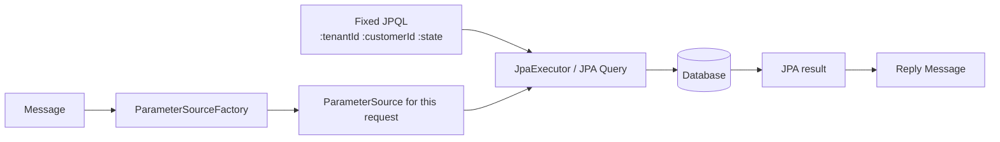
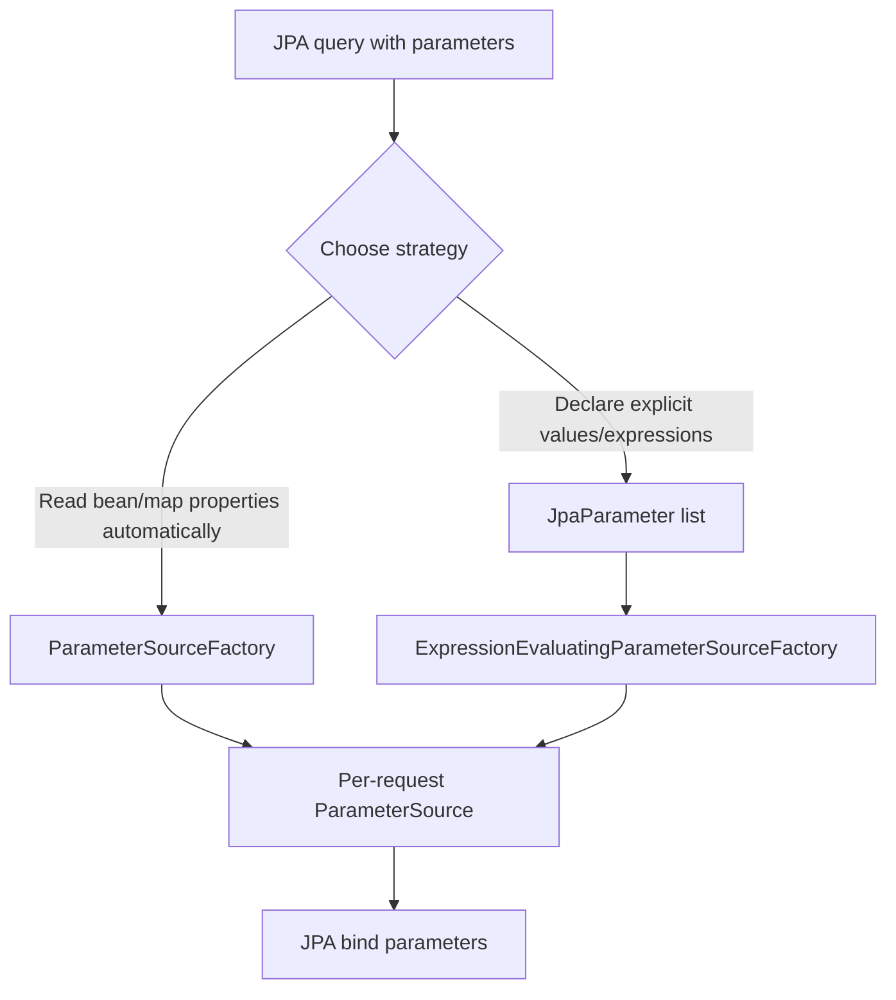
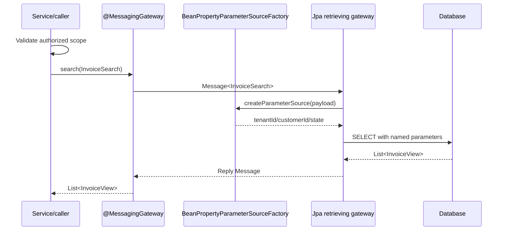
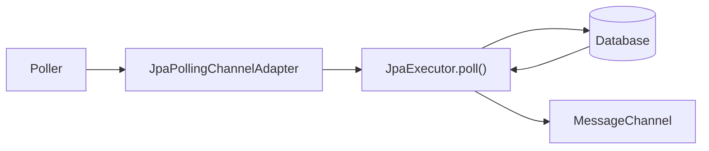
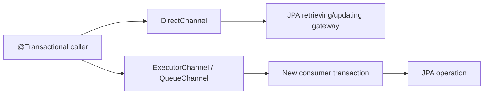

# Parameter Source for JPA Queries

## 1. Context and Goals

In the **SPRING_INTEGRATION_ADAPTERS** module, Spring Integration connects external systems via inbound/outbound adapters, gateways, pollers, and `MessageChannel`. A request may arrive via HTTP, files, SFTP, JMS, AMQP, or Kafka, and then need to query or update a database. To execute a JPA query safely, the endpoint must know **which values bind to each query parameter**.

The **Parameter Source for JPA Queries** lesson belongs to the **Adapter JPA** chapter. Its focus is how Spring Integration turns a **Spring Message** into a **`ParameterSource`** so `JpaExecutor` can bind data for JPQL, named queries, or native SQL.

After this lesson, you will be able to:

- Explain the contract between `JpaExecutor`, `ParameterSourceFactory`, `ParameterSource`, and JPA query parameters.
- Distinguish `BeanPropertyParameterSourceFactory` from `ExpressionEvaluatingParameterSourceFactory`.
- Choose the right way to read values from **JavaBean payloads**, **`Map`s**, **message headers**, or **SpEL expressions**.
- Understand `usePayloadAsParameterSource(true/false)` accurately, including how its default shifts when explicit `JpaParameter` entries are declared.
- Configure named, positional, static, and expression-based parameters with Java DSL, plain `JpaExecutor`, and XML namespaces.
- Implement a custom `ParameterSourceFactory` when the input contract does not match query parameter names directly.
- Build a working example using Spring Boot 3.x, Spring Integration 6.x, Jakarta Persistence, and `@MessagingGateway`.
- Prevent type-mismatch binding errors, missing parameters, cross-tenant data leaks, and untrusted SpEL/SQL injection.
- Unit test parameter sources independently, then integration test the full request–reply JPA flow against a database.
- Design strategies for JPA inbound polling without request messages, transactional updating outbound gateways, and asynchronous flows.

**Key takeaway up front:** a parameter source only decides **which values to bind**; it **does not** authenticate users, enforce authorization, create transactions, or guarantee exactly-once processing.

## 2. Why Do We Need ParameterSource?

JPA supports parameterized queries:

```sql
select i from Invoice i
where i.tenantId = :tenantId
  and i.customerId = :customerId
  and i.state = :state
order by i.id
```

The JPQL string above is defined by the application. Yet each request carries different values:

```text
Request A:
  tenantId   = TENANT-A
  customerId = C-101
  state      = PAID

Request B:
  tenantId   = TENANT-B
  customerId = C-205
  state      = PENDING
```

`JpaExecutor` needs an object answering questions such as: "Does `tenantId` have a value?", "What is the value of `customerId`?", and "If the query uses positional parameters, where do positions 1 and 2 come from?".

`ParameterSource` and `ParameterSourceFactory` solve this.



### Separating Three Responsibilities

| Responsibility | Component | Example |
| --- | --- | --- |
| Define **query syntax** | Query configuration | `where i.tenantId = :tenantId` |
| Supply **parameter values** | `ParameterSource` | `tenantId = "TENANT-A"` |
| Execute and manage transactions | `JpaExecutor`, JPA provider, Spring transaction | `EntityManager.createQuery` / `setParameter` / `getResultList` |

**Never** construct queries like:

```java
// WRONG: never concatenate client data directly into JPQL.
String jpql = "select i from Invoice i where i.tenantId = '"
        + untrustedTenantId + "'";
```

Instead, keep `where i.tenantId = :tenantId` and bind `tenantId` through a parameter source. Binding prevents data from becoming JPQL/SQL syntax, though the application must still enforce tenant authorization.

## 3. Core APIs

Key API types in Spring Integration JPA 6.x:

```java
org.springframework.integration.jpa.core.JpaExecutor

org.springframework.integration.jpa.support.parametersource.ParameterSource
org.springframework.integration.jpa.support.parametersource.ParameterSourceFactory

org.springframework.integration.jpa.support.parametersource.BeanPropertyParameterSourceFactory
org.springframework.integration.jpa.support.parametersource.ExpressionEvaluatingParameterSourceFactory

org.springframework.integration.jpa.support.JpaParameter
```

### 3.1. ParameterSource Is the Value-Lookup Contract

The `ParameterSource` interface provides:

```java
public interface ParameterSource {
    boolean hasValue(String paramName);
    Object getValue(String paramName);
}
```

This snippet simplifies the API to highlight its intent; packages/imports are listed above.

- `hasValue("tenantId")` indicates whether the source provides a parameter named `tenantId`.
- `getValue("tenantId")` returns the value to bind to the JPA query.
- `hasValue(...) == true` **does not** guarantee the value is non-null, properly typed, or authorized for the caller.
- Positional parameters rely on interfaces/implementations supporting positional lookup; do not force positional queries into `getValue(String)` by guessing parameter names.

### 3.2. ParameterSourceFactory Builds a Source Per Input

`ParameterSourceFactory` has the contract:

```java
public interface ParameterSourceFactory {
    ParameterSource createParameterSource(Object input);
}
```

`input` is whatever object `JpaExecutor` hands to the factory—either the **payload** or the **entire Spring Message**, depending on `usePayloadAsParameterSource`.

**A single factory bean may be shared across concurrent requests**, so implementations should be **stateless** or hold only immutable configuration. Never store request A's parameters in a shared mutable `Map` and reuse it for request B. Every `createParameterSource` call should return an independent value source for that input.

### 3.3. Two Common Factories

| Factory | How It Extracts Values | Best Fit |
| --- | --- | --- |
| `BeanPropertyParameterSourceFactory` | JavaBean property introspection; handles certain `Map`/`List` forms | Payload already has properties matching query parameter names |
| `ExpressionEvaluatingParameterSourceFactory` | Evaluates static `JpaParameter` values or SpEL against input | Parameters come from multiple places, need renaming/computation, or read headers |
| Custom factory | Java code explicitly converting input to `ParameterSource` | Complex contracts, legacy mappings, centralized value checks |

**Crucial distinction:** `BeanPropertyParameterSourceFactory` normally needs no explicit `JpaParameter` list; `ExpressionEvaluatingParameterSourceFactory` takes `JpaParameter` definitions and evaluates expressions to produce values.

## 4. BeanPropertyParameterSourceFactory: Reading Values from a JavaBean

This is the simplest strategy when the request payload is a JavaBean whose getters match JPQL parameter names.

### 4.1. JavaBean Example

```java
package com.example.jpaparams;

public final class InvoiceSearch {

    private final String tenantId;
    private final String customerId;
    private final String state;

    public InvoiceSearch(
            String tenantId, String customerId, String state) {
        this.tenantId = tenantId;
        this.customerId = customerId;
        this.state = state;
    }

    public String getTenantId() {
        return tenantId;
    }

    public String getCustomerId() {
        return customerId;
    }

    public String getState() {
        return state;
    }
}
```

Per JavaBeans conventions, these getters expose properties `tenantId`, `customerId`, and `state`. The JPQL query:

```sql
select i from Invoice i
where i.tenantId = :tenantId
  and i.customerId = :customerId
  and i.state = :state
```

has parameter names matching the JavaBean properties.

### 4.2. Calling the Factory Directly to Verify the Contract

```java
import org.springframework.integration.jpa.support.parametersource.BeanPropertyParameterSourceFactory;
import org.springframework.integration.jpa.support.parametersource.ParameterSource;

BeanPropertyParameterSourceFactory factory =
        new BeanPropertyParameterSourceFactory();

InvoiceSearch search = new InvoiceSearch(
        "TENANT-A", "C-101", "PAID");

ParameterSource source =
        factory.createParameterSource(search);

System.out.println(source.hasValue("tenantId")); // true
System.out.println(source.getValue("tenantId"));  // TENANT-A
System.out.println(source.getValue("state"));     // PAID
```

This is a Java API demo and runs no query yet. You need `JpaExecutor`/gateway and a JPA provider to execute actual JPQL.

**Do not confuse a `Java record` with JavaBean getters:** a record `record InvoiceSearch(String tenantId)` has accessor `tenantId()`, whereas bean-property introspection can behave differently across Spring/Java versions. To keep the `BeanPropertyParameterSourceFactory` example predictable, this lesson uses a class with explicit `getTenantId()` methods. For records, choose SpEL expressions `payload.tenantId()` and test on your target version.

### 4.3. Configuring on JpaExecutor

```java
JpaExecutor executor = new JpaExecutor(entityManagerFactory);

executor.setJpaQuery("""
        select i from Invoice i
        where i.tenantId = :tenantId
          and i.customerId = :customerId
          and i.state = :state
        order by i.id
        """);

executor.setParameterSourceFactory(
        new BeanPropertyParameterSourceFactory());

executor.setUsePayloadAsParameterSource(true);
executor.setExpectSingleResult(false);
executor.setMaxNumberOfResults(50);
```

Here:

1. `new JpaExecutor(entityManagerFactory)` uses Spring-managed JPA infrastructure.
2. The fixed query defines three named parameters.
3. `BeanPropertyParameterSourceFactory` reads JavaBean properties from the **payload**.
4. `setUsePayloadAsParameterSource(true)` ensures the factory receives `InvoiceSearch` rather than the `Message` wrapper.
5. `setExpectSingleResult(false)` preserves the list contract.
6. `setMaxNumberOfResults(50)` prevents unbounded row retrieval.

Once a factory is configured to supply all parameters, **do not also attach a separate `JpaParameter` list to the same executor** expecting the framework to merge both sources.

### 4.4. Map as a Parameter Source

`BeanPropertyParameterSourceFactory` also supports `Map` inputs:

```java
import java.util.Map;
import org.springframework.integration.jpa.support.parametersource.BeanPropertyParameterSourceFactory;

var factory = new BeanPropertyParameterSourceFactory();

var source = factory.createParameterSource(Map.of(
        "tenantId", "TENANT-A",
        "customerId", "C-101",
        "state", "PAID"
));

Object tenantId = source.getValue("tenantId");
Object state = source.getValue("state");
```

Map keys must match query parameter names exactly. `Map.of(...)` rejects nulls—convenient for demos, though real nullable filters require an explicit contract.

### 4.5. Static Parameters on BeanProperty Factory

`setStaticParameters(Map<String,Object>)` has an easily overlooked quirk: the Javadoc states static parameters are appended when the **input is a `Map` or `List`**, whereas for an ordinary JavaBean input, this property is **ignored**.

Example with a Map:

```java
var factory = new BeanPropertyParameterSourceFactory();

factory.setStaticParameters(
        Map.of("state", "PAID"));

var source = factory.createParameterSource(
        Map.of(
            "tenantId", "TENANT-A",
            "customerId", "C-101"
        ));

Object state = source.getValue("state"); // PAID
```

If your payload is an `InvoiceSearch` JavaBean and you want `state` fixed to `PAID` regardless of client input, **do not assume `setStaticParameters` overrides bean properties**. Use a constant JPQL predicate `i.state = 'PAID'`, a static `JpaParameter` in the expression-based strategy, or construct a server-canonicalized request object.

## 5. usePayloadAsParameterSource: Choosing the Factory's Input

`usePayloadAsParameterSource` is a critical configuration setting on `JpaExecutor`.

| Value | Input Passed to Factory | Typical Access Style |
| --- | --- | --- |
| `true` | Only `message.getPayload()` | JavaBean `customerId`, `state`; SpEL `#this` when payload is root |
| `false` | Entire Spring `Message<?>` | SpEL `payload.customerId`, `headers['verifiedTenantId']` |

**Default rule per Spring Integration Reference:**

- **Without explicit `JpaParameter` entries:** usually defaults to `true`, since `BeanPropertyParameterSourceFactory` reads properties from the payload.
- **With explicit `JpaParameter` entries:** the default flips to `false`, letting SpEL expressions reach both payload and headers.

To avoid surprises from indirect configuration changes, set `true`/`false` **explicitly** whenever multiple developers share a flow or documentation must make the input clear.

### 5.1. Why Can "payload.customerId" Fail?

Suppose you configure:

```java
new JpaParameter(
        "customerId", null, "payload.customerId");
```

If the root is the Spring Message (`usePayloadAsParameterSource(false)`), `payload.customerId` works.

If the root is `InvoiceSearch` itself (`true`), the expression must be `customerId` (the bean property), because `InvoiceSearch` does not have a property named `payload`.

Failure illustration:

```text
SpEL root = InvoiceSearch
Expression = payload.customerId
            ^^^^^^^
InvoiceSearch has no "payload" property
→ SpelEvaluationException or parameter binding error
```

### 5.2. Need to Read Headers?

To read headers, the root must be the **Message**:

```java
new JpaParameter(
        "tenantId", null,
        "headers['verifiedTenantId']");
```

And configure:

```java
executor.setUsePayloadAsParameterSource(false);
```

However, **a header does not become trustworthy just because its name contains "verified"**. At HTTP/JMS/Kafka ingress, producers could supply arbitrary headers if allowed. Authentication/authorization layers must resolve and enforce scope, then attach the trusted header used by the query.

### 5.3. When to Choose true vs. false?

| Scenario | Recommended Configuration |
| --- | --- |
| Payload is a JavaBean whose getters match parameter names | `BeanPropertyParameterSourceFactory` + `true` |
| Payload is a Map whose keys match parameter names | `BeanPropertyParameterSourceFactory` + `true` |
| Parameter needs renaming from another field | Explicit `JpaParameter` expressions + `false` |
| Must combine payload and headers | Explicit expressions or custom factory + `false` |
| Payload is a single String value | `#this` with `true`, or `payload` with `false` |
| Inbound poller with no request message | Static parameters or server-side factory; never assume `payload` exists |
| Complex multi-field validation needed | Validate/enrich into a DTO before the gateway; use custom factory only when warranted |

## 6. ExpressionEvaluatingParameterSourceFactory and JpaParameter

When parameter names differ from bean properties, or values come from both payload and headers, use **SpEL** expressions.

### 6.1. JpaParameter Represents One Parameter

`JpaParameter` has two key constructors:

```java
new JpaParameter(String name, Object value, String expression);

new JpaParameter(Object value, String expression);
```

The first creates a **named parameter**; the second omits the name, suitable for **positional parameters**.

Examples:

```java
// :tenantId comes from a validated payload field.
new JpaParameter(
        "tenantId", null, "payload.tenantId");

// :state is a server-defined constant.
new JpaParameter(
        "state", "PAID", null);

// :customerId comes from a trusted header.
new JpaParameter(
        "customerId", null,
        "headers['verifiedCustomerId']");

// Positional parameter (unnamed).
new JpaParameter(
        null, "payload.customerId");
```

**Exactly one of `value` or `expression` must be supplied** per the constructor contract. If you need to bind `null` intentionally, design nullable parameter handling and typing carefully; never pass both `value` and `expression` as null.

### 6.2. ExpressionEvaluatingParameterSourceFactory

The expression-evaluating factory exposes:

```java
ExpressionEvaluatingParameterSourceFactory factory =
        new ExpressionEvaluatingParameterSourceFactory();

factory.setParameters(List.of(
        new JpaParameter(
                "tenantId", null,
                "payload.tenantId"),
        new JpaParameter(
                "customerId", null,
                "payload.customerId"),
        new JpaParameter(
                "state", "PAID", null)
));
```

It creates a `ParameterSource` resolving the values defined by each `JpaParameter`. For standard SpEL expressions, the input is the full message when `usePayloadAsParameterSource(false)`.

This is an **alternative** to `JpaExecutor.setJpaParameters(...)`, not a factory to attach alongside another parameter list on the same executor.

### 6.3. Direct Configuration on JpaExecutor

Common Java configuration style:

```java
JpaExecutor executor =
        new JpaExecutor(entityManagerFactory);

executor.setJpaQuery("""
        select i from Invoice i
        where i.tenantId = :tenantId
          and i.customerId = :customerId
          and i.state = :state
        """);

executor.setJpaParameters(List.of(
        new JpaParameter(
                "tenantId", null,
                "payload.tenantId"),
        new JpaParameter(
                "customerId", null,
                "payload.customerId"),
        new JpaParameter(
                "state", "PAID", null)
));

executor.setUsePayloadAsParameterSource(false);
executor.setExpectSingleResult(false);
executor.setMaxNumberOfResults(50);
```

`JpaExecutor` initializes the evaluation machinery from the `JpaParameter` list during the Spring bean lifecycle. When declared as a `@Bean`, Spring runs the lifecycle hooks automatically; you do not need to build SpEL parsers manually for standard setups.

### 6.4. Equivalent Java DSL Style

```java
Jpa.retrievingGateway(entityManagerFactory)
        .jpaQuery("""
                select i from Invoice i
                where i.tenantId = :tenantId
                  and i.customerId = :customerId
                  and i.state = :state
                """)
        .parameterExpression(
                "tenantId", "payload.tenantId")
        .parameterExpression(
                "customerId", "payload.customerId")
        .parameter("state", "PAID")
        .usePayloadAsParameterSource(false)
        .maxResults(50);
```

`parameterExpression` evaluates values as messages pass through the gateway. `parameter("state", "PAID")` pins the state so clients cannot override it.

If using a plain String payload:

```java
// Message payload = "TENANT-A", root is the full Message:
.parameterExpression("tenantId", "payload")

// When payload is selected as the root:
.usePayloadAsParameterSource(true)
.parameterExpression("tenantId", "#this")
```

These two styles illustrate SpEL roots; never combine both groups on a single DSL spec.

## 7. Named Parameters vs. Positional Parameters

### 7.1. Named Parameters

JPQL is clearer with names:

```sql
select i from Invoice i
where i.tenantId = :tenantId
  and i.state = :state
```

Configuration:

```java
.parameterExpression("tenantId", "payload.tenantId")
.parameter("state", "PAID")
```

Named parameters do not depend on declaration order, but **names must match case-sensitively**. `tenantID` and `tenantId` are distinct names.

### 7.2. Positional Parameters

JPQL:

```sql
select i from Invoice i
where i.tenantId = ?1
  and i.state = ?2
```

DSL:

```java
Jpa.retrievingGateway(entityManagerFactory)
        .jpaQuery("""
                select i from Invoice i
                where i.tenantId = ?1
                  and i.state = ?2
                """)
        .parameterExpression("payload.tenantId")
        .parameter("PAID");
```

These are the **unnamed parameter** overloads; declaration order must match the positional indices expected by JPA/the provider.

**Recommendation:** prefer named parameters once queries have more than one or two predicates. Positional parameters remain useful for legacy named/native queries or specific provider requirements.

### 7.3. Do Not Mix Positional Syntaxes Across Standards

JPA positional parameters (`?1`, `?2`) differ from `?` placeholders in plain JDBC SQL frameworks. Native SQL may also vary in named parameter support across Hibernate/JPA providers and databases.

When using native SQL, verify **exact query syntax and binding mechanics** against the target database. Never assume syntax tested on H2 works identically on PostgreSQL, Oracle, or MySQL.

## 8. Custom ParameterSourceFactory

When input schemas do not match query parameter names or legacy structures need normalization, write a custom factory.

**Rule:** a custom factory should handle well-typed value mapping, never replacing authentication/authorization. It must never assemble query strings from request data.

### 8.1. Field-Renaming Factory Example

Suppose the input is:

```java
public record LegacyInvoiceQuery(
        String organizationKey,
        String customerKey,
        String workflowState) {
}
```

While JPQL expects `:tenantId`, `:customerId`, and `:state`. You can write:

```java
package com.example.jpaparams;

import java.util.Map;

import org.springframework.integration.jpa.support.parametersource.BeanPropertyParameterSourceFactory;
import org.springframework.integration.jpa.support.parametersource.ParameterSource;
import org.springframework.integration.jpa.support.parametersource.ParameterSourceFactory;

public final class LegacyInvoiceParameterSourceFactory
        implements ParameterSourceFactory {

    private final BeanPropertyParameterSourceFactory delegate =
            new BeanPropertyParameterSourceFactory();

    @Override
    public ParameterSource createParameterSource(Object input) {
        if (!(input instanceof LegacyInvoiceQuery query)) {
            throw new IllegalArgumentException(
                    "Expected LegacyInvoiceQuery");
        }

        if (query.organizationKey() == null
                || query.organizationKey().isBlank()
                || query.customerKey() == null
                || query.customerKey().isBlank()
                || query.workflowState() == null
                || query.workflowState().isBlank()) {
            throw new IllegalArgumentException(
                    "Invalid legacy query fields");
        }

        Map<String, Object> namedValues = Map.of(
                "tenantId", query.organizationKey(),
                "customerId", query.customerKey(),
                "state", query.workflowState());

        // Create an independent ParameterSource for the current input.
        return delegate.createParameterSource(namedValues);
    }
}
```

In an input-validated flow:

```java
Jpa.retrievingGateway(entityManagerFactory)
        .jpaQuery("""
                select i from Invoice i
                where i.tenantId = :tenantId
                  and i.customerId = :customerId
                  and i.state = :state
                """)
        .parameterSourceFactory(
                new LegacyInvoiceParameterSourceFactory())
        .usePayloadAsParameterSource(true)
        .maxResults(50);
```

This factory only **renames fields** and checks non-blank values. It does not verify that `organizationKey` is an authorized tenant for the caller. In production, attach an **authenticated tenant scope** before entering the flow; otherwise clients could supply arbitrary `organizationKey` values and read another tenant's data.

### 8.2. Custom Factory Reading the Full Spring Message

When inputs require both payload and a **security-verified** header, choose `usePayloadAsParameterSource(false)`:

```java
public final class MessageInvoiceParameterSourceFactory
        implements ParameterSourceFactory {

    private final BeanPropertyParameterSourceFactory delegate =
            new BeanPropertyParameterSourceFactory();

    @Override
    public ParameterSource createParameterSource(Object input) {
        if (!(input instanceof Message<?> message)) {
            throw new IllegalArgumentException(
                    "Expected Spring Message");
        }

        if (!(message.getPayload() instanceof InvoiceSearch search)) {
            throw new IllegalArgumentException(
                    "Expected InvoiceSearch payload");
        }

        Object verifiedTenant =
                message.getHeaders().get("verifiedTenantId");

        if (!(verifiedTenant instanceof String tenant)
                || tenant.isBlank()) {
            throw new IllegalArgumentException(
                    "Missing trusted tenant scope");
        }

        return delegate.createParameterSource(Map.of(
                "tenantId", tenant,
                "customerId", search.getCustomerId(),
                "state", search.getState()
        ));
    }
}
```

This snippet assumes the same `Message`, `Map`, `ParameterSourceFactory`, `ParameterSource`, and `BeanPropertyParameterSourceFactory` imports shown earlier.

**Crucial:** checking that the header **exists** is not enough. Ensure `verifiedTenantId` can only be set by a trusted server-side component and is **stripped/overwritten** on untrusted client ingress. If an attacker can supply that header, the factory becomes an unauthorized data leak.

### 8.3. Avoid Mutable State in Singleton Factories

**Wrong:**

```java
private final Map<String, Object> current = new HashMap<>();

public ParameterSource createParameterSource(Object input) {
    // Writes parameters of request A/B into the same shared map.
    current.put("tenantId", ...);
    return delegate.createParameterSource(current);
}
```

Two concurrent requests can overwrite each other mid-flight and leak data across tenants.

**Right:** allocate a fresh local `Map` inside `createParameterSource(...)` and never hold per-request state on the singleton factory. If caching anything, cache immutable config or query metadata, never user-scoped parameter values.

### 8.4. When Is a Custom Factory Unnecessary?

If you only need to rename fields or combine two simple values, `JpaParameter`/SpEL is shorter and easier to audit. For business validation, validate in a **service/transformer** upstream of the gateway to build a canonical DTO, then use `BeanPropertyParameterSourceFactory`. Custom factories pay off when complex legacy format mapping is reused across flows and thoroughly unit tested.

## 9. Avoid Mixing the Two Binding Mechanisms

Spring Integration provides two relatively independent configuration paths:



In the XML namespace, **`parameter-source-factory` and `<int-jpa:parameter>` elements are mutually exclusive**. Per official documentation, if you supply a custom factory, parameter definitions belong **inside that factory**, not split between the factory and endpoint child elements.

In Java, pick one:

**A — Factory:**

```java
executor.setParameterSourceFactory(
        new BeanPropertyParameterSourceFactory());
executor.setUsePayloadAsParameterSource(true);
```

**B — Explicit parameters:**

```java
executor.setJpaParameters(List.of(
        new JpaParameter(
                "tenantId", null,
                "payload.tenantId"),
        new JpaParameter(
                "state", "PAID", null)
));
executor.setUsePayloadAsParameterSource(false);
```

**C — Factory holding an expression list (when needed):**

```java
ExpressionEvaluatingParameterSourceFactory factory =
        new ExpressionEvaluatingParameterSourceFactory();

factory.setParameters(List.of(
        new JpaParameter(
                "tenantId", null,
                "payload.tenantId"),
        new JpaParameter(
                "state", "PAID", null)
));

executor.setParameterSourceFactory(factory);
executor.setUsePayloadAsParameterSource(false);
```

For any real endpoint, select **one** branch. Never combine A, B, and C expecting them to merge or establish precedence automatically.

## 10. Complete Example: Spring Boot + JPA + ParameterSourceFactory

### 10.1. Problem Statement

We will build an invoice lookup application:

1. A service receives an **authenticated tenant/customer scope**.
2. The service validates the `state` filter and constructs an `InvoiceSearch` JavaBean.
3. `@MessagingGateway` sends `Message<InvoiceSearch>` into an Integration Flow.
4. A JPA retrieving gateway uses **`BeanPropertyParameterSourceFactory`** to extract all three parameters from the payload.
5. JPQL returns `InvoiceView` DTOs via a constructor expression so entities never leak to callers.
6. `@Transactional(readOnly=true)` wraps the synchronous request–reply call.
7. In-memory H2 supplies demo data, with tests verifying zero cross-tenant leakage.

Diagram:



### 10.2. Maven Dependencies

The sample uses Java 17+, Spring Boot 3.x, Spring Integration 6.x, and Jakarta Persistence:

```xml
<dependencies>
    <dependency>
        <groupId>org.springframework.boot</groupId>
        <artifactId>spring-boot-starter</artifactId>
    </dependency>
    <dependency>
        <groupId>org.springframework.boot</groupId>
        <artifactId>spring-boot-starter-data-jpa</artifactId>
    </dependency>
    <dependency>
        <groupId>org.springframework.boot</groupId>
        <artifactId>spring-boot-starter-integration</artifactId>
    </dependency>
    <dependency>
        <groupId>org.springframework.integration</groupId>
        <artifactId>spring-integration-jpa</artifactId>
    </dependency>
    <dependency>
        <groupId>com.h2database</groupId>
        <artifactId>h2</artifactId>
        <scope>runtime</scope>
    </dependency>
    <dependency>
        <groupId>org.springframework.boot</groupId>
        <artifactId>spring-boot-starter-test</artifactId>
        <scope>test</scope>
    </dependency>
</dependencies>
```

Use Spring Boot dependency management/BOM to keep Spring Integration, Hibernate/JPA, and Spring Framework aligned. H2 is strictly a demo database; production requires PostgreSQL/MySQL/Oracle per environment along with schema migrations.

### 10.3. Invoice Entity

File `Invoice.java`:

```java
package com.example.jpaparams;

import java.math.BigDecimal;

import jakarta.persistence.Column;
import jakarta.persistence.Entity;
import jakarta.persistence.Id;
import jakarta.persistence.Index;
import jakarta.persistence.Table;

@Entity
@Table(
    name = "invoice",
    indexes = @Index(
            name = "idx_invoice_scope",
            columnList = "tenant_id, customer_id, state"))
public class Invoice {

    @Id
    @Column(name = "invoice_id", length = 80)
    private String id;

    @Column(name = "tenant_id", nullable = false, length = 80)
    private String tenantId;

    @Column(name = "customer_id", nullable = false, length = 80)
    private String customerId;

    @Column(nullable = false, length = 24)
    private String state;

    @Column(nullable = false, precision = 12, scale = 2)
    private BigDecimal amount;

    protected Invoice() {
        // Jakarta Persistence requires a no-arg constructor.
    }

    public Invoice(
            String id, String tenantId, String customerId,
            String state, BigDecimal amount) {
        this.id = id;
        this.tenantId = tenantId;
        this.customerId = customerId;
        this.state = state;
        this.amount = amount;
    }

    public String getId() {
        return id;
    }

    public String getTenantId() {
        return tenantId;
    }

    public String getCustomerId() {
        return customerId;
    }

    public String getState() {
        return state;
    }

    public BigDecimal getAmount() {
        return amount;
    }
}
```

In JPQL, `Invoice` is the Java entity name, and `tenantId` and `customerId` are Java fields. In physical SQL, the columns are `tenant_id` and `customer_id`. That is the difference between JPQL and native SQL.

### 10.4. Return DTO and Request JavaBean

File `InvoiceView.java`:

```java
package com.example.jpaparams;

import java.math.BigDecimal;

public record InvoiceView(
        String invoiceId,
        String state,
        BigDecimal amount) {
}
```

File `InvoiceSearch.java` (introduced in section 4.1):

```java
package com.example.jpaparams;

public final class InvoiceSearch {

    private final String tenantId;
    private final String customerId;
    private final String state;

    public InvoiceSearch(
            String tenantId, String customerId, String state) {
        this.tenantId = tenantId;
        this.customerId = customerId;
        this.state = state;
    }

    public String getTenantId() {
        return tenantId;
    }

    public String getCustomerId() {
        return customerId;
    }

    public String getState() {
        return state;
    }
}
```

Although `InvoiceSearch` is an immutable JavaBean (no setters), getters suffice for **read-only bean property access** by the parameter source. In production, you can use builders or records, provided you test how the factory resolves properties for your chosen object type.

### 10.5. Repository for Seeding Test Data

File `InvoiceRepository.java`:

```java
package com.example.jpaparams;

import org.springframework.data.jpa.repository.JpaRepository;

public interface InvoiceRepository
        extends JpaRepository<Invoice, String> {
}
```

This repository is for seeding and test assertions. The primary query still executes via the **JPA retrieving outbound gateway** in the Integration Flow.

### 10.6. @MessagingGateway Interface

File `InvoiceLookupGateway.java`:

```java
package com.example.jpaparams;

import java.util.List;
import org.springframework.integration.annotation.MessagingGateway;

@MessagingGateway(
        defaultRequestChannel = "invoiceSearchRequests",
        defaultReplyTimeout = "5000")
public interface InvoiceLookupGateway {

    List<InvoiceView> search(InvoiceSearch query);
}
```

`@MessagingGateway` creates a request Spring Message and waits for a reply. There is no poller here; the query executes when `search(...)` is called. The messaging gateway's reply timeout does not replace a JDBC query timeout, especially on synchronous flows.

### 10.7. IntegrationFlow Using BeanPropertyParameterSourceFactory

File `InvoiceIntegrationConfiguration.java`:

```java
package com.example.jpaparams;

import jakarta.persistence.EntityManagerFactory;

import org.springframework.context.annotation.Bean;
import org.springframework.context.annotation.Configuration;
import org.springframework.integration.config.EnableIntegration;
import org.springframework.integration.dsl.IntegrationFlow;
import org.springframework.integration.jpa.dsl.Jpa;
import org.springframework.integration.jpa.support.parametersource.BeanPropertyParameterSourceFactory;

@Configuration
@EnableIntegration
public class InvoiceIntegrationConfiguration {

    @Bean
    IntegrationFlow invoiceLookupFlow(
            EntityManagerFactory entityManagerFactory) {

        BeanPropertyParameterSourceFactory parameterFactory =
                new BeanPropertyParameterSourceFactory();

        return IntegrationFlow
                .from("invoiceSearchRequests")
                .handle(
                        Jpa.retrievingGateway(entityManagerFactory)
                                .jpaQuery("""
                                        select new com.example.jpaparams.InvoiceView(
                                            i.id, i.state, i.amount)
                                        from Invoice i
                                        where i.tenantId = :tenantId
                                          and i.customerId = :customerId
                                          and i.state = :state
                                        order by i.id
                                        """)
                                .parameterSourceFactory(parameterFactory)
                                .usePayloadAsParameterSource(true)
                                .maxResults(50)
                                .expectSingleResult(false))
                .get();
    }
}
```

**Most important lines:**

```java
.parameterSourceFactory(parameterFactory)
.usePayloadAsParameterSource(true)
```

When a request arrives:

- `JpaExecutor` (configured by Java DSL) calls the factory to build a parameter source for the input.
- Because `true` is set, the factory receives the **`InvoiceSearch` payload**, not the wrapper message.
- Bean properties `tenantId`, `customerId`, and `state` match the named parameters in JPQL.
- The JPA provider binds values cleanly with no JPQL string concatenation.
- The constructor expression returns `InvoiceView` DTOs, avoiding lazy loading and keeping the entity graph internal.
- `maxResults(50)` prevents unbounded result sets.
- `expectSingleResult(false)` maintains list replies; queries with no matching rows return an empty list in Spring Integration 6.x.

**Why use a constructor expression?** This lesson focuses on parameter sources, so skipping an extra transformer step keeps the example concise. If a query returns full entities, map them to DTOs before crossing HTTP/Kafka/JMS or async channels.

### 10.8. Service Validating Conditions Before the Gateway

File `InvoiceSearchService.java`:

```java
package com.example.jpaparams;

import java.util.List;
import java.util.Set;

import org.springframework.stereotype.Service;
import org.springframework.transaction.annotation.Transactional;

@Service
public class InvoiceSearchService {

    private static final Set<String> ALLOWED_STATES =
            Set.of("PAID", "PENDING");

    private final InvoiceLookupGateway gateway;

    public InvoiceSearchService(InvoiceLookupGateway gateway) {
        this.gateway = gateway;
    }

    @Transactional(readOnly = true)
    public List<InvoiceView> findInAuthorizedScope(
            String verifiedTenantId,
            String authorizedCustomerId,
            String requestedState) {

        if (verifiedTenantId == null
                || verifiedTenantId.isBlank()
                || verifiedTenantId.length() > 80
                || authorizedCustomerId == null
                || authorizedCustomerId.isBlank()
                || authorizedCustomerId.length() > 80) {
            throw new IllegalArgumentException(
                    "Invalid authorized scope");
        }

        if (!ALLOWED_STATES.contains(requestedState)) {
            throw new IllegalArgumentException(
                    "Unsupported invoice state");
        }

        InvoiceSearch query = new InvoiceSearch(
                verifiedTenantId,
                authorizedCustomerId,
                requestedState);

        return gateway.search(query);
    }
}
```

**Trust scope:** `verifiedTenantId` and `authorizedCustomerId` in the service represent values **already authenticated/authorized** by the application's security layer. If an HTTP controller passes raw user-supplied query parameters into these two arguments, parameter naming provides zero protection. Production systems must derive tenant/customer scope from the authenticated principal, ACL, or domain authorization service.

`@Transactional(readOnly = true)` wraps the synchronous flow on `DirectChannel`. If an `ExecutorChannel` or `QueueChannel` is inserted, the caller thread's transaction and JPA persistence context do not transfer to the downstream consumer.

### 10.9. Spring Boot Main and application.properties

File `JpaParameterSourceApplication.java`:

```java
package com.example.jpaparams;

import java.math.BigDecimal;
import java.util.List;

import org.springframework.boot.CommandLineRunner;
import org.springframework.boot.SpringApplication;
import org.springframework.boot.autoconfigure.SpringBootApplication;
import org.springframework.context.annotation.Bean;
import org.springframework.integration.annotation.IntegrationComponentScan;

@SpringBootApplication
@IntegrationComponentScan
public class JpaParameterSourceApplication {

    public static void main(String[] args) {
        SpringApplication.run(
                JpaParameterSourceApplication.class, args);
    }

    @Bean
    CommandLineRunner sampleData(
            InvoiceRepository repository,
            InvoiceSearchService service) {

        return args -> {
            if (repository.count() == 0) {
                repository.saveAll(List.of(
                        new Invoice(
                                "INV-101", "TENANT-A", "C-101",
                                "PAID", new BigDecimal("35.00")),
                        new Invoice(
                                "INV-102", "TENANT-A", "C-101",
                                "PENDING", new BigDecimal("42.00")),
                        new Invoice(
                                "INV-103", "TENANT-B", "C-101",
                                "PAID", new BigDecimal("70.00")),
                        new Invoice(
                                "INV-104", "TENANT-A", "C-102",
                                "PAID", new BigDecimal("99.00"))
                ));
            }

            System.out.println("Allowed: "
                    + service.findInAuthorizedScope(
                            "TENANT-A", "C-101", "PAID"));

            System.out.println("Other state: "
                    + service.findInAuthorizedScope(
                            "TENANT-A", "C-101", "PENDING"));

            System.out.println("No rows: "
                    + service.findInAuthorizedScope(
                            "TENANT-A", "C-999", "PAID"));
        };
    }
}
```

File `application.properties`:

```properties
spring.main.web-application-type=none

spring.datasource.url=jdbc:h2:mem:jpa_param_demo;DB_CLOSE_DELAY=-1
spring.datasource.driver-class-name=org.h2.Driver
spring.datasource.username=sa
spring.datasource.password=

spring.jpa.hibernate.ddl-auto=create-drop
spring.jpa.open-in-view=false
logging.level.org.springframework.integration=INFO
```

**Use in-memory H2 and `create-drop` only in exercises**, never for storing production data.

### 10.10. Expected Results

| Request | Reply | Why |
| --- | --- | --- |
| TENANT-A, C-101, PAID | `INV-101` | All three named parameters match |
| TENANT-A, C-101, PENDING | `INV-102` | Different state, same scope |
| TENANT-A, C-999, PAID | `[]` | No matching rows |
| TENANT-A, C-101, PAID | No `INV-103` | That invoice belongs to TENANT-B |
| TENANT-A, C-101, PAID | No `INV-104` | That invoice belongs to C-102 |

**Verification tip:** do not assert only list size; assert specific IDs to catch queries that accidentally drop a tenant/customer predicate or bind the wrong property.

## 11. Replacing the Factory with JpaParameter Expressions

The same application can be configured alternatively so parameters resolve via SpEL rather than bean-property lookup.

**Do not enable this alongside `InvoiceIntegrationConfiguration` from section 10.7 on the same request channel**, as they are alternative handlers.

```java
package com.example.jpaparams;

import jakarta.persistence.EntityManagerFactory;

import org.springframework.context.annotation.Bean;
import org.springframework.context.annotation.Configuration;
import org.springframework.integration.dsl.IntegrationFlow;
import org.springframework.integration.jpa.dsl.Jpa;

@Configuration
public class InvoiceExpressionFlowConfiguration {

    @Bean
    IntegrationFlow invoiceExpressionFlow(
            EntityManagerFactory entityManagerFactory) {

        return IntegrationFlow
                .from("invoiceSearchRequests")
                .handle(
                        Jpa.retrievingGateway(entityManagerFactory)
                                .jpaQuery("""
                                        select new com.example.jpaparams.InvoiceView(
                                            i.id, i.state, i.amount)
                                        from Invoice i
                                        where i.tenantId = :tenantId
                                          and i.customerId = :customerId
                                          and i.state = :state
                                        order by i.id
                                        """)
                                .parameterExpression(
                                        "tenantId", "payload.tenantId")
                                .parameterExpression(
                                        "customerId", "payload.customerId")
                                .parameterExpression(
                                        "state", "payload.state")
                                .usePayloadAsParameterSource(false)
                                .maxResults(50)
                                .expectSingleResult(false))
                .get();
    }
}
```

Key differences:

- `BeanPropertyParameterSourceFactory` is not configured on this endpoint.
- Each named parameter has its own `parameterExpression`.
- With the `Message` root (`false`), `payload.tenantId`/`payload.customerId`/`payload.state` are valid expressions targeting `InvoiceSearch` getters.
- If reading a trusted header later, you can add `headers['verifiedTenantId']`, provided header creation is secured.
- Query text and reply type remain identical.

**Use a factory when payload fields match parameter names; use explicit expressions when mapping, renaming, or combining headers.** There is no need to turn every simple query into SpEL just because the framework supports it.

## 12. Java @ServiceActivator and JpaExecutor Configuration

Java DSL hides executor instantiation details. When explicit bean wiring is preferred:

```java
package com.example.jpaparams;

import jakarta.persistence.EntityManagerFactory;

import org.springframework.context.annotation.Bean;
import org.springframework.context.annotation.Configuration;
import org.springframework.integration.annotation.ServiceActivator;
import org.springframework.integration.jpa.core.JpaExecutor;
import org.springframework.integration.jpa.outbound.JpaOutboundGateway;
import org.springframework.integration.jpa.support.OutboundGatewayType;
import org.springframework.integration.jpa.support.parametersource.BeanPropertyParameterSourceFactory;
import org.springframework.messaging.MessageHandler;

@Configuration
public class InvoiceJpaExecutorConfiguration {

    @Bean
    JpaExecutor invoiceJpaExecutor(
            EntityManagerFactory entityManagerFactory) {

        JpaExecutor executor =
                new JpaExecutor(entityManagerFactory);

        executor.setJpaQuery("""
                select new com.example.jpaparams.InvoiceView(
                    i.id, i.state, i.amount)
                from Invoice i
                where i.tenantId = :tenantId
                  and i.customerId = :customerId
                  and i.state = :state
                order by i.id
                """);

        executor.setParameterSourceFactory(
                new BeanPropertyParameterSourceFactory());

        executor.setUsePayloadAsParameterSource(true);
        executor.setExpectSingleResult(false);
        executor.setMaxNumberOfResults(50);

        return executor;
    }

    @Bean
    @ServiceActivator(inputChannel = "invoiceSearchRequests")
    MessageHandler invoiceRetrievingHandler(
            JpaExecutor invoiceJpaExecutor) {

        JpaOutboundGateway handler =
                new JpaOutboundGateway(invoiceJpaExecutor);

        handler.setGatewayType(
                OutboundGatewayType.RETRIEVING);
        // Handler returns a reply; do not call setProducesReply(false).
        return handler;
    }
}
```

- `JpaExecutor` is managed as a Spring bean so initialization callbacks execute.
- `JpaOutboundGateway` runs in `RETRIEVING` mode, returning results to the `@MessagingGateway` caller.
- To return an affected count after an `UPDATE`, switch to `UPDATING` and update the JPQL, transactions, and return type.
- Calling `setProducesReply(false)` turns the handler into a one-way outbound channel adapter and callers will receive no reply.

**Do not also register the Java DSL handler bean on this channel** unless intentionally designing multiple consumers. On `DirectChannel`, multiple handlers load-balance requests across consumers, causing request A and request B to hit different handlers.

## 13. XML Namespace Configuration

### 13.1. XML Using a Factory Directly

This XML snippet can replace the Java DSL or plain Java configuration in the example:

```xml
<bean id="invoiceParameterSourceFactory"
      class="org.springframework.integration.jpa.support.parametersource.BeanPropertyParameterSourceFactory"/>

<int-jpa:retrieving-outbound-gateway
        id="invoiceRetrievingGateway"
        request-channel="invoiceSearchRequests"
        entity-manager-factory="entityManagerFactory"
        jpa-query="select new com.example.jpaparams.InvoiceView(
                       i.id, i.state, i.amount)
                   from Invoice i
                   where i.tenantId = :tenantId
                     and i.customerId = :customerId
                     and i.state = :state
                   order by i.id"
        parameter-source-factory="invoiceParameterSourceFactory"
        use-payload-as-parameter-source="true"
        max-results="50"
        expect-single-result="false"/>
```

Assumes the XML application context declares the `int` and `int-jpa` namespaces/schemas, `entityManagerFactory`, the request channel, and `@MessagingGateway`. This is only an endpoint configuration snippet.

**Never place `<int-jpa:parameter>` elements inside an endpoint that sets `parameter-source-factory`.** Those are two separate parameter sources and do not merge implicitly.

### 13.2. XML Using Expression-Based Parameters

Alternative configuration:

```xml
<int-jpa:retrieving-outbound-gateway
        id="invoiceRetrievingGatewayExpressions"
        request-channel="invoiceSearchRequests"
        entity-manager-factory="entityManagerFactory"
        jpa-query="select new com.example.jpaparams.InvoiceView(
                       i.id, i.state, i.amount)
                   from Invoice i
                   where i.tenantId = :tenantId
                     and i.customerId = :customerId
                     and i.state = :state"
        use-payload-as-parameter-source="false"
        max-results="50"
        expect-single-result="false">

    <int-jpa:parameter
            name="tenantId"
            expression="payload.tenantId"/>
    <int-jpa:parameter
            name="customerId"
            expression="payload.customerId"/>
    <int-jpa:parameter
            name="state"
            expression="payload.state"/>
</int-jpa:retrieving-outbound-gateway>
```

The three `<int-jpa:parameter>` elements use SpEL on the `Message` root to extract payload properties. When a static value is needed:

```xml
<int-jpa:parameter
        name="state"
        type="java.lang.String"
        value="PAID"/>
```

Use it **instead of** the `state` expression; never declare two parameters with the same name on one gateway.

### 13.3. Positional XML

For the query:

```sql
select i from Invoice i
where i.tenantId = ?1
  and i.state = ?2
```

you can configure:

```xml
<int-jpa:parameter expression="payload.tenantId"/>
<int-jpa:parameter type="java.lang.String" value="PAID"/>
```

Positional parameter definitions omit `name`; **order** must match the query. With multiple predicates, named parameters are usually easier to debug and review.

### 13.4. Java, DSL, and XML Are Three Alternatives

Do not attach all three retrieving handlers to `invoiceSearchRequests` when only one request–reply gateway is wanted. Pick **one** configuration style at runtime; the others here are solely for API comparison.

## 14. Parameter Sources in JPA Inbound Polling

A JPA inbound adapter reads the database on a schedule:



Unlike a retrieving gateway, inbound polling **has no business request message** carrying an `InvoiceSearch` payload or headers.

Consequently, an expression like:

```java
new JpaParameter(
        "tenantId", null, "payload.tenantId");
```

cannot be copied verbatim into a polling source expecting a request payload. For polling, you can:

- Use JPQL without dynamic parameters.
- Use server-defined static parameters.
- Configure a `ParameterSource` suitable for the poll schedule using trusted server-side state.
- If every request message supplies different criteria, use a **JPA retrieving outbound gateway** instead of inbound polling.

### 14.1. Polling with Static Values

```java
JpaExecutor executor =
        new JpaExecutor(entityManagerFactory);

executor.setJpaQuery("""
        select i from Invoice i
        where i.state = :state
        order by i.id
        """);

executor.setJpaParameters(List.of(
        new JpaParameter("state", "PENDING", null)
));

executor.setExpectSingleResult(false);
executor.setMaxNumberOfResults(25);
```

Then you can build `JpaPollingChannelAdapter` and a polling endpoint:

```java
@Bean
@InboundChannelAdapter(
        channel = "pendingInvoices",
        poller = @Poller(
                fixedDelay = "5000",
                maxMessagesPerPoll = "1"))
MessageSource<?> pendingInvoiceSource(
        JpaExecutor invoicePollingExecutor) {

    return new JpaPollingChannelAdapter(
            invoicePollingExecutor);
}
```

This is a separate illustrative snippet. Running it requires declaring `invoicePollingExecutor`, imports, and a consumer channel without colliding with the main demo gateway.

### 14.2. Do Not Confuse maxMessagesPerPoll and maxResults

- `maxMessagesPerPoll=1`: one poll cycle receives at most **one Spring Message** from the source per config.
- `maxResults=25`: the JPA query returns at most **25 rows** per query execution.
- A single message can carry a `List<Invoice>` of many rows.
- If a `state='PENDING'` query does not update/claim rows, the next poll can return **the exact same rows**.

Design state transitions, atomic claims/leases, transactions, idempotency, and error handling when polling drives work processing. A parameter source does not track "already processed rows".

## 15. Parameter Sources for UPDATE/DELETE and Transactions

The same binding techniques apply to the JPA updating outbound gateway.

Example JPQL:

```sql
update Invoice i
   set i.state = 'PAID'
 where i.id = :invoiceId
   and i.tenantId = :tenantId
   and i.state = 'PENDING'
```

DSL fragment:

```java
Jpa.updatingGateway(entityManagerFactory)
        .jpaQuery("""
                update Invoice i
                   set i.state = 'PAID'
                 where i.id = :invoiceId
                   and i.tenantId = :tenantId
                   and i.state = 'PENDING'
                """)
        .parameterExpression(
                "invoiceId", "payload.invoiceId")
        .parameterExpression(
                "tenantId", "payload.tenantId")
        .usePayloadAsParameterSource(false);
```

Here the payload is assumed to be a command DTO with validated `invoiceId`/`tenantId` properties.

An updating gateway typically returns the **affected row count** for JPQL UPDATE/DELETE; e.g., `1` means one row matched `WHERE`, and `0` means none matched. `0` alone cannot distinguish a missing invoice, wrong tenant, already-`PAID` invoice, or a race condition.

### 15.1. Transactions Are Mandatory for Writes

`EntityManager.persist`, `merge`, `remove`, and JPQL UPDATE/DELETE normally require a transaction. Example service calling a gateway:

```java
@Transactional
public int markPaid(AuthorizedPaymentCommand command) {
    Integer affected = paymentGateway.markPaid(command);
    if (affected == null || affected < 0 || affected > 1) {
        throw new IllegalStateException(
                "Unexpected update result: " + affected);
    }
    return affected;
}
```

This snippet assumes `AuthorizedPaymentCommand` and `paymentGateway` exist; it illustrates **transaction boundaries**, not a standalone class in the invoice lookup demo.

With a synchronous `DirectChannel`, the JPA handler can join the caller's transaction. With `ExecutorChannel` or `QueueChannel`, transactions do not propagate to the consumer thread; establish the transaction on the receiving endpoint/service.

### 15.2. Reply, Flush, and Commit Are Distinct

An `Integer(1)` from an updating gateway confirms the JPA operation returned an affected count, **not that an outer transaction committed**. Similarly, `flush()` syncs SQL inside the transaction without replacing `commit()`.

If updates must emit Kafka/JMS events afterward, consider a transactional outbox. When sources support retries/redeliveries, use event IDs and idempotency keys rather than `MessageHeaders.ID`.

### 15.3. Entity Mode Does Not Use parameter-source-factory the Same Way

When an outbound adapter/gateway directly persists/merges/deletes an entity payload, a query `parameter-source-factory` is generally **not used**. Do not configure a factory expecting it to populate entity fields before `persist`. When enrichment or validation is needed, perform it in a transformer/validator **before** the JPA endpoint.

## 16. Nulls, Data Types, and Default Values

### 16.1. Missing Differs from Null

Suppose JPQL has `:state`:

- `hasValue("state") == false`: the factory did not define the parameter; the query may fail due to an unbound parameter.
- `hasValue("state") == true` with value `null`: the parameter exists as null; `i.state = null` is not equivalent to `IS NULL` in SQL three-valued logic.
- `state = ""`: an empty string is a concrete value; validate explicitly.
- `state = "PAID"`: a valid enum-like value passing an allowlist.

If optional null filtering is intentional:

```sql
select i from Invoice i
where (:state is null or i.state = :state)
```

This is a conditional JPQL pattern, but **never** let callers pass null to bypass mandatory boundaries like `tenantId`. Always **reject null tenants** before the gateway.

### 16.2. Parameter Types Must Match Entity Field Types

| Field | Valid Value | Common Error |
| --- | --- | --- |
| `String tenantId` | Validated String | Passing a full principal object or list |
| `Long id` | Long | Passing an unconverted String |
| `Enum status` | Enum instance matching mapping | Passing an arbitrary String JPA does not auto-map |
| `Instant createdAt` | Time type supported by provider | Passing an epoch string without timezone clarity |
| `BigDecimal amount` | BigDecimal | Passing a double with precision loss |
| `Collection<String> ids` | Typed collection when using `IN` | Passing an empty list without defined semantics |

SpEL may coerce types in certain cases, but do not rely on implicit conversion for critical contracts. Prefer validating and constructing a typed DTO in the service.

### 16.3. Collection Parameters and IN

JPQL:

```sql
select i from Invoice i
where i.tenantId = :tenantId
  and i.id in :invoiceIds
```

`invoiceIds` must be a properly typed collection. Databases and providers behave differently when collections are **empty**, huge, or exceed bind-parameter limits.

Cap collection sizes in the service, split into batches if necessary, and short-circuit `empty collection` inputs to an empty result list without hitting the DB when business semantics permit. Never rely on providers to handle arbitrary empty lists uniformly.

### 16.4. Using Static Parameters to Enforce Policy

A query reading only `PAID`:

```java
.parameter("state", "PAID")
```

locks down the state. Yet if `tenantId` comes unauthenticated from a client, the policy remains insecure. Static parameters reduce one degree of freedom, **not authorization**.

## 17. Security: Preventing Injection, Cross-Tenant Leaks, and Dynamic SpEL

### 17.1. Binding Mitigates SQL Syntax Injection, Not IDOR

Given the query:

```sql
select i from Invoice i
where i.tenantId = :tenantId
```

if a user can supply any `tenantId`, SQL binding executes cleanly while reading another tenant's records. That is an authorization/IDOR flaw, not syntax injection.

To defend against it:

1. Authenticate callers at the HTTP/JMS/Kafka boundary.
2. Determine tenant/customer/resource scope from the server-side security context or ACL.
3. Build an internal request DTO holding authorized values.
4. Only then bind parameters via a parameter source.
5. Enforce authorization on outbound results, never exposing raw entity graphs.
6. Set query limits/timeouts, rate limits, and source auditing.
7. Never log tokens, PII, or sensitive payloads when queries fail.

### 17.2. Never Accept SpEL Expressions from Clients

**Wrong:**

```java
String expression = incomingPayload.getExpression();

new JpaParameter(
        "tenantId", null, expression);
```

Allowing clients to write SpEL lets them exploit the evaluation context far beyond "picking a value". Keep **SpEL expressions developer-defined**; requests carry only validated scalars/DTOs.

### 17.3. Parameters Cannot Alter JPQL Structure

A `:sortColumn` parameter **cannot substitute for an entity/property name** in a JPQL `ORDER BY` clause the way value parameters work. For optional sorting, use an enum allowlist mapped to controlled queries/query builders—never concatenate `ORDER BY ` + rawInput.

### 17.4. Never Share Mutable Maps Across Concurrent Requests

Every value mapping created by a factory must remain scoped to the current request. If a singleton factory stores request A's `tenantId` in a mutable field and request B reuses it, race conditions cause cross-tenant leaks even when JPQL has `where i.tenantId = :tenantId`.

**Good design:** immutable request objects + local Maps/fresh `ParameterSource` per call + zero user state in singleton factories.

## 18. Performance, Pagination, and Transaction Boundaries

### 18.1. Query Limits Must Still Be Configured

A parameter source **does not** cap returned rows. On retrieving gateways, configure `maxResults(50)` or validated dynamic pagination. Unbounded SELECTs load too many managed entities into the persistence context, consume heap, trigger N+1 queries, and exhaust connection pools.

### 18.2. Is Dynamic Pagination a ParameterSourceFactory?

`maxResultsExpression` and `firstResultExpression` also evaluate SpEL against messages, yet they control **query properties** (limit/offset) rather than `:namedParameter` values inside JPQL. They are separate configuration layers.

Example:

```java
Jpa.retrievingGateway(entityManagerFactory)
        .jpaQuery("""
                select i from Invoice i
                where i.tenantId = :tenantId
                order by i.id
                """)
        .parameterExpression(
                "tenantId", "payload.tenantId")
        .firstResultExpression("payload.offset")
        .maxResultsExpression("payload.limit");
```

This assumes the payload DTO exposes JavaBean properties `tenantId`, `offset`, and `limit`. The service must cap `limit` (e.g., max 50) and enforce non-negative offsets before sending. **Never configure `maxResults` and `maxResultsExpression` together expecting the minimum of the two.**

### 18.3. DTO Projections and Lazy Loading

With Hibernate/JPA, queried entities become detached once the transaction closes. If downstream work on another thread accesses a `LAZY` association, `LazyInitializationException` can occur.

The main example uses a JPQL constructor expression returning `InvoiceView`. This immutable DTO travels safely across HTTP/JMS/Kafka and asynchronous channels.

### 18.4. DirectChannel vs. Async Channels



- `DirectChannel` usually runs the handler on the same thread, joining the caller's transaction.
- `QueueChannel`/`ExecutorChannel` cross thread boundaries; caller transactions and persistence contexts **do not propagate**.
- JPA write operations must run inside an active transaction in the right place.
- Gateway reply timeout is not a JDBC query timeout.
- When Kafka/JMS sources redeliver, the parameter source is rebuilt for the new message; business idempotency remains a separate concern.

### 18.5. Metrics and Observability

| Suggested Metric | Question Answered |
| --- | --- |
| `jpa_query_requests_total` | How many requests enter the gateway? |
| `jpa_query_duration_seconds` | How long do queries take? |
| `jpa_query_binding_failures_total` | How many parameter/SpEL errors occur? |
| `jpa_query_empty_results_total` | How many requests return zero rows? |
| `jpa_query_rows_returned` | Are queries returning excessive data? |
| `jpa_query_timeout_total` | Are DB/driver/provider timeouts occurring? |
| `jpa_query_page_limit_rejections_total` | How many requests hit page limits? |
| `db_connection_pool_active` | Is the pool overloaded? |
| `jpa_update_conflicts_total` | Are `affected=0` outcomes due to business conflicts? |
| `integration_error_messages_total` | Where are errors occurring by endpoint/channel? |

Avoid using `tenantId`, `customerId`, or `invoiceId` as default metric labels due to high cardinality and sensitivity. Use protected trace IDs/logs instead of dumping full payloads.

## 19. Error Handling and Troubleshooting

| Symptom | Cause to Check | Fix |
| --- | --- | --- |
| JPQL reports "parameter not bound" | `:parameter` missing from source or source yields no value | Match JPQL names with `hasValue`/getters/Map keys |
| `SpelEvaluationException` looking up `payload` | Root is payload while expression uses `payload.xxx` | Set `usePayloadAsParameterSource(false)` or adjust expression |
| `BeanPropertyParameterSourceFactory` misses property | JavaBean lacks standard getter or name differs | Provide standard `getXxx()` or use explicit SpEL |
| Static `state` ignored for bean payload | `setStaticParameters` only augments Map/List inputs | Use a static `JpaParameter` or canonical DTO |
| `Long` parameter receives String | Type mismatch in binding | Parse/validate as `Long` in service |
| JPQL references `purchase_order` | Confusing SQL table with JPQL entity | Use `Invoice` and Java field names |
| Native SQL returns `Object[]` | No result mapping declared | Use an appropriate result mapping/projection |
| Record payload with non-JavaBean accessors | Introspection differs from getters | Test the factory or use explicit `payload.foo()` |
| Query returns another tenant's rows | Client-supplied tenant or missing predicate | Authenticated scope + `WHERE` tenant filter |
| Zero rows yet caller hits timeout | Filter drops reply, older version/mode, misrouted channel | Return empty list reply or explicit not-found reply |
| Query returns huge row counts | Missing `maxResults`/pagination | Cap server-side and add indexes |
| `ParameterSourceFactory` race condition | Factory holds a shared mutable Map | Create a fresh Map/ParameterSource per request |
| `TransactionRequiredException` | JPA write runs outside a transaction | Add `@Transactional` or consumer-side endpoint advice |
| Slow query despite short reply timeout | Messaging timeout does not cancel DB query | Set DB/JDBC query timeout, pool limits, indexes |
| Inbound adapter fails to read payload param | Polling source has no request Message | Use static/server-side params or a retrieving gateway |
| Two consumers return inconsistent results | Multiple unintended handlers on one channel | Register only one endpoint per request flow |
| Update replies 1 yet DB rolls back | Gateway reply is not outer commit | Check transaction boundary and commit exceptions |

### Quick Debug Checklist

1. Which endpoint uses `JpaExecutor`: inbound, outbound adapter, retrieving, or updating gateway?
2. Which named parameters appear in JPQL, and do they match the source spelling?
3. Which `ParameterSourceFactory` is active?
4. Is `usePayloadAsParameterSource` `true` or `false`? Did explicit parameters change the default?
5. Is the factory actually receiving the payload DTO/Map or the full `Message`?
6. Does `ParameterSource.hasValue(name)` return true, and is `getValue(name)` the right type?
7. Are explicit `JpaParameter` entries mixed with a custom factory?
8. Was the tenant header set by a trusted component or copied from the client?
9. Does the query use JPQL entity/field names or native table/column names?
10. Is an active transaction wrapping `UPDATE`/`DELETE`?
11. Are empty lists returned cleanly as normal replies?
12. Are query sizes, page limits, timeouts, and indexes bounded and tested?

## 20. Testing ParameterSourceFactory

### 20.1. Unit Testing BeanPropertyParameterSourceFactory

No database is needed to verify parameter name mapping:

```java
package com.example.jpaparams;

import static org.assertj.core.api.Assertions.assertThat;

import org.junit.jupiter.api.Test;
import org.springframework.integration.jpa.support.parametersource.BeanPropertyParameterSourceFactory;
import org.springframework.integration.jpa.support.parametersource.ParameterSource;

class BeanPropertyParameterSourceFactoryTest {

    @Test
    void resolvesValuesFromJavaBean() {
        var factory = new BeanPropertyParameterSourceFactory();

        var input = new InvoiceSearch(
                "TENANT-A", "C-101", "PAID");

        ParameterSource source =
                factory.createParameterSource(input);

        assertThat(source.hasValue("tenantId")).isTrue();
        assertThat(source.getValue("tenantId"))
                .isEqualTo("TENANT-A");
        assertThat(source.getValue("customerId"))
                .isEqualTo("C-101");
        assertThat(source.getValue("state"))
                .isEqualTo("PAID");
    }

    @Test
    void doesNotInventMissingProperty() {
        var factory = new BeanPropertyParameterSourceFactory();

        var source = factory.createParameterSource(
                new InvoiceSearch(
                        "TENANT-A", "C-101", "PAID"));

        assertThat(source.hasValue("unknownField")).isFalse();
    }
}
```

This test proves the factory extracts values from the JavaBean under matching names. It **does not** prove JPQL, transactions, or authorization are correct.

### 20.2. Unit Testing Static Parameters with Map

```java
import static org.assertj.core.api.Assertions.assertThat;

import java.util.Map;
import org.junit.jupiter.api.Test;
import org.springframework.integration.jpa.support.parametersource.BeanPropertyParameterSourceFactory;

class StaticParameterSourceFactoryTest {

    @Test
    void addsStaticParametersForMapInput() {
        var factory = new BeanPropertyParameterSourceFactory();

        factory.setStaticParameters(
                Map.of("state", "PAID"));

        var source = factory.createParameterSource(
                Map.of(
                        "tenantId", "TENANT-A",
                        "customerId", "C-101"
                ));

        assertThat(source.getValue("state"))
                .isEqualTo("PAID");
        assertThat(source.getValue("tenantId"))
                .isEqualTo("TENANT-A");
    }
}
```

This is important to test when switching between JavaBeans and Maps or handling legacy payloads. Never assume `setStaticParameters` behaves identically for every input type.

### 20.3. Unit Testing a Custom Factory

```java
import static org.assertj.core.api.Assertions.assertThat;

import org.junit.jupiter.api.Test;

class LegacyInvoiceParameterSourceFactoryTest {

    @Test
    void mapsLegacyNamesToJpaNames() {
        var factory = new LegacyInvoiceParameterSourceFactory();

        var source = factory.createParameterSource(
                new LegacyInvoiceQuery(
                        "TENANT-A", "C-101", "PAID"));

        assertThat(source.getValue("tenantId"))
                .isEqualTo("TENANT-A");
        assertThat(source.getValue("customerId"))
                .isEqualTo("C-101");
        assertThat(source.getValue("state"))
                .isEqualTo("PAID");
    }
}
```

Add tests for wrong input types, null/blank fields, concurrent calls, spoofed tenant inputs, and incomplete parameter mappings.

### 20.4. Full-Flow Testing with SpringBootTest

File `InvoiceIntegrationTest.java`:

```java
package com.example.jpaparams;

import static org.assertj.core.api.Assertions.assertThat;

import java.math.BigDecimal;
import java.util.List;
import java.util.UUID;

import org.junit.jupiter.api.Test;
import org.springframework.beans.factory.annotation.Autowired;
import org.springframework.boot.test.context.SpringBootTest;

@SpringBootTest
class InvoiceIntegrationTest {

    @Autowired
    InvoiceRepository repository;

    @Autowired
    InvoiceSearchService service;

    @Test
    void bindsAllThreeQueryParameters() {
        String customer = "test-" + UUID.randomUUID();

        repository.saveAllAndFlush(List.of(
                new Invoice(
                        "a-" + UUID.randomUUID(),
                        "TENANT-A", customer, "PAID",
                        new BigDecimal("10.00")),
                new Invoice(
                        "b-" + UUID.randomUUID(),
                        "TENANT-A", customer, "PENDING",
                        new BigDecimal("20.00")),
                new Invoice(
                        "c-" + UUID.randomUUID(),
                        "TENANT-B", customer, "PAID",
                        new BigDecimal("30.00"))));

        List<InvoiceView> result =
                service.findInAuthorizedScope(
                        "TENANT-A", customer, "PAID");

        assertThat(result).hasSize(1);
        assertThat(result.get(0).amount())
                .isEqualByComparingTo(new BigDecimal("10.00"));
    }

    @Test
    void returnsEmptyListWhenNoRowsMatch() {
        List<InvoiceView> result =
                service.findInAuthorizedScope(
                        "TENANT-A",
                        "none-" + UUID.randomUUID(),
                        "PAID");

        assertThat(result).isEmpty();
    }
}
```

`@SpringBootTest` initializes `JpaExecutor`, the JPA provider, `DataSource`, and the message flow. `saveAllAndFlush(...)` seeds test data. Since the service returns DTOs after querying, tests do not depend on managed entities living outside a transaction.

### 20.5. Extended Test Matrix

| Scenario | Expected Outcome |
| --- | --- |
| JavaBean getters with matching names | Named params bind accurately |
| Map with matching keys | Query receives corresponding values |
| Missing key/property | Clear binding or validation error |
| Static parameter with Map | Value provided per `setStaticParameters` |
| Static parameter with JavaBean | Do not assume injection; verify contract |
| SpEL payload root with `customerId` | Reads bean property properly |
| SpEL Message root with `payload.customerId` | Reads payload properly |
| Expression reading `headers['verifiedTenantId']` | Uses only trusted server-set header |
| Named parameter case mismatch | Caught as configuration error |
| Positional parameters out of order | Tests catch wrong results or binding error |
| Record payload | Use method-call SpEL or verify introspection |
| Factory with mutable state | Concurrency test catches cross-request bleed |
| Different tenant sharing same customer ID | Never returns cross-tenant data |
| Query matches 0 rows | Empty list reply (6.x retrieving mode) |
| JPA UPDATE lacking transaction | Explicit failure; never ACKs success |
| Native query | Mapping and positional/named binding verified on real DB |
| Large query | Limits/indexes/timeouts bound resources |

In production, use Testcontainers or a PostgreSQL/MySQL/Oracle-equivalent environment since H2 differs in SQL dialect, data types, transaction isolation, and query behavior.

## 21. Practice Exercises

### Exercise A — JavaBean vs. Map

Write JPQL with three named parameters `:tenantId`, `:customerId`, `:state`. Invoke `BeanPropertyParameterSourceFactory` with an `InvoiceSearch` JavaBean and with a `Map`. Write `hasValue`/`getValue` unit tests and explain how behavior differs when a Map omits a key.

### Exercise B — Static Parameters and SpEL

Restrict the query to "fetch only `PAID`". Try `setStaticParameters(Map.of("state","PAID"))` with both a Map and a JavaBean, comparing results. Then use `JpaParameter("state","PAID",null)` and verify the explicit strategy with a request message.

### Exercise C — usePayloadAsParameterSource true/false

Create two alternative endpoints: one using `BeanPropertyParameterSourceFactory + true`, and one using `JpaParameter` expressions `payload.tenantId`/`headers['verifiedTenantId']` with `false`. Deliberately misconfigure the root to observe `SpelEvaluationException`; fix it and explain why.

### Exercise D — Custom ParameterSourceFactory

Write a factory for `LegacyInvoiceQuery(organizationKey, customerKey, workflowState)` mapping to the three query parameter names. Test invalid input types, nulls, blanks, and concurrent calls, ensuring the factory holds zero shared mutable request state. Explain why the factory does **not** authenticate the tenant itself.

### Exercise E — JPA Inbound vs. Retrieving Gateway

A JPA inbound adapter polls all `PENDING` invoices with a static parameter. A retrieving gateway accepts `InvoiceSearch` to filter by tenant/customer. Compare request message presence, parameter source creation, polling cadence, empty results, and processed-row tracking strategies.

### Exercise F — End-to-End with HTTP/Kafka/JMS

An HTTP request or Kafka/JMS event queries invoices within an authenticated tenant. Design authentication, DTO mapping, `ParameterSourceFactory`, JPA query, pagination/timeouts, error channel, response/outbound adapter, and metrics. Trigger retries/redeliveries, evaluate idempotency, and explain why a successful read query does not prove downstream received the message.

**Completion criteria:** you can pick the right factory, distinguish payload vs. Message inputs, bind named/positional/static/SpEL parameters with proper types, enforce tenant scope and query limits, and test the entire request → JPA gateway → reply path.

## 22. Summary

- `ParameterSource` supplies `hasValue` and `getValue` for JPA parameters.
- `ParameterSourceFactory` builds a value source per request input; never keep request data in shared mutable state.
- `BeanPropertyParameterSourceFactory` fits when JavaBean/Map inputs match named parameter names.
- `ExpressionEvaluatingParameterSourceFactory` uses `JpaParameter` with static values or SpEL expressions.
- `usePayloadAsParameterSource(true)` passes the payload to the factory; `false` passes the entire `Message` to expose both payload and headers.
- Without explicit parameters, it usually defaults to `true`; with `JpaParameter`, the default shifts to `false`.
- `setStaticParameters` on the BeanProperty factory has special behavior for Map/List inputs; do not assume it overrides JavaBean properties.
- Named parameters are generally more maintainable than positional parameters; query and source must match names and types.
- `parameter-source-factory` and `<int-jpa:parameter>` in XML are mutually exclusive.
- Query text and SpEL expressions are **developer-authored configuration**; never accept dynamic code/queries from clients.
- Value binding prevents syntax injection, yet **never replaces authentication/authorization**.
- For JPA inbound pollers with no request message, do not assume `payload` exists as in a retrieving outbound gateway.
- For JPA UPDATE/DELETE, use transactions, handle affected counts, and never equate reply/flush with DB commit.
- DTOs, query limits, indexes, timeouts, idempotency, and metrics remain essential for production JPA Integration Flows.

## References

- [Spring Integration 6.5 — JPA Outbound Gateways](https://docs.spring.io/spring-integration/reference/6.5/jpa/outbound-gateways.html)
- [Spring Integration 6.5 — JPA Namespace Support](https://docs.spring.io/spring-integration/reference/6.5/jpa/namespace-support.html)
- [Spring Integration 6.5 — JPA Java Implementation](https://docs.spring.io/spring-integration/reference/6.5/jpa/java-implementation.html)
- [Spring Integration 6.5 — JPA Inbound Adapter](https://docs.spring.io/spring-integration/reference/6.5/jpa/inbound-channel-adapter.html)
- [Spring Integration API — ParameterSource](https://docs.spring.io/spring-integration/docs/6.5.0/api/org/springframework/integration/jpa/support/parametersource/ParameterSource.html)
- [Spring Integration API — ParameterSourceFactory](https://docs.spring.io/spring-integration/docs/6.5.0/api/org/springframework/integration/jpa/support/parametersource/ParameterSourceFactory.html)
- [Spring Integration API — BeanPropertyParameterSourceFactory](https://docs.spring.io/spring-integration/docs/6.5.0/api/org/springframework/integration/jpa/support/parametersource/BeanPropertyParameterSourceFactory.html)
- [Spring Integration API — ExpressionEvaluatingParameterSourceFactory](https://docs.spring.io/spring-integration/docs/6.5.0/api/org/springframework/integration/jpa/support/parametersource/ExpressionEvaluatingParameterSourceFactory.html)
- [Spring Integration API — JpaParameter](https://docs.spring.io/spring-integration/docs/6.5.0/api/org/springframework/integration/jpa/support/JpaParameter.html)
- [Spring Integration API — JpaExecutor](https://docs.spring.io/spring-integration/docs/6.5.0/api/org/springframework/integration/jpa/core/JpaExecutor.html)
- [Spring Integration API — JpaBaseOutboundEndpointSpec](https://docs.spring.io/spring-integration/docs/6.5.0/api/org/springframework/integration/jpa/dsl/JpaBaseOutboundEndpointSpec.html)
- [Spring Framework Reference — Spring Expression Language](https://docs.spring.io/spring-framework/reference/core/expressions.html)
- [Spring Framework Reference — Transactions](https://docs.spring.io/spring-framework/reference/data-access/transaction.html)
- [Jakarta Persistence Specification](https://jakarta.ee/specifications/persistence/)
