# Flush, Clear, and Transaction Boundaries

## 1. Context and Goals

In the **SPRING_INTEGRATION_ADAPTERS** module, Spring Integration connects external systems via inbound/outbound adapters, gateways, pollers, and `MessageChannel`. A message arriving from a file, SFTP, HTTP, JMS, AMQP, or Kafka can carry an entity, a list of entities, or a database update command. When using **Adapter JPA** to write or query, three questions determine whether the flow is correct:

1. **When are entity changes synchronized into SQL?** — `flush`.
2. **When does JPA stop tracking entities in the persistence context?** — `clear`, `detach`, or when the context ends.
3. **When do changes actually commit or roll back?** — the **transaction boundary**.

This lesson, **Flush, Clear, and Transaction Boundaries**, distinguishes those three moments, especially when a `MessageChannel` passes data across multiple handlers or threads. The content applies to Java 17+, Spring Boot 3.x, Spring Integration 6.x, and Jakarta Persistence.

After this lesson, you will be able to:

- Explain `EntityManager.flush()`, `clear()`, `detach()`, `refresh()`, `commit()`, and their differences.
- Understand the first-level cache, dirty checking, managed/detached states, and how `clear` affects unflushed changes.
- Configure `JpaExecutor.setFlush(...)`, `setFlushSize(...)`, and `setClearOnFlush(...)` with accurate semantics.
- Distinguish `flush-size` from JDBC batch size, Spring Message counts, commit counts, and records per chunk.
- Place transaction boundaries at `@Transactional` services, JPA endpoint advice, or pollers.
- Recognize the difference between synchronous `DirectChannel` and asynchronous `ExecutorChannel`/`QueueChannel`.
- Build a Spring Boot/H2 application with a JPA outbound adapter accepting an `Iterable` and performing batch flush/clear.
- Test commits, rollbacks when an entity fails, duplicate events, detached entities, and multi-chunk imports.
- Understand why a `JPA gateway reply`, `MessageChannel.send(...)`, and Kafka/JMS ACKs do not equate to a DB commit.
- Design safe batching, retries, outboxes, and monitoring in message-driven systems.

> **Principle:** `flush` synchronizes persistence context state with the database **inside the current transaction**; `clear` removes entities from the context; **only a successful commit finalizes a DB transaction**. These three actions do not substitute for one another.

## 2. Three State Layers to Distinguish

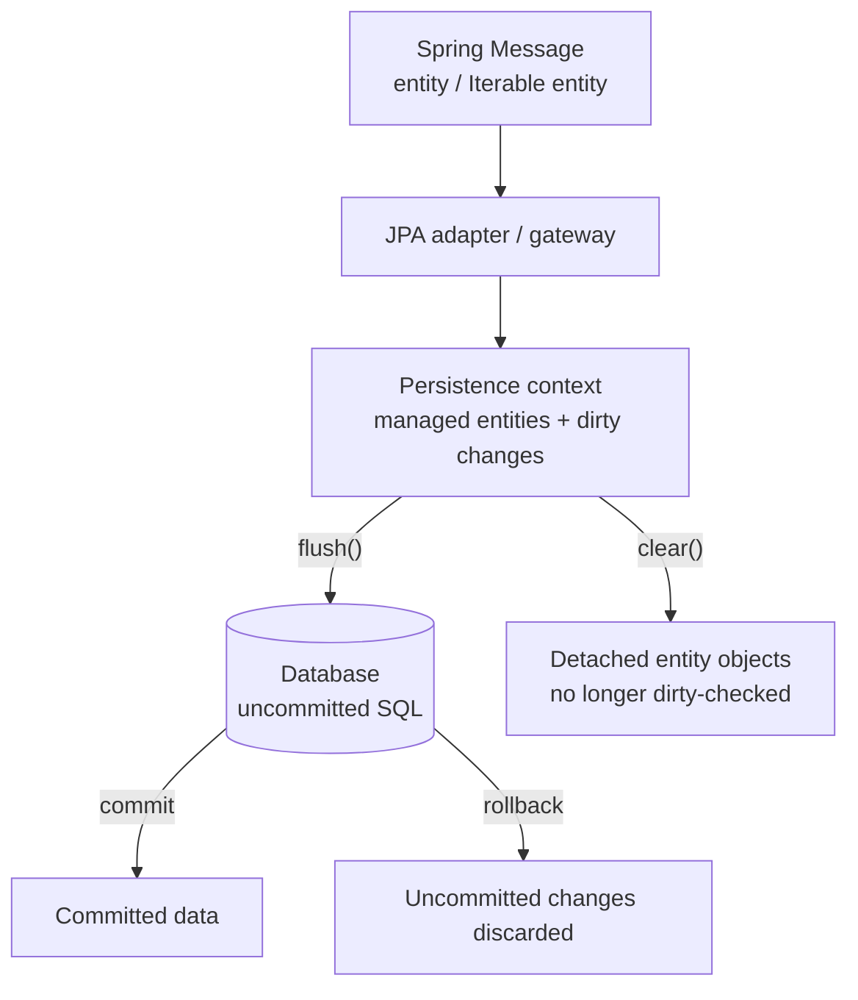

| Operation | Affected Target | Runs SQL Immediately? | Commits? |
| --- | --- | --- | --- |
| `persist(entity)` | Entity / persistence context | May run immediately or be deferred depending on provider/ID strategy | Does not commit on its own |
| Mutate a managed entity | Java object in persistence context | Usually waits for flush/commit | No |
| `flush()` | **Pending changes** in the same context | Yes, to sync with DB | **No** |
| `clear()` | **All managed entities** in the context | Does not trigger writes | **No** |
| `detach(entity)` | One entity instance | Does not trigger writes | No |
| `refresh(entity)` | One managed entity | May re-SELECT from DB | No |
| `commit()` | Database transaction | May trigger flush, then commits | **Yes, if successful** |
| `rollback()` | Database transaction | Discards uncommitted SQL | No |
| `MessageChannel.send()` | Channel and subscriber/handler | Depends on handler | Does not prove commit |

Some providers emit SQL before an explicit `flush()`, for example due to ID generation strategies or auto-flushing before a query. Therefore, never infer "flush wasn't called, so no SQL ran." The invariant to remember: **already-executed SQL can still roll back**.

### 2.1. Flush Is Not "Write File", Clear Is Not "Truncate Table"

The same words appear in JDBC, Kafka, file adapters, and JPA with different meanings:

- **JPA `EntityManager.flush()`:** syncs the persistence context's unit of work with the DB.
- **JDBC batch flush/`executeBatch`:** sends a batch of statements from driver to database.
- **Kafka producer flush:** waits for buffered producer records to complete per Kafka semantics.
- **File flush:** pushes buffers to the filesystem/stream per API.
- **JPA `EntityManager.clear()`:** detaches entities from the persistence context—**never** executes `DELETE FROM ...`.

This lesson uses flush/clear solely in the **Jakarta Persistence and Spring Integration JPA** sense unless JDBC/brokers are named explicitly.

## 3. Persistence Context and Dirty Checking

The persistence context tracks entity instances by entity identity. A JPA transaction usually owns a corresponding transaction-scoped context. Inside it, the JPA provider tracks state, generates SQL on flush, and maintains the first-level cache.

### 3.1. Entity Lifecycle

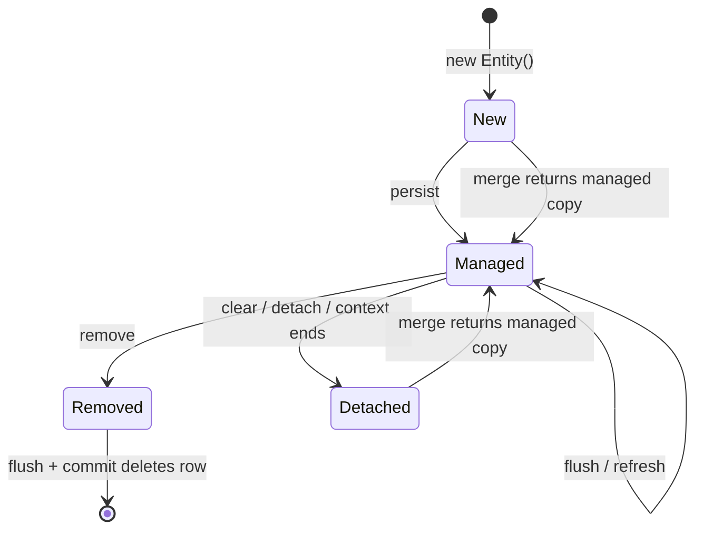

| State | `em.contains(entity)` in Right Context | Do Field Edits Auto-Flush? |
| --- | --- | --- |
| New/transient | `false` | No |
| Managed | `true` | Yes, via dirty checking |
| Detached | `false` | No; must load/merge a managed object deliberately |
| Removed | Per context/provider state | Row scheduled for deletion, not yet committed |

**Note on merge:** `EntityManager.merge(detached)` returns a **managed instance**, without guaranteeing the passed instance becomes managed. When merging, use the returned instance if you continue mutating it in the transaction.

### 3.2. Dirty Checking

```java
@Service
public class InventoryService {

    @PersistenceContext
    private EntityManager em;

    @Transactional
    public void reserve(String sku) {
        InventoryItem item =
                em.find(InventoryItem.class, sku);

        if (item == null) {
            throw new IllegalArgumentException("SKU not found");
        }

        item.setState("RESERVED");
        // item is managed: calling merge/save is not strictly needed.
        // JPA checks dirty state automatically at flush/commit.
    }
}
```

This snippet assumes `@Entity InventoryItem` and an appropriate Spring transaction manager. If you modify an entity instance outside a transaction after it became detached, those edits **are not written automatically**.

### 3.3. First-Level Cache Is Not an Application-Wide Cache

An entity with key `SKU-1` resolves to the same Java instance inside transaction A:

```java
InventoryItem a = em.find(InventoryItem.class, "SKU-1");
InventoryItem b = em.find(InventoryItem.class, "SKU-1");
boolean same = a == b; // true in the same persistence context
```

Transaction B has a separate persistence context and creates a different Java instance for the same row. `clear()` drops managed references from context A, **without** deleting rows in the DB or clearing the provider's second-level cache in the same way.

## 4. EntityManager.flush(): When and Why?

### 4.1. Syncing Pending Changes

```java
@Transactional
public void createAndValidate(Receipt receipt) {
    em.persist(receipt);
    em.flush();  // Pushes pending INSERT/UPDATE/DELETE to database.
    // Transaction is still open.
}
```

`flush()` surfaces certain errors earlier:

- Primary-key or unique constraint violations.
- NOT NULL or foreign-key constraint errors.
- Optimistic locking conflicts detected at flush.
- SQL syntax/dialect errors or other provider constraints.

Not every failure appears at flush, however: deferred constraints, deadlocks, connection drops, or concurrent transactions can still make **commit fail**.

### 4.2. Timeline

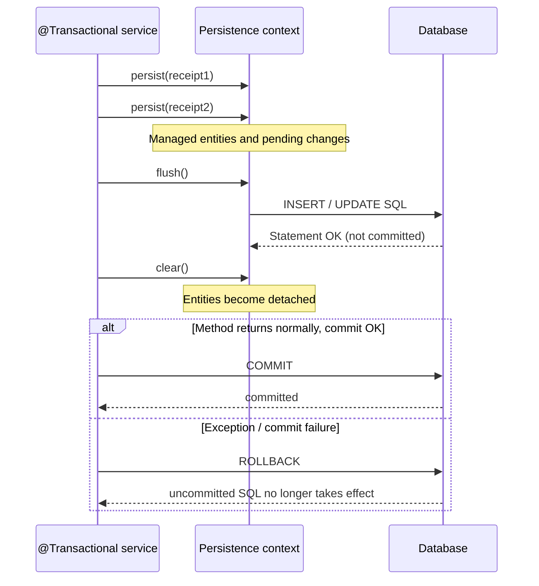

### 4.3. FlushModeType.AUTO and COMMIT

```java
em.setFlushMode(FlushModeType.AUTO);
em.setFlushMode(FlushModeType.COMMIT);
```

- `AUTO` is the typical default. The JPA provider may sync pending changes before queries requiring consistency.
- `COMMIT` defers flushing until commit; whether pre-commit queries see pending changes depends on JPA/provider rules and should not be guessed.
- Explicit `flush()` still forces immediate synchronization inside the transaction.

Never switch to `COMMIT` or disable auto-flush just to "speed things up" without measuring SQL, locks, query results, and inconsistency risks.

### 4.4. Flush Does Not Create a Transaction

Running this outside a transaction is **unsafe**:

```java
em.persist(receipt);
em.flush();
```

A Spring-managed EM can throw `TransactionRequiredException` without an active JPA transaction. `flush()` neither starts nor commits a transaction.

## 5. EntityManager.clear(): Real Effect and Risks

`clear()` **detaches every managed entity in that persistence context**, dropping dirty-state tracking for them. It does not execute SQL DELETE, does not roll back, and does not flush automatically.

### 5.1. Classic Mistake: clear Before flush

```java
@Transactional
public void wrongSequence(String sku) {
    InventoryItem item =
            em.find(InventoryItem.class, sku);

    item.setState("RESERVED");
    em.clear();

    // Not flushed: changes may never be written to the DB.
}
```

Understand that `clear` discards unflushed pending changes for detached entities. When clearing is necessary, determine whether `flush()` must precede it.

### 5.2. Proper Sequence: flush Then clear

```java
@Transactional
public void explicitFlushThenClear(String sku) {
    InventoryItem item =
            em.find(InventoryItem.class, sku);

    item.setState("RESERVED");

    em.flush();               // SQL may run, not committed yet.
    boolean before = em.contains(item); // true

    em.clear();
    boolean after = em.contains(item);  // false

    assert before && !after;
}
```

After `clear`, `item` remains on the heap and already-loaded fields can still be read, but it is **no longer managed**. Calling `item.setState("AVAILABLE")` after `clear` will not be written to the DB automatically.

### 5.3. clear Detaches the Whole Context, Not Just the Batch

A subtle bug when enabling Spring Integration `clearOnFlush(true)`:

```java
@Transactional
public void riskyFlow(Order order) {
    Order managedOrder = em.find(Order.class, order.getId());
    managedOrder.setStatus("VALIDATED");

    // JPA adapter uses the same transactional persistence context.
    // With flushSize + clearOnFlush, the adapter may flush/clear
    // the entire context, including managedOrder.
    importChannel.send(
            MessageBuilder.withPayload(importBatch).build());

    managedOrder.setStatus("EXPORTED"); // May already be detached!
}
```

This pseudocode illustrates the hazard, not a standalone runnable file. **`clear` is scoped to the persistence context**—there is no `clearOnlyTheseTwoReceipts()` API. Consequently:

- If a batch adapter shares a transaction/EM with a business service, `clearOnFlush` can detach **unrelated entities** in that context.
- Changes before flush may have synced to SQL; changes **after clear** are no longer dirty-checked.
- Isolate batch persistence in its own transaction if surrounding service logic still relies on managed entities.
- Or disable `clearOnFlush` when one transaction manipulates other domain entities whose lifecycle you have not isolated.

### 5.4. detach(entity), clear(), and refresh(entity)

| API | Scope | When to Use |
| --- | --- | --- |
| `em.detach(entity)` | Single entity instance | Stop tracking one specific object |
| `em.clear()` | All managed entities in PC | Large batches needing memory relief after proper flush |
| `em.refresh(entity)` | Reloads one managed entity from DB | Object is stale after bulk update or external change |
| `em.flush()` | Pending changes in PC | Need SQL executed before continuing |
| `em.close()` | Application-managed EM lifecycle | Never call on Spring's shared transactional proxy |

`refresh` can discard pending local changes on that entity. `clear` does not evict the provider's second-level cache; do not use it as a distributed cache invalidation mechanism.

## 6. JpaExecutor: flush, flushSize, and clearOnFlush

Spring Integration JPA 6.x provides these properties on `org.springframework.integration.jpa.core.JpaExecutor`:

```java
JpaExecutor executor =
        new JpaExecutor(entityManagerFactory);

executor.setEntityClass(ImportReceipt.class);
executor.setPersistMode(PersistMode.PERSIST);

executor.setFlush(false);
executor.setFlushSize(50);
executor.setClearOnFlush(true);
```

Here, `flushSize(50)` **takes precedence** over `flush(false)` because `flushSize > 0`. A cleaner configuration avoids setting both when batching is intended.

### 6.1. API-Documented Rules

| Property | Default | Effect |
| --- | --- | --- |
| `flush` | `false` | If true, flushes after the persistence operation; equivalent to `flushSize=1` in applicable cases |
| `flushSize` | `0` | If > 0, flushes in groups while iterating an `Iterable`, plus a flush after the loop |
| `clearOnFlush` | `false` | Calls `EntityManager.clear()` **after an actual flush occurs** |
| `PersistMode` | `MERGE` | Chooses merge/persist/delete for entity mode |
| `Iterable` payload | — | One message carrying multiple entities, not multiple messages |
| Transaction boundary | **Not set by flushSize** | Controlled by `@Transactional`, endpoint advice, or poller/transaction manager |

Specifically per Spring Integration JPA documentation:

- Setting `flush=true` without `flushSize` effectively acts like `flushSize=1`.
- `flushSize=3`: when processing an `Iterable`, flushes after every three entities and once after the loop per implementation/docs; a trailing flush can still fire even on an exact multiple, so never build business logic on exact flush counts.
- For a **single non-Iterable entity**, `flushSize>0` forces a flush just like `flush=true` rather than waiting for N **separate messages**.
- `clearOnFlush=true` takes effect only when a flush actually runs (via `flush` or `flushSize`).
- `clearOnFlush` does not split a transaction into smaller transactions.

### 6.2. Example: 7 Entities, flushSize=3

```text
Message<List<Receipt>> containing [R1, R2, R3, R4, R5, R6, R7]

persist R1
persist R2
persist R3
  → flush
  → clear

persist R4
persist R5
persist R6
  → flush
  → clear

persist R7
  → final flush
  → clear

Still ONE Spring Message.
Can still be ONE database transaction.
```

If entity R7 hits a constraint error and the transaction rolls back, **R1–R6 also roll back** because they share the same transaction with no intermediate commits. `flushSize=3` never means "the first six rows are committed".

### 6.3. What flushSize Does Not Mean

| Setting | Is It flushSize? | Why |
| --- | --- | --- |
| JDBC driver batch size | No | Provider/driver batching has separate settings |
| Rows per transaction | No | Transaction boundary decides that |
| Messages polled per poll run | No | Controlled by poller's `maxMessagesPerPoll` |
| Kafka consumer batch size | No | Controlled by Kafka listener/broker configuration |
| Rows returned by JPA SELECT | No | Controlled by `maxResults`/`maxNumberOfResults` |
| Number of SQL statements | Not fixed | Depends on ID strategy, cascades, provider flush ordering |
| Broker ACK count | No | Depends on source adapter/consumer transaction |

Never treat `flushSize` as "auto-commit every N rows". To commit per chunk, design **a separate transaction per chunk**.

### 6.4. Which Operations Do flush/clear Apply To?

The `flush`, `flushSize`, and `clearOnFlush` properties on JPA outbound entity mode target **persist/merge/delete of entities**, especially `Iterable` payloads. When a handler runs JPQL bulk `UPDATE/DELETE`, SQL executes via `executeUpdate`; you still need a transaction, and you should not expect `flushSize` to split `executeUpdate` into chunks.

To break a 100,000-row bulk update into chunks, partition queries by business keys with separate transactions; never set `flushSize(100)` expecting one JPQL UPDATE to commit piecemeal.

## 7. Transaction Boundaries: Where Do They Start and End?

A transaction boundary defines where database operations commit or roll back. It can be established by:

1. A `@Transactional` public application service method invoked via a Spring proxy.
2. Integration endpoint advice (Java DSL `endpoint -> endpoint.transactional()`).
3. A transactional poller on an inbound channel adapter/source.
4. XML `<int-jpa:transactional .../>` on an outbound JPA endpoint.
5. An explicit `TransactionTemplate` in a service/orchestrator.

**A flow does not automatically share a transaction just because its components are Spring beans.**

### 7.1. With Synchronous DirectChannel

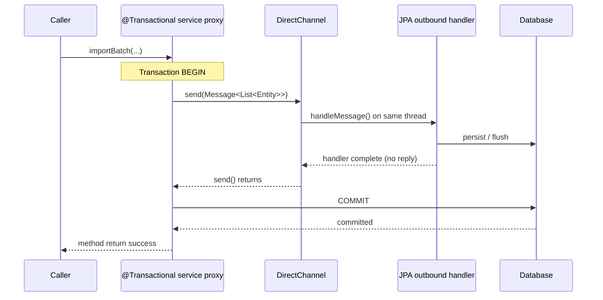

With `DirectChannel`, the caller's transaction is typically bound to the current thread. A synchronous JPA handler running on that same thread with a matching `EntityManagerFactory`/transaction manager participates in that transaction. **Commit happens when the proxy exits the method**, not when `send(...)` returns true.

### 7.2. With ExecutorChannel or QueueChannel

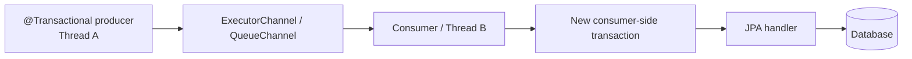

- Spring's imperative `@Transactional` binds transactions to threads (normally).
- `ExecutorChannel` and `QueueChannel` hand work across threads/queues, so the sender's transaction **does not propagate** to the consumer.
- The producer may see "message accepted by channel" before the DB write even starts.
- JPA writes need a transaction on the **consumer thread**, typically via endpoint advice or a `@Transactional` service invoked by the handler.
- Consumer-side failures/rollbacks must route to error/retry/DLQ flows; the producer will not receive synchronous exceptions by default.

### 7.3. @Transactional and Self-Invocation

Common pitfall:

```java
@Service
class ImportService {

    public void run() {
        importChunk(); // self-invocation: transaction proxy does not run.
    }

    @Transactional
    public void importChunk() {
        // JPA writes.
    }
}
```

With Spring's default proxy mode, `@Transactional` intercepts only **external calls passing through the proxy**. Move the transactional method to another bean and inject it, or use `TransactionTemplate`. Never rely on `@Transactional` on private methods or `this.importChunk()` to start a transaction.

### 7.4. readOnly, REQUIRED, and REQUIRES_NEW

| Setting | Behavior |
| --- | --- |
| `@Transactional` / `REQUIRED` | Joins active transaction if present; otherwise starts a new one |
| `REQUIRES_NEW` | Suspends outer transaction and starts an independent transaction |
| `readOnly=true` | Hint for transaction manager/provider; **not an ACL** and does not strictly forbid every write |
| `rollbackFor` | Controls which exceptions trigger rollback (per contract) |
| `timeout` | Transaction timeout enforced by the transaction manager, not every DB query |
| `isolation` | Isolation level when starting a new transaction, dependent on DB/manager |

`REQUIRES_NEW` holds the outer transaction's connection while acquiring another for the inner transaction; under high worker concurrency this can exhaust the pool. Use it purposefully, not as a default bandage for transaction issues.

### 7.5. Exception-Driven Rollback

Spring declarative transactions roll back by default on `RuntimeException` and `Error`; checked exceptions typically require `rollbackFor` or explicit handling. Catching and swallowing DB errors while returning normally can leave the transaction marked rollback-only—failing at commit—or mislead the caller about state.

**Do not do this:**

```java
try {
    importChannel.send(message);
} catch (Exception ex) {
    log.warn("Ignored database failure", ex);
    // Wrong: ACKing Kafka/JMS as a success.
}
```

Better: classify retryable vs. non-retryable errors, let the transaction roll back properly, and ACK/NACK the source per policy.

## 8. Three Ways to Place Transactions in Spring Integration JPA

### 8.1. @Transactional Service Outside DirectChannel

```java
@Transactional
public void importBatch(List<ImportReceipt> receipts) {
    importChannel.send(
            MessageBuilder.withPayload(receipts).build());
}
```

Pros: clear to read; the service owns the unit of work and commit, and can coordinate other JPA writes in the same transaction. Cons: if the adapter uses `clearOnFlush`, it can also detach other entities living in the **same context** inside the service.

### 8.2. Java DSL Endpoint Transactional Advice

```java
@Bean
IntegrationFlow transactionalImportFlow(
        EntityManagerFactory emf) {

    return IntegrationFlow.from("importChannel")
            .handle(
                    Jpa.outboundAdapter(emf)
                            .entityClass(ImportReceipt.class)
                            .persistMode(PersistMode.PERSIST)
                            .flushSize(50)
                            .clearOnFlush(true),
                    endpoint -> endpoint.transactional())
            .get();
}
```

This illustrates an **alternative** to a service transaction. If the caller has no transaction, endpoint advice opens one for the handler. If the caller already has a transaction and propagation is `REQUIRED`, the endpoint joins the existing transaction. Never assume advice isolates a separate transaction without setting propagation accordingly.

**Important:** if a transaction must span a poller's **receive → transform → JPA write**, putting transaction advice solely on the JPA handler may not cover the poll cycle or source ACK metadata. Place the boundary to match consistency requirements.

### 8.3. XML JPA Endpoint Transaction

```xml
<int-jpa:outbound-channel-adapter
        id="receiptJpaOutbound"
        channel="importChannel"
        entity-manager-factory="entityManagerFactory"
        entity-class="com.example.jpaflush.ImportReceipt"
        persist-mode="PERSIST"
        flush-size="50"
        clear-on-flush="true">

    <int-jpa:transactional
            transaction-manager="transactionManager"
            propagation="REQUIRED"/>
</int-jpa:outbound-channel-adapter>
```

Illustrative XML requires `int-jpa` namespaces/schemas, EMF/transaction manager beans, and the channel. **Do not enable both** Java DSL and XML on the same `DirectChannel` unless competing multiple consumers are intentional.

### 8.4. Poller Transaction for JPA Inbound

```xml
<int-jpa:inbound-channel-adapter
        id="pendingInbound"
        channel="pendingItems"
        entity-manager-factory="entityManagerFactory"
        jpa-query="select i from ImportJob i
                   where i.state = 'NEW'"
        max-results="20">

    <int:poller fixed-delay="2000"
                max-messages-per-poll="1">
        <int:transactional
                transaction-manager="transactionManager"
                propagation="REQUIRED"/>
    </int:poller>
</int-jpa:inbound-channel-adapter>
```

**Crucial distinction:**

- In **poller XML**, the transactional child element uses the `int` namespace (Spring Integration poller).
- In **outbound JPA endpoint XML**, the transactional child element uses `int-jpa`.
- A poller transaction wraps the poll operation and **synchronous** downstream work on the same call stack; once a message crosses an async channel, downstream leaves that transaction.
- When using `delete-after-poll` or mutating state at inbound, the transaction rolls back DB work on synchronous failures, yet **does not roll back external systems that already received a message**.

Never write a "SELECT NEW" adapter assuming a poller transaction automatically transitions rows to `PROCESSING`. To prevent re-reading, implement state transitions, claims/leases, and idempotency.

## 9. Complete Example: Importing Multiple Receipts with flushSize + clearOnFlush

### 9.1. Example Goals

Build a small Spring Boot application:

- A `List<ImportReceipt>` forms **one Spring Message**.
- `ReceiptImportService.importBatch(...)` is `@Transactional`.
- `DirectChannel` passes the message synchronously to the JPA outbound channel adapter.
- `Jpa.outboundAdapter(...)` uses `PersistMode.PERSIST`, `flushSize(2)`, and `clearOnFlush(true)`.
- `ReceiptRepository` verifies rows after the **service transaction commits**.
- Invalid data violating `NOT NULL` demonstrates rolling back the **entire batch**, including rows flushed before the error.
- No distributed transactions or external brokers in the demo.

Environment: **Java 17+, Spring Boot 3.x, Spring Integration 6.x, Jakarta Persistence, Hibernate, and H2**.

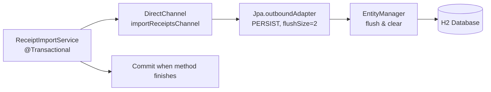

### 9.2. Maven Dependencies

```xml
<dependencies>
    <dependency>
        <groupId>org.springframework.boot</groupId>
        <artifactId>spring-boot-starter</artifactId>
    </dependency>
    <dependency>
        <groupId>org.springframework.boot</groupId>
        <artifactId>spring-boot-starter-integration</artifactId>
    </dependency>
    <dependency>
        <groupId>org.springframework.integration</groupId>
        <artifactId>spring-integration-jpa</artifactId>
    </dependency>
    <dependency>
        <groupId>org.springframework.boot</groupId>
        <artifactId>spring-boot-starter-data-jpa</artifactId>
    </dependency>
    <dependency>
        <groupId>com.h2database</groupId>
        <artifactId>h2</artifactId>
        <scope>runtime</scope>
    </dependency>
    <dependency>
        <groupId>org.springframework.boot</groupId>
        <artifactId>spring-boot-starter-test</artifactId>
        <scope>test</scope>
    </dependency>
</dependencies>
```

Use the Spring Boot BOM to keep versions compatible; Spring Boot 3 uses the `jakarta.persistence` namespace. In production, replace H2 with your target database and manage schemas with migrations.

### 9.3. ImportReceipt Entity

File `ImportReceipt.java`:

```java
package com.example.jpaflush;

import jakarta.persistence.Column;
import jakarta.persistence.Entity;
import jakarta.persistence.Id;
import jakarta.persistence.Table;

@Entity
@Table(name = "import_receipt")
public class ImportReceipt {

    @Id
    @Column(name = "event_id", length = 80,
            nullable = false)
    private String eventId;

    @Column(name = "source_name", length = 80,
            nullable = false)
    private String sourceName;

    protected ImportReceipt() {
        // JPA requires a no-argument constructor.
    }

    public ImportReceipt(
            String eventId, String sourceName) {
        this.eventId = eventId;
        this.sourceName = sourceName;
    }

    public String getEventId() {
        return eventId;
    }

    public String getSourceName() {
        return sourceName;
    }
}
```

`eventId` is a stable primary key. `sourceName` has a `NOT NULL` constraint to test in-transaction failures. The demo constructor **skips validating `sourceName`** intentionally to demonstrate constraint violations at flush/commit; real applications must validate inputs before sending to JPA.

### 9.4. Repository for Verifying Commits

File `ReceiptRepository.java`:

```java
package com.example.jpaflush;

import org.springframework.data.jpa.repository.JpaRepository;

public interface ReceiptRepository
        extends JpaRepository<ImportReceipt, String> {
}
```

The repository is only for seeding, reading, and assertions. Actual integration-flow writes are performed by the JPA outbound adapter.

### 9.5. MessageChannel and JPA Outbound Adapter

File `ReceiptImportIntegrationConfiguration.java`:

```java
package com.example.jpaflush;

import jakarta.persistence.EntityManagerFactory;

import org.springframework.context.annotation.Bean;
import org.springframework.context.annotation.Configuration;
import org.springframework.integration.channel.DirectChannel;
import org.springframework.integration.config.EnableIntegration;
import org.springframework.integration.dsl.IntegrationFlow;
import org.springframework.integration.jpa.dsl.Jpa;
import org.springframework.integration.jpa.support.PersistMode;
import org.springframework.messaging.MessageChannel;

@Configuration
@EnableIntegration
public class ReceiptImportIntegrationConfiguration {

    @Bean
    MessageChannel importReceiptsChannel() {
        return new DirectChannel();
    }

    @Bean
    IntegrationFlow receiptImportFlow(
            EntityManagerFactory entityManagerFactory) {

        return IntegrationFlow
                .from("importReceiptsChannel")
                .handle(
                        Jpa.outboundAdapter(entityManagerFactory)
                                .entityClass(ImportReceipt.class)
                                .persistMode(PersistMode.PERSIST)
                                .flushSize(2)
                                .clearOnFlush(true))
                .get();
    }
}
```

Explanation:

1. `DirectChannel` runs the handler synchronously on the sender's thread.
2. `Jpa.outboundAdapter(...)` is a **one-way outbound channel adapter**, producing no reply message.
3. `PersistMode.PERSIST` ensures new entities are inserted. Sending a duplicate ID is rejected by DB/JPA rather than silently merged.
4. `flushSize(2)` flushes in batches of two entities over the `Iterable`.
5. `clearOnFlush(true)` detaches managed entities from the persistence context after flushing.
6. **Do not also set `flush(true)`** because `flushSize > 0` already governs flushing.
7. The transaction here is opened on the **calling service** below. If the flow pulls from an async channel/consumer instead, add the transaction at the consumer.

### 9.6. Service Sending a List in One Transaction

File `ReceiptImportService.java`:

```java
package com.example.jpaflush;

import java.util.List;

import org.springframework.beans.factory.annotation.Qualifier;
import org.springframework.messaging.MessageChannel;
import org.springframework.messaging.support.MessageBuilder;
import org.springframework.stereotype.Service;
import org.springframework.transaction.annotation.Transactional;

@Service
public class ReceiptImportService {

    private final MessageChannel channel;

    public ReceiptImportService(
            @Qualifier("importReceiptsChannel")
            MessageChannel channel) {
        this.channel = channel;
    }

    @Transactional
    public void importBatch(List<ImportReceipt> receipts) {
        if (receipts == null || receipts.isEmpty()) {
            throw new IllegalArgumentException("Empty batch");
        }

        boolean accepted = channel.send(
                MessageBuilder
                        .withPayload(List.copyOf(receipts))
                        .build());

        if (!accepted) {
            throw new IllegalStateException(
                    "Import channel rejected message");
        }

        // Not considered committed at this line yet.
        // Transaction interceptor commits when method exits.
    }
}
```

**Why use `List.copyOf`?** It creates an unmodifiable list snapshot (membership cannot change), preventing the caller from mutating the `List` while the handler iterates. It **does not** make individual `ImportReceipt` objects immutable; avoid mutating entity instances on other threads during batch execution.

**Never treat `send() == true` as a database ACK.** On a `DirectChannel`, the handler has completed synchronously if `send` returns normally, yet the outer transaction has not committed at that point inside the method. Only when the caller receives a normal return from the **Spring transactional proxy** has the service transaction committed per the transaction manager's contract. If commit throws an exception, the caller will not see a normal return.

### 9.7. Spring Boot Main and Demo

File `JpaFlushApplication.java`:

```java
package com.example.jpaflush;

import java.util.List;

import org.springframework.boot.CommandLineRunner;
import org.springframework.boot.SpringApplication;
import org.springframework.boot.autoconfigure.SpringBootApplication;
import org.springframework.context.annotation.Bean;

@SpringBootApplication
public class JpaFlushApplication {

    public static void main(String[] args) {
        SpringApplication.run(JpaFlushApplication.class, args);
    }

    @Bean
    CommandLineRunner demo(
            ReceiptImportService service,
            ReceiptRepository repository) {

        return args -> {
            service.importBatch(List.of(
                    new ImportReceipt("evt-101", "sftp"),
                    new ImportReceipt("evt-102", "kafka"),
                    new ImportReceipt("evt-103", "http")));

            System.out.println(
                    "Committed rows: " + repository.count());
            System.out.println(
                    "evt-103 present: "
                    + repository.existsById("evt-103"));
        };
    }
}
```

File `application.properties`:

```properties
spring.main.web-application-type=none

spring.datasource.url=jdbc:h2:mem:jpa_flush_demo;DB_CLOSE_DELAY=-1
spring.datasource.driver-class-name=org.h2.Driver
spring.datasource.username=sa
spring.datasource.password=

spring.jpa.hibernate.ddl-auto=create-drop
spring.jpa.open-in-view=false
logging.level.org.springframework.integration=INFO
```

With three input receipts, `flushSize=2` processes the first two entities then flushes/clears, then processes the third and runs the final flush/clear. **The repository sees three rows only after the service method completes and the DB commits.** It does not mean the first rows committed before the third row.

In-memory H2 and `create-drop` are solely for practice; production requires a real database, schema migrations, connection pool sizing, and transaction timeouts.

## 10. Failure Testing: Flushing First Still Rolls Back the Whole Batch

This is the most important experiment for separating **flush** from **commit**.

### 10.1. Simulating Failure on the Final Element

Send three receipts with `flushSize(2)`:

```text
R1 = eventId: good-a, sourceName: sftp
R2 = eventId: good-b, sourceName: kafka
R3 = eventId: bad-c,  sourceName: null

R1,R2 → persist → SQL flush succeeds → clear
R3    → persist → flush detects NOT NULL violation
Transaction rollback
R1,R2,R3 are ALL NOT committed
```

### 10.2. Illustrative SpringBootTest

File `ReceiptImportIntegrationTest.java`:

```java
package com.example.jpaflush;

import static org.assertj.core.api.Assertions.assertThat;
import static org.assertj.core.api.Assertions.assertThatThrownBy;

import java.util.List;
import java.util.UUID;

import org.junit.jupiter.api.Test;
import org.springframework.beans.factory.annotation.Autowired;
import org.springframework.boot.test.context.SpringBootTest;

@SpringBootTest
class ReceiptImportIntegrationTest {

    @Autowired
    ReceiptImportService service;

    @Autowired
    ReceiptRepository repository;

    @Test
    void commitsThreeReceiptsInOneTransaction() {
        String prefix = "success-" + UUID.randomUUID();

        service.importBatch(List.of(
                new ImportReceipt(prefix + "-1", "sftp"),
                new ImportReceipt(prefix + "-2", "kafka"),
                new ImportReceipt(prefix + "-3", "http")));

        assertThat(repository.existsById(prefix + "-1")).isTrue();
        assertThat(repository.existsById(prefix + "-2")).isTrue();
        assertThat(repository.existsById(prefix + "-3")).isTrue();
    }

    @Test
    void rollsBackEarlierFlushedEntitiesWhenLastFails() {
        String prefix = "fail-" + UUID.randomUUID();

        assertThatThrownBy(() ->
                service.importBatch(List.of(
                        new ImportReceipt(prefix + "-1", "sftp"),
                        new ImportReceipt(prefix + "-2", "kafka"),
                        new ImportReceipt(prefix + "-3", null))))
                .isInstanceOf(RuntimeException.class);

        assertThat(repository.existsById(prefix + "-1")).isFalse();
        assertThat(repository.existsById(prefix + "-2")).isFalse();
        assertThat(repository.existsById(prefix + "-3")).isFalse();
    }

    @Test
    void rejectsDuplicateEventIdWithoutSilentUpsert() {
        String eventId = "dup-" + UUID.randomUUID();

        service.importBatch(List.of(
                new ImportReceipt(eventId, "sftp")));

        assertThatThrownBy(() ->
                service.importBatch(List.of(
                        new ImportReceipt(eventId, "kafka"))))
                .isInstanceOf(RuntimeException.class);

        assertThat(repository.findById(eventId))
                .isPresent()
                .get()
                .extracting(ImportReceipt::getSourceName)
                .isEqualTo("sftp");
    }
}
```

We intentionally **do not** annotate test methods with `@Transactional`: if the test framework wraps each test in an auto-rolling-back transaction, the service transaction joins it and hides the flow's real commit/rollback behavior.

**Test limitation:** H2 differs from production databases in constraint checking timing, locking, isolation, and SQL dialects. These tests demonstrate transaction **atomicity** on a standard error; concurrency and deferred constraints require PostgreSQL/MySQL/Oracle Testcontainers or a real database environment.

### 10.3. Do Not Assert Speculative SQL Flush Counts

Never write brittle tests like "`flushSize(2)` guarantees Hibernate makes exactly two JDBC roundtrips." A flush can emit 0, 1, or many SQL statements depending on ID strategy, cascades, driver batching, dirty state, and provider ordering.

Instead, assert **observable semantics**:

- DB rows exist after commit.
- DB contains zero rows after rollback.
- No entities lost after clear.
- Detached state behaves as expected.
- Transaction boundaries behave properly when async.
- Real metrics/performance measured in a realistic test environment.

If you need to inspect flush counts, use Hibernate statistics or controlled SQL logs, noting clearly that they are **provider-specific metrics**, not part of the JPA adapter's public contract.

## 11. Inspecting Managed/Detached State with a Diagnostic Service

This experiment is **separate** from section 9's JPA outbound handler. It calls `@PersistenceContext EntityManager` directly to observe entity state before/after flush and clear.

### 11.1. @PersistenceContext Is a Shared Transactional Proxy

Spring typically injects an **EntityManager proxy** bound to the current transaction into singleton services:

```java
@PersistenceContext
private EntityManager em;
```

This **does not** mean one real raw `EntityManager` is shared across parallel threads. `EntityManagerFactory` is shared across threads; the actual persistence context and transaction have their own per-transaction lifecycle.

### 11.2. Probe Service

File `ReceiptPersistenceProbe.java`:

```java
package com.example.jpaflush;

import jakarta.persistence.EntityManager;
import jakarta.persistence.PersistenceContext;

import org.springframework.stereotype.Service;
import org.springframework.transaction.annotation.Transactional;

@Service
public class ReceiptPersistenceProbe {

    @PersistenceContext
    private EntityManager em;

    @Transactional
    public Observation persistFlushClear(String eventId) {
        ImportReceipt receipt =
                new ImportReceipt(eventId, "manual");

        em.persist(receipt);
        boolean managedBeforeFlush = em.contains(receipt);

        em.flush();
        boolean managedAfterFlush = em.contains(receipt);

        em.clear();
        boolean managedAfterClear = em.contains(receipt);

        return new Observation(
                managedBeforeFlush,
                managedAfterFlush,
                managedAfterClear);
    }

    @Transactional
    public void flushThenFail(String eventId) {
        ImportReceipt receipt =
                new ImportReceipt(eventId, "manual");

        em.persist(receipt);
        em.flush();

        // SQL ran, but transaction has not committed yet.
        throw new IllegalStateException(
                "Simulated business failure after flush");
    }

    public record Observation(
            boolean beforeFlush,
            boolean afterFlush,
            boolean afterClear) {
    }
}
```

**Expected results:**

- `beforeFlush == true`.
- `afterFlush == true` because flush does not detach entities.
- `afterClear == false` because clear detaches entities.
- When `persistFlushClear` exits cleanly through the transactional proxy, the row exists after commit.
- When `flushThenFail` is invoked from another bean, the exception rolls back the transaction even though `em.flush()` already ran.

### 11.3. Testing Under a Real Transaction

```java
@SpringBootTest
class ReceiptPersistenceProbeTest {

    @Autowired
    ReceiptPersistenceProbe probe;

    @Autowired
    ReceiptRepository repository;

    @Test
    void flushKeepsManagedButClearDetaches() {
        String id = "probe-" + UUID.randomUUID();

        var result = probe.persistFlushClear(id);

        assertThat(result.beforeFlush()).isTrue();
        assertThat(result.afterFlush()).isTrue();
        assertThat(result.afterClear()).isFalse();
        assertThat(repository.existsById(id)).isTrue();
    }

    @Test
    void rollbackCancelsPreviouslyFlushedSql() {
        String id = "rollback-" + UUID.randomUUID();

        assertThatThrownBy(() -> probe.flushThenFail(id))
                .isInstanceOf(IllegalStateException.class);

        assertThat(repository.existsById(id)).isFalse();
    }
}
```

This test assumes imports for `@SpringBootTest`, `@Autowired`, `@Test`, `UUID`, and AssertJ static assertions, and intentionally avoids wrapping the test in a default transaction.

### 11.4. Why Test with the Matching Transaction Manager?

With multiple datasources/`EntityManagerFactory` beans, an unqualified `@Transactional` can pick the wrong transaction manager. When managing multiple persistence units, specify the target manager explicitly:

```java
@Transactional("inventoryTransactionManager")
public void updateInventory() {
    // Inventory EMF must be bound to the matching transaction manager.
}
```

`inventoryTransactionManager` is illustrative; real applications must declare the bean. **Never** treat two local JPA transactions across two DBs as one distributed atomic transaction just because they run inside one method.

## 12. Committing by Chunk Is Completely Different from Batch Flushing

A common question: "I have 10,000 receipts—I want to commit every 100 records, while flushing every 20 records. How?"

**Never use `flushSize(20)` alone.** You need two distinct levels:

1. **Chunk boundary**: every 100 receipts is one **transaction**.
2. **Persistence flush boundary**: inside that chunk, flush/clear every 20 receipts.

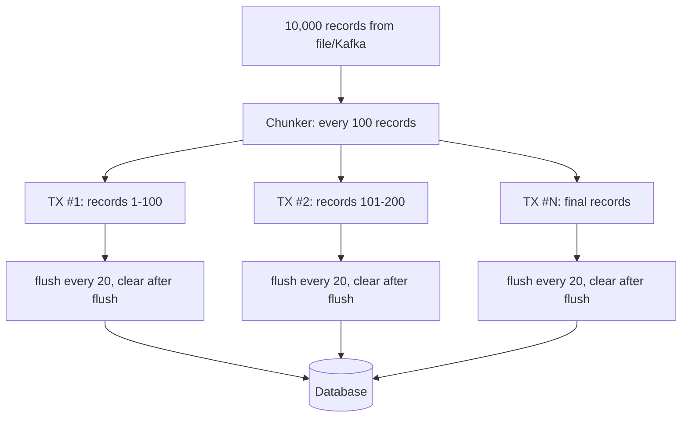

If TX #2 fails:

- TX #1 has already committed and remains persisted.
- TX #2 rolls back **all** 100 of its rows, including rows already flushed.
- Whether TX #3 proceeds depends on the coordinator and error policy.
- If the source replays **the entire file** from the beginning, TX #1 may hit duplicates; checkpoints/idempotency are required.

### 12.1. Configuring the Adapter with flushSize=20

Replaces section 9.5's demo config (do not enable both simultaneously):

```java
@Bean
IntegrationFlow chunkReceiptFlow(EntityManagerFactory emf) {
    return IntegrationFlow.from("importReceiptsChannel")
            .handle(
                    Jpa.outboundAdapter(emf)
                            .entityClass(ImportReceipt.class)
                            .persistMode(PersistMode.PERSIST)
                            .flushSize(20)
                            .clearOnFlush(true))
            .get();
}
```

### 12.2. ChunkWriter as a Transactional Spring Bean

```java
@Service
public class ReceiptChunkWriter {

    private final MessageChannel importReceiptsChannel;

    public ReceiptChunkWriter(
            @Qualifier("importReceiptsChannel")
            MessageChannel channel) {
        this.importReceiptsChannel = channel;
    }

    @Transactional
    public void writeChunk(List<ImportReceipt> chunk) {
        if (chunk.isEmpty() || chunk.size() > 100) {
            throw new IllegalArgumentException(
                    "Invalid chunk size");
        }

        boolean accepted = importReceiptsChannel.send(
                MessageBuilder.withPayload(
                        List.copyOf(chunk)).build());

        if (!accepted) {
            throw new IllegalStateException(
                    "Chunk not accepted");
        }
    }
}
```

Imports mirror `ReceiptImportService` from the demo. `ReceiptChunkWriter` must be a separate bean so the coordinator calls it **through the Spring proxy**, ensuring each `writeChunk` call runs in its own transaction.

### 12.3. Coordinator Without a Transaction Spanning the Whole File

```java
@Service
public class ReceiptImportCoordinator {

    private final ReceiptChunkWriter writer;

    public ReceiptImportCoordinator(ReceiptChunkWriter writer) {
        this.writer = writer;
    }

    // Intentionally NOT @Transactional here.
    public void importAll(List<ImportReceipt> all) {
        int chunkSize = 100;

        for (int start = 0; start < all.size();
                start += chunkSize) {
            int end = Math.min(
                    start + chunkSize, all.size());

            writer.writeChunk(all.subList(start, end));
            // writeChunk ran through proxy and committed before returning.
        }
    }
}
```

If you place a large `@Transactional` on the coordinator, `writeChunk` (default `REQUIRED`) **joins the outer transaction**, collapsing the entire file back into one commit. Keep the coordinator **non-transactional**, or deliberately use `REQUIRES_NEW` with sufficient connection pool capacity.

### 12.4. Should You Use TransactionTemplate?

`TransactionTemplate` fits when orchestration needs programmatic transaction control:

```java
for (List<ImportReceipt> chunk : chunks) {
    transactionTemplate.executeWithoutResult(status -> {
        writeChunkContents(chunk);
    });
}
```

Here, `writeChunkContents` must execute directly in the synchronous transaction or send via `DirectChannel` so the JPA handler participates. `TransactionTemplate` never transfers a transaction to another thread.

**Avoid mixing `TransactionTemplate` and `REQUIRES_NEW` haphazardly**; nested/suspended transactions increase complexity and connection pool load.

### 12.5. Per-Record, Per-Message, or Per-File?

| Boundary | Pros | Cons |
| --- | --- | --- |
| One transaction per file | Simple all-or-nothing | Long lock/heap duration, massive rollback |
| One transaction per 100-record chunk | Balances rollback/retry and throughput | Previously committed chunks need checkpoints/idempotency |
| One transaction per record | Fine-grained error isolation | Many commits, potentially lower throughput |
| One transaction per consumer message | Fits single broker events | Large batch inside one message still rolls back together |
| One transaction per JPQL bulk update | Atomic query/transaction | Cannot be split into multiple commits via `flushSize` |

Choose based on business semantics: a bank settlement file needing file-wide atomicity differs from a log import allowing bad-record quarantine.

## 13. Updating Gateways, Retrieving Gateways, and Bulk Queries

### 13.1. JPA Updating Outbound Gateway

`Jpa.updatingGateway(...)` uses `JpaExecutor` and **returns a reply**. In entity mode, the reply can be the persisted/merged entity; for JPQL `UPDATE/DELETE`, the reply is typically the affected-row count.

```java
@Bean
IntegrationFlow updateStatusFlow(EntityManagerFactory emf) {
    return IntegrationFlow.from("updateStatusRequests")
            .handle(
                    Jpa.updatingGateway(emf)
                            .jpaQuery("""
                                    update ImportJob j
                                    set j.state = 'DONE'
                                    where j.id = :jobId
                                      and j.state = 'RUNNING'
                                    """)
                            .parameterExpression(
                                    "jobId", "payload"))
            .get();
}
```

This is a **separate example** requiring an `ImportJob` entity and a caller/endpoint transaction; do not mix it into the `ImportReceipt` demo without defining all types/beans.

When the reply affected count is `1`, the JPA query matched and modified one row. **The outer transaction can still roll back after the reply**, so never emit a "DONE committed" event before the actual commit succeeds.

### 13.2. Bulk UPDATE Does Not Dirty-Check Loaded Entities

Example:

```java
@Transactional
public void staleManagedEntity() {
    ImportJob job = em.find(ImportJob.class, "JOB-1");
    // job.state may be RUNNING

    em.createQuery("""
            update ImportJob j
            set j.state = 'DONE'
            where j.id = :id
            """)
        .setParameter("id", "JOB-1")
        .executeUpdate();

    // job may still return RUNNING from first-level cache!
    em.refresh(job);
}
```

- JPQL bulk updates modify DB rows directly.
- Previously loaded managed entities can become **stale** in the persistence context.
- `flushSize` **does not** split this bulk query into multiple transactions.
- `clear` or `refresh` can resync objects, though unflushed pending changes must be considered carefully.
- Bulk updates bypass standard entity optimistic version increments and lifecycle callbacks; use conditional queries + expected version checks when needed.

### 13.3. Retrieved Entities and Async Boundaries

`Jpa.retrievingGateway(...)` can return an entity or list. If downstream runs after the transaction or across `ExecutorChannel`/`QueueChannel`, entities become detached; touching `LAZY` associations can throw `LazyInitializationException`.

Good practice:

```text
JPA retrieving gateway
    → DTO transformer inside appropriate transaction
    → QueueChannel / Kafka / HTTP outbound
```

Or return **immutable IDs** and let downstream consumers open their own transactions to reload entities. Never send a live JPA managed graph across a broker expecting the receiver to share the persistence context.

## 14. JPA Inbound Adapter, Pollers, and delete-after-poll

### 14.1. Which Steps Should a Poller Transaction Cover?

A scheduled inbound source:

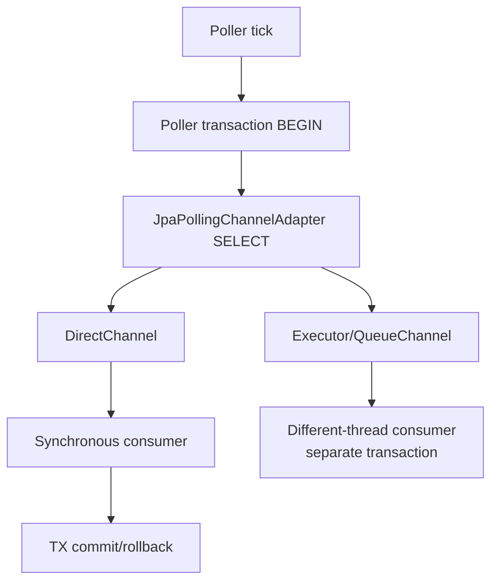

If the poller executes the query, sends onto `DirectChannel`, and a synchronous consumer updates the row, the transaction can span both on the same thread. If sent onto `QueueChannel` or `ExecutorChannel`, the poller's JPA context and transaction **do not follow** the message.

### 14.2. deleteAfterPoll Is Highly Sensitive

When an inbound adapter enables `deleteAfterPoll(true)`, the DB deletes read rows within the poll cycle. **Never** equate "row read" with "successfully delivered to Kafka/processed downstream".

Failure example:

```text
JPA inbound poller → fetches job
deleteAfterPoll() → prepares to delete job
DB commits job deletion
Kafka outbound → network error
Job lost from DB, event not received by broker
```

A poller transaction wrapping a **synchronous** consumer can roll back the DB if errors propagate cleanly before commit, yet if external side effects happened prior to rollback or the consumer is asynchronous, DB and broker still lack default distributed atomicity.

### 14.3. Atomic Claim/Lease Instead of Deleting Before Processing

A more durable design:

```text
NEW → CLAIMED(workerId, leaseUntil) → PROCESSING
    → DONE
    or FAILED/RETRYABLE
```

Use conditional update queries, affected-row counts, or appropriate locking with short transactions and idempotency. If a worker crashes, the lease expires so another worker can reclaim the item.

For high volume or post-commit event publishing, consider a transactional outbox or CDC instead of polling business tables directly.

## 15. Kafka, JMS, AMQP, HTTP, and File/SFTP: Who Commits First?

Message-driven systems usually involve multiple independent **commit/acknowledgment boundaries**.

| System | What Counts as Confirmed? | Shares Transaction with JPA Automatically? |
| --- | --- | --- |
| JPA / database | DB transaction commits successfully | — |
| Kafka consumer | Offset/ack per listener policy | **No by default** |
| Kafka producer | Broker acknowledges record send | **No by default** |
| JMS/AMQP consumer | ACK/commit/NACK per session/container | **No by default** |
| HTTP | Server sends response and client receives per transport | No |
| File/SFTP poller | Metadata/filter/rename/delete per flow | No |
| Spring `MessageChannel.send()` | Channel accepts message per semantics | No |
| JPA updating gateway reply | Handler returns entity or affected count | Does not prove outer commit |

### 15.1. Crash Windows in Kafka/JMS Consumers

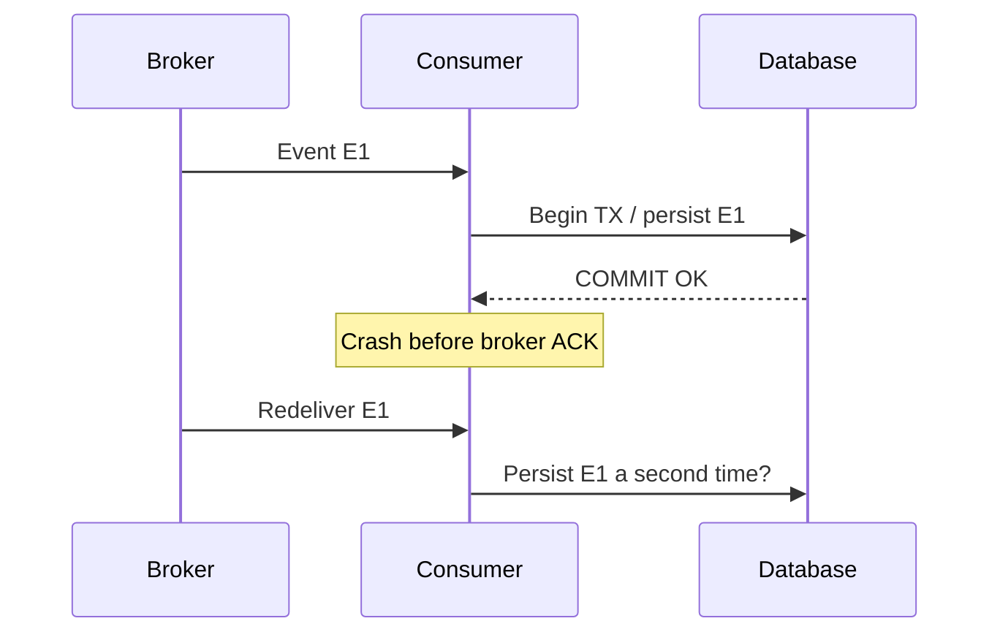

With `PersistMode.PERSIST` and `eventId` as a unique key, the second attempt can trigger a constraint violation. **Constraints detect duplicates but are not enough for safe ACKs**: check whether the event already succeeded or carries conflicting data, and whether other side effects remain incomplete.

### 15.2. Transactional Inbox/Outbox

When coordinating business-row updates and event publishing:

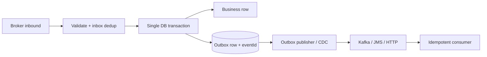

- Business data and the outbox row commit in the **same DB transaction**.
- The publisher sends outbox events post-commit and updates status upon receiving ACK.
- If a crash happens after publish but before marking `SENT`, the event may be resent.
- Consumers must deduplicate by event ID.
- This delivers **at-least-once + idempotency**, not default network-wide exactly-once.

### 15.3. Checkpointed File/SFTP Imports

For multi-chunk files:

1. Compute file identity/checksum and row IDs.
2. Stream-parse and validate records.
3. Write each chunk inside an explicit DB transaction.
4. Persist progress/checkpoints in the DB per policy.
5. On mid-file crash, resume from the checkpoint or replay idempotently.
6. Mark the file DONE / move to archive only when business conditions pass.
7. Separate parse/validation errors, transient DB errors, and unprocessable data errors.

`flushSize` relieves persistence-context memory pressure; it **does not** create file or broker checkpoints.

## 16. Differences Among flushSize, Hibernate JDBC Batching, and DB Commit

Three optimization layers are frequently confused:

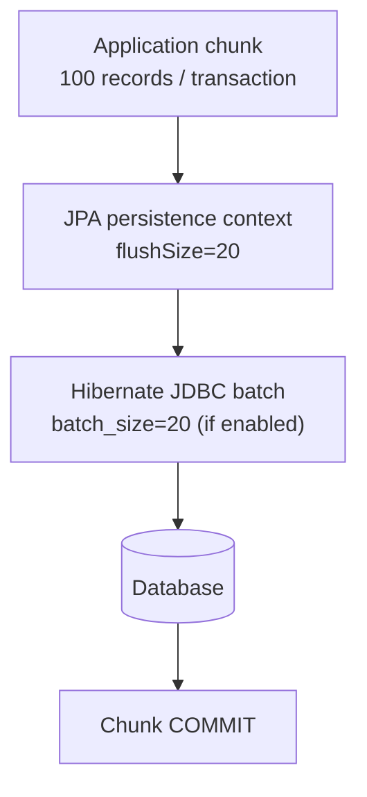

### 16.1. Application Defines the Chunk

Chunk size controls:

- How many records belong to one **transaction**.
- How many records retry if the chunk fails.
- How many records sit in a `List<Entity>` message.
- Failure isolation and checkpoint granularity.

### 16.2. JpaExecutor.flushSize Defines When to Flush

It controls **when `EntityManager.flush()` is called** in entity-mode operations. Paired with `clearOnFlush`, JPA drops managed entities between groups.

There is no equivalence "`flushSize=20` → JDBC `executeBatch` always sends exactly 20 statements."

### 16.3. Hibernate JDBC Batching Is a Provider Setting

Example with Hibernate (illustrative; verify for your version):

```properties
spring.jpa.properties.hibernate.jdbc.batch_size=20
spring.jpa.properties.hibernate.order_inserts=true
spring.jpa.properties.hibernate.order_updates=true
```

Actual batching depends on:

- ID generation strategy: `GenerationType.IDENTITY` often disables or limits batch inserts.
- SQL shape and statement ordering.
- Driver and database batching support.
- Versioned entity updates and provider settings.
- Flush/cascade/ordering behavior.
- Row size, indexes, and network latency.

**Benchmark against a real DB** before locking in batch sizes. H2 does not accurately reflect PostgreSQL/MySQL/Oracle.

### 16.4. Why Not Unlimited flushSize?

Flushing too rarely bloats the persistence context, spikes heap/GC, and delays error detection. Flushing too often increases provider overhead and SQL roundtrips, hurting throughput. `clearOnFlush` shrinks the first-level cache at the cost of detaching objects, causing bugs if downstream code mutates entities afterward.

Measure and balance **chunk size**, **flush size**, **JDBC batch size**, **DB connection pool**, and concurrency. There is no single universal magic number.

## 17. Security, Tenancy, and Business Errors

### 17.1. Flush/Clear Does Not Validate Data

An event's `tenantId` or `orderId` is untrusted input, not authorization. When querying or persisting from messages:

- Authenticate the source and principal.
- Enforce tenant/resource ownership in the service.
- Map DTOs onto entities using allowlisted fields; never merge raw client objects directly.
- Enforce primary-key, unique, NOT NULL, and foreign-key constraints in the DB.
- Disallow update queries missing tenant/state/version predicates.
- Never let clients control `flushSize`, JPQL/SpEL expressions, or unbounded batch sizes.
- Never log full payloads containing PII/tokens to debug flush errors.
- For multi-tenant databases, ensure transactions, connections, and persistence units use the right tenant context.

### 17.2. Validate Up Front; Constraints Are the Last Line of Defense

The demo `ImportReceipt` allowed `sourceName=null` to test rollbacks. Production code should validate early:

```java
if (receipt.getSourceName() == null
        || receipt.getSourceName().isBlank()) {
    throw new IllegalArgumentException(
            "sourceName is required");
}
```

Never burn a DB transaction just to catch malformed input that the service can reject up front. Still, **keep DB constraints** to catch races, bugs, and code paths bypassing validation.

### 17.3. Retries Must Classify Errors

| Error | Should Retry? | Why |
| --- | --- | --- |
| Temporary DB connection loss | Yes, **bounded** | Transient and recoverable |
| Lock timeout / deadlock | Yes | Use backoff/jitter and a fresh transaction |
| Duplicate event ID | Do not retry blindly | Requires idempotency/conflict policy |
| NOT NULL violation | No | Data must be fixed |
| Wrong tenant / unauthorized | No | Authorization failure |
| Query missing parameter | No | Configuration bug |
| Optimistic locking conflict | Business-dependent | Reconcile version/state; never overwrite blindly |
| Ambiguous commit failure | Case-dependent | Verify outcome/idempotency before replaying |
| Outbound Kafka failure after DB commit | Retry publishing via outbox | Never roll back an already-finished DB commit |

Never write a catch-all error handler that retries every `Exception` forever. For broker sources, align ACK/NACK/seek/DLQ with DB commit timing explicitly.

## 18. Troubleshooting: Common Issues

| Symptom | Possible Cause | Where to Check |
| --- | --- | --- |
| `TransactionRequiredException` | JPA write outside a transaction | `@Transactional`/endpoint advice on the right consumer |
| `flush()` succeeded yet data vanished | Transaction rolled back after flush | Commit exceptions, rollback-only flag, call path |
| `clearOnFlush(true)` "never runs" | No flush occurred; `flush=false` and `flushSize=0` | Set `flush` or `flushSize > 0` |
| Mutating entity after send leaves DB unchanged | Adapter cleared the shared persistence context | Check `em.contains(entity)` after handler |
| Batch of 100 rows fails on #99 and loses all 100 | Single transaction for all 100 rows | Split into chunk transactions if policy allows |
| Only 1 row committed despite `flushSize=50` | Only one message/entity sent | `flushSize` does not aggregate across separate messages |
| Many SQL statements despite large `flushSize` | `IDENTITY` keys/cascades/auto-flush/provider | Inspect Hibernate SQL and statistics |
| `@Transactional` ignored | Self-invocation/private/non-proxied call | Invoke via Spring proxy from another bean |
| Async handler fails while producer sees `true` | `Queue`/`ExecutorChannel` crosses threads | Add error channel/consumer tx/retries |
| Kafka offset committed yet DB row missing | ACK happened too early | Move ACK after DB commit; add retry/idempotency |
| JPA inbound re-polls identical rows | No claim or state update | Atomic claim/lease/checkpoint |
| `LazyInitializationException` | Entity detached by clear or tx end | DTO projection or reload in consumer tx |
| `EntityExistsException`/duplicate PK | Redelivery or duplicate ID in batch | Idempotency keys/unique constraint policy |
| JDBC pool waiting long | Too many long TXs, `REQUIRES_NEW`, threads | Monitor active connections and transactions |
| Managed entity still reads stale state | JPQL bulk update bypassed dirty checking | Careful `refresh`/`clear`/reload |
| Errors surface only at commit | Flush mode or deferred constraints | Clarify boundaries; test commit failures |
| Multi-EMF updates wrong DB | Mismatched transaction manager/EMF | Explicit qualifiers and `transactionManager` |

### 18.1. Step-by-Step Diagnostic Checklist

1. Does the message flow through `DirectChannel` or an async boundary?
2. Is the transaction opened at the service, endpoint, or poller?
3. Is the transactional bean method called **through a proxy**?
4. How are `flush`/`flushSize`/`clearOnFlush` configured on `JpaExecutor`?
5. Is the payload a **single entity** or an **`Iterable`**?
6. Is `flushSize > 0`? Does `clearOnFlush` actually have a flush to follow?
7. Are unrelated managed entities in the same PC getting cleared?
8. Did SQL run at flush or earlier? Has the transaction **committed**?
9. Are deferred constraints or commit-time errors occurring?
10. Do broker ACKs and outbound results happen before or after commit?
11. Across multiple chunks, which chunks committed and checkpointed?
12. Are duplicate events, tenant authorization, and optimistic locks verified?

## 19. Metrics and Operations

| Suggested Metric | Question Answered |
| --- | --- |
| `jpa_messages_received_total` | How many Spring Messages reached the handler? |
| `jpa_entities_processed_total` | How many business entities were processed? |
| `jpa_flush_duration_seconds` | How long do flushes take? |
| `jpa_flushes_total` | How many flushes ran (provider-instrumented)? |
| `jpa_transaction_commit_duration_seconds` | Are commits slowing down? |
| `jpa_transaction_rollbacks_total` | Are rollbacks spiking? |
| `jpa_constraints_failed_total` | Are input/constraint failures rising? |
| `jpa_batch_size` | How many entities per message/batch? |
| `jpa_chunk_size` | How many entities per transaction chunk? |
| `jpa_optimistic_conflicts_total` | Are multi-worker update races increasing? |
| `db_pool_active_connections` | Is the pool saturated? |
| `db_pool_pending_threads` | Are threads waiting for connections? |
| `outbox_pending_events` | Is an unpublished outbox backlog growing? |
| `import_checkpoint_lag_seconds` | Is file/broker import progress lagging? |

Never use `eventId`, `tenantId`, `orderId`, or raw payloads as metric labels due to high cardinality and data sensitivity. Use trace/correlation IDs in access-controlled structured logs with proper retention.

### 19.1. Responsible Operations

- Size `chunkSize` according to acceptable rollback/recovery windows.
- Tune `flushSize`/`clearOnFlush` based on heap/GC/throughput and PC ownership.
- Configure sensible transaction/JDBC/query timeouts and connection pools.
- Bound consumer/poller thread counts when the database is under pressure.
- Count committed records from the DB rather than inferring from `flush` or `send()` calls.
- Separate business errors (duplicates/invalid inputs) from infrastructure errors (DB downtime).
- Record checkpoints/idempotency keys before allowing controlled retries/replays.
- Monitor throughput, p95/p99 latency, lock contention, and outbox backlogs.

## 20. Production Test Plan

### 20.1. Mandatory Test Matrix

| Scenario | Expectation |
| --- | --- |
| Persist 1 entity and commit | Row exists |
| Persist Iterable of 3 entities, `flushSize=2` | All 3 rows exist after commit |
| Final record violates `NOT NULL` | Entire transaction rolls back; zero partial commits |
| Manual `em.flush()` then throw runtime exception | DB rolls back despite SQL having run |
| `em.clear()` after flush | `em.contains(entity) == false` |
| `em.clear()` before flush with pending dirty changes | Changes lost; test proves exact semantics |
| Mutate detached entity without merging | DB is not automatically updated |
| Independent chunks: chunk #2 fails | Chunk #1 stays committed; #2 rolls back |
| Accidental `@Transactional` on coordinator | Chunks merge into one transaction; test catches it |
| Switch `DirectChannel` to `ExecutorChannel` | Transaction does not cross thread boundary |
| Transactional advice on JPA endpoint | Handler write succeeds when caller has no tx |
| Duplicate event ID | Constraint/idempotency policy behaves properly |
| Kafka redelivery after DB commit | No duplicate side effects |
| JPQL bulk update on already-loaded entity | Persistence context can become stale |
| `@Version` enabled, two concurrent updates | Optimistic conflict/retry works cleanly |
| H2 vs. PostgreSQL/MySQL | Locking/isolation/provider quirks verified |
| Multiple datasources/EMFs | Right manager and database selected |
| Client-supplied batch size cap | Clients cannot DoS DB with huge payloads |

### 20.2. Testing Solely on H2 Is Insufficient

H2 validates basic contracts, but does not fully reproduce:

- Target DB lock waits, deadlocks, and isolation levels.
- Deferrable constraints and commit-time failures.
- JDBC batch driver behavior.
- Bulk JPQL/SQL and query optimizer plans.
- Multi-node concurrency and connection pool contention.

Use Testcontainers or a production-like DB environment to test transaction races, unique-constraint timing, pessimistic/optimistic locking, rollbacks during DB outages, and crash/restart recovery.

### 20.3. Do Not Use Mock Repositories to Claim Flush Behavior

Mock repository tests only prove a method was called; they **never** prove `EntityManager.flush`, `clear`, SQL/rollbacks, or transaction commits. At least one suite of integration tests must run against a real JPA provider and database.

## 21. Practice Exercises

### Exercise A — Flush and Rollback

Create a `@Transactional` service that persists an entity, calls `em.flush()`, and then throws `IllegalStateException`. Verify outside the transaction that the row **does not exist**. Explain why SQL can appear in logs even though the DB never committed.

### Exercise B — Clear and Detached Entities

Load a managed entity, modify a field, and call `em.clear()` before flushing; verify the change is not dirty-checked. Repeat with `em.flush(); em.clear()` and check the state. After clearing, mutate the entity again without merging and observe the DB stays unchanged.

### Exercise C — JpaExecutor flushSize

Send a `List<ImportReceipt>` of 7 entities through an adapter with `flushSize(3)`/`clearOnFlush(true)`. Use Hibernate statistics or test SQL logs to observe flushing, while **asserting only the contract** on committed/rolled-back rows and detached state. Compare with `flush=true` on a single entity.

### Exercise D — Transaction Per Chunk

Import 250 entities in chunks of 100/100/50 with `flushSize=20`. Intentionally fail an entity in the second chunk. Prove chunk #1 committed, chunk #2 rolled back, and chunk #3 followed policy. Add checkpointing and replay without duplicating chunk #1.

### Exercise E — DirectChannel vs. ExecutorChannel

Replace `DirectChannel` with `ExecutorChannel` or `QueueChannel`. Keep `@Transactional` on the producer and attempt to persist on the consumer. Observe exceptions/transaction context; add consumer-side transaction advice, an error channel, and bounded retries. Explain why producer `send()` succeeding does not prove the DB write succeeded.

### Exercise F — SFTP/Kafka → JPA → Outbox

Build a flow ingesting files or broker events, validating, chunking, and persisting via JPA. Write an outbox row inside the same DB transaction as the business rows, with a separate publisher sending to Kafka/JMS/HTTP. Simulate crashes after DB commit before source ACK, and after publish before marking `SENT`. Design event IDs, inbox/outbox, deduplication, checkpoints, metrics, and a DLQ.

**Completion criteria:** you can map the boundaries of `flush`, `clear`, and `commit` on a single message flow, explain why `flushSize` does not create multiple transactions, avoid letting `clearOnFlush` accidentally detach surrounding business entities, and design retries/ACKs around real commits.

## 22. Summary

- `EntityManager.flush()` syncs pending entity changes to SQL inside the transaction; **it does not commit**.
- `EntityManager.clear()` detaches **all** managed entities in the persistence context; it does not delete DB data or auto-flush.
- Calling `clear` before `flush` can lose pending dirty changes; `flush; clear` is a common pattern to bound batch memory, yet can still roll back.
- `JpaExecutor.setFlush(true)` flushes after persistence operations; `flushSize > 0` takes precedence over the `flush` flag and targets `Iterable` payloads.
- `clearOnFlush=true` runs only when a flush executes; remember it can also detach **non-batch entities** sharing the same context.
- A `Message<List<Entity>>` is **one message**; `flushSize` is not message count, JDBC batch size, or transaction chunk size.
- To commit per chunk, create a transaction boundary for **each chunk**, not just `flushSize`.
- `DirectChannel` usually lets the JPA handler join the caller's transaction; `ExecutorChannel`/`QueueChannel` create an async boundary needing consumer-side transactions.
- Proxy-based `@Transactional` skips self-invocation; call via another bean/proxy or use `TransactionTemplate`.
- Poller transactions and JPA outbound endpoint transactions sit at different points; pick boundaries around claim/update/ACK needs.
- JPQL bulk updates can leave managed entities stale and do not auto-increment versions like dirty checking.
- Gateway replies, `MessageChannel.send()`, Kafka/JMS ACKs, and HTTP responses **do not prove a database transaction committed**.
- With files/SFTP/Kafka/JMS and multiple nodes, enforce idempotency, bounded retries, DLQs, checkpoints, or a transactional outbox per consistency requirements.

## References

- [Spring Integration 6.5 — JPA Outbound Channel Adapter](https://docs.spring.io/spring-integration/reference/6.5/jpa/outbound-channel-adapter.html)
- [Spring Integration 6.5 — JPA Namespace Support and Transaction Handling](https://docs.spring.io/spring-integration/reference/6.5/jpa/namespace-support.html)
- [Spring Integration 6.5 — JPA Java Implementation](https://docs.spring.io/spring-integration/reference/6.5/jpa/java-implementation.html)
- [Spring Integration 6.5 — JPA Outbound Gateways](https://docs.spring.io/spring-integration/reference/6.5/jpa/outbound-gateways.html)
- [Spring Integration API — JpaExecutor](https://docs.spring.io/spring-integration/docs/6.5.0/api/org/springframework/integration/jpa/core/JpaExecutor.html)
- [Spring Integration API — DefaultJpaOperations](https://docs.spring.io/spring-integration/docs/6.5.0/api/org/springframework/integration/jpa/core/DefaultJpaOperations.html)
- [Spring Integration API — JpaUpdatingOutboundEndpointSpec](https://docs.spring.io/spring-integration/docs/6.5.0/api/org/springframework/integration/jpa/dsl/JpaUpdatingOutboundEndpointSpec.html)
- [Spring Integration API — PersistMode](https://docs.spring.io/spring-integration/docs/6.5.0/api/org/springframework/integration/jpa/support/PersistMode.html)
- [Spring Framework Reference — Declarative Transactions](https://docs.spring.io/spring-framework/reference/data-access/transaction/declarative/annotations.html)
- [Spring Framework Reference — Programmatic Transactions](https://docs.spring.io/spring-framework/reference/data-access/transaction/programmatic.html)
- [Spring Framework Reference — JPA](https://docs.spring.io/spring-framework/reference/data-access/orm/jpa.html)
- [Jakarta Persistence 3.1 Specification](https://jakarta.ee/specifications/persistence/3.1/jakarta-persistence-spec-3.1)
- [Spring Data JPA Reference — Entity Persistence](https://docs.spring.io/spring-data/jpa/reference/jpa/entity-persistence.html)
