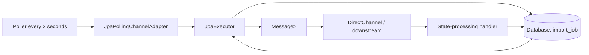
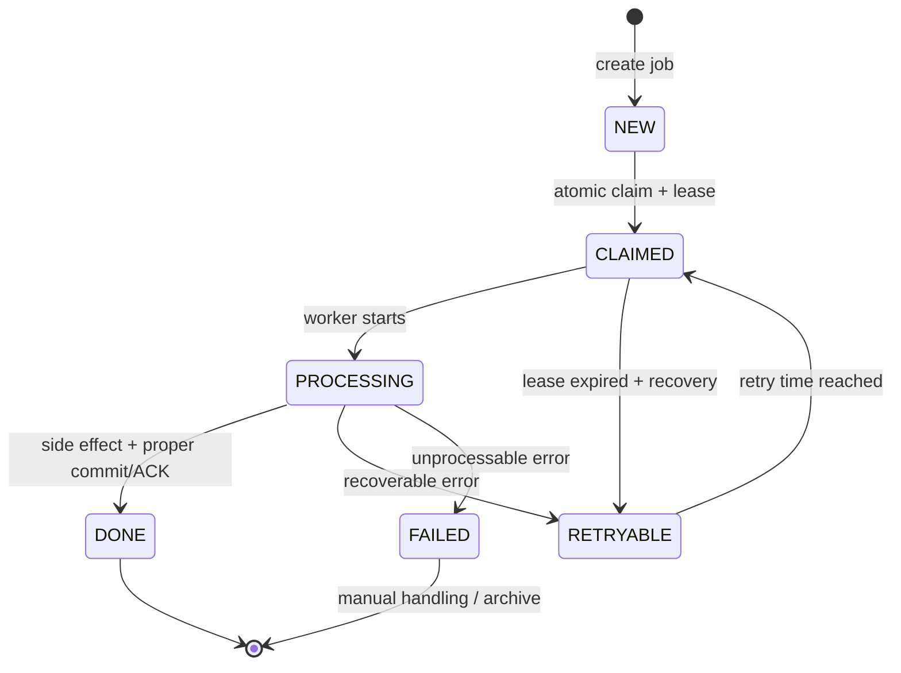
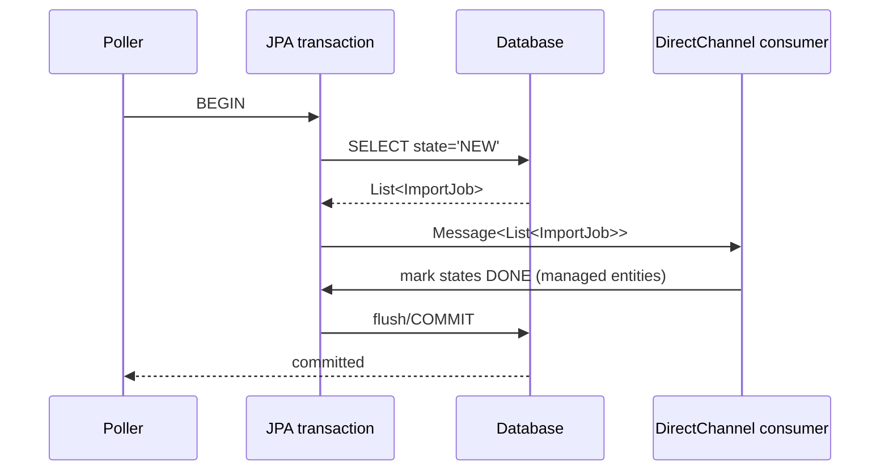
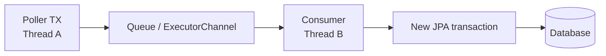
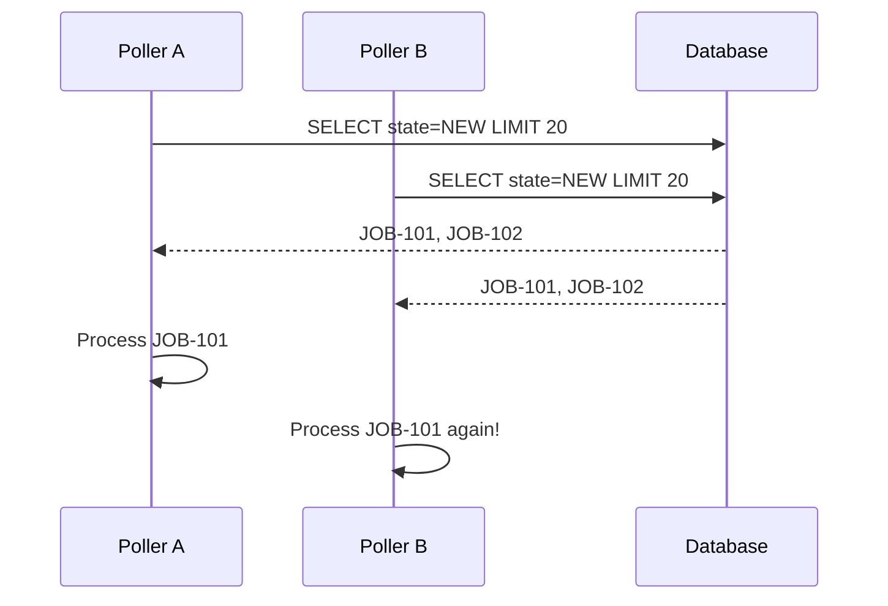
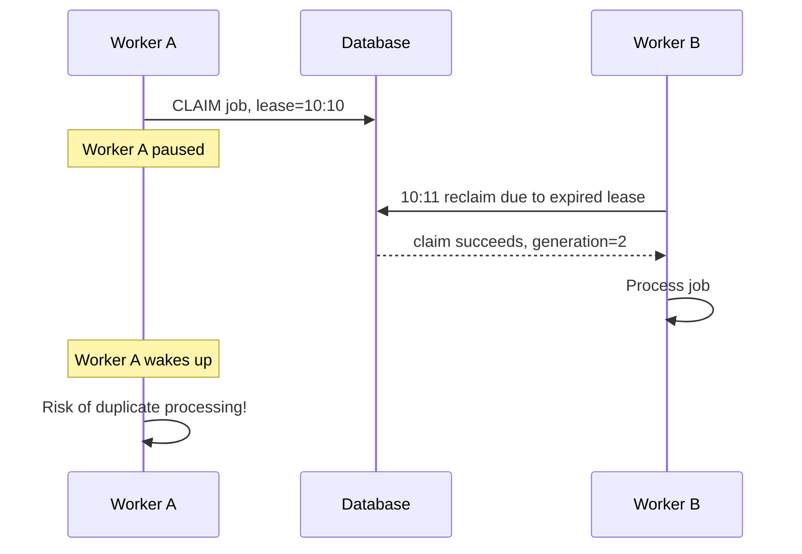
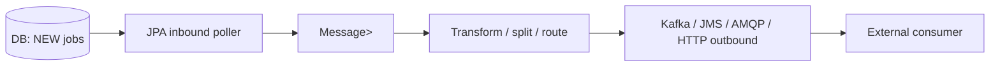

# Polling Entities by State

## 1. Context and Goals

In the **SPRING_INTEGRATION_ADAPTERS** module, Spring Integration connects external systems via inbound/outbound adapters, gateways, pollers, and `MessageChannel`. A business flow may ingest files over SFTP, invoke HTTP, publish to JMS/AMQP/Kafka, or read data from a database; after each step, the system must track **which records are still waiting**, **which are in flight**, and **which are complete**.

The topic **Polling Entities by State** in the **Adapter JPA** chapter focuses on using the JPA inbound channel adapter to fetch entities matching a state predicate, emit the results as Spring Messages, and design transactions, state transitions, concurrency, and retries so polling never causes duplicate processing or data loss.

After this lesson, you will be able to:

- Explain `JpaPollingChannelAdapter`, `JpaExecutor`, `Jpa.inboundAdapter(...)`, and `SourcePollingChannelAdapter`.
- Distinguish **scheduled polling** from **on-demand retrieving outbound gateways**, and database rows from Spring Messages.
- Write JPQL `SELECT` queries with `WHERE state = 'NEW'`, deterministic ordering, and `maxResults`.
- Configure `fixedDelay`, `fixedRate`, `maxMessagesPerPoll`, transaction advice, and the output `MessageChannel`.
- Understand that `expectSingleResult(false)` returns `List<Entity>` rather than one message per row.
- Explain why a query always selecting `NEW` can return **the same old rows on the next poll**.
- Practice with Spring Boot 3.x, Spring Integration 6.x, Java 17+, Jakarta Persistence, and H2.
- Transition states inside a synchronous transaction, and then extend to conditional claims, leases, attempt counts, and optimistic locking.
- Distinguish `deleteAfterPoll` from **claiming/marking processed**, controlling data-loss risks when downstream fails.
- Design retries, idempotency, checkpoints, outboxes, and backlog monitoring in multi-worker systems.
- Write integration tests for NEW/DONE transitions, empty results, rollbacks, poll schedules, and concurrent contention.

> **Key point:** JPA inbound polling is fundamentally a **scheduled SELECT**. A `WHERE state='NEW'` query only filters data; it **does not automatically mark rows processed, claim exclusive ownership, or guarantee exactly-once execution**.

## 2. What Is Polling Entities by State?

Suppose the system has an `import_job` table:

| id | state | Meaning |
| --- | --- | --- |
| J-101 | NEW | Ready to be picked up |
| J-102 | NEW | Ready to be picked up |
| J-103 | PROCESSING | Another worker is handling it |
| J-104 | DONE | Completed |
| J-105 | FAILED | Errored and awaiting retry decision |

Every few seconds, an inbound adapter executes JPQL:

```sql
select j
from ImportJob j
where j.state = 'NEW'
order by j.id
```

If results are found, the adapter emits a Spring Message onto a channel for downstream processing.



**Distinguish two moments:**

1. **Poll tick:** the scheduler invokes the source; `JpaExecutor` queries the database.
2. **Process:** the handler receives the payload and runs business logic. If modifying the DB, a transaction must wrap the appropriate operations.

Once all rows move to `DONE`, the `NEW` query finds nothing to emit. If the handler **forgets to update state** or the transaction rolls back, the next poll still sees `NEW`.

### 2.1. Related Classes and Framework Components

| Component | Role |
| --- | --- |
| `JpaExecutor` | Executes JPA SELECT/named/native queries and maps results |
| `JpaPollingChannelAdapter` | `MessageSource` using the executor to fetch entities from DB |
| `Jpa.inboundAdapter(entityManagerFactory)` | Factory/spec for the inbound adapter in Java DSL |
| `SourcePollingChannelAdapter` | Framework endpoint created for the scheduler to poll the source |
| `PollerSpec`/`Pollers` | Defines delay, trigger, transaction advice, and error handling |
| `MessageChannel` | Accepts a Spring Message from the source and delivers it to handlers |
| `JpaTransactionManager` | Manages JPA transactions/persistence contexts when configured |
| `@Transactional` | Wraps business logic in a transaction via Spring proxy |
| `@Version` | Detects optimistic conflicts when modifying managed entities |
| `Jpa.updatingGateway(...)` | Separate option for atomic conditional UPDATE returning affected-row counts |

### 2.2. Polling Is Not a Database Event Listener

The JPA inbound adapter does not tail the database transaction log like CDC. It runs periodic queries. Therefore:

- There is **latency** between inserting `NEW` and the next poll tick.
- Every poll incurs query overhead, even when zero jobs exist.
- A row can be seen **multiple times**, especially if its state has not changed.
- Multiple application instances can SELECT the same row simultaneously.
- Processing throughput must be bounded with limits, concurrency controls, and retries.

If very low latency is required and a reliable change stream is available, consider CDC/outboxes/brokers instead of direct polling. Still, polling remains simple and practical for job tables, scheduled imports, legacy data, and reconciliation.

## 3. Comparing Ways to Bring JPA Data into an Integration Flow

| Approach | Trigger | Input Message Before Query | Output |
| --- | --- | --- | --- |
| **JPA inbound channel adapter** | Periodic poller | No request message needed | Message holding entity or list |
| **JPA retrieving outbound gateway** | Request message | Caller payload/headers | Reply entity/list |
| **JPA updating outbound gateway** | Request message | Command | Reply entity or affected-row count |
| **JPA outbound channel adapter** | Request message | Entity/command | One-way; no reply |
| **Spring Data repository via `@Scheduled`** | Java scheduler | No Spring Integration message source | Custom Java handling |
| **CDC + broker listener** | Transaction log changes | Broker event | Stream of change events |
| **Transactional outbox publisher** | Poll/CDC on outbox table | Event committed with business data | Publishes to broker |

Use the **JPA inbound channel adapter** when you want "every 2 seconds scan `NEW` rows and push them into an Integration Flow." Use a **retrieving gateway** when an HTTP/JMS/Kafka request supplies an ID/criteria and needs an immediate SELECT for that request rather than scanning a table.

### 3.1. When Should You Not Use Inbound Polling?

Do not treat it as a complete durable work queue unless you have addressed:

- Atomic claims across multiple nodes.
- Leases/recovery when a worker dies.
- Commit/rollback vs. downstream ACKs.
- Idempotency under redelivery.
- Backpressure and row limits.
- Poison rows, retry policies, and DLQs.
- Data consistency across schema/tenant changes.

A bare `WHERE state='NEW'` and `fixedDelay(2000)` are not enough for those guarantees.

## 4. State Model: NEW, CLAIMED, PROCESSING, DONE, FAILED

A minimal demo might use only NEW/DONE. In real systems integrating HTTP/Kafka/JMS or multiple workers, separate intermediate states.



### 4.1. Contract per State

| State | Business Meaning | Typical Rules |
| --- | --- | --- |
| `NEW` | Unclaimed | Poller may SELECT |
| `CLAIMED` | One worker holds a temporary processing lease | Has `claimedBy`, `leaseUntil` |
| `PROCESSING` | Task currently executing | Heartbeats/progress if long-running |
| `DONE` | Completed per chosen confirmation criteria | Never re-polled as `NEW` |
| `RETRYABLE` | Transient failure | Has `nextAttemptAt` and `attemptCount` |
| `FAILED` | Retries exhausted or permanently invalid data | Quarantine/DLQ/investigation |
| `CANCELLED` | Stopped by business request | Cannot be reclaimed without authorization |

**A state is not proof of external delivery unless explicitly defined:** `DONE` may mean only "updated in DB", not that a Kafka producer was ACKed or an HTTP consumer applied the result.

### 4.2. Why Must State Queries Still Have ORDER BY?

```sql
select j from ImportJob j
where j.state = 'NEW'
order by j.id
```

A deterministic `ORDER BY` makes `maxResults(20)` predictable. When prioritizing by time/priority:

```sql
select j from ImportJob j
where j.state = 'NEW'
order by j.priority desc, j.createdAt asc, j.id asc
```

Include a unique tie-breaker (`id`) when rows share priority/timestamps. Note that continuous high-priority arrivals can cause **starvation** for lower-priority rows; fairness is a scheduling problem not solved by `ORDER BY` alone.

## 5. Payloads, Batches, and Poll Counts

### 5.1. One List Is Not Multiple Spring Messages

With:

```java
Jpa.inboundAdapter(entityManagerFactory)
        .jpaQuery("""
            select j from ImportJob j
            where j.state = 'NEW'
            order by j.id
            """)
        .maxResults(20)
        .expectSingleResult(false);
```

one query execution produces a `List<ImportJob>` payload of up to 20 entities. When emitted, **it is normally one Spring Message carrying a List**, not 20 messages.

```text
Poll tick #1
  SELECT NEW LIMIT 20
  ↓
  Message<List<ImportJob>> [J-101, J-102, ..., J-120]
  ↓
  handler receives a list
```

To handle each job separately, add `.split()` or a splitter, while accounting for transactions and partial failures: splitting a list into multiple messages does not automatically wrap each item in its own transaction.

### 5.2. Three Different Limits

| Configuration | What It Counts | What It Does Not Count |
| --- | --- | --- |
| `maxResults(20)` | Max 20 rows per query | Not 20 Spring Messages |
| `maxMessagesPerPoll(1)` | Receive attempts per poll cycle | Not 1 row |
| `fixedDelay(2000)` | Pause between runs per trigger | Does not guarantee queries finish within 2 seconds |
| `QueueChannel.capacity` | Number of Spring Messages buffered | Does not directly cap rows per list |
| `taskExecutor concurrency` | Concurrent task count | Does not lock DB rows |
| `JDBC batch size` | How driver/provider groups SQL | Not poll size |

A poll with `maxMessagesPerPoll(1)` can still pull 20 rows and produce a large List. If row payloads are unbounded, memory, serialization, and downstream consumers can still overload.

### 5.3. What Is expectSingleResult(true) For?

If a query expects strictly one entity:

```java
Jpa.inboundAdapter(entityManagerFactory)
        .jpaQuery("""
            select j from ImportJob j
            where j.id = 'J-101'
            """)
        .expectSingleResult(true);
```

the payload becomes a single `ImportJob` instead of a List (when exactly one row matches). If multiple rows match while `expectSingleResult(true)` is set, the framework may throw `MessagingException`; never misuse it to turn a "multiple NEW jobs" query into a single entity.

For job polling, normally use **`expectSingleResult(false)`** with an explicit row cap.

### 5.4. What If There Are Zero Rows?

In Spring Integration 6.5, `JpaPollingChannelAdapter.doReceive()` returns `null` when `JpaExecutor.poll()` yields empty results, so **no Spring Message containing an empty list is emitted** on that tick. The poller keeps running on schedule, and should not be used as a "per-tick heartbeat message". Always test the zero-job case on your target version.

Contrast this with **JPA retrieving outbound gateway 6.x**, where a list-mode query with zero rows returns **`List.of()`** as the reply to a request. Do not confuse that request–reply semantics with an "EMPTY" poller event.

If you want metrics on "rows per poll", use Micrometer metrics, advice, or observability hooks—never emit empty business messages that downstream consumers could mistake for real batches.

## 6. Ways to Configure JPA Inbound Polling

### 6.1. Java DSL

```java
IntegrationFlow.from(
        Jpa.inboundAdapter(entityManagerFactory)
                .jpaQuery("""
                    select j from ImportJob j
                    where j.state = 'NEW'
                    order by j.id
                    """)
                .maxResults(20)
                .expectSingleResult(false)
                .deleteAfterPoll(false),
        endpoint -> endpoint.poller(
                Pollers.fixedDelay(Duration.ofSeconds(2))
                        .maxMessagesPerPoll(1)
                        .transactional()))
        .handle(batchHandler, "markCompleted")
        .get();
```

This fragment is completed by the full source files in section 9. `.transactional()` is on the **poller**, not a method on the JPQL query. Poller advice wraps the synchronous poll-and-forward execution per configuration.

### 6.2. Java Annotations

```java
@Bean
@InboundChannelAdapter(
        channel = "jpaJobBatches",
        poller = @Poller(
                fixedDelay = "2000",
                maxMessagesPerPoll = "1"))
MessageSource<?> jpaJobSource(JpaExecutor executor) {
    return new JpaPollingChannelAdapter(executor);
}
```

You must declare a separate `JpaExecutor` bean and configure transactions on the consumer or poller if writes occur. `@InboundChannelAdapter` schedules polling; **it does not automatically wrap all JPA writes in a transaction**.

### 6.3. XML Namespace

```xml
<int-jpa:inbound-channel-adapter
        id="newJobJpaSource"
        channel="jpaJobBatches"
        entity-manager-factory="entityManagerFactory"
        jpa-query="select j from ImportJob j
                   where j.state = 'NEW'
                   order by j.id"
        max-results="20"
        expect-single-result="false"
        delete-after-poll="false">

    <int:poller fixed-delay="2000"
                max-messages-per-poll="1">
        <int:transactional
                transaction-manager="transactionManager"
                propagation="REQUIRED"/>
    </int:poller>
</int-jpa:inbound-channel-adapter>
```

This XML requires `int` and `int-jpa` root namespaces/schemas plus `entityManagerFactory`, `transactionManager`, and a consumer on `jpaJobBatches`. Register only **one** source per workflow unless competing pollers are intentional.

### 6.4. Using "entityClass" Instead of a Query

You can write:

```java
Jpa.inboundAdapter(entityManagerFactory)
        .entityClass(ImportJob.class)
        .maxResults(20);
```

This is convenient when fetching all entities of a class without writing a custom query, but **it cannot express the `state='NEW'` filter**. For state-based polling, write explicit JPQL specifying state, tenant/scope, and ordering.

### 6.5. JPQL / Named / Native

| Mode | Example | Notes |
| --- | --- | --- |
| `jpaQuery` | `select j from ImportJob j where j.state='NEW'` | Uses Java entity and property names |
| `namedQuery` | `ImportJob.findNew` | Named query must exist |
| `nativeQuery` | `select * from import_job where state='NEW'` | SQL dialect/result mapping depends on DB/provider |
| `entityClass` | `ImportJob.class` | Does not filter by state automatically |
| `parameterSource` | Value source for `:state` | Poller has no request Message with arbitrary payloads |

Never declare multiple conflicting query modes simultaneously expecting the framework to pick a "winning query".

## 7. Transactions and Persistence Context When Polling

### 7.1. Why Put a Transaction on the Poller?



When a poller transaction wraps both **receive + send** synchronously over `DirectChannel`, the handler can join the same JPA transaction if using the matching `EntityManagerFactory`/manager on the same thread. If the handler throws a runtime exception before commit, the transaction rolls back so `NEW` rows can be retried per policy.

### 7.2. Is @Transactional on the Handler Enough?

Without a poller transaction, if only the service has:

```java
@Transactional
public void markCompleted(List<ImportJob> batch) {
    // reload entity then update state.
}
```

the service opens a transaction **after the source already ran SELECT**. This is still a valid pattern for read-then-update demos, yet there is **no single transaction spanning both polling and processing**, so snapshots/locks are not held across both steps. The handler should **reload/verify state** and use optimistic/atomic updates to guard against races.

### 7.3. DirectChannel Is Not Like QueueChannel

With `DirectChannel`, the handler runs immediately on the scheduler thread, reusing the poller's transaction.

If output switches to `ExecutorChannel` or `QueueChannel`:



Thread-local transactions and persistence contexts **do not cross** asynchronous channels. If the source emits managed entities, the downstream consumer typically receives detached objects; accessing `LAZY` associations can trigger `LazyInitializationException`. Passing immutable IDs/DTOs or reloading inside the consumer transaction is much cleaner.

### 7.4. SELECT Is Not a Claim

Even when `SELECT` runs inside a transaction, two workers on two nodes can still do:

```text
Worker A SELECT NEW: J-101
Worker B SELECT NEW: J-101
Worker A processes J-101
Worker B also processes J-101
```

An ordinary read transaction **does not acquire an exclusive lock** stopping other workers from reading the same row. To prevent duplicate processing across workers, use atomic claims or proper locks/leases—not `@Transactional` alone.

## 8. deleteAfterPoll vs. State Transitions

### 8.1. deleteAfterPoll Is Destructive

The Spring Integration JPA inbound spec offers:

```java
Jpa.inboundAdapter(entityManagerFactory)
        .jpaQuery("select j from ImportJob j where j.state = 'NEW'")
        .deleteAfterPoll(true)
        .flushAfterDelete(true);
```

Meaning:

- After querying entities, the adapter **deletes the read entities from the database**.
- Deleting requires a valid JPA transaction.
- `flushAfterDelete(true)` flushes the persistence context after deletion—**it is not a commit**.
- With native SQL or projections, `deleteAfterPoll` has limitations and may not work as expected.
- With `deleteInBatch(true)`, batch deletion can bypass per-entity cascades and lifecycle callbacks.

### 8.2. Why Not Use deleteAfterPoll for Job Tables by Default?

```text
Jpa inbound SELECT NEW
  → deleteAfterPoll(true)
  → DB commits job deletion
  → Kafka publish FAILS
  → job gone, event never received by broker
```

A poller transaction can roll back the DB delete if a **synchronous** downstream consumer throws right before commit. However, it cannot make Kafka/JMS/HTTP delivery atomic with the DB. Over async channels, the send may even appear accepted before the consumer actually finishes.

When audit trails and retries matter, **transition state `NEW → CLAIMED/PROCESSING → DONE/FAILED`** instead of deleting immediately.

### 8.3. When Can deleteAfterPoll Fit?

Short-lived staging tables with reconstructible records, simple downstream logic, and clear failure policies can use delete-after-poll. Even then, verify:

- Poller transaction boundaries.
- Exact entity/query types supported for deletion.
- Cascade and foreign-key constraints.
- Rollback behavior on synchronous consumer errors.
- Crash windows between DB commit and external delivery.
- Multi-node concurrent polling.
- Data retention and audit requirements.

**Never enable `deleteAfterPoll` just to "avoid re-polling"** while ignoring data loss on external failures.

## 9. Complete Spring Boot Example: Poll NEW and Transition to DONE

### 9.1. Example Scope

We will build a **single-node, local-DB-only** application:

1. Seed several `ImportJob` rows with state `NEW` or `PAUSED`.
2. The JPA inbound adapter SELECTs up to 20 `NEW` rows every 2 seconds.
3. The poller opens a JPA transaction.
4. A synchronous handler receives `List<ImportJob>`, reloads entities inside the transaction, and transitions `NEW → DONE`.
5. Hibernate dirty checking syncs the changes at flush/commit.
6. Subsequent polls no longer select `DONE` jobs.
7. `deleteAfterPoll` stays disabled to preserve rows/auditability.
8. No external systems are called, keeping focus on polling + transactions; multi-node coordination and external side effects follow later.

**Limitation:** this single-node demo does not guarantee single execution across multiple app instances, especially with external side effects. It is designed as a safe single-node foundation before adding claims and leases.

### 9.2. Maven Dependencies

Uses Java 17+, Spring Boot 3.x, Spring Integration 6.x, Jakarta Persistence, and H2:

```xml
<dependencies>
    <dependency>
        <groupId>org.springframework.boot</groupId>
        <artifactId>spring-boot-starter</artifactId>
    </dependency>
    <dependency>
        <groupId>org.springframework.boot</groupId>
        <artifactId>spring-boot-starter-data-jpa</artifactId>
    </dependency>
    <dependency>
        <groupId>org.springframework.boot</groupId>
        <artifactId>spring-boot-starter-integration</artifactId>
    </dependency>
    <dependency>
        <groupId>org.springframework.integration</groupId>
        <artifactId>spring-integration-jpa</artifactId>
    </dependency>
    <dependency>
        <groupId>com.h2database</groupId>
        <artifactId>h2</artifactId>
        <scope>runtime</scope>
    </dependency>
    <dependency>
        <groupId>org.springframework.boot</groupId>
        <artifactId>spring-boot-starter-test</artifactId>
        <scope>test</scope>
    </dependency>
</dependencies>
```

The Spring Boot BOM aligns Spring Integration, Hibernate ORM, and Spring Framework versions. In-memory H2 is strictly for learning; production uses schema migrations and the target DB.

### 9.3. ImportJob Entity

File `ImportJob.java`:

```java
package com.example.jpapolling;

import jakarta.persistence.Column;
import jakarta.persistence.Entity;
import jakarta.persistence.Id;
import jakarta.persistence.Index;
import jakarta.persistence.Table;
import jakarta.persistence.Version;

@Entity
@Table(
    name = "import_job",
    indexes = @Index(
            name = "idx_job_state_id",
            columnList = "state, job_id"))
public class ImportJob {

    @Id
    @Column(name = "job_id", length = 80, nullable = false)
    private String id;

    @Column(nullable = false, length = 24)
    private String state;

    @Version
    private Long version;

    protected ImportJob() {
        // Required by Jakarta Persistence.
    }

    public ImportJob(String id, String state) {
        this.id = id;
        this.state = state;
    }

    public String getId() {
        return id;
    }

    public String getState() {
        return state;
    }

    public Long getVersion() {
        return version;
    }

    public void markDone() {
        if (!"NEW".equals(state)) {
            throw new IllegalStateException(
                    "Only NEW job can be marked DONE");
        }
        this.state = "DONE";
    }
}
```

`String state` keeps JPQL straightforward in the demo. Production can use `@Enumerated(EnumType.STRING)` enums, state-machine/domain validation, and audit columns. `@Version` catches certain concurrent entity updates, yet does not replace atomic claims for external side effects.

### 9.4. Repository for Seeding and Testing

File `ImportJobRepository.java`:

```java
package com.example.jpapolling;

import org.springframework.data.jpa.repository.JpaRepository;

public interface ImportJobRepository
        extends JpaRepository<ImportJob, String> {
}
```

The repository seeds data and verifies committed state afterward. Primary `NEW` polling runs through the **Spring Integration JPA inbound adapter**, not `repository.findByState(...)` inside a `@Scheduled` method.

### 9.5. Handler Processing the List Inside the Poller Transaction

File `ImportJobBatchHandler.java`:

```java
package com.example.jpapolling;

import java.util.List;

import jakarta.persistence.EntityManager;
import jakarta.persistence.PersistenceContext;

import org.springframework.stereotype.Service;
import org.springframework.transaction.annotation.Propagation;
import org.springframework.transaction.annotation.Transactional;

@Service
public class ImportJobBatchHandler {

    @PersistenceContext
    private EntityManager em;

    @Transactional(propagation = Propagation.MANDATORY)
    public void markCompleted(List<ImportJob> batch) {
        for (ImportJob candidate : batch) {
            // Reload inside the right transactional persistence context.
            // Do not assume entities crossing a channel are always managed.
            ImportJob managed =
                    em.find(ImportJob.class, candidate.getId());

            if (managed != null
                    && "NEW".equals(managed.getState())) {
                managed.markDone();
            }
        }

        // No need for em.merge(managed): already managed.
        // Dirty checking syncs at flush/commit.
    }
}
```

**Why `MANDATORY`?** This example requires the poller to open the transaction. If someone alters the flow so the handler runs non-transactionally, `MANDATORY` fails loudly instead of silently opening a separate transaction and hiding the boundary change. That serves as a design check; other architectures may prefer `REQUIRED`.

**Why reload via `em.find(...)`?** Within the same synchronous source/consumer transaction, the adapter may pass managed entities, yet reloading keeps boundaries explicit: the handler operates on instances managed in the active persistence context. In an async flow, `MANDATORY` would fail unless the consumer creates a transaction; see later sections for async designs.

**Do not call Kafka/HTTP here.** Marking `DONE` in the same DB transaction demonstrates local state transitions; it does not prove external delivery.

### 9.6. Java DSL Polling IntegrationFlow

File `ImportJobPollingConfiguration.java`:

```java
package com.example.jpapolling;

import java.time.Duration;

import jakarta.persistence.EntityManagerFactory;

import org.springframework.context.annotation.Bean;
import org.springframework.context.annotation.Configuration;
import org.springframework.integration.config.EnableIntegration;
import org.springframework.integration.dsl.IntegrationFlow;
import org.springframework.integration.dsl.Pollers;
import org.springframework.integration.jpa.dsl.Jpa;

@Configuration
@EnableIntegration
public class ImportJobPollingConfiguration {

    @Bean
    IntegrationFlow newJobPollingFlow(
            EntityManagerFactory entityManagerFactory,
            ImportJobBatchHandler handler) {

        return IntegrationFlow.from(
                Jpa.inboundAdapter(entityManagerFactory)
                        .jpaQuery("""
                                select j from ImportJob j
                                where j.state = 'NEW'
                                order by j.id
                                """)
                        .maxResults(20)
                        .expectSingleResult(false)
                        .deleteAfterPoll(false),
                endpoint -> endpoint
                        .id("newJobPollingEndpoint")
                        .poller(
                                Pollers.fixedDelay(
                                        Duration.ofSeconds(2))
                                        .maxMessagesPerPoll(1)
                                        .transactional()))
                .handle(handler, "markCompleted")
                .get();
    }
}
```

Explanation:

1. `Jpa.inboundAdapter(entityManagerFactory)` creates the JPA polling source.
2. `jpaQuery` runs JPQL `SELECT` for `NEW` rows ordered by `id`.
3. `maxResults(20)` caps rows per query.
4. `expectSingleResult(false)` keeps payloads as `List<ImportJob>`.
5. `deleteAfterPoll(false)` preserves job records; the handler updates state.
6. `Pollers.fixedDelay(Duration.ofSeconds(2))` runs periodically rather than reacting to an HTTP request.
7. `maxMessagesPerPoll(1)` limits receives per poll cycle, **not to one job/row**.
8. `transactional()` wraps the poll task using the default transaction manager. If multiple transaction managers exist, specify the target manager explicitly to avoid targeting the wrong DB.
9. `handle(handler, "markCompleted")` runs synchronously; using the default direct path with no async channel lets the handler join the poller's transaction.
10. There is no `.split()`, so the whole local batch runs in one transaction.

**Concurrency limitation:** a single instance polls on schedule, but deploying three instances with this config causes all three to query the same `NEW` rows. A poller transaction alone does not grant exclusive ownership.

### 9.7. Main Application and Sample Data

File `JpaStatePollingApplication.java`:

```java
package com.example.jpapolling;

import java.util.List;

import org.springframework.boot.CommandLineRunner;
import org.springframework.boot.SpringApplication;
import org.springframework.boot.autoconfigure.SpringBootApplication;
import org.springframework.context.annotation.Bean;

@SpringBootApplication
public class JpaStatePollingApplication {

    public static void main(String[] args) {
        SpringApplication.run(
                JpaStatePollingApplication.class, args);
    }

    @Bean
    CommandLineRunner sampleJobs(ImportJobRepository repository) {
        return args -> {
            if (repository.count() == 0) {
                repository.saveAll(List.of(
                        new ImportJob("JOB-101", "NEW"),
                        new ImportJob("JOB-102", "NEW"),
                        new ImportJob("JOB-103", "PAUSED"),
                        new ImportJob("JOB-104", "DONE")
                ));
            }

            System.out.println(
                    "Seeded jobs. Poller will mark NEW as DONE.");
        };
    }
}
```

File `application.properties`:

```properties
spring.main.web-application-type=none

spring.datasource.url=jdbc:h2:mem:jpa_state_poll;DB_CLOSE_DELAY=-1
spring.datasource.driver-class-name=org.h2.Driver
spring.datasource.username=sa
spring.datasource.password=

spring.jpa.hibernate.ddl-auto=create-drop
spring.jpa.open-in-view=false

logging.level.org.springframework.integration=INFO
```

**Expected results after at least one committed poll:**

| Job | Resulting State | Why |
| --- | --- | --- |
| JOB-101 | `DONE` | Selected as `NEW` and transitioned by handler |
| JOB-102 | `DONE` | Selected as `NEW` and transitioned by handler |
| JOB-103 | `PAUSED` | Excluded by query |
| JOB-104 | `DONE` | Already completed beforehand |
| `NEW` record inserted later | `DONE` after next poll | Scheduled polling picks it up |

Do not put `Thread.sleep` inside `CommandLineRunner` waiting for results. In practice, observe logs, inspect H2/tests, or write integration tests with bounded timeouts.

### 9.8. Why Does This Flow Only Illustrate "Single Node"?

With one instance and local DB-only state transitions, `SELECT → handler → dirty-checking → commit` is easy to reason about. However:

- Another node can read the same row before commit.
- A handler can re-run after rollback.
- An external side effect could finish right before the DB transaction rolls back.
- `@Version` can trigger an optimistic conflict in one transaction, yet already-sent external calls cannot auto-rollback.
- Real distributed work queues require **atomic claims + worker identity/leases + idempotency**.

Never deploy this single-node demo as a distributed worker queue merely because it runs cleanly on H2.

## 10. Transaction Rollback and State Transitions

### 10.1. What Happens When the Handler Throws an Exception?

With a transactional poller + `DirectChannel`:

```text
TX BEGIN
  → SELECT NEW: [JOB-101, JOB-102]
  → handler marks JOB-101 = DONE
  → handler marks JOB-102 = DONE
  → handler throws RuntimeException
TX ROLLBACK
  → JOB-101 and JOB-102 remain NEW in DB
next poll can pick them up again
```

Remember the provider may have flushed before the exception, yet **flush is not commit**. On rollback, none of that SQL commits. Any Java entity references retained after rollback should not be treated as valid managed state.

### 10.2. Some Errors Need Retries; Others Need Quarantine

| Error | Appropriate Policy |
| --- | --- |
| Transient DB connection timeout | Bounded retry with backoff |
| Deadlock / serialization failure | Retry in a **new transaction**, verifying idempotency |
| Malformed schema input | Do not retry forever; mark `FAILED`/DLQ |
| Missing required field | Validate before processing; quarantine |
| Duplicate unique key | Check whether `eventId` already succeeded or conflicts |
| Optimistic lock conflict | Reconcile state/lease; never overwrite blindly |
| Downstream Kafka/HTTP timeout | Check outcome and deduplicate before retrying |
| Poison row repeatedly failing the batch | Isolate the row or cap attempts so the batch does not stall |

If one bad row forces the entire batch to roll back, `ORDER BY id LIMIT 20` will keep selecting that exact row. That is **poison-row starvation**, requiring an error policy with `RETRYABLE`/`FAILED` states or per-chunk isolation and attempt limits.

### 10.3. Partial Processing Does Not Happen Automatically in One Transaction

Suppose a handler receives 20 rows, transitions 19 to `DONE`, and fails on #20:

- If the whole handler shares **one transaction**, the first 19 **roll back** with #20.
- If each row has its own transaction, the 19 can commit, requiring batch-level duplicate/retry handling.
- Splitting with `.split()` while still sharing the synchronous poller transaction can keep work in one transaction; **split does not equal per-item commit**.
- Inserting an async channel after a splitter requires separate transactions and error handling per worker.

Choose boundaries based on all-or-nothing requirements, throughput, and recovery semantics.

## 11. End-to-End Testing of Poll Schedules

### 11.1. SpringBootTest: NEW Transitions to DONE

File `ImportJobPollingIntegrationTest.java`:

```java
package com.example.jpapolling;

import static org.assertj.core.api.Assertions.assertThat;

import java.time.Duration;
import java.util.UUID;

import org.junit.jupiter.api.Test;
import org.springframework.beans.factory.annotation.Autowired;
import org.springframework.boot.test.context.SpringBootTest;

@SpringBootTest
class ImportJobPollingIntegrationTest {

    @Autowired
    ImportJobRepository repository;

    @Test
    void eventuallyProcessesNewJob() throws InterruptedException {
        String id = "test-" + UUID.randomUUID();
        repository.saveAndFlush(new ImportJob(id, "NEW"));

        long deadline = System.nanoTime()
                + Duration.ofSeconds(12).toNanos();

        String state = null;
        while (System.nanoTime() < deadline) {
            state = repository.findById(id)
                    .map(ImportJob::getState)
                    .orElse(null);

            if ("DONE".equals(state)) {
                break;
            }
            Thread.sleep(100);
        }

        assertThat(state).isEqualTo("DONE");
    }

    @Test
    void doesNotProcessPausedJob() throws InterruptedException {
        String id = "paused-" + UUID.randomUUID();
        repository.saveAndFlush(
                new ImportJob(id, "PAUSED"));

        // Wait longer than one fixedDelay so the poller has a chance to run.
        Thread.sleep(2500);

        assertThat(repository.findById(id))
                .isPresent()
                .get()
                .extracting(ImportJob::getState)
                .isEqualTo("PAUSED");
    }
}
```

These are integration tests for a **real scheduler**, so timing matters. Never assert "after exactly 2 seconds"—schedulers, DBs, and CI runners vary. A bounded deadline prevents hanging forever; busy CI environments may need generous deadlines.

**Important:** Never put `@Transactional` on the test method. If the test rolls back the insert at the end and the poller runs on another thread, the poller **will not see the uncommitted `NEW` row**. `repository.saveAndFlush` runs in its own repository transaction and commits when returning under default settings without an outer test transaction.

### 11.2. Testing the Source Directly Without Waiting for the Scheduler

To unit/integration test `JpaPollingChannelAdapter` without waiting on ticks, you can build a separate source/executor and invoke `receive()` inside `TransactionTemplate`. That is a **different test** from the scheduler `@SpringBootTest`; you must manage manual initialization, transactions, and prevent two sources from racing on the same rows.

```java
JpaExecutor executor = new JpaExecutor(entityManagerFactory);
executor.setJpaQuery("""
        select j from ImportJob j
        where j.state = 'NEW'
        order by j.id
        """);
executor.setMaxNumberOfResults(20);
executor.setExpectSingleResult(false);
// If created manually outside Spring, apply proper
// lifecycle before invoking executor.

JpaPollingChannelAdapter source =
        new JpaPollingChannelAdapter(executor);
```

Never call source methods directly expecting full Spring bean lifecycle, transactions, and error handling unless initialized properly. Integration tests using `@Bean` and `@InboundChannelAdapter` match production behavior more closely.

### 11.3. Assertions Must Verify State and Scope

Counting handler invocations is not enough. Assert:

- `NEW` rows actually become `DONE` **after commit**.
- `PAUSED`/`DONE` rows remain untouched.
- Rows inserted after a tick get picked up on a subsequent tick.
- No query exceeds `maxResults`.
- When the handler throws, the transaction rolls back and rows stay `NEW` or move to `RETRYABLE` per design.
- No duplicate processing occurs with multiple workers and atomic claims.
- Tenant-scoped queries never return another tenant's entities.

## 12. Atomic Claim: SELECT NEW Is Not Enough for Work Distribution

### 12.1. Race Condition When Two Workers Read Concurrently

With two instances executing the same query:



A state-filtered `SELECT` **picks candidates**, but gives no worker exclusive ownership. Wrapping `SELECT` in `@Transactional` does not turn it into an atomic claim.

Even with `@Version`, optimistic conflicts normally surface only at `UPDATE`/flush/commit; if both workers already sent HTTP/Kafka requests beforehand, the side effect **has already run twice** before one transaction rolls back.

### 12.2. Atomic Conditional Update

A standard technique is a **conditional `UPDATE` query**:

```sql
update ImportJob j
set j.state = 'CLAIMED',
    j.version = j.version + 1
where j.id = :jobId
  and j.state = 'NEW'
```

If two workers try to claim the same ID simultaneously:

- The winning worker receives affected count `1`.
- The losing worker typically gets `0` once the state changed, or a contention/serialization error depending on DB/isolation.
- Only the worker whose claim **committed successfully** proceeds to external side effects.
- On statement failure/deadlock, retry the transaction with bounded backoff; never treat `0` and exceptions as identical outcomes.

**Note:** JPQL bulk updates do not auto-increment `@Version` via dirty checking. In the query above, `j.version = j.version + 1` is **explicit** so version tracking is not bypassed.

### 12.3. Spring Data JPA Repository Claim

Because the demo `ImportJob` already has `state` and `version`, you can add this **method** to the repository interface (an advanced extension):

```java
import org.springframework.data.jpa.repository.Modifying;
import org.springframework.data.jpa.repository.Query;
import org.springframework.data.repository.query.Param;

@Modifying
@Query("""
        update ImportJob j
           set j.state = 'CLAIMED',
               j.version = j.version + 1
         where j.id = :id
           and j.state = 'NEW'
        """)
int claimIfNew(@Param("id") String id);
```

This method must run inside a **write transaction**, e.g., a service bean:

```java
@Service
public class ImportJobClaimService {

    private final ImportJobRepository repository;

    public ImportJobClaimService(
            ImportJobRepository repository) {
        this.repository = repository;
    }

    @Transactional
    public boolean tryClaim(String jobId) {
        return repository.claimIfNew(jobId) == 1;
    }
}
```

Both snippets assume `@Service`/`@Transactional` imports. In full files, place the repository method **inside** `ImportJobRepository` and the service in its own file. Never run the `NEW → DONE` demo flow simultaneously with this claim flow on the same dataset without updating the state machine, or the two flows will compete.

### 12.4. Claim Success Means After Commit

```text
SELECT candidate IDs
    ↓
tryClaim(id) in its own transaction
    ↓
DB COMMIT succeeds
    ↓
If affected == 1: run side effect
If affected == 0: skip, another worker may have claimed
If exception: retry claim per policy
```

Returning `1` inside a transaction does not prove commit yet. With a `@Transactional` service proxy, external callers continue only after normal return following commit. If the caller already holds an **outer transaction** with `REQUIRED`, `tryClaim` joins it and has not committed upon returning. Design the boundary explicitly.

For workers making slow HTTP/Kafka calls, keep the claim transaction **short**, commit, and then execute external work instead of holding row locks and JDBC connections open across network calls.

### 12.5. JPA Updating Outbound Gateway Can Also Claim

To keep all operations inside Spring Integration:

```java
Jpa.updatingGateway(entityManagerFactory)
        .jpaQuery("""
                update ImportJob j
                   set j.state = 'CLAIMED',
                       j.version = j.version + 1
                 where j.id = :jobId
                   and j.state = 'NEW'
                """)
        .parameterExpression("jobId", "payload");
```

The request payload is the ID; the reply is the **affected-row count** from the JPQL UPDATE. Wrap with a caller or endpoint transaction and inspect `0/1` before dispatching downstream.

**Never** accept reply `1` and publish Kafka success inside the same pre-commit transaction while ignoring crash windows. Use explicit transaction boundaries or a transactional outbox.

## 13. Leases and Recovery When Workers Crash

Atomic claims resolve contention **at pickup time**, yet if a worker claims a row and crashes, the row gets stuck in `CLAIMED`. Leases allow recovering expired claims.

### 13.1. Extending the Schema

In a production variant, add columns:

```sql
-- Pseudo-schema: adapt syntax to your actual DB/migration.
claimed_by       VARCHAR(80)
lease_until      TIMESTAMP
attempt_count    INTEGER NOT NULL DEFAULT 0
next_attempt_at  TIMESTAMP
last_error_code  VARCHAR(80)
updated_at       TIMESTAMP NOT NULL
```

The extended entity must map these fields; section 9's demo `ImportJob` **does not include them**. Only use the JPQL below after updating the schema, entity, and migrations.

### 13.2. Timed Claim

```sql
update ImportJob j
set j.state = 'CLAIMED',
    j.claimedBy = :workerId,
    j.leaseUntil = :leaseUntil,
    j.attemptCount = j.attemptCount + 1,
    j.version = j.version + 1
where j.id = :jobId
  and (
       j.state = 'NEW'
       or (j.state = 'CLAIMED' and j.leaseUntil < :now)
  )
  and (j.nextAttemptAt is null or j.nextAttemptAt <= :now)
```

Meaning:

- A worker owns the row only when affected count is `1` and the transaction commits.
- The prior worker holds the lease until `leaseUntil`; others can reclaim after expiry.
- `attemptCount` enforces a retry budget.
- `nextAttemptAt` enables exponential backoff or scheduled deferral.
- `workerId` aids auditing and reconciliation.
- `version`/fencing tokens block stale workers from updating after losing the lease.

### 13.3. Lease Expiry Alone Does Not Prevent Duplicate Execution

Suppose worker A stalls or hits a long GC pause, its lease expires, and B reclaims and starts processing. A then wakes up and may still execute the side effect.



**Hence fencing and idempotency are required**, not just leases.

One pattern gives each claim a monotonically increasing `claimGeneration`/version; the DB completion update checks:

```sql
update ImportJob j
set j.state = 'DONE',
    j.version = j.version + 1
where j.id = :id
  and j.claimedBy = :workerId
  and j.version = :claimedVersion
  and j.state = 'CLAIMED'
```

This is a database compare-and-set; if the old worker lost ownership, the `DONE` update returns `0`. External systems still require their own idempotency/fencing mechanisms because a DB CAS **cannot recall** an HTTP request already sent.

### 13.4. Recovering Stuck Jobs

A separate scheduler/job can detect expired leases:

```sql
select j from ImportJob j
where j.state = 'CLAIMED'
  and j.leaseUntil < :now
order by j.leaseUntil, j.id
```

Then reclaim or transition to `RETRYABLE` per policy. Never blindly reset all `CLAIMED` rows to `NEW` while workers may still be running or clock skew is unchecked.

Across regions, prefer unified database/server clocks, store `Instant`/UTC, and account for clock skew. Test long pauses, worker crashes, restarts, duplicate leases, and stale completions.

## 14. Row Locking and SKIP LOCKED

### 14.1. @Lock(PESSIMISTIC_WRITE)

JPA supports pessimistic locking where appropriate:

```java
@Lock(LockModeType.PESSIMISTIC_WRITE)
@Query("""
        select j from ImportJob j
        where j.id = :id
        """)
Optional<ImportJob> lockById(@Param("id") String id);
```

Declare this on a Spring Data repository with proper imports and an active transaction. Locks remain held until transaction completion per DB/provider. Holding locks during slow network calls holds connections and row locks open, hurting throughput and risking deadlocks.

### 14.2. SELECT ... FOR UPDATE SKIP LOCKED

Databases such as PostgreSQL and Oracle support skipping locked rows with `FOR UPDATE SKIP LOCKED`. This distributes work efficiently via native SQL inside a short claim transaction:

```sql
-- Illustrative SQL, not portable JPQL:
select job_id
from import_job
where state = 'NEW'
order by job_id
for update skip locked
```

`LIMIT`/`FETCH FIRST` syntax, lock ordering, and Hibernate/JPA mappings **vary by database/dialect**; write SQL for your target DB rather than pasting it straight into `jpaQuery(...)`.

### 14.3. Combining Locks and Claims

A clean pattern:

1. In a short DB transaction, `SELECT` a batch of rows using `SKIP LOCKED`.
2. Update the batch to `CLAIMED`, setting owner/lease and version.
3. `COMMIT` to release locks.
4. Process outside the claim transaction.
5. In a separate transaction, update to `DONE` guarded by owner/generation.
6. On failure, update to `RETRYABLE`/`FAILED` and schedule retries.

Never hold the claim transaction open across Kafka/HTTP/SFTP calls. `SKIP LOCKED` prevents waiting on locked rows **during claim**, without solving post-commit idempotency on its own.

## 15. Pagination, Fairness, and Avoiding Starvation

### 15.1. maxResults Must Be Bounded

With a million `NEW` rows, an unbounded `SELECT` loads too many managed entities, spikes heap/GC, slows queries, and creates oversized messages.

```java
Jpa.inboundAdapter(entityManagerFactory)
        .jpaQuery("""
                select j from ImportJob j
                where j.state = 'NEW'
                order by j.id
                """)
        .maxResults(100)
        .expectSingleResult(false);
```

`100` is illustrative; tune based on row size, SLA, throughput, indexes, and transaction duration. Never accept an uncapped `maxResults` from external inputs.

### 15.2. Why Is OFFSET Usually Unnecessary for NEW States?

Once polled rows **transition `NEW → CLAIMED/DONE`**, the next `WHERE state='NEW'` poll excludes claimed rows automatically. You can always read the **first page** with limit N.

Using an increasing `OFFSET` over a **mutating result set**:

```text
Poll 1: SELECT NEW offset 0 → J1..J10 → mark DONE
Poll 2: SELECT NEW offset 10 → may skip J11..J20
```

Because the dataset shrinks as `NEW` rows leave, offsets skip rows. Generally **avoid incrementing page numbers** on state-changing work queues; poll the fixed first page with atomic claims.

### 15.3. Starvation from Poison Rows or Priorities

If a query always orders by `id` and picks the first 20 rows, an un-transitioned failing row stays at the front forever. With 20 poison rows, every poll selects the exact same 20 rows and starves the backlog behind them.

Solutions:

- Persist `attemptCount` increments durably outside the rolled-back work transaction.
- Transition to `RETRYABLE`/`FAILED` or set `nextAttemptAt` once attempts exceed a threshold.
- Apply backoff and jitter.
- Quarantine poison records out of the main pipeline.
- Enforce scheduling fairness across priorities/tenants/shards.
- Monitor "oldest `NEW` age", not just backlog count.

### 15.4. Indexes Supporting WHERE and ORDER BY

For `state='NEW' ORDER BY id`, a `(state, id)` index is a strong candidate, as in the demo entity. For multi-tenant and prioritized queues, `(tenant_id, state, priority, created_at, id)` or an execution-plan-tuned variant may fit.

**Never add indexes by guesswork**: indexes slow down INSERT/UPDATEs and consume storage. Inspect query plans and cardinality on the real DB, especially when tables hold millions of `DONE` rows and few `NEW` rows.

## 16. Pollers and Parameter Sources

### 16.1. Inbound Polling Usually Has No Request Payload

Unlike `Jpa.retrievingGateway(...)`, `Jpa.inboundAdapter(...)` is not invoked by an HTTP user's `Message<Filter>`. It is triggered on a schedule by a poller. Thus:

```java
new JpaParameter(
        "state", null, "payload.state")
```

has no default request message with `payload.state` to evaluate. For periodic polling, prefer **server-configured literals** or a server-controlled `ParameterSource`.

### 16.2. Static Parameters via JpaExecutor

```java
JpaExecutor executor =
        new JpaExecutor(entityManagerFactory);

executor.setJpaQuery("""
        select j from ImportJob j
        where j.state = :state
        order by j.id
        """);

executor.setJpaParameters(
        List.of(new JpaParameter(
                "state", "NEW", null)));

executor.setMaxNumberOfResults(20);
executor.setExpectSingleResult(false);
```

This Java config snippet assumes `JpaExecutor`/`JpaParameter`/`List` imports. Wrapping that executor bean in `JpaPollingChannelAdapter` with `@InboundChannelAdapter` polls safely using a trusted server constant `NEW`, never a client-supplied header.

### 16.3. Named Queries, Native Queries, and Projections

With JPQL:

```sql
select j from ImportJob j
where j.state = 'NEW'
order by j.id
```

the source returns entities. If only a few fields are needed across an async channel, use a DTO projection:

```sql
select new com.example.jpapolling.JobDispatchView(
    j.id, j.state, j.version)
from ImportJob j
where j.state = 'NEW'
order by j.id
```

`JobDispatchView` must be defined with a matching constructor; it is not part of section 9's demo. Projections avoid sending entities with `LAZY` associations across thread boundaries.

**Note:** when the source returns DTOs instead of managed entities, `deleteAfterPoll(true)` should no longer be treated as a valid default entity delete. In work queues, use ID-based atomic claims rather than delete-after-poll.

## 17. Forwarding Poll Results to Kafka, JMS, AMQP, and HTTP

### 17.1. A Message Source Does Not Guarantee Delivery to the Target



Selecting a record does **not** mean:

- It has been claimed.
- `DONE` committed in the DB.
- The Kafka producer received a broker ACK.
- The JMS/AMQP message was ACKed by a consumer.
- The HTTP client received and applied the response.
- The external API executed its side effect exactly once.

If the handler marks `DONE` **before** sending outbound and the DB commits while the external send fails, the event is lost. If it **sends outbound first** and the DB rolls back, the job may run again—producing a duplicate event.

### 17.2. Transactional Outbox: Coordinating DB + Broker

When a `NEW` job must publish an event, use one DB transaction:

```text
BEGIN DB transaction
  SELECT / claim verified job
  UPDATE job → DONE or OUTBOX_PENDING
  INSERT outbox_event(eventId, aggregateId, payload, status='NEW')
COMMIT
```

A separate publisher:

```text
Poll outbox NEW
  → claim outbox row
  → publish Kafka/JMS
  → receive broker ACK
  → mark outbox SENT
```

If a crash occurs between broker ACK and marking `SENT`, the publisher may resend; consumers must be idempotent by `eventId`. This achieves **at-least-once + idempotency**, not system-wide exactly-once unless proved end-to-end.

### 17.3. Transaction Boundaries and Channel Types

| Design | Outcome to Understand |
| --- | --- |
| JPA poller → DirectChannel → sync DB handler | Can share the poller's transaction |
| JPA poller → DirectChannel → HTTP/Kafka send | DB transaction does not commit broker/HTTP atomically |
| JPA poller → QueueChannel | Queue buffers the Message; downstream consumer needs its own tx |
| JPA poller → ExecutorChannel | Runs on another worker thread; loses thread-bound transaction |
| JPA poller → Kafka outbound | Producer ACK and DB commit are independent boundaries |
| JPA poller → outbox DB | Keeps state + publish intent in one DB commit |
| JPA poller → File/SFTP outbound | File writes/renames are not atomic with DB transactions |

To send messages only after commit, use transaction synchronization or an outbox. Never treat `MessageChannel.send(...) == true` as external delivery confirmation.

### 17.4. Handling Error Channels

For pollers:

- Configure `errorChannel`/`ErrorMessage` or an error handler for poll/handler failures.
- Synchronous errors must propagate cleanly through advice so transactions roll back.
- Never swallow exceptions and ACK sources as succeeded.
- With asynchronous error channels, publishing an `ErrorMessage` may prevent exceptions from propagating back as expected; test actual rollback behavior.
- With Kafka/JMS, separate broker DLQs from Spring Integration's `errorChannel`. An `ErrorMessage` is not a durable DLQ on its own.

## 18. Multi-Tenancy, Security, and Auditing

### 18.1. Pollers Typically Run Under a Service Identity

A background poller is not an HTTP request from a specific end user. It runs under a **service account** authorized for a defined job scope.

Never assume a backend poller should read all tenants indiscriminately. A query:

```sql
select j from ImportJob j
where j.state = 'NEW'
```

can mix multi-tenant data. When isolation is required, add a tenant predicate:

```sql
select j from ImportJob j
where j.tenantId = :tenantId
  and j.state = 'NEW'
order by j.id
```

`tenantId` must be server-verified/assigned, or enforced via database row-level security/multi-tenancy. Never authorize a poller from an arbitrary client-supplied header.

### 18.2. Tenant-Scoped Polling

Per tenant/shard, you can:

- Configure tenant-specific pollers with static `ParameterSource` values.
- Have a scheduler pick eligible tenants per policy and query through a validated retrieving gateway/request DTO.
- Use leader election/sharding across pollers to avoid duplicate work.
- Include `tenantId` and `state` in DB claim predicates.
- Apply per-tenant rate limits and fairness so one tenant cannot starve worker pools.

Never spin up unbounded poller threads or one connection pool per tenant without measuring resource capacity.

### 18.3. Audit Fields and Event Logs

A production job table often tracks:

```text
job_id
tenant_id
business_key
state
created_at
updated_at
claimed_by
lease_until
attempt_count
next_attempt_at
last_error_code
completed_at
version
```

Audit logs should capture state transitions, worker ID, correlation ID, and error codes while avoiding full payloads with PII/tokens. Protect sensitive fields with retention policies, access control, and masking.

### 18.4. Pollers Must Never Accept Arbitrary User Queries

Never let clients supply JPQL/SpEL strings or arbitrary table/column names for polling queries. Query structure must remain developer-controlled; dynamic inputs should only be validated, authorized parameter values.

## 19. Operations: Measuring Backlog, Throughput, and Starvation

| Suggested Metric | Meaning |
| --- | --- |
| `jpa_poll_ticks_total` | Scheduler poll invocations |
| `jpa_poll_queries_total` | Executed JPA poll queries |
| `jpa_poll_duration_seconds` | Duration of SELECT plus synchronous handler |
| `jpa_poll_rows_returned` | Rows returned per query |
| `jpa_poll_batches_emitted_total` | Batch messages emitted |
| `job_backlog_new` | Count of jobs in `NEW` |
| `job_oldest_new_age_seconds` | Age of the oldest waiting `NEW` job |
| `job_claim_success_total` | Successful atomic claims |
| `job_claim_conflict_total` | Claims rejected or lost due to race |
| `job_lease_expired_total` | Expired leases |
| `job_retryable_total` | Jobs awaiting retry |
| `job_failed_total` | Jobs marked `FAILED`/quarantined |
| `jpa_transaction_rollbacks_total` | Transaction rollbacks |
| `db_pool_active_connections` | Database connection pool utilization |
| `outbox_pending_events` | Unpublished outbox event backlog |

**Never use `jobId`, `tenantId`, `eventId`, or raw payloads as default metric labels** due to high cardinality and privacy risks. Keep correlation IDs in controlled traces and logs.

### 19.1. Configuring fixedDelay and fixedRate

- `fixedDelay`: waits a fixed pause after the previous run finishes; prevents back-to-back piling.
- `fixedRate`: schedules on a fixed cadence; with concurrent executors, guard against overlapping runs.
- `cron`: fits wall-clock schedules; account for timezones and daylight saving time.
- `maxMessagesPerPoll`: caps receives per poll cycle, not rows per query.
- Set query/JDBC/transaction timeouts so a stuck poll never holds a DB connection forever.

### 19.2. Backpressure

If the source fetches 100 rows every 0.5 seconds while downstream handles 20 rows/second, backlog balloons. Mitigations:

1. Lower poll frequency or `maxResults`.
2. Cap worker concurrency within DB/broker capacity.
3. Use bounded queues/executors with explicit rejection/retry policies.
4. Size batches to measured throughput.
5. Rely on claims/leases rather than buffering huge unclaimed queues in memory.
6. Monitor p95/p99 DB latency, pool wait times, and oldest backlog age.
7. For very high throughput, consider brokers, CDC, or outboxes instead of direct polling.

Never raise `taskExecutor` concurrency blindly while the DB is overloaded; that worsens lock contention and pool exhaustion.

### 19.3. Health and Readiness

A poller returning zero rows may simply mean "no `NEW` jobs right now"—**not unhealthy**. Repeated DB errors, stalled backlogs, or rising expired leases warrant alerts. Health checks should distinguish "valid idle" from "stalled/failing".

## 20. Troubleshooting and Test Matrix

### 20.1. Common Issues

| Symptom | Cause to Check | Resolution |
| --- | --- | --- |
| `NEW` job polled endlessly | Handler skips state update or transaction rolls back | Check dirty checking/commit and retry state |
| Poller never picks up jobs | Poller stopped, bad query, scheduler disabled | Check lifecycle, cron/fixedDelay, predicates |
| Only one Message arrives with 20 rows | Payload is `List<Entity>` | Distinguish `maxMessagesPerPoll` from `maxResults` |
| Handler cast to `ImportJob` fails | `expectSingleResult(false)` returns a List | Accept `List<ImportJob>` or add a splitter |
| `expectSingleResult(true)` throws | Query returns multiple entities | Use list mode for polling |
| Query returns `DONE` rows | JPQL missing `WHERE state='NEW'` | Fix query and inspect row states |
| Two nodes run the same job | `SELECT` is not a claim | Use atomic update/locking/leases/fencing |
| Poison row stalls first batch | Missing `FAILED`/`nextAttemptAt` | Add retry budget, quarantine, fairness |
| `TransactionRequiredException` on delete/update | Missing transaction on poller/consumer | Add advice or `@Transactional` at the right boundary |
| `deleteAfterPoll` loses jobs | DB deleted before external send failed | Use state machine/outbox instead of eager delete |
| JPA `LAZY` error in async handler | Entity detached across channel/tx | Pass ID/DTO; reload in consumer tx |
| Transaction commits `DONE` then HTTP fails | Side effects not atomic with DB | Use outbox or reconciliation |
| `fixedDelay` still overloads DB | Expensive query, many nodes, missing index | Cap rate, add index, metrics, coordination |
| Offset pagination skips rows | `NEW` set shrinks after updates | Poll fixed page 1 + atomic claim |
| Worker claims then crashes | No lease/recovery | Add expiry, retry schedule, fencing |
| Claim count=0 yet logs success | Misinterpreted affected count | Proceed only after committed claim `1` |
| Cross-tenant data leak | Missing tenant filter or spoofed scope | Server auth + tenant-aware claim/query |
| Test misses uncommitted job | Test `@Transactional` hides row from poller thread | Commit fixture before polling; eventual assertions |
| Timing-flaky tests | Fixed `sleep(2000)` + immediate assert | Bounded deadline or controlled poller for tests |
| Native `SKIP LOCKED` dialect error | DB-specific SQL | Use Testcontainers on real DB, not plain JPQL |

### 20.2. Advanced Test Matrix

| Test | What It Proves |
| --- | --- |
| 1 `NEW` row, 1 `DONE` row | Only `NEW` transitions to `DONE` |
| 20 `NEW` rows, `maxResults=5` | Each poll takes at most 5; all finish over cycles |
| Zero `NEW` rows | Poller idles cleanly with zero business work |
| One poison row at the head | Does not permanently block rows behind it |
| Handler throws `RuntimeException` | Poller transaction rolls back |
| Entity with `LAZY` association | Async consumer does not depend on old PC |
| 2 JVMs/nodes polling same DB | Overlapping `SELECT`s yet only one claim wins |
| Claim committed, worker dies | Lease expiry enables recovery |
| Lease A expires, B claims, A wakes | Fencing blocks stale completion |
| Retry after connection reset | No duplicate side effects |
| Kafka publish ACK after DB commit | Outbox/dedup handles crash windows |
| Kafka publish fails before ACK | Publisher retries within bounds |
| Table with 1M `DONE`, few `NEW` | Index plan and latency stay acceptable |
| Multiple tenants with backlogs | Tenant isolation and fairness hold |
| Native SQL locking | Dialect and isolation verified on real DB |
| `fixedRate` with concurrent scheduler | No overlapping duplicate runs |
| App restart | No lost jobs; retries/checkpoints resume |
| DB failover | Poller recovers without false ACKs |
| Dead-letter/`FAILED` | Poison messages do not retry infinitely |

Never treat H2 test passes as proof of concurrency safety on PostgreSQL/MySQL/Oracle. Use Testcontainers or a production-equivalent database for isolation, locking, deadlocks, claim generations, and recovery tests.

### 20.3. Production Checklist

- [ ] Chose JPA inbound adapter for **scheduled polling**, not on-demand retrieving gateway use cases.
- [ ] JPQL includes `WHERE state=...`, `ORDER BY`, and explicit `maxResults`.
- [ ] List payloads, `maxMessagesPerPoll`, and transaction units are clearly distinguished.
- [ ] Durable state transitions prevent re-polling already-processed rows.
- [ ] All JPA writes execute inside proper transactions.
- [ ] Multi-worker setups use atomic claims/leases/versions/owners instead of bare `SELECT`.
- [ ] No external side effects run before the claim commits.
- [ ] Fencing/idempotency handles lease expirations and worker restarts.
- [ ] `deleteAfterPoll` is disabled when auditability/retries are needed without proven recovery.
- [ ] DTOs/IDs are passed across async channels.
- [ ] Bounded retries, backoff, dead-lettering, and poison-row isolation exist.
- [ ] Post-commit event publishing uses a transactional outbox where needed.
- [ ] Tenant authorization, auditing, and least-privilege DB grants are enforced.
- [ ] Queries have supporting indexes; starvation and fairness are checked.
- [ ] Metrics track backlog, oldest age, claim conflicts, and expired leases.
- [ ] Integration tests cover commits, rollbacks, concurrency, and crash windows.

## 21. Practice Exercises

### Exercise A — Basic State-Based Polling

Run `JpaStatePollingApplication`, seed 100 `NEW` rows and 3 `DONE`/`PAUSED` rows. Change `maxResults` to 10 and `fixedDelay` to 500 ms. Observe batch counts and when rows turn `DONE`. Explain why one poll receives one `Message<List<ImportJob>>` rather than ten messages.

### Exercise B — Missing State Transition

Temporarily disable `markDone` in the handler. Watch `NEW` rows get re-polled on every tick. Restore the handler and throw an exception on the third row. Inspect the rollback, re-polling, and the effect of a poison row in the batch.

### Exercise C — DirectChannel vs. ExecutorChannel

Insert an `ExecutorChannel` between the source and consumer. Annotate the handler with `@Transactional(propagation=MANDATORY)` and observe the exception when no consumer transaction exists. Place the transaction properly and pass IDs/DTOs to prevent lazy loading/detached entity errors.

### Exercise D — Two-Worker Atomic Claim

Add `claimIfNew(id)` to the repository or use a JPA updating gateway returning affected count. Run two workers concurrently against the same ID. Only the worker getting `affectedRows=1` **and committing** processes the job; the other skips or reconciles. Test deadlocks/optimistic conflicts on PostgreSQL/MySQL via Testcontainers.

### Exercise E — Leases, Retries, and Fairness

Add `claimedBy`, `leaseUntil`, `attemptCount`, `nextAttemptAt`, and `version`. Simulate a worker crashing after claiming; let the lease expire and another worker reclaim. Wake worker A after B claimed, using fencing to reject stale completion. Design a retry budget and poison-row quarantine.

### Exercise F — JPA Polling → Outbox → Kafka/JMS/HTTP

A `NEW` job requires a business update plus sending an event to Kafka/JMS or calling HTTP. Inside a DB transaction, persist business state and an outbox record. Have a separate publisher emit after commit, wait for ACK, and mark `SENT`. Simulate crashes before commit, after commit before publish, and after publish before marking `SENT`. Add `eventId`, consumer idempotency, error channels, DLQs, backlog metrics, and tenant isolation.

**Completion criteria:** you can distinguish a **`NEW` query**, **atomic claim**, **transaction commit**, and **external ACK**; write a compliant JPA inbound polling flow; bound queries; prevent infinite re-polling; and design a state machine safe for multiple workers.

## 22. Summary

- **JPA inbound channel adapter** uses a poller to run periodic `SELECT`s, emitting a `Message` containing an entity or list into a Spring Integration Flow.
- `JpaPollingChannelAdapter` delegates to `JpaExecutor`; Java DSL builds it via `Jpa.inboundAdapter(entityManagerFactory)`.
- `maxResults(20)` caps rows per query; `maxMessagesPerPoll(1)` caps receives per poll cycle, **not entity count**.
- `expectSingleResult(false)` fits multi-job polling; empty results are neither jobs nor ACKs.
- `WHERE state='NEW'` must be paired with state transitions/claims to avoid re-polling old data.
- Poller transactions can wrap `SELECT` and **synchronous** `DirectChannel` handlers, yet do not grant exclusive multi-node ownership.
- `ExecutorChannel`/`QueueChannel` break thread-bound transactions; consumers need their own transactions.
- `deleteAfterPoll` deletes rows and requires a transaction; avoid using it instead of a state machine when retries, audits, or external delivery are needed.
- With multiple workers, use **atomic conditional `UPDATE`s**, affected-row counts, leases, fencing, and idempotency.
- Claims must **commit before external side effects**; lease expiry alone does not stop a stalled old worker from continuing.
- JPQL bulk updates can make the persistence context stale and do not auto-increment versions like dirty checking.
- On shrinking `NEW` tables, poll the **fixed first page** rather than incrementing `OFFSET` blindly.
- Filter/sort indexes, poison-row policies, retry bounds, fairness, and metrics govern operational stability.
- DB commits are not atomic with Kafka/JMS/AMQP/HTTP by default; **transactional outboxes** and idempotent consumers coordinate reliably.

## References

- [Spring Integration 6.5 — JPA Inbound Channel Adapter](https://docs.spring.io/spring-integration/reference/6.5/jpa/inbound-channel-adapter.html)
- [Spring Integration 6.5 — JPA Namespace Support](https://docs.spring.io/spring-integration/reference/6.5/jpa/namespace-support.html)
- [Spring Integration 6.5 — JPA Java Implementation](https://docs.spring.io/spring-integration/reference/6.5/jpa/java-implementation.html)
- [Spring Integration 6.5 — JPA Outbound Gateways](https://docs.spring.io/spring-integration/reference/6.5/jpa/outbound-gateways.html)
- [Spring Integration API — JpaInboundChannelAdapterSpec](https://docs.spring.io/spring-integration/docs/6.5.0/api/org/springframework/integration/jpa/dsl/JpaInboundChannelAdapterSpec.html)
- [Spring Integration API — JpaPollingChannelAdapter](https://docs.spring.io/spring-integration/docs/6.5.0/api/org/springframework/integration/jpa/inbound/JpaPollingChannelAdapter.html)
- [Spring Integration API — JpaExecutor](https://docs.spring.io/spring-integration/docs/6.5.0/api/org/springframework/integration/jpa/core/JpaExecutor.html)
- [Spring Integration API — PollerSpec](https://docs.spring.io/spring-integration/docs/6.5.0/api/org/springframework/integration/dsl/PollerSpec.html)
- [Spring Integration Reference — Polling Consumer](https://docs.spring.io/spring-integration/reference/endpoint/polling-consumer.html)
- [Spring Framework Reference — Transaction Management](https://docs.spring.io/spring-framework/reference/data-access/transaction.html)
- [Spring Data JPA Reference — Entity Persistence](https://docs.spring.io/spring-data/jpa/reference/jpa/entity-persistence.html)
- [Jakarta Persistence Specification](https://jakarta.ee/specifications/persistence/)
