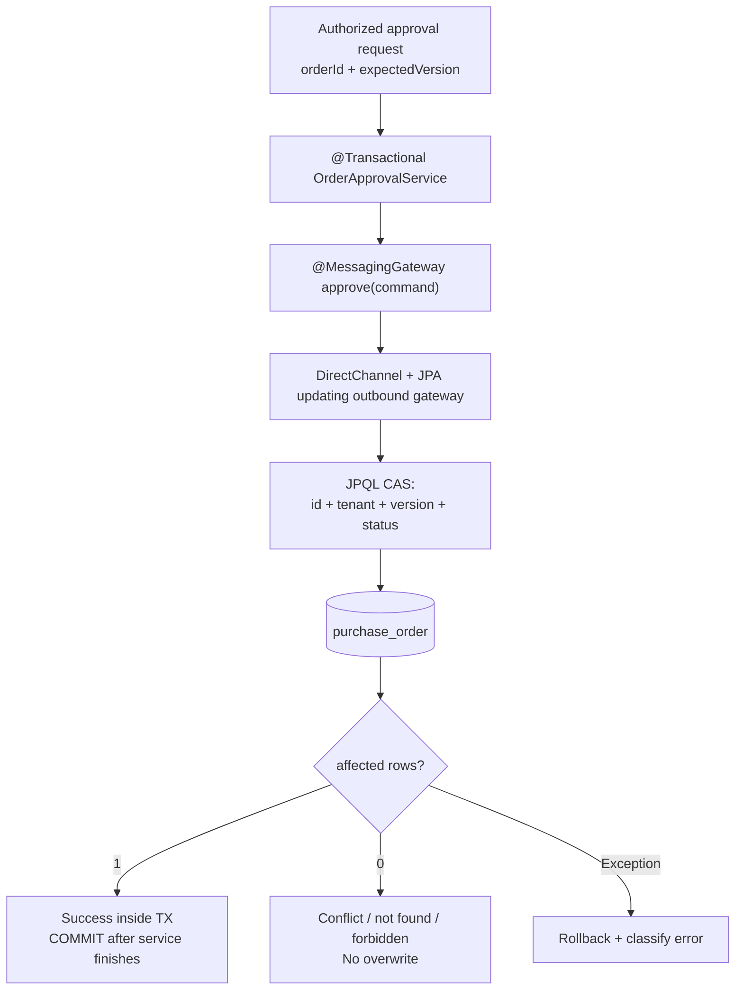
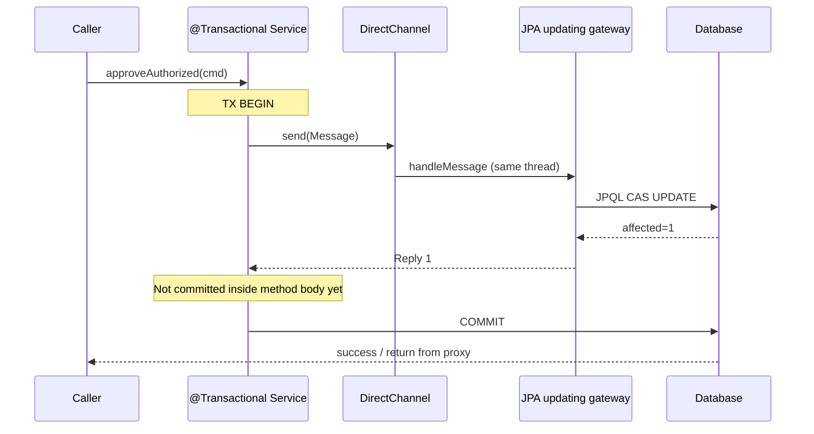
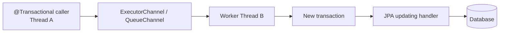
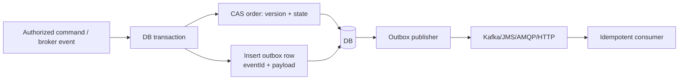

# Optimistic Locking on Updates

## 1. Context and Goals

The **SPRING_INTEGRATION_ADAPTERS** module connects external systems into Spring Integration using inbound/outbound adapters, gateways, pollers, and `MessageChannel`. In a business system, the same record can be modified by an HTTP request, a Kafka/JMS/AMQP message, a file/SFTP poller, or a background job. If two concurrent flows read the same stale state and write back, the last write can **overwrite the earlier update** without anyone noticing.

This lesson, **Optimistic Locking on Updates**, belongs to the **Adapter JPA** chapter. It focuses on using **Jakarta Persistence `@Version`** and **version predicates in the JPA updating outbound gateway** to protect data from *lost updates*, while handling conflicts cleanly with transactions, retries, idempotency, and authorization.

After this lesson, you will be able to:

- Describe *lost updates*, stale entities, and why a single transaction alone is insufficient under concurrent requests.
- Explain how `@Version`, the persistence context, dirty checking, `flush`, and `commit` work together to detect optimistic conflicts.
- Distinguish `OptimisticLockException` from `OptimisticLockingFailureException` and exceptions translated by Spring/JPA providers.
- Know when optimistic failures can occur: at `merge`, `flush`, or `commit`, not necessarily when mutating a field.
- Write versioned JPA entities and `@Transactional` services that update managed entities properly.
- Build a **JPA updating outbound gateway** using JPQL **compare-and-set (CAS)** returning the **affected-row count** via `@MessagingGateway`.
- Avoid confusing automatic entity-lifecycle `@Version` with **JPQL bulk `UPDATE`**, which bypasses optimistic locking unless you add explicit version conditions.
- Handle `affectedRows=0` without leaking tenant details or mistaking it for an infrastructure error.
- Design conditional retries: never blindly retry a command carrying a stale `expectedVersion`.
- Test conflicts using two independent snapshots/transactions and two commands sharing the same version.
- Identify transaction boundaries across `DirectChannel`, `ExecutorChannel`, `QueueChannel`, and Kafka/JMS/SFTP sources.
- Combine idempotency, transactional inbox/outbox, fencing tokens, and monitoring for multi-worker systems.

> **Key point:** Optimistic locking does not prevent two callers from **reading** the same row; it detects that **at least one caller modified the row after the other read it**. The application must decide how to handle conflicts: return an error, reload for user resolution, or safely re-execute a commutative operation.

## 2. Lost Update: The Problem Before Optimistic Locking

### 2.1. Two Transactions Reading the Same Record

Suppose order `ORD-101` is `PENDING` with editable `quantity=5`.

```mermaid
sequenceDiagram
    participant A as Request A / Tx A
    participant B as Request B / Tx B
    participant DB as Database
    A->>DB: SELECT ORD-101 → quantity=5
    B->>DB: SELECT ORD-101 → quantity=5
    A->>A: quantity=8
    B->>B: quantity=6
    A->>DB: UPDATE quantity=8
    DB-->>A: COMMIT
    B->>DB: UPDATE quantity=6
    DB-->>B: COMMIT
    Note over DB: Final result = 6; A's update overwritten
```

Without proper concurrency control, transaction B writes from its stale snapshot and wipes out transaction A's change.

This is a *lost update*. Not every database or isolation level allows this exact interleaving—higher isolation or locking may block or fail—yet **you should never rely on default isolation** instead of an explicit business-level optimistic concurrency contract.

### 2.2. Adding a Version Column

Now the row includes:

```text
id       = ORD-101
quantity = 5
version  = 7
```

Each writer issues an update shaped like:

```sql
update purchase_order
set quantity = ?, version = version + 1
where id = ? and version = 7
```

The first writer succeeds: the row moves from version `7 → 8`. The second writer still using `version=7` gets **0 rows matched** or triggers an optimistic conflict in the JPA provider.

```mermaid
sequenceDiagram
    participant A as Tx A (version 7)
    participant B as Tx B (version 7)
    participant DB as Database
    A->>DB: UPDATE ... WHERE version=7
    DB-->>A: affected=1, version=8
    A->>DB: COMMIT
    B->>DB: UPDATE ... WHERE version=7
    DB-->>B: affected=0
    Note over B: Conflict; does not overwrite A's data
```

**There is no "global Java lock" here.** The database still executes UPDATEs under DB concurrency, isolation, and row locks. Optimistic locking is a **write-time precondition check**.

### 2.3. Conflicts Differ from Duplicates

Two requests can collide in different ways:

- Both edit the same row starting from the same version → **optimistic conflict**.
- The same event arrives again via Kafka/JMS redelivery → **duplicate delivery**.
- The same payment API call arrives twice with one idempotency key → **duplicate command**.
- Two workers run one job after a lease expires → **stale worker/fencing conflict**.

`@Version` primarily protects **concurrent modifications to an entity**. It **does not automatically** deduplicate events, guarantee once-only HTTP side effects, or enforce tenant authorization.

## 3. Jakarta Persistence @Version

### 3.1. Basic Mapping

```java
import jakarta.persistence.Entity;
import jakarta.persistence.Id;
import jakarta.persistence.Version;

@Entity
public class ExampleDocument {

    @Id
    private String id;

    @Version
    private Long version;

    // Other fields, constructor, and getters...
}
```

For versioned entities, the JPA provider checks the version whenever the entity is updated or deleted via standard entity-lifecycle operations. Generated SQL looks conceptually like:

```sql
update example_document
set content = ?, version = ?
where id = ? and version = ?
```

If the updated row count misses expectations, JPA detects stale state and throws an optimistic locking exception.

### 3.2. Rules to Remember

- Declare only **one version attribute** per entity per the portability contract.
- Map the version column on the entity's **primary table**.
- Place `@Version` on fields or properties consistently with your JPA access strategy.
- `Long`/`long`, `Integer`/`int`, and other spec-supported version types work; if using timestamps, check spec/provider rules.
- **Do not manually assign or increment the version in Java business services** on managed entities; the provider owns the version lifecycle.
- `@Version` is **not an event sequence number**, not an audit timestamp, and not an idempotency key.
- An update that *modifies no persistent state* might not increment the version unless an optimistic force increment is requested.
- Never hardcode assumptions about the initial post-INSERT version (`0` vs. `1`); read the actual version from the persisted entity or DB.

### 3.3. Distinguishing @Version and ETag

| Concept | Scope | Purpose |
| --- | --- | --- |
| `@Version` | JPA entity / persistence provider | Detects concurrent updates/deletes |
| HTTP `ETag` + `If-Match` | HTTP resource contract | Lets clients require no intermediate modification |
| `eventId` / idempotency key | Command / delivery | Eliminates duplicate event processing |
| `claimGeneration` / fencing token | Distributed job ownership | Blocks stale workers from finishing expired claims |
| DB transaction isolation | Concurrent transactions | Defines visibility and locking across transactions |

You can **include an entity's version inside an ETag** when the API format and semantics are designed consistently. However, `@Version` does not generate `ETag` headers automatically; your HTTP controller/service must handle that.

### 3.4. Two Independent Persistence Contexts

```text
Tx A:
  find(ORD-101) → managed order A, version 7
  update fields
  flush/commit → version 8

Tx B:
  find(ORD-101) before A's commit → managed order B, version 7
  update fields
  flush/commit → optimistic conflict
```

Inside each persistence context, `em.contains(order)` is `true`, yet that **does not** guarantee the object reflects the latest committed DB row. A managed entity in transaction B can already be stale relative to what A just committed.

## 4. Which JPA APIs Honor @Version?

### 4.1. Dirty Checking on a Managed Entity

```java
@Transactional
public void changeStatus(String orderId) {
    PurchaseOrder managed =
            em.find(PurchaseOrder.class, orderId);

    if (managed == null) {
        throw new IllegalArgumentException("Not found");
    }

    managed.approve();

    // Provider checks version at flush/commit.
    // Do not modify managed.version manually.
}
```

Because `managed` is tracked by JPA, mutating business fields inside the transaction triggers dirty checking. If another transaction committed first, the version check fails **at flush or commit**.

### 4.2. Merging a Detached Entity

```java
PurchaseOrder managedCopy = em.merge(detachedOrder);
```

With `@Version`, the provider checks the detached entity's version. If the detached snapshot is older than the DB row, `merge` raises `OptimisticLockException` either immediately or at flush/commit depending on the provider.

**Two key points:**

- The instance returned by `merge` is the **managed copy**, not necessarily the same reference as `detachedOrder`.
- Never accept raw entity JSON from clients and `merge` every field unvalidated: that lets callers overwrite protected fields and introduces mass-assignment vulnerabilities.

In APIs, accept a **command DTO** carrying `expectedVersion` and only editable fields.

### 4.3. Removing an Entity

```java
@Transactional
public void deleteOrder(String id) {
    PurchaseOrder managed = em.find(PurchaseOrder.class, id);
    if (managed != null) {
        em.remove(managed);
    }
}
```

When deleting a **managed versioned entity**, the provider enforces the version check to catch stale deletions. By contrast, a JPQL bulk `DELETE` **does not** invoke entity-lifecycle optimistic locking unless your query explicitly checks the version.

### 4.4. LockModeType.OPTIMISTIC

```java
PurchaseOrder current =
        em.find(PurchaseOrder.class, orderId,
                LockModeType.OPTIMISTIC);
```

`OPTIMISTIC` requests optimistic consistency checks even when a transaction only reads an entity that must remain unchanged until commit. `OPTIMISTIC_FORCE_INCREMENT` forces a version bump on a versioned entity, usually at flush/commit.

**Do not confuse** `LockModeType.OPTIMISTIC` with `PESSIMISTIC_WRITE`: optimistic mode does not hold a DB row lock from read through write.

### 4.5. Bulk UPDATE/DELETE Is a Critical Exception

Per Jakarta Persistence, JPQL bulk `UPDATE`/`DELETE` executes directly on the database and **bypasses automatic entity-lifecycle optimistic locking checks**. It also **does not sync** managed entities already loaded in the persistence context.

Thus:

```sql
update PurchaseOrder o
set o.status = 'APPROVED'
where o.id = :orderId
```

**does not automatically append `o.version = :expectedVersion` just because the entity has `@Version`**.

To get optimistic CAS in bulk queries, **write the check and increment explicitly**:

```sql
update PurchaseOrder o
set o.status = 'APPROVED',
    o.version = o.version + 1
where o.id = :orderId
  and o.version = :expectedVersion
  and o.status = 'PENDING'
```

This is central when using the **Spring Integration JPA updating outbound gateway**.

## 5. How Spring Reports Optimistic Locking Failures

### 5.1. Root and Spring Exceptions

| Type | Where Encountered | Meaning |
| --- | --- | --- |
| `jakarta.persistence.OptimisticLockException` | JPA provider / `EntityManager` | Version check failed; transaction marked for rollback |
| `org.springframework.dao.OptimisticLockingFailureException` | Spring data access abstraction | Concurrency conflict classification |
| `org.springframework.orm.ObjectOptimisticLockingFailureException` | Spring ORM | Optimistic conflict with entity/ID if available |
| `org.springframework.orm.jpa.JpaOptimisticLockingFailureException` | Spring JPA exception translation | JPA optimistic exception translated to Spring |
| `org.springframework.integration.MessageHandlingException` | Messaging handler wrapper (flow-dependent) | May wrap the JPA error as a cause |
| `DataIntegrityViolationException` | Other constraint violations (unique/FK/NOT NULL...) | Not every constraint error is an optimistic conflict |

Exact exception classes depend on the provider, Spring transaction manager, exception translation, and message routing. In an Integration Flow, you may need to **walk the cause chain** to recognize optimistic conflicts; never catch every `RuntimeException` and report "version conflict".

### 5.2. Exception Timing

```mermaid
sequenceDiagram
    participant C as Caller
    participant S as @Transactional Service
    participant EM as EntityManager
    participant DB as Database
    C->>S: approve(command)
    S->>EM: find(entity)
    S->>EM: entity.approve()
    Note over EM: Entity dirty, may not have issued UPDATE yet
    S->>EM: flush() or commit
    EM->>DB: UPDATE WHERE version=old
    DB-->>EM: 0 rows updated
    EM-->>S: OptimisticLockException
    S-->>C: Exception; transaction rolled back
```

**Do not assume the exception fires at `setStatus`.** With `@Version`, `em.flush()` or commit is usually when the check executes (some providers check earlier in `merge`).

### 5.3. Never Retry Inside a Failed Transaction

After `OptimisticLockException`, the JPA transaction is normally marked rollback-only. Never do this:

```java
@Transactional
public void unsafeRetry(String id) {
    try {
        update(id);
    } catch (OptimisticLockException ex) {
        update(id); // Wrong: same transaction/PC may already be unusable.
    }
}
```

Let the current transaction roll back, **open a fresh transaction** if business rules allow retrying, reload the latest state, and re-run business logic. For user-driven optimistic conflicts, returning HTTP `409`/`412` and asking the client to fetch the new version is often the right choice.

## 6. Two Optimistic Concurrency Strategies in Spring Integration JPA

| Strategy | Execution | Conflict Detection | Reply Contract |
| --- | --- | --- | --- |
| **Entity-mode managed update** | `@Transactional` service, `em.find` then mutate managed entity; or entity-mode updating adapter/gateway | `@Version` checks automatically; throws exception | Success or exception; entity-mode gateway can return entity |
| **JPQL conditional UPDATE (CAS)** | `Jpa.updatingGateway(...)` with `WHERE version=:expected` and explicit increment | JPA query returns **affected row count 0 or 1** | `Integer`/count; usually does not throw optimistic exception on zero match |
| **JPQL bulk UPDATE without version predicate** | `update ... where id=:id` | **No automatic optimistic check** | Affected count, yet risks lost updates |
| **Pessimistic locking** | `em.find(..., PESSIMISTIC_WRITE)` / SQL row lock | Lock/timeout/deadlock + DB isolation | Different from optimistic conflict |
| **Atomic business predicate without version** | `UPDATE ... WHERE state='PENDING'` | Affected count guards one specific transition | `0`/`1`, yet lacks full version check |

**Subtle note:** conditional `UPDATE` on `state` may suffice for "claim job if `NEW`", yet does not protect all business fields. Whenever a command derives from an earlier read and must guard against *any* intermediate entity change, add `expectedVersion`.

### 6.1. When to Choose Managed Updates?

Choose when:

- Business logic spans a complex object graph.
- You rely on JPA lifecycle callbacks, cascades, or entity-level validation.
- You need dirty checking, entity associations, and domain methods.
- You want the provider to enforce version checks automatically.
- Transactions are short and entities never cross async boundaries.

### 6.2. When to Choose Updating Gateway CAS?

Choose when:

- The command is a clean state transition carrying `id`, `tenantId`, and `expectedVersion`.
- Downstream routers/services need the `affectedRows` result.
- You want to skip an extra pre-update `SELECT` roundtrip.
- You need an atomic conditional update before emitting downstream events.
- Bypassing entity lifecycle callbacks and dirty checking is acceptable.
- You handle stale persistence contexts if entities were loaded beforehand.

The two approaches **are not completely interchangeable**; pick based on domain invariants and side effects.

## 7. Example Design: Version-Guarded Order Approval

The hands-on scenario approves purchase orders:

- Table `purchase_order` has `id`, `tenant_id`, `status`, `total_amount`, and `version`.
- A user or external event requests `PENDING → APPROVED`.
- Requests carry `orderId`, an authenticated tenant scope, and `expectedVersion` from an earlier read.
- If the row is still `PENDING`, belongs to the tenant, and matches version: update, increment version, return `affectedRows=1`.
- Otherwise: return `0` without touching the row.
- On DB errors: throw an exception and roll back rather than faking a `0` result.
- Do not emit Kafka/HTTP events inside the transaction without bridging the commit/publish gap.



This is a **request–reply flow between an application service and a Spring Integration JPA updating gateway**—not a scheduled JPA inbound poller. A poller could invoke the same service in another workflow, with its own ownership and transaction boundaries.

## 8. Maven and Environment Configuration

The demo uses **Java 17+**, Spring Boot 3.x, Spring Integration 6.x, Spring Data JPA, Jakarta Persistence, and H2.

### 8.1. Dependencies

```xml
<dependencies>
    <dependency>
        <groupId>org.springframework.boot</groupId>
        <artifactId>spring-boot-starter</artifactId>
    </dependency>
    <dependency>
        <groupId>org.springframework.boot</groupId>
        <artifactId>spring-boot-starter-data-jpa</artifactId>
    </dependency>
    <dependency>
        <groupId>org.springframework.boot</groupId>
        <artifactId>spring-boot-starter-integration</artifactId>
    </dependency>
    <dependency>
        <groupId>org.springframework.integration</groupId>
        <artifactId>spring-integration-jpa</artifactId>
    </dependency>
    <dependency>
        <groupId>com.h2database</groupId>
        <artifactId>h2</artifactId>
        <scope>runtime</scope>
    </dependency>
    <dependency>
        <groupId>org.springframework.boot</groupId>
        <artifactId>spring-boot-starter-test</artifactId>
        <scope>test</scope>
    </dependency>
</dependencies>
```

Use the Spring Boot BOM/dependency management to keep versions aligned. Never pair Spring Framework 6.x with unsupported Spring Integration versions manually. On Spring Boot 4 / Spring Integration 7, verify APIs and migration guides before copying code.

### 8.2. application.properties

```properties
spring.main.web-application-type=none

spring.datasource.url=jdbc:h2:mem:optimistic_demo;DB_CLOSE_DELAY=-1
spring.datasource.driver-class-name=org.h2.Driver
spring.datasource.username=sa
spring.datasource.password=

spring.jpa.hibernate.ddl-auto=create-drop
spring.jpa.open-in-view=false

logging.level.org.springframework.integration=INFO
```

In-memory H2 and `ddl-auto=create-drop` are **strictly for learning and testing**. Production requires a real DB (PostgreSQL/MySQL/Oracle...), migrations (Flyway/Liquibase), connection pooling, query/transaction timeouts, least-privilege credentials, and monitoring.

## 9. Entity, Repository, and Command DTOs

All demo Java files live in package `com.example.jpaoptimistic`.

### 9.1. PurchaseOrder Entity

File `PurchaseOrder.java`:

```java
package com.example.jpaoptimistic;

import java.math.BigDecimal;

import jakarta.persistence.Column;
import jakarta.persistence.Entity;
import jakarta.persistence.Id;
import jakarta.persistence.Table;
import jakarta.persistence.Version;

@Entity
@Table(name = "purchase_order")
public class PurchaseOrder {

    @Id
    @Column(name = "order_id", length = 80, nullable = false)
    private String id;

    @Column(name = "tenant_id", length = 60, nullable = false)
    private String tenantId;

    @Column(nullable = false, length = 24)
    private String status;

    @Column(name = "total_amount", precision = 12,
            scale = 2, nullable = false)
    private BigDecimal totalAmount;

    @Version
    private Long version;

    protected PurchaseOrder() {
        // Jakarta Persistence requires a no-arg constructor.
    }

    public PurchaseOrder(
            String id, String tenantId,
            String status, BigDecimal totalAmount) {
        this.id = id;
        this.tenantId = tenantId;
        this.status = status;
        this.totalAmount = totalAmount;
    }

    public String getId() {
        return id;
    }

    public String getTenantId() {
        return tenantId;
    }

    public String getStatus() {
        return status;
    }

    public BigDecimal getTotalAmount() {
        return totalAmount;
    }

    public Long getVersion() {
        return version;
    }

    public void approve() {
        if (!"PENDING".equals(status)) {
            throw new IllegalStateException(
                    "Only PENDING orders can be approved");
        }
        status = "APPROVED";
    }
}
```

**Important:**

- `@Version` is managed by the JPA provider during entity-lifecycle operations.
- The demo uses `Long version` so commands can read the current version easily.
- Domain method `approve()` guards state transitions in **entity-mode** updates.
- JPQL CAS below **bypasses `approve()`**, so `status='PENDING'` is enforced directly in JPQL.
- If additional domain invariants, callbacks, or cascades exist, evaluate whether JPQL bulk updates are appropriate.
- When adding `@Version` to existing tables, migrations must backfill non-null versions compatibly with your provider.

### 9.2. Repository for Seeding and Verification

File `PurchaseOrderRepository.java`:

```java
package com.example.jpaoptimistic;

import org.springframework.data.jpa.repository.JpaRepository;

public interface PurchaseOrderRepository
        extends JpaRepository<PurchaseOrder, String> {
}
```

The repository seeds rows and inspects state/version **after commit**. Primary approval updates run through the **JPA updating outbound gateway**, not `repository.save(...)` bypassing the Integration Flow.

### 9.3. Command DTO

File `ApproveOrderCommand.java`:

```java
package com.example.jpaoptimistic;

public record ApproveOrderCommand(
        String orderId,
        String tenantId,
        Long expectedVersion) {
}
```

This is an **internal DTO populated after scope authorization**. Never let clients submit an arbitrary `tenantId` as proof of permission. `expectedVersion` must come from an earlier read (for UIs, via a response field or `ETag`).

### 9.4. View DTO

File `OrderView.java`:

```java
package com.example.jpaoptimistic;

import java.math.BigDecimal;

public record OrderView(
        String id,
        String status,
        Long version,
        BigDecimal totalAmount) {

    public static OrderView from(PurchaseOrder entity) {
        return new OrderView(
                entity.getId(),
                entity.getStatus(),
                entity.getVersion(),
                entity.getTotalAmount());
    }
}
```

Returning DTOs over HTTP/Kafka/WebSocket is safer than returning managed JPA entities directly, avoiding unexpected lazy loads and limiting exposed fields. Never accept a client's `OrderView` and merge it straight into `PurchaseOrder`.

## 10. Spring Integration JPA Updating Outbound Gateway (CAS)

### 10.1. @MessagingGateway

File `OrderApprovalGateway.java`:

```java
package com.example.jpaoptimistic;

import org.springframework.integration.annotation.MessagingGateway;

@MessagingGateway(
        defaultRequestChannel = "approveOrderRequests",
        defaultReplyTimeout = "5000")
public interface OrderApprovalGateway {

    Integer approve(ApproveOrderCommand command);
}
```

`@MessagingGateway` builds a request Spring Message, sends it into the channel, and awaits an `Integer` reply. This is the **application** gateway to Spring Integration; the handler's "updating outbound gateway" role means it performs the JPA `UPDATE` and emits a reply.

### 10.2. Java DSL Flow

File `OrderApprovalIntegrationConfiguration.java`:

```java
package com.example.jpaoptimistic;

import jakarta.persistence.EntityManagerFactory;

import org.springframework.context.annotation.Bean;
import org.springframework.context.annotation.Configuration;
import org.springframework.integration.config.EnableIntegration;
import org.springframework.integration.dsl.IntegrationFlow;
import org.springframework.integration.jpa.dsl.Jpa;

@Configuration
@EnableIntegration
public class OrderApprovalIntegrationConfiguration {

    @Bean
    IntegrationFlow approveOrderFlow(
            EntityManagerFactory entityManagerFactory) {

        return IntegrationFlow.from("approveOrderRequests")
                .handle(
                        Jpa.updatingGateway(entityManagerFactory)
                                .jpaQuery("""
                                        update PurchaseOrder o
                                           set o.status = 'APPROVED',
                                               o.version = o.version + 1
                                         where o.id = :orderId
                                           and o.tenantId = :tenantId
                                           and o.status = 'PENDING'
                                           and o.version = :expectedVersion
                                        """)
                                .parameterExpression(
                                        "orderId",
                                        "payload.orderId()")
                                .parameterExpression(
                                        "tenantId",
                                        "payload.tenantId()")
                                .parameterExpression(
                                        "expectedVersion",
                                        "payload.expectedVersion()"))
                .get();
    }
}
```

**Reading the query clause by clause:**

1. `o.id = :orderId`: targets the exact business aggregate.
2. `o.tenantId = :tenantId`: enforces the service-authenticated tenant scope.
3. `o.status = 'PENDING'`: prevents re-approving already `APPROVED`/`CANCELLED` orders.
4. `o.version = :expectedVersion`: compares the caller's snapshot against the current DB row.
5. `o.version = o.version + 1`: **explicitly increments version**, since JPQL bulk updates do not.
6. `Jpa.updatingGateway` returns the **affected row count** for JPQL UPDATEs—`0` or `1` for unique IDs.
7. `parameterExpression(...)` extracts **values** from the Spring Message without dynamic JPQL concatenation.

With explicit parameter expressions, Spring Integration evaluates SpEL against the **entire Message** (`payload.*`, `headers[...]`); you can add `usePayloadAsParameterSource(false)` in DSL to make the root explicit. The example uses `payload.orderId()` record accessors.

**Limitation:** bulk `UPDATE` **does not invoke** `approve()`, `@PreUpdate` entity listeners, or entity-graph cascades. The JPQL `WHERE` clause must capture all relevant business invariants, or you should use a managed entity update instead.

### 10.3. Affected Count Is Not OptimisticLockException

For this CAS query:

| Affected Count | Possible Meaning | Recommended Handling |
| --- | --- | --- |
| `1` | One row matched ID + tenant + status + version and updated | Proceed; commit transaction before reporting success |
| `0` | Missing row, wrong tenant, different status, or stale version | Return conflict/not-found per policy; do not overwrite |
| `>1` | Abnormal when `id` is a unique primary key | Treat as config/data bug and roll back |
| Exception | DB timeout/lock, invalid JPQL, transaction failure | Roll back and classify retryability |
| `null` reply | Broken contract/flow or mapping error | Never treat as success |

**Never assume `affected=0` throws `OptimisticLockException`.** JPQL bulk CAS bypasses automatic version checking, so `0` simply signals the `WHERE` predicates matched no rows.

### 10.4. Where Is the Transaction?

In the demo flow, synchronous `DirectChannel` lets the JPA handler join the caller thread's transaction opened by the service around the gateway call.

If replaced with `ExecutorChannel`/`QueueChannel`, the service's transaction **does not cross the thread boundary**. Put the transaction on the consumer and wire reply routing, correlation, and error handling explicitly instead of relying on `@Transactional` on the sender.

## 11. @Transactional Service and Sample Runner

### 11.1. Service Validating and Invoking the Gateway

File `OrderApprovalService.java`:

```java
package com.example.jpaoptimistic;

import org.springframework.stereotype.Service;
import org.springframework.transaction.annotation.Transactional;

@Service
public class OrderApprovalService {

    private final OrderApprovalGateway gateway;

    public OrderApprovalService(OrderApprovalGateway gateway) {
        this.gateway = gateway;
    }

    @Transactional
    public boolean approveAuthorized(
            String verifiedTenantId,
            String orderId,
            Long expectedVersion) {

        // Must obtain verifiedTenantId from an authenticated
        // server-side principal/ACL, never trust client input.
        if (verifiedTenantId == null
                || verifiedTenantId.isBlank()
                || verifiedTenantId.length() > 60
                || orderId == null
                || orderId.isBlank()
                || orderId.length() > 80
                || expectedVersion == null
                || expectedVersion < 0) {
            throw new IllegalArgumentException(
                    "Invalid approval command");
        }

        ApproveOrderCommand command =
                new ApproveOrderCommand(
                        orderId, verifiedTenantId, expectedVersion);

        Integer affected = gateway.approve(command);

        if (affected == null || affected < 0 || affected > 1) {
            throw new IllegalStateException(
                    "Unexpected update count: " + affected);
        }

        // true when one row matches CAS, false when none matches.
        // Transaction commits after the method exits.
        return affected == 1;
    }
}
```

When callers invoke this public method **through the Spring transactional proxy**:

- The transaction starts before `gateway.approve`.
- The JPA handler runs synchronously, executing JPQL `UPDATE` in that transaction.
- `affected==1` shows the query matched, **yet commit has not happened inside the method body**.
- The Spring transaction interceptor commits as the method exits; callers get a normal return only after the transaction manager succeeds.
- If commit fails, an exception fires **after the `return` statement** before control returns from the proxy.
- `affected==0` is still a valid transaction modifying zero rows; the service returns `false` as a business outcome rather than a DB error.

**Self-invocation:** calling `this.approveAuthorized(...)` inside the same Spring bean bypasses the transactional proxy. Always invoke from another bean or proxy-managed boundary.

### 11.2. Bootstrapping and Seeding Data

File `JpaOptimisticApplication.java`:

```java
package com.example.jpaoptimistic;

import java.math.BigDecimal;
import java.util.List;

import org.springframework.boot.CommandLineRunner;
import org.springframework.boot.SpringApplication;
import org.springframework.boot.autoconfigure.SpringBootApplication;
import org.springframework.context.annotation.Bean;
import org.springframework.integration.annotation.IntegrationComponentScan;

@SpringBootApplication
@IntegrationComponentScan
public class JpaOptimisticApplication {

    public static void main(String[] args) {
        SpringApplication.run(JpaOptimisticApplication.class, args);
    }

    @Bean
    CommandLineRunner sample(
            PurchaseOrderRepository repository,
            OrderApprovalService service) {

        return args -> {
            if (repository.count() == 0) {
                repository.saveAll(List.of(
                        new PurchaseOrder(
                                "ORD-101", "TENANT-A", "PENDING",
                                new BigDecimal("120.00")),
                        new PurchaseOrder(
                                "ORD-102", "TENANT-B", "PENDING",
                                new BigDecimal("80.00"))));
            }

            PurchaseOrder before =
                    repository.findById("ORD-101").orElseThrow();

            Long oldVersion = before.getVersion();

            System.out.println(
                    "Before: " + OrderView.from(before));

            boolean first = service.approveAuthorized(
                    "TENANT-A", "ORD-101", oldVersion);

            boolean stale = service.approveAuthorized(
                    "TENANT-A", "ORD-101", oldVersion);

            PurchaseOrder after =
                    repository.findById("ORD-101").orElseThrow();

            System.out.println("First approval: " + first);
            System.out.println("Stale approval: " + stale);
            System.out.println(
                    "After: " + OrderView.from(after));
        };
    }
}
```

**Expected output** (initial version number is provider-determined):

```text
Before: OrderView[id=ORD-101, status=PENDING, version=<v>, ...]
First approval: true
Stale approval: false
After: OrderView[id=ORD-101, status=APPROVED, version=<v+1>, ...]
```

In the block above, `<v>` and `<v+1>` are placeholders, **not literal text output**. Tests should read the actual persisted version from the DB and compare it against the post-update version.

### 11.3. Is a Retrieving Gateway Also Needed?

It is optional for the demo: the repository fetches the initial version before issuing the approval command. In a fully message-driven architecture, use `Jpa.retrievingGateway(entityManagerFactory)` or a `@Transactional(readOnly=true)` service to return `OrderView`, then supply that version in the update command.

**Never assume** a JPA retrieving gateway keeps a persistence context open until an HTTP client replies minutes later. Clients hold only a **snapshot DTO/version**; write commands must re-verify the version at write time.

## 12. Testing Version-Guarded CAS

### 12.1. SpringBootTest Without an Outer Transaction

File `OrderApprovalIntegrationTest.java`:

```java
package com.example.jpaoptimistic;

import static org.assertj.core.api.Assertions.assertThat;

import java.math.BigDecimal;
import java.util.UUID;

import org.junit.jupiter.api.Test;
import org.springframework.beans.factory.annotation.Autowired;
import org.springframework.boot.test.context.SpringBootTest;

@SpringBootTest
class OrderApprovalIntegrationTest {

    @Autowired
    PurchaseOrderRepository repository;

    @Autowired
    OrderApprovalService service;

    @Test
    void approvesOnceAndRejectsStaleVersion() {
        String id = "approve-" + UUID.randomUUID();
        repository.saveAndFlush(
                new PurchaseOrder(
                        id, "TENANT-A", "PENDING",
                        new BigDecimal("42.00")));

        Long expected = repository.findById(id)
                .orElseThrow().getVersion();

        boolean first = service.approveAuthorized(
                "TENANT-A", id, expected);

        boolean stale = service.approveAuthorized(
                "TENANT-A", id, expected);

        PurchaseOrder after =
                repository.findById(id).orElseThrow();

        assertThat(first).isTrue();
        assertThat(stale).isFalse();
        assertThat(after.getStatus())
                .isEqualTo("APPROVED");
        assertThat(after.getVersion())
                .isEqualTo(expected + 1);
    }

    @Test
    void rejectsWrongTenantWithoutModifyingRow() {
        String id = "tenant-" + UUID.randomUUID();

        repository.saveAndFlush(
                new PurchaseOrder(
                        id, "TENANT-B", "PENDING",
                        new BigDecimal("10.00")));

        Long version = repository.findById(id)
                .orElseThrow().getVersion();

        boolean result = service.approveAuthorized(
                "TENANT-A", id, version);

        PurchaseOrder after =
                repository.findById(id).orElseThrow();

        assertThat(result).isFalse();
        assertThat(after.getStatus()).isEqualTo("PENDING");
        assertThat(after.getVersion()).isEqualTo(version);
    }

    @Test
    void rejectsUnknownOrder() {
        boolean result = service.approveAuthorized(
                "TENANT-A",
                "missing-" + UUID.randomUUID(),
                0L);

        assertThat(result).isFalse();
    }
}
```

**Why omit `@Transactional` on the test methods?** If the test opens a transaction and rolls back at the end, the `@Transactional(REQUIRED)` service joins it—hiding real commit timing and reading from the same persistence context. Testing optimistic CAS requires realistic independent transactions.

### 12.2. What the Tests Prove

- `WHERE version = :expectedVersion` matches on the first call.
- JPQL **explicitly increments version** on update.
- A stale request cannot overwrite the new state.
- Tenant mismatches leave the row untouched.
- Not-found returns `0`/`false` without inserting anything.
- Final results are observed from the repository **after the service transaction**.

### 12.3. What the Tests Do Not Prove Yet

- Two transactions running concurrently in parallel.
- Automatic entity-lifecycle `@Version` throwing `OptimisticLockException`.
- Provider behavior on flush/commit deadlocks or timeouts.
- Exactly-once delivery across Kafka/JMS/HTTP.
- Tenant authorization in an HTTP controller.
- Query plans and version scaling on large production tables.

Those require dedicated tests in the following sections, especially on your target database or Testcontainers.

## 13. Testing Automatic @Version with a Stale Detached Entity

Section 10 used **JPQL CAS** returning `affected=0`. To observe **provider-managed optimistic locking on managed/merged entities**, capture a detached snapshot, update the row in a second transaction, and attempt to merge the stale snapshot.

### 13.1. Three Independent Transactions

```mermaid
sequenceDiagram
    participant T1 as Transaction 1
    participant T2 as Transaction 2
    participant T3 as Transaction 3
    participant DB as Database
    T1->>DB: SELECT ORDER-1 version=0
    DB-->>T1: detached snapshot after commit
    T2->>DB: SELECT ORDER-1 version=0
    T2->>T2: approve()
    T2->>DB: UPDATE ... WHERE version=0
    DB-->>T2: commit → version=1
    T3->>DB: merge(detached version=0)
    DB-->>T3: optimistic failure
    Note over T3: Transaction rolls back; version=1 not overwritten
```

Unlike the CAS test, this expects a provider/Spring exception rather than `affectedRows`.

### 13.2. @SpringBootTest Using TransactionTemplate

File `ManagedVersionIntegrationTest.java`:

```java
package com.example.jpaoptimistic;

import static org.assertj.core.api.Assertions.assertThat;
import static org.assertj.core.api.Assertions.assertThatThrownBy;

import java.math.BigDecimal;
import java.util.UUID;

import jakarta.persistence.EntityManager;
import jakarta.persistence.OptimisticLockException;
import jakarta.persistence.PersistenceContext;

import org.junit.jupiter.api.Test;
import org.springframework.beans.factory.annotation.Autowired;
import org.springframework.boot.test.context.SpringBootTest;
import org.springframework.dao.OptimisticLockingFailureException;
import org.springframework.transaction.PlatformTransactionManager;
import org.springframework.transaction.support.TransactionTemplate;

@SpringBootTest
class ManagedVersionIntegrationTest {

    @Autowired
    PurchaseOrderRepository repository;

    @Autowired
    PlatformTransactionManager transactionManager;

    @PersistenceContext
    EntityManager em;

    @Test
    void staleDetachedMergeCannotOverwriteNewVersion() {
        String id = "merge-" + UUID.randomUUID();

        repository.saveAndFlush(
                new PurchaseOrder(
                        id, "TENANT-A", "PENDING",
                        new BigDecimal("30.00")));

        TransactionTemplate tx =
                new TransactionTemplate(transactionManager);

        // TX #1: read, commit → returned object is detached.
        PurchaseOrder stale = tx.execute(status ->
                em.find(PurchaseOrder.class, id));

        Long oldVersion = stale.getVersion();

        // TX #2: update via managed entity.
        tx.executeWithoutResult(status -> {
            PurchaseOrder managed =
                    em.find(PurchaseOrder.class, id);
            managed.approve();
        });

        Long newVersion = repository.findById(id)
                .orElseThrow().getVersion();

        assertThat(newVersion).isGreaterThan(oldVersion);

        // TX #3: merge stale snapshot based on oldVersion.
        assertThatThrownBy(() ->
                tx.executeWithoutResult(status -> {
                    em.merge(stale);
                    em.flush();
                }))
                .satisfies(ex ->
                        assertThat(isOptimisticFailure(ex))
                                .isTrue());

        PurchaseOrder after =
                repository.findById(id).orElseThrow();

        assertThat(after.getStatus())
                .isEqualTo("APPROVED");
        assertThat(after.getVersion())
                .isEqualTo(newVersion);
    }

    private static boolean isOptimisticFailure(
            Throwable failure) {

        Throwable current = failure;

        while (current != null) {
            if (current instanceof OptimisticLockException
                    || current
                    instanceof OptimisticLockingFailureException) {
                return true;
            }
            current = current.getCause();
        }
        return false;
    }
}
```

**Explanation:**

- `TransactionTemplate` creates independent transactions with no `@Transactional` on the test method.
- `@PersistenceContext` injects Spring's shared transactional `EntityManager` proxy; inside each `tx.execute`, it binds to that transaction's persistence context.
- `stale` returned from TX #1 is detached.
- TX #2 modifies the row via a managed entity, and the JPA provider bumps `version`.
- TX #3 cannot overwrite the newer row using the stale entity's old version.
- Exceptions may be translated by Spring, wrapped by transaction/messaging layers, or raised at `merge`/`flush`/`commit`—so walking the cause chain is reliable.
- If changing providers or version specs, verify actual exception chains and timing.

**Limitation:** this tests a **sequential stale detached snapshot**, not a true two-thread race. It suffices to prove automatic `@Version` checking on `merge`; true concurrency testing comes next.

### 13.3. Concurrent Test with a Barrier

An advanced test runs two tasks concurrently:

```text
Thread A:
  TX BEGIN → find order (version V)
  await barrier
  approve() → flush/commit

Thread B:
  TX BEGIN → find order (version V)
  await barrier
  approve() → flush/commit

Expectation (on DB/provider supporting optimistic version check):
  Must not have 2 commits overwriting each other from version V.
  One transaction succeeds;
  the other must conflict or fail under
  the DB's concurrency/serialization policy.
```

You must use **two independent transactions and two persistence contexts**. Bound barrier wait times, transaction timeouts, and pool size, and prevent thread leaks. On H2, conflicts can manifest as different lock/timeout errors than on PostgreSQL/MySQL; run Testcontainers against your production DB engine to verify error classification.

**Never** share one real `EntityManager` created via `emf.createEntityManager()` across two threads because JPA `EntityManager` is not thread-safe. With Spring's `@PersistenceContext` proxy, each thread must open its own transaction context properly.

## 14. Retrying Optimistic Conflicts: When Right, When Wrong?

### 14.1. Do Not Auto-Retry Every Version Conflict

Consider a user viewing an order at `version=7`, changing the total from 100 to 120, and submitting. Meanwhile someone else updated it to 150 (`version=8`). If the server silently reloads `version=8` and overwrites 150 with 120, it **defeats optimistic locking**, because the first user never saw 150.

For interactive UI edits:

1. Return an explicit conflict error.
2. Return the fresh snapshot **after authorization** or tell the client to re-fetch.
3. Let the user review the diff and decide.
4. Submit a new command with the updated `expectedVersion`.

Never blindly "retry until winning" when overwriting user intent.

### 14.2. Retrying Can Be Valid for Re-Applicable Operations

Consider a valid event requesting **increment a counter by 1**. On a stale conflict, you can:

1. Roll back the failed transaction.
2. Open a fresh transaction.
3. Load the latest state.
4. Verify the event ID has not already been applied.
5. Recompute the state/counter per business rules.
6. Commit.
7. Perform bounded retries if conflicts persist below the retry budget.

Still, if events arrive **at-least-once**, retrying without deduplication can **add 1 twice** after redelivery. Optimistic locking and idempotency must be designed together.

### 14.3. Retries Must Start a Fresh Transaction

Boundary-safe structure (illustrative pseudocode):

```java
public ApprovalResult approveWithPolicy(
        ApprovedScope scope,
        String orderId,
        Long expectedVersion) {

    // Example for a "compare and reject" API.
    // DO NOT auto-retry when expectedVersion is stale.
    boolean changed = approvalService.approveAuthorized(
            scope.tenantId(), orderId, expectedVersion);

    if (!changed) {
        return ApprovalResult.CONFLICT;
    }
    return ApprovalResult.APPROVED;
}
```

When a commutative operation truly warrants retries, use a **non-transactional orchestrator** invoking a **transactional worker bean** via the Spring proxy for each attempt:

```text
Orchestrator (not @Transactional)
    ↓ attempt 1
Transaction worker bean @Transactional → conflict → rollback
    ↓ backoff/jitter
Orchestrator
    ↓ attempt 2
Transaction worker bean @Transactional → reread + recompute → commit
```

Never catch an exception and re-run business logic inside the **same rollback-only transaction**. Never simply add `@Retryable` without checking AOP advice ordering, propagation, idempotency, exception taxonomy, and how new transactions open.

### 14.4. Backoff, Budget, and Dead Lettering

| Setting | Example Policy |
| --- | --- |
| `maxAttempts` | 3–5 attempts for allowed transient conflicts |
| Backoff | Exponential + jitter |
| Retryable exceptions | Optimistic conflict on commutative commands, deadlock/serialization/transient connection per domain |
| Non-retryable | Stale UI version, unauthorized, invariant violation |
| Idempotency key | Event/command ID from a trusted source |
| Once retries exhaust | Return conflict, move to `RETRYABLE`/`FAILED`, or DLQ per source type |
| Metrics | Conflict rate, attempt count, abandon count, latency |
| Error channel | Routes messaging errors; does not replace a durable DLQ |

Note that high optimistic conflict rates signal **abnormal contention**; raising attempt counts indefinitely only worsens DB overload.

## 15. JPQL Bulk UPDATE and Stale Persistence Contexts

### 15.1. Why Do Bulk Queries Differ from Managed Updates?

With JPQL:

```java
int changed = em.createQuery("""
        update PurchaseOrder o
        set o.status = 'APPROVED',
            o.version = o.version + 1
        where o.id = :id
          and o.version = :version
        """)
        .setParameter("id", id)
        .setParameter("version", expectedVersion)
        .executeUpdate();
```

the database updates directly. Any `PurchaseOrder` **already loaded** in the same persistence context still shows `status='PENDING'` and `version=old`, because JPQL bulk updates do not update managed Java instances in memory.

### 15.2. Stale Object Example Inside the Same Transaction

```java
@Transactional
public void demonstrateStaleContext(
        String orderId, Long expectedVersion) {

    PurchaseOrder old =
            em.find(PurchaseOrder.class, orderId);

    int updated = em.createQuery("""
            update PurchaseOrder o
            set o.status = 'APPROVED',
                o.version = o.version + 1
            where o.id = :orderId
              and o.version = :expected
              and o.status = 'PENDING'
            """)
            .setParameter("orderId", orderId)
            .setParameter("expected", expectedVersion)
            .executeUpdate();

    if (updated != 1) {
        return;
    }

    // old.getStatus() may still be PENDING;
    // old.getVersion() may still be the old version.
    em.refresh(old);
    // After refresh, state reflects DB per appropriate isolation.
}
```

This snippet belongs inside a service with `@PersistenceContext EntityManager em` rather than running standalone. `em.refresh(old)` discards unflushed local edits on the object, so **never call it casually in real business services**.

### 15.3. How Can This Break Subsequent Operations?

After a bulk `UPDATE`, the persistence context still manages the stale entity. If code modifies `old` and dirty checking flushes:

- The update can fail with an optimistic conflict due to the stale version.
- Or behavior depends on provider flush order and the earlier `UPDATE`.
- Pending changes prior to the bulk query may have auto-flushed right before the query.
- `clear()` detaches **the entire** context, including unrelated entities.

**Recommendation:** for gateway CAS, keep transactions **short and isolated** (update and commit without pre-loaded managed entities). If sharing a context is unavoidable, plan `refresh`/`clear`/reloads and flush ordering deliberately.

### 15.4. Bulk UPDATE Bypasses Several Entity-Lifecycle Behaviors

| Behavior | Managed Entity Update | JPQL Bulk UPDATE |
| --- | --- | --- |
| Dirty checking | Yes | Not per entity |
| Automatic `@Version` check | Yes | No; write predicates manually |
| Version increment | Provider-managed | Write `version = version + 1` explicitly |
| `@PreUpdate` / entity callbacks | Per entity lifecycle | Not fired per updated entity |
| Entity-graph cascades | Per mappings/lifecycle | Does not traverse entity graphs |
| Persistence context state | Managed instances tracked | Can become stale |
| Affected-row count | Usually not a service-level API | `executeUpdate` returns `int` |
| Business guards | Domain methods / service | `WHERE` predicates / service |

Never pick bulk updates solely to save roundtrips if your domain relies on callbacks, aggregate invariants, or synchronized child entities.

## 16. Spring Integration Adapters/Gateways and Optimistic Locking

### 16.1. JPA Updating Outbound Gateway

```text
Message<ApproveOrderCommand>
   → JPA updating gateway
   → JPQL UPDATE ... WHERE id + tenant + version + state
   → Reply<Integer affectedRows>
```

This fits a **CAS command** well. To map the integer into `Conflict`/`Approved` messages, add a transformer/router after the gateway with a clear contract.

### 16.2. JPA Outbound Channel Adapter

```text
Message<PurchaseOrder>
   → Jpa.outboundAdapter(...)
   → persist/merge/delete
   → no reply
```

In entity mode with `PersistMode.MERGE`, the provider checks `@Version` when merging a detached entity. However, the outbound adapter **emits no reply**; recovering from conflicts requires an error channel/exception handler holding enough context (entity ID, `eventId`, source).

**Never blindly feed** raw detached entities from Kafka payloads into `merge` without validating authorization, `expectedVersion`, and editable fields.

### 16.3. JPA Retrieving Outbound Gateway

```text
Message<String orderId>
   → Jpa.retrievingGateway(...)
   → OrderView/PurchaseOrder
   → Reply
```

The retrieving gateway is great for reading the current state/version. Yet after returning a snapshot to a UI or worker, the row can change; updates must enforce CAS/`@Version` at **write time**, never assuming freshness from an earlier `SELECT`.

### 16.4. JPA Inbound Adapter and Optimistic Locking

JPA inbound pollers periodically `SELECT` `NEW` rows. Two nodes can read the same row:

```text
Poller A SELECT job NEW, version 5
Poller B SELECT job NEW, version 5
A updates job PROCESSING, version 6
B updates job PROCESSING with version 5 → conflict / affected=0
```

**Warning:** if A and B already called HTTP/Kafka before confirming the claim commit, the optimistic conflict arrives **too late to undo external effects**. Use short conditional CAS claims, commit first, then process—paired with idempotency/fencing as needed.

### 16.5. SFTP, File, Kafka, JMS, AMQP, and HTTP

Across multi-adapter architectures:

- File/SFTP imports: attach `eventId` or file-row identity to prevent uncontrolled reprocessing if a file is re-scanned.
- Kafka/JMS/AMQP consumers: messages can be redelivered; optimistic locking does not deduplicate on its own.
- HTTP PUT/PATCH: pass `If-Match` or `expectedVersion` to block stale overwrites.
- WebSockets: clients may submit commands based on outdated versions; validate and authorize on receipt.
- DB polling: `SELECT` is not exclusive ownership; multiple workers need conditional `UPDATE`s.

All of these must define **who opens transactions**, **who owns jobs**, **when ACKs happen**, and **when external side effects count as complete**.

## 17. Transaction Boundaries and MessageChannel

### 17.1. Synchronous DirectChannel



Gateway reply `1` does not prove the outer service transaction committed. If commit fails, the JPA update rolls back and the caller receives an error despite the handler previously seeing affected count `1`.

### 17.2. Asynchronous ExecutorChannel / QueueChannel



- Transactions bound to the sender thread do not propagate to consumers.
- When JPA writes run on worker B, B needs its own transaction.
- Callers may see "message accepted" before the DB is updated.
- For request–reply, configure explicit reply routing, correlation, error channels, and realistic timeouts.
- `@MessagingGateway` reply timeout does not replace DB query/transaction timeouts.
- Never return `APPROVED` to an HTTP client before commit is confirmed per design.

### 17.3. Transaction Rollback After Optimistic Errors

When `OptimisticLockException` fires:

- The JPA transaction is normally marked for rollback.
- All other DB changes in the **same transaction** roll back.
- External side effects already sent **do not roll back automatically**.
- The exception may fire at flush or commit, outside the handler method body.
- Catching the exception in a handler to emit a success reply hides rollback-only state and triggers `UnexpectedRollbackException`.

Design explicit command outcomes—**APPLIED / CONFLICT / INVALID / ERROR**—and publish `APPLIED` only after commit or via an outbox.

## 18. Idempotency, Transactional Inbox/Outbox, and Optimistic Locking

### 18.1. Version Alone Does Not Solve Redelivery

Kafka/JMS/AMQP or polling sources can redeliver messages after failures:

```text
Event E123: approve ORD-101 expectedVersion=7

Attempt 1: UPDATE ... WHERE version=7 → affected=1, commit, version=8
Crash before broker ACK
Attempt 2: Event E123 redelivered → affected=0
```

On the second attempt, `affected=0` might mean:

- The event already succeeded earlier.
- Another event modified the row.
- The entity does not exist.
- Wrong tenant or state.
- Another worker processed concurrently.

Never conclude from `0` alone that **"this was a duplicate already processed"**. You need an **event ID/idempotency record** and business reconciliation.

### 18.2. Transactional Inbox

Add a `processed_event` table with a unique `event_id` key:

```text
BEGIN DB transaction
  INSERT processed_event(event_id, source, processed_at)
  UPDATE purchase_order WHERE version + tenant + state
  -- If UPDATE=0, apply domain rollback policy or record explicit outcome.
COMMIT
```

When event E123 redelivers, atomically insert/check the unique ID to distinguish already-processed events. Avoid non-transactional `if (!exists(eventId)) insert` patterns that race; use unique constraints and transactions/CAS properly.

**Important:** never commit `processed_event` as "succeeded" if the order update failed and a handler swallowed the exception. The inbox record must reflect the true defined outcome.

### 18.3. Transactional Outbox

When `APPROVED` must emit an `order.approved` event:



- **Order update + outbox insert** share one DB transaction.
- The publisher sends only committed outbox rows.
- After broker ACK, mark the outbox row `SENT`.
- A crash after publish but before marking `SENT` can cause duplicate delivery.
- Consumers deduplicate by `eventId`.
- Never promise "end-to-end exactly-once" without true cross-system transactional proof.

### 18.4. Versions and Fencing in Distributed Workers

For leased jobs:

```text
CLAIMED(worker=A, generation=12)
Lease expires
CLAIMED(worker=B, generation=13)
Worker A wakes up and tries to complete
```

If the `DONE` update checks only `state='CLAIMED'` without checking owner/generation, A can overwrite work owned by B. Add predicates:

```sql
update ImportJob j
set j.state = 'DONE',
    j.version = j.version + 1
where j.id = :id
  and j.claimedBy = :workerId
  and j.claimGeneration = :generation
  and j.state = 'CLAIMED'
```

This illustrates a **different job model** (`ImportJob` with its own fields), not a query for the demo's `PurchaseOrder` entity. Versions can participate in fencing, though external services must also support idempotency/fencing to reject stale side effects.

## 19. HTTP APIs: ETag/If-Match and Conflicts

### 19.1. From Version to HTTP Contract

Suppose GET returns:

```http
HTTP/1.1 200 OK
ETag: "order-v7"
Content-Type: application/json

{"id":"ORD-101","status":"PENDING","version":7}
```

Client submits:

```http
PATCH /orders/ORD-101/approve HTTP/1.1
If-Match: "order-v7"
```

The server should:

1. Authenticate the caller.
2. Authorize approval on that order/tenant.
3. Parse `If-Match` into `expectedVersion` per the defined format.
4. Invoke `approveAuthorized(verifiedTenantId, orderId, expectedVersion)`.
5. If CAS update and commit succeed: return `200`/`204` per API contract, supplying the new ETag where appropriate.
6. If version fails the precondition: typically return **412 Precondition Failed**.
7. If business status disallows approval: typically **409 Conflict**.
8. If missing or unauthorized: return `404`/`403` per security policy to avoid resource enumeration.
9. If a required precondition is missing: consider **428 Precondition Required**.

This outlines the API contract—**not runnable demo code**, as section 8's Maven dependencies omit `spring-boot-starter-web`. Real HTTP controllers must add that dependency and implement RFC-compliant ETag parsing/serialization.

### 19.2. Do Not Leak Causes of affected=0 Before Authorization

A CAS query returning `0` can mean wrong tenant, wrong ID, wrong status, or stale version. Returning "order exists, current version is 8" to unauthenticated/unauthorized callers lets attackers enumerate another tenant's order IDs.

Authenticate and authorize before deciding whether to read current state or disclose status/version. For resources requiring existence privacy, return a uniform `404` when unauthorized.

### 19.3. Never Use ETag Version as an Authorization Token

ETags and versions are not secrets; clients can observe or guess them. A version is strictly a **concurrency precondition against stale snapshots**, not proof a user may modify the order.

## 20. Java @ServiceActivator and XML Alternatives to Java DSL

### 20.1. Explicit JpaExecutor

Alternative to section 10's `OrderApprovalIntegrationConfiguration`:

```java
package com.example.jpaoptimistic;

import java.util.List;

import jakarta.persistence.EntityManagerFactory;

import org.springframework.context.annotation.Bean;
import org.springframework.context.annotation.Configuration;
import org.springframework.integration.annotation.ServiceActivator;
import org.springframework.integration.jpa.core.JpaExecutor;
import org.springframework.integration.jpa.outbound.JpaOutboundGateway;
import org.springframework.integration.jpa.support.JpaParameter;
import org.springframework.integration.jpa.support.OutboundGatewayType;
import org.springframework.messaging.MessageHandler;

@Configuration
public class OrderApprovalJpaExecutorConfiguration {

    @Bean
    JpaExecutor approvalJpaExecutor(
            EntityManagerFactory entityManagerFactory) {

        JpaExecutor executor =
                new JpaExecutor(entityManagerFactory);

        executor.setJpaQuery("""
                update PurchaseOrder o
                   set o.status = 'APPROVED',
                       o.version = o.version + 1
                 where o.id = :orderId
                   and o.tenantId = :tenantId
                   and o.status = 'PENDING'
                   and o.version = :expectedVersion
                """);

        executor.setJpaParameters(List.of(
                new JpaParameter(
                        "orderId", null,
                        "payload.orderId()"),
                new JpaParameter(
                        "tenantId", null,
                        "payload.tenantId()"),
                new JpaParameter(
                        "expectedVersion", null,
                        "payload.expectedVersion()")));

        executor.setUsePayloadAsParameterSource(false);

        return executor;
    }

    @Bean
    @ServiceActivator(inputChannel = "approveOrderRequests")
    MessageHandler approvalJpaHandler(
            JpaExecutor approvalJpaExecutor) {

        JpaOutboundGateway handler =
                new JpaOutboundGateway(approvalJpaExecutor);

        handler.setGatewayType(
                OutboundGatewayType.UPDATING);

        // Updating gateway must emit an Integer reply.
        // Do not call handler.setProducesReply(false).
        return handler;
    }
}
```

- `JpaExecutor` is a Spring bean so lifecycle and parameter initialization run automatically.
- `JpaParameter` binds named parameters via SpEL from the message payload.
- `OutboundGatewayType.UPDATING` selects the update execution path.
- `JpaOutboundGateway` replies with the affected-row count.
- **Do not enable** this alongside section 10's Java DSL flow on the same `DirectChannel`, or the two handlers will compete for messages.

### 20.2. XML Updating Outbound Gateway

Equivalent XML configuration:

```xml
<int-jpa:updating-outbound-gateway
        id="approvalJpaGateway"
        request-channel="approveOrderRequests"
        entity-manager-factory="entityManagerFactory"
        jpa-query="update PurchaseOrder o
                   set o.status = 'APPROVED',
                       o.version = o.version + 1
                   where o.id = :orderId
                     and o.tenantId = :tenantId
                     and o.status = 'PENDING'
                     and o.version = :expectedVersion"
        use-payload-as-parameter-source="false">

    <int-jpa:parameter
            name="orderId"
            expression="payload.orderId()"/>
    <int-jpa:parameter
            name="tenantId"
            expression="payload.tenantId()"/>
    <int-jpa:parameter
            name="expectedVersion"
            expression="payload.expectedVersion()"/>

    <int-jpa:transactional
            transaction-manager="transactionManager"
            propagation="REQUIRED"/>
</int-jpa:updating-outbound-gateway>
```

This is an XML fragment: the app needs `int`/`int-jpa` namespaces/schemas and matching beans/channels. `<int-jpa:transactional>` starts a transaction if none exists; with `REQUIRED` it **joins an existing transaction** on the same manager. Never assume the endpoint commits independently when a caller transaction is already open.

### 20.3. Pick Exactly One Configuration Style

| Configuration Style | Pros | Notes |
| --- | --- | --- |
| Java DSL | Keeps channel, handler, and query in one flow | Fits Java-config codebases |
| Java `JpaExecutor` + `@ServiceActivator` | Explicit executor/bean control | Must manage lifecycle and gateway type |
| XML namespace | Fits legacy/XML teams | Requires namespaces/schemas and proper transactional child |
| Spring Data repository `@Modifying` | Centralizes queries in repository | Not a Spring Integration gateway by itself |
| `EntityManager` + `@Transactional` service | Fits rich domain logic | Does not replace message flows when adapters/gateways are needed |

Never register multiple handlers on the same request channel expecting all of them to run updates. `DirectChannel` is not a broadcast channel; multiple subscribers are load-balanced.

## 21. Performance, Isolation, and Optimistic vs. Pessimistic Locking

### 21.1. Optimistic Does Not Mean Zero Database Locks

JPA optimistic locking avoids long-lived **read locks** like pessimistic mode, yet at `UPDATE`/commit time the DB still acquires row locks, encounters index contention, and enforces isolation rules. If thousands of workers race on one "hot row", excessive conflicts and retries can trigger a **retry storm**.

### 21.2. When to Consider Pessimistic Locking?

```java
PurchaseOrder order = em.find(
        PurchaseOrder.class,
        id,
        LockModeType.PESSIMISTIC_WRITE);
```

Suitable when:

- Contention is very high.
- Transactions must modify a row exclusively for a brief moment.
- Repeated optimistic retries become too expensive.
- The system tolerates blocking/deadlock risks and configures timeouts.

Never hold pessimistic locks across slow HTTP/Kafka/SFTP calls; long transactions exhaust pools, lock rows, and spike latency.

### 21.3. Comparison

| Criterion | Optimistic `@Version` | Conditional CAS JPQL | Pessimistic Lock |
| --- | --- | --- | --- |
| Concurrency check | Provider checks automatically | Application-written `WHERE` | DB locking + isolation |
| API style | Managed entity, merge, remove | Bulk `UPDATE`/`DELETE` | `EntityManager` lock/find |
| On failure | Exception | `affected=0` or DB exception | Timeout/deadlock/exception |
| Requires prior `SELECT`? | Usually yes to mutate managed entity | No | Usually yes via find/lock |
| Entity callbacks | Yes per lifecycle | Bypassed by bulk queries | Yes when mutating managed entity |
| Stale persistence context | Provider syncs managed entity | Can go stale | Still requires proper PC management |
| Under low contention | Usually great | Great for state transitions | Potentially unnecessary locking |
| Under high contention | Many conflicts/retries | Many `affected=0`/DB locks | Prone to blocking/lock contention |
| Guarantees Kafka exactly-once? | No | No | No |

### 21.4. Isolation Levels Do Not Replace Versions

`READ_COMMITTED`, `REPEATABLE_READ`, and `SERIALIZABLE` govern DB concurrency and isolation. Never use a "higher" isolation level as an excuse to drop version or idempotency checks without proving your invariants. Under hot-row contention, load test against the real DB and inspect deadlocks and serialization failures.

### 21.5. Version Overflow

With `Long` versions, overflow is practically nonexistent for typical workloads. Still, for extremely long-lived records with massive update rates, verify numeric bounds and column types in your provider/DB. Never use overly narrow integer types or reset versions to `0` as a "fix"—that breaks monotonicity and optimistic guarantees.

## 22. Security and Multi-Tenancy

### 22.1. @Version Does Not Check Permissions

An attacker may know an `orderId` and guess `expectedVersion`. If a query only writes:

```sql
update PurchaseOrder o
set o.status = 'APPROVED',
    o.version = o.version + 1
where o.id = :id
  and o.version = :version
```

the version check can succeed **even on another tenant's order**. Thus our sample query **mandates** `o.tenantId = :tenantId`, populated from an authenticated principal or server-side ACL.

### 22.2. Never Trust Arbitrary Client Headers

`headers['tenantId']` in a Spring Message is not trustworthy by itself: HTTP/Kafka/JMS producers can attach headers. Any component reading tenant headers must verify the source, overwrite with the authenticated scope, and never grant access from client-supplied values.

### 22.3. Never Accept JPQL/SpEL from Clients

Query text and parameter expressions must be **developer-defined configuration**. Only validated values are bound. Never concatenate `WHERE`, `ORDER BY`, or SpEL code from untrusted input.

### 22.4. Prevent Mass Assignment

For HTTP updates:

```json
{
  "id": "ORD-101",
  "tenantId": "TENANT-B",
  "status": "APPROVED",
  "version": 7,
  "adminApproved": true
}
```

**Never** deserialize the entire JSON straight into a JPA entity and merge it. Accept only a narrow DTO with permitted fields, verify permissions, and call the service/JPQL CAS. Keep `@Version` strictly as a concurrency precondition, not a field clients can arbitrarily overwrite beyond sending `expectedVersion`.

### 22.5. Avoid Information Leakage After Conflicts

An API may report "version mismatch", but only after verifying the caller is **authorized to read** the resource. On cross-tenant mismatches, never reveal the actual status or version so attackers cannot probe data. Log errors with trace IDs, masked IDs, error categories, and verified tenant scopes.

## 23. Metrics, Logs, and Operational Checks

| Suggested Metric | Purpose |
| --- | --- |
| `jpa_optimistic_conflicts_total` | Rate of provider-detected conflicts |
| `jpa_cas_zero_updates_total` | CAS updates returning `0` |
| `jpa_cas_success_total` | CAS updates matching `1` |
| `jpa_transaction_rollbacks_total` | Transaction rollbacks |
| `jpa_commit_failures_total` | Failures occurring at commit |
| `jpa_update_duration_seconds` | Update/CAS latency |
| `jpa_conflict_retry_attempts_total` | Retry attempts |
| `jpa_conflict_retry_abandoned_total` | Retries abandoned after exhausting budget |
| `db_lock_wait_duration_seconds` | DB lock contention level |
| `db_pool_active_connections` | Active connection utilization |
| `outbox_pending_events` | Post-commit outbox publish backlog |
| `message_redeliveries_total` | Broker duplicate deliveries |
| `http_precondition_failures_total` | HTTP `412`/`428` responses per API contract |
| `job_stale_owner_rejections_total` | Rejected stale fencing tokens |

**Metric notes:**

- `affected=0` does not automatically mean an optimistic conflict. A large share may be wrong tenant/ID/state; classify after authorization and optional state reads.
- Never use `orderId`, `eventId`, or `tenantId` as high-cardinality metric labels.
- Traces should carry correlation IDs, source adapters, and message types, never raw DTOs containing PII or tokens.
- When conflict rates spike, measure transaction duration, hot rows, lock waits, consumer concurrency, and retry rates before increasing thread pools.

### 23.1. Alert on Meaningful Signals, Not Raw Exception Counts

Occasional optimistic conflicts are **normal** in concurrent APIs. Alert on trends instead: surging conflict rates, retry storms, dropping throughput, growing queue backlogs, rising DB pool waits, or single orders hammered repeatedly.

### 23.2. Auditing

For order approvals, record:

```text
event_id
order_id
tenant_scope
actor_id
action = APPROVE
expected_version
result = APPLIED | CONFLICT | INVALID | ERROR
completed_at
correlation_id
```

Audit result `APPLIED` should align with a successful commit—never written to an external system pre-commit without an outbox. Never store tokens or secrets, and enforce retention and access controls.

## 24. Troubleshooting and Test Matrix

### 24.1. Common Issues

| Symptom | Possible Cause | Resolution |
| --- | --- | --- |
| Two updates overwrite each other | Entity lacks `@Version` or bulk `UPDATE` omits version predicate | Add version CAS or proper managed update |
| `affectedRows=0` | ID, tenant, status, or version mismatch | Classify outcome after authorization |
| `OptimisticLockException` fires only at commit | Provider defers version check | Establish clear transaction boundaries; test commits |
| Catching conflict and retrying fails anyway | Transaction already rollback-only | Retry inside a fresh transaction |
| `merge` on detached entity fails stale | Detached version older than DB | Report conflict/reload; never overwrite blindly |
| `@Version` stays unchanged on JPQL `UPDATE` | Bulk updates bypass automatic versioning | Increment version and check `WHERE` explicitly |
| JPQL `UPDATE` ran yet `entity.getVersion()` is stale | Stale persistence context | Controlled reload/refresh |
| HTTP client overwrites despite changed ETag | Server ignores `If-Match`/`expectedVersion` | Enforce precondition on the `UPDATE` statement |
| Retries emit duplicate Kafka events | Missing idempotency/outbox | Unique event IDs, inbox/outbox |
| Wrong-tenant request reveals version info | Resource enumeration | Enforce auth checks and error masking |
| `@Transactional` never opens | Self-invocation or async boundary | Call via Spring proxy; add consumer-side tx |
| Updating gateway returns no reply | Used outbound adapter or `producesReply=false` | Use updating outbound gateway properly |
| `Integer` reply arrives yet caller fails or lies | Outer transaction hasn't committed yet | Report success only after tx proxy/outbox |
| SQL lock timeout instead of `OptimisticLockException` | DB contention/isolation/locking | Classify errors; test on real DB |
| Version column resets | Bad migration or manual version overwrite | Let provider manage; write safe migrations |
| Many workers hit one row | Hot aggregate/contended state | Shard/serialize work, reduce contention, cap retries |
| `UPDATE` modifies multiple rows instead of 1 | Missing PK/tenant predicate | Roll back, fix query, enforce invariants |

### 24.2. Diagnostic Checklist

1. Does the entity have **exactly one** `@Version` mapped and initialized cleanly?
2. Does the update use a **managed JPA entity** or **JPQL bulk `UPDATE`**?
3. If bulk `UPDATE`, does it check `WHERE version=:expected` and increment version?
4. Are `WHERE tenant=:authorizedTenant` and business state guards included?
5. Where does `expectedVersion` originate, and is it typed and validated?
6. Is the transaction opened at the service, handler, poller, or worker consumer?
7. Does the flow stay synchronous on `DirectChannel` or cross an async boundary?
8. Does the exception occur at `merge`, `flush`, `commit`, or get wrapped by a handler?
9. Do retries run in a fresh transaction rather than the failed one?
10. When CAS returns `0`, is it a duplicate, wrong tenant, different state, or stale version?
11. Did a JPQL bulk query leave other managed entities stale in the context?
12. Are external side effects deferred until after commit or placed in an outbox?
13. Is HTTP `If-Match` enforced, and does the server return fresh ETags?
14. Are DB isolation, lock timeouts, pool sizing, and concurrency tested on the real DB?
15. Do metrics separate conflicts from invalid/unauthorized requests and transient DB failures?

### 24.3. Essential Test Matrix

| Test | What It Proves |
| --- | --- |
| Managed entity update when version unchanged | Commits and increments version |
| Two detached snapshots sharing a version, one updated first | Stale merge throws optimistic exception |
| First CAS with matching expected version | `affected=1`, new status, `version + 1` |
| Second CAS with stale expected version | `affected=0`, no overwrite |
| CAS with wrong tenant | `affected=0`, zero data leakage |
| CAS with wrong state | `affected=0`, version unchanged |
| CAS with nonexistent entity | `affected=0`, no INSERT |
| JPQL bulk update with pre-loaded entity | Demonstrates persistence context staleness |
| Failure at commit time | Caller receives exception, never success |
| Simple H2 concurrency | Basic conflict/rollback semantics |
| PostgreSQL/MySQL 2-thread concurrent writes | Zero lost updates; lock/timeout policy verified |
| Kafka/JMS redelivery | Inbox/event ID prevents duplicates |
| Crash after DB commit before broker ACK | Redelivery handled idempotently |
| Crash after outbox publish before marking `SENT` | Consumer deduplication handles replay |
| Worker lease expiry | Fencing rejects stale completion |
| HTTP `If-Match` version mismatch | Returns `412` per API policy |
| HTTP missing required precondition | Returns `428` or defined policy |
| Multi-tenant 2 clients sharing order ID | Authorization operates independently of version |
| `@Transactional` self-invocation | Fails to open tx; caught by test |
| Async error channel | Never turns DB failure into a success reply |

H2 does not fully reproduce PostgreSQL/MySQL/Oracle lock waits, deadlocks, isolation, and transaction scheduling. Use Testcontainers or a production-like DB environment to confirm real optimistic conflict, update count, and retry behavior.

## 25. Practice Exercises

### Exercise A — Lost Updates and @Version

Create an unversioned entity in a **test environment** and demonstrate two snapshots overwriting each other. Add `@Version Long version` and re-run across two transactions. Explain why conflicts normally fire at flush/commit rather than in the setter.

### Exercise B — JPA Updating Gateway Compare-and-Set

Run `JpaOptimisticApplication`, read `ORD-101`'s version, and approve with that expected version. Resend the old command and verify `affectedRows=0`. Add tests for wrong tenant, wrong state, missing ID, and invalid version.

### Exercise C — JpaExecutor / Java DSL / XML

Replace `Jpa.updatingGateway(...)` with explicit `JpaExecutor` + `JpaOutboundGateway` or equivalent XML configuration. Keep the exact JPQL, `JpaParameter`/SpEL expressions, transactions, and `Integer` reply. Enable only one variant on the request channel during tests.

### Exercise D — Stale Persistence Context After Bulk UPDATE

Inside one transaction, load an entity before running a conditional JPQL `UPDATE`. Inspect the old object's version/status, then try `em.refresh` or `em.clear()` and reload. Highlight the risk of losing unflushed edits on clear/refresh, contrasting entity mode with bulk mode.

### Exercise E — Policy-Driven Optimistic Retries

An amount-editing UI request with a stale expected version: return conflict without auto-retrying. An event incrementing a counter carrying an `eventId`: design a fresh transaction per retry, reload current state, and deduplicate by `eventId`. Test concurrent writers on PostgreSQL/MySQL Testcontainers and observe retry budgets.

### Exercise F — Kafka/JMS/SFTP → JPA → Outbox

Build a flow ingesting events from Kafka/JMS or files/SFTP, validating tenant and `eventId`, updating an order with optimistic CAS, writing an outbox record in the same DB transaction, and publishing post-commit via a separate publisher. Simulate crashes before commit, after commit before source ACK, and after publish before marking `SENT`. Define DLQ/retries, idempotency, fencing, and metrics.

**Completion criteria:** you can explain when `@Version` checks automatically vs. when JPQL bulk updates need manual CAS, handle `affectedRows=0` and optimistic exceptions accurately, and place transactions, ACKs, and retries correctly in a Spring Integration Flow.

## 26. Summary

- Optimistic locking detects **stale writers**; it does not prevent concurrent readers from reading the same row.
- `@Version` on entities lets the JPA provider verify versions during entity-lifecycle updates/deletes; never manually mutate version fields on managed entities.
- Providers throw `OptimisticLockException` at `merge`, `flush`, or `commit`; Spring translates it to `OptimisticLockingFailureException` or wraps it in messaging exceptions.
- **JPQL bulk `UPDATE`/`DELETE` bypasses automatic optimistic version checks** and can leave the persistence context stale.
- With Spring Integration's **JPA updating outbound gateway**, use `WHERE id + tenant + state + expectedVersion` and `SET version=version+1` for atomic compare-and-set.
- CAS `affected=1` means the query matched; `affected=0` has multiple possible causes and never automatically implies duplicate success.
- Never report business success or publish external events before the DB transaction commits per policy.
- `DirectChannel` usually shares the caller's transaction thread; `QueueChannel`/`ExecutorChannel` require consumer-side transactions.
- Never retry optimistic exceptions inside an already rollback-only transaction; retry only genuinely safe operations in a fresh transaction.
- `@Version` does not replace event IDs, inbox/outbox tables, tenant authorization, `ETag`/`If-Match`, leases, or fencing tokens.
- Under heavy contention, prefer CAS, work sharding/serialization, or bounded pessimistic locking over unbounded retries.
- Test against your actual Spring Integration/JPA/provider versions and production database engine; H2 is only for initial learning.

## References

- [Spring Integration — JPA Outbound Gateways](https://docs.spring.io/spring-integration/reference/jpa/outbound-gateways.html)
- [Spring Integration — JPA Java Implementation](https://docs.spring.io/spring-integration/reference/jpa/java-implementation.html)
- [Spring Integration — JPA Namespace Support](https://docs.spring.io/spring-integration/reference/jpa/namespace-support.html)
- [Spring Integration API — JpaExecutor 6.5](https://docs.spring.io/spring-integration/docs/6.5.0/api/org/springframework/integration/jpa/core/JpaExecutor.html)
- [Spring Integration API — JpaOutboundGateway 6.5](https://docs.spring.io/spring-integration/docs/6.5.0/api/org/springframework/integration/jpa/outbound/JpaOutboundGateway.html)
- [Spring Integration API — Jpa DSL](https://docs.spring.io/spring-integration/docs/6.5.0/api/org/springframework/integration/jpa/dsl/Jpa.html)
- [Spring Framework API — ObjectOptimisticLockingFailureException](https://docs.spring.io/spring-framework/docs/6.2.14/javadoc-api/org/springframework/orm/ObjectOptimisticLockingFailureException.html)
- [Spring Framework Reference — Declarative Transaction Management](https://docs.spring.io/spring-framework/reference/data-access/transaction/declarative/annotations.html)
- [Spring Framework Reference — JPA](https://docs.spring.io/spring-framework/reference/data-access/orm/jpa.html)
- [Spring Data JPA Reference — Locking](https://docs.spring.io/spring-data/jpa/reference/jpa/locking.html)
- [Jakarta Persistence 3.1 Specification — Optimistic Locking and Bulk Update](https://jakarta.ee/specifications/persistence/3.1/jakarta-persistence-spec-3.1)
- [Jakarta Persistence API — @Version](https://jakarta.ee/specifications/persistence/3.1/apidocs/jakarta.persistence/jakarta/persistence/version)
