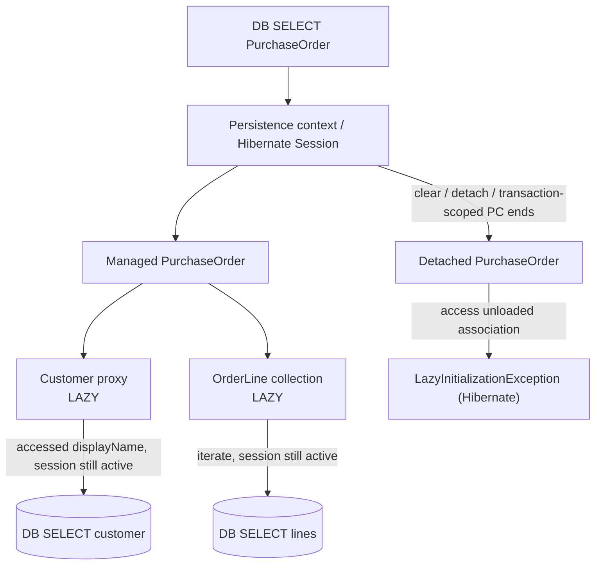
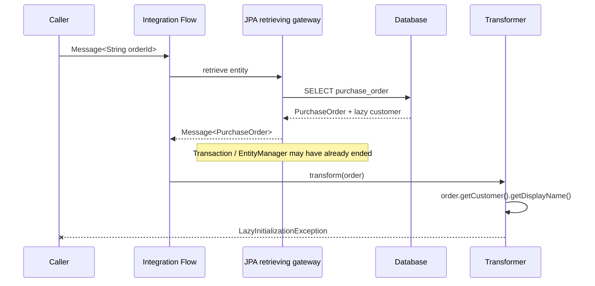
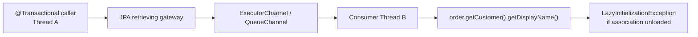
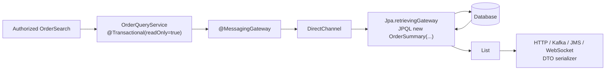
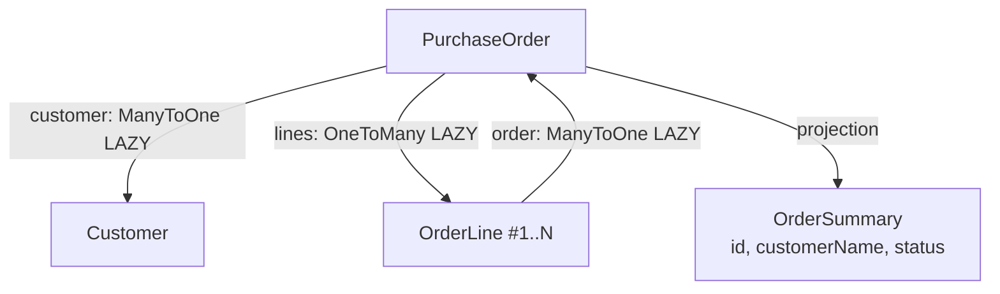
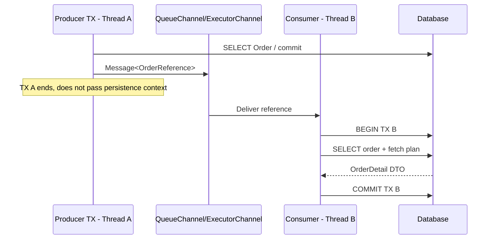

# Lazy Loading in Message Flows

## 1. Context and Goals

In the **SPRING_INTEGRATION_ADAPTERS** module, applications connect external systems via inbound/outbound adapters, gateways, pollers, and `MessageChannel`. Messages may arrive from files, SFTP, HTTP, JMS, AMQP, Kafka, or databases; data is queried, transformed, routed, and forwarded to other systems.

With **Adapter JPA**, a JPA retrieving outbound gateway or inbound channel adapter may place `PurchaseOrder`, `Customer`, or `List<PurchaseOrder>` into the payload. If entities contain `@ManyToOne(fetch = LAZY)`, `@OneToMany(fetch = LAZY)`, or Hibernate-managed collection proxies, calling getters after the transaction/persistence context ends easily triggers `LazyInitializationException`. Conversely, keeping the persistence context open to dodge that error can introduce **N+1 queries**, long-held DB connections, or SQL queries firing in unexpected places.

This lesson, **Lazy Loading in Message Flows**, helps you explain the root causes, pick **the right fetch plan**, and design **message contracts independent of the JPA persistence context**.

After completing it, you will be able to:

- Understand `FetchType.LAZY`/`FetchType.EAGER`, Hibernate proxies, collection wrappers, and managed/detached states.
- Distinguish valid lazy loading inside a transaction from accessing associations after the context closes.
- Explain `LazyInitializationException` across `DirectChannel`, `ExecutorChannel`, `QueueChannel`, `PublishSubscribeChannel`, and Kafka/JMS/HTTP/WebSocket boundaries.
- Identify **which parts of an Integration Flow `@Transactional` wraps**, without assuming a method call keeps the persistence context alive forever.
- Choose **JPQL constructor DTO projections**, `JOIN FETCH`, `@EntityGraph`, or DTO mapping inside transactional services.
- Measure and eliminate **N+1 SELECTs**, avoid Cartesian products, and avoid combining collection `JOIN FETCH` with pagination.
- Build a Spring Boot 3.x, Spring Integration 6.x, Jakarta Persistence/Hibernate, and H2 app whose JPA retrieving gateway returns `List<DTO>`.
- Test both the detached-entity failure path and the DTO happy path, while controlling asynchronous boundaries.
- Design contracts when a JPA inbound poller emits entities/lists, or when outbound adapters ingest broker events.
- Separate tenant authorization, query caps, and serialization from the persistence entity graph.
- Avoid relying on Open Session in View or `hibernate.enable_lazy_load_no_trans` as default workarounds.

> **Core rule:** A JPA entity is an **object bound to a persistence context lifecycle**, not an ideal payload to pass freely across message flows. When crossing transaction, thread, process, or network boundaries, prefer **immutable DTOs/IDs/events** containing the exact required data.

## 2. Lazy Loading and the Persistence Context

### 2.1. What Is Lazy Loading?

Lazy loading defers loading an association until the application actually accesses it. For example:

```java
@Entity
class PurchaseOrder {
    @ManyToOne(fetch = FetchType.LAZY)
    private Customer customer;

    @OneToMany(mappedBy = "order", fetch = FetchType.LAZY)
    private List<OrderLine> lines = new ArrayList<>();
}
```

When querying an order:

```java
PurchaseOrder order =
        entityManager.find(PurchaseOrder.class, "ORD-101");
```

The JPA provider may load only `PurchaseOrder` columns and necessary foreign keys. `order.getCustomer()` may be a proxy; `order.getLines()` may be an uninitialized Hibernate persistent collection. When code actually reads `order.getCustomer().getDisplayName()` or iterates `order.getLines()`, the provider emits additional SQL **if the entity/collection is still attached to an active session**.

**Never** assume that because a getter returns an object, the entire object graph has already been loaded.

### 2.2. LAZY Is Not Always the Default

| JPA Mapping | Default Fetch per Jakarta Persistence | Notes |
| --- | --- | --- |
| `@ManyToOne` | **EAGER** | Declare `fetch=LAZY` explicitly when the parent/reference is not always needed |
| `@OneToOne` | **EAGER** | `LAZY` may require provider-specific bytecode enhancement in certain cases |
| `@OneToMany` | **LAZY** | Usually a collection proxy/wrapper |
| `@ManyToMany` | **LAZY** | Collections can be huge |
| `@Basic` | **EAGER** | `@Basic(fetch=LAZY)` has provider/enhancement limits |

Per JPA, `EAGER` requires the provider to fetch eagerly, whereas `LAZY` can be treated as a hint in certain cases. On Hibernate, lazy to-one proxies and persistent collections are standard; test exact behavior on your target version.

**Never switch every mapping to `EAGER` just to silence exceptions.** `EAGER` does not guarantee "always one SQL query": providers can issue secondary selects, and loading unneeded graphs slows the system down.

### 2.3. How Does the Persistence Context Manage Entities?



A **transaction-scoped persistence context** normally ends when the transaction finishes. Afterward, the Java entity instance may still sit inside a Spring Message or service field, no longer tracked by JPA.

- **Managed:** `EntityManager.contains(entity)` is `true` in that context.
- **Detached:** Java object remains on the heap without an active context.
- **Initialized lazy association:** data was already fetched; loaded fields can still be read after detach as long as unloaded associations are untouched.
- **Uninitialized lazy association:** touching DB-backed fields after session close typically throws `LazyInitializationException` in Hibernate.

### 2.4. Some Getters Might Not Trigger SQL

Depending on provider/enhancement, reading a proxy's ID might not hit the DB:

```java
String customerId = order.getCustomer().getId();
```

However, `order.getCustomer().getDisplayName()` usually initializes the proxy. **Never treat "reading the ID is always safe" as a portable guarantee across all mappings/providers**, especially with composite keys, bytecode enhancement, or customized entity methods.

## 3. LazyInitializationException in Spring Integration Flows

A basic synchronous flow:

```text
@MessagingGateway
  → DirectChannel
  → Jpa.retrievingGateway(...)
  → Transformer
  → Reply
```

If the transformer executes **outside the transaction/persistence context** used for retrieval, even a nested getter call can fail.

### 3.1. Typical Failure Pattern



**Crucial point:** using **`DirectChannel`** only means handlers generally run on the sender's thread. It **does not create a transaction** wrapping all handlers. Without `@Transactional` on the caller or appropriate poller/endpoint advice, the JPA query and the transformer can run in separate persistence-context scopes.

### 3.2. When Can DirectChannel Read Lazy Relations?

When a public service method with `@Transactional(readOnly=true)` calls a synchronous `@MessagingGateway` and the flow uses `DirectChannel`, JPA handlers can join the thread-bound transaction:

```java
@Transactional(readOnly = true)
public OrderDetail loadOrder(String tenantId, String orderId) {
    return orderGateway.findDetail(...); // Synchronous flow
}
```

If the transformer reads associations **within that same transaction** and builds a DTO before returning, lazy loading works. Even so, it is not optimal by default: the transformer can trigger **N+1 queries**, and switching the flow to async later breaks the transaction scope.

**Recommendation:** even in synchronous transactions, **design explicit fetch plans and DTO projections**.

### 3.3. Asynchronous Boundaries



- Spring's imperative transactions are typically bound to a **thread**.
- `ExecutorChannel` dispatches handlers onto executor threads.
- `QueueChannel` buffers messages for another poller/consumer thread later.
- `PublishSubscribeChannel` can be synchronous or asynchronous depending on its executor.
- `@Async`/`CompletableFuture`/manual threads create separate thread boundaries too.
- The Java entity object crosses the channel, while the persistence context **does not travel** to another thread merely because the message holds the reference.

If the consumer needs fresh JPA queries, it must open **its own transaction**, or receive only DTOs/IDs and reload as needed.

### 3.4. Serialization Boundaries

A Kafka/JMS/AMQP/HTTP/WebSocket outbound adapter may serialize payloads:

```text
Message<PurchaseOrder>
  → Jackson/serializer
  → calls getCustomer(), getLines(), ...
  → unintended lazy SQL or LazyInitializationException
```

Serializers invoke getters in unpredictable orders, walk bidirectional relationships (`PurchaseOrder.lines[*].order`), hit circular references, expose restricted fields, or bloat payloads.

**Never let the serializer dictate your database fetch plan.** Serialize only DTOs/events whose schemas are controlled by the application.

## 4. Symptoms to Distinguish

| Symptom | Possible Cause | Do Not Jump to Conclusions |
| --- | --- | --- |
| `org.hibernate.LazyInitializationException` | Uninitialized proxy/collection accessed after session closed | Not automatically bad SQL |
| `LazyInitializationException: could not initialize proxy - no Session` | Accessing lazy to-one after detach | Cannot be fixed by growing JDBC pool |
| `failed to lazily initialize a collection` | Iterating collection outside session | Does not mean the list has no data |
| `N+1 SELECT` | Each entity triggers queries for associations during iteration | Having `@Transactional` does not guarantee optimal SQL |
| Timeouts after enabling `EAGER` | Loading oversized entity graphs | Increasing page size won't help |
| Thousands of SQL queries during JSON serialization | Jackson walking lazy getters | Do not just turn off SQL logging |
| `LazyInitializationException` after `clearOnFlush` | Adapter flush/clear detached entities | `clear()` clears the whole PC, not just the batch |
| `LazyInitializationException` in Kafka consumer | Entity/DTO sent across broker missing data | Brokers never carry Hibernate sessions |
| Invalid JSON / circular reference | Bidirectional graph serialized directly | Not an optimistic locking issue |
| SQL running after controller returned data | Open Session in View still enabled | Does not mean a business transaction is still open |

**Key distinction:** `LazyInitializationException` is a Hibernate session/lifecycle error. Even without an exception, **N+1 queries can still happen** and impose heavy load.

## 5. Choosing the Right Strategy for Message Contracts

| Strategy | When to Use | Pros | Risks / Caveats |
| --- | --- | --- | --- |
| **JPQL constructor DTO projection** | Lists/read models with known fields | Zero entity proxies; fewer columns | Query constructor must match package and types |
| **DTO mapping inside `@Transactional` service** | Need domain methods/aggregates | Full control building DTOs using domain logic | Without proper fetching, can cause N+1 |
| **`JOIN FETCH` to-one** | Need entity plus `customer` immediately | Loads association in one query | Not all to-many associations should be joined |
| **`JOIN FETCH` single collection** | Detail by ID, small lists | Cuts extra SQL | Duplicates/Cartesian products; unsafe with pagination |
| **`@EntityGraph`** | Reusable repository methods / per-use-case fetching | Declarative fetch plans | Still must measure query plans; multiple collections risky |
| **Batch fetching / `@BatchSize`** | Accessing lazy associations across many entities | Reduces N+1 to fewer roundtrips | Still needs a transaction; loads extra rows |
| **Pass ID and reload in consumer** | `Queue`/`ExecutorChannel`/broker boundaries | Zero reliance on old persistence context | Extra DB read + consistency policy needed |
| **`EAGER` everywhere** | Rare; small mandatory associations | Data loaded up front per contract | Easily over-fetches; poor default |
| **Open Session in View** | Intentional legacy web compatibility | Delays errors outside service | View-layer N+1, out-of-transaction queries, breaks on async |
| **`hibernate.enable_lazy_load_no_trans`** | Avoid as default | Spawns temporary sessions when detached | N+1, unclear consistency, heavy DB load |

**Primary guideline:** messages **crossing system boundaries** should carry DTOs/IDs/events; query the exact needed fields **before the boundary**.

## 6. Example Design: Querying Orders and Returning OrderSummary

We will build an application with:

- `Customer`: customer data.
- `PurchaseOrder`: orders with `LAZY` associations to customer and lines.
- `OrderLine`: order line items, `LAZY` from the order side.
- `OrderSummary`: **record DTO** containing order ID, customer name, and status.
- `OrderDetail` and `OrderLineView`: detail DTOs.
- A JPA retrieving outbound gateway executing a **constructor projection** returning `List<OrderSummary>`.
- `@MessagingGateway` providing request/reply for `OrderSearch` holding an authenticated tenant scope and status filter.
- A transactional service validating/normalizing inputs and invoking the flow.
- A repository using `@EntityGraph` to load details inside a dedicated transaction when lines are truly needed.
- One **intentionally unsafe** demo method to reproduce the lazy failure on detached entities.



**Never send entities outward.** Even if the flow is synchronous today, this separation makes switching `DirectChannel` to an async channel later painless.

## 7. Maven and Spring Boot Configuration

The example uses **Java 17+, Spring Boot 3.x, Spring Integration 6.x, Hibernate ORM 6.x, Jakarta Persistence, and H2**. For newer major versions, check migration notes before copying code.

### 7.1. Maven Dependencies

```xml
<dependencies>
    <dependency>
        <groupId>org.springframework.boot</groupId>
        <artifactId>spring-boot-starter</artifactId>
    </dependency>
    <dependency>
        <groupId>org.springframework.boot</groupId>
        <artifactId>spring-boot-starter-integration</artifactId>
    </dependency>
    <dependency>
        <groupId>org.springframework.integration</groupId>
        <artifactId>spring-integration-jpa</artifactId>
    </dependency>
    <dependency>
        <groupId>org.springframework.boot</groupId>
        <artifactId>spring-boot-starter-data-jpa</artifactId>
    </dependency>
    <dependency>
        <groupId>com.h2database</groupId>
        <artifactId>h2</artifactId>
        <scope>runtime</scope>
    </dependency>
    <dependency>
        <groupId>org.springframework.boot</groupId>
        <artifactId>spring-boot-starter-test</artifactId>
        <scope>test</scope>
    </dependency>
</dependencies>
```

Use Spring Boot dependency management/BOM to align Spring, Hibernate, and Integration versions. `spring-integration-jpa` is required for `Jpa.retrievingGateway(...)` and `JpaExecutor`. H2 and `ddl-auto=create-drop` are strictly for the demo.

### 7.2. application.properties

```properties
spring.main.web-application-type=none

spring.datasource.url=jdbc:h2:mem:jpa_lazy_demo;DB_CLOSE_DELAY=-1
spring.datasource.driver-class-name=org.h2.Driver
spring.datasource.username=sa
spring.datasource.password=

spring.jpa.hibernate.ddl-auto=create-drop
spring.jpa.open-in-view=false

# Used in tests/observability; do not enable SQL traces containing sensitive
# data in production by default.
spring.jpa.properties.hibernate.generate_statistics=true
logging.level.org.springframework.integration=INFO

# Depending on Hibernate version, this turns pagination + collection
# fetch join errors into fail-fast.
spring.jpa.properties.hibernate.query.fail_on_pagination_over_collection_fetch=true
```

`spring.jpa.open-in-view=false` confirms the app does not rely on a web request-scoped EntityManager to keep sessions open past the service layer. With `spring.main.web-application-type=none`, the demo has no servlet controller; the property still signals architectural intent when adapting to web apps.

### 7.3. Package Structure

All Java classes in the example reside in:

```text
com.example.jpalazy
    Customer.java
    PurchaseOrder.java
    OrderLine.java
    OrderSummary.java
    OrderSearch.java
    OrderLineView.java
    OrderDetail.java
    CustomerRepository.java
    PurchaseOrderRepository.java
    OrderSummaryGateway.java
    OrderSummaryIntegrationConfiguration.java
    OrderQueryService.java
    JpaLazyApplication.java
```

You do not need to create separate directories/files from this list inside Markdown: the code blocks illustrate the practice app's layout.

## 8. JPA Entities with LAZY Associations

### 8.1. Customer

File `Customer.java`:

```java
package com.example.jpalazy;

import jakarta.persistence.Column;
import jakarta.persistence.Entity;
import jakarta.persistence.Id;
import jakarta.persistence.Table;

@Entity
@Table(name = "customer")
public class Customer {

    @Id
    @Column(name = "customer_id", length = 80)
    private String id;

    @Column(name = "display_name", nullable = false, length = 120)
    private String displayName;

    protected Customer() {
        // Jakarta Persistence requires a no-arg constructor.
    }

    public Customer(String id, String displayName) {
        this.id = id;
        this.displayName = displayName;
    }

    public String getId() {
        return id;
    }

    public String getDisplayName() {
        return displayName;
    }
}
```

In the demo, customers are persisted before purchase orders. Production needs unique constraints, customer tenant isolation, and policy-driven access control.

### 8.2. PurchaseOrder

File `PurchaseOrder.java`:

```java
package com.example.jpalazy;

import java.util.ArrayList;
import java.util.List;

import jakarta.persistence.CascadeType;
import jakarta.persistence.Column;
import jakarta.persistence.Entity;
import jakarta.persistence.FetchType;
import jakarta.persistence.Id;
import jakarta.persistence.JoinColumn;
import jakarta.persistence.ManyToOne;
import jakarta.persistence.OneToMany;
import jakarta.persistence.Table;
import jakarta.persistence.Version;

@Entity
@Table(name = "purchase_order")
public class PurchaseOrder {

    @Id
    @Column(name = "order_id", length = 80)
    private String id;

    @Column(name = "tenant_id", nullable = false, length = 60)
    private String tenantId;

    @Column(nullable = false, length = 24)
    private String status;

    @ManyToOne(fetch = FetchType.LAZY, optional = false)
    @JoinColumn(name = "customer_id", nullable = false)
    private Customer customer;

    @OneToMany(
            mappedBy = "order",
            fetch = FetchType.LAZY,
            cascade = CascadeType.ALL,
            orphanRemoval = true)
    private List<OrderLine> lines = new ArrayList<>();

    @Version
    private Long version;

    protected PurchaseOrder() {
    }

    public PurchaseOrder(
            String id, String tenantId, String status,
            Customer customer) {
        this.id = id;
        this.tenantId = tenantId;
        this.status = status;
        this.customer = customer;
    }

    public void addLine(
            String lineId, String sku, int quantity) {
        lines.add(new OrderLine(
                lineId, this, sku, quantity));
    }

    public String getId() {
        return id;
    }

    public String getTenantId() {
        return tenantId;
    }

    public String getStatus() {
        return status;
    }

    public Customer getCustomer() {
        return customer;
    }

    public List<OrderLine> getLines() {
        return lines;
    }

    public Long getVersion() {
        return version;
    }
}
```

Both `customer` and `lines` are **explicitly `LAZY`**. `@Version` illustrates concurrency tracking; this lesson does not mutate state, though update commands would still need version checks for optimistic locking.

### 8.3. OrderLine

File `OrderLine.java`:

```java
package com.example.jpalazy;

import jakarta.persistence.Column;
import jakarta.persistence.Entity;
import jakarta.persistence.FetchType;
import jakarta.persistence.Id;
import jakarta.persistence.JoinColumn;
import jakarta.persistence.ManyToOne;
import jakarta.persistence.Table;

@Entity
@Table(name = "order_line")
public class OrderLine {

    @Id
    @Column(name = "line_id", length = 80)
    private String id;

    @ManyToOne(fetch = FetchType.LAZY, optional = false)
    @JoinColumn(name = "order_id", nullable = false)
    private PurchaseOrder order;

    @Column(nullable = false, length = 80)
    private String sku;

    @Column(nullable = false)
    private int quantity;

    protected OrderLine() {
    }

    public OrderLine(
            String id, PurchaseOrder order,
            String sku, int quantity) {
        this.id = id;
        this.order = order;
        this.sku = sku;
        this.quantity = quantity;
    }

    public String getId() {
        return id;
    }

    public String getSku() {
        return sku;
    }

    public int getQuantity() {
        return quantity;
    }
}
```

With bidirectional `PurchaseOrder.lines` and `OrderLine.order`, serializers can hit infinite recursion when serializing entity graphs. This lesson **never** serializes entities, avoiding workarounds like `@JsonIgnore`, `@JsonManagedReference`, or Hibernate serializer modules.

### 8.4. Relationship to the Entity Graph



The DTO selects only needed fields and **contains neither a `Customer` proxy nor an `OrderLine` collection**.

## 9. DTOs, Repositories, and Request Contract

### 9.1. Summary DTO

File `OrderSummary.java`:

```java
package com.example.jpalazy;

public record OrderSummary(
        String orderId,
        String customerName,
        String status) {
}
```

This is a safe payload to return over REST/JMS/Kafka. There is no `getCustomer().getDisplayName()` path that could trigger SQL during serialization.

### 9.2. Detail DTO

File `OrderLineView.java`:

```java
package com.example.jpalazy;

public record OrderLineView(
        String sku, int quantity) {
}
```

File `OrderDetail.java`:

```java
package com.example.jpalazy;

import java.util.List;

public record OrderDetail(
        String orderId,
        String customerName,
        String status,
        List<OrderLineView> lines) {
}
```

`List<OrderLineView>` holds only immutable values; the `List` itself should be created with `Stream.toList()` or `List.copyOf(...)` to prevent accidental mutation.

### 9.3. Normalized Request

File `OrderSearch.java`:

```java
package com.example.jpalazy;

public record OrderSearch(
        String verifiedTenantId,
        String status) {
}
```

**Never take `verifiedTenantId` directly from a client-supplied JSON field.** In real applications, the tenant must be resolved by an authenticated principal/ACL or trusted tenant resolver before constructing `OrderSearch`.

### 9.4. Repositories

File `CustomerRepository.java`:

```java
package com.example.jpalazy;

import org.springframework.data.jpa.repository.JpaRepository;

public interface CustomerRepository
        extends JpaRepository<Customer, String> {
}
```

File `PurchaseOrderRepository.java`:

```java
package com.example.jpalazy;

import java.util.Optional;

import org.springframework.data.jpa.repository.EntityGraph;
import org.springframework.data.jpa.repository.JpaRepository;
import org.springframework.data.jpa.repository.Query;
import org.springframework.data.repository.query.Param;

public interface PurchaseOrderRepository
        extends JpaRepository<PurchaseOrder, String> {

    @EntityGraph(attributePaths = {"customer", "lines"})
    @Query("""
            select o from PurchaseOrder o
            where o.id = :id
              and o.tenantId = :tenantId
            """)
    Optional<PurchaseOrder> findAuthorizedDetail(
            @Param("id") String id,
            @Param("tenantId") String tenantId);
}
```

This `@EntityGraph` targets **single-order detail by ID**. Never use it as the default for large paginated lists because it fetches the `lines` collection.

The repository seeds test data and loads **detail** inside the service. The main **summary** query runs through the Spring Integration JPA retrieving outbound gateway.

## 10. Jpa.retrievingGateway Returning DTOs Directly from the Query

### 10.1. @MessagingGateway

File `OrderSummaryGateway.java`:

```java
package com.example.jpalazy;

import java.util.List;

import org.springframework.integration.annotation.MessagingGateway;

@MessagingGateway(
        defaultRequestChannel = "orderSummaryRequests",
        defaultReplyTimeout = "5000")
public interface OrderSummaryGateway {

    List<OrderSummary> search(OrderSearch query);
}
```

`search` creates a Spring Message holding `OrderSearch` and awaits a reply. This is a **request-driven JPA retrieving outbound gateway**, not a periodic inbound poller.

### 10.2. IntegrationFlow

File `OrderSummaryIntegrationConfiguration.java`:

```java
package com.example.jpalazy;

import jakarta.persistence.EntityManagerFactory;

import org.springframework.context.annotation.Bean;
import org.springframework.context.annotation.Configuration;
import org.springframework.integration.config.EnableIntegration;
import org.springframework.integration.dsl.IntegrationFlow;
import org.springframework.integration.jpa.dsl.Jpa;

@Configuration
@EnableIntegration
public class OrderSummaryIntegrationConfiguration {

    @Bean
    IntegrationFlow orderSummaryFlow(
            EntityManagerFactory entityManagerFactory) {

        return IntegrationFlow.from("orderSummaryRequests")
                .handle(
                        Jpa.retrievingGateway(entityManagerFactory)
                                .jpaQuery("""
                                        select new com.example.jpalazy.OrderSummary(
                                            o.id,
                                            c.displayName,
                                            o.status)
                                        from PurchaseOrder o
                                        join o.customer c
                                        where o.tenantId = :tenantId
                                          and o.status = :status
                                        order by o.id
                                        """)
                                .parameterExpression(
                                        "tenantId",
                                        "payload.verifiedTenantId()")
                                .parameterExpression(
                                        "status",
                                        "payload.status()")
                                .maxResults(25)
                                .expectSingleResult(false))
                .get();
    }
}
```

**Why is this the right solution?**

1. The query uses a **JPQL constructor expression** to construct `OrderSummary` directly.
2. `join o.customer c` reads `c.displayName` inside the query without returning a `Customer` entity/proxy.
3. `PurchaseOrder.lines` is **never loaded** because summaries do not need line items.
4. The reply payload is `List<OrderSummary>`: independent of the persistence context and safe to serialize post-transaction.
5. `maxResults(25)` bounds rows per request; add indexes and pagination for large production workloads.
6. `expectSingleResult(false)` preserves the list contract; Spring Integration 6.x retrieving gateways return an **empty list** when zero rows match.
7. `parameterExpression` extracts **values** from the Spring Message without concatenating user JPQL.
8. `tenantId`/`status` are resolved and validated in the service; the query never lets clients pick arbitrary tenants.

This is a **JPQL projection**, not a `JOIN FETCH`. `JOIN FETCH` loads associations onto a **root entity**; constructor queries pick exact fields to build DTOs.

### 10.3. Do Not Fetch Huge Graphs Unnecessarily

Example **not** to use for summary lists:

```sql
select o from PurchaseOrder o
left join fetch o.customer
left join fetch o.lines
where o.tenantId = :tenantId
order by o.id
```

If each order has hundreds of lines, that query multiplies rows and loads unneeded data. Never add `fetch` out of habit; tailor queries to the **fields of the message contract**.

## 11. Service Transactions and Detail Mapping

### 11.1. Query Service

File `OrderQueryService.java`:

```java
package com.example.jpalazy;

import java.util.List;
import java.util.Set;

import org.springframework.stereotype.Service;
import org.springframework.transaction.annotation.Transactional;

@Service
public class OrderQueryService {

    private static final Set<String> ALLOWED_STATUSES =
            Set.of("PENDING", "PAID");

    private final OrderSummaryGateway gateway;
    private final PurchaseOrderRepository orders;

    public OrderQueryService(
            OrderSummaryGateway gateway,
            PurchaseOrderRepository orders) {
        this.gateway = gateway;
        this.orders = orders;
    }

    @Transactional(readOnly = true)
    public List<OrderSummary> summaries(
            String verifiedTenantId,
            String status) {

        requireTenant(verifiedTenantId);
        if (!ALLOWED_STATUSES.contains(status)) {
            throw new IllegalArgumentException(
                    "Invalid status");
        }

        return gateway.search(
                new OrderSearch(verifiedTenantId, status));
    }

    @Transactional(readOnly = true)
    public OrderDetail detail(
            String verifiedTenantId,
            String orderId) {

        requireTenant(verifiedTenantId);

        PurchaseOrder order = orders
                .findAuthorizedDetail(orderId, verifiedTenantId)
                .orElseThrow(() ->
                        new IllegalArgumentException(
                                "Order not found"));

        // Mapping occurs WHILE transaction is still open.
        List<OrderLineView> lineViews =
                order.getLines().stream()
                        .map(line -> new OrderLineView(
                                line.getSku(),
                                line.getQuantity()))
                        .toList();

        return new OrderDetail(
                order.getId(),
                order.getCustomer().getDisplayName(),
                order.getStatus(),
                lineViews);
    }

    // Only for demonstrating LAZY failure in unit/integration tests.
    // Never return raw JPA entities from real public APIs.
    @Transactional(readOnly = true)
    public PurchaseOrder unsafeEntityForDemonstration(
            String verifiedTenantId,
            String orderId) {

        requireTenant(verifiedTenantId);
        PurchaseOrder order =
                orders.findById(orderId).orElseThrow();

        if (!verifiedTenantId.equals(order.getTenantId())) {
            throw new IllegalArgumentException(
                    "Order not found");
        }

        // Do not initialize customer / lines here.
        return order;
    }

    private static void requireTenant(String verifiedTenantId) {
        if (verifiedTenantId == null
                || verifiedTenantId.isBlank()
                || verifiedTenantId.length() > 60) {
            throw new IllegalArgumentException(
                    "Invalid tenant scope");
        }
    }
}
```

In `summaries`, JPQL returns DTOs directly, so the transaction defines a clean read-only scope with no lazy getters afterward.

In `detail`, the repository uses `@EntityGraph(attributePaths={"customer","lines"})` to fetch required associations; DTO mapping finishes **before the transaction ends**. Never return `PurchaseOrder` to web or broker callers.

In `unsafeEntityForDemonstration`, the method name clearly warns **never to expose this in production**; it exists solely so integration tests can reproduce the lazy error.

### 11.2. @Transactional(readOnly=true) Is Not Authorization

- `readOnly=true` is a hint to the transaction manager/provider that may enable Hibernate optimizations.
- It **does not block** application code from reading another tenant's rows.
- It **does not propagate transactions** across `ExecutorChannel`/`QueueChannel`.
- It **does not authorize** a client-supplied `verifiedTenantId`.
- It **does not eliminate N+1** when code loops over lazy associations.
- It **does not keep sessions open** after the method returns.

Validation and authorization must run **before** the JPA query; at larger tenant scales, enforce row-level security and proper indexes.

## 12. Main Application and Demo Data

File `JpaLazyApplication.java`:

```java
package com.example.jpalazy;

import java.util.List;

import org.springframework.boot.CommandLineRunner;
import org.springframework.boot.SpringApplication;
import org.springframework.boot.autoconfigure.SpringBootApplication;
import org.springframework.context.annotation.Bean;
import org.springframework.integration.annotation.IntegrationComponentScan;

@SpringBootApplication
@IntegrationComponentScan
public class JpaLazyApplication {

    public static void main(String[] args) {
        SpringApplication.run(JpaLazyApplication.class, args);
    }

    @Bean
    CommandLineRunner sample(
            CustomerRepository customers,
            PurchaseOrderRepository orders,
            OrderQueryService queries) {

        return args -> {
            if (orders.count() == 0) {
                Customer alice = customers.save(
                        new Customer("CUS-101", "Alice Example"));

                PurchaseOrder first = new PurchaseOrder(
                        "ORD-101", "TENANT-A", "PAID", alice);
                first.addLine("LINE-101", "SKU-1", 2);
                first.addLine("LINE-102", "SKU-2", 1);

                PurchaseOrder second = new PurchaseOrder(
                        "ORD-102", "TENANT-A", "PENDING", alice);
                second.addLine("LINE-103", "SKU-3", 3);

                PurchaseOrder third = new PurchaseOrder(
                        "ORD-201", "TENANT-B", "PAID", alice);
                third.addLine("LINE-201", "SKU-4", 1);

                orders.saveAll(List.of(
                        first, second, third));
            }

            System.out.println("Summary list: "
                    + queries.summaries("TENANT-A", "PAID"));

            System.out.println("Detail: "
                    + queries.detail("TENANT-A", "ORD-101"));

            System.out.println("No rows: "
                    + queries.summaries("TENANT-C", "PAID"));
        };
    }
}
```

**Practice note:** `TENANT-C` in the demo represents an authorized tenant with no orders yet, so querying `PAID` returns `[]`. In real systems, callers cannot pass arbitrary unauthenticated tenants to probe the database. Passing an unlisted status throws `IllegalArgumentException` before hitting the JPA gateway.

**Illustrative results:**

| Call | Result |
| --- | --- |
| `summaries("TENANT-A", "PAID")` | `[OrderSummary("ORD-101","Alice Example","PAID")]` |
| `detail("TENANT-A","ORD-101")` | `OrderDetail` with 2 line DTOs |
| `summaries("TENANT-C","PAID")` | `[]` |
| `summaries("TENANT-A","INVALID")` | Validation error, no query run |
| `detail("TENANT-B","ORD-101")` | Not found within tenant scope |
| Unsafe entity leaves transaction then reads `customer.displayName` | Throws `LazyInitializationException` if uninitialized |

In-memory H2 and `create-drop` are not for production. Lazy-fetch timing depends on the provider, so write integration tests verifying loaded state rather than making blind assumptions across mappings/versions.

## 13. Integration Tests: LAZY Failures and Two Fixes

These tests run on Spring Boot 3.x + Hibernate ORM 6.x + H2 with `spring.jpa.open-in-view=false`. They intentionally omit `@Transactional` on test methods so the test framework does not hold an overly broad transaction open and mask detachment errors.

### 13.1. Test Fixture

File `OrderLazyLoadingIntegrationTest.java`:

```java
package com.example.jpalazy;

import static org.assertj.core.api.Assertions.assertThat;
import static org.assertj.core.api.Assertions.assertThatThrownBy;

import java.util.List;
import java.util.UUID;

import jakarta.persistence.EntityManagerFactory;

import org.hibernate.LazyInitializationException;
import org.junit.jupiter.api.Test;
import org.springframework.beans.factory.annotation.Autowired;
import org.springframework.boot.test.context.SpringBootTest;

@SpringBootTest
class OrderLazyLoadingIntegrationTest {

    @Autowired
    CustomerRepository customers;

    @Autowired
    PurchaseOrderRepository orders;

    @Autowired
    OrderQueryService queries;

    @Autowired
    EntityManagerFactory entityManagerFactory;

    private String createOrder(
            String tenant, String status, int lineCount) {

        String suffix = UUID.randomUUID().toString();
        Customer customer = customers.save(
                new Customer("cust-" + suffix, "Name " + suffix));

        String id = "order-" + suffix;
        PurchaseOrder order = new PurchaseOrder(
                id, tenant, status, customer);

        for (int index = 0; index < lineCount; index++) {
            order.addLine(
                    "line-" + suffix + "-" + index,
                    "SKU-" + index,
                    index + 1);
        }

        orders.saveAndFlush(order);
        return id;
    }

    @Test
    void summaryGatewayReturnsDtosWithoutLazyProxy() {
        String tenant = "tenant-" + UUID.randomUUID();
        String id = createOrder(tenant, "PAID", 2);

        List<OrderSummary> result =
                queries.summaries(tenant, "PAID");

        assertThat(result).extracting(OrderSummary::orderId)
                .containsExactly(id);

        assertThat(result.get(0).customerName())
                .startsWith("Name ");

        // DTO remains safe after service/transaction returns.
        assertThat(result.get(0).status()).isEqualTo("PAID");
    }

    @Test
    void detailMapperLoadsAssociationsInsideTransaction() {
        String tenant = "tenant-" + UUID.randomUUID();
        String id = createOrder(tenant, "PAID", 3);

        OrderDetail detail = queries.detail(tenant, id);

        assertThat(detail.orderId()).isEqualTo(id);
        assertThat(detail.customerName()).startsWith("Name ");
        assertThat(detail.lines()).hasSize(3);
        assertThat(detail.lines().get(0).sku()).startsWith("SKU-");
    }

    @Test
    void detachedUninitializedAssociationFailsWithHibernate() {
        String tenant = "tenant-" + UUID.randomUUID();
        String id = createOrder(tenant, "PAID", 1);

        PurchaseOrder detached =
                queries.unsafeEntityForDemonstration(
                        tenant, id);

        // This test demonstrates Hibernate 6.x behavior for LAZY mappings.
        assertThat(
                entityManagerFactory.getPersistenceUnitUtil()
                        .isLoaded(detached, "customer"))
                .isFalse();

        assertThatThrownBy(() ->
                detached.getCustomer().getDisplayName())
                .isInstanceOf(LazyInitializationException.class);
    }

    @Test
    void summaryListIsEmptyForTenantWithoutOrders() {
        String emptyTenant = "empty-" + UUID.randomUUID();

        assertThat(
                queries.summaries(emptyTenant, "PAID"))
                .isEmpty();
    }
}
```

**What these tests verify:**

- `OrderSummary` has no JPA entity/proxy; it is safe to read post-transaction without hitting the DB.
- `OrderDetail` contains `OrderLineView` entries mapped inside a transaction using `@EntityGraph`.
- `unsafeEntityForDemonstration` returns an entity with an uninitialized `customer`; accessing non-ID fields post-transaction fails under Hibernate.
- List-mode `expectSingleResult(false)` with zero rows returns an empty list in Spring Integration 6.x.
- Each test uses randomized IDs/tenants to stay independent of `CommandLineRunner` data and test execution order.

**Not every JPA provider throws `org.hibernate.LazyInitializationException`.** Other providers differ in exception classes and lazy-fetch rules. This lesson runs on Hibernate ORM 6.x; standard JPA does not define that Hibernate exception class.

### 13.2. Why Omit @Transactional on Test Methods?

If the test method itself has `@Transactional`:

```java
@Test
@Transactional
void misleadingTest() {
    PurchaseOrder order = orders.findById(id).orElseThrow();
    assertThat(order.getCustomer().getDisplayName())
            .isNotBlank();
}
```

the association loads because **the test keeps the persistence context alive**—so the test passes while a production HTTP controller or Kafka consumer fails once the service returns a detached entity.

To truly test boundaries, ensure entities leave the transaction:

- Do not put `@Transactional` on the test method.
- Let the service load the entity in a transaction that completes before assertions.
- Set `spring.jpa.open-in-view=false`.
- Avoid accidentally touching associations during seeding/services before assertions.
- Use `PersistenceUnitUtil.isLoaded` or Hibernate `isInitialized` to inspect state before invoking getters.

### 13.3. Inspecting Hibernate Proxies

```java
import org.hibernate.Hibernate;

boolean initialized =
        Hibernate.isInitialized(order.getCustomer());

boolean linesInitialized =
        Hibernate.isInitialized(order.getLines());
```

`Hibernate.isInitialized(...)` inspects Hibernate-specific proxies/collections. Jakarta Persistence also offers:

```java
boolean loaded =
        entityManagerFactory.getPersistenceUnitUtil()
                .isLoaded(order, "customer");
```

Never rely on `toString()`, debugger watches, or JSON serialization to "inspect" state, as they can trigger lazy loading themselves.

### 13.4. Testing SQL Statement Counts

`OrderLazyLoadingIntegrationTest` verifies semantics; to verify performance, measure SQL statement counts and query latency:

- Enable Hibernate statistics in test settings.
- Clear statistics before each scenario.
- Test lists containing orders across **many distinct customers**.
- Compare statement counts for raw entity + lazy getter loops vs. DTO projections / join fetches.
- Warm up or disable caches during benchmarks.
- Never assert "always strictly N+1" when shared associations hit first-level caches or batch fetching.
- Validate query plans and p95 latency on a production-like database.

Testing with a single order **cannot** prove the absence of N+1 queries.

## 14. JOIN FETCH: When You Need Entities with Loaded Associations

### 14.1. Regular JOIN vs. JOIN FETCH

JPQL:

```sql
select o
from PurchaseOrder o
join o.customer c
where c.displayName = :name
```

Here `join` filters by customer, **without requiring `o.customer` to be initialized** on the returned entity.

To return the entity with `customer` fetched in the same query:

```sql
select o
from PurchaseOrder o
join fetch o.customer
where o.tenantId = :tenantId
order by o.id
```

**`join fetch` modifies the fetch plan** for that association. For to-one relationships, this efficiently avoids extra `SELECT`s when mapping customer names across many orders.

### 14.2. Java DSL Retrieving Gateway with Fetch Join

An **alternative to projection** from section 10:

```java
@Bean
IntegrationFlow orderEntityReadFlow(
        EntityManagerFactory entityManagerFactory) {

    return IntegrationFlow.from("orderEntityReadRequests")
            .handle(
                    Jpa.retrievingGateway(entityManagerFactory)
                            .jpaQuery("""
                                    select o from PurchaseOrder o
                                    join fetch o.customer
                                    where o.tenantId = :tenantId
                                    order by o.id
                                    """)
                            .parameterExpression(
                                    "tenantId",
                                    "payload")
                            .maxResults(25)
                            .expectSingleResult(false))
            .get();
}
```

Assumes the request payload is a server-authorized `String verifiedTenantId`, not arbitrary client input. The query returns `List<PurchaseOrder>` with `customer` loaded.

**Never send this entity list out to Kafka/HTTP without DTO mapping.** `lines` remains `LAZY`, and future model additions may add more relationships. Better yet, place a transformer/mapper inside the synchronous transaction or use a constructor projection directly.

### 14.3. JOIN FETCH on a Single Collection for Detail

When loading **one order by ID**, you can write:

```sql
select distinct o
from PurchaseOrder o
join fetch o.customer
left join fetch o.lines
where o.id = :orderId
  and o.tenantId = :tenantId
```

- `join fetch o.customer` loads the required customer.
- `left join fetch o.lines` retains orders that have zero lines.
- `distinct` states the intent not to duplicate root orders; Hibernate 6 also deduplicates root entity references from fetch joins.
- The query applies no pagination over the to-many collection.
- Map to `OrderDetail` **inside the transaction** so only needed fields leave.

For orders with tens of thousands of lines, fetching the entire collection at once is still too heavy. Paginate lines separately or use bounded detail projections.

### 14.4. Never Fetch Multiple Collections in Parallel Unboundedly

```sql
select distinct o
from PurchaseOrder o
left join fetch o.lines
left join fetch o.discountRules
left join fetch o.shipments
where o.id = :orderId
```

This **hypothetical example** adds `discountRules` and `shipments` beyond the demo model. If each collection has 10 items, SQL JOINs produce thousands of row combinations for one order. Hibernate also imposes restrictions such as `MultipleBagFetchException` when fetching multiple bag collections simultaneously.

**Solution:** fetch only needed associations; split queries, use batch/subselect fetching, or project per slice. Measure actual SQL row counts rather than counting SQL statements alone.

## 15. @EntityGraph by Use Case

### 15.1. EntityGraph Does Not Alter Global Mappings

In our demo repository:

```java
@EntityGraph(attributePaths = {"customer", "lines"})
@Query("""
        select o from PurchaseOrder o
        where o.id = :id
          and o.tenantId = :tenantId
        """)
Optional<PurchaseOrder> findAuthorizedDetail(
        @Param("id") String id,
        @Param("tenantId") String tenantId);
```

`@EntityGraph` applies only to this method. It does not turn all `PurchaseOrder` queries `EAGER` or require modifying entity annotations globally.

**Use when:**

- A repository method loads a detail view with a known set of associations.
- You want to reuse the method inside a transactional service.
- The fetch plan is stable for that business case.
- The query does not paginate a to-many collection unsafely.

### 15.2. FETCH vs. LOAD Graphs

Spring Data JPA supports `EntityGraph.EntityGraphType.FETCH` and `LOAD`, matching JPA fetch/load graph semantics:

- **FETCH graph:** listed attributes are fetched eagerly; unlisted attributes may be treated as `LAZY` per JPA/provider rules.
- **LOAD graph:** listed attributes are fetched eagerly; unlisted attributes keep their configured mapping fetch strategy.

Example:

```java
@EntityGraph(
        attributePaths = {"customer"},
        type = EntityGraph.EntityGraphType.LOAD)
@Query("""
        select o from PurchaseOrder o
        where o.tenantId = :tenantId
        """)
List<PurchaseOrder> findByTenantWithCustomer(
        @Param("tenantId") String tenantId);
```

This is an **optional method** to add to `PurchaseOrderRepository` if experimenting with `LOAD` graphs. On models with several `EAGER` mappings, `LOAD` still pulls those `EAGER` relations; never assume it means "load only customer".

### 15.3. Nested EntityGraph

When fetching nested `customer.address`:

```java
@EntityGraph(
        attributePaths = {"customer", "customer.address"})
```

This **hypothetical** example assumes `Customer` has an `address` property not present in our demo. Deep graphs multiply joins, SQL complexity, and rows; keep them bounded per use case and never expand an EntityGraph just because a serializer touches another getter.

### 15.4. EntityGraph Does Not Prevent N+1 if Misused

A graph fetching `customer` does not load `lines`. If code loops over `order.getLines()` for 100 orders inside the transaction, it can still fire 100 extra selects. Ensure your graph/projection covers **every field read by the DTO** without adding mapper fields behind the query plan's back.

## 16. N+1 SELECTs: Even Valid Transactions Can Be Very Slow

### 16.1. How N+1 Happens

```java
@Transactional(readOnly = true)
public List<String> listCustomerNames() {
    return orders.findAll().stream()
            .map(order ->
                    order.getCustomer().getDisplayName())
            .toList();
}
```

If `findAll()` returns N orders with distinct customers, the provider may emit:

```text
1 SQL: SELECT purchase_order
N SQL: SELECT customer WHERE customer_id = ?
------------------------------------------
≈ N + 1 SQL statements
```

Exact counts depend on first/second-level caches, batch fetching, shared customer IDs, and the provider. Still, under load, "iterate list + lazy getters" is a major red flag to profile.

**Never treat `@Transactional` as a performance fix:** it merely makes lazy queries legal, and often worsens throughput by holding transactions/connections open longer.

### 16.2. Fix 1: JPQL DTO Projection

```sql
select new com.example.jpalazy.OrderSummary(
    o.id, c.displayName, o.status)
from PurchaseOrder o
join o.customer c
where o.tenantId = :tenantId
order by o.id
```

This is our main demo's approach. No full `PurchaseOrder` or `Customer` managed entities need to be loaded and looped over; each row builds a DTO directly.

### 16.3. Fix 2: To-One Fetch Join

```sql
select o
from PurchaseOrder o
join fetch o.customer
where o.tenantId = :tenantId
order by o.id
```

Useful when downstream truly needs entities or domain methods. Still map to DTOs inside the transaction before crossing message boundaries.

### 16.4. Fix 3: EntityGraph

```java
@EntityGraph(attributePaths = {"customer"})
@Query("""
        select o from PurchaseOrder o
        where o.tenantId = :tenantId
        order by o.id
        """)
List<PurchaseOrder> findTenantOrdersWithCustomer(
        @Param("tenantId") String tenantId);
```

This is an optional repository method; measure SQL counts and memory since fetch plans vary by provider.

### 16.5. Fix 4: Hibernate Batch Fetching

Hibernate supports batch-fetching lazy associations:

```properties
spring.jpa.properties.hibernate.default_batch_fetch_size=32
```

or annotating specific collections:

```java
@BatchSize(size = 32)
@OneToMany(mappedBy = "order", fetch = FetchType.LAZY)
private List<OrderLine> lines = new ArrayList<>();
```

`@BatchSize` is **Hibernate-specific**, not part of the Jakarta Persistence standard. It reduces SELECT roundtrips when initializing multiple associations in one session, yet:

- Does not make collections initialized after entities detach.
- Does not eliminate the need for a transaction/session.
- Is not always as efficient as a DTO projection when only a few fields are needed.
- Extra loaded entities still consume memory; benchmark it.
- For a single small order detail, join fetch is often simpler.

## 17. Pagination and Collection Fetching: A Performance Trap

### 17.1. Why Is Combining LIMIT/OFFSET with To-Many Fetch Dangerous?

Suppose you want 20 orders per page:

```sql
select distinct o from PurchaseOrder o
left join fetch o.lines
where o.tenantId = :tenantId
order by o.id
```

If each order has 100 lines, the SQL JOIN multiplies rows per order. Applying `LIMIT 20` on the joined SQL rows does **not** return 20 complete distinct orders. Hibernate may fall back to **in-memory pagination**, loading far more rows from the DB than expected.

That is why Hibernate provides a fail-fast setting:

```properties
spring.jpa.properties.hibernate.query.fail_on_pagination_over_collection_fetch=true
```

In Hibernate 6.x, this rejects risky paginated collection fetch joins rather than silently paginating in memory. Check the property name for your provider version.

**Never "fix" this by increasing heap or `maxResults`.** Change the query strategy.

### 17.2. Paginate by Root IDs First

A two-phase pattern:

**Phase 1 — fetch a page of order IDs:**

```sql
select o.id
from PurchaseOrder o
where o.tenantId = :tenantId
order by o.id
```

Apply `setFirstResult(offset)` and `setMaxResults(pageSize)` to **this ID-only query**, with no collection fetches.

**Phase 2 — fetch details for that page's IDs:**

```sql
select distinct o from PurchaseOrder o
join fetch o.customer
left join fetch o.lines
where o.tenantId = :tenantId
  and o.id in :ids
```

Then:

- Restore the exact order from Phase 1's ID list (SQL `IN` does not preserve input order).
- Map DTOs inside the transaction.
- Cap `ids` list size and collection sizes per API contract.
- Evaluate snapshot consistency if data changes between the two queries.
- For fast-changing datasets, consider cursor/keyset pagination and isolation policies.

### 17.3. Never Fetch a Whole Collection Just to Count It

If a list DTO only needs the line count per order, query the aggregate:

```sql
select o.id, count(l.id)
from PurchaseOrder o
left join o.lines l
where o.tenantId = :tenantId
group by o.id
order by o.id
```

This returns scalar tuples/projections without loading `OrderLine` lists. Match your DTO constructor to `count`'s `Long` return type per provider.

### 17.4. Warning on Fetching Multiple Collections Together

Joining two 1:N or N:M collections in parallel creates a Cartesian product with huge SQL row counts and duplicated root references. Hibernate 6 deduplicates root results in many cases, but deduplicating **after DB retrieval** does not save DB or network cost. With multiple bag collections, Hibernate can throw `MultipleBagFetchException`.

**Good design:** never load "the entire aggregate tree" just because a consumer wants JSON. Define dedicated read models per endpoint or message schema.

## 18. Async Messaging: Send IDs/DTOs Instead of Entities

### 18.1. A Message Contract Should Carry Data, Not a Session

**Avoid:**

```java
Message<PurchaseOrder> message =
        MessageBuilder.withPayload(managedEntity).build();

asyncOrderChannel.send(message);
```

`managedEntity` can carry lazy proxies, dirty state, provider wrappers, and ties to an expiring context. Once a consumer runs on another thread, unloaded associations cannot follow automatically.

**Prefer:**

```java
public record OrderReference(
        String verifiedTenantId,
        String orderId,
        String correlationId) {
}
```

Send only the **ID + verified scope + correlation ID** (or a complete DTO snapshot if reloading is undesirable). If scope arrives in broker headers, the consumer must still verify source trustworthiness; record field names alone do not authorize access.

### 18.2. Consumer Opens Its Own Transaction to Reload

Hypothetical consumer receiving `OrderReference`:

```java
@Service
public class OrderReferenceConsumer {

    private final PurchaseOrderRepository orders;

    public OrderReferenceConsumer(PurchaseOrderRepository orders) {
        this.orders = orders;
    }

    @Transactional(readOnly = true)
    public OrderDetail loadForConsumer(OrderReference ref) {
        PurchaseOrder order = orders
                .findAuthorizedDetail(
                        ref.orderId(),
                        ref.verifiedTenantId())
                .orElseThrow(() ->
                        new IllegalArgumentException(
                                "Order unavailable"));

        return new OrderDetail(
                order.getId(),
                order.getCustomer().getDisplayName(),
                order.getStatus(),
                order.getLines().stream()
                        .map(line -> new OrderLineView(
                                line.getSku(),
                                line.getQuantity()))
                        .toList());
    }
}
```

This is an **advanced variant** outside the core demo; it requires Spring annotation imports and `OrderReference`. It returns a **DTO** from a **fresh consumer-side transaction**, independent of the producer's closed persistence context.

### 18.3. Sender Transactions Do Not Cross Thread Boundaries



If the consumer must see the exact snapshot from when the producer emitted the event, **reloading from the DB may observe newer state**. When point-in-time event history is required, emit an immutable event DTO created inside the producer transaction or store the payload in a **transactional outbox**.

### 18.4. Channel Types Compared

| Channel / Boundary | Thread / Transaction | Safe for JPA Entities? |
| --- | --- | --- |
| `DirectChannel` | Synchronous handler; can join caller's tx | Only if fetched/mapped in the right PC; DTO still preferred |
| `PublishSubscribeChannel` (no executor) | Usually invokes subscribers synchronously | Depends on transaction/lifecycle |
| `PublishSubscribeChannel` (with executor) | Can run concurrently | Never share entity/PC; use DTO/ID |
| `ExecutorChannel` | Consumer on another thread | Never propagates JPA transaction |
| `QueueChannel` | Consumer may read later | Does not keep PC alive in the queue |
| Kafka / JMS / AMQP | Separate process/network | Data schemas only; zero entity proxies |
| HTTP / WebSocket | JSON/bytes serialization boundary | DTOs/projections with permitted fields only |
| File / SFTP | File bytes/metadata | Explicit data mapping, never entity graphs |

### 18.5. Never Share Mutable Entity Objects Across Subscribers

If a `PublishSubscribeChannel` delivers the **same entity object reference** to multiple consumers, they can read and mutate Java state concurrently. A JPA entity is not an immutable event. Beyond lazy errors, that introduces races on fields and cascade collections. Send immutable DTOs/records with defensive collection copies.

## 19. JPA Inbound Polling with Lazy Entities

### 19.1. Pollers Can Emit List<Entity>

A JPA inbound adapter:

```java
IntegrationFlow.from(
        Jpa.inboundAdapter(entityManagerFactory)
                .jpaQuery("""
                        select o from PurchaseOrder o
                        where o.status = 'PENDING'
                        order by o.id
                        """)
                .maxResults(20)
                .expectSingleResult(false),
        endpoint -> endpoint.poller(
                Pollers.fixedDelay(Duration.ofSeconds(5))
                        .maxMessagesPerPoll(1)
                        .transactional()))
        .get();
```

This is a source configuration **fragment** (needs imports and a consumer channel); the query emits **one Spring Message holding `List<PurchaseOrder>`**. `maxMessagesPerPoll(1)` does not mean a single row. When no rows exist, the source should not be treated as a business "empty batch" heartbeat.

### 19.2. Accessing LAZY Inside the Poller Transaction

When the poller is transactional and a synchronous consumer listens on `DirectChannel`, you can:

1. `SELECT` entities inside the poller transaction.
2. Map to DTOs in the synchronous handler **before** any async boundary.
3. Only then forward DTOs to Queue/Kafka/HTTP.
4. Commit/roll back per policy.

Still, mapping lazy fields per entity can cause N+1. Prefer JPQL projections or fetch plans directly on the **source query** and monitor SQL.

### 19.3. Never Push Entities onto a Queue Expecting the Poller Transaction to Stay Alive

```text
Jpa.inboundAdapter SELECT List<PurchaseOrder>
    ↓
QueueChannel places List<Entity> onto queue
    ↓ poller transaction commits/ends
Queue consumer calls order.getLines().size()
    ↓ LazyInitializationException
```

This is a classic "worked with `DirectChannel`, broke when switched to `QueueChannel`" bug.

Solutions:

- Map DTOs before the queue.
- Or send a list of IDs and let the consumer reload in its own transaction.
- If poll-time snapshot fidelity is needed, write an outbox/snapshot payload.
- Never store Hibernate proxies in a persistent message store expecting lazy serialization.

### 19.4. Re-Polling and State

If the source query always picks `status='PENDING'` while the handler only converts entities to DTOs **without updating state/claiming**, the next poll reads the same rows again. Lazy loading and delivery semantics are **two independent problems**:

- Lazy issue: data unloaded when crossing a transaction boundary.
- Re-poll issue: row not claimed or marked processed.

For distributed job processing, use atomic claims/leases/idempotency rather than treating successful DTO serialization as a DB ACK.

## 20. Kafka/JMS/HTTP Serialization: Never Let Jackson Trigger SQL

### 20.1. Circular References and Lazy Proxies

A JSON serializer might traverse:

```text
PurchaseOrder
  → customer
  → otherOrders
  → customer
  → ...
```

Bidirectional entity graphs cause infinite recursion, stack overflows, or massive unintended loads. Default JSON serializers also struggle with Hibernate proxy types.

**Best practice:** design explicit event DTOs:

```java
public record OrderApprovedEvent(
        String eventId,
        String tenantId,
        String orderId,
        long version,
        String status) {
}
```

An event often needs only ID/state/version, not the entire `Customer`/`OrderLines` graph.

### 20.2. Limits of Hibernate-Specific Jackson Modules

Some apps use Hibernate-specific Jackson modules, `@JsonIgnore`, `@JsonIdentityInfo`, or custom serializers to dodge recursion and uninitialized proxies. They can be compatibility aids for legacy APIs, but **do not replace fetch plans or DTO contracts**:

- They may omit uninitialized fields, making JSON vary unpredictably with session state.
- They can trigger SQL during serialization depending on module flags.
- They do not fix N+1 queries or tenant authorization.
- They do not keep payloads stable when moving from sync to async channels.
- They couple event schemas to Hibernate versions.

For Kafka/JMS/HTTP, use explicit event DTOs with **message schema versioning**, independent of JPA `@Version`.

### 20.3. DTO Snapshots vs. ID-Only References

| Option | When Appropriate | Concerns to Address |
| --- | --- | --- |
| DTO snapshot | Event carries state as of business commit | Outbox + schema evolution + PII rules |
| ID-only reference | Consumer needs the latest state | Extra DB read + authorization + eventual consistency |
| Full JPA entity | Almost never appropriate over network | Proxies, lazy traps, huge graphs, mutable state, version |
| Event + ID + minimal fields | Typical microservice integration | Idempotency, schema compatibility, contracts |

### 20.4. External ACKs Are Not Atomic with DB Reads/Writes

Suppose a consumer receives an event, loads `OrderDetail`, and sends an HTTP call:

```text
DB transaction read → DTO snapshot → DB commit
HTTP send → remote ACK (or timeout)
```

If HTTP times out, the persistence context cannot tell you whether the remote side processed it. Handle retries/idempotency/outboxes explicitly. Lazy exceptions are *data-access* bugs; delivery confirmation is *delivery semantics*.

## 21. "Fixes" That Usually Create Worse Bugs

### 21.1. Switching All Associations to EAGER

```java
@ManyToOne(fetch = FetchType.EAGER)
private Customer customer;

@OneToMany(fetch = FetchType.EAGER)
private List<OrderLine> lines;
```

This silences some lazy errors while causing:

- Unneeded associations fetched for every simple query.
- N+1 queries via secondary selects.
- Higher memory and network costs, especially on deep collections.
- Recursive graph traversal across relationships.
- Broken/hard-to-control pagination.
- Global impact on all queries for that entity, instead of tailoring per use case.

Design fetch plans **per query/service**, never to appease a serializer.

### 21.2. Open Session in View (OSIV)

In traditional web apps, OSIV keeps the `EntityManager` open across view rendering. If a controller returns an entity, serializers can still hit `LAZY` getters after the service transaction ended.

**Problems:**

- SQL executes during view/serialization, far outside business boundaries.
- Can cause N+1 queries missed by service tests.
- Consistency across queries can diverge from the original transaction.
- `EntityManager` stays open longer, increasing connection/resource pressure depending on provider/pool behavior.
- Does nothing for Kafka/JMS/`ExecutorChannel` background threads.
- Is not an authorization mechanism.

**Recommendation:** set `spring.jpa.open-in-view=false` and map DTOs in transactional services or JPQL projections unless a legacy app has a controlled reason.

### 21.3. hibernate.enable_lazy_load_no_trans

```properties
# NOT recommended to enable by default to fix LazyInitializationException
spring.jpa.properties.hibernate.enable_lazy_load_no_trans=true
```

This Hibernate-specific flag permits certain detached lazy loads by opening temporary sessions where supported. It can:

- Mask architectural message-boundary bugs.
- Emit unexpected N+1 SQL.
- Increase DB load and blur object-graph consistency.
- Drop the original transaction, correlation, and security context.
- Still fail on certain detached/serialization edge cases.

Never use it instead of **DTO projections + proper transaction boundaries**.

### 21.4. Calling Hibernate.initialize() Everywhere

```java
Hibernate.initialize(order.getCustomer());
Hibernate.initialize(order.getLines());
```

While the entity is inside an active Hibernate session, `Hibernate.initialize` forces loading an association. However:

- Each call can fire another SQL query.
- Looping over many orders still causes N+1.
- Collections can be huge.
- If the session is already closed, `initialize` cannot resurrect it.
- Nested associations inside `line`/`customer` stay uninitialized.

Use it deliberately inside a transaction after measuring; `JOIN FETCH`, `EntityGraph`, or projections are usually cleaner.

### 21.5. Wrapping Serializers or Network Sends in @Transactional

Keeping a DB transaction open while serializing thousands of entities or calling HTTP/Kafka extends lock durations, spikes latency, and risks deadlocks. Keep transactions scoped strictly to atomic DB work; construct DTOs or write outbox rows inside the transaction, then publish post-commit through the pipeline.

### 21.6. clear/flush Does Not Fix Lazy Loading

`EntityManager.flush()` syncs pending writes without **initializing `LAZY` associations**. `EntityManager.clear()` detaches every entity and makes lazy errors appear **even earlier**. Enabling `JpaExecutor.clearOnFlush(true)` to save heap on outbound batches does not mean entities remain serializable afterward.

## 22. Designing Transaction Boundaries for Message Flows

When designing an Integration Flow, the key question is not "is `@Transactional` enabled?" but **which entities must be initialized before which boundary**.

### 22.1. Three Architectural Patterns

**A — DTO projection inside the JPA gateway:**

```text
Request Message<OrderSearch>
  → Jpa.retrievingGateway
  → select new OrderSummary(...)
  → Message<List<OrderSummary>>
  → HTTP / Kafka / JMS / WebSocket
```

This is our main example's pattern. The payload has zero entities or proxies, so it safely crosses networks and threads after the DB transaction closes.

**B — Read entities and map DTOs inside a synchronous transaction:**

```text
@Transactional service
  → JPA retrieving gateway with JOIN FETCH
  → DTO mapper in the same DirectChannel call stack
  → List<OrderDetail>
Transaction ends
  → Outbound adapters
```

All required lazy associations must be fetched and mapped before the transaction finishes; never place an async channel before the mapper. Even without lazy errors, monitor for N+1 queries.

**C — Pass IDs; consumer reloads:**

```text
Producer transaction
  → Message<OrderReference>
  → QueueChannel / ExecutorChannel / Kafka / JMS
New consumer transaction
  → SELECT with fetch plan
  → DTO
```

Ideal for asynchronous workers, though **data can change** between producer send and consumer query. When a point-in-time snapshot is required, emit an immutable event DTO or outbox payload inside the business transaction.

### 22.2. @Transactional Self-Invocation

```java
@Service
class WrongBoundary {

    public OrderDetail handle(String id) {
        // this.* calls bypass the default transactional proxy.
        return loadInTransaction(id);
    }

    @Transactional(readOnly = true)
    public OrderDetail loadInTransaction(String id) {
        // ... JPA operations
        throw new UnsupportedOperationException("illustration");
    }
}
```

This illustrates the self-invocation bug—**not a runnable demo file**. Under Spring's proxy-based transactions, calling a method on `this` skips the interceptor. Move the transactional method to another bean called through the Spring proxy, or use `TransactionTemplate` when programmatic transactions are needed.

### 22.3. Never Pass EntityManager in Message Headers

**Do not do this:**

```java
MessageBuilder.withPayload(orderId)
        .setHeader("entityManager", entityManager)
        .build();
```

A raw JPA `EntityManager` is not thread-safe, cannot be serialized across brokers, and has no place in a business message contract. Consumers must open their own transactions/sessions. Never pass a Hibernate `Session` or transaction object to "keep `LAZY` alive".

### 22.4. Read-Only Does Not Mean Zero Extra SQL

`@Transactional(readOnly=true)` does not guarantee a single `SELECT`. A mapper looping over 100 lazy associations still executes 100 extra `SELECT`s. Nor does it replace authorization or open transactions on other worker threads.

### 22.5. DB Commit Differs from Broker ACK

Loading a DTO in a transaction and sending to Kafka/HTTP in the same Java method does not make DB and network operations a single distributed atomic transaction. For write + publish, use a transactional outbox; for read + publish, define snapshot/time consistency and retry rules. Lazy loading, DB commits, and delivery ACKs are **distinct contracts**.

## 23. Multi-Tenancy, Security, and Privacy

### 23.1. DTOs Do Not Replace Authorization

The demo query has:

```sql
where o.tenantId = :tenantId
  and o.status = :status
```

`tenantId` **must** come from a server-side authenticated principal/ACL/tenant resolver. If a client sends `{"verifiedTenantId":"TENANT-SECRET"}` and the service trusts it, query binding runs valid SQL while exposing another tenant's data. The word "verified" in a variable name verifies nothing.

Always:

1. Authenticate sources at HTTP/JMS/Kafka/file adapter boundaries.
2. Derive authorized scope server-side rather than trusting raw headers/payloads.
3. Enforce tenant/resource predicates in JPQL and repository queries.
4. Authorize access to `customer`/`lines` if associations cross scopes.
5. Include only permitted fields in DTOs/events.
6. Cap `maxResults`, page sizes, and line counts.
7. Never let clients supply JPQL, native SQL, or SpEL expressions.
8. Use least-privilege DB roles and row-level security where policies require.
9. Never dump JPA entity graphs containing PII into logs.

### 23.2. Lazy Traversal Can Leak Data

If `Customer` has an `orders` collection, a mapper or serializer walking `customer.orders` could pull orders outside the request's scope. JPA relationships are **not permission to expose the entire object graph**. Review fetch plans as part of the API/message security contract, never driven by serializers.

### 23.3. Preventing IDOR on Detail Queries

Our demo repository uses `where o.id=:id and o.tenantId=:tenantId`. That scopes rows by tenant, though domains may also require actor-level checks on specific orders. APIs may return `404` for unauthorized resources to prevent enumeration.

### 23.4. Safe Logging

**Avoid:**

```java
log.error("Failed to map {}", entity, ex);
```

If `entity.toString()` touches associations, logging itself can trigger extra SQL or `LazyInitializationException`, while risking PII leaks.

**Prefer:**

```java
log.error(
        "Failed to map order; orderId={}, traceId={}",
        orderId, traceId, ex);
```

Apply masking, access control, and retention rules to logged IDs as well.

## 24. Observing N+1 and Operations

### 24.1. Suggested Metrics

| Metric | Meaning |
| --- | --- |
| `jpa_gateway_requests_total` | Requests passing through JPA retrieving gateway |
| `jpa_query_duration_seconds` | JPA query execution duration |
| `jpa_query_rows_returned` | Rows returned |
| `jpa_sql_statements_per_request` | N+1 indicator |
| `hibernate_entity_load_count` | Entities loaded per processing cycle |
| `jpa_lazy_init_failures_total` | Uninitialized `LAZY` failures |
| `jpa_dto_mapping_duration_seconds` | DTO mapping duration |
| `jpa_dto_payload_bytes` | Serialized payload size |
| `db_pool_active_connections` | Active pool connections |
| `db_pool_pending_threads` | Threads waiting for DB connections |
| `integration_queue_depth` | Async channel backlog |
| `integration_handler_errors_total` | Errors per endpoint |
| `outbox_pending_events` | Post-commit outbox publish backlog |

These are **suggested metric names**, not all built-in out of the box when enabling Micrometer/Actuator. Instrument according to your Spring Boot, Spring Integration, and Hibernate versions.

### 24.2. Measure SQL Instead of Guessing

In test environments:

```properties
spring.jpa.properties.hibernate.generate_statistics=true
logging.level.org.hibernate.SQL=DEBUG
```

To compare N+1 behavior, seed many orders across **distinct customers**, then run:

- `findAll` + `getCustomer().getDisplayName()` loop.
- JPQL `JOIN FETCH o.customer`.
- Repository `@EntityGraph(attributePaths={"customer"})`.
- JPQL constructor projection `OrderSummary`.
- Bounded Hibernate batch fetching.

Measure SQL statement counts, returned rows, p95 latency, allocations, and heap. Caches, drivers, and DB engines affect results—never assert a rigid "always N+1" count when multiple orders share a customer or batch fetching kicks in.

### 24.3. Useful Alerts

- `LazyInitializationException` spikes after introducing `ExecutorChannel`.
- SQL statements per request jump after adding a field to a DTO mapper.
- p95 query latency rises after enabling `EAGER` or fetching multiple collections.
- Hibernate warns about collection-fetch pagination.
- DB pool waits/GC spike when serializers hold transactions too long.
- Unusual payload size or queue depth growth.
- Error rate spikes on an outbound adapter after schema changes.

Never use `tenantId`, `customerId`, or `orderId` as high-cardinality metric labels; use controlled trace IDs and logs instead.

## 25. Troubleshooting

| Symptom | Possible Cause | Fix |
| --- | --- | --- |
| `LazyInitializationException` in transformer | Entity detached before mapper calls getter | Use DTO projection or map inside transaction |
| `LAZY` error in `Queue`/`Executor` consumer | Sender transaction/session does not cross threads | Send ID/DTO; consumer loads in its own transaction |
| `LAZY` error serializing HTTP JSON | Controller returned JPA entity with OSIV off | Return DTO from service |
| `LAZY` error serializing Kafka/JMS | Message holds Hibernate proxies | Use immutable event DTOs |
| N+1 SQL despite `@Transactional` | Lazy getters inside loop | Use JPQL projection, fetch join, or `EntityGraph` |
| `@ManyToOne(EAGER)` still fires many SQLs | Provider executes secondary fetches | Use explicit query fetch plans per use case |
| `EntityGraph` has `customer`, `lines` fails | Graph omitted `lines` | Include needed fields for detail; map DTO before detach |
| `clearOnFlush` breaks entity access | Whole PC was detached | Stop using entity after clear; reload/map before clear |
| Collection fetch join + pagination warning | In-memory pagination or fail-fast triggered | Paginate IDs first, then fetch associations |
| Multi-collection fetch very slow | Cartesian product / multiple bags | Split queries or use projections |
| DTO query constructor exception | Wrong package or constructor parameter types | Match JPQL `new` to record/class constructor |
| Gateway returns entity instead of list | Wrong `expectSingleResult` | Configure list contract explicitly |
| Empty result causes caller timeout | Filter drops empty list or wrong reply route | Keep 6.x retrieving empty-list reply |
| Native query returns `Object[]` | Missing typed DTO mapping | Add explicit result mapping/transform |
| Serializer hits infinite recursion | Bidirectional JPA graph | Never serialize entities directly |
| Service `@Transactional` fails to open | Self-invocation or async boundary | Call via Spring proxy; add consumer-side tx |
| Test fails to reproduce `LAZY` error | Test method has `@Transactional` or OSIV on | Read entity in separate tx; assert after detach |
| DTO still triggers JPA on serialize | DTO nests an entity or proxy | Flatten DTO to scalars and nested DTOs only |
| Tenant leak via nested relationships | Traversal ignores authorization | Tenant-scoped queries + field-level DTO contracts |
| Oversized query result | Missing result/collection caps | Cap page size, chunk, index, project DTOs |

### Diagnostic Checklist

1. Is the current payload an **entity**, **`List<Entity>`**, or **DTO**?
2. Which associations are `LAZY`, and have they been initialized?
3. Is the entity managed or detached in the active persistence context?
4. Inside which transaction does the handler invoke getters?
5. Is there a synchronous `DirectChannel` or an async/queue boundary?
6. Is `@Transactional` invoked through the Spring proxy?
7. Did `EntityManager.clear()`/`clearOnFlush` run before the mapper?
8. Are JPQL projections, `JOIN FETCH`, or `EntityGraph` covering the exact fields?
9. Is there N+1 or parallel multi-collection Cartesian inflation?
10. Does the query combine pagination with a collection fetch join?
11. Is a serializer automatically walking an entity graph?
12. Were tenant/resource permissions verified before fetching?
13. Does the consumer need a point-in-time snapshot or fresh state on reload?
14. What do SQL count, payload size, and queue backlog metrics show?
15. Did integration tests close transactions/OSIV before asserting `LAZY` failures?

## 26. Extended Test Matrix

| Scenario | Expected Outcome |
| --- | --- |
| JPQL constructor projection | Returns typed DTO with zero Hibernate proxies |
| Read summaries by status/tenant | Returns only in-scope rows |
| Zero matching rows | 6.x retrieving gateway returns `List.of()` |
| Detail with 3 lines | Complete DTO available post-transaction |
| Returning uninitialized entity | Throws Hibernate `LazyInitializationException` after detach |
| `PersistenceUnitUtil.isLoaded` | Accurately detects association state |
| Mapper inside transaction | Reads associations cleanly, yet SQL count must be measured |
| Mapper outside transaction | Fails if uninitialized |
| To-one `JOIN FETCH` | `Customer` eagerly fetched in query |
| To-one `EntityGraph` | Zero N+1 on tested multi-customer dataset |
| Detail collection `EntityGraph` | Lines mapped inside transaction |
| Collection fetch join + pagination | Fail-fast or warning per Hibernate settings |
| Two collections fetched in parallel | Detects duplicates/Cartesian product |
| 100 orders across 100 customers | Compare SQL count: lazy loop vs. projection |
| `ExecutorChannel` after JPA read | DTO succeeds; lazy entity fails |
| `QueueChannel` delayed consumer | Zero dependency on closed session |
| Kafka/JMS JSON | Never serializes entity graphs or proxies |
| `@Transactional` self-call | Test catches inactive boundary |
| Cross-tenant lookup | Zero order leakage |
| DTO nesting an entity/proxy | Caught by static review/serialization test |
| `clearOnFlush` followed by association access | Controlled failure/behavior |
| Huge result set | Server caps result/page/collection sizes |
| Non-H2 database | Fetch plans and SQL verified on target DB |

Use Testcontainers or a production-equivalent database when evaluating query plans, locking/isolation, dialects, query latency, and native SQL. Mock repositories cannot verify lazy loading, sessions, or N+1 behavior.

## 27. Practice Exercises

### Exercise A — Reproducing a LAZY Failure

Create `PurchaseOrder` with `@ManyToOne(fetch=LAZY) Customer`. Have a service load and return the entity outside its transaction. Check `PersistenceUnitUtil.isLoaded` and call `getCustomer().getDisplayName()` post-transaction to observe the exception. Fix it with a DTO projection.

### Exercise B — DirectChannel vs. ExecutorChannel

Configure a JPA retrieving gateway returning entities, place a mapper after `DirectChannel`, and then switch to `ExecutorChannel`. Explain why the transaction does not cross threads. Fix it by mapping to DTOs before the async boundary or sending `OrderReference` so the consumer reloads.

### Exercise C — N+1 and Fetch Plans

Seed 100 orders with 100 distinct customers, measuring SQL count and latency across a lazy loop, `JOIN FETCH`, `@EntityGraph`, and JPQL constructor DTO projection. Explain why a valid transaction alone does not guarantee good performance.

### Exercise D — Collection Pagination

Try `left join fetch o.lines` with `maxResults(10)` and `hibernate.query.fail_on_pagination_over_collection_fetch=true`. Then paginate root IDs first, fetch lines for those IDs, and restore ordering. Explain the performance and consistency trade-offs.

### Exercise E — JPA Inbound Polling → JMS/Kafka

Design an inbound adapter polling `List<PurchaseOrder>`, mapping to immutable DTOs/IDs inside an appropriate transaction, and publishing to JMS/Kafka. The consumer must process messages without needing the producer's Hibernate session. Define state claims, idempotency, and retries separately from LAZY issues.

### Exercise F — SFTP/HTTP/WebSocket Production Readiness

An HTTP request or SFTP file triggers reading orders from the DB and outputting to HTTP/WebSocket. Define tenant authorization, fetch plans, transactions, DTO serialization, line/page caps, metrics, error channels, and tests. Write at least one integration test proving zero lazy SQL fires after the message leaves the persistence boundary.

**Completion criteria:** you know exactly when entities become detached, can pick between DTO projections, fetch joins, and `EntityGraph`, and can explain N+1 queries, paginated collection fetches, async transactions, serialization, and security.

## 28. Summary

- `LAZY` defers association loading; Hibernate commonly uses proxies and persistent collections.
- `@ManyToOne` and `@OneToOne` default to `EAGER` in JPA; `@OneToMany` and `@ManyToMany` default to `LAZY`.
- Accessing uninitialized associations on detached entities can throw `LazyInitializationException` in Hibernate.
- Synchronous `DirectChannel` **does not create a transaction**; caller/poller/endpoint boundaries decide session lifetime.
- `ExecutorChannel`, `QueueChannel`, and brokers **never propagate thread-bound persistence contexts**.
- JPQL **constructor projections** build DTOs directly in the database query, ideal for message contracts.
- Use `JOIN FETCH`/`@EntityGraph` when entities and associations are explicitly needed; map to DTOs before leaving the transaction.
- N+1 can strike even without exceptions; measure SQL counts and latency rather than switching everything to `EAGER`.
- Collection `JOIN FETCH` combined with pagination risks in-memory pagination and row inflation; paginate root IDs first.
- `@BatchSize`/batch fetching reduces query counts without fixing detached sessions.
- OSIV, `enable_lazy_load_no_trans`, and global `EAGER` are not proper default fixes.
- Never serialize JPA entities directly over Kafka/JMS/HTTP/WebSocket; send DTOs, events, or IDs.
- JPA inbound pollers can emit `List<Entity>`; map DTOs or extract IDs before async boundaries.
- Authorization, query caps, idempotency/outboxes, and observability remain required alongside solving `LAZY`.
- Integration tests must run **past the transaction boundary**, against a real Hibernate provider, covering async boundaries.

## References

- [Spring Integration 6.5 — JPA Outbound Gateways](https://docs.spring.io/spring-integration/reference/6.5/jpa/outbound-gateways.html)
- [Spring Integration 6.5 — JPA Java Implementation](https://docs.spring.io/spring-integration/reference/6.5/jpa/java-implementation.html)
- [Spring Integration 6.5 — JPA Inbound Channel Adapter](https://docs.spring.io/spring-integration/reference/6.5/jpa/inbound-channel-adapter.html)
- [Spring Integration API 6.5 — JpaRetrievingOutboundGatewaySpec](https://docs.spring.io/spring-integration/docs/6.5.0/api/org/springframework/integration/jpa/dsl/JpaRetrievingOutboundGatewaySpec.html)
- [Spring Framework — Declarative Transaction Management](https://docs.spring.io/spring-framework/reference/data-access/transaction/declarative/annotations.html)
- [Spring Framework — JPA](https://docs.spring.io/spring-framework/reference/data-access/orm/jpa.html)
- [Spring Data JPA — Query Methods and EntityGraph](https://docs.spring.io/spring-data/jpa/reference/jpa/query-methods.html)
- [Hibernate ORM 6.6 — Introduction to Lazy Associations and Fetching](https://docs.hibernate.org/orm/6.6/introduction/html_single/)
- [Hibernate ORM 6.6 — HQL Join Fetching](https://docs.hibernate.org/orm/6.6/querylanguage/html_single/)
- [Hibernate ORM 6.6 — User Guide](https://docs.hibernate.org/orm/6.6/userguide/html_single/)
- [Hibernate ORM 6.6 API — Collection Fetch Pagination Settings](https://docs.hibernate.org/orm/6.6/javadocs/org/hibernate/cfg/QuerySettings.html)
- [Jakarta Persistence 3.1 Specification](https://jakarta.ee/specifications/persistence/3.1/jakarta-persistence-spec-3.1)
