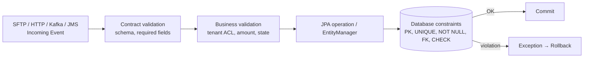
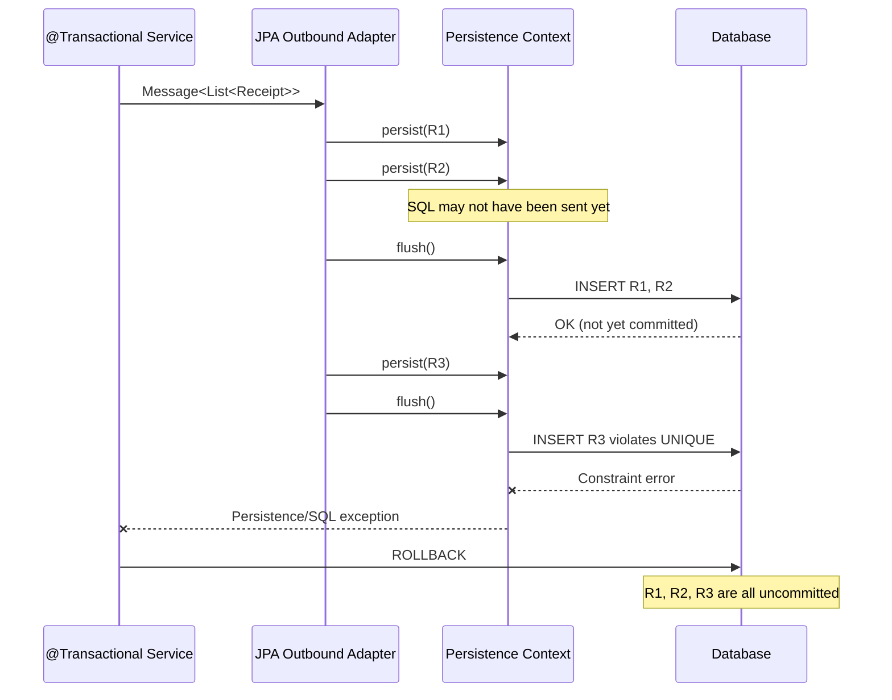
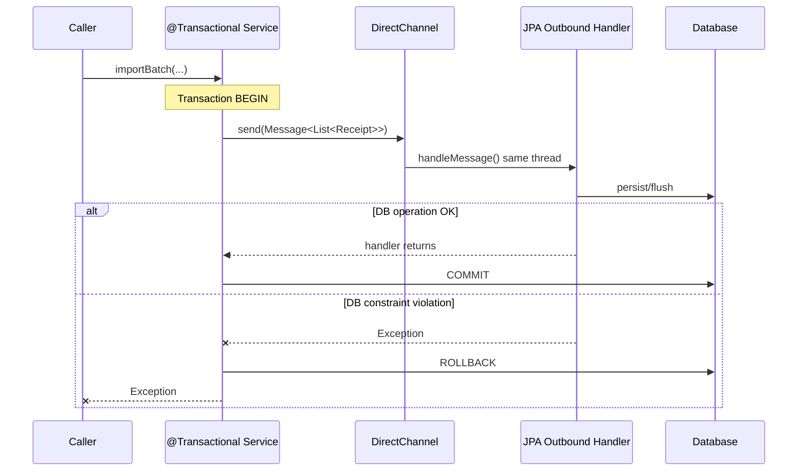
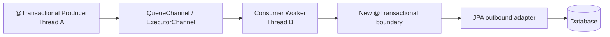
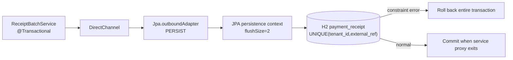
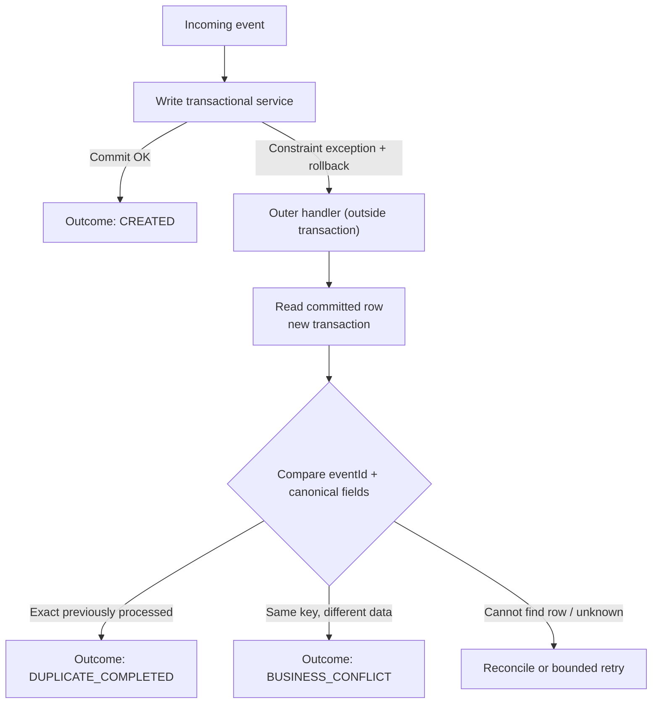
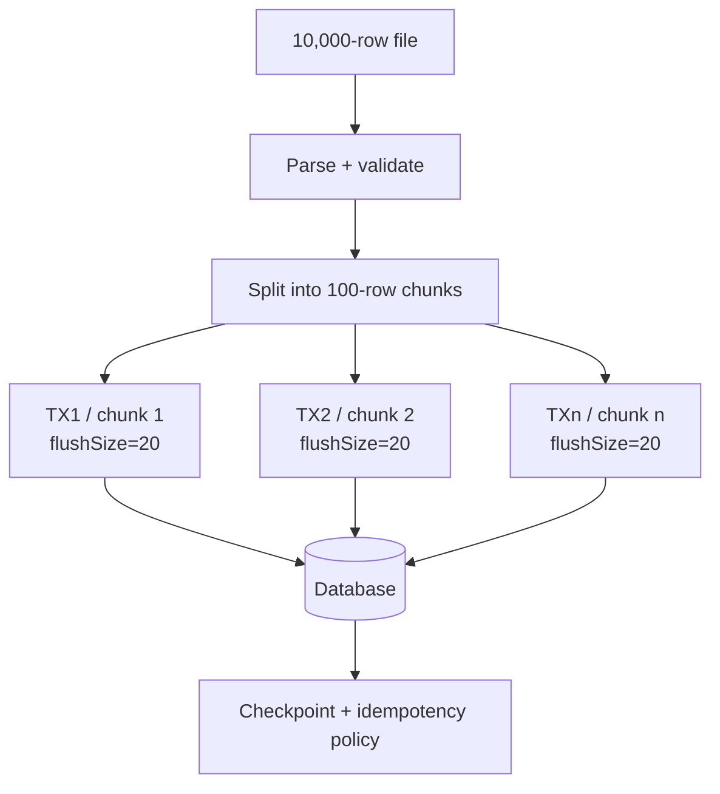
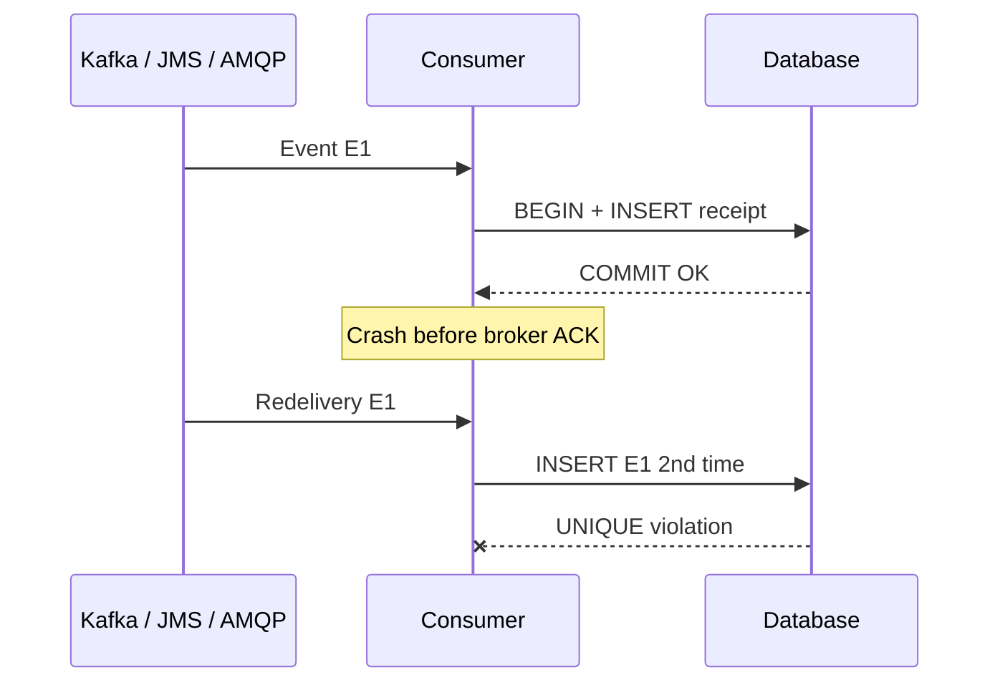
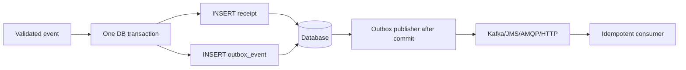
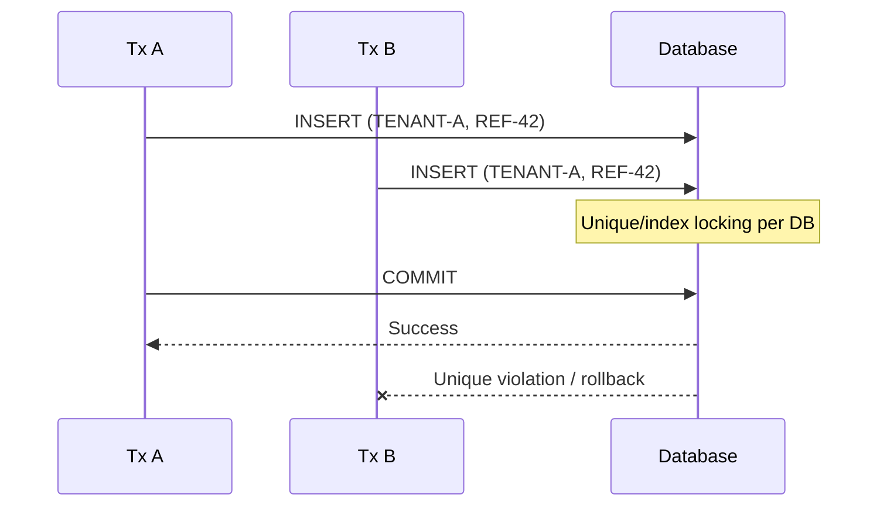

# Constraint Violation Handling and Rollback

## 1. Context and Objectives

In the **SPRING_INTEGRATION_ADAPTERS** module, Spring Integration connects external systems into the application via inbound/outbound adapters, gateways, pollers, and `MessageChannel`. A processing flow typically receives files over SFTP, messages from Kafka/JMS/AMQP, HTTP requests, or entities from a database, then performs persist/merge/update/delete operations using **Adapter JPA**.

When writing to a database, not every message is valid. Data may duplicate a business key, miss a required field, reference a non-existent entity, violate a CHECK constraint, or trigger a version conflict. An error can occur **immediately at `persist`, during `flush`, or as late as `commit`**. If handled improperly, the application may:

- Report "success" when the transaction actually rolled back.
- Send an ACK to Kafka/JMS and then lose unsaved messages.
- Attempt to keep using a Hibernate `Session` that is already in an error state.
- Retain part of a batch even though business rules require all-or-nothing.
- Infinitely retry a permanent data error and clog the queue.
- Duplicate side effects when the database has committed but the broker ACK failed.
- Expose sensitive information through constraint names or SQL error messages.

The **Constraint Violation Handling and Rollback** lesson (in the **Adapter JPA** chapter) explains everything from the nature of database constraints to how transactions and error handling are organized in Spring Integration.

After this lesson, you will be able to:

1. Distinguish between `PRIMARY KEY`, `UNIQUE`, `NOT NULL`, `FOREIGN KEY`, and `CHECK`.
2. Understand the differences between **Bean Validation**, business validation, and **database constraints**.
3. Recognize `jakarta.validation.ConstraintViolationException`, `org.hibernate.exception.ConstraintViolationException`, `DataIntegrityViolationException`, `PersistenceException`, and `MessageHandlingException`.
4. Determine when an error occurs: during a JPA API call, `flush`, or `commit`.
5. Understand that `EntityManager.flush()` **does not mean** the transaction has committed.
6. Configure `Jpa.outboundAdapter(...)`, `PersistMode.PERSIST`, `flushSize`, and transactions at the right boundary.
7. Design `@Transactional` across `DirectChannel`, pollers, and asynchronous consumers.
8. Test a `List<Entity>` whose last element duplicates a unique key to prove **full transaction rollback**, including elements that were already flushed.
9. Avoid swallowing a database error and continuing inside the same persistence context.
10. Classify **permanent invalid data**, duplicate/idempotent events, optimistic conflicts, and transient infrastructure failures.
11. Design checkpoints/chunk transactions, retry/backoff, poison messages, error channels, and DLQs.
12. Distinguish DB commit from Kafka/JMS ACKs, HTTP responses, and `MessageChannel.send(...)`.
13. Test on Spring Boot 3.x, Spring Integration 6.x, Jakarta Persistence, and H2; understand H2's limitations compared to production databases.

> **Principle:** database constraints are the **last line of defense** ensuring data integrity. When a JPA operation fails due to a constraint/persistence error, let the transaction roll back, end that persistence context, and perform any inspection/recovery only in a **new transaction** according to business policy.

## 2. Validation and Constraint Layers

### 2.1. A Real-World Example

The application receives a payment event:

```json
{
  "eventId": "evt-1041",
  "tenantId": "TENANT-A",
  "externalRef": "PAY-2026-042",
  "amount": 125000.00
}
```

The database stores the `payment_receipt` table. Business rules:

- `eventId` is the primary key and must not be duplicated.
- `tenantId`, `externalRef`, and `amount` must not be null.
- The pair `(tenantId, externalRef)` is a **business unique key**.
- `amount > 0`.
- If `accountId` is present, it must reference an existing and permitted account.
- When the same event is resent, the system must distinguish an **already-processed duplicate** from **the same externalRef with conflicting data**.

There are three layers of verification:



**Do not pick one layer and discard all the others:**

- API/Bean Validation returns clear errors early without wasting a transaction.
- Business validation checks permissions, state, and domain policies.
- DB constraints protect against race conditions and code paths that bypass service validation.

### 2.2. Common Constraint Types

| Type | Example | Behavior on Violation |
| --- | --- | --- |
| `PRIMARY KEY` | Two rows with the same `event_id` | Reject duplicate-key INSERT/UPDATE |
| `UNIQUE` | Two receipts with the same `(tenant_id, external_ref)` | Reject duplicate record according to DB uniqueness semantics |
| `NOT NULL` | `amount = null` | Reject null; the JPA provider may also check before the DB |
| `FOREIGN KEY` | `account_id` does not exist | Reject operations that break referential integrity |
| `CHECK` | `amount > 0` | Reject values that fail the expression (DB-dependent) |
| Column length/precision | `VARCHAR(80)`, `DECIMAL(12,2)` | May reject or truncate depending on DB/schema/settings; not safe by default |
| `@Version` | Concurrent stale entity | Optimistic locking conflict; **not** a SQL unique constraint |
| Application allowlist | `status ∈ {NEW,DONE}` | Service validation, optionally supplemented by a DB CHECK |

**Warning:** `UNIQUE` on nullable columns has different semantics across databases regarding how many null values are allowed. If uniqueness must apply to a required business key, explicitly declare **NOT NULL + UNIQUE**.

### 2.3. Checking Existence with SELECT Alone Is Not Enough

A race-prone approach:

```java
if (!repository.existsByTenantIdAndExternalRef(
        tenantId, externalRef)) {
    repository.save(receipt);
}
```

Two workers can both observe `exists=false` and both execute INSERT. A standard transaction/SELECT does not grant an "exclusive right to insert." **A unique constraint in the DB is what guarantees only one valid record** for that key.

You can use a database atomic insert/upsert or an inbox/idempotency table, but every branch must handle the conflict outcome inside the proper transaction.

### 2.4. Validation Is Not Authorization

A payload containing `tenantId="TENANT-A"` is data—**it does not prove the caller belongs to tenant A**. Verify the tenant from an authenticated principal or server-side ACL before invoking JPA. If a client decides the tenant on its own, UNIQUE and NOT NULL constraints can still pass while the application **writes unauthorized data**.

## 3. Bean Validation vs. Database Constraints

### 3.1. Bean Validation in Java

Jakarta Validation supports:

```java
import jakarta.validation.constraints.NotBlank;
import jakarta.validation.constraints.NotNull;
import jakarta.validation.constraints.Positive;

public record ReceiptCommand(
        @NotBlank String eventId,
        @NotBlank String tenantId,
        @NotBlank String externalRef,
        @NotNull @Positive BigDecimal amount) {
}
```

To use validation directly in Spring Boot 3.x, you can add the `spring-boot-starter-validation` dependency and invoke `Validator` or use `@Valid` at the appropriate boundary.

- `@NotBlank` checks that a string is non-null and not blank.
- `@NotNull` checks for non-null.
- `@Positive` checks for a positive number.
- `@Valid` on HTTP controllers/messaging handlers does not automatically apply to every message flow unless proper validation configuration is in place.

### 3.2. JPA Mappings and DB Constraints

```java
@Column(name = "external_ref", nullable = false, length = 80)
private String externalRef;
```

`@Column(nullable=false)` expresses mapping metadata and can affect schema generation/provider validation. It **should not be the sole mechanism** relied upon to guarantee production DB actually has NOT NULL: manage DDL via migrations and verify the schema.

`@Table(uniqueConstraints=...)` can create a unique constraint in a `hibernate.ddl-auto=create-drop` demo, but production should manage constraints with Flyway/Liquibase rather than auto-updating the schema.

### 3.3. Two ConstraintViolationException Classes Are Two Different Errors

It is easy to confuse two identically named classes:

| Exception | Package | Typically Originates From |
| --- | --- | --- |
| `ConstraintViolationException` | `jakarta.validation.ConstraintViolationException` | Bean Validation: `@NotNull`, `@Positive`, `@Size` |
| `ConstraintViolationException` | `org.hibernate.exception.ConstraintViolationException` | Hibernate ORM wrapping a JDBC/SQL integrity constraint violation |
| `DataIntegrityViolationException` | `org.springframework.dao.DataIntegrityViolationException` | Spring DAO/ORM exception translation; may wrap a DB violation |

For example, a failing `@NotBlank` produces a set of `ConstraintViolation<?>` describing the fields. Meanwhile, a database unique constraint produces a `SQLException`, a Hibernate ORM `ConstraintViolationException`, and outer Spring/Integration wrappers.

**Do not write:**

```java
catch (ConstraintViolationException ex) {
    // Unclear whether you are catching Bean Validation or Hibernate ORM!
}
```

Use exact imports or fully qualified names, then classify by origin and business meaning.

### 3.4. CHECK Constraints in the Database

A DDL example (depends on DB dialect):

```sql
alter table payment_receipt
add constraint ck_receipt_amount_positive
check (amount > 0);
```

This is an **additional migration example**, not a file you need to create in the lesson. `@Positive` on a DTO helps return errors early, but CHECK protects the DB if another producer or batch import bypasses validation.

### 3.5. Foreign Keys and Orphans/Deletions

If a receipt references an account:

```sql
alter table payment_receipt
add constraint fk_receipt_account
foreign key (account_id)
references account(account_id);
```

Before enabling an FK in production, verify legacy data, indexes, cascade/delete policies, and tenant scope. An existing `accountId` does not imply the user is authorized to write to that account.

## 4. From JPA API to Database: When Does the Error Appear?

### 4.1. There Is No Single Fixed Moment for Every Constraint

A transaction may proceed as follows:



Depending on the provider/ID generation/flush mode/database:

- `persist(...)` may issue SQL immediately (e.g., IDENTITY) or merely place the entity into the persistence context.
- `flush()` typically causes the provider to execute pending INSERT/UPDATE/DELETE statements, so NOT NULL/UNIQUE/FK errors often surface here.
- `commit()` typically forces a flush if needed, then commits the DB transaction; **deferred constraints** or concurrency errors may only surface at commit.
- `merge(...)` may inspect entity state/version early, yet you still must flush/commit to know whether the transaction succeeded.

Do not claim "it will fail precisely at persist" or "every error appears at flush" without testing on your specific provider and database.

### 4.2. flush Is Not commit

```java
@Transactional
public void saveAndFail(PaymentReceipt receipt) {
    entityManager.persist(receipt);
    entityManager.flush();  // INSERT may have already executed.
    throw new IllegalStateException("fail after flush");
}
```

The transaction rolls back when the runtime exception escapes through the Spring transactional proxy. The DB **retains no new row** even though the SQL INSERT appeared in the logs. `flush` synchronizes changes with the database **within the transaction**; it does not make data durable.

### 4.3. Commit Can Fail Too

Suppose a service completes its method body and returns `true`:

```java
@Transactional
public boolean importReceipt(PaymentReceipt receipt) {
    channel.send(MessageBuilder.withPayload(receipt).build());
    return true;
}
```

The transaction interceptor may invoke commit **after the method body returns**, then throw an exception if flush/commit fails. Callers outside the proxy **do not receive a normal success** when commit throws. However, if the application already sent a network event to an external system **inside the method before commit**, the external side effect may have already happened and will not roll back automatically.

### 4.4. clear() Does Not Recover a Failed Transaction

`EntityManager.clear()` detaches every entity in the persistence context; it neither rolls back nor repairs a transaction already marked failed by the DB/provider. Do not do:

```java
try {
    entityManager.flush();
} catch (PersistenceException ex) {
    entityManager.clear();
    // Wrong: continuing to persist in the same transaction after a DB error.
}
```

With Hibernate, after a serious persistence/JDBC exception, you should **roll back, end the current Session/EntityManager**, and start a new unit of work. Spring-managed transactions/EntityManagers are cleaned up by the framework according to their lifecycle; do not manually call `close()` on a shared injected transactional proxy.

### 4.5. Rollback Does Not "Undo" Java Object State

When a transaction rolls back:

- Uncommitted SQL is rolled back by the database.
- The Java object `receipt` may still retain fields that were set.
- `@GeneratedValue`/version/identifier fields on the object may have already been mutated before rollback.
- Entities become detached after the transaction; do not reuse that object as a fresh managed entity.
- Kafka/HTTP side effects that already occurred are not rolled back by the database.
- DB sequences/identity counters generally do not roll back like row data; gaps in IDs can be normal.

If you need to retry, build a **new command/snapshot** and use a new transaction without relying on the state of the failed persistence context.

## 5. Exception Taxonomy and Inspecting the Cause Chain

### 5.1. Common Error Classes

| Exception | Typical Meaning | Suggested Behavior |
| --- | --- | --- |
| `jakarta.validation.ConstraintViolationException` | Bean validation on field/record/entity | Return input error, do not retry blindly |
| `org.hibernate.PropertyValueException` | Invalid nullability/association property per Hibernate | Data/mapping bug, check contract |
| `org.hibernate.exception.ConstraintViolationException` | SQL/DB integrity constraint | Identify unique/FK/NOT NULL/CHECK via DB metadata |
| `org.springframework.dao.DataIntegrityViolationException` | Spring-translated integrity violation | Classify business conflict, stop transaction |
| `org.springframework.dao.DuplicateKeyException` | Specific duplicate-key category (when translation recognizes it) | Do not assume JPA always translates to this class |
| `jakarta.persistence.PersistenceException` | JPA provider-level failure | Roll back, inspect cause |
| `jakarta.persistence.OptimisticLockException` | Version check failed | Conflict/retry per domain rules |
| `org.springframework.orm.ObjectOptimisticLockingFailureException` | Spring optimistic failure | **Not** a UNIQUE violation |
| `org.springframework.transaction.UnexpectedRollbackException` | Transaction was marked rollback-only but outer tried to commit | Find the root error that was caught/masked |
| `org.springframework.transaction.TransactionSystemException` | Transaction/commit system failure | Inspect root causes and commit state |
| `org.springframework.messaging.MessageHandlingException` | Handler in message flow failed, possibly wrapping a JPA exception | Walk the cause chain, not just top-level |
| `org.springframework.messaging.MessagingException` | Messaging infrastructure error | May be unrelated to database |

**Exception translation does not have one fixed shape:** the top-level type depends on the provider, translator, JPA transaction manager, transaction advice, and message endpoint. A `DataIntegrityViolationException` may appear directly or as the cause of a `MessageHandlingException`.

### 5.2. Classify via Cause Chain, Not by Parsing SQL Text for Business Rules

A utility for logging/diagnostics:

```java
public final class FailureClassifier {

    private FailureClassifier() {
    }

    public static boolean isIntegrityViolation(Throwable failure) {
        for (Throwable cursor = failure;
                cursor != null;
                cursor = cursor.getCause()) {

            if (cursor instanceof
                    org.springframework.dao.DataIntegrityViolationException
                    || cursor instanceof
                    org.hibernate.exception.ConstraintViolationException
                    || cursor instanceof
                    org.hibernate.PropertyValueException
                    || cursor instanceof
                    jakarta.validation.ConstraintViolationException) {
                return true;
            }
        }
        return false;
    }

    public static boolean isOptimisticConflict(Throwable failure) {
        for (Throwable cursor = failure;
                cursor != null;
                cursor = cursor.getCause()) {

            if (cursor instanceof
                    jakarta.persistence.OptimisticLockException
                    || cursor instanceof
                    org.springframework.dao.OptimisticLockingFailureException) {
                return true;
            }
        }
        return false;
    }
}
```

This is a **general-purpose classification utility**; it is not enough to conclude that a duplicate was already processed properly. To determine which UNIQUE key was violated, you need the constraint name/SQLState/vendor error code and the **DB schema contract**. With SQLState, for example PostgreSQL `23505` typically indicates a unique violation, but you should not rely on that code across all DBs without proper abstraction and testing.

### 5.3. Never Expose SQL/Constraint Details to Clients

**Do not return:**

```json
{
  "error": "uk_receipt_scope_ref duplicate key ... TENANT-A PAY-123"
}
```

Such details can leak tenant IDs, internal table/constraint names, or personal data. Public APIs should return meaningful error codes such as `DUPLICATE_REFERENCE` or `INVALID_ACCOUNT` after appropriate authorization and reconciliation. Internal logs must mask PII/SQL bind values.

### 5.4. Constraint Names Are Useful but Not Business Authority

In Hibernate ORM, `ConstraintViolationException#getConstraintName()` sometimes provides the constraint name; some databases/drivers return null or a different name than expected. Use a tested mapping between constraint names and error codes, and **never** grant access or conclude an event was already processed solely from a constraint name string.

## 6. Spring Transaction Rollback Rules

### 6.1. Default @Transactional Behavior

In Spring Framework 6.x, standard `@Transactional` behavior:

- Propagation: `REQUIRED`.
- Isolation: system default.
- Rolls back when a `RuntimeException` or `Error` escapes.
- Checked `Exception` does not automatically roll back under the **traditional default**, unless `rollbackFor` or another global default rollback rule is configured.

Some newer Spring Framework versions allow changing the application-wide default rollback policy; if using that mechanism, check the actual configuration. For readable codebases, use cases with checked business exceptions should state the rule explicitly:

```java
@Transactional(rollbackFor = Exception.class)
public void importBatch(...) throws ImportRejectedException {
    // ...
}
```

If `ImportRejectedException` is a checked exception, `rollbackFor` ensures rollback per contract. Still, if you want business validation failures **not to open a transaction at all**, validate before invoking the transactional service.

### 6.2. Catching an Exception Can Cause an Outer Commit to Fail

```java
@Service
class InnerWriter {

    @Transactional
    public void write() {
        throw new IllegalStateException("write failed");
    }
}

@Service
class OuterOrchestrator {

    private final InnerWriter inner;

    OuterOrchestrator(InnerWriter inner) {
        this.inner = inner;
    }

    @Transactional
    public void run() {
        try {
            inner.write();
        } catch (IllegalStateException ex) {
            // Wrong: swallowing inner error and returning as success.
        }
    }
}
```

Because `InnerWriter.write` passes through a transactional proxy with `REQUIRED` propagation, the inner advice can mark the shared transaction **rollback-only**. When the outer method tries to commit, it receives `UnexpectedRollbackException`. If code swallows a SQL error and the provider already marked the transaction rollback-only, the outcome can be similar.

**Correct approach:** classify errors **outside the failed transaction**, let rollback finish, and only then retry/reconcile in a new transaction. Do not use `noRollbackFor=DataIntegrityViolationException.class` to try to "save the remaining rows" after a provider/DB error, because the persistence context/transaction may no longer be usable.

### 6.3. Self-Invocation Does Not Start a New Transaction

```java
@Service
class BrokenService {

    public void run() {
        importChunk();   // this.importChunk(): bypasses proxy in default mode.
    }

    @Transactional
    public void importChunk() {
        // JPA write...
    }
}
```

In standard Spring proxy mode, calls within the same instance do not go through the interceptor. Move the `@Transactional` method to another bean and call it through the proxy, or use `TransactionTemplate` appropriately.

### 6.4. REQUIRES_NEW and Partial Commits

`REQUIRES_NEW` starts an independent transaction and suspends the outer one. If each chunk calls a worker with `REQUIRES_NEW` and commits successfully, earlier chunks **do not roll back** when a later chunk fails. That may match business requirements, but it is not equivalent to all-or-nothing for an entire file. Additionally, `REQUIRES_NEW` may require a second DB connection while the outer transaction still holds one, so pool size/concurrency must be controlled.

### 6.5. Use RollbackOnly Only When Truly Needed

```java
TransactionAspectSupport.currentTransactionStatus()
        .setRollbackOnly();
```

This is Spring's mechanism to manually request rollback of the current transaction; it is usually less clear than throwing a meaningful exception. Never call it in one place and then return `success=true` to the caller. Maintain a consistent outcome contract for HTTP/brokers.

## 7. MessageChannel Boundaries Determine How Far Rollback Propagates

### 7.1. Synchronous DirectChannel



When `DirectChannel` dispatches synchronously on the caller thread, the JPA handler can participate in the transaction opened by the caller's `@Transactional`, provided they share the same `EntityManagerFactory`/transaction manager. A constraint exception propagates through the handler and causes the proxy to roll back.

**`MessageChannel.send() == true`** does not prove the database committed; it confirms the message was accepted/handled by the channel per its semantics. With an outer transaction, commit still lies ahead.

### 7.2. ExecutorChannel / QueueChannel



- A transaction bound to the producer thread **does not automatically propagate** to a consumer on another thread.
- The producer may receive `send()==true` before the consumer even runs.
- JPA writes require a transaction **on the consumer side**; use endpoint advice or invoke a transactional service on thread B.
- Consumer errors need an error channel/retry/DLQ; they are not thrown back to the producer by default.
- Never let the producer ACK the source message before the contract-required outcome is established.

### 7.3. Poller Transactions

A JPA inbound poller or file poller can configure a transaction around synchronous receive-and-forward:

```java
Pollers.fixedDelay(Duration.ofSeconds(2))
        .maxMessagesPerPoll(1)
        .transactional();
```

If downstream uses a `DirectChannel` and the consumer fails, the poller transaction can roll back; if it sends to a `QueueChannel`, consumer processing executes in a separate transaction.

**Specifically:** a poller transaction rolls back **database state** within that transaction's scope; it does not automatically undo a renamed file, a sent HTTP request, or a Kafka record already accepted by the broker.

### 7.4. An Error Channel Does Not Replace the Transaction Manager

Spring Integration uses `ErrorMessage` and `errorChannel` to route errors to an error-handling flow, especially across asynchronous boundaries. However, **sending an ErrorMessage does not automatically roll back a transaction**:

- In a synchronous call, the exception may be thrown to the caller; if caught/swallowed improperly, rollback behavior changes.
- In an async task, the exception is routed to the error handler; the consumer-side transaction must be configured to roll back.
- Whether an error handler rethrows the exception can affect the inbound adapter's ACK/retry semantics.
- Spring Integration's error channel is distinct from durable DLQs in Kafka/JMS/AMQP.

Always write integration tests verifying **DB state after failure**, not merely asserting that an ErrorMessage was sent.

## 8. JpaExecutor and JPA Endpoints Under Constraint Errors

| Endpoint | Input | Reply | DB Write / Constraint Handling |
| --- | --- | --- | --- |
| JPA outbound channel adapter | Entity, `Iterable<Entity>`, or JPQL command | No reply returned | `persist/merge/delete`, JPQL UPDATE; throws exception on failure |
| JPA updating outbound gateway | Entity/command | Entity or affected count depending on mode | Returns a result; errors may still surface at outer commit |
| JPA retrieving outbound gateway | Query request | Entity/DTO/list | SELECT normally does not mutate data, but auto-flush may uncover pending constraint errors |
| JPA inbound channel adapter | Poller tick | Message from source | SELECT, optionally DELETE via `deleteAfterPoll` which may hit FK constraints |
| `JpaExecutor` | Core execution | Depends on operation | `flush`, `flushSize`, `clearOnFlush` configured per mode |

### 8.1. Entity Mode and PersistMode

```java
Jpa.outboundAdapter(entityManagerFactory)
        .entityClass(PaymentReceipt.class)
        .persistMode(PersistMode.PERSIST);
```

`PersistMode.PERSIST` creates a new entity; duplicate PK/UNIQUE keys can be rejected. `PersistMode.MERGE` is the default for some entity-mode JPA endpoints and has different semantics: merging a detached entity can update an existing row rather than rejecting an ID duplicate. **Do not treat MERGE as safe idempotency handling** if the command might overwrite unwanted fields.

### 8.2. flushSize, flush, and clearOnFlush

```java
Jpa.outboundAdapter(entityManagerFactory)
        .entityClass(PaymentReceipt.class)
        .persistMode(PersistMode.PERSIST)
        .flushSize(2)
        .clearOnFlush(true);
```

- `flushSize(2)` flushes the persistence context while processing an `Iterable` after groups of entities and after the loop per the implementation.
- `flushSize > 0` takes precedence over the `flush` flag.
- `clearOnFlush(true)` clears the persistence context **after an actual flush**, detaching all managed entities in the context—not just the current batch.
- For a single non-Iterable entity, `flushSize > 0` can also force a flush.
- **None of these properties creates a transaction, commits every N entities, or ACKs a broker.**

If the third item violates UNIQUE after items 1–2 have already flushed, the entire transaction still rolls back if they share the same transaction.

### 8.3. JPQL UPDATE and Affected-Row Count

JPQL bulk UPDATE can be used in an updating outbound gateway:

```java
Jpa.updatingGateway(entityManagerFactory)
        .jpaQuery("""
                update PaymentReceipt r
                   set r.status = 'DONE'
                 where r.id = :id
                   and r.status = 'NEW'
                """)
        .parameterExpression("id", "payload");
```

This snippet assumes an entity model with a `status` field (omitted from the basic demo entity in section 9). With JPQL UPDATE, the gateway returns the affected-row count and **does not throw a UNIQUE violation when no row matches**. `0` is typically a business no-match/conflict, not a constraint error.

### 8.4. JPA Queries Can Auto-Flush Before SELECT

If a transaction has persisted an invalid entity and then invokes a JPA retrieving query, the provider may auto-flush pending INSERTs before the SELECT according to the flush mode. In that case, a unique/NOT NULL failure can appear **while executing the retrieving gateway**, even though the offending code was an earlier JPA write. Do not diagnose solely by the endpoint name where the stack trace stopped.

## 9. Complete Example: Batch Persist with UNIQUE Constraint and Rollback

### 9.1. Practice Requirements

Build a Spring Boot application:

1. Each `PaymentReceipt` has `eventId` as its primary key.
2. `(tenantId, externalRef)` is a unique key.
3. A Spring Integration `DirectChannel` receives **one `List<PaymentReceipt>`** in a single message.
4. The JPA outbound channel adapter uses `PERSIST`, `flushSize(2)`, and `clearOnFlush(true)`.
5. A `@Transactional` service calls the channel, wrapping the entire batch in one transaction.
6. Three valid receipts are persisted and committed.
7. Another batch containing two valid receipts followed by one receipt with a duplicate unique key causes the entire transaction to roll back.
8. Do not send network events or broker ACKs in the demo so DB atomicity can be observed cleanly.
9. Unit/integration tests verify the DB after commit/rollback.

Flow:



### 9.2. Maven Dependencies

The example uses Java 17+, Spring Boot 3.x, and Spring Integration 6.x:

```xml
<dependencies>
    <dependency>
        <groupId>org.springframework.boot</groupId>
        <artifactId>spring-boot-starter</artifactId>
    </dependency>
    <dependency>
        <groupId>org.springframework.boot</groupId>
        <artifactId>spring-boot-starter-integration</artifactId>
    </dependency>
    <dependency>
        <groupId>org.springframework.integration</groupId>
        <artifactId>spring-integration-jpa</artifactId>
    </dependency>
    <dependency>
        <groupId>org.springframework.boot</groupId>
        <artifactId>spring-boot-starter-data-jpa</artifactId>
    </dependency>
    <dependency>
        <groupId>org.springframework.boot</groupId>
        <artifactId>spring-boot-starter-validation</artifactId>
    </dependency>
    <dependency>
        <groupId>com.h2database</groupId>
        <artifactId>h2</artifactId>
        <scope>runtime</scope>
    </dependency>
    <dependency>
        <groupId>org.springframework.boot</groupId>
        <artifactId>spring-boot-starter-test</artifactId>
        <scope>test</scope>
    </dependency>
</dependencies>
```

To ensure compatible versions, use the Spring Boot BOM. Jakarta Persistence uses `jakarta.persistence`, not `javax.persistence`, for Spring Boot 3 applications.

### 9.3. PaymentReceipt Entity

File `PaymentReceipt.java`:

```java
package com.example.jpaerrors;

import java.math.BigDecimal;

import jakarta.persistence.Column;
import jakarta.persistence.Entity;
import jakarta.persistence.Id;
import jakarta.persistence.Table;
import jakarta.persistence.UniqueConstraint;

@Entity
@Table(
        name = "payment_receipt",
        uniqueConstraints = @UniqueConstraint(
                name = "uk_receipt_tenant_ref",
                columnNames = {"tenant_id", "external_ref"}))
public class PaymentReceipt {

    @Id
    @Column(name = "receipt_id", nullable = false, length = 80)
    private String id;

    @Column(name = "tenant_id", nullable = false, length = 80)
    private String tenantId;

    @Column(name = "external_ref", nullable = false, length = 80)
    private String externalRef;

    @Column(name = "amount", nullable = false,
            precision = 15, scale = 2)
    private BigDecimal amount;

    protected PaymentReceipt() {
        // Required by Jakarta Persistence.
    }

    public PaymentReceipt(
            String id, String tenantId, String externalRef,
            BigDecimal amount) {
        this.id = id;
        this.tenantId = tenantId;
        this.externalRef = externalRef;
        this.amount = amount;
    }

    public String getId() {
        return id;
    }

    public String getTenantId() {
        return tenantId;
    }

    public String getExternalRef() {
        return externalRef;
    }

    public BigDecimal getAmount() {
        return amount;
    }
}
```

In this demo, the constraint is created by H2 when Hibernate runs DDL. In production, migrations must define the real unique key; never assume `@Table(uniqueConstraints)` updated an existing database without a migration.

**Relation to idempotency:** `eventId` is the technical unique key, while `(tenantId, externalRef)` is the business key. If the same externalRef is sent twice with a **different amount**, do not silently overwrite the row with `MERGE`; detect the conflict for investigation.

### 9.4. Repository

File `PaymentReceiptRepository.java`:

```java
package com.example.jpaerrors;

import java.util.Optional;

import org.springframework.data.jpa.repository.JpaRepository;

public interface PaymentReceiptRepository
        extends JpaRepository<PaymentReceipt, String> {

    Optional<PaymentReceipt> findByTenantIdAndExternalRef(
            String tenantId, String externalRef);
}
```

The repository is used for queries/verification and reconciliation **in a new transaction after failure**. It does not prevent races if the application calls `findByTenantIdAndExternalRef` and then INSERTs in another transaction; the database unique constraint remains the final source of truth.

### 9.5. IntegrationFlow with DirectChannel and JPA Outbound Adapter

File `ReceiptIntegrationConfiguration.java`:

```java
package com.example.jpaerrors;

import jakarta.persistence.EntityManagerFactory;

import org.springframework.context.annotation.Bean;
import org.springframework.context.annotation.Configuration;
import org.springframework.integration.channel.DirectChannel;
import org.springframework.integration.config.EnableIntegration;
import org.springframework.integration.dsl.IntegrationFlow;
import org.springframework.integration.jpa.dsl.Jpa;
import org.springframework.integration.jpa.support.PersistMode;
import org.springframework.messaging.MessageChannel;

@Configuration
@EnableIntegration
public class ReceiptIntegrationConfiguration {

    @Bean
    MessageChannel receiptImportRequests() {
        return new DirectChannel();
    }

    @Bean
    IntegrationFlow receiptImportFlow(
            EntityManagerFactory entityManagerFactory) {

        return IntegrationFlow
                .from("receiptImportRequests")
                .handle(
                        Jpa.outboundAdapter(entityManagerFactory)
                                .entityClass(PaymentReceipt.class)
                                .persistMode(PersistMode.PERSIST)
                                .flushSize(2)
                                .clearOnFlush(true))
                .get();
    }
}
```

- `DirectChannel` dispatches messages synchronously.
- The JPA outbound adapter is **one-way** and returns no reply.
- `PERSIST` is for new rows; it does not implicitly upsert.
- `flushSize(2)` triggers mid-batch flushes, helping expose errors before commit in many cases; it does not commit every two rows.
- `clearOnFlush(true)` detaches managed entities, shrinking the first-level cache; **it clears the entire persistence context**, not just the batch. Do not enable it indiscriminately if the service needs to continue modifying other managed entities.
- The transaction is opened by the service, because this adapter **does not define a transaction boundary** merely from `flushSize`.

### 9.6. @Transactional Service

File `ReceiptBatchService.java`:

```java
package com.example.jpaerrors;

import java.math.BigDecimal;
import java.util.List;

import org.springframework.beans.factory.annotation.Qualifier;
import org.springframework.messaging.MessageChannel;
import org.springframework.messaging.support.MessageBuilder;
import org.springframework.stereotype.Service;
import org.springframework.transaction.annotation.Transactional;

@Service
public class ReceiptBatchService {

    private final MessageChannel channel;

    public ReceiptBatchService(
            @Qualifier("receiptImportRequests")
            MessageChannel channel) {
        this.channel = channel;
    }

    @Transactional
    public void importBatch(List<PaymentReceipt> receipts) {
        if (receipts == null || receipts.isEmpty()) {
            throw new IllegalArgumentException("Empty batch");
        }

        if (receipts.size() > 100) {
            throw new IllegalArgumentException("Batch too large");
        }

        for (PaymentReceipt receipt : receipts) {
            if (receipt == null
                    || receipt.getId() == null
                    || receipt.getId().isBlank()
                    || receipt.getTenantId() == null
                    || receipt.getTenantId().isBlank()
                    || receipt.getExternalRef() == null
                    || receipt.getExternalRef().isBlank()
                    || receipt.getAmount() == null
                    || receipt.getAmount()
                              .compareTo(BigDecimal.ZERO) <= 0) {
                throw new IllegalArgumentException(
                        "Invalid receipt fields");
            }
        }

        boolean accepted = channel.send(
                MessageBuilder
                        .withPayload(List.copyOf(receipts))
                        .build());

        if (!accepted) {
            throw new IllegalStateException(
                    "Import channel rejected message");
        }

        // Transaction has not committed here yet.
        // Spring interceptor commits when public method completes.
    }
}
```

The service validates basic conditions before the DB; it **does not check duplicate externalRef via SELECT** in place of the constraint. That is intentional for this exercise: two receipts with the same externalRef pass shape validation, and the DB unique constraint rejects the batch.

`List.copyOf` creates a snapshot of the list's membership; it does not make `PaymentReceipt` instances immutable. Do not modify entity instances from another thread while the handler is running.

### 9.7. Application Main and H2 Properties

File `JpaConstraintApplication.java`:

```java
package com.example.jpaerrors;

import java.math.BigDecimal;
import java.util.List;

import org.springframework.boot.CommandLineRunner;
import org.springframework.boot.SpringApplication;
import org.springframework.boot.autoconfigure.SpringBootApplication;
import org.springframework.context.annotation.Bean;

@SpringBootApplication
public class JpaConstraintApplication {

    public static void main(String[] args) {
        SpringApplication.run(
                JpaConstraintApplication.class, args);
    }

    @Bean
    CommandLineRunner demo(
            ReceiptBatchService service,
            PaymentReceiptRepository repository) {

        return args -> {
            service.importBatch(List.of(
                    new PaymentReceipt(
                            "evt-101", "TENANT-A", "REF-A",
                            new BigDecimal("50.00")),
                    new PaymentReceipt(
                            "evt-102", "TENANT-A", "REF-B",
                            new BigDecimal("75.00")),
                    new PaymentReceipt(
                            "evt-103", "TENANT-A", "REF-C",
                            new BigDecimal("25.00"))));

            System.out.println(
                    "Committed rows: " + repository.count());

            try {
                service.importBatch(List.of(
                        new PaymentReceipt(
                                "evt-201", "TENANT-A", "REF-X",
                                new BigDecimal("10.00")),
                        new PaymentReceipt(
                                "evt-202", "TENANT-A", "REF-Y",
                                new BigDecimal("20.00")),
                        new PaymentReceipt(
                                "evt-203", "TENANT-A", "REF-X",
                                new BigDecimal("30.00"))));
            } catch (RuntimeException ex) {
                System.out.println(
                        "Second batch rejected; transaction rolled back.");
            }

            System.out.println(
                    "Rows after rejected batch: "
                    + repository.count());
        };
    }
}
```

The `try/catch` here sits **outside the transactional service method**: the Spring proxy has already rolled back the failed transaction before propagating the exception to `CommandLineRunner`. Never reuse an injected `EntityManager` in an error state; `repository.count()` executes in a fresh read operation/transaction per Spring Data defaults.

File `application.properties`:

```properties
spring.main.web-application-type=none

spring.datasource.url=jdbc:h2:mem:jpa_constraint_demo;DB_CLOSE_DELAY=-1
spring.datasource.driver-class-name=org.h2.Driver
spring.datasource.username=sa
spring.datasource.password=

spring.jpa.hibernate.ddl-auto=create-drop
spring.jpa.open-in-view=false

logging.level.org.springframework.integration=INFO
```

**Use H2 in-memory and `create-drop` only in exercises.** Production databases require migrations, backups, monitoring, query timeouts, and permissions.

### 9.8. Expected Results

| Stage | Rows in Database | Explanation |
| --- | --- | --- |
| Initial | 0 | Newly created H2 in-memory DB |
| Batch 1 valid | 3 | Single transaction committed successfully |
| Batch 2: evt-201, evt-202 flushed | Still only 3 **committed** | Two new rows are not committed yet |
| Batch 2: evt-203 duplicates REF-X | Constraint error | Third row violates unique key |
| Batch 2 rolled back | 3 | None of evt-201/202/203 committed |
| `repository.count()` after catch outside tx | 3 | No partial commit |

**Do not** treat SQL log lines `INSERT evt-201` and `INSERT evt-202` as proof of commit. Everything runs in the same transaction and rolls back if the last element fails.

## 10. Integration Tests: Full-Batch Commit and Rollback

### 10.1. SpringBootTest Against a Real Database

File `ReceiptImportIntegrationTest.java`:

```java
package com.example.jpaerrors;

import static org.assertj.core.api.Assertions.assertThat;
import static org.assertj.core.api.Assertions.assertThatThrownBy;

import java.math.BigDecimal;
import java.util.List;
import java.util.UUID;

import org.junit.jupiter.api.Test;
import org.springframework.beans.factory.annotation.Autowired;
import org.springframework.boot.test.context.SpringBootTest;

@SpringBootTest
class ReceiptImportIntegrationTest {

    @Autowired
    ReceiptBatchService service;

    @Autowired
    PaymentReceiptRepository repository;

    @Test
    void commitsValidBatch() {
        String prefix = "valid-" + UUID.randomUUID();

        service.importBatch(List.of(
                receipt(prefix + "-1", "A-" + prefix),
                receipt(prefix + "-2", "B-" + prefix),
                receipt(prefix + "-3", "C-" + prefix)));

        assertThat(repository.existsById(prefix + "-1")).isTrue();
        assertThat(repository.existsById(prefix + "-2")).isTrue();
        assertThat(repository.existsById(prefix + "-3")).isTrue();
    }

    @Test
    void rollsBackEarlierFlushedRowsWhenLastIsDuplicate() {
        String prefix = "dup-" + UUID.randomUUID();

        assertThatThrownBy(() ->
                service.importBatch(List.of(
                        receipt(prefix + "-1", "REF-A-" + prefix),
                        receipt(prefix + "-2", "REF-B-" + prefix),
                        receipt(prefix + "-3", "REF-A-" + prefix))))
                .isInstanceOf(RuntimeException.class);

        assertThat(repository.existsById(prefix + "-1")).isFalse();
        assertThat(repository.existsById(prefix + "-2")).isFalse();
        assertThat(repository.existsById(prefix + "-3")).isFalse();
    }

    @Test
    void uniqueConstraintIsScopedByTenant() {
        String prefix = "tenant-" + UUID.randomUUID();
        String ref = "REF-" + prefix;

        service.importBatch(List.of(
                new PaymentReceipt(
                        prefix + "-a", "TENANT-A", ref,
                        new BigDecimal("10.00")),
                new PaymentReceipt(
                        prefix + "-b", "TENANT-B", ref,
                        new BigDecimal("20.00"))));

        assertThat(repository.existsById(prefix + "-a")).isTrue();
        assertThat(repository.existsById(prefix + "-b")).isTrue();
    }

    @Test
    void rejectsInvalidInputBeforeDatabaseWrite() {
        assertThatThrownBy(() ->
                service.importBatch(List.of(
                        new PaymentReceipt(
                                "invalid-" + UUID.randomUUID(),
                                "TENANT-A", " ",
                                new BigDecimal("1.00")))))
                .isInstanceOf(IllegalArgumentException.class);
    }

    private static PaymentReceipt receipt(
            String id, String externalRef) {
        return new PaymentReceipt(
                id, "TENANT-A", externalRef,
                new BigDecimal("10.00"));
    }
}
```

**Do not put `@Transactional` on the test method.** If the test opens its own transaction and the Spring test framework rolls it back at the end of the test, the service may participate in the test transaction, masking real commits and invalidating assertions about transaction boundaries.

The tests use random IDs/refs so they do not collide with one another or with data from `CommandLineRunner`.

### 10.2. What the Tests Prove

1. A valid batch is committed.
2. `flushSize(2)` does not turn a 3-row batch into multiple commits.
3. A UNIQUE violation on the last row rolls back earlier rows as well.
4. The unique key is **tenant-scoped**, not a global externalRef.
5. Input shape validation occurs before DB insert when invalid.

### 10.3. What the Tests Do Not Prove Yet

- Exactly-once delivery with Kafka/JMS/AMQP.
- Lock/isolation behavior of PostgreSQL/MySQL/Oracle.
- The exact point at which a constraint is checked across all DBs/providers.
- Deferred foreign key constraints at commit time.
- Concurrency of two threads executing INSERT with the same key simultaneously.
- Correctness of business policy when an event is duplicate but carries a different amount.

Those scenarios require Testcontainers/real databases and dedicated fault-injection cases.

## 11. Experiment: Flush Followed by Deliberate Rollback

To verify this independently of UNIQUE constraints, let us write a diagnostic service (using the same `PaymentReceipt` and `@PersistenceContext`):

```java
package com.example.jpaerrors;

import jakarta.persistence.EntityManager;
import jakarta.persistence.PersistenceContext;

import org.springframework.stereotype.Service;
import org.springframework.transaction.annotation.Transactional;

@Service
public class FlushRollbackProbe {

    @PersistenceContext
    private EntityManager entityManager;

    @Transactional
    public void flushThenThrow(PaymentReceipt receipt) {
        entityManager.persist(receipt);
        entityManager.flush();

        throw new IllegalStateException(
                "Simulated failure after flush");
    }
}
```

Integration test:

```java
@Test
void flushDoesNotCommit() {
    String id = "probe-" + UUID.randomUUID();

    assertThatThrownBy(() ->
            probe.flushThenThrow(
                    new PaymentReceipt(
                            id, "TENANT-A",
                            "ref-" + id,
                            new BigDecimal("10.00"))))
            .isInstanceOf(IllegalStateException.class);

    assertThat(repository.existsById(id)).isFalse();
}
```

This test fragment assumes `@Autowired FlushRollbackProbe probe` and imports are already in the test class. The exception escapes the transactional method, so Spring rolls back; the row does not exist **after the transaction ends**.

**Remember:** `flush`/`clear` are persistence-context operations; **commit/rollback** is decided by the transaction manager/database. Errors can occur as late as commit, outside any `try/catch` inside the method body.

## 12. Handling Duplicate Events Differs from Ignoring Unique Violations

### 12.1. A UNIQUE Key Detects Duplicates; It Does Not Provide Idempotency by Itself

Suppose two deliveries arrive:

```text
Event #1:
  eventId=evt-101
  tenantId=TENANT-A
  externalRef=PAY-10
  amount=100.00

Event #2:
  eventId=evt-202
  tenantId=TENANT-A
  externalRef=PAY-10
  amount=999.00
```

Event #2 violates `UNIQUE(tenant_id,external_ref)`. If the application catches the exception and returns `ALREADY_PROCESSED` for every duplicate, it can mask a **genuine data conflict** because the amount differs from 100.00.

A duplicate must be classified according to the **idempotency/business contract**:

| Case | Recommended Handling |
| --- | --- |
| Same `eventId`, same canonical payload, and already committed | Can return previous outcome, avoiding duplicate side effects |
| Same `eventId` but different content | Reject conflict, audit |
| Different `eventId`, same business reference and same semantic effect | Needs reconciliation policy; do not ACK blindly |
| Different `eventId`, same business reference, but different amount | Permanent conflict, quarantine/investigate |
| Unique conflict from two workers racing on first insert | One worker commits; the other rolls back and inspects outcome |
| Unclear whether the previous transaction committed | Query idempotency record in a new transaction and reconcile |

**Do not** rely on an exception message containing `"duplicate"` to immediately return success to a broker or HTTP client.

### 12.2. Reconcile After Rollback in a New Transaction

A safe structure:



Note that one failed transaction may have been rolled back by the DB while the competing row **has not yet committed** or resides in another transaction. If the row is not found, do not conclude that the violation "doesn't exist"; apply bounded retry and transaction isolation policies appropriate for your database.

### 12.3. Read-Only Inspector Used in a New Transaction

Additional example (using `PaymentReceiptRepository` from section 9):

```java
package com.example.jpaerrors;

import java.math.BigDecimal;
import java.util.Optional;

import org.springframework.stereotype.Service;
import org.springframework.transaction.annotation.Transactional;

@Service
public class ReceiptReconciliationService {

    private final PaymentReceiptRepository repository;

    public ReceiptReconciliationService(
            PaymentReceiptRepository repository) {
        this.repository = repository;
    }

    @Transactional(readOnly = true)
    public DuplicateOutcome compareCommitted(
            String verifiedTenantId,
            String eventId,
            String externalRef,
            BigDecimal amount) {

        Optional<PaymentReceipt> existing =
                repository.findByTenantIdAndExternalRef(
                        verifiedTenantId, externalRef);

        if (existing.isEmpty()) {
            return DuplicateOutcome.UNKNOWN;
        }

        PaymentReceipt stored = existing.orElseThrow();

        if (stored.getId().equals(eventId)
                && stored.getAmount().compareTo(amount) == 0) {
            return DuplicateOutcome.EXACT_REPLAY;
        }

        return DuplicateOutcome.CONFLICT;
    }

    public enum DuplicateOutcome {
        EXACT_REPLAY,
        CONFLICT,
        UNKNOWN
    }
}
```

`compareCommitted` must be called **after the failed write transaction has finished rolling back**, from an orchestrator/controller/consumer outside that transaction. This example only compares two fields; production typically needs a canonical request hash, event source, schema version, status/outcome, authorization, and an idempotency record written **in the same transaction as the business mutation**.

### 12.4. Why Not Call the Inspector Inside the catch of a @Transactional Method?

**Wrong:**

```java
@Transactional
public void unsafe() {
    try {
        repository.saveAndFlush(incoming);
    } catch (DataIntegrityViolationException ex) {
        // Current transaction has failed / may be rollback-only.
        repository.findById(incoming.getId());
        // Trying to read/write again in the same persistence context!
    }
}
```

With Hibernate, a persistence context after a JDBC/ORM exception is not considered recoverable. Let the exception exit the transactional service so the framework rolls back, then use a **new transaction** to read/reconcile.

## 13. Chunking: Roll Back the Whole File or Just One Group?

### 13.1. flushSize Is Not Transaction Size

A batch of 100 entities with `flushSize(20)`:

```text
One Spring Message<List<Receipt>> containing 100 records
    ├─ persist R1..R20 → flush
    ├─ persist R21..R40 → flush
    ├─ persist R41..R60 → flush
    ├─ persist R61..R80 → flush
    └─ persist R81..R100 → flush
                     ↓
           ONE transaction COMMIT
```

If R96 violates UNIQUE and all records share the same transaction, R1..R95 all roll back even though multiple flushes succeeded.

### 13.2. Per-Chunk Commits Require Separate Transactions

If a file/SFTP import has 10,000 rows and business rules allow committing every 100 rows:



When chunk #3 fails, chunks #1 and #2 may already have **committed**. This is **intentional partial progress**, not full-file rollback. Document the semantics for each import job.

### 13.3. ChunkWriter as a Transactional Spring Bean

```java
@Service
public class ReceiptChunkWriter {

    private final ReceiptBatchService batchService;

    public ReceiptChunkWriter(ReceiptBatchService batchService) {
        this.batchService = batchService;
    }

    @Transactional
    public void writeChunk(List<PaymentReceipt> chunk) {
        batchService.importBatch(chunk);
        // REQUIRED: batchService joins writeChunk's TX.
        // Commits when the writeChunk proxy returns.
    }
}
```

And a coordinator that is **not @Transactional** over the whole file:

```java
@Service
public class ReceiptImportCoordinator {

    private final ReceiptChunkWriter writer;

    public ReceiptImportCoordinator(ReceiptChunkWriter writer) {
        this.writer = writer;
    }

    public void importAll(List<PaymentReceipt> receipts) {
        int chunkSize = 100;

        for (int start = 0;
                start < receipts.size();
                start += chunkSize) {

            int end = Math.min(
                    start + chunkSize, receipts.size());

            writer.writeChunk(receipts.subList(start, end));
            // Each call goes through the proxy, committing or throwing an error.
        }
    }
}
```

This is an **advanced variant** requiring its own imports and files if tested. The demo's `ReceiptBatchService` is already `@Transactional(REQUIRED)`, so it joins `ReceiptChunkWriter`'s current transaction. When the coordinator caller has no outer transaction, each chunk starts a new transaction.

If you place `@Transactional` on the coordinator and keep the default `REQUIRED` on the writer, all chunks merge into a single transaction; that is no longer per-chunk commit.

### 13.4. Error Policies for Chunks

| Policy | Pros | Cons |
| --- | --- | --- |
| Full-file all-or-nothing | Simple atomicity model | Very long transactions, high memory/locks |
| Per-chunk atomic | Reasonable retry granularity | Earlier chunks already committed when a later chunk fails |
| Per-record transaction | Strong isolation of bad rows | Many commits, lower throughput |
| Quarantine poison rows | Keeps backlog moving | Requires state/trace/audit |
| Skip invalid rows during parse | Cheap, fast | Requires business approval for partial import |
| Ignore all DataIntegrityViolation | **Do not do this** | Hides bad data and uncertain outcomes |

### 13.5. Checkpoints and Replay

With per-chunk commits, record checkpoints by file identity, chunk number, last processed key, and batch outcome. When the app crashes midway through chunk #2:

- Chunk #1 may have committed.
- Chunk #2 may have committed or rolled back depending on crash timing.
- Without checkpoints/idempotency, replay may hit UNIQUE errors.
- Only ACK/mark the file as processed according to the defined contract.

You need **event ID deduplication + expected business key checks** rather than marking "file reading finished" as soon as `MessageChannel.send` returns.

## 14. Fixing One Bad Row Does Not Mean Continuing in the Same Transaction

### 14.1. Savepoints and NESTED Do Not Automatically Save Hibernate Session

Some DBs/JDBC drivers support savepoints and Spring offers `NESTED` propagation in compatible transaction managers. However:

- `JpaTransactionManager`/the JPA persistence context does not provide portable nested JPA transaction semantics like JDBC savepoints across all providers.
- After a Hibernate persistence exception, the Session may fall out of sync with a DB rollback-to-savepoint.
- Do not design "catch R3 error, roll back to savepoint, continue persisting R4 on the same EntityManager" as a default pattern.

If business rules allow skipping individual rows, **choose per-row or per-chunk transactions**, validate beforehand, and retry/quarantine outside the failed transaction.

### 14.2. TransactionTemplate to Isolate Each Unit

An alternative to declarative `@Transactional`:

```java
@Service
public class ProgrammaticChunkProcessor {

    private final TransactionTemplate transactionTemplate;
    private final MessageChannel channel;

    public ProgrammaticChunkProcessor(
            PlatformTransactionManager transactionManager,
            @Qualifier("receiptImportRequests") MessageChannel channel) {
        this.transactionTemplate =
                new TransactionTemplate(transactionManager);
        this.channel = channel;
    }

    public void processChunks(List<List<PaymentReceipt>> chunks) {
        for (List<PaymentReceipt> chunk : chunks) {
            transactionTemplate.executeWithoutResult(status -> {
                channel.send(
                        MessageBuilder.withPayload(chunk).build());
            });
        }
    }
}
```

This snippet assumes the corresponding imports and validation upstream or in the handler. Each `executeWithoutResult` call with default REQUIRED propagation starts a new transaction when no outer transaction exists. If the caller already opened a transaction, REQUIRED will **join** it—so check boundaries or ensure the orchestrator is non-transactional.

### 14.3. Why Retry Attempts Must Be Bounded

A NOT NULL violation will not fix itself on retry. Infinite retries generate extra database load and block valid messages behind the failing one.

Classification:

- **Permanent:** bad data/constraint, invalid mapping, unsupported state → quarantine/repair.
- **Business conflict:** duplicate reference/version mismatch → reconcile or return conflict.
- **Transient:** deadlock, lock timeout, connection unavailable → bounded retry after rollback with backoff/jitter.
- **Unknown outcome:** commit/ACK lost → query idempotency/outbox before replay.

Do not rely solely on the top-level exception class to decide, since messaging wrapping and provider translation vary.

## 15. Kafka, JMS, AMQP: Database Rollback vs. Broker ACK

### 15.1. Two Systems Have Two Durability Boundaries



If duplicates are handled by "swallowing the exception" without verifying whether E1 actually committed, you risk ACKing an incomplete event or hiding a data conflict.

### 15.2. ACK After Commit Still Does Not Give Automatic Exactly-Once

If the DB commit succeeds but the app crashes before sending the broker ACK, the broker can redeliver. This window cannot be eliminated simply by putting `@Transactional` on the JPA service without proper coordination/reconciliation. You need:

- A stable event ID from the source.
- A unique index/idempotency record.
- Duplicate outcome determination after rollback in a new transaction.
- Explicit processing/completed/deadletter state.
- Error-specific retry/backoff/DLQ policies.
- An outbox if a DB mutation needs to publish events to another broker.

**Accurate phrasing:** systems typically provide **at-least-once delivery + idempotent processing** rather than automatic end-to-end exactly-once guarantees.

### 15.3. DB Fails After Consumer Already ACKed Early

```text
Broker receive E1
  → ACK source
  → JPA INSERT
  → UNIQUE/DB outage exception
  → ROLLBACK
Result: broker may not redeliver E1
```

This causes message loss if the system ACKs before confirming the DB commit. Choose an ACK mode/transaction/broker listener container configuration so failure paths can retry/recover, rather than relying on `send()==true` from an asynchronous channel.

### 15.4. Attaching a Broker Session Transaction to a JPA Transaction Is Not Automatically Atomic

A JMS listener with a local session transaction and JPA with a local DB transaction are **two separate transactions** without XA/JTA/transaction coordination. Even on the same call stack, they are not guaranteed to commit atomically together. Kafka also has its own transaction features, but you must understand the limitations of DB + Kafka dual-writes.

If atomic **database update + publish intent** is required, consider transactional outbox/CDC. XA/JTA may fit certain environments, but it adds operational complexity and should not be treated as the default.

### 15.5. Error Channel, Retry Advice, and DLQ

A design with classification:

```text
Kafka/JMS inbound
    → deserialize + validate
    → service @Transactional
        → JPA outbound adapter / repository
    → commit success
        → ACK source
    └─ RuntimeException
        → rollback
        → classify outside failed TX
        ├─ transient: bounded retry/backoff
        ├─ invalid: DLQ/quarantine
        └─ duplicate: reconcile exact outcome
```

Do not use an error channel to automatically turn every exception into success. When an async handler emits an `ErrorMessage`, consumer-side transaction rollback must be explicitly designed and tested.

## 16. File / SFTP / HTTP and External Side Effects Outside the Transaction

### 16.1. File / SFTP Ingest

Consider an SFTP file with 1,000 rows:

```text
SFTP inbound adapter
    → download/stage
    → parse/validate
    → split chunks
    → JPA persist
    → mark file processed/archive
```

A DB rollback **does not automatically** rename a moved file back to its original name, delete an exported file, or undo an SFTP operation. If a file is moved to archive **before** the DB commits and the DB later fails, the source may never be polled again for retry.

Design:

1. Download/stage the file safely with a file identity/checksum.
2. Parse/validate and persist progress/idempotency keys.
3. Commit chunks according to policy.
4. If a chunk hits a permanent error, quarantine the file/row with audit info.
5. Mark DONE/archive only after post-conditions are verified.
6. Base crash recovery on checkpoints and deduplication.

### 16.2. HTTP Requests and Public Error Codes

| Outcome | Suggested HTTP Response (Depends on API Policy) |
| --- | --- |
| Invalid schema/validation data | `400 Bad Request` or `422 Unprocessable Content` |
| Business UNIQUE conflict when client creates new resource | `409 Conflict` |
| Optimistic `If-Match` mismatch | `412 Precondition Failed` |
| Missing required precondition | `428 Precondition Required` if required by API |
| DB temporarily unavailable | `503 Service Unavailable` with appropriate retry policy |
| Constraint/JPQL mapping error due to server bug | `500 Internal Server Error`, without leaking SQL |
| Duplicate request whose outcome is already stored | Return the previous successful outcome per idempotency contract |

Do not map every `DataIntegrityViolationException` to HTTP 409: the error might be a NOT NULL caused by a server bug or an FK violation from tampered input. Authorization and error mapping must follow business policy, not just the exception class.

### 16.3. Do Not Send a Success Response Before Commit

If an HTTP controller calls a `@Transactional` service through its proxy, return 201/200 only after that call completes successfully. If the service publishes an HTTP/WebSocket/Kafka event **inside the method body before commit**, remote consumers may receive the event while the subsequent commit fails. For events that must be emitted only after commit, use an outbox or proper transaction synchronization.

### 16.4. WebSocket Callbacks / Streaming

A WebSocket session can outlive many database transactions; never keep a JPA persistence context open across the entire session. If a write triggered by a WebSocket command fails, send an error response with a correlation ID, and never broadcast "payment confirmed" before DB commit.

## 17. Transactional Inbox/Outbox and Idempotent Business Processing

### 17.1. Transactional Inbox

A `processed_event` table:

```sql
-- Pseudo DDL: adjust for target DB.
create table processed_event (
    event_id varchar(80) primary key,
    tenant_id varchar(80) not null,
    payload_hash varchar(128) not null,
    result_code varchar(40) not null,
    processed_at timestamp not null
);
```

Inside **one DB transaction**:

```text
BEGIN
  INSERT processed_event(event_id, payload_hash, result_code=PROCESSING)
  INSERT payment_receipt(...)
  UPDATE processed_event SET result_code=COMPLETED
COMMIT
```

The unique `event_id` prevents two transactions from recording the same event as successfully processed twice. However:

- If the transaction rolls back, both the inbox row and the receipt roll back.
- If a duplicate occurs, finish rolling back the transaction before reading the committed outcome in a new transaction.
- A duplicate event ID with a different payload hash must be flagged as a **conflict**, not treated as an exact replay.
- A complete inbox table may also need processing state, tenant, source, expiry/retention, and domain-specific recovery jobs.

### 17.2. Transactional Outbox

When a persisted business receipt also needs to publish to Kafka/JMS:



Order of operations:

1. Validate/authorize event.
2. DB transaction writes the receipt and an outbox row with a stable `eventId`.
3. Commit both changes together.
4. Publisher dispatches the outbox row **after commit**.
5. Upon broker ACK, publisher marks the row SENT.
6. If a crash happens after sending but before marking SENT, the publisher may resend.
7. Downstream consumer deduplicates by event ID.

An outbox does not create network-wide exactly-once delivery on its own; it prevents losing the **publish intent** if the DB commits and the process crashes before sending to the broker.

### 17.3. Handling Unique Violations in the Outbox

If an outbox row duplicates an event ID:

- It may be an event regenerated after a retry.
- It may be a bug reusing an event ID for different data.
- It may be a race between two workers.

Do not catch the duplicate and ignore everything without comparing payload/outcome. Enforce idempotency invariants and appropriate unique keys for both outbox and inbox.

## 18. Database Isolation, Concurrency, and Optimistic Locking

### 18.1. Two Workers Inserting the Same Unique Key Simultaneously



The exact blocking order or exception is not identical across every database; at some isolation levels, worker B may wait for A's commit, or hit a deadlock/serialization error. Regardless, the **UNIQUE constraint guarantees two committed rows will never violate the same unique key** under that schema/semantics.

### 18.2. SELECT EXISTS Does Not Make an INSERT Atomic

A pre-check helps return errors early when a row already exists, but it cannot close the race window. The DB constraint must be the final line of defense, while the application resolves outcome/retry/reconciliation after commit.

### 18.3. @Version and Optimistic Locking Differ from Integrity Constraints

`@Version` protects against stale updates/deletes along the entity lifecycle. A JPQL bulk `UPDATE` does not check `@Version` automatically—you must write `WHERE version=:expectedVersion` and increment the version explicitly if CAS semantics are needed.

Do not confuse them:

- `OptimisticLockException` → stale writer; may retry in a new transaction if business rules allow.
- `ConstraintViolationException` from DB UNIQUE → duplicate/business conflict.
- `SQLTransientConnectionException`, deadlock/serialization → transient infrastructure/concurrency failure.
- `affectedRows=0` from CAS → no match on `WHERE`, **not** a SQL constraint violation.

### 18.4. Deferred Constraints

Some databases support **deferrable unique/foreign key constraints**, checked at commit time rather than immediately at INSERT/flush. For instance, PostgreSQL supports constraint deferral for certain constraint types and DDL definitions. H2 may not fully mirror this behavior.

Consequently, even when the adapter's `.flush(true)` succeeds, **commit can still fail**. Business logic must never emit external success signals merely because flush did not throw.

### 18.5. JDBC Batch Errors and Pinpointing the Failing Element

With Hibernate JDBC batch mode, a `BatchUpdateException` may encompass multiple statements and vendor-specific update counts. Do not rely on exception ordering or SQL log lines to pinpoint the exact failing item across all drivers. To isolate a poison row, process smaller chunks in **separate transactions**, or pre-validate and inspect candidate keys. Never try to keep a failed batch transaction alive to "skip one row" and continue.

## 19. Database Migrations, Constraint Naming, and Operations

### 19.1. Stable Constraint Names Help

Example on the entity:

```java
@Table(
    name = "payment_receipt",
    uniqueConstraints = @UniqueConstraint(
        name = "uk_receipt_tenant_ref",
        columnNames = {"tenant_id", "external_ref"}))
```

A stable name helps:

- DBAs/debug logs identify the exact constraint.
- Error classification rely less on auto-generated names.
- Migration/schema reviews clearly express invariants.
- Incident tooling group errors by constraint type.

However, drivers/providers may return names with altered casing, truncation, or quoting; verify behavior on the production DB, and never build business contracts around exact vendor message strings.

### 19.2. Adding a UNIQUE Constraint to an Existing Table

Before migrating:

```sql
select tenant_id, external_ref, count(*)
from payment_receipt
group by tenant_id, external_ref
having count(*) > 1;
```

You must have a plan to clean up or merge existing duplicates before creating the UNIQUE constraint. The migration may lock the table or run slowly depending on the DB and data volume. Test forward/rollback migrations, downtime/concurrency impact, and older app versions still writing concurrently.

### 19.3. NOT NULL and FK Migrations

Adding `NOT NULL` to a column with existing nulls causes DDL to fail unless data is backfilled first. Adding an FK on a large table requires checking orphan records and delete/update policies. Do not simply change `@Column(nullable=false)` on the entity and assume the production DB changed.

### 19.4. Never Use ddl-auto=create-drop in Production

`hibernate.ddl-auto=create-drop` in demos recreates constraints/schema from mappings on every run—useful for teaching, dangerous for real data. In production, use Flyway/Liquibase, review DDL, and take backups.

## 20. XML and Java DSL Transaction Alternatives

### 20.1. Transaction on the JPA Outbound Endpoint

If the source is a message consumer whose caller **does not open a transaction**, you can place transaction advice on the endpoint:

```java
@Bean
IntegrationFlow receiptImportFlowWithEndpointTx(
        EntityManagerFactory entityManagerFactory) {

    return IntegrationFlow.from("receiptImportRequests")
            .handle(
                    Jpa.outboundAdapter(entityManagerFactory)
                            .entityClass(PaymentReceipt.class)
                            .persistMode(PersistMode.PERSIST)
                            .flushSize(2)
                            .clearOnFlush(true),
                    endpoint -> endpoint.transactional())
            .get();
}
```

**Do not enable this variant simultaneously** with `receiptImportFlow` from section 9 on the same `DirectChannel`, because multiple handlers will compete for messages. This is an **alternative** configuration.

`endpoint.transactional()` creates advice that opens a transaction if the caller lacks one; with default REQUIRED propagation, it joins an already-open caller transaction. Do not assume each endpoint gets an independent commit.

### 20.2. XML JPA Outbound Channel Adapter

```xml
<int-jpa:outbound-channel-adapter
        id="receiptJpaWriter"
        channel="receiptImportRequests"
        entity-manager-factory="entityManagerFactory"
        entity-class="com.example.jpaerrors.PaymentReceipt"
        persist-mode="PERSIST"
        flush-size="2"
        clear-on-flush="true">

    <int-jpa:transactional
            transaction-manager="transactionManager"
            propagation="REQUIRED"/>
</int-jpa:outbound-channel-adapter>
```

This is an XML fragment requiring `int`/`int-jpa` root namespaces/schemas along with the corresponding beans/channels. The transaction child of an **outbound JPA endpoint** is `<int-jpa:transactional>`.

### 20.3. XML Poller Transactions Differ from Outbound Endpoints

For a JPA inbound poller:

```xml
<int-jpa:inbound-channel-adapter
        id="newPaymentPoller"
        channel="pendingPayments"
        entity-manager-factory="entityManagerFactory"
        jpa-query="select p from PaymentJob p
                   where p.state = 'NEW'">

    <int:poller fixed-delay="2000"
                max-messages-per-poll="1">
        <int:transactional
                transaction-manager="transactionManager"
                propagation="REQUIRED"/>
    </int:poller>
</int-jpa:inbound-channel-adapter>
```

`PaymentJob` is a **separate illustrative entity** you must define if running the poller example; it is not part of the `PaymentReceipt` demo. The transaction child of a **poller** uses the `int` namespace, not `int-jpa`.

### 20.4. When to Use @ServiceActivator / JpaExecutor?

If you need explicit bean lifecycle control, you can declare `JpaExecutor` and the JPA outbound handler separately, or use `@ServiceActivator`. However, Java DSL is usually concise and keeps channel/handler wiring consistent. Whether configured in Java, XML, or annotations, **verify transaction boundaries by testing DB state after commit/rollback**; changing syntax does not change the principles.

## 21. Error Channels and Exception Routing in Detail

### 21.1. Synchronous vs. Asynchronous Exceptions

| Configuration | Where Are Constraint Errors Typically Observed? |
| --- | --- |
| `DirectChannel`, `@Transactional` caller | Exception propagates to caller/transaction proxy |
| JPA outbound handler with its own transaction advice | Handler/advice rolls back and throws exception |
| `ExecutorChannel` | Worker thread; `ErrorMessage`/error handler per config |
| `QueueChannel` + poller consumer | Poller worker/error channel; consumer-side transaction |
| Kafka inbound → DirectChannel → JPA | Listener call stack receives exception while synchronous |
| Kafka inbound → QueueChannel → JPA | Inbound may accept message before DB write; needs dedicated ACK/retry |
| JPA inbound poller → DirectChannel → DB consumer | Poller transaction may span both receive and synchronous processing |
| HTTP controller → async queue | HTTP response does not wait for DB commit without reply/correlation design |

### 21.2. What Does ErrorMessage Contain?

Spring Integration can publish an `ErrorMessage` to an error channel, typically with a `Throwable` payload and original/failed message metadata depending on the handler/strategy:

```text
errorChannel
    └─ ErrorMessage
        ├─ payload: Throwable
        │   └─ cause: MessageHandlingException
        │       └─ cause: Hibernate / SQL constraint
        └─ headers: correlation context
```

Do not assume the payload always has one fixed exception type. Traverse the cause chain and use safe metadata, avoiding logging entire messages that contain PII.

### 21.3. An Error Channel Is Not a Business Success Path

If a handler fails and the error flow simply logs and finishes, the framework may consider the error handled under certain configurations, affecting ACK/retry behavior. **Do not** use an error channel to silently swallow every `DataIntegrityViolationException`. Instead:

- Retry transient errors with bounded limits.
- Route permanent validation errors → DLQ/quarantine.
- Reconcile exact outcomes for duplicate events.
- Consult the idempotency record for unknown commit outcomes.
- Reject/audit security violations; do not leak masked data in responses.

### 21.4. Classification Inside an ErrorMessage Flow

A consumer-side exception handler might do:

```java
@Service
public class ErrorReportService {

    public void report(Throwable failure) {
        if (FailureClassifier.isIntegrityViolation(failure)) {
            // Metric + sanitize + route to durable quarantine.
            // Do not continue processing in the failed JPA transaction.
            return;
        }

        // Retryable classification or alert per policy.
    }
}
```

This snippet is purely a **reporting side effect** (it does not auto-ACK the source). Writing to a durable DLQ/quarantine is a separate handler with its own transaction/error policy; never write to a DLQ using the same failed EntityManager/transaction.

## 22. Testing Concurrency and Commit-Time Failures

### 22.1. Two Threads Inserting the Same Unique Key

An advanced integration test:

1. Issue two `ReceiptBatchService` invocations on **two threads** with different IDs but the same `tenantId/externalRef`.
2. Synchronize the two threads with a `CountDownLatch`/barrier right before INSERT to force a race if desired.
3. Give each invocation its own transaction—do not share a raw EntityManager.
4. Wait for both outcomes to finish (with a bounded timeout).
5. Assert that **only one** row with that unique key exists in the DB after commits.
6. The other invocation's failure may be a unique violation, lock timeout, or serialization error depending on DB/isolation; classify properly.
7. Do not rely on a specific winner.

**Do not just rely on a `repository.existsBy...` pre-check in both threads.** Trigger genuine concurrent INSERTs and verify the DB unique key.

### 22.2. Commit-Time Failures

To test deferred constraints or commit-time failures, use a database that supports them (e.g., PostgreSQL with appropriate deferrable DDL) in Testcontainers. H2 does not emulate every behavior.

One vital test: **the handler returns normally before commit** while commit throws an error; the caller outside the transactional proxy must receive the exception, and outbound events must not be treated as successfully published.

### 22.3. Test Exception Taxonomy Without Over-Coupling to the Provider

```java
assertThatThrownBy(() -> service.importBatch(duplicateBatch))
        .isInstanceOf(RuntimeException.class);
```

This assertion is portable at the contract level. Afterward, you can assert on the cause chain in a deterministic H2/Hibernate setup—for example recognizing `org.hibernate.exception.ConstraintViolationException` or Spring's `DataIntegrityViolationException`. Do not require every provider/endpoint across all versions to emit the exact same top-level wrapper.

### 22.4. Test Isolation

- Use UUIDs for `eventId`/`externalRef`.
- Read the DB **after** the service transaction, not inside an accidentally still-open test transaction.
- Avoid `@DirtiesContext` unless genuinely necessary.
- Do not rely on test execution order.
- Disable or isolate `CommandLineRunner` seeding in tests if it conflicts with assertions; using UUIDs in test IDs avoids collisions.
- Use a production-like database for concurrency/isolation/constraint checks.
- Consider teardown/in-memory DB resets, while leaving workspace files outside the assigned module untouched.

## 23. Observability: Metrics and Logs

| Suggested Metric | Meaning |
| --- | --- |
| `jpa_write_attempts_total` | Number of JPA write attempts |
| `jpa_write_commits_total` | Number of successful commits, excluding flush-only |
| `jpa_write_rollbacks_total` | Number of rolled-back transactions |
| `jpa_integrity_violations_total` | Number of DB integrity errors |
| `jpa_duplicate_reconciliations_total` | Exact replays vs. conflicts |
| `jpa_unique_conflicts_total` | UNIQUE violations grouped by constraint category |
| `jpa_not_null_failures_total` | NOT NULL violations |
| `jpa_fk_failures_total` | Foreign key failures |
| `jpa_transaction_commit_failures_total` | Errors at commit time |
| `jpa_flush_duration_seconds` | Flush duration |
| `jpa_transaction_duration_seconds` | How long transactions run |
| `db_pool_active_connections` | Busy pool connections |
| `db_lock_wait_duration_seconds` | Lock contention wait time |
| `broker_redeliveries_total` | Redelivered events |
| `quarantine_backlog` | Poison messages awaiting handling |
| `outbox_pending_events` | Publish intents not yet sent |

These metric names are **instrumentation suggestions**, not defaults automatically exposed by Spring Boot/Micrometer. To avoid cardinality explosions and PII exposure, never use `eventId`/`externalRef`/`tenantId` directly as metric labels. If grouping by `constraintName`, use an allowlist of known constraint names rather than arbitrary text from database errors.

### 23.1. Controlled Structured Logging

A useful log entry contains:

```text
traceId=...
component=jpaReceiptWriter
operation=INSERT
eventType=PaymentReceived
errorCategory=INTEGRITY_UNIQUE
transactionOutcome=ROLLED_BACK
retryable=false
```

Never log full SQL bind parameters or payment records containing PII or secrets; enforce masking and retention policies.

### 23.2. Distinguish "Flushed" from "Committed" in Dashboards

A `jpa_entities_flushed_total` metric can increase even if the transaction ultimately rolls back. Business "processed" counters must rely on **committed outcomes**/idempotency statuses recorded in the DB or publisher ACKs per a clear contract.

### 23.3. Symptom-Based Alerting

- Sudden spike in duplicate violations after a release → inspect producer replay/ID generation.
- Rising FK failures → check source data/ordering/asynchronous references.
- Rising rollback/commit failures → DB outage/schema changes/constraint migrations.
- Growing retry backlog and broker lag → poison messages or overloaded DB.
- Increasing transaction duration → chunks too large, slow queries/locks.
- Rising `UnexpectedRollbackException` → code catching/suppressing exceptions inside a transaction.

## 24. Troubleshooting Checklist

| Symptom | Common Cause | Investigation Direction |
| --- | --- | --- |
| Duplicate INSERT despite `exists` check | Race condition | UNIQUE constraint + reconcile |
| UNIQUE fails only at commit | Deferred constraint or flush timing | Commit error path, DB dialect |
| Flush OK yet row disappears | Outer transaction rolled back | Trace transaction boundaries |
| Wrapped `DataIntegrityViolationException` | Messaging/transaction infrastructure | Walk cause chain |
| `UnexpectedRollbackException` | Inner REQUIRED marked rollback-only, outer swallowed error | Don't suppress; clarify boundaries |
| `TransactionRequiredException` | JPA write lacks a transaction | `@Transactional`/advice on the right thread |
| Ambiguous `ConstraintViolationException` | Confused Bean Validation with Hibernate SQL exception | Use fully qualified packages |
| One bad row rolls back the whole batch | Single transaction for List | Design chunk/per-row tx if needed |
| `flushSize=20` without 20 commits | Flush is not commit | Transaction boundary governs commits |
| Async producer `send` returns true while DB fails | Different worker thread | Consumer transaction/error channel |
| Broker ACKed yet DB lacks receipt | ACKed before commit | ACK policy/redo/idempotency |
| DB committed then Kafka send failed | Dual-write gap | Transactional outbox |
| SFTP file archived then DB rolled back | External side effect before commit | Checkpoint/rename policy |
| Infinite duplicate retries | Permanent constraint violation | Reconcile/quarantine |
| Duplicate reported processed despite different amount | Catch block too broad | Canonical payload comparison |
| H2 test PASSES, production FK fails | Dialect/deferred constraint differences | Testcontainers target DB |
| Response exposes constraint names and data | Raw DB error serialized | Sanitized business error |
| JPQL UPDATE returns 0 | No match, not inherently a constraint error | Domain branch, affected count |
| EntityManager keeps failing after catch | Persistence context is non-recoverable | Roll back, start new transaction |
| Multiple EMFs updating wrong DB | Mismatched transaction manager | Explicit qualifiers/managers |
| SELECT query triggers flush failure | AUTO flush of pending changes | Find earlier write in transaction |

### 24.1. Step-by-Step Diagnostic Checklist

1. Which constraints actually exist **in the production DB schema**?
2. Did the payload pass schema/domain validation and authorization?
3. Is this a Bean Validation exception or a DB integrity exception?
4. Is the JPA operation `PERSIST`, `MERGE`, JPQL UPDATE, or DELETE?
5. Did the exception arise at `persist`, `flush`, auto-flush before a query, or `commit`?
6. Is the transaction opened at the caller, endpoint, poller, or async consumer?
7. Is the channel a synchronous `DirectChannel` or a `QueueChannel`/`ExecutorChannel`?
8. Is `@Transactional` invoked through the Spring proxy?
9. Was an error caught/swallowed, causing an outer `UnexpectedRollbackException`?
10. Was `flushSize` mistaken for per-chunk commits?
11. Is code trying to reuse the EntityManager after a SQL exception?
12. For duplicates, were event ID/business key/payload reconciled?
13. Did any broker/file/HTTP side effect happen before commit?
14. Are retries bounded with backoff and DLQ/quarantine?
15. Do logs/metrics leak tenant/PII/SQL bind values?

## 25. Production Testing Matrix

| Test | What It Proves |
| --- | --- |
| Batch of 3 valid receipts | Full batch commits |
| Batch of 2 flushed + 3rd duplicate row | All rows roll back |
| Duplicate unique key within same tenant | DB rejects duplicate |
| Same externalRef across different tenants | Valid under composite unique key |
| NOT NULL / Bean Validation | Errors classified accurately |
| CHECK `amount>0` | DB schema blocks invalid numbers |
| Non-existent FK account | Database rolls back |
| `em.flush()` followed by RuntimeException | Flush does not commit |
| Reusing Session after SQL exception | Prevented by architecture/new transaction |
| Inner REQUIRED fails, outer suppresses | `UnexpectedRollbackException` |
| Checked business exception | `rollbackFor` works as specified |
| Self-invocation `@Transactional` | Detects missing transaction |
| `DirectChannel` synchronous exception | Caller/tx rolls back |
| `ExecutorChannel` JPA consumer | Worker-side transaction/error path |
| `QueueChannel` + redelivery | Idempotency/ACK semantics |
| SFTP file re-poll | Checkpoint/dedup prevents duplication |
| Kafka duplicate event with exact payload | Reconciles as exact replay |
| Kafka same eventId with different payload | Quarantine/business conflict |
| DB commit, crash before ACK | Safe broker redelivery |
| DB commit, crash before outbox publish | Publisher recovers |
| Event published, crash before mark SENT | Consumer deduplicates |
| Two concurrent inserts with same unique key | Only one row committed |
| Deferred constraint at commit | Caller never reports false success |
| DB outage/lock timeout | Bounded retry/new transaction |
| Chunk #2 fails after chunk #1 commits | Checkpoint/partial semantics |
| Unauthorized tenant | Write blocked / no data leaked |
| Production DB dialect | Accurate constraints/locking/isolation |

H2 is sufficient for basic examples, but it does not replace PostgreSQL/MySQL/Oracle when testing native SQL, deferred constraints, locking, and concurrency. Use Testcontainers or a production-like test environment.

## 26. Hands-On Exercises

### Exercise A — UNIQUE and All-or-Nothing

Run the demo in section 9, building a batch of 3 receipts where the first two have distinct `externalRef` values and the last duplicates the first row's `externalRef`. Enable SQL logging in a test and verify that the initial INSERTs may be sent due to `flushSize=2` yet remain **uncommitted** after rollback. Never rely on SQL execution counts as proof of commit.

### Exercise B — Distinguish Three Validation Layers

Add DTO `@NotBlank`/`@Positive`, entity `@Column(nullable=false)`, and DB `CHECK(amount>0)`. Send missing/negative/null values and compare `jakarta.validation.ConstraintViolationException`, Hibernate `PropertyValueException`, and Spring `DataIntegrityViolationException`. Explain which checks belong in the service layer and why the DB serves as the last line of defense.

### Exercise C — Transaction Boundaries

Replace `DirectChannel` with `ExecutorChannel` or `QueueChannel`, keep `@Transactional` only on the producer, and observe the JPA write fail/lack a transaction context. Add transaction advice on the consumer side along with an appropriate error channel. Prove that `send()==true` on the producer does not imply DB commit.

### Exercise D — Chunks and Quarantine

Import 250 receipts in chunks of 100/100/50 with `flushSize=20`. Trigger an error on a row in the second chunk. Verify that the first chunk stays committed if each chunk runs in its own transaction, the second chunk rolls back, and the third chunk proceeds only according to the chosen policy. Add checkpoints, a retry budget, and quarantine.

### Exercise E — Duplicate/Idempotency Reconciliation

Send event E1 twice with the same payload, then send E1 with a different amount. Design `processed_event` with a stable event ID/canonical payload hash and unique key. Distinguish `EXACT_REPLAY`, `BUSINESS_CONFLICT`, `TRANSIENT_ERROR`, and `UNKNOWN_OUTCOME`; perform reconciliation **after rollback** in a new transaction.

### Exercise F — Kafka/JMS/SFTP → JPA → Transactional Outbox

Build a flow that receives a message or file, validates + authorizes, persists the receipt and an outbox row in one transaction, publishes after commit, and handles ACK/retry/DLQ. Simulate crashes after DB commit before broker ACK, after publish before marking SENT, and a constraint failure in one chunk. Add rollback/duplicate/lag metrics and Testcontainers for the production database.

**Completion criteria:** learners can distinguish validation from DB constraints, `flush` from `commit`, synchronous from asynchronous execution, permanent from transient failures, and explain **why a failure on one entity can roll back an entire batch** even when SQL INSERTs appeared in the logs.

## 27. Summary

- Database `PRIMARY KEY`/`UNIQUE`/`NOT NULL`/`FOREIGN KEY`/`CHECK` constraints protect data integrity even under concurrent callers.
- Bean Validation helps fail fast, but it **does not replace database constraints** or authorization.
- `jakarta.validation.ConstraintViolationException` and `org.hibernate.exception.ConstraintViolationException` are two different exceptions.
- Spring can translate database errors into `DataIntegrityViolationException`, and Integration handlers can wrap them in `MessageHandlingException`; always inspect the cause chain.
- Failures can occur at `persist`, `flush`, or `commit`; do not promise exact timing across all DBs/providers.
- **Flush is not commit.** Flushed rows still roll back if the enclosing transaction fails.
- After a serious persistence/JDBC exception, **roll back and end the failed persistence context**; do not retry inside the same transaction.
- `Jpa.outboundAdapter` with `PersistMode.PERSIST` and an `Iterable` supports batch writes; `flushSize` does not create a commit every N entities.
- `@Transactional` rolls back by default on `RuntimeException`/`Error`; checked exceptions require `rollbackFor` or an explicit policy depending on version/configuration.
- `DirectChannel` can share the caller's transaction; `QueueChannel`/`ExecutorChannel` need their own transaction on the consumer side.
- Catching and swallowing an error inside an outer transaction can trigger `UnexpectedRollbackException`.
- Do not lump duplicates, optimistic conflicts, invalid data, and transient DB outages into the same retry policy.
- A UNIQUE constraint detects duplicates but **does not prove exact replay on its own**; compare event ID/payload/business outcome.
- Broker ACKs, HTTP responses, SFTP renames, and JPA transaction commits are independent boundaries.
- Chunk commits, checkpoints, idempotency, bounded retries, quarantine/DLQ, and transactional outboxes are the tools for managing failure windows.
- Integration tests must verify the DB **after real commits/rollbacks**, adding concurrency and DB-specific tests before going to production.

## References

- [Spring Integration — JPA Outbound Channel Adapter](https://docs.spring.io/spring-integration/reference/jpa/outbound-channel-adapter.html)
- [Spring Integration — JPA Outbound Gateways](https://docs.spring.io/spring-integration/reference/jpa/outbound-gateways.html)
- [Spring Integration — JPA Java Implementation](https://docs.spring.io/spring-integration/reference/jpa/java-implementation.html)
- [Spring Integration — JPA Namespace Support](https://docs.spring.io/spring-integration/reference/jpa/namespace-support.html)
- [Spring Integration — Error Handling](https://docs.spring.io/spring-integration/reference/error-handling.html)
- [Spring Integration — Transactions](https://docs.spring.io/spring-integration/reference/transactions.html)
- [Spring Integration API 6.5 — JpaUpdatingOutboundEndpointSpec](https://docs.spring.io/spring-integration/docs/6.5.0/api/org/springframework/integration/jpa/dsl/JpaUpdatingOutboundEndpointSpec.html)
- [Spring Framework — Using @Transactional](https://docs.spring.io/spring-framework/reference/data-access/transaction/declarative/annotations.html)
- [Spring Framework — Rolling Back a Declarative Transaction](https://docs.spring.io/spring-framework/reference/data-access/transaction/declarative/rolling-back.html)
- [Spring Framework — JPA](https://docs.spring.io/spring-framework/reference/data-access/orm/jpa.html)
- [Spring Framework API — DataIntegrityViolationException](https://docs.spring.io/spring-framework/docs/current/javadoc-api/org/springframework/dao/DataIntegrityViolationException.html)
- [Hibernate ORM — User Guide: Exception Handling](https://docs.hibernate.org/stable/orm/userguide/html_single/)
- [Spring Data JPA — Entity Persistence](https://docs.spring.io/spring-data/jpa/reference/jpa/entity-persistence.html)
- [Jakarta Persistence Specification](https://jakarta.ee/specifications/persistence/)
- [Jakarta Bean Validation Specification](https://jakarta.ee/specifications/bean-validation/)
