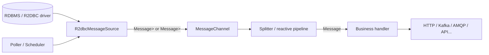
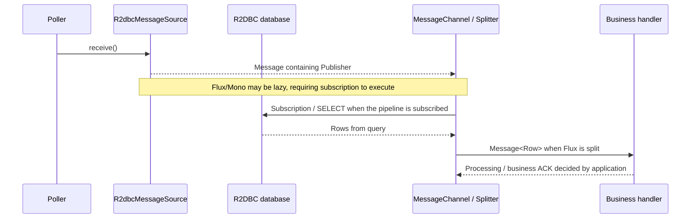

# R2DBC inbound channel adapter

> **Chapter:** R2DBC Adapter  
> **Module:** SPRING_INTEGRATION_ADAPTERS  
> **Module scope:** Connect external systems to Spring Integration using inbound/outbound adapters, gateways, pollers, and MessageChannels. Practice exchange flows over files, SFTP, HTTP, JMS, AMQP, Kafka, and databases; handle message contracts, errors, and connection lifecycles.

## 1. Learning Objectives

After this lesson, you will be able to:

- Explain why an **R2DBC inbound channel adapter** is needed to read data from a database on a schedule and feed it into a Spring Integration flow.
- Distinguish between `R2dbcMessageSource`, `R2dbcEntityOperations`, `SourcePollingChannelAdapter`, `MessageChannel`, and downstream processing components.
- Configure static or dynamic `SELECT` queries, map data rows via `payloadType`, and understand the `expectSingleResult` option.
- Accurately explain that the **default payload is a `Flux`/`Mono`**, rather than each data row automatically becoming a separate message.
- Configure Java DSL with `R2dbc.inboundChannelAdapter(...)`, a poller, and a splitter to process the read rows.
- Use `updateSql` and `bindFunction` to mark selected records, while understanding the risks of **early marking**, duplicate reads, and failures between steps.
- Design polling intervals, batch limits, backpressure, timeouts, retries, idempotency, and verify multiple instances running concurrently.
- Propose how to test the adapter on PostgreSQL R2DBC and how to observe incidents when moving to production.

## 2. What problem does the R2DBC inbound channel adapter solve?

Suppose an application has an `integration_events` table. Other services write new events into the table; the integration system needs to periodically find unprocessed rows and convert them into Spring Messages to forward to HTTP, Kafka, AMQP, or a business service.

If using traditional JDBC, the thread executing `SELECT` typically waits on synchronous I/O. **R2DBC** (Reactive Relational Database Connectivity) provides a Reactive Streams database access API with compatible drivers; read operations can produce a `Flux` or `Mono`, enabling composition and demand/backpressure in a reactive pipeline.

Spring Integration provides **`R2dbcMessageSource`** and an inbound adapter attached to a poller:



**Key point:** R2DBC provides reactive DB access via a reactive API, which does **not** mean every component in the flow is automatically non-blocking. A poller is still responsible for triggering `receive()` on a schedule; querying, subscribing, mapping, and processing rows must be configured properly for the pipeline to operate as intended.

### 2.1. How is R2DBC inbound different from JDBC inbound?

| Criterion | JDBC inbound channel adapter | R2DBC inbound channel adapter |
| --- | --- | --- |
| DB technology | JDBC/`DataSource`. | R2DBC/`ConnectionFactory` and `R2dbcEntityOperations`. |
| Access API | Primarily blocking. | Reactive Streams, typically using Reactor. |
| Reading component | `JdbcPollingChannelAdapter`. | `R2dbcMessageSource`. |
| Result payload | Usually a `List`/collection of read rows. | **Publisher**: `Flux` by default, or `Mono` if single result is selected. |
| Trigger schedule | Poller. | **Still a poller**, does not automatically detect DB changes via push. |
| Marking as read | Depends on SELECT/UPDATE configuration. | Has optional `updateSql` and `bindFunction`. |
| Persistence/ACK | Must be designed in the application. | **Must also be designed**; Reactive does not automatically provide exactly-once. |

**R2DBC inbound is not CDC (Change Data Capture).** It does not read the transaction log or emit events immediately upon transaction commit. The poller runs queries periodically; minimum latency depends on the polling schedule, DB load, and downstream. If every change must be delivered with high reliability, consider **transactional outbox + broker** or a dedicated CDC solution depending on requirements.

## 3. Related Spring Integration components

| Component | Function |
| --- | --- |
| `R2dbcEntityOperations` / `R2dbcEntityTemplate` | Provides query operations and row mapping via R2DBC. |
| `R2dbcMessageSource` | `MessageSource<Publisher<?>>` that executes the configured SELECT and creates a message containing a Publisher. |
| `R2dbc.inboundChannelAdapter(...)` | Java DSL factory to create the spec of an R2DBC inbound source. |
| `SourcePollingChannelAdapter` | Endpoint that triggers `MessageSource.receive()` on a schedule. |
| `PollerMetadata` | Specifies fixed delay/rate, number of polls/source receives per cycle, and error policies. |
| `MessageChannel` | Passes Spring Messages to a splitter, transformer, router, or handler. |
| `DefaultMessageSplitter` | Can split a `Flux`/`Publisher` into multiple items, each becoming a separate Spring Message. |
| `FluxMessageChannel` | A reactive channel that helps maintain the demand/backpressure model when the flow is properly designed. |
| `updateSql` / `bindFunction` | Optional UPDATE operation after the read step according to the source mechanism so the same rows are not read again in the next poll. |

Distinguish inbound from outbound:

- **R2DBC inbound adapter**: periodically **reads** the DB and emits Spring Messages into the flow.
- **R2DBC outbound adapter**: receives messages from the flow and **writes** to the DB (`INSERT`/`UPDATE`/`DELETE`) using `R2dbcMessageHandler`.
- **R2DBC gateway** is not the default name for an inbound source; do not treat this polling source as a synchronous request-reply API like a `@MessagingGateway`.

### 3.1. Lifecycle of a poll



The diagram illustrates the conceptual flow. With `updateSql`, row status update operations are integrated into the source's reactive path according to configuration; **do not assume the UPDATE acts as an ACK after the business handler succeeds**. Exact ordering and transaction boundaries must be tested for your specific version, flow, and database.

## 4. Project prerequisites

The examples below target **Spring Boot 3.x, Spring Integration 6.x, and Java 17+**; for compatibility, let Spring Boot manage versions via its BOM. When using another framework branch, check the corresponding API instead of copying versions from documentation for a different release.

### 4.1. Maven dependencies

```xml
<dependencies>
    <dependency>
        <groupId>org.springframework.boot</groupId>
        <artifactId>spring-boot-starter-integration</artifactId>
    </dependency>
    <dependency>
        <groupId>org.springframework.integration</groupId>
        <artifactId>spring-integration-r2dbc</artifactId>
    </dependency>
    <dependency>
        <groupId>org.springframework.boot</groupId>
        <artifactId>spring-boot-starter-data-r2dbc</artifactId>
    </dependency>
    <dependency>
        <groupId>org.postgresql</groupId>
        <artifactId>r2dbc-postgresql</artifactId>
        <scope>runtime</scope>
    </dependency>
</dependencies>
```

These libraries serve distinct roles: Spring Integration DSL, the R2DBC adapter, Spring Data R2DBC, and the **R2DBC driver for PostgreSQL**. You cannot replace the `r2dbc-postgresql` driver with a JDBC driver if you are using `R2dbcEntityTemplate`.

If you need to expose HTTP endpoints with WebFlux, add the corresponding dependency; **WebFlux is not required** to run an R2DBC poller.

### 4.2. Connection configuration

Example `application.yml`:

```yaml
spring:
  r2dbc:
    url: r2dbc:postgresql://localhost:5432/integration_demo
```

Do not store passwords in Git; in deployment environments, configure them through variables such as `SPRING_R2DBC_USERNAME` and `SPRING_R2DBC_PASSWORD` or a secrets management system.

PostgreSQL must be running, the `integration_demo` database must exist, and the user must have `SELECT` and `UPDATE` privileges on the example table. Spring Boot can provide `R2dbcEntityTemplate` when Spring Data R2DBC is configured properly; do not create a JDBC `DataSource` and expect the R2DBC adapter to use it.

## 5. Example data model: events table to process

We use a PostgreSQL table:

```sql
CREATE TABLE integration_events (
    id           BIGSERIAL PRIMARY KEY,
    event_type   VARCHAR(80) NOT NULL,
    body         TEXT NOT NULL,
    status       VARCHAR(20) NOT NULL DEFAULT 'NEW',
    created_at   TIMESTAMPTZ NOT NULL DEFAULT NOW(),
    processed_at TIMESTAMPTZ
);

CREATE INDEX idx_integration_events_status_id
    ON integration_events (status, id);

INSERT INTO integration_events (event_type, body)
VALUES
    ('DEVICE_UPDATED', '{"deviceId":"sensor-01"}'),
    ('DEVICE_UPDATED', '{"deviceId":"sensor-02"}');
```

Meaning of the statuses:

| Status | Meaning in this lesson | Operational note |
| --- | --- | --- |
| `NEW` | Not yet processed/received by a flow. | Poller selects these rows. |
| `CLAIMED` | Marked to avoid being read again in the next poll. | **Does not** mean business processing is complete. |
| `DONE` | Business service confirmed success. | Requires a separate ACK/update step after the handler in real use. |
| `FAILED` | Recorded an error requiring handling or reconciliation. | Must define whether to retry, when, and how many times. |

The `CLAIMED` status for learning purposes only demonstrates how `updateSql` marks selected rows. **This pattern is not sufficient for production**: if the application stops after marking but before processing, rows can remain stuck in `CLAIMED` forever. Section 11 proposes leases, timeouts, and safe claiming when multiple instances read concurrently.

### 5.1. Java entity mapped from SELECT results

File `InboundEvent.java`:

```java
import org.springframework.data.annotation.Id;
import org.springframework.data.relational.core.mapping.Column;
import org.springframework.data.relational.core.mapping.Table;

@Table("integration_events")
public class InboundEvent {

    @Id
    private Long id;

    @Column("event_type")
    private String eventType;

    private String body;

    public InboundEvent() {
    }

    public Long getId() {
        return id;
    }

    public void setId(Long id) {
        this.id = id;
    }

    public String getEventType() {
        return eventType;
    }

    public void setEventType(String eventType) {
        this.eventType = eventType;
    }

    public String getBody() {
        return body;
    }

    public void setBody(String body) {
        this.body = body;
    }
}
```

`payloadType(InboundEvent.class)` tells Spring Data R2DBC to map rows from the SELECT into `InboundEvent` objects. Do not confuse `payloadType` with the Java generics of `Message`; the source can still return `Message<Flux<InboundEvent>>` rather than directly `Message<InboundEvent>`.

## 6. Java DSL configuration: R2DBC inbound channel adapter

### 6.1. Main flow

File `R2dbcInboundConfiguration.java`:

```java
import org.springframework.context.annotation.Bean;
import org.springframework.context.annotation.Configuration;
import org.springframework.integration.config.EnableIntegration;
import org.springframework.integration.dsl.IntegrationFlow;
import org.springframework.integration.dsl.MessageChannels;
import org.springframework.integration.r2dbc.dsl.R2dbc;
import org.springframework.data.r2dbc.core.R2dbcEntityTemplate;
import org.springframework.r2dbc.core.DatabaseClient;

@Configuration
@EnableIntegration
public class R2dbcInboundConfiguration {

    @Bean
    IntegrationFlow inboundDatabaseEvents(
            R2dbcEntityTemplate template) {

        return IntegrationFlow
                .from(
                        R2dbc.inboundChannelAdapter(
                                template,
                                "SELECT id, event_type, body " +
                                "FROM integration_events " +
                                "WHERE status = 'NEW' " +
                                "ORDER BY id LIMIT 25")
                                .payloadType(InboundEvent.class)
                                .updateSql(
                                        "UPDATE integration_events " +
                                        "SET status = 'CLAIMED' " +
                                        "WHERE id = :id AND status = 'NEW'")
                                .bindFunction(
                                        (DatabaseClient.GenericExecuteSpec spec,
                                         InboundEvent row) ->
                                                spec.bind("id", row.getId())),
                        e -> e.poller(p ->
                                p.fixedDelay(2_000)
                                 .maxMessagesPerPoll(1))
                )
                .channel(MessageChannels.flux())
                .split()
                .channel(MessageChannels.flux())
                .handle(InboundEvent.class, (row, headers) -> {
                    System.out.printf(
                            "R2DBC inbound: id=%d, type=%s, body=%s%n",
                            row.getId(), row.getEventType(), row.getBody()
                    );

                    // Return null: ends the demo branch at this handler.
                    return null;
                })
                .get();
    }
}
```

**This is a demonstration example that receives and logs data, not a production consumer guaranteeing delivery.** To preserve proper retry semantics, replace the logging handler with idempotent business processing that has a separate ACK. In particular, `updateSql` marking `CLAIMED` **does not mean** the log line or downstream succeeded.

### 6.2. Step-by-step explanation

1. `R2dbc.inboundChannelAdapter(template, query)` creates the spec for an R2DBC `MessageSource` that runs the query on a poll schedule.
2. `payloadType(InboundEvent.class)` specifies the object type that `EntityRowMapper` creates for each row.
3. `updateSql(...)` declares the UPDATE statement that marks read rows so the next poll cycle does not keep selecting rows still having status `NEW`.
4. `bindFunction(...)` binds the `:id` value from the corresponding row using parameter binding; avoid concatenating IDs into SQL.
5. `e.poller(...fixedDelay(2_000).maxMessagesPerPoll(1))` schedules receiving messages from the source. **`maxMessagesPerPoll(1)` is the number of `receive()` calls in one cycle, not the limit on SELECT rows**.
6. `MessageChannels.flux()` creates a Reactive Streams channel; suitable for use with a splitter and reactive processing steps.
7. `.split()` splits a `Publisher` containing multiple `InboundEvent`s into multiple Spring Messages so the handler sees **each** event individually.
8. The handler simply logs and ends the branch. This is not yet a reliable `ACK` step in a real environment.

In this flow, `LIMIT 25` is the row limit of **one SELECT**, whereas `maxMessagesPerPoll(1)` limits the number of messages produced by the source in one poll cycle. If you omit `LIMIT`, a single poll can trigger too many rows, even though `receive()` is called only once.

### 6.3. Why is a splitter needed?

`R2dbcMessageSource` defaults to `expectSingleResult=false`, so `receive()` returns a **Spring Message whose payload is `Flux<InboundEvent>`**. If you immediately replace `.split()` with a handler accepting `InboundEvent`, the handler may encounter a **payload type mismatch** because it is receiving a `Flux`.

```text
WITHOUT split:
Poll #1 -> Message<Flux<InboundEvent>>

WITH split:
Poll #1 -> Message<Flux<InboundEvent>>
                  |
                  v
               Splitter
                  |
                  +--> Message<InboundEvent> (id=1)
                  +--> Message<InboundEvent> (id=2)
                  +--> ...
```

`DefaultMessageSplitter` supports `Publisher`; with an appropriate `ReactiveStreamsSubscribableChannel`, the splitter can use subscription/demand to emit items. If you place a synchronous channel or blocking handler in between, the flow can lose reactive benefits; **do not conclude the entire pipeline is non-blocking just by looking at the use of R2DBC**.

### 6.4. Simple read-only version without UPDATE

To observe SELECT and mapping without changing table state, you can omit these two configurations:

```java
.updateSql("UPDATE integration_events SET status='CLAIMED' " +
           "WHERE id = :id AND status = 'NEW'")
.bindFunction((spec, row) -> spec.bind("id", row.getId()))
```

In that case, **every poll continues to re-read rows that are still `NEW`**. This is intentional for experimentation, not a durable delivery mechanism. Do not run a read-only configuration with non-idempotent side effects in production, as it can emit the same event many times.

## 7. expectSingleResult: Mono vs. Flux

According to the `R2dbcMessageSource` API:

- `expectSingleResult(false)` is the default: the query reads multiple rows, and the payload is **`Flux<?>`**.
- `expectSingleResult(true)`: the query runs in single-result mode, and the payload is **`Mono<?>`**.
- **`Mono<?>` is still a Publisher**. It does not mean the payload has turned into a POJO before downstream subscribes.
- If the SELECT returns no rows or multiple rows compared to expectations, the empty/result handling policy must be tested in the flow for your version.

Example reading one row by `id`:

```java
@Bean
IntegrationFlow oneRowFlow(R2dbcEntityTemplate template) {
    return IntegrationFlow
            .from(
                    R2dbc.inboundChannelAdapter(
                            template,
                            "SELECT id, event_type, body " +
                            "FROM integration_events " +
                            "WHERE status = 'NEW' ORDER BY id LIMIT 1")
                            .payloadType(InboundEvent.class)
                            .expectSingleResult(true),
                    e -> e.poller(p ->
                            p.fixedDelay(5_000).maxMessagesPerPoll(1))
            )
            .channel(MessageChannels.flux())
            .split()
            .channel(MessageChannels.flux())
            .handle(InboundEvent.class, (event, headers) -> {
                System.out.println("Single row id=" + event.getId());
                return null;
            })
            .get();
}
```

**Do not enable both** example flows `inboundDatabaseEvents` and `oneRowFlow` simultaneously on the same table while evaluating delivery, because they can compete on SELECT and produce unpredictable results. This snippet is an **alternative variant** for learning `expectSingleResult`.

With `Mono.empty()`, there are no rows for the splitter to emit; avoid sending a message containing null to represent "no rows" if the handler has not defined how to handle it.

## 8. Using @InboundChannelAdapter instead of Java DSL

You can declare `R2dbcMessageSource` directly as a bean, then use the `@InboundChannelAdapter` annotation:

```java
import org.springframework.context.annotation.Bean;
import org.springframework.context.annotation.Configuration;
import org.springframework.integration.annotation.InboundChannelAdapter;
import org.springframework.integration.annotation.Poller;
import org.springframework.integration.r2dbc.inbound.R2dbcMessageSource;
import org.springframework.data.r2dbc.core.R2dbcEntityTemplate;

@Configuration
public class R2dbcAnnotationExample {

    @Bean
    @InboundChannelAdapter(
            channel = "r2dbcPublishers",
            poller = @Poller(fixedDelay = "2000"))
    R2dbcMessageSource pollDatabase(
            R2dbcEntityTemplate template) {

        var source = new R2dbcMessageSource(
                template,
                "SELECT id, event_type, body " +
                "FROM integration_events " +
                "WHERE status = 'NEW' ORDER BY id LIMIT 25");

        source.setPayloadType(InboundEvent.class);
        source.setExpectSingleResult(false);
        return source;
    }
}
```

This configuration **also requires** a `MessageChannel` bean named `r2dbcPublishers` and a consumer that splits/subscribes to the `Flux` to execute the query and process rows. If you only create `R2dbcMessageSource` without an appropriate downstream, you may not receive rows as expected.

This is an **alternative** to the Java DSL in section 6; do not enable two inbound sources on the same table in parallel during an experiment.

## 9. Dynamic queries, SelectCreator, and data mapping

### 9.1. Static SQL and dynamic queries

R2DBC inbound supports:

- Static `SELECT` passed as an SQL string.
- **SpEL** expressions evaluated on each `receive()` to build dynamic SQL.
- `R2dbcMessageSource.SelectCreator` as the root context for expressions selecting data via `StatementMapper.SelectSpec`.

Java DSL example based on the Fluent API instead of concatenating SQL strings:

```java
import org.springframework.data.relational.core.query.Criteria;
import org.springframework.integration.r2dbc.dsl.R2dbc;

// Snippet inside IntegrationFlow.from(...):
R2dbc.inboundChannelAdapter(
        template,
        selectCreator ->
                selectCreator.createSelect("integration_events")
                        .withProjection("id", "event_type", "body")
                        .withCriteria(Criteria.where("status").is("NEW")))
        .payloadType(InboundEvent.class)
```

The snippet above illustrates creating a `SelectSpec`. When adding it to a real flow, you still need a poller and a Publisher consumer. If you want to limit the batch row count, choose a query builder/way to express `LIMIT` appropriate for your dialect and API; do not assume every DB uses the same SQL syntax.

### 9.2. Why use bind parameters?

`bindFunction` is responsible for binding values into `UPDATE` based on the SELECTed record. Never build SQL by concatenating untrusted input values:

```java
// AVOID: placing raw IDs or business strings directly into SQL.
String sql = "UPDATE integration_events SET status='CLAIMED' "
           + "WHERE id = " + externalId;
```

Instead:

```java
String sql =
        "UPDATE integration_events SET status='CLAIMED' WHERE id = :id";

DatabaseClient.GenericExecuteSpec spec = client.sql(sql);
spec = spec.bind("id", event.getId());
```

Distinguish between **value bind parameters** and **table/column names**. You cannot bind an arbitrary table name as a value; if a real query needs to choose tables dynamically, whitelist allowed identifiers to prevent SQL injection and authorization errors.

### 9.3. Default payloadType

If `payloadType` is not set, the adapter defaults to mapping records into a case-insensitive Map type (for example `LinkedCaseInsensitiveMap`), which is suitable when there is no entity model. With `payloadType(InboundEvent.class)`, `EntityRowMapper` and the `R2dbcEntityOperations` converters map columns into Java fields.

| Mapping approach | Payload item | When to use |
| --- | --- | --- |
| No `payloadType` configured | Map by column name. | Flexible queries, prototypes, simple schema data. |
| Set `payloadType` to entity/DTO | POJO/record supported by Spring Data. | Want clear type contracts, validation, and type-safe code. |

Whether using a Map or POJO, check nullability, numeric types, timezones, missing/renamed columns, and JSON text contents against the business schema.

## 10. Poller, reactive streams, and backpressure

### 10.1. Poller is a trigger point, not an infinite subscription

A poller invokes `R2dbcMessageSource.receive()` on a schedule. In the reactive model, `receive()` can return a message containing a **lazy** publisher: the query and mapping actually execute when the publisher is subscribed to by downstream.

Therefore, you must understand both levels:

```text
Polling rate:
  how often does SourcePollingChannelAdapter call receive()?

Reactive demand:
  has downstream subscribed yet?
  how many items are requested? at what rate can it process?
```

`maxMessagesPerPoll(1)` is **not** equivalent to "read only one row every two seconds". A single `receive()` can return a `Flux` with dozens of records; row count depends on `SELECT`/`LIMIT` and the Publisher processing flow.

### 10.2. fixedDelay or fixedRate?

| Scheduling mode | General meaning | Caution |
| --- | --- | --- |
| `fixedDelay(2000)` | Delay between scheduling runs after one poll task finishes. | A poll task may only push a Publisher into the flow, without necessarily waiting for all reactive processing to complete. |
| `fixedRate(2000)` | Tries to maintain a fixed periodic schedule frequency. | If the task/flow is slow, can easily cause overlapping pressure if concurrency is not bounded. |
| `maxMessagesPerPoll(1)` | Limits how many messages are received from the source per cycle. | Does not limit the number of rows in a `Flux`. |
| `SELECT ... LIMIT 25` | Limits row count per SQL query. | Does not by itself protect against two overlapping polls or two instances selecting the same rows. |

**Important note:** `fixedDelay` does not prove by itself that the entire publisher/handler of the previous poll has finished before the next poll. With asynchronous pipelines, you must verify overlap empirically, limit concurrency, or design DB-level claiming.

### 10.3. Backpressure does not replace resource limits

A `FluxMessageChannel` can support subscription/demand in a reactive flow. However:

- The poller can still keep creating new publishers on schedule.
- An unbounded SQL query can read a huge amount of data.
- A handler switching to JDBC/blocking APIs will occupy threads and defeat reactive benefits.
- Any non-Reactive-Streams-aware component placed in the middle of the pipeline can alter how demand works.
- Too many concurrent queries can exhaust the R2DBC connection pool.

Combine `LIMIT`, polling frequency, active subscription/concurrency limits, R2DBC pool sizing, timeouts, backpressure, and queue depth monitoring. When ordered isolation is needed, process events sequentially with `concatMap` or limit `flatMap` concurrency in the appropriate Reactor pipeline.

## 11. updateSql, ACK, and reliability

### 11.1. updateSql marks "read", not "finished processing"

Spring Integration supports `updateSql` to mark SELECTed records and exclude them from subsequent polls. For example:

```sql
SELECT id, event_type, body
FROM integration_events
WHERE status = 'NEW'
ORDER BY id
LIMIT 25;

UPDATE integration_events
SET status = 'CLAIMED'
WHERE id = :id AND status = 'NEW';
```

This helps reduce **repeatedly reading** the same rows across polls, but does not mean downstream succeeded. If the handler fails after the UPDATE succeeds, the row can get stuck in `CLAIMED` and never be SELECTed again.

Therefore, do not present `updateSql` as an "exactly-once" ACK. It is a read/claim state management tool that requires an additional recovery policy.

### 11.2. Risk when two instances poll concurrently

```mermaid
sequenceDiagram
    participant A as Instance A
    participant B as Instance B
    participant DB as Database

    A->>DB: SELECT WHERE status=NEW (id=10)
    B->>DB: SELECT WHERE status=NEW (id=10)
    DB-->>A: id=10
    DB-->>B: id=10
    A->>DB: UPDATE id=10 SET CLAIMED WHERE NEW
    B->>DB: UPDATE id=10 SET CLAIMED WHERE NEW
    Note over A,B: Both read the same row; atomic claim design is needed
```

The `WHERE status='NEW'` condition means **one UPDATE may affect zero rows** after the other instance has claimed it. However, do not assume the source automatically discards the message on the instance whose claim failed. To guarantee a single worker owns a row, you must **check the number of rows successfully UPDATED** and design an appropriate transaction/claim protocol.

### 11.3. Production design: lease-based claim + post-handler ACK

A solid approach is a state machine:

```text
NEW -> PROCESSING(lease_owner, lease_until, attempt_count)
    -> DONE
    -> RETRY / DEAD
```

Ideal steps:

1. **Claim atomically**: select an unprocessed/lease-expired batch and update owner + lease in a single appropriate DB operation/transaction (for example PostgreSQL `FOR UPDATE SKIP LOCKED` in a transaction or `UPDATE ... RETURNING` with proper conditions).
2. Emit only rows that the instance **actually claimed** successfully.
3. Use **event ID** as the idempotency key for the handler and downstream.
4. After downstream completes, update to `DONE` in a separately managed ACK step.
5. When a worker crashes or times out, the lease expires; the row is returned for the next processing attempt.
6. Limit attempts, apply backoff, and move unprocessable rows to `DEAD`/DLQ status.
7. Monitor overdue `PROCESSING` rows, retry counts, and DB connection loss.

**You cannot combine a DB commit and sending to an external system into a single atomic transaction using only `R2dbcMessageSource`.** If the goal is reliably publishing integration events to Kafka/AMQP, consider transactional outbox and idempotent consumers.

### 11.4. At-most-once, at-least-once, and exactly-once effects

| Strategy | On mid-flight failure | Risk |
| --- | --- | --- |
| Mark `CLAIMED` before handler, no recovery | Row may never be reprocessed. | **Event loss** if handler fails. |
| Re-read when un-ACKed, with lease/retry | Row may be processed again. | **Duplicates** if previous side effect succeeded. |
| Outbox + broker + idempotent consumer | Event may be redelivered, consumer deduplicates. | Requires transaction, retention, and monitoring design. |

R2DBC provides **reactive** data access; it does not inherently guarantee exactly-once side effects over the network.

## 12. Error handling and retry

### 12.1. Different errors require different handling paths

| Error | Example | How to handle |
| --- | --- | --- |
| DB connect/query | Connection timeout, DB restart. | Bounded retry with backoff, monitor DB health and connection pool. |
| SQL/mapping | Wrong column, conversion failure. | Fix schema/query/mapping; do not retry infinitely. |
| Reactive subscription | Publisher not subscribed, cancelled, error after subscription. | Inspect flow, error handling, and Reactor instrumentation. |
| Duplicate row | Two polls/instances read the same row. | Atomic claim, check affected rows, idempotency. |
| Business downstream | API returns error or timeout. | Keep retryable state, ACK after processing succeeds. |
| Marked `CLAIMED` successfully but handler crashes | Row is no longer in `SELECT status=NEW`. | Lease timeout/compensation, do not treat as DONE. |
| Slow/overlapping poller | Expensive query, downstream congestion. | Batch size, concurrency limit, index, rate, and backpressure. |

### 12.2. Do not over-rely on errorChannel

Because the payload can be a `Flux`/`Mono`, exceptions **can occur after the poller has already emitted the Spring Message**, during actual subscription. Do not assume the poller's `errorChannel` will certainly catch every error emitted from the publisher.

- **Synchronous** errors while creating/sending the message can follow the endpoint's error handling path.
- **Asynchronous** errors from the Publisher must be handled inside the reactive chain, with logging/retry/DLQ as needed.
- If downstream uses a blocking handler and throws an exception, how the error propagates depends on the channel and consumer types.

Specifically test three scenarios: DB temporary pause, Publisher emitting an error mid-batch, and business handler failing after part of a batch has already been processed.

### 12.3. Safe retry

For pure read queries, retry is usually simpler, but with `updateSql` and downstream side effects, you must ask:

1. Did the error occur **before or after** the claim UPDATE?
2. How many rows were already processed successfully by the handler?
3. Which event IDs have already been ACKed?
4. When retrying, should the **same event ID** be used or a new ID generated?
5. Are there retry limits, deadlines, jitter, and a DLQ?
6. Could the event be sent twice to an external system?

Rule of thumb: **event ID stays unchanged across retries**, consumers are idempotent, DB state is sufficient for recovery, and final results can be reconciled.

## 13. Monitoring, query optimization, and resources

### 13.1. SQL should have clear indexes and batching

For tables with millions of rows:

```sql
SELECT id, event_type, body
FROM integration_events
WHERE status = 'NEW'
ORDER BY id
LIMIT 25;
```

An index such as `(status, id)` makes batch read queries more efficient. However, you still need to measure the actual query plan, DB statistics, ratio of `NEW` rows, and write amplification caused by UPDATEs.

Do not set `LIMIT` too high just to reduce poll frequency if downstream is slow; it can produce a Publisher with too many items and hold DB connections for a long time.

### 13.2. Suggested metrics

| Metric | Meaning |
| --- | --- |
| `poll_attempt_total` / `poll_errors_total` | Number of polls, query/scheduler errors. |
| `rows_selected_total` | Number of rows returned by the DB. |
| `rows_claimed_total` / `rows_claim_conflict_total` | Successful claims and contention across instances. |
| `events_processed_total` / `events_failed_total` | Handler successes/failures. |
| `oldest_new_event_age` | Maximum backlog age/latency. |
| `processing_lease_expired_total` | Worker crash or overly slow handler. |
| `r2dbc_pool_active` / `r2dbc_pool_pending` | Connection pool health. |
| `poll_to_done_p95` | Actual latency from poll to business completion. |
| `duplicate_event_ids_total` | Level of retries/duplicates in the flow. |

These are **suggested metric names**, not a built-in Micrometer list provided automatically by the adapter. When measuring in practice, combine DB/pool metrics, Spring Integration management, and business counters.

### 13.3. Health and shutdown

- Application **liveness** does not imply the DB is ready.
- **Readiness** should consider DB connectivity, backlog size, and downstream processing capacity.
- On shutdown, stop new polls, allow in-flight subscriptions/handlers to finish within a deadline, and preserve un-ACKed rows via leases.
- When the R2DBC pool is exhausted, reduce concurrency/poll rate instead of endlessly increasing connection count.
- Do not log the full `body` if it contains personal data or secrets; log the event ID, event type, timestamp, and sanitized error codes.

## 14. End-to-end testing

### 14.1. Preparation

In a local environment:

1. Create the PostgreSQL database and `integration_events` table as in section 5.
2. Configure `spring.r2dbc.url` along with credentials for the application.
3. Ensure Spring Boot component scan includes `InboundEvent` and `R2dbcInboundConfiguration`.
4. Start one application instance; observe `NEW` events being read.
5. For the demo with `updateSql`, query the table to observe the `CLAIMED` status after a read cycle.

**Expected** output (not actually executed in this document):

```text
R2DBC inbound: id=1, type=DEVICE_UPDATED, body={"deviceId":"sensor-01"}
R2DBC inbound: id=2, type=DEVICE_UPDATED, body={"deviceId":"sensor-02"}
```

Actual IDs are generated by the database; do not always assume 1 and 2 if prior data already exists.

### 14.2. Test matrix

| Scenario | Outcome to verify |
| --- | --- |
| Empty table | No business rows emitted; poller continues running. |
| Two `NEW` rows | Mapped to `InboundEvent`, splitter emits each item. |
| No `payloadType` | Each row is mapped to a Map, not a POJO. |
| `expectSingleResult=true` | Source creates a `Mono`, not a multi-row `Flux`. |
| `LIMIT 25` with 100 rows | One SELECT does not exceed a 25-row batch; subsequent polls continue by status. |
| `maxMessagesPerPoll(1)` | Limits source invocation count, **not** row count. |
| No `updateSql` configured | `NEW` rows are re-read on subsequent polls. |
| `updateSql` configured | Rows with updated status are no longer SELECTed by `status=NEW`. |
| DB error before SELECT | Retried/logged per policy; not reported as processed. |
| Schema mapping mismatch | Conversion error observed, not silently ignored. |
| Handler fails after claim | Row is not treated as DONE; requires recovery/lease. |
| Two app instances poll simultaneously | Do not rely on plain SELECT then UPDATE to assert exclusive claim. |
| Slow downstream | Backlog grows; do not let pool/queues grow unboundedly. |
| App restarts while `CLAIMED` rows remain | Must have a recovery mechanism or operator reconciliation. |
| Body contains Unicode/JSON | UTF-8 read accurately and separate JSON/schema validation performed. |
| Stop poller | No new batches accepted; running subscriptions handled per shutdown policy. |

### 14.3. Unit tests with fake data and integration tests with a real DB

**Unit tests:** verify parsers/handlers, retry policies, and business ID mapping with mocked POJOs; no DB is required to test business conditions.

**Integration tests:** use real PostgreSQL via Testcontainers (or an equivalent test environment) to verify dialect, SQL binding, transactions, update counts, concurrency, and rollback/leases. H2 R2DBC can be useful for testing basic syntax but **does not** fully represent PostgreSQL, especially for locking/`SKIP LOCKED`.

Do not treat a test that "fetched two rows" as sufficient proof of delivery semantics. Fault-inject in the window **between SELECT, claim UPDATE, and ACK**.

## 15. Common design mistakes

| Mistake | Consequence | How to fix |
| --- | --- | --- |
| Assuming each poll emits one row | One poll can produce a `Flux` of many rows. | Distinguish `receive()` from items; use splitter and `LIMIT`. |
| Handler casts payload directly to `InboundEvent` without splitting | `ClassCastException` or type mismatch. | Use a splitter or handle Publisher explicitly. |
| Not subscribing to `Flux` | Query may never execute. | Design reactive downstream with a subscriber. |
| Using JDBC `DataSource` for R2DBC source | Wrong connection API. | Use R2DBC driver and `R2dbcEntityTemplate`. |
| Configuring `fixedDelay` and assuming the old batch always finishes | Reactive processing may still be running. | Limit concurrency and measure overlap. |
| Treating `updateSql` as handler ACK | Row may be marked before processing succeeds. | Separate ACK, lease/recovery, and idempotency. |
| Two instances concurrently SELECT status `NEW` | May read duplicate rows. | Atomic claim/locking, check update count. |
| Using only `maxMessagesPerPoll(1)` to limit row count | One `Flux` can still contain many items. | SQL `LIMIT`, pool/concurrency limits. |
| Infinite retry on schema-mismatch SQL | Fixed recurring errors, increasing DB load. | Classify errors, alert, and stop/recover. |
| Building SQL by concatenating raw input | SQL injection or broken queries. | Bind values and whitelist identifiers. |
| Blocking work inside a reactive channel | Blocks threads and reduces throughput. | Choose appropriate handler/reactive scheduling. |
| Not monitoring stale `CLAIMED` rows | Event loss after crash. | Lease timeout, alerts, recovery job. |

## 16. Practice exercises

**Exercise 1 — Explore the payload.** Remove the splitter and set a handler to log `payload.getClass()`. Confirm one poll emits a `Flux` rather than an `InboundEvent`; then restore the splitter.

**Exercise 2 — Compare single and multi.** Enable `expectSingleResult(true)` with `LIMIT 1`, then revert to the default `false` with `LIMIT 25`. Compare `Mono`/`Flux` and the meaning of `maxMessagesPerPoll(1)`.

**Exercise 3 — Re-read rows.** Remove `updateSql` while keeping the `status='NEW'` query. Observe the same event ID appearing across multiple polls; explain why downstream must be idempotent.

**Exercise 4 — Claim and crash.** Keep `updateSql`, intentionally make the handler throw an exception after the row is updated to `CLAIMED`. Check whether the row is read again; propose a lease recovery mechanism instead of marking DONE early.

**Exercise 5 — Two competing instances.** Run two application instances reading the same table, adding a delay during processing. Record duplicate event IDs, design an atomic PostgreSQL-based claim transaction, and compare.

**Exercise 6 — Dynamic query.** Use `SelectCreator` and `Criteria` to select events by `event_type`, explaining why input criteria must be bound instead of concatenated into SQL strings.

**Exercise 7 — Backpressure.** Make each event take 300 ms to process and increase polling speed. Measure backlog, pool utilization, and active subscriptions; propose a reasonable batch size/interval.

**Exercise 8 — End-to-end delivery.** After processing an event, send it over Kafka/AMQP. Design request/event IDs, transactional outbox, ACK, and retries to prevent loss/duplicates when one side fails.

## 17. Self-check questions

1. In what type of DB API does the R2DBC inbound channel adapter differ from the JDBC inbound adapter?
2. Is `R2dbcMessageSource` a scheduler that continuously runs queries by itself?
3. Which method does the adapter's poller call to fetch a message?
4. With `expectSingleResult=false`, what type does the payload typically have?
5. When `expectSingleResult=true`, is the payload directly the entity or a `Mono`?
6. Why is a splitter needed when you want to process one row as one Spring Message?
7. Does `maxMessagesPerPoll(1)` limit each SELECT to one row?
8. What does `payloadType(InboundEvent.class)` mean?
9. What is `updateSql` designed to do, and why should it not be treated as a handler success ACK?
10. What is the role of `bindFunction` when an UPDATE has a `:id` parameter?
11. Why can two instances read the same row if they only run non-atomic SELECT followed by UPDATE?
12. Why is `fixedDelay` not guaranteed to wait for all async subscribers to finish processing?
13. What can happen if a `Flux` is not subscribed to?
14. If a row is already `CLAIMED` and the app crashes, what mechanism can reprocess it?
15. Does the R2DBC inbound adapter replace CDC or transactional outbox for exactly-once event delivery?
16. Which metrics help indicate that the poller is falling behind a backlog?

**Answer hints:** (1) JDBC is blocking, R2DBC is reactive. (2) No; the poller triggers the source. (3) `receive()`. (4) `Flux`. (5) `Mono` per the API. (6) One Publisher has multiple rows; the splitter emits items individually. (7) No, it limits `receive()` calls; row count is controlled by SQL. (8) Selects the row mapping target type. (9) Marks as read; downstream can fail afterward. (10) Safely binds parameters per record. (11) SELECT does not lock/claim exclusively. (12) Reactive work may run after the poll task returns. (13) The query might never be executed. (14) Lease, timeout, and recovery job. (15) No, a separate delivery contract/ACK/dedup is needed. (16) Age of oldest NEW row, poll rate, rows/s, errors, p95 latency, R2DBC pool, and retries.

## 18. References

- [Spring Integration Reference — R2DBC Support](https://docs.spring.io/spring-integration/reference/r2dbc.html).
- [Spring Integration API — R2dbcMessageSource](https://docs.spring.io/spring-integration/api/org/springframework/integration/r2dbc/inbound/R2dbcMessageSource.html).
- [Spring Integration API — R2dbc Java DSL](https://docs.spring.io/spring-integration/api/org/springframework/integration/r2dbc/dsl/R2dbc.html).
- [Spring Integration Reference — Inbound Channel Adapters and Pollers](https://docs.spring.io/spring-integration/reference/dsl/java-inbound-adapters.html).
- [Spring Integration Reference — Splitter and Publisher](https://docs.spring.io/spring-integration/reference/splitter.html).
- [Spring Data R2DBC Reference](https://docs.spring.io/spring-data/relational/reference/r2dbc.html).
- [R2DBC Specification](https://r2dbc.io/spec/1.0.0.RELEASE/spec/html/).

**Key takeaway:** **The R2DBC inbound channel adapter is a pollable MessageSource over a reactive database**. It combines `R2dbcEntityOperations`, `SourcePollingChannelAdapter`, a `SELECT` query, and a `MessageChannel` to bring data into Spring Integration. The source's payload is a `Flux` or `Mono`; subscription/splitting must be designed explicitly. `updateSql` helps mark read records, but **does not guarantee downstream processing success or exactly-once delivery**. For production, you need batch sizes, backpressure, atomic claim/lease, post-processing ACK, idempotency, retries, and full observability.
