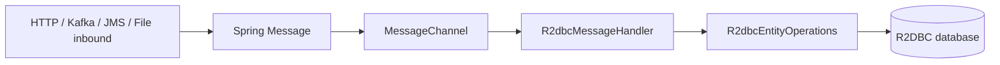
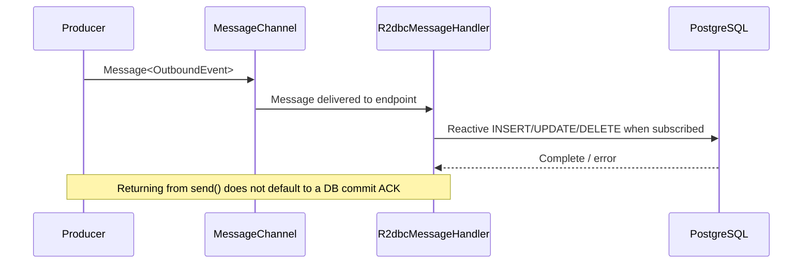
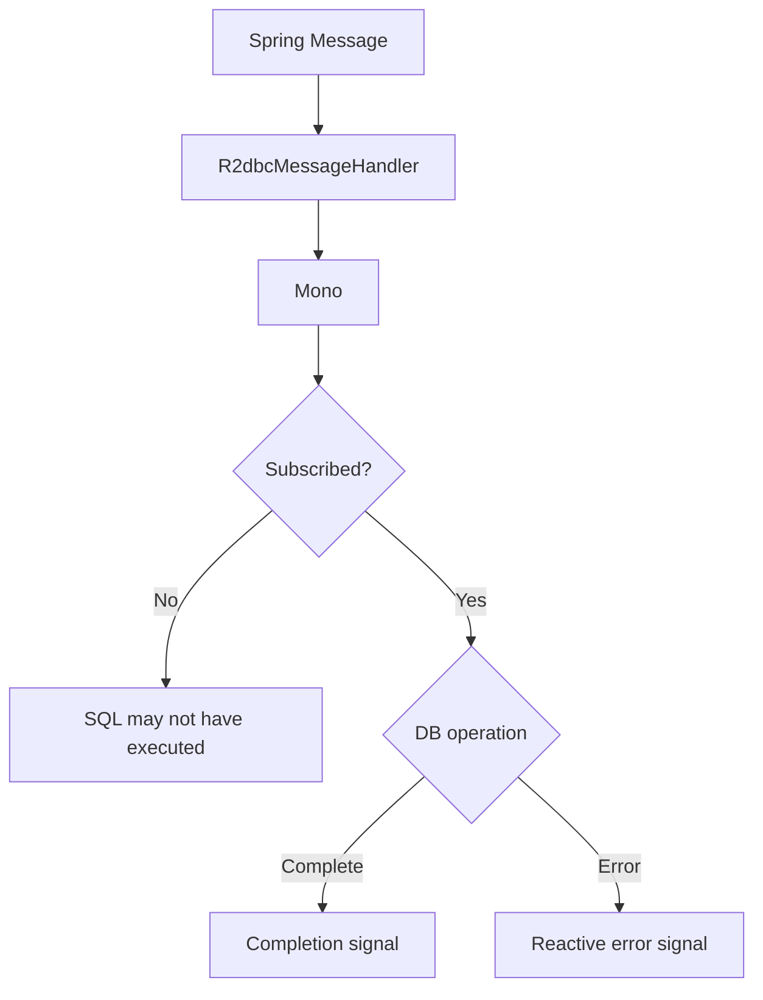

# R2DBC outbound channel adapter

> **Chapter:** R2DBC Adapter  
> **Module:** SPRING_INTEGRATION_ADAPTERS  
> **Scope:** Connect external systems to Spring Integration using inbound/outbound adapters, gateways, pollers, and MessageChannels. Practice exchanging data via files, SFTP, HTTP, JMS, AMQP, Kafka, and databases; focus on message contracts, errors, and connection lifecycles.

## 1. Learning Objectives

After this lesson, you will be able to:

- Explain how the **R2DBC outbound channel adapter** sends Spring Messages from the application **to a database** via R2DBC.
- Distinguish between `R2dbcMessageHandler`, `R2dbcEntityOperations`, `R2dbcEntityTemplate`, `ConnectionFactory`, and `MessageChannel`.
- Configure `INSERT` (default), `UPDATE`, and `DELETE` using `R2dbcMessageHandler.Type`, `tableName`, `values`, and `criteria`.
- Use `R2dbc.outboundChannelAdapter(...)` and `handleReactive(...)` in the Spring Integration 6.1+ Java DSL.
- Understand `Mono<Void>`, subscription, error signals, and the difference between **sending a message successfully** and a **successful database commit**.
- Build a Spring Boot/PostgreSQL example that inserts an event, updates its status, and deletes conditionally.
- Choose when to use entity mapping, column-value maps, custom `DatabaseClient`, and reactive transactions.
- Analyze duplicate events, optimistic locking, retries, idempotency, backpressure, and transactions that do not span across brokers.
- Test database outages, constraint violations, concurrency, and conditions ensuring only the intended rows are updated.

## 2. Why do we need an R2DBC outbound channel adapter?

An integration flow receives events from HTTP, Kafka, AMQP, JMS, or files and needs to persist them into an `integration_events` table. The database communication layer should be decoupled from the producer: the producer sends a Spring Message to a `MessageChannel`; the outbound adapter receives the message and performs the write operation.

R2DBC (Reactive Relational Database Connectivity) is a Reactive Streams SQL database access API. Spring Data R2DBC provides `R2dbcEntityOperations` and `R2dbcEntityTemplate` to interact with the database reactively. Spring Integration provides `R2dbcMessageHandler`, a **`ReactiveMessageHandler`** that executes `INSERT`, `UPDATE`, or `DELETE` when receiving a message.



Here, **outbound** indicates the direction of a Spring Message **going out to the database system**. It does not mean actively opening a TCP socket, nor is it a source emitting records from the DB. To **read** new rows from the database on a schedule, use the **R2DBC inbound channel adapter**, `R2dbcMessageSource`, and a poller.

### 2.1. How is it different from the JDBC outbound adapter?

| Criterion | JDBC outbound | R2DBC outbound |
| --- | --- | --- |
| DB API | JDBC / `DataSource` | R2DBC / `R2dbcEntityOperations` |
| Typical I/O | Blocking | Reactive API, though not necessarily the entire flow is non-blocking |
| Handler | Corresponding JDBC handler | `R2dbcMessageHandler` |
| Operation | Configured write SQL | `INSERT`, `UPDATE`, `DELETE` via entity or table/values/criteria |
| Trigger point | When a Spring Message arrives | When a Spring Message arrives |
| Needs a dedicated poller? | Not by default | **No**; a poller belongs to an inbound source if present |
| Guarantees exactly-once? | Not automatically | **Not automatically** |
| Transactions with broker/HTTP | Must be designed separately | **Must also be designed separately** |

**Reactive** does not automatically provide distributed transactions, retries, ACKs, or idempotency. Those belong to the contract between the producer, the database, and downstream.

## 3. Architecture and message lifecycle

| Component | Responsibility |
| --- | --- |
| `MessageChannel` | Delivers request messages from the source to the DB write endpoint. |
| `R2dbcMessageHandler` | Translates a message into the appropriate SQL write command and returns a reactive signal. |
| `R2dbc.outboundChannelAdapter(template)` | Java DSL factory to create/configure the handler spec. |
| `R2dbcMessageHandler.Type` | Selects `INSERT`, `UPDATE`, or `DELETE`. |
| `R2dbcEntityOperations` | Spring Data interface for entity/SQL operations over R2DBC. |
| `R2dbcEntityTemplate` | Common implementation of `R2dbcEntityOperations`. |
| R2DBC `ConnectionFactory` | Supplies connections to the database; **different** from Spring Integration IP's TCP ConnectionFactory. |
| `handleReactive(...)` | Terminal operator that subscribes to the reactive handler's `Mono<Void>`. |
| `TransactionalOperator` | Declares a transaction within a reactive chain when multiple DB operations must be atomic. |



The key concepts are **subscription** and **completion signals**. Accepting a Spring Message into a channel does not guarantee the SQL has already executed. An outbound channel adapter also does not automatically return a Spring reply message containing `rowsUpdated`.

### 3.1. Why not treat the adapter as a gateway with a response?

A request-reply gateway returns a result to the caller. `R2dbcMessageHandler` is an **outbound channel adapter** for writing data and implements `ReactiveMessageHandler`; its processing contract is primarily expressed via a `Mono<Void>` complete/error signal. If business logic needs to know that **exactly one row was updated** or needs a database-generated ID, use a custom reactive service with an explicit return type.

## 4. How the handler builds SQL statements

### 4.1. Default INSERT

If `queryType` is not configured, the default operation is **`INSERT`**. Two ways to provide data:

1. Without setting `tableName`: the payload must be an entity with appropriate Spring Data `@Table` metadata for persistence.
2. Setting `tableName` and `values`: a column-value Map constructed from the payload/headers via a function or SpEL.

Example:

```text
Payload:
  eventId = evt-101
  eventType = DEVICE_UPDATED
  payloadJson = {"deviceId":"sensor-01"}

tableName = integration_events
values = {event_id: evt-101, event_type: DEVICE_UPDATED, payload_json: ...}
```

This structure lets you decouple the DTO sent over a MessageChannel from the persistence entity. **Do not** let input choose table/column names without a whitelist.

### 4.2. UPDATE requires values and criteria

For `UPDATE`:

- `queryType(Type.UPDATE)`: selects the operation type.
- `tableName("integration_events")`: fixed table name.
- `values(...)`: Map of columns and new values.
- `criteria(...)`: condition determining which rows are modified.

```sql
UPDATE integration_events
SET status = 'DONE'
WHERE event_id = 'evt-101' AND status = 'NEW';
```

**Note:** An UPDATE can succeed at the SQL layer while updating **0 rows** if the criteria do not match. If business logic requires "exactly one row must be updated", check the updated row count using a reactive service with `rowsUpdated()`, rather than treating the adapter's `Mono<Void>` as a row count.

### 4.3. DELETE requires explicit criteria

```sql
DELETE FROM integration_events
WHERE event_id = 'evt-101' AND status = 'DONE';
```

`Type.DELETE` combined with `criteria(...)` ensures only matching rows are targeted. DELETE is destructive; for data with retention obligations, consider **soft delete** instead of physical deletion.

### 4.4. Static Type and dynamic Type

`R2dbcMessageHandler.Type` can be fixed or computed from the message via SpEL/function. One endpoint can choose INSERT/UPDATE/DELETE based on a command. However, when operations have different permissions and testing requirements, **separating flows** is usually easier to manage.

SpEL can read `payload` and `headers`, but must not become a place to execute raw SQL sent by callers. `R2dbcMessageHandler` is an adapter that generates DML from configuration, **not** an arbitrary SQL execution interface for every use case.

## 5. Preparing the Spring Boot and PostgreSQL application

The examples use **Java 17+, Spring Boot 3.x, and Spring Integration 6.1+**. `handleReactive(...)` was introduced in Spring Integration 6.1. For older branches, choose the API matching your version instead of copying syntax verbatim.

### 5.1. Maven dependencies

```xml
<dependencies>
    <dependency>
        <groupId>org.springframework.boot</groupId>
        <artifactId>spring-boot-starter-integration</artifactId>
    </dependency>
    <dependency>
        <groupId>org.springframework.integration</groupId>
        <artifactId>spring-integration-r2dbc</artifactId>
    </dependency>
    <dependency>
        <groupId>org.springframework.boot</groupId>
        <artifactId>spring-boot-starter-data-r2dbc</artifactId>
    </dependency>
    <dependency>
        <groupId>org.postgresql</groupId>
        <artifactId>r2dbc-postgresql</artifactId>
        <scope>runtime</scope>
    </dependency>
</dependencies>
```

The Spring Boot BOM should manage versions. The PostgreSQL **R2DBC** driver is a separate component from the JDBC driver; installing only JDBC will not satisfy `R2dbcEntityTemplate`.

### 5.2. Database connection

Example `application.yml`:

```yaml
spring:
  r2dbc:
    url: r2dbc:postgresql://127.0.0.1:5432/integration_demo
```

Use environment variables `SPRING_R2DBC_USERNAME` and `SPRING_R2DBC_PASSWORD` or a secrets manager to supply credentials; never commit real passwords to the repository. Create the `integration_demo` database before running.

### 5.3. Creating the table

```sql
CREATE TABLE integration_events (
    event_id     VARCHAR(64) PRIMARY KEY,
    event_type   VARCHAR(64) NOT NULL,
    payload_json TEXT NOT NULL,
    status       VARCHAR(16) NOT NULL DEFAULT 'NEW',
    created_at   TIMESTAMPTZ NOT NULL DEFAULT CURRENT_TIMESTAMP
);

CREATE INDEX idx_integration_events_status
    ON integration_events (status, created_at);
```

- `event_id` serves as the **business idempotency key**.
- `status` defaults to `NEW`, transitioning to `DONE` when a consumer finishes per contract.
- `created_at` is generated by the database.
- The `PRIMARY KEY` constraint prevents duplicate rows, but does not automatically turn a duplicate INSERT into success for the caller.

## 6. Java DSL example: INSERT event into the database

### 6.1. Payload DTO

Create `OutboundEvent.java`:

```java
public record OutboundEvent(
        String eventId,
        String eventType,
        String payloadJson
) {
}
```

This DTO does not necessarily need `@Table` because the flow explicitly specifies `tableName` and `values`.

### 6.2. R2DBC outbound flow

Create `R2dbcOutboundConfiguration.java`:

```java
import java.util.Map;

import org.springframework.context.annotation.Bean;
import org.springframework.context.annotation.Configuration;
import org.springframework.data.r2dbc.core.R2dbcEntityTemplate;
import org.springframework.integration.annotation.IntegrationComponentScan;
import org.springframework.integration.config.EnableIntegration;
import org.springframework.integration.dsl.IntegrationFlow;
import org.springframework.integration.r2dbc.dsl.R2dbc;
import org.springframework.messaging.Message;

@Configuration
@EnableIntegration
@IntegrationComponentScan
public class R2dbcOutboundConfiguration {

    @Bean
    IntegrationFlow insertEventFlow(R2dbcEntityTemplate template) {
        return IntegrationFlow
                .from("r2dbcInsertRequests")
                .handleReactive(
                        R2dbc.outboundChannelAdapter(template)
                                .tableName("integration_events")
                                // INSERT is the default query type.
                                .values((Message<OutboundEvent> message) -> {
                                    OutboundEvent event = message.getPayload();
                                    return Map.of(
                                            "event_id", event.eventId(),
                                            "event_type", event.eventType(),
                                            "payload_json", event.payloadJson()
                                    );
                                })
                )
                .get();
    }
}
```

**Explanation:**

1. `from("r2dbcInsertRequests")` creates the flow's input via a Spring MessageChannel.
2. `R2dbc.outboundChannelAdapter(template)` configures `R2dbcMessageHandler` on `R2dbcEntityOperations`.
3. `tableName("integration_events")` fixes the target table.
4. `values(...)` maps the DTO to table columns. `status` and `created_at` are left for the DB to apply defaults.
5. `handleReactive(...)` is the terminal operator handling the reactive handler and subscribing to the write publisher.
6. This is a **one-way** outbound flow; there is no Spring reply message containing affected row counts.

`Map.of(...)` rejects `null` values; validation must ensure required fields are non-null before sending. When using Spring Data converters, check naming strategies and database compatibility of date/time types.

### 6.3. Internal Messaging Gateway

Create `EventWritePort.java`:

```java
import org.springframework.integration.annotation.MessagingGateway;

@MessagingGateway(defaultRequestChannel = "r2dbcInsertRequests")
public interface EventWritePort {

    void publish(OutboundEvent event);
}
```

This is a **Spring Messaging Gateway** for Java code to send a message into a channel, **not** a database outbound gateway with a reply. A `void` method cannot tell the caller how many rows were INSERTed.

### 6.4. Input validation service

```java
import org.springframework.stereotype.Service;

@Service
public class EventPublishingService {

    private final EventWritePort port;

    public EventPublishingService(EventWritePort port) {
        this.port = port;
    }

    public void accept(OutboundEvent event) {
        if (event == null
                || event.eventId() == null
                || !event.eventId().matches("[A-Za-z0-9_-]{1,64}")
                || event.eventType() == null
                || !event.eventType().matches("[A-Z_]{1,64}")
                || event.payloadJson() == null
                || event.payloadJson().length() > 100_000) {
            throw new IllegalArgumentException("Invalid event");
        }

        // Send to the flow; NOT a database commit ACK.
        port.publish(event);
    }
}
```

`payloadJson.length()` is a **character-count** limit for demonstration; production should define limits in UTF-8 bytes and validate the JSON schema. Do not log sensitive JSON or tokens.

### 6.5. Running a test

Place an `ApplicationRunner` in the application:

```java
import org.springframework.boot.ApplicationRunner;
import org.springframework.context.annotation.Bean;
import org.springframework.context.annotation.Configuration;

@Configuration
public class DemoEventRunner {

    @Bean
    ApplicationRunner seedEvent(EventPublishingService service) {
        return args -> service.accept(new OutboundEvent(
                "evt-101",
                "DEVICE_UPDATED",
                "{\"deviceId\":\"sensor-01\"}"
        ));
    }
}
```

After PostgreSQL and the application start, **wait for the DB operation to complete** by observing the SELECT result with a deadline; do not treat `publish()` returning as confirmation of a commit:

```sql
SELECT event_id, event_type, payload_json, status, created_at
FROM integration_events
WHERE event_id = 'evt-101';
```

**Expected** result (not actually executed in this lesson):

```text
event_id     : evt-101
event_type   : DEVICE_UPDATED
payload_json : {"deviceId":"sensor-01"}
status       : NEW
created_at   : (DB-generated timestamp)
```

If run a second time while row `evt-101` already exists, the database will reject the INSERT due to the unique/primary key. That is the proper behavior of the constraint; the caller must decide the duplicate policy.

## 7. UPDATE via R2DBC outbound channel adapter

Create payload:

```java
public record EventStateChange(
        String eventId,
        String newStatus
) {
}
```

Add a flow in a `@Configuration` class:

```java
import java.util.Map;
import org.springframework.context.annotation.Bean;
import org.springframework.data.r2dbc.core.R2dbcEntityTemplate;
import org.springframework.data.relational.core.query.Criteria;
import org.springframework.integration.dsl.IntegrationFlow;
import org.springframework.integration.r2dbc.dsl.R2dbc;
import org.springframework.integration.r2dbc.outbound.R2dbcMessageHandler;
import org.springframework.messaging.Message;

@Bean
IntegrationFlow updateEventFlow(R2dbcEntityTemplate template) {
    return IntegrationFlow
            .from("r2dbcStatusUpdates")
            .handleReactive(
                    R2dbc.outboundChannelAdapter(template)
                            .queryType(R2dbcMessageHandler.Type.UPDATE)
                            .tableName("integration_events")
                            .criteria((Message<EventStateChange> message) -> {
                                var change = message.getPayload();
                                return Criteria.where("event_id")
                                        .is(change.eventId())
                                        .and("status").is("NEW");
                            })
                            .values((Message<EventStateChange> message) -> {
                                String status =
                                        message.getPayload().newStatus();
                                if (!"DONE".equals(status)
                                        && !"FAILED".equals(status)) {
                                    throw new IllegalArgumentException(
                                            "Unsupported status");
                                }
                                return Map.of("status", status);
                            })
            )
            .get();
}
```

`queryType(Type.UPDATE)` selects UPDATE; `criteria` selects a specific event **still in NEW**; `values` restricts the status being written. When transitioning `NEW → DONE`, the semantically equivalent SQL is:

```sql
UPDATE integration_events
SET status = 'DONE'
WHERE event_id = 'evt-101' AND status = 'NEW';
```

An SQL UPDATE can complete with **0 rows** matching the condition, for example if the event does not exist or is already `DONE`. If business logic must be certain **exactly 1 row** was modified, do not rely on the adapter's `Mono<Void>` completion; use a custom reactive service with `rowsUpdated()` and return `UPDATED/CONFLICT/NOT_FOUND` per contract.

### 7.1. Optimistic concurrency

For data with multiple writers, add a `version` column and perform conditional updates:

```sql
UPDATE integration_events
SET status = 'DONE', version = version + 1
WHERE event_id = 'evt-101' AND version = 3;
```

The statement affects 0 rows when the version has changed. This is not necessarily a connection error; it is a conflict signal that business logic must handle.

## 8. DELETE via R2DBC outbound channel adapter

Payload:

```java
public record EventDeleteRequest(String eventId) {
}
```

DELETE flow:

```java
import org.springframework.context.annotation.Bean;
import org.springframework.data.r2dbc.core.R2dbcEntityTemplate;
import org.springframework.data.relational.core.query.Criteria;
import org.springframework.integration.dsl.IntegrationFlow;
import org.springframework.integration.r2dbc.dsl.R2dbc;
import org.springframework.integration.r2dbc.outbound.R2dbcMessageHandler;
import org.springframework.messaging.Message;

// Place this in @Configuration; do not enable in production without
// clear retention, delete permissions, and auditing.
@Bean
IntegrationFlow deleteCompletedEventFlow(R2dbcEntityTemplate template) {
    return IntegrationFlow
            .from("r2dbcDeleteRequests")
            .handleReactive(
                    R2dbc.outboundChannelAdapter(template)
                            .queryType(R2dbcMessageHandler.Type.DELETE)
                            .tableName("integration_events")
                            .criteria((Message<EventDeleteRequest> message) ->
                                    Criteria.where("event_id")
                                            .is(message.getPayload().eventId())
                                            .and("status").is("DONE"))
            )
            .get();
}
```

In the example, only a row with the specified ID **and** `status=DONE` qualifies for deletion. In real deployments, the caller must be authenticated, authorized, and validated before sending the command. Consider **soft delete** or storing audit trails if retention is required.

## 9. Entity mapping, expressions, and functions

### 9.1. When tableName is not declared

The handler can process payloads as entities mapped by Spring Data R2DBC via `@Table`:

```java
import org.springframework.data.annotation.Id;
import org.springframework.data.relational.core.mapping.Column;
import org.springframework.data.relational.core.mapping.Table;

@Table("integration_events")
public class EventRow {
    @Id
    @Column("event_id")
    private String eventId;

    @Column("event_type")
    private String eventType;

    @Column("payload_json")
    private String payloadJson;

    // Corresponding constructors and getters/setters.
}
```

With entity mode, ID mapping and how Spring Data performs INSERT/UPDATE must be tested on a real database. **Do not** assume an existing ID triggers an UPSERT; unique constraints can still throw errors.

### 9.2. Configuration options

| Option | Meaning |
| --- | --- |
| `queryType(Type.INSERT/UPDATE/DELETE)` | Fixes the SQL operation type. |
| `queryTypeFunction` or expression | Selects Type from a Spring Message if whitelisted. |
| `tableName("...")` | Fixed table name. |
| `tableNameExpression` / function | Computes table from message; requires whitelisting and authorization protection. |
| `values(Map/function/SpEL)` | Produces the column-value Map for INSERT or UPDATE. |
| `criteria(Criteria/function/SpEL)` | Produces the condition for UPDATE or DELETE. |

SpEL can use `payload`/`headers`; Java functions are type-checked and generally easier to unit test. In both cases, **do not** concatenate raw input into table/column names or SQL statements.

### 9.3. When should you use a custom DatabaseClient?

The adapter fits common DML. When you need:

- UPSERT with PostgreSQL `ON CONFLICT`.
- Updating **multiple tables in a single transaction**.
- Returning `rowsUpdated()` to business logic.
- Returning DB-generated IDs.
- Batch operations with custom policies.
- Conditional updates with optimistic locking and conflict retries.
- Executing complex SQL beyond the table/values/criteria model.

Write a custom reactive service using `DatabaseClient`/`R2dbcEntityOperations` and integrate that service into the `IntegrationFlow`. Not every SQL query needs to be forced into `R2dbcMessageHandler`.

## 10. Subscription, completion, and error signals

### 10.1. What does Mono<Void> mean?

`R2dbcMessageHandler` implements `ReactiveMessageHandler`; processing results are represented by `Mono<Void>`: the publisher emits **complete** when the operation finishes or **error** if an error occurs.



With Spring Integration 6.1+, `handleReactive(...)` lets the framework subscribe to the handler's publisher. If you create a Publisher in a custom service without subscribing, SQL **may never run**:

```java
Mono<Void> write = customReactiveService.saveEvent(event);
// This only creates a publisher; an appropriate subscriber is needed to execute.
```

Do not arbitrarily call `block()` on a Reactor event-loop thread to wait for results; this defeats reactive benefits and can cause deadlocks or degraded throughput.

### 10.2. send() is not a DB commit acknowledgement

A flow can accept a message before the DB returns complete/error. Especially with this interface:

```java
@MessagingGateway(defaultRequestChannel = "r2dbcInsertRequests")
public interface EventWritePort {
    void publish(OutboundEvent event);
}
```

A `void` method means **sending the message to the flow**, not that the transaction has committed. An outbound channel adapter also does not automatically produce a reply message with row counts for the caller.

If an HTTP API needs to return `201 Created` **only after the DB write definitely succeeds**, build a reactive service returning `Mono<SaveResult>` or a gateway/business flow with an explicit result that is subscribed to and awaited per contract. Only return `202 Accepted` when the system has truly **durably accepted** the request or clearly defines the data-loss characteristics of a temporary queue.

### 10.3. DB errors can arrive after the publish() call

Examples:

- R2DBC connection lost after the message enters the channel.
- Unique violation when SQL runs.
- Foreign key or CHECK constraint failure.
- Connection pool exhausted.
- Transaction rollback.
- Query timeout.

Because errors occur after subscription, `try/catch` around `port.publish(...)` is **not sufficient** to guarantee catching all DB errors. You must design error handling and observe the reactive chain's completion/error signals.

## 11. Transactions in R2DBC and boundaries outside the database

### 11.1. Transactions do not automatically extend to Kafka/HTTP

Suppose the application does:

```text
[Receive event from Kafka]
          |
          v
[INSERT PostgreSQL via R2DBC]
          |
          v
[HTTP call]
          |
          v
[Commit Kafka offset]
```

If PostgreSQL commits and then the HTTP call fails, the local DB transaction **does not roll back** HTTP. Likewise, the Kafka offset is not automatically committed atomically with PostgreSQL simply because R2DBC is used.

If durable event delivery is required, typically use a **transactional outbox**, replay mechanisms, and idempotent consumers, rather than claiming exactly-once from the adapter.

### 11.2. Reactive TransactionalOperator

When the application must write to two tables atomically, use `TransactionalOperator` on the reactive chain:

```java
import org.springframework.r2dbc.core.DatabaseClient;
import org.springframework.transaction.reactive.TransactionalOperator;
import reactor.core.publisher.Mono;

public final class AtomicEventWriter {

    private final DatabaseClient db;
    private final TransactionalOperator tx;

    public AtomicEventWriter(
            DatabaseClient db,
            TransactionalOperator tx) {
        this.db = db;
        this.tx = tx;
    }

    public Mono<Void> saveWithAudit(
            String eventId,
            String eventType,
            String json) {

        return db.sql(
                        "INSERT INTO integration_events " +
                        "(event_id, event_type, payload_json) " +
                        "VALUES (:id, :type, :body)")
                .bind("id", eventId)
                .bind("type", eventType)
                .bind("body", json)
                .fetch()
                .rowsUpdated()
                .flatMap(count -> {
                    if (count != 1L) {
                        return Mono.error(new IllegalStateException(
                                "Expected 1 inserted row"));
                    }

                    // The event_audit table must be created beforehand.
                    return db.sql(
                                    "INSERT INTO event_audit " +
                                    "(event_id, action) " +
                                    "VALUES (:id, :action)")
                            .bind("id", eventId)
                            .bind("action", "CREATED")
                            .fetch()
                            .rowsUpdated();
                })
                .then()
                .as(tx::transactional);
    }
}
```

This is a **custom reactive service**, not the main adapter configuration. It assumes the `event_audit` table has a compatible schema and both operations share the same transaction manager/connection factory. `TransactionalOperator` attaches the transaction context to the Reactor chain.

You can create the operator in a `@Configuration` class:

```java
import org.springframework.context.annotation.Bean;
import org.springframework.transaction.ReactiveTransactionManager;
import org.springframework.transaction.reactive.TransactionalOperator;

@Bean
TransactionalOperator r2dbcTx(ReactiveTransactionManager manager) {
    return TransactionalOperator.create(manager);
}
```

A single `INSERT` statement is normally already atomic in the DB; `TransactionalOperator` is needed here when **multiple DB operations** must be consistent. Do not use thread-local JDBC-style transactions assuming they cover reactive publishers running on different schedulers.

## 12. Idempotency, duplicates, and optimistic locking

### 12.1. Unique keys protect data, they do not automatically ACK retries

The same event ID may arrive again due to producer retries or broker redelivery:

```text
INSERT evt-101 attempt 1 -> commit succeeds.
INSERT evt-101 attempt 2 -> unique violation.
```

The `PRIMARY KEY(event_id)` constraint prevents creating duplicate rows, but **the second attempt is still an error** if the application has not defined a duplicate-handling rule.

Options:

1. Read the existing row and verify the payload matches; mark the event as already processed per contract.
2. Return a conflict when the same ID is reused with different data.
3. Use `ON CONFLICT DO NOTHING/UPDATE` if appropriate for your policy, implemented via custom `DatabaseClient`.
4. Record the event ID and source for reconciliation.

**Do not infinitely retry unique constraint errors**, as they are not transient network errors.

### 12.2. UPDATE affecting 0 rows

Statement:

```sql
UPDATE integration_events
SET status = 'DONE'
WHERE event_id = 'evt-101' AND status = 'NEW';
```

This can update 0 rows if the ID does not exist or the status already changed. Outbound handler **completion** must not be taken as verification that the business state transitioned. If the requirement is "exactly one row changed", use an API returning `rowsUpdated()`/row count and emit responses accordingly.

### 12.3. Lost replies and unknown outcomes

A caller may time out after the database has already committed. If it retries with a new event ID, the system may store **two equivalent operations**. Keep the event ID unchanged across attempts, classify `UNKNOWN` states, and provide a DB query path for reconciliation.

Reactive I/O does not replace business transaction correctness.

## 13. Backpressure and resource limits

R2DBC uses a reactive API, yet PostgreSQL is still bounded by connection count, CPU, disk I/O, row locks, and write throughput.

```text
Upstream producer
       |
       v
MessageChannel / queue and demand limits
       |
       v
Reactive R2DBC handler
       |
       v
R2DBC connection pool (bounded)
       |
       v
PostgreSQL throughput (bounded)
```

### 13.1. What needs to be controlled?

| Limit | Why is it needed? |
| --- | --- |
| Pool size | Do not exceed the DB connections the server can handle. |
| Pending acquire timeout | Producers should not wait on the pool forever. |
| Concurrent reactive subscriptions | Avoid creating too many pending SQL operations. |
| Buffer/channel capacity | Prevent unbounded memory growth. |
| Message size | Large JSON must not excessively consume memory/DB. |
| Retry budget | Prevent retry storms when the database is failing. |
| Total deadline | Protect caller SLAs. |
| Shutdown policy | Do not report commit for requests that have not completed. |

`FluxMessageChannel` can support demand in a reactive flow, but that does not mean every HTTP/JMS/Kafka source automatically understands or obeys backpressure if the connector lacks a corresponding mechanism.

### 13.2. Pollers belong to inbound sources, not outbound handlers

The R2DBC outbound adapter **does not poll the DB by itself**. If upstream is a file inbound adapter or an R2DBC inbound source, the poller sits on the **source endpoint**. Poller schedules like `fixedDelay` or `maxMessagesPerPoll` are not core properties of `R2dbcMessageHandler`.

To protect the DB under continuous writes, limit producer rate, concurrency, pool, and retries; do not just slow down a poll schedule while ignoring how many publishers are running.

## 14. Error handling and security

### 14.1. Classify exceptions by action

| Error | Example | How to handle |
| --- | --- | --- |
| DB connection timeout | DB restart or network failure. | Bounded retry with backoff/jitter. |
| Unique constraint | `event_id` already exists. | Dedup/conflict policy, do not blindly retry. |
| Foreign key / CHECK constraint | Invalid payload data. | Validation or reject branch. |
| Schema mismatch | Missing table/column. | Stop/alert migration; do not retry infinitely. |
| Pool exhausted | Out of database connections. | Backpressure, request limits, and deadlines. |
| UPDATE 0 rows | State/version mismatch. | Use affected-row check in custom service. |
| Reactive error after publish | Error while subscription executes. | Observe error signals, error channel, and event ID. |
| Timeout after INSERT | Unclear whether commit occurred. | Reconcile by event ID before re-emitting. |

### 14.2. Error channels are not magic

Some errors can occur **after the producer sends the message**, inside the reactive handler's subscription. Depending on the topology and how Spring Integration manages the endpoint, errors may route through appropriate error handling or surface via Reactor error signals. Do not assume `try/catch` around `publish()` catches everything.

An error strategy should record:

- Event/request ID and source code.
- SQL operation type, table, and sanitized error class/SQLState.
- Attempt count, timestamps, and total deadline.
- Status `RETRY`, `DEAD`, `REJECTED`, or `UNKNOWN`.
- Final authoritative database result if reconciliation is needed.

Do not log credentials, personal data, or raw sensitive JSON.

### 14.3. Security

- DB account with **least privilege** per table and operation.
- Do not pass raw table/column names from messages into dynamic configuration.
- Validate event ID, event type, JSON schema, null values, and byte limits.
- Use Spring Data R2DBC parameter binding; never concatenate untrusted input into raw SQL.
- Protect R2DBC connections with TLS configuration when required.
- Restrict DELETE permissions and establish retention/audit policies.
- Apply migrations in a controlled manner; schema and application must remain compatible.

## 15. Observability and testing

### 15.1. Suggested metrics

| Metric | Purpose |
| --- | --- |
| `r2dbc_write_attempt_total` | Number of write command attempts. |
| `r2dbc_write_complete_total` | Number of completions. |
| `r2dbc_write_error_total` | Errors by operation type/SQLState. |
| `r2dbc_write_latency_p95` | DB write latency. |
| `r2dbc_pool_active` / `r2dbc_pool_pending` | Connection pool health. |
| `duplicate_event_id_total` | Redeliveries/retries and deduplication. |
| `state_conflict_total` | UPDATE version/state mismatches. |
| `retry_attempt_total` | Retry storms. |
| `pending_event_age` | Backlog waiting for ACK. |
| `dead_letter_total` | Failed events requiring special handling. |

These are **suggested metric names**, not built-in metrics provided automatically by Spring Integration. Instrument at message reception, subscription completion/error, and in business services if row counts are needed.

### 15.2. Test matrix

| Scenario | What to prove |
| --- | --- |
| One valid event | Exactly one row in the table, default status `NEW`. |
| Missing event ID | Validation rejects before sending. |
| Oversized JSON | Rejected according to defined limits. |
| Sequential duplicate ID | Unique constraint and dedup policy work correctly. |
| Two concurrent duplicates | No two rows share the same primary key. |
| UPDATE from `NEW` to `DONE` | Modifies only the target event. |
| UPDATE when already `DONE` | Does not falsely report success if business logic requires 1 row. |
| DELETE `NEW` event | Not deleted when criteria allow only `DONE`. |
| Database down | Receives error/timeout and appropriate retry state. |
| Wrong column name/migration | Schema error is not retried infinitely. |
| Pool exhausted | Wait/concurrency/buffer limits hold. |
| Unsubscribed Publisher | Detects SQL not executing in custom handler. |
| Event retry after timeout | Keeps the same ID and creates no duplicate side effects. |
| Multi-table transaction | When audit INSERT fails, event INSERT rolls back. |
| DB commit then Kafka publish fails | Outbox/replay and idempotent consumer are applied. |
| Shutdown mid-operation | Does not assert write succeeded before completion. |

### 15.3. Step-by-step end-to-end testing

1. Run local/test PostgreSQL and create the `integration_events` table.
2. Configure Spring R2DBC credentials and start the app.
3. Send an `OutboundEvent("evt-101",...)`.
4. Conditionally wait with a deadline and query the DB; do not verify success solely from `send()`.
5. Resend the same ID to observe the unique violation.
6. Send `EventStateChange` over the UPDATE channel and verify state.
7. Send DELETE by event ID in the test environment, verifying only `DONE` rows are deleted.
8. Try stopping PostgreSQL mid-operation and observe failure/retry behavior.
9. Generate bounded concurrent load; measure pool/latency/duplicates.
10. Use PostgreSQL Testcontainers or an equivalent test environment to verify transactions, constraints, concurrency, and SQL dialect.

H2 R2DBC can be useful for simple experiments, but does not fully substitute for PostgreSQL when using `ON CONFLICT`, isolation/locking, and other dialect details.

## 16. Common design mistakes

| Mistake | Consequence | Fix |
| --- | --- | --- |
| Confusing outbound with inbound polling | Expecting adapter to periodically SELECT by itself. | Inbound uses `R2dbcMessageSource`; outbound writes when a message arrives. |
| Using JDBC `DataSource` for R2DBC handler | Incompatible API. | Use R2DBC driver and `R2dbcEntityTemplate`. |
| Forgetting subscription in custom Publisher | SQL never runs. | Use `handleReactive` or a proper subscriber per contract. |
| Treating `void publish()` as DB ACK | Reporting success before commit. | API with explicit completion/status. |
| UPDATE without criteria | Unintended bulk writes. | Enforce criteria and row-count checks. |
| DELETE from input without authorization check | Unauthorized data deletion. | Whitelist, authentication, authorization. |
| Infinite retry on constraint violations | Fixed recurring error, added load. | Classify errors, dedup/conflict handling. |
| Retrying with a new event ID | Duplicate side effects. | Keep event ID stable. |
| Assuming R2DBC transaction covers Kafka/HTTP | Lost events or inconsistent state. | Outbox and idempotent consumers. |
| Calling `block()` on Reactor event-loop | Blocks threads, risk of deadlock. | Proper reactive composition. |
| Unbounded pool/concurrency | DB overload, rising memory/latency. | Bounded rates, queues/pools, and timeouts. |
| Ignoring reactive error signals | Silent event failures. | Error handling and metrics keyed by event ID. |

## 17. Practice exercises

**Exercise 1 — INSERT:** Run `insertEventFlow` and send two events with different IDs. Observe that `queryType(Type.INSERT)` is unnecessary since INSERT is the default. Verify rows in the database.

**Exercise 2 — Duplicate:** Resend an existing event ID. Compare a unique violation against a policy allowing duplicate retries, and explain how to verify payload equivalence.

**Exercise 3 — UPDATE:** Create `EventStateChange("evt-101","DONE")` and verify the `NEW → DONE` transition. Run the update a second time and explain why affected-row count is needed when returning status to callers.

**Exercise 4 — DELETE:** Delete only `DONE` events by ID. Add validation and auditing, comparing with soft delete for retention requirements.

**Exercise 5 — Post-publish error:** Stop PostgreSQL and then send an event. Observe why synchronous `try/catch` may miss exceptions emitted later by the publisher.

**Exercise 6 — Writing two tables:** Add an `event_audit` table and use `TransactionalOperator`. Trigger an error in the audit INSERT to confirm the event INSERT rolls back.

**Exercise 7 — Concurrent load:** Send 1,000 messages with bounded concurrency; measure p95 latency, pending pool acquisitions, and errors. Propose tuning that avoids overloading the database.

**Exercise 8 — Outbox:** Design updating a business record + writing to an outbox in the same transaction, then publishing to Kafka/AMQP with replay and idempotent consumers.

**Exercise 9 — Optimistic lock:** Add a `version` column and have two workers update the same row concurrently. Use a conditional update and inspect affected-row counts to detect conflicts.

## 18. Self-check questions

1. Where does the R2DBC outbound adapter receive data from and where does it write to?
2. Which component directly implements `ReactiveMessageHandler`?
3. Which SQL operation does `R2dbcMessageHandler` perform by default?
4. How does `tableName + values` differ from `@Table` entity mode?
5. What data type must the `values` function return?
6. Why do UPDATE/DELETE need `criteria`?
7. What is the role of `handleReactive(...)`?
8. Does `Mono<Void>` contain the number of updated rows?
9. Does `MessagingGateway.publish(...)` returning normally prove the DB committed?
10. Can an UPDATE affecting 0 rows be treated as business success by default?
11. Unique constraints protect against duplicate rows, but why is an idempotency policy still needed?
12. Does an R2DBC transaction automatically roll back HTTP/Kafka?
13. What kind of boundary is `TransactionalOperator` suitable for?
14. When the database experiences network errors, what limits should retries have?
15. Why shouldn't unique constraint errors be retried like transient connection failures?
16. How do backpressure and pool size affect outbound throughput?
17. When you need PostgreSQL `ON CONFLICT` or `rowsUpdated()`, which tool should you use?
18. Which metrics and tests are most important before production?

**Hints:** (1) From a MessageChannel to an SQL database. (2) `R2dbcMessageHandler`. (3) INSERT. (4) Explicit column specification vs. entity metadata. (5) `Map<String, ?>`. (6) To target the exact rows. (7) Subscribes to the reactive handler's publisher. (8) No, only completion/error. (9) No. (10) Not if the contract requires modifying a row. (11) Constraints can throw errors; valid duplicates vs. conflicts must be distinguished. (12) No. (13) A reactive chain sharing the same database/transaction manager. (14) Attempts, total deadline, backoff, jitter, error classification. (15) They are usually deterministic data/constraint errors. (16) They bound concurrency and DB resources. (17) `DatabaseClient`/`R2dbcEntityOperations` in a custom service. (18) Completion/error, latency, pool, duplicates, rollback, DB outage, concurrency, outbox.

## 19. References

- [Spring Integration Reference — R2DBC Support](https://docs.spring.io/spring-integration/reference/r2dbc.html).
- [Spring Integration API — R2dbcMessageHandler](https://docs.spring.io/spring-integration/docs/6.2.4/api/org/springframework/integration/r2dbc/outbound/R2dbcMessageHandler.html).
- [Spring Integration API — R2dbcMessageHandlerSpec](https://docs.spring.io/spring-integration/docs/6.5.1/api/org/springframework/integration/r2dbc/dsl/R2dbcMessageHandlerSpec.html).
- [Spring Integration Reference — Reactive Streams Support](https://docs.spring.io/spring-integration/reference/reactive-streams.html).
- [Spring Data R2DBC Reference](https://docs.spring.io/spring-data/relational/reference/r2dbc.html).
- [Spring Framework Reference — Data Access with R2DBC](https://docs.spring.io/spring-framework/reference/data-access/r2dbc.html).

**Key takeaway:** **The R2DBC outbound channel adapter receives Spring Messages and executes reactive SQL writes** via `R2dbcMessageHandler` and `R2dbcEntityOperations`. You can choose `INSERT`, `UPDATE`, or `DELETE` via `Type`, and describe data via entities or `tableName`, `values`, and `criteria`. `handleReactive(...)` handles subscription on Spring Integration 6.1+, but **sending a message does not mean the database has committed**. Reliable integration requires validation, unique keys, affected-row checks where appropriate, reactive transactions, bounded retries, backpressure, idempotency, and an outbox for cross-system communication.
