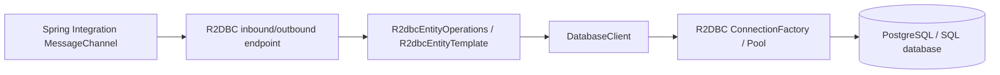
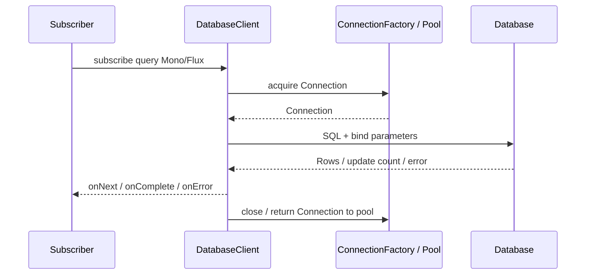
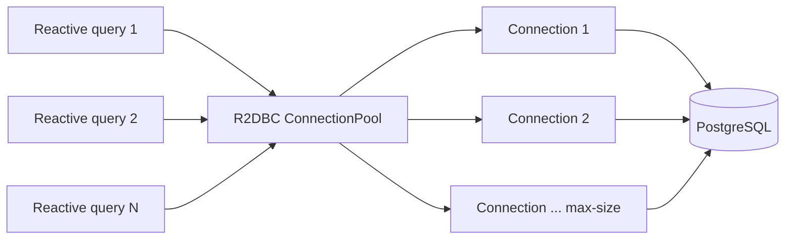
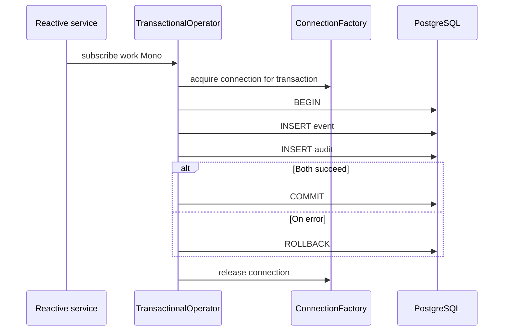

# DatabaseClient and ConnectionFactory

> **Chapter:** R2DBC Adapter  
> **Module:** SPRING_INTEGRATION_ADAPTERS  
> **Context:** Connect external systems to Spring Integration using inbound/outbound adapters, gateways, pollers, and MessageChannels. Practice with files, SFTP, HTTP, JMS, AMQP, Kafka, and databases; focus on message contracts, errors, and connection lifecycles.

## 1. Learning Objectives

After this lesson, you will be able to:

- Clearly distinguish between `io.r2dbc.spi.ConnectionFactory`, `org.springframework.r2dbc.core.DatabaseClient`, `R2dbcEntityOperations`, and `R2dbcEntityTemplate`.
- Explain how a `ConnectionFactory` creates a **database connection** following Reactive Streams and why it differs from Spring Integration TCP's `ConnectionFactory`.
- Configure Spring Boot with PostgreSQL R2DBC, URL, credentials, driver, pool, and resource limits.
- Execute `SELECT`, `INSERT`, and `UPDATE` with `DatabaseClient`; use `bind(...)`, `bindNull(...)`, `map(...)`, `all()`, `one()`, and `rowsUpdated()`.
- Distinguish **creating a Publisher** from **SQL actually executing/committing**, and understand subscriptions, Reactor `Mono`/`Flux`, and backpressure.
- Connect `DatabaseClient`/`R2dbcEntityTemplate` into Spring Integration **R2DBC inbound/outbound channel adapters**.
- Design reactive transactions with `R2dbcTransactionManager` and `TransactionalOperator`; define transaction boundaries in an integration flow.
- Classify connection, pool, SQL, mapping, timeout, and rollback errors; build retry/idempotency policies that avoid duplicate writes.
- Design test suites, metrics, health checks, and security principles for real-world R2DBC applications.

## 2. The big picture: four distinct layers



The diagram shows **architectural relationships**; not every `R2dbcEntityTemplate` command necessarily goes through an application-declared `DatabaseClient` bean. The core point is that both Spring Integration adapters and custom query services can share the **same R2DBC connection infrastructure**, at different levels of abstraction.

| Component | Belongs to framework | Main responsibility |
| --- | --- | --- |
| **`ConnectionFactory`** | R2DBC SPI (`io.r2dbc.spi`) | Creates a `Connection` to the database when subscribed; can be wrapped by a pool. |
| **`DatabaseClient`** | Spring Framework R2DBC | Fluent API for SQL, parameter binding, `Row` mapping, connection lifecycle, and exception translation. |
| **`R2dbcEntityOperations`** | Spring Data R2DBC | API for entity operations, queries, and insert/update/delete using metadata and converters. |
| **`R2dbcEntityTemplate`** | Spring Data R2DBC | Common implementation of `R2dbcEntityOperations`. |
| **`R2dbcMessageSource`** | Spring Integration R2DBC | **Inbound** source triggered by a poller to emit a data Publisher into a flow. |
| **`R2dbcMessageHandler`** | Spring Integration R2DBC | **Outbound** handler converting Spring Messages into SQL `INSERT`/`UPDATE`/`DELETE`. |
| **`MessageChannel`** | Spring Integration | Passes Spring Messages between endpoints and application logic. |

**Two common misconceptions:**

1. `ConnectionFactory` in this lesson is an **R2DBC database connection factory**, **not** `TcpNetClientConnectionFactory`/`TcpNetServerConnectionFactory` from Spring Integration IP.
2. `DatabaseClient` is an **SQL query client in Spring Framework**, not a TCP/HTTP client and does **not** by itself create a Spring Integration adapter.

## 3. ConnectionFactory in R2DBC: contract and lifecycle

### 3.1. SPI concept

`io.r2dbc.spi.ConnectionFactory` is the entry point for obtaining a database connection under the reactive contract:

```java
import io.r2dbc.spi.Connection;
import io.r2dbc.spi.ConnectionFactory;
import org.reactivestreams.Publisher;

void describe(ConnectionFactory factory) {
    Publisher<? extends Connection> connectionPublisher =
            factory.create();

    System.out.println(factory.getMetadata().getName());
    // Does not necessarily open a database socket just by creating the Publisher.
}
```

`ConnectionFactory.create()` returns a **Publisher**, not an immediately ready `Connection` like JDBC `DataSource.getConnection()`. Only when the publisher is subscribed does the driver/pool perform the work needed to acquire a connection.

A DB connection can participate in transactions, execute multiple SQL statements, and must be **closed/returned to the pool** per contract. In normal Spring applications, let `DatabaseClient`/`R2dbcEntityTemplate` manage acquiring/releasing connections rather than calling `create()` everywhere yourself.

### 3.2. ConnectionFactory is not a single connection

`ConnectionFactory` is a shared object for **creating or supplying** connections. It does not mean a single socket shared across all requests.

- A driver factory may create a new connection per request.
- A pooled factory may borrow an idle connection from the pool or create a new one up to the limit.
- Two concurrent requests can use **two different database connections**.
- Inside a **reactive transaction**, Spring binds a connection to the transaction context so operations in the same transaction use the right connection.

**Do not keep an `io.r2dbc.spi.Connection` directly in a singleton field** and share it across multiple request flows without coordination. Arbitrary sharing is invalid due to transaction, cursor, and statement state.

### 3.3. ConnectionFactory vs. JDBC DataSource

| JDBC | R2DBC |
| --- | --- |
| `javax.sql.DataSource` | `io.r2dbc.spi.ConnectionFactory` |
| `java.sql.Connection` | `io.r2dbc.spi.Connection` |
| Queries typically block the calling thread. | Publishers are processed via Reactive Streams. |
| `getConnection()` acquires a connection via a blocking API. | `create()` returns a Publisher of a connection. |
| Synchronous transactions usually rely on thread-bound context. | Reactive transactions rely on Reactor context/subscription. |

An application can have both JDBC and R2DBC, but **must not use a JDBC DataSource to configure an R2DBC adapter**. A JDBC driver also cannot substitute for an R2DBC driver.

### 3.4. Connection lifecycle in a query



Simplified diagram: the exact sequence with streaming rows, transactions, cancellation, or driver pooling can vary. The invariant to guarantee is that **connections are always released on completion, error, or cancellation**, even if the subscriber does not consume all results.

## 4. DatabaseClient: reactive SQL at the right low level

`org.springframework.r2dbc.core.DatabaseClient` provides a fluent API:

```java
import org.springframework.r2dbc.core.DatabaseClient;

DatabaseClient client = DatabaseClient.create(connectionFactory);
```

When Spring Boot auto-configures R2DBC, usually **just inject the `DatabaseClient` bean** instead of recreating it manually:

```java
import org.springframework.r2dbc.core.DatabaseClient;
import org.springframework.stereotype.Repository;

@Repository
public class DemoRepository {

    private final DatabaseClient db;

    public DemoRepository(DatabaseClient db) {
        this.db = db;
    }
}
```

`DatabaseClient` is well suited when you want to **explicitly write SQL**, bind values, and read `rowsUpdated`. For entity-mapped CRUD, `R2dbcEntityTemplate` can reduce boilerplate.

### 4.1. Pipeline of an SQL query

```text
DatabaseClient.sql("SELECT ... WHERE id = :id")
              .bind("id", someId)
              .map((row, metadata) -> ...)
              .one()
              |
              v
           Mono<T>
              |
              v
          subscribe()
              |
              v
        SQL executes / rows emitted / complete or error
```

A `Mono` or `Flux` is a **description of asynchronous work**. Merely calling `db.sql(...)` and receiving a publisher does not mean the SQL has executed. Subscription comes from WebFlux, a Spring Integration reactive endpoint, a reactive test, or the responsible subscriber caller.

### 4.2. Commonly used methods

| Method | Meaning |
| --- | --- |
| `sql(String)` | Creates an SQL statement. |
| `bind("name", value)` | Binds a named parameter. |
| `bind(index, value)` | Binds by positional index when supported by the driver/query. |
| `bindNull("name", Type.class)` | Binds SQL NULL with an explicit type. |
| `map((row, metadata) -> ...)` | Converts each row into a DTO/entity. |
| `all()` | Reads multiple rows as `Flux<T>`. |
| `one()` | Expects at most one row, returns `Mono<T>`. |
| `first()` | Takes the first row when only one result is needed out of multiple rows. |
| `fetch().rowsUpdated()` | Receives the affected row count from DML as `Mono<Long>`. |
| `then()` | Cares only about SQL completion, ignoring data/row counts. |

**Do not carelessly use `one()` when a query may return multiple rows**: define the SQL clearly and choose `first()` or `all()` as required. Avoid treating `Mono.empty()` as an SQL failure when there are no rows; that can be a valid result.

## 5. Building a Spring Boot application with R2DBC

The exercises use **Java 17+, Spring Boot 3.x, and Spring Integration 6.x**. When choosing newer versions, use a compatible BOM and check the API for your deployed version.

### 5.1. Maven dependencies

```xml
<dependencies>
    <dependency>
        <groupId>org.springframework.boot</groupId>
        <artifactId>spring-boot-starter-integration</artifactId>
    </dependency>
    <dependency>
        <groupId>org.springframework.integration</groupId>
        <artifactId>spring-integration-r2dbc</artifactId>
    </dependency>
    <dependency>
        <groupId>org.springframework.boot</groupId>
        <artifactId>spring-boot-starter-data-r2dbc</artifactId>
    </dependency>
    <dependency>
        <groupId>org.postgresql</groupId>
        <artifactId>r2dbc-postgresql</artifactId>
        <scope>runtime</scope>
    </dependency>
    <!-- Add when you want to use an R2DBC connection pool. -->
    <dependency>
        <groupId>io.r2dbc</groupId>
        <artifactId>r2dbc-pool</artifactId>
    </dependency>
</dependencies>
```

The Spring Boot BOM manages versions. The R2DBC PostgreSQL driver is **different** from `org.postgresql:postgresql` (JDBC). When using MySQL/MariaDB/SQL Server, swap the driver and review the URL, SQL dialect, temporal type mappings, and transaction capabilities accordingly.

### 5.2. application.yml

```yaml
spring:
  r2dbc:
    url: r2dbc:postgresql://127.0.0.1:5432/integration_demo
    username: ${DB_USER}
    password: ${DB_PASSWORD}
    pool:
      enabled: true
      initial-size: 2
      max-size: 10
      max-idle-time: 10m
      max-acquire-time: 3s
```

`${DB_USER}` and `${DB_PASSWORD}` are placeholders resolved by Spring Boot from environment variables at runtime; **do not hardcode passwords**. Create the `integration_demo` database and grant least-privilege permissions on the table.

When using Spring Boot auto-configuration, Spring can provide these beans:

- `io.r2dbc.spi.ConnectionFactory`.
- `org.springframework.r2dbc.core.DatabaseClient`.
- `R2dbcEntityTemplate`/`R2dbcEntityOperations` when Spring Data R2DBC auto-configuration is enabled.
- An appropriate reactive transaction manager if configuration conditions are met.

**Do not declare a second bean of the same type just "to be safe"**; choose either auto-configuration or manual configuration and verify which connection factory all components actually use.

### 5.3. Creating a factory via SPI without Spring Boot auto-configuration

An **alternative** option—do not run alongside auto-config providing the same bean:

```java
import io.r2dbc.spi.ConnectionFactories;
import io.r2dbc.spi.ConnectionFactory;
import io.r2dbc.spi.ConnectionFactoryOptions;

import static io.r2dbc.spi.ConnectionFactoryOptions.DATABASE;
import static io.r2dbc.spi.ConnectionFactoryOptions.DRIVER;
import static io.r2dbc.spi.ConnectionFactoryOptions.HOST;
import static io.r2dbc.spi.ConnectionFactoryOptions.PASSWORD;
import static io.r2dbc.spi.ConnectionFactoryOptions.PORT;
import static io.r2dbc.spi.ConnectionFactoryOptions.USER;

ConnectionFactoryOptions options = ConnectionFactoryOptions.builder()
        .option(DRIVER, "postgresql")
        .option(HOST, "127.0.0.1")
        .option(PORT, 5432)
        .option(DATABASE, "integration_demo")
        .option(USER, "integration_app")
        .option(PASSWORD, System.getenv("DB_PASSWORD"))
        .build();

ConnectionFactory connectionFactory = ConnectionFactories.get(options);
```

This snippet assumes the `DB_PASSWORD` environment variable exists. `ConnectionFactories.get(options)` requires an R2DBC driver supporting `postgresql` on the classpath. If you manage pooling yourself, wrap this factory with `ConnectionPool` (section 10) or let Spring Boot do it.

### 5.4. Creating DatabaseClient and R2dbcEntityTemplate

Given a properly configured `ConnectionFactory`:

```java
import io.r2dbc.spi.ConnectionFactory;
import org.springframework.data.r2dbc.core.R2dbcEntityTemplate;
import org.springframework.r2dbc.core.DatabaseClient;

// Shown only for manually managed beans.
DatabaseClient databaseClient = DatabaseClient.create(connectionFactory);
R2dbcEntityTemplate entityTemplate =
        new R2dbcEntityTemplate(connectionFactory);
```

**Note:** `DatabaseClient` provides a general-purpose SQL API, whereas `R2dbcEntityTemplate` understands Spring Data metadata/converters and uses connections from the factory. These two objects are **two different abstraction levels**, not two databases.

## 6. Database schema and entity for the practice

Create the table on PostgreSQL:

```sql
CREATE TABLE integration_events (
    event_id       VARCHAR(64) PRIMARY KEY,
    event_type     VARCHAR(64) NOT NULL,
    payload_json   TEXT NOT NULL,
    status         VARCHAR(16) NOT NULL DEFAULT 'NEW',
    created_at     TIMESTAMPTZ NOT NULL DEFAULT CURRENT_TIMESTAMP,
    processed_at   TIMESTAMPTZ
);

CREATE INDEX idx_integration_events_status_created
    ON integration_events (status, created_at, event_id);
```

We use:

- `event_id` as the business/idempotency key, independent of the Spring Message ID.
- `status=NEW` for unfinished events, `DONE` after a consumer processes them successfully.
- `created_at` for ordering batches and measuring backlog.
- `processed_at` to record completion time if applicable.

Create the DTO/entity used in queries:

```java
import org.springframework.data.annotation.Id;
import org.springframework.data.relational.core.mapping.Column;
import org.springframework.data.relational.core.mapping.Table;

@Table("integration_events")
public record IntegrationEvent(
        @Id @Column("event_id") String eventId,
        @Column("event_type") String eventType,
        @Column("payload_json") String payloadJson,
        String status
) {
}
```

`@Table`/`@Column` are useful for `R2dbcEntityTemplate` and inbound adapters using `payloadType`. When using `DatabaseClient.map((row, metadata) -> ...)`, your code maps each column manually and does not require annotations.

## 7. DatabaseClient SELECT: from Row to Flux/Mono

### 7.1. Single row by business key

```java
import org.springframework.r2dbc.core.DatabaseClient;
import org.springframework.stereotype.Repository;
import reactor.core.publisher.Mono;

@Repository
public class EventReadRepository {

    private final DatabaseClient db;

    public EventReadRepository(DatabaseClient db) {
        this.db = db;
    }

    public Mono<IntegrationEvent> findById(String eventId) {
        return db.sql(
                        "SELECT event_id, event_type, payload_json, status " +
                        "FROM integration_events WHERE event_id = :id")
                .bind("id", eventId)
                .map((row, metadata) -> new IntegrationEvent(
                        row.get("event_id", String.class),
                        row.get("event_type", String.class),
                        row.get("payload_json", String.class),
                        row.get("status", String.class)
                ))
                .one();
    }
}
```

Code walkthrough:

1. `sql(...)` defines the SELECT statement with named parameter `:id`.
2. `bind("id", eventId)` binds a **value** instead of concatenating input into SQL.
3. `map(...)` converts each `Row` into an `IntegrationEvent`.
4. `one()` produces `Mono<IntegrationEvent>`; if no row matches, the publisher completes empty.
5. The caller or framework must subscribe; merely calling `findById(...)` does not query the database yet.

`Row` and `RowMetadata` belong to the R2DBC SPI, while the fluent/mapping API is provided by Spring Framework's `DatabaseClient`.

### 7.2. Multiple rows with batch limit

Add a method:

```java
import reactor.core.publisher.Flux;

public Flux<IntegrationEvent> findNew(int limit) {
    if (limit < 1 || limit > 100) {
        return Flux.error(new IllegalArgumentException(
                "Limit must be 1..100"));
    }

    return db.sql(
                    "SELECT event_id, event_type, payload_json, status " +
                    "FROM integration_events " +
                    "WHERE status = :status " +
                    "ORDER BY created_at, event_id LIMIT :limit")
            .bind("status", "NEW")
            .bind("limit", limit)
            .map((row, metadata) -> new IntegrationEvent(
                    row.get("event_id", String.class),
                    row.get("event_type", String.class),
                    row.get("payload_json", String.class),
                    row.get("status", String.class)
            ))
            .all();
}
```

This is an **additional method inside the repository** above; it uses the declared `db` field. PostgreSQL supports binding the `LIMIT` value. For other SQL dialects, check syntax and parameter types.

**`Flux` does not automatically ensure a query returns little data**; you need `LIMIT`/pagination/streaming policies. Reading millions of rows unboundedly can still consume significant connections, memory, and time on the client or DB.

### 7.3. Distinguishing one, first, and all

| Desired result | API | Key point |
| --- | --- | --- |
| 0 or 1 row | `one()` | Avoid if the query is allowed to return multiple rows. |
| Only the first row | `first()` | Should have `ORDER BY` and `LIMIT 1` for clear semantics. |
| Multiple rows | `all()` | `Flux` emits items individually with error and completion signals. |

Do not use `.collectList()` indiscriminately: it holds **all** rows in memory. For strictly bounded batches, `collectList()` can be acceptable; for large tables, use streaming/pagination and bounded consumers.

## 8. DatabaseClient INSERT, UPDATE, DELETE, and row count

### 8.1. INSERT event

```java
import org.springframework.r2dbc.core.DatabaseClient;
import reactor.core.publisher.Mono;

public record NewEvent(
        String eventId,
        String eventType,
        String payloadJson
) {
}

public Mono<Long> insert(DatabaseClient db, NewEvent event) {
    if (event.eventId() == null
            || !event.eventId().matches("[A-Za-z0-9_-]{1,64}")
            || event.eventType() == null
            || event.payloadJson() == null) {
        return Mono.error(new IllegalArgumentException(
                "Invalid event"));
    }

    return db.sql(
                    "INSERT INTO integration_events " +
                    "(event_id, event_type, payload_json) " +
                    "VALUES (:id, :type, :body)")
            .bind("id", event.eventId())
            .bind("type", event.eventType())
            .bind("body", event.payloadJson())
            .fetch()
            .rowsUpdated();
}
```

**Snippet note:** The `insert(...)` method must live inside a Java class such as a service or repository; `NewEvent` goes in its own file per Java rules. The resulting `Mono<Long>` reflects the **number of rows SQL reports affected** once the publisher is subscribed and completes successfully.

If a request is sent twice with the same `event_id`, the second INSERT will hit a **unique constraint** rather than silently turning into "saved successfully". The application needs an idempotency/duplicate policy.

### 8.2. Conditional UPDATE

```java
public Mono<Long> markDone(DatabaseClient db, String eventId) {
    return db.sql(
                    "UPDATE integration_events " +
                    "SET status = 'DONE', " +
                    "    processed_at = CURRENT_TIMESTAMP " +
                    "WHERE event_id = :id AND status = 'NEW'")
            .bind("id", eventId)
            .fetch()
            .rowsUpdated();
}
```

Interpretation:

- `1` row: successfully transitioned from `NEW` to `DONE`.
- `0` rows: the event does not exist **or** already has a status other than `NEW`.
- SQL/connection error: publisher emits `onError`, rather than returning `0` and pretending there was no data.

If business logic needs to distinguish `NOT_FOUND` from `ALREADY_DONE`, query further inside a transaction or separate check path. **Do not** always treat 0 rows as "already processed successfully".

### 8.3. Conditional DELETE

```java
public Mono<Long> deleteDone(DatabaseClient db, String eventId) {
    return db.sql(
                    "DELETE FROM integration_events " +
                    "WHERE event_id = :id AND status = 'DONE'")
            .bind("id", eventId)
            .fetch()
            .rowsUpdated();
}
```

When deleting, enforce proper permissions and retention/audit policies. For systems requiring reconciliation, **soft delete** or transitioning to `status=ARCHIVED` may be more suitable than physical deletion.

### 8.4. bindNull and optional types

`DatabaseClient.bind(...)` is not for `null` values. When SQL NULL is needed, use `bindNull(...)` with the type:

```java
return db.sql(
                "UPDATE integration_events " +
                "SET processed_at = :processedAt " +
                "WHERE event_id = :id")
        .bindNull("processedAt", java.time.OffsetDateTime.class)
        .bind("id", eventId)
        .fetch()
        .rowsUpdated();
```

This snippet lives inside a method that has `db` and `eventId`. The Java type must match the column type and driver. For timezone-aware timestamps, standardize how UTC/offsets are stored, read, and displayed per system requirements.

### 8.5. How binding prevents injection

Right:

```java
db.sql("SELECT * FROM integration_events WHERE event_id = :id")
  .bind("id", suppliedId);
```

Wrong:

```java
// DO NOT DO THIS: concatenating raw input into SQL.
String sql = "SELECT * FROM integration_events WHERE event_id = '"
           + suppliedId + "'";
```

Parameter binding applies to **values**, not table/column names or `ORDER BY` identifiers. If dynamic tables/sorting are required, use a whitelist of allowed values and construct the SQL from **validated identifiers**, rather than trying to bind an identifier as a literal value.

## 9. R2dbcEntityTemplate vs. DatabaseClient

`R2dbcEntityTemplate` is a convenience layer for working with entities via metadata:

```java
import org.springframework.data.r2dbc.core.R2dbcEntityTemplate;
import reactor.core.publisher.Mono;

public Mono<IntegrationEvent> findEntity(
        R2dbcEntityTemplate template,
        String eventId) {

    return template.selectOne(
            org.springframework.data.relational.core.query.Query.query(
                    org.springframework.data.relational.core.query.Criteria
                            .where("event_id").is(eventId)),
            IntegrationEvent.class
    );
}
```

**Conceptual differences:**

| Scenario | DatabaseClient | R2dbcEntityTemplate |
| --- | --- | --- |
| SQL with `JOIN`/CTE/driver-specific syntax | Direct, flexible. | May need raw SQL or switching to DatabaseClient. |
| Entity-based data mapping | Manual row mapping or optional converters. | Uses metadata/entity converters. |
| Queries from `Criteria`/`Query` | Usually written as SQL manually. | Has dedicated API. |
| Need `rowsUpdated()` for conditional DML | Direct access. | Some DML methods also return matching counts/results. |
| Use in R2DBC inbound/outbound adapters | Indirect via infrastructure. | Typically passes `R2dbcEntityOperations` to adapters. |

Do not treat `R2dbcEntityTemplate` as a "full ORM like JPA": Spring Data R2DBC has a different mapping and relationship model and does **not** provide default lazy-loading or Hibernate/JPA-style entity lifecycle management.

## 10. Connection pool: limits and observability

### 10.1. Why use a pool?

Opening and closing a database connection for every query incurs handshake/authentication overhead and database resource costs. A pool can **reuse live connections** across many queries.



**Do not equate a pooled factory with a single shared connection**: a `ConnectionPool` manages **multiple** connections up to a limit; requests borrow and return them according to state.

### 10.2. Spring Boot pool properties

With the `io.r2dbc:r2dbc-pool` dependency and Boot auto-configuration:

```yaml
spring:
  r2dbc:
    pool:
      enabled: true
      initial-size: 2
      max-size: 10
      max-idle-time: 10m
      max-acquire-time: 3s
```

Values must fit PostgreSQL's `max_connections`, the number of application instances, and the workload. For example, 10 app instances each with max pool size 10 can open up to around **100 database connections**, not counting other services.

### 10.3. Creating a pool in Java (when managed manually)

```java
import java.time.Duration;

import io.r2dbc.pool.ConnectionPool;
import io.r2dbc.pool.ConnectionPoolConfiguration;
import io.r2dbc.spi.ConnectionFactories;
import io.r2dbc.spi.ConnectionFactory;
import io.r2dbc.spi.ConnectionFactoryOptions;

import static io.r2dbc.spi.ConnectionFactoryOptions.*;

// Raw driver connection; assumes DB_PASSWORD is already set.
ConnectionFactory rawFactory = ConnectionFactories.get(
        ConnectionFactoryOptions.builder()
                .option(DRIVER, "postgresql")
                .option(HOST, "127.0.0.1")
                .option(PORT, 5432)
                .option(DATABASE, "integration_demo")
                .option(USER, "integration_app")
                .option(PASSWORD, System.getenv("DB_PASSWORD"))
                .build());

ConnectionPoolConfiguration configuration =
        ConnectionPoolConfiguration.builder(rawFactory)
                .initialSize(2)
                .maxSize(10)
                .maxIdleTime(Duration.ofMinutes(10))
                .maxAcquireTime(Duration.ofSeconds(3))
                .build();

ConnectionPool pool = new ConnectionPool(configuration);
```

This is a **manual configuration illustration**; it requires PostgreSQL running, the matching driver, and the `DB_PASSWORD` environment variable set. When managing manually, **dispose the pool on shutdown**. Do not enable Boot's pool and wrap another manual pool simultaneously without reason.

### 10.4. Pooling does not guarantee queries won't be slow

Situations that hold connections open for a long time:

- Query returns large data while the subscriber reads slowly.
- Lock contention or long-running transactions.
- Subscriber is not subscribed or fails to consume properly.
- Unstable database network or overly long statement timeouts.
- Too many active subscriptions.

Pool limits protect the DB, though they can create a **wait queue to acquire connections**; monitor active, idle, pending acquire, and latency metrics. Increasing `max-size` unboundedly usually just shifts the bottleneck from the application to PostgreSQL.

## 11. Reactive transactions and ConnectionFactory

### 11.1. One transaction requires the same connection

SQL statements in the same database transaction must run on the appropriate connection. Spring's R2DBC transaction manager carries the transaction context in the reactive chain:



When code runs a `Mono`/`Flux` chain inside `TransactionalOperator`, the transaction context is attached to the **subscription**. It does not work like simple thread-local JDBC transactions.

### 11.2. R2dbcTransactionManager and TransactionalOperator

If Spring Boot created a `ReactiveTransactionManager`, inject that bean to create the operator:

```java
import org.springframework.context.annotation.Bean;
import org.springframework.transaction.ReactiveTransactionManager;
import org.springframework.transaction.reactive.TransactionalOperator;

@Bean
TransactionalOperator transactionalOperator(
        ReactiveTransactionManager manager) {
    return TransactionalOperator.create(manager);
}
```

This is a `@Bean` method inside `@Configuration`. When managing manually, create `org.springframework.r2dbc.connection.R2dbcTransactionManager` from the exact `ConnectionFactory` used by `DatabaseClient`.

### 11.3. Two SQL statements in one transaction

Create an audit table for this section:

```sql
CREATE TABLE integration_event_audit (
    audit_id   BIGSERIAL PRIMARY KEY,
    event_id   VARCHAR(64) NOT NULL,
    action     VARCHAR(32) NOT NULL,
    created_at TIMESTAMPTZ NOT NULL DEFAULT CURRENT_TIMESTAMP
);
```

Example service:

```java
import org.springframework.r2dbc.core.DatabaseClient;
import org.springframework.transaction.reactive.TransactionalOperator;
import reactor.core.publisher.Mono;

public class AtomicEventService {

    private final DatabaseClient db;
    private final TransactionalOperator tx;

    public AtomicEventService(
            DatabaseClient db,
            TransactionalOperator tx) {
        this.db = db;
        this.tx = tx;
    }

    public Mono<Void> insertAndAudit(NewEvent event) {
        return db.sql(
                        "INSERT INTO integration_events " +
                        "(event_id, event_type, payload_json) " +
                        "VALUES (:id, :type, :body)")
                .bind("id", event.eventId())
                .bind("type", event.eventType())
                .bind("body", event.payloadJson())
                .fetch().rowsUpdated()
                .flatMap(count -> {
                    if (count != 1L) {
                        return Mono.error(
                                new IllegalStateException(
                                        "Expected exactly one event INSERT"));
                    }
                    return db.sql(
                                    "INSERT INTO integration_event_audit " +
                                    "(event_id, action) " +
                                    "VALUES (:id, :action)")
                            .bind("id", event.eventId())
                            .bind("action", "CREATED")
                            .fetch().rowsUpdated();
                })
                .then()
                .as(tx::transactional);
    }
}
```

If the audit INSERT fails, the entire reactive chain subscribed inside the transaction rolls back per configured policy. **Do not manually call `subscribe()` between the two operations**, as that can create a separate subscription outside the transaction context.

### 11.4. DB transactions do not cover Kafka, HTTP, or JMS

Example:

```text
[INSERT event + audit in PostgreSQL]
                  |
                  v
           [Kafka publish]
                  |
                  v
          [ACK Kafka offset]
```

An R2DBC transaction does not automatically roll back an event already sent via Kafka/HTTP or a committed offset. If the application crashes after the DB commits but before publishing, there is a risk of **losing events**. Consider **transactional outbox**, replay, and idempotent consumers when cross-system delivery guarantees are needed.

## 12. Combining with Spring Integration R2DBC adapters

### 12.1. Outbound: writing Spring Messages into the database

The Java DSL can use `R2dbcEntityTemplate`/`R2dbcEntityOperations` instead of writing raw SQL inside the flow:

```java
import java.util.Map;
import org.springframework.context.annotation.Bean;
import org.springframework.context.annotation.Configuration;
import org.springframework.data.r2dbc.core.R2dbcEntityTemplate;
import org.springframework.integration.config.EnableIntegration;
import org.springframework.integration.dsl.IntegrationFlow;
import org.springframework.integration.r2dbc.dsl.R2dbc;
import org.springframework.messaging.Message;

@Configuration
@EnableIntegration
public class IntegrationR2dbcOutboundConfiguration {

    @Bean
    IntegrationFlow eventInsertFlow(R2dbcEntityTemplate template) {
        return IntegrationFlow
                .from("eventsToDatabase")
                .handleReactive(
                        R2dbc.outboundChannelAdapter(template)
                                .tableName("integration_events")
                                .values((Message<NewEvent> message) -> {
                                    NewEvent event = message.getPayload();
                                    return Map.of(
                                            "event_id", event.eventId(),
                                            "event_type", event.eventType(),
                                            "payload_json", event.payloadJson()
                                    );
                                })
                )
                .get();
    }
}
```

**Understand each role accurately:**

- `MessageChannel` receives messages from producers.
- `R2dbcMessageHandler` handles reactive outbound DML.
- `R2dbcEntityTemplate` provides entity/database operations via R2DBC.
- `ConnectionFactory`/pool supplies connections when the publisher executes.
- `handleReactive(...)` subscribes to `ReactiveMessageHandler` in Spring Integration 6.1+.

**ACK warning:** Successfully sending a message to a channel does not prove the INSERT has committed. An outbound channel adapter also does not emit a Spring reply containing `rowsUpdated()` by default. If callers need confirmation of row count/commit, use `DatabaseClient` in a reactive service/gateway with an explicit result.

### 12.2. Inbound: reading the database and emitting messages

Illustration of the **inbound** side (an **alternative** learning configuration—do not enable unconditionally alongside another flow on the same table):

```java
import org.springframework.context.annotation.Bean;
import org.springframework.context.annotation.Configuration;
import org.springframework.data.r2dbc.core.R2dbcEntityTemplate;
import org.springframework.integration.config.EnableIntegration;
import org.springframework.integration.dsl.IntegrationFlow;
import org.springframework.integration.dsl.MessageChannels;
import org.springframework.integration.r2dbc.dsl.R2dbc;

@Configuration
@EnableIntegration
public class IntegrationR2dbcInboundConfiguration {

    @Bean
    IntegrationFlow newEventsFlow(R2dbcEntityTemplate template) {
        return IntegrationFlow
                .from(
                        R2dbc.inboundChannelAdapter(
                                template,
                                "SELECT event_id, event_type, " +
                                "payload_json, status " +
                                "FROM integration_events " +
                                "WHERE status = 'NEW' " +
                                "ORDER BY created_at, event_id LIMIT 20")
                                .payloadType(IntegrationEvent.class),
                        e -> e.poller(p ->
                                p.fixedDelay(2_000)
                                 .maxMessagesPerPoll(1))
                )
                .channel(MessageChannels.flux())
                .split()
                .handle(IntegrationEvent.class, (event, headers) -> {
                    System.out.println(
                            "Received from DB: " + event.eventId()
                    );
                    return null;
                })
                .get();
    }
}
```

By default, `R2dbcMessageSource` emits a message whose payload is a **`Flux`** containing the SELECTed rows; `.split()` splits the Publisher into individual messages. `maxMessagesPerPoll(1)` limits the number of source calls per poll cycle, **not** one row. The batch limit is `LIMIT 20` in the SQL.

**Do not enable this inbound demo reading `status='NEW'` with external side effects without a claim/ACK mechanism.** Without marking or changing state, the same rows will be read repeatedly on subsequent polls, and two instances can race to pick up the same rows.

### 12.3. Do you need to create DatabaseClient manually for adapters?

Usually **no**. When injecting `R2dbcEntityTemplate` into an adapter, the template uses the underlying `ConnectionFactory` infrastructure. Direct `DatabaseClient` is useful for **custom SQL** such as atomic claims, UPDATEs that inspect row counts, CTEs, UPSERTs, and multi-table transactions.

## 13. Handling errors at the right layer

| Error / symptom | Layer | Resolution |
| --- | --- | --- |
| Wrong `r2dbc:postgresql://...` or missing driver | Config / connection factory | Verify URL, driver, classpath, and permissions. |
| DNS / connection refused / DB down | Transport / driver | Bounded retry, check readiness/network. |
| Pool acquire timeout | Pool | Limit concurrency, tune pool to load, monitor metrics. |
| SQL wrong table/column | Query / schema | Fix migration/query; do not retry infinitely. |
| `bindNull` missing type or missing parameter binding | Query binding | Check names/positions and data types. |
| Duplicate primary key | Integrity constraint | Dedup/conflict policy; do not blindly retry. |
| `rowsUpdated() == 0` | DML result | Distinguish missing row from state/version conflict. |
| Row mapping type error | Conversion | Check columns, nullability, timezones, enums/schema. |
| Publisher not subscribed | Reactive lifecycle | Ensure framework/caller manages subscription. |
| Transaction rollback | Business / DB transaction | Log ID and cause; keep event ID stable on safe retry. |
| Downstream error after DB commit | Multi-system workflow | Outbox, replay, and idempotent consumers. |

### 13.1. Reactive errors can occur after a method returns

With code like:

```java
Mono<Long> write = db.sql("UPDATE integration_events " +
        "SET status = 'DONE' WHERE event_id = :id")
        .bind("id", "evt-101")
        .fetch().rowsUpdated();

// Here we only have a Publisher; SQL may not have run yet.
```

SQL may start only when the publisher is subscribed. Therefore, a `try/catch` around **creating the `Mono`** will not catch DB errors occurring **after subscription**. Handle errors with appropriate operators (`onErrorResume`, `doOnError`, bounded `retryWhen`) or the actual endpoint's error handling mechanism.

**Do not auto-retry every `RuntimeException`**: duplicate keys, syntax errors, and validation errors usually cannot be fixed by resending the same statement.

### 13.2. Timeout does not prove a transaction did not commit

If a caller times out after SQL was sent, the database may have committed and the response was lost. For `INSERT` with a unique `event_id`, check status by ID before retrying. For commands with side effects like incrementing balances, stricter idempotency is required.

### 13.3. Cancellation and cleanup

A subscriber can cancel a `Flux` before reading everything. The application should:

- Avoid leaking connections by manually subscribing without disposing.
- Avoid calling `block()` arbitrarily on event loops or inside reactive handlers.
- Enforce query result/batch size limits.
- Monitor connection leaks and pool metrics.
- Use `DatabaseClient`/`R2dbcEntityTemplate` so the framework manages connection lifecycles; when operating manually, use `usingWhen`/corresponding cleanup.

## 14. Using ConnectionFactory directly: only when truly necessary

For special protocols or driver-specific statements, you can use the raw R2DBC SPI. When doing so, you must guarantee **closing/returning the connection** even on errors.

```java
import io.r2dbc.spi.ConnectionFactory;
import reactor.core.publisher.Mono;

public Mono<Integer> pingDatabase(ConnectionFactory factory) {
    return Mono.usingWhen(
            Mono.from(factory.create()),
            connection ->
                    Mono.from(
                            connection.createStatement("SELECT 1").execute())
                    .flatMap(result -> Mono.from(
                            result.map((row, metadata) ->
                                    row.get(0, Integer.class)))),
            connection -> Mono.from(connection.close())
    );
}
```

This is a **method inside a Java class**, not standalone top-level code. `Mono.usingWhen(...)` cleans up resources on complete/error/cancel per contract. In most cases, **`DatabaseClient.sql("SELECT 1")` is simpler and safer** because it already manages connections.

If you manually call `ConnectionFactory.create()` and `subscribe()` in multiple places, you may unintentionally open **more database connections** than expected, lose transaction context, or forget to close connections.

## 15. Security, timeouts, and operations

### 15.1. Security

- Use a **least-privilege DB role**; grant SELECT/INSERT/UPDATE/DELETE only on required tables.
- Do not commit passwords, credentialed URLs, or secrets/tokens to source control.
- Enable TLS and verify the database server when traversing untrusted networks.
- Bind values; whitelist table/column names if queries must be dynamic.
- Validate event IDs, enums/statuses, JSON schemas, and payload sizes in bytes as needed.
- Do not log full sensitive payloads and do not treat `event_id` as an authorization credential.
- Restrict permissions to execute DELETE or bulk UPDATE; enforce audit/retention policies.

### 15.2. Different types of timeouts

| Timeout | What it protects |
| --- | --- |
| Connect timeout | Opening a connection to the database. |
| Pool acquire timeout | Waiting for an idle connection from the pool. |
| SQL statement timeout | A single SQL query running too long or waiting on locks. |
| Reactive chain deadline | Total time the pipeline has to finish. |
| HTTP/API timeout | External callers waiting for responses. |
| Message/broker ACK deadline | A source requiring an ACK after processing. |

Timeouts **must work together to meet SLAs** without replacing one another. `pool.max-acquire-time=3s` does not mean an SQL command is guaranteed to finish within 3 seconds. With retries, enforce a total deadline and backoff/jitter to avoid a **retry storm**.

### 15.3. Observability

| Suggested metric/log | Meaning |
| --- | --- |
| Connection pool active/idle/pending | Is there contention acquiring database connections? |
| Query latency p50/p95/p99 | Is SQL slow due to DB/locks/network? |
| Rows read / rows updated | Do queries match the data contract? |
| SQL exception type/SQLState | Transient failure or schema/constraint error? |
| Transaction commit/rollback | How many operations roll back, and why? |
| R2DBC inbound poll count/batch size | How many rows/messages is the poller producing? |
| R2DBC outbound write complete/error | Did the reactive handler actually finish writing? |
| Event ID / correlation ID | Trace the same operation across retries/connection switches. |
| Oldest NEW event age | Detect backlog in the source table. |
| Duplicate event IDs | Sign of redelivery/retry requiring idempotency. |

These are **suggested** metric names, not all built-in defaults from Spring Boot/Micrometer. Choose counters and traces based on start points, completion, errors, timeouts, and actual DB commits.

## 16. Testing DatabaseClient and ConnectionFactory

### 16.1. Test setup

1. Start PostgreSQL in a test environment or via Testcontainers.
2. Create the `integration_events` and `integration_event_audit` schemas.
3. Configure test-specific R2DBC URL/user/password.
4. Verify `ConnectionFactory`, `DatabaseClient`, and `R2dbcEntityTemplate` beans target the same database.
5. Send `NewEvent("evt-101", ...)` via repository or outbound flow.
6. Verify the row via `findById("evt-101")` **after reactive completion**.
7. Test conditional UPDATE, duplicate INSERT, and DB down scenarios.
8. For transactions, intentionally fail the audit INSERT and verify rollback.

### 16.2. Testing reactive code with StepVerifier

Standard Spring Boot test dependencies plus `reactor-test` if needed:

```xml
<dependency>
    <groupId>io.projectreactor</groupId>
    <artifactId>reactor-test</artifactId>
    <scope>test</scope>
</dependency>
```

A conceptual test:

```java
import org.junit.jupiter.api.Test;
import reactor.test.StepVerifier;

import static org.junit.jupiter.api.Assertions.assertEquals;

@Test
void insertThenFind() {
    NewEvent event = new NewEvent(
            "evt-test-101",
            "DEVICE_UPDATED",
            "{\"deviceId\":\"sensor-01\"}");

    StepVerifier.create(
            eventWriter.insert(db, event)
                    .then(eventReader.findById(event.eventId())))
            .assertNext(row -> {
                assertEquals(event.eventId(), row.eventId());
                assertEquals("NEW", row.status());
            })
            .verifyComplete();
}
```

This is a **method inside a test class** where `eventWriter`, `eventReader`, and `db` are already injected/initialized; it is not a complete test file. Clean up test data or use unique IDs to avoid unique key collisions across runs.

**Do not use `Thread.sleep()` as a way to confirm an INSERT has committed**. In reactive tests, wait for completion or poll DB conditions within a deliberate timeout.

### 16.3. Required test matrix

| Scenario | What to verify |
| --- | --- |
| Valid URL/driver | ConnectionFactory is created and simple queries work. |
| Invalid URL / DB closed | Clear connect failure, no business success reported. |
| Small pool size and many callers | Pending acquire/timeout triggers without opening unbounded connections. |
| SELECT with no rows | `Mono.empty()` valid per contract. |
| SELECT multiple rows with `one()` | Detects query mismatch against expectations. |
| SELECT batch `LIMIT 20` | Never returns more than batch size, does not load entire table. |
| Column rename in mapping | Error or DTO change is explicitly tested. |
| `bindNull` | Writes valid SQL NULL for nullable columns. |
| Valid INSERT | `rowsUpdated() == 1` and row exists. |
| Duplicate `event_id` INSERT | Constraint blocks it; application executes dedup/conflict policy. |
| Matching-state UPDATE | Transitions `NEW → DONE`, count = 1. |
| Non-matching UPDATE | Count = 0, not assumed as business success. |
| Audit INSERT fails | Transaction rolls back event too when sharing the same operator. |
| Repeated R2DBC inbound polls | Events still `NEW` are re-read if there is no claim/ACK. |
| Outbound message sent while DB down | Does not confuse message accepted with DB committed. |
| Query cancelled mid-flight | Connection is cleaned up/returned to pool per contract. |
| Two instances claim the same row | Atomic claim or lease required to prevent duplicate emission. |
| Downstream fails after DB commit | Separate outbox/replay/reconciliation exists. |

### 16.4. Multi-instance testing and atomic claiming

When workers concurrently pull `status='NEW'`, "SELECT then UPDATE" does not guarantee exclusivity. PostgreSQL supports patterns like:

```sql
WITH selected AS (
    SELECT event_id
    FROM integration_events
    WHERE status = 'NEW'
    ORDER BY created_at, event_id
    LIMIT :batchSize
    FOR UPDATE SKIP LOCKED
)
UPDATE integration_events AS e
SET status = 'PROCESSING'
FROM selected
WHERE e.event_id = selected.event_id
RETURNING e.event_id, e.event_type, e.payload_json, e.status;
```

This is **PostgreSQL-specific SQL** illustrating an atomic claim; add lease owner/expiry/retry attempts if workers can crash. `DatabaseClient.sql(...)` lets you run this custom SQL and map `RETURNING`; standard inbound polling adapters do not automatically provide a durable claim/ACK protocol.

## 17. Common design mistakes

| Mistake | Consequence | Fix |
| --- | --- | --- |
| Confusing R2DBC `ConnectionFactory` with TCP factory | Wrong API and lifecycle chosen. | Distinguish package `io.r2dbc.spi` from Spring Integration IP. |
| Installing only the JDBC driver | Missing proper R2DBC provider. | Add the R2DBC driver matching your SQL database. |
| Creating extra connection factories unnecessarily | Two endpoints hit different DBs/pools. | Prefer Boot auto-config and inject consistently. |
| Calling `ConnectionFactory.create()` and forgetting to close | Connection leaks / pool exhausted. | Use DatabaseClient or `usingWhen`. |
| Creating a Publisher without subscribing | SQL never executes. | Use reactive chains/endpoints with subscribers. |
| Calling `block()` on an event loop | Blocking, reduced throughput, or deadlock. | Proper reactive composition and scheduling. |
| Concatenating input into SQL | SQL injection. | Bind values, whitelist identifiers. |
| Treating UPDATE complete as 1 row | 0 rows can be a valid SQL outcome. | Check `rowsUpdated()` when business logic requires it. |
| Treating MessageChannel send as DB ACK | Sending a message does not guarantee commit. | Reactive completion and explicit status/ACK. |
| Using an unbounded pool | DB overload and memory exhaustion. | Limit pool, concurrency, and deadlines. |
| Retrying duplicate key like a network error | Retries never succeed. | Dedup/conflict policy. |
| Using DB transactions to "wrap" Kafka/HTTP | State divergence across systems. | Outbox and idempotent consumers. |
| Two pollers SELECTing the same rows | Duplicate reads/deliveries. | Atomic claim, lease, idempotency. |
| Not testing rollback/migrations | Data errors surface in production. | Testcontainers and controlled fault injection. |

## 18. Practice exercises

**Exercise 1 — Distinguish layers.** Diagram `MessageChannel → R2dbcMessageHandler → R2dbcEntityTemplate → ConnectionFactory → PostgreSQL`. Identify where connections are created, where entities are mapped, and where messages are handled.

**Exercise 2 — Boot versus manual config.** Configure via `spring.r2dbc.url` and inject `DatabaseClient`. Write the SPI factory setup and explain why both approaches should not be enabled together without controlling beans.

**Exercise 3 — SQL binding.** Write `SELECT ... WHERE event_id = :id` using `bind`. Pass an `eventId` containing special characters and verify the input is treated as a value, not part of the SQL.

**Exercise 4 — Row mapping.** Use `DatabaseClient` to read one `IntegrationEvent` with `one()`, then read multiple `NEW` events with `all()` and `LIMIT`; compare `Mono` and `Flux`.

**Exercise 5 — Conditional UPDATE.** Write a `markDone` method returning row count. Test a non-existent event, a `NEW` event, and a `DONE` event; design appropriate `UPDATED`, `NOT_FOUND`, or `CONFLICT` states.

**Exercise 6 — Pool under load.** Cap max pool size at 3, run 20 concurrent queries, and measure pending acquisitions and latency. Determine rate and queue limits to avoid overloading the DB.

**Exercise 7 — Reactive transaction.** Create two INSERTs (event + audit) and intentionally violate a constraint in audit. Verify rollback with `TransactionalOperator` and explain why `subscribe()` must not be called mid-transaction.

**Exercise 8 — Inbound adapter.** Use `R2dbcMessageSource` and a poller reading `status='NEW'`. Explain why a single `receive()` can emit a multi-row `Flux` and why a splitter or Publisher consumer is needed.

**Exercise 9 — Outbound adapter.** Use `R2dbc.outboundChannelAdapter(template)` and `handleReactive` to INSERT events. Compare with a custom `DatabaseClient` approach when `rowsUpdated()` is required.

**Exercise 10 — Reliability review.** Design a PostgreSQL transactional outbox with a batch-reading worker, atomic claim, lease expiry, post-publish ACK, and idempotent Kafka/AMQP consumers.

**Exercise 11 — Security.** Separate a read-only DB role for inbound and a write role for outbound; verify TLS, secret rotation, query parameters, and DELETE permissions.

**Exercise 12 — Observability and errors.** Simulate DB connection loss, pool acquire timeout, duplicate key, transaction rollback, and post-commit downstream failure; design dedicated logs/metrics for each case.

## 19. Self-check questions

1. What does `io.r2dbc.spi.ConnectionFactory` return when `create()` is called?
2. Why shouldn't a raw `Connection` be stored in a singleton shared across all requests?
3. What is the fundamental difference between R2DBC `ConnectionFactory` and JDBC `DataSource`?
4. Which package contains `DatabaseClient`?
5. What kind of Publisher does `DatabaseClient.sql(...).bind(...).one()` typically return?
6. How does `all()` differ from `one()`?
7. Which method retrieves the number of rows affected by an UPDATE?
8. Why does `bindNull` require a `Class<?>`?
9. At what abstraction level do `DatabaseClient` and `R2dbcEntityTemplate` differ?
10. Does `ConnectionPool` mean all queries share one single connection?
11. Why must pool acquire timeout be bounded?
12. Which context do `@Transactional`/`TransactionalOperator` rely on in a reactive flow?
13. Does using a PostgreSQL transaction guarantee a Kafka publish succeeds in the same transaction?
14. Why does creating a `Mono` from SQL not guarantee the SQL has executed?
15. Does an outbound R2DBC adapter sending a message successfully automatically return the updated row count?
16. Does the R2DBC inbound adapter need a poller?
17. Does `maxMessagesPerPoll(1)` limit each SELECT to one row?
18. Can two instances simultaneously SELECTing `status='NEW'` fetch the same row?
19. Why do primary keys prevent duplicate rows yet not provide exactly-once processing by themselves?
20. When dealing with complex SQL/`ON CONFLICT`/`UPDATE RETURNING`, when should you use `DatabaseClient` directly?

**Answer hints:** (1) A Publisher of `Connection`. (2) Connections/transactions carry state and cannot be arbitrarily shared. (3) R2DBC is reactive, JDBC is typically blocking. (4) `org.springframework.r2dbc.core`. (5) `Mono<T>`. (6) Multi-row `Flux<T>` vs. a single result. (7) `fetch().rowsUpdated()`. (8) The driver needs to know the SQL NULL type. (9) DatabaseClient is SQL-first, template is entity/mapping-first. (10) No, a pool manages a bounded number of connections. (11) To avoid waiting indefinitely on exhausted resources. (12) Reactor context/subscription. (13) No. (14) Publishers are lazy; subscription is required. (15) No. (16) Yes, the source is triggered by a poller. (17) No, it limits `receive()` calls. (18) Yes, without atomic claiming. (19) Duplicates still need ACK/dedup policies. (20) When custom SQL and explicit row counts/results are needed.

## 20. References

- [Spring Integration Reference — R2DBC Support](https://docs.spring.io/spring-integration/reference/r2dbc.html).
- [Spring Integration API — R2dbcMessageSource](https://docs.spring.io/spring-integration/api/org/springframework/integration/r2dbc/inbound/R2dbcMessageSource.html).
- [Spring Integration API — R2dbcMessageHandler](https://docs.spring.io/spring-integration/api/org/springframework/integration/r2dbc/outbound/R2dbcMessageHandler.html).
- [Spring Framework Reference — Data Access with R2DBC](https://docs.spring.io/spring-framework/reference/data-access/r2dbc.html).
- [Spring Data R2DBC Reference](https://docs.spring.io/spring-data/relational/reference/r2dbc.html).
- [R2DBC SPI Specification](https://r2dbc.io/spec/1.0.0.RELEASE/spec/html/).
- [Spring Boot Reference — Data Access / R2DBC](https://docs.spring.io/spring-boot/reference/data/sql.html).

**Key takeaway:** **`ConnectionFactory` creates/supplies database connections**, while **`DatabaseClient` executes reactive SQL and manages connection lifecycles**, `R2dbcEntityTemplate` raises the abstraction to entity mapping, and Spring Integration uses them via inbound/outbound R2DBC adapters. Do not confuse creating a Publisher with SQL having executed, sending a Spring Message with a DB commit, or an R2DBC transaction with a distributed transaction. A reliable integration system needs safe parameter binding, bounded pools, subscription-scoped reactive transactions, contract-driven row counts/ACKs, idempotency, retries, and realistic failure testing.
