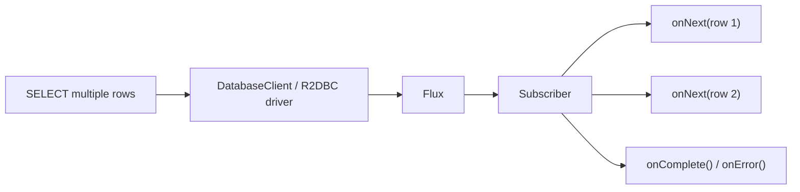
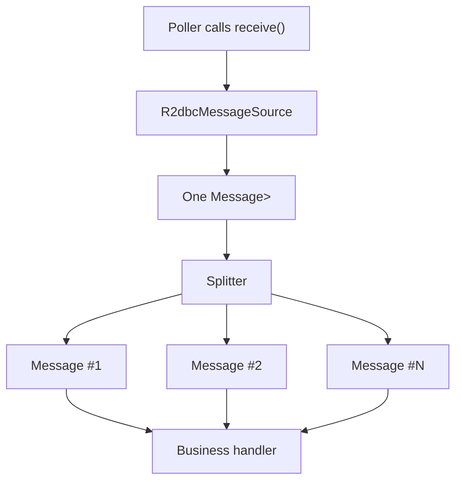
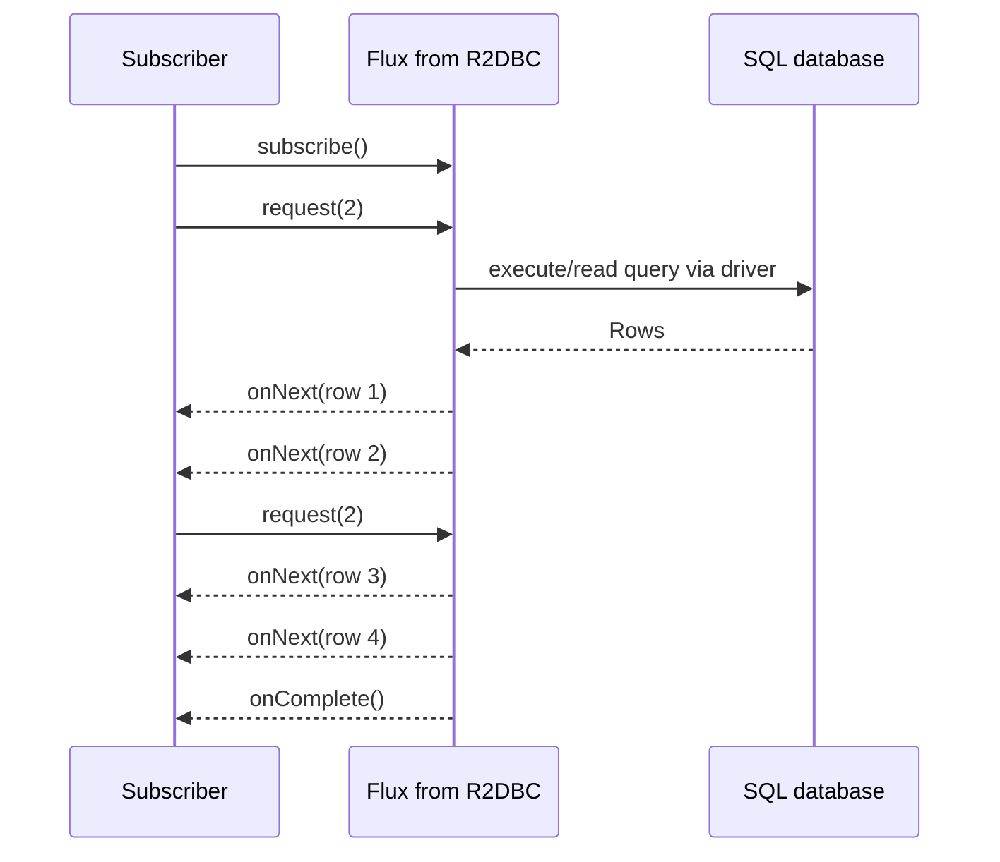
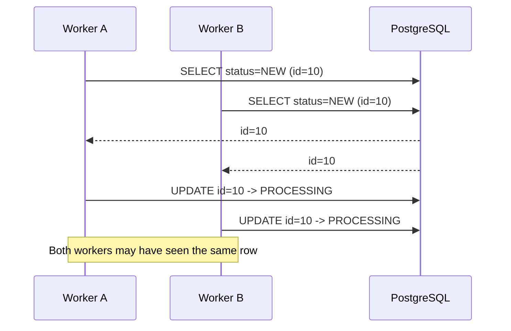

# Reactive queries returning Flux

> **Chapter:** R2DBC Adapter  
> **Module:** SPRING_INTEGRATION_ADAPTERS  
> **Context:** Connect external systems to Spring Integration using inbound/outbound adapters, gateways, pollers, and MessageChannels. Practice exchanging data via files, SFTP, HTTP, JMS, AMQP, Kafka, and databases; focus on message contracts, errors, and connection lifecycles.

## 1. Learning Objectives

Upon completing this lesson, you will be able to:

- Describe `Flux<T>` as a Publisher of **0..N elements** and distinguish it from `Mono<T>`, `List<T>`, and `Stream<T>`.
- Write R2DBC queries `DatabaseClient.sql(...).map(...).all()` returning `Flux`, or entity queries via `R2dbcEntityTemplate.select(...).all()`.
- Understand **lazy/cold Publishers**, subscriptions, `onNext`, `onComplete`, `onError`, cancellation, and that re-subscribing may re-execute the SQL.
- Safely map `Row`s to POJOs/records, bind parameters, and handle SQL NULLs in compliance with Reactive Streams.
- Apply `filter`, `map`, `concatMap`, `flatMap`, `buffer`, and `collectList` while respecting ordering, concurrency, and resource constraints.
- Explain that `R2dbcMessageSource` defaults to returning **`Message<Flux<T>>`**, requiring a splitter/reactive consumer if each record should become a separate Spring Message.
- Distinguish poller `maxMessagesPerPoll`, SQL `LIMIT`, `Flux` demand, and concurrency limits.
- Design batch reading, keyset pagination, claim/ACK, retries, idempotency, and transactions when multiple instances read the same table.
- Test reactive queries with Reactor `StepVerifier` and real PostgreSQL; monitor metrics, error handling, and the DB connection pool.

## 2. Why do R2DBC queries return Flux?

An integration application needs to fetch new events from an SQL database and forward them to HTTP, Kafka, AMQP, or an internal processor. A `SELECT` statement may return zero rows, one row, or thousands of rows.

R2DBC (Reactive Relational Database Connectivity) accesses databases via Reactive Streams. Project Reactor's **`Flux<T>`** represents a stream of **0..N values of type `T`** plus a completion or error signal. In Spring Framework R2DBC, `DatabaseClient` can turn each `Row` into an element of a `Flux`:

```java
Flux<ReadingRow> readings = databaseClient
        .sql("SELECT id, device_id, reading_value FROM device_readings")
        .map((row, metadata) -> new ReadingRow(
                row.get("id", Long.class),
                row.get("device_id", String.class),
                row.get("reading_value", BigDecimal.class)
        ))
        .all();
```

This snippet is **illustrative**: `Flux` and `BigDecimal` must be imported, and `ReadingRow` must be declared. It does not immediately build a `List` of rows. It returns a **Publisher**; once subscribed, the query is triggered and rows are emitted sequentially.



**Important distinction:** Reactive does not mean a query is pushed instantaneously everywhere by the database, does not mean the entire pipeline automatically applies end-to-end backpressure, and does not guarantee every driver always streams rows over the network strictly one-for-one with `request(n)`.

### 2.1. Flux vs. Mono, List, and Java Stream

| Type | Element count | Key characteristic |
| --- | --- | --- |
| `Mono<T>` | 0 or 1 | Typically used by `one()`, `first()`, or a write operation returning a result. |
| `Flux<T>` | 0..N | Has onNext/onComplete/onError, subscription, and demand. |
| `List<T>` | Materialized element count | Data is already in memory. |
| Java `Stream<T>` | Pull/synchronous traversal via Java API | Not a Reactive Streams Publisher by itself. |
| `Message<Flux<T>>` | **One Spring Message** holding a Publisher | Not `N` Spring Messages. |
| `Flux<Message<T>>` | Publisher emitting multiple Spring Messages | Each element is a separate message. |

The last two rows are the crucial distinction in **Spring Integration R2DBC**.

### 2.2. Three signals of a reactive query

A `Flux<ReadingRow>` can:

1. Emit `onNext(reading)` multiple times when data exists.
2. End normally with `onComplete()`.
3. End abnormally with `onError(exception)`.

After `onComplete()` or `onError()`, no further `onNext` signals are valid. **Zero rows** usually means an **empty completion**, not a `404` error or SQL error.

`Flux` **must not emit `null` as an item**. A nullable column can be read as `null` during mapping, so the mapper should place it into a DTO with a nullable field or choose an appropriate representation; do not return `null` directly from the `map(...)` function.

## 3. Cold publishers, subscription, and execution

### 3.1. What is a Cold Publisher?

For most R2DBC queries created from `DatabaseClient`, the `Flux` is **cold**: a new subscription can cause the SQL to execute again and read fresh data from the database at that point in time.

```java
Flux<ReadingRow> query = repository.findRecent("sensor-01", 20);

// Returns a Publisher; SQL has not necessarily run yet.
Mono<Long> count = query.count();
Mono<List<ReadingRow>> list = query.collectList();

// Two branches create two independent subscriptions when subscribed.
// DB state may differ between the two executions.
```

This differs from a `List` that already holds data. Do not assume that reusing the same `query` variable means query results are cached in memory.

### 3.2. Reactor example without a database

```java
import reactor.core.publisher.Flux;

Flux<Integer> cold = Flux.defer(() -> {
    System.out.println("Creating new subscription");
    return Flux.just(1, 2, 3);
});

cold.subscribe(value -> System.out.println("A=" + value));
cold.subscribe(value -> System.out.println("B=" + value));
```

When running the demo, "Creating new subscription" prints for **each subscription**. For an R2DBC cold query, the same rule applies: each subscription may re-query and receive different data if the database changed.

**Do not scatter manual `subscribe()` calls** inside a service returning `Flux`, as that takes away the caller's control over cancellation, retry, transactions, and completion.

### 3.3. What actually causes SQL to execute

Components that can subscribe:

- Spring WebFlux when an endpoint returns `Flux<T>` or `Mono<T>`.
- Reactor `StepVerifier` in unit/integration tests.
- A Spring Integration reactive endpoint/channel when the flow is configured properly.
- An upstream orchestrating service composing the Publisher into a reactive workflow.

A call like:

```java
Flux<ReadingRow> query = repository.findRecent("sensor-01", 20);
```

by itself **does not prove the query ran**. Also do not use `Thread.sleep()` to prove completion; observe terminal signals or DB state per contract.

### 3.4. Subscribing a second time can cause duplicate reads

```text
T0: Flux created from SELECT WHERE status='NEW'
T1: Subscriber A runs SELECT -> id=100, 101
T2: Subscriber B runs same SELECT -> id=100, 101
T3: Both A and B send to external systems
```

If A/B both perform side effects, records can be processed **twice**. `Flux` does not automatically provide claim/ACK/idempotency. For reliable work, design business keys, atomic claims, retries, and consistency rather than assuming a Flux variable is consumed only once.

## 4. Preparing PostgreSQL and Spring Boot

The examples target **Java 17+, Spring Boot 3.x, Spring Integration 6.x**; use Spring Boot dependency management to select compatible versions. Some APIs change across versions, so check the Javadoc of the exact libraries you deploy.

### 4.1. Maven dependencies

```xml
<dependencies>
    <dependency>
        <groupId>org.springframework.boot</groupId>
        <artifactId>spring-boot-starter-integration</artifactId>
    </dependency>
    <dependency>
        <groupId>org.springframework.boot</groupId>
        <artifactId>spring-boot-starter-data-r2dbc</artifactId>
    </dependency>
    <dependency>
        <groupId>org.springframework.integration</groupId>
        <artifactId>spring-integration-r2dbc</artifactId>
    </dependency>
    <dependency>
        <groupId>org.postgresql</groupId>
        <artifactId>r2dbc-postgresql</artifactId>
        <scope>runtime</scope>
    </dependency>
    <dependency>
        <groupId>io.projectreactor</groupId>
        <artifactId>reactor-test</artifactId>
        <scope>test</scope>
    </dependency>
</dependencies>
```

Use the **R2DBC PostgreSQL driver**, do not substitute JDBC's `org.postgresql:postgresql`. When using a connection pool, configure the appropriate `r2dbc-pool` dependency or starter/BOM support and verify the pool is actually created.

### 4.2. application.yml

```yaml
spring:
  r2dbc:
    url: r2dbc:postgresql://127.0.0.1:5432/integration_demo
    username: ${DB_USER}
    password: ${DB_PASSWORD}
    pool:
      enabled: true
      initial-size: 2
      max-size: 10
```

`${DB_USER}` and `${DB_PASSWORD}` represent placeholders resolved from the runtime environment, not passwords committed to Git. Spring Boot can auto-configure `io.r2dbc.spi.ConnectionFactory`, `DatabaseClient`, `R2dbcEntityTemplate`, and a reactive transaction manager if dependency/bean conditions match.

### 4.3. Example table

```sql
CREATE TABLE device_readings (
    id            BIGSERIAL PRIMARY KEY,
    device_id     VARCHAR(64) NOT NULL,
    reading_value NUMERIC(12, 3) NOT NULL,
    status        VARCHAR(16) NOT NULL DEFAULT 'NEW',
    created_at    TIMESTAMPTZ NOT NULL DEFAULT CURRENT_TIMESTAMP,
    processed_at  TIMESTAMPTZ
);

CREATE INDEX idx_readings_device_id_id
    ON device_readings (device_id, id DESC);

CREATE INDEX idx_readings_status_id
    ON device_readings (status, id);

INSERT INTO device_readings(device_id, reading_value)
VALUES
  ('sensor-01', 20.5),
  ('sensor-01', 21.0),
  ('sensor-02', 18.75);
```

`id` identifies the row. `status` supports the polling and ACK examples; `created_at` can be used to measure lag. This is a learning schema and does not yet include `claim_owner`, `lease_until`, or an outbox table for production delivery.

### 4.4. Shared Java type

Create `ReadingRow.java`:

```java
import java.math.BigDecimal;
import java.time.OffsetDateTime;

public record ReadingRow(
        Long id,
        String deviceId,
        BigDecimal value,
        String status,
        OffsetDateTime createdAt
) {
}
```

When mapping with `DatabaseClient.map(...)`, `@Table` is not required. When you want `R2dbcEntityTemplate` to map automatically, declare `@Table("device_readings")` and `@Column(...)` on the corresponding entity/record.

## 5. DatabaseClient: SELECT queries returning Flux

### 5.1. End-to-end repository

Create `ReadingRepository.java`:

```java
import java.math.BigDecimal;
import java.time.OffsetDateTime;

import org.springframework.r2dbc.core.DatabaseClient;
import org.springframework.stereotype.Repository;
import reactor.core.publisher.Flux;

@Repository
public class ReadingRepository {

    private final DatabaseClient db;

    public ReadingRepository(DatabaseClient db) {
        this.db = db;
    }

    public Flux<ReadingRow> findRecent(String deviceId, int limit) {
        if (deviceId == null
                || !deviceId.matches("[A-Za-z0-9_-]{1,64}")) {
            return Flux.error(
                    new IllegalArgumentException("Invalid device ID"));
        }

        if (limit < 1 || limit > 100) {
            return Flux.error(
                    new IllegalArgumentException("Limit must be 1..100"));
        }

        return db.sql(
                        "SELECT id, device_id, reading_value, " +
                        "status, created_at " +
                        "FROM device_readings " +
                        "WHERE device_id = :deviceId " +
                        "ORDER BY id DESC LIMIT :maxRows")
                .bind("deviceId", deviceId)
                .bind("maxRows", limit)
                .map((row, metadata) -> new ReadingRow(
                        row.get("id", Long.class),
                        row.get("device_id", String.class),
                        row.get("reading_value", BigDecimal.class),
                        row.get("status", String.class),
                        row.get("created_at", OffsetDateTime.class)
                ))
                .all();
    }

    public Flux<ReadingRow> findReady(int batchSize) {
        if (batchSize < 1 || batchSize > 100) {
            return Flux.error(new IllegalArgumentException(
                    "Batch size must be 1..100"));
        }

        return db.sql(
                        "SELECT id, device_id, reading_value, " +
                        "status, created_at " +
                        "FROM device_readings WHERE status = 'NEW' " +
                        "ORDER BY id ASC LIMIT :batchSize")
                .bind("batchSize", batchSize)
                .map((row, metadata) -> new ReadingRow(
                        row.get("id", Long.class),
                        row.get("device_id", String.class),
                        row.get("reading_value", BigDecimal.class),
                        row.get("status", String.class),
                        row.get("created_at", OffsetDateTime.class)
                ))
                .all();
    }
}
```

**Breakdown:**

1. `DatabaseClient.sql(...)` creates an SQL execution spec.
2. `bind(...)` binds **values** to named parameters without concatenating raw input into SQL.
3. `map(...)` turns each SQL `Row` into a `ReadingRow`.
4. `all()` returns `Flux<ReadingRow>`, not a materialized `List`.
5. `ORDER BY` establishes meaningful ordering for a single query; multiple queries at different times may still observe different data.
6. `LIMIT` bounds the row count of **one SELECT**; it is separate from Reactor demand and poller options.

**Important:** `status='NEW'` does not lock rows by itself. Two callers or two instances querying concurrently can receive the same rows. Atomic claiming is covered in section 14.

### 5.2. One row, multiple rows, and query results

| API | Return type | When to use |
| --- | --- | --- |
| `.map(...).all()` | `Flux<T>` | Query has 0..N rows. |
| `.map(...).one()` | `Mono<T>` | Expects at most one row; multiple rows are an error per contract. |
| `.map(...).first()` | `Mono<T>` | Takes only the first row; use `ORDER BY`/`LIMIT 1`. |
| `.fetch().all()` | `Flux<Map<String,Object>>` | Want default column-name-to-value maps. |
| `.fetch().rowsUpdated()` | `Mono<Long>` | INSERT/UPDATE/DELETE needing affected row count. |

A `Flux` emitting rows is **not a JDBC SQL ResultSet buffered entirely in RAM**. Still, a driver, SQL server, or downstream operator may buffer data. Do not rely on the word "Flux" to assume constant memory.

### 5.3. Preserving data types

- PostgreSQL `NUMERIC` generally maps well to `java.math.BigDecimal`.
- `TIMESTAMPTZ` is usually mapped by the PostgreSQL R2DBC driver to offset/timestamp types; test your application's driver and schema.
- If a column can be NULL, the mapping function must represent null as a **field inside the record/DTO**, never emit null directly as an item.
- Do not convert `BigDecimal` to `double` if decimal precision affects business logic.
- When the schema renames columns, verify mappings with tests instead of failing late at runtime.

## 6. Flux and essential operators

### 6.1. map: transforming each element

```java
Flux<String> summaries = repository.findReady(20)
        .map(reading ->
                reading.deviceId() + "=" + reading.value());
```

`map` preserves item order in the stream; it does not imply asynchronous execution per item.

### 6.2. filter: dropping items that do not match

```java
Flux<ReadingRow> hot = repository.findReady(20)
        .filter(reading ->
                reading.value().compareTo(
                        new java.math.BigDecimal("30.0")) > 0);
```

`filter` runs **after** the DB returns items to the client. For large datasets, push conditions down to SQL `WHERE reading_value > :threshold` to reduce bytes transferred and mapping overhead. Do not use `filter` instead of an SQL index when the database can filter more efficiently.

### 6.3. concatMap: ordered asynchronous processing

A service wants to send each reading to a remote API and move to the next item only after the previous one completes:

```java
import reactor.core.publisher.Flux;
import reactor.core.publisher.Mono;

public final class ReadingBatchProcessor {

    private final ReadingRepository repository;
    private final RemoteReadingSender sender;

    public ReadingBatchProcessor(
            ReadingRepository repository,
            RemoteReadingSender sender) {
        this.repository = repository;
        this.sender = sender;
    }

    public Mono<Void> processOrdered() {
        return repository.findReady(25)
                .concatMap(sender::send)
                .then();
    }
}
```

Assume `RemoteReadingSender.send(ReadingRow)` returns `Mono<Void>`, does not block, and completes after remote acknowledgement per its contract. `concatMap` preserves **order and processes each item sequentially**; `then()` returns `Mono<Void>` once the whole batch finishes.

**This is an illustrative processing skeleton**, not production delivery: it lacks atomic claiming, ACK, retry, and idempotency, so two processes could send the same row.

### 6.4. flatMap: bounding concurrent tasks

When items are independent and side-effect ordering is not required:

```java
Mono<Void> task = repository.findReady(25)
        .flatMap(sender::send, 4)
        .then();
```

`flatMap(..., 4)` allows up to roughly **4 inner publishers** to be processed concurrently per the operator's mechanism. Completion order may **differ from SQL order**.

| Operator | Output order | Concurrency |
| --- | --- | --- |
| `map` | Preserves input order | Synchronous transform, does not spawn async tasks. |
| `concatMap` | Preserves order | Each inner Publisher is processed sequentially. |
| `flatMap` | May reorder | Concurrent; must bound concurrency. |
| `flatMapSequential` | Preserves emission order | Inner tasks can still run concurrently. |

Preserving emission order **does not mean** side effects from inner tasks occur in order. If business logic requires one event to commit before the next, use sequential orchestration and appropriate transaction contracts.

### 6.5. buffer and collectList

```java
Flux<java.util.List<ReadingRow>> groups =
        repository.findReady(100).buffer(10);

Mono<java.util.List<ReadingRow>> completeList =
        repository.findReady(100).collectList();
```

- `buffer(10)` groups up to 10 items into a list, useful when downstream supports batching.
- `collectList()` emits only after the Flux completes, holding all items in **RAM**.
- Use `collectList()` only when the query already has a reasonable `LIMIT`; do not collect unboundedly on tables with millions of records.

Reactor's `buffer` is in-memory grouping in the application; **it does not automatically equal a batch INSERT or SQL cursor**.

### 6.6. take, limitRate, and query LIMIT

```java
Flux<ReadingRow> partial = repository.findReady(100)
        .take(10);

Flux<ReadingRow> demandTuned = repository.findReady(100)
        .limitRate(16);
```

`take(10)` cancels the subscription after 10 items, though the SQL query may already have executed and the driver/database may have processed more rows. `limitRate(16)` shapes upstream demand; it does **not** set SQL `LIMIT 16` and does not guarantee the DB server uses at most 16 rows in RAM.

**Prioritize limiting data at the database with SQL**, then tune Reactor demand and concurrency.

## 7. R2dbcEntityTemplate can also return Flux

With an entity mapped by Spring Data R2DBC:

```java
import java.math.BigDecimal;
import java.time.OffsetDateTime;

import org.springframework.data.annotation.Id;
import org.springframework.data.relational.core.mapping.Column;
import org.springframework.data.relational.core.mapping.Table;

@Table("device_readings")
public record ReadingEntity(
        @Id Long id,
        @Column("device_id") String deviceId,
        @Column("reading_value") BigDecimal value,
        String status,
        @Column("created_at") OffsetDateTime createdAt
) {
}
```

Querying entities via `R2dbcEntityTemplate`:

```java
import org.springframework.data.r2dbc.core.R2dbcEntityTemplate;
import org.springframework.data.relational.core.query.Criteria;
import org.springframework.data.relational.core.query.Query;
import org.springframework.data.domain.Sort;
import reactor.core.publisher.Flux;

public Flux<ReadingEntity> findNewEntities(
        R2dbcEntityTemplate template, int limit) {

    Query query = Query.query(
                    Criteria.where("status").is("NEW"))
            .sort(Sort.by(Sort.Direction.ASC, "id"))
            .limit(limit);

    return template.select(ReadingEntity.class)
            .matching(query)
            .all();
}
```

**How to choose:**

| Case | Recommendation |
| --- | --- |
| Need SQL JOINs, CTEs, `RETURNING`, or dialect-specific queries | `DatabaseClient`. |
| Want entity mapping and `Criteria`/`Query` | `R2dbcEntityTemplate`. |
| Want Spring Data R2DBC Repository API | `ReactiveCrudRepository` and query methods. |
| Need a Spring Integration inbound adapter | `R2dbcEntityOperations` passed into `R2dbcMessageSource`. |

Both `DatabaseClient` and `R2dbcEntityTemplate` use the R2DBC connection infrastructure. The name "template" does not mean queries execute eagerly; queries returning reactive Publishers still require subscription.

## 8. R2DBC inbound channel adapter: one Message containing a Flux

This connects directly to the **SPRING_INTEGRATION_ADAPTERS** module.

`R2dbcMessageSource` is a `MessageSource<Publisher<?>>` triggered by a poller. **By default `expectSingleResult=false`**, so `receive()` returns a Spring Message whose **payload is a `Flux`** of the queried rows.



### 8.1. Comparing the two perspectives

```text
Direct DatabaseClient:
  SELECT -> Flux<ReadingRow>
    subscriber receives each ReadingRow

Spring Integration R2DBC inbound:
  one poll -> Message<Flux<ReadingEntity>>
    splitter -> Message<ReadingEntity> for each row
```

**One poll can emit many rows**, yet without a splitter/reactive consumer there are not N Spring Messages. Do not write `handle(ReadingEntity.class, ...)` right after the source assuming the payload is already a `ReadingEntity`.

### 8.2. Java DSL inbound flow with splitter

Create `ReadingR2dbcInboundConfiguration.java` **as an alternative to other sources on the same table during practice**:

```java
import org.springframework.context.annotation.Bean;
import org.springframework.context.annotation.Configuration;
import org.springframework.data.r2dbc.core.R2dbcEntityTemplate;
import org.springframework.integration.config.EnableIntegration;
import org.springframework.integration.dsl.IntegrationFlow;
import org.springframework.integration.dsl.MessageChannels;
import org.springframework.integration.r2dbc.dsl.R2dbc;

@Configuration
@EnableIntegration
public class ReadingR2dbcInboundConfiguration {

    @Bean
    IntegrationFlow readingInboundFlow(
            R2dbcEntityTemplate template) {

        return IntegrationFlow
                .from(
                        R2dbc.inboundChannelAdapter(
                                template,
                                "SELECT id, device_id, reading_value, " +
                                "status, created_at " +
                                "FROM device_readings " +
                                "WHERE status = 'NEW' " +
                                "ORDER BY id LIMIT 20")
                                .payloadType(ReadingEntity.class)
                                .expectSingleResult(false),
                        e -> e.poller(p ->
                                p.fixedDelay(2_000)
                                 .maxMessagesPerPoll(1))
                )
                .channel(MessageChannels.flux())
                .split()
                .channel(MessageChannels.flux())
                .handle(ReadingEntity.class, (reading, headers) -> {
                    System.out.printf(
                            "R2DBC reading id=%s device=%s value=%s%n",
                            reading.id(),
                            reading.deviceId(),
                            reading.value()
                    );
                    // Demo logs only; does not prove downstream ACK.
                    return null;
                })
                .get();
    }
}
```

**Explanation:**

1. The poller periodically invokes `R2dbcMessageSource.receive()`.
2. `payloadType(ReadingEntity.class)` specifies how each row is mapped.
3. `expectSingleResult(false)` preserves the behavior of creating `Flux<ReadingEntity>`.
4. `MessageChannels.flux()` selects a reactive channel suited for the publisher/splitter.
5. `.split()` splits the elements of the `Flux` into individual messages whose payload is a `ReadingEntity`.
6. The handler logs each row; it does not provide an ACK or delivery guarantee.
7. SQL `LIMIT 20` bounds the **row count per SELECT**, whereas `maxMessagesPerPoll(1)` limits how many times `receive()` is called in a poll task.

**Warning:** The flow only SELECTs `status='NEW'`, with no UPDATE/claim. Subsequent polls can re-read **the same records** and emit logs multiple times. This demo clarifies Publisher structure; production must design ownership/ACK as in section 14.

### 8.3. How does the Splitter understand a Publisher?

The Spring Integration splitter supports `Publisher`. When the output channel is an appropriate `ReactiveStreamsSubscribableChannel` (such as `FluxMessageChannel`), the splitter can create a reactive Flux for splitting and apply downstream demand mechanisms.

If you swap the output for a channel/handler lacking proper reactive support, splitting may behave differently. Always **inspect channel types, subscribers, concurrency, and actual errors**, rather than just knowing Spring Integration has `.split()`.

### 8.4. Does expectSingleResult=true turn Flux directly into a row?

When switching to `expectSingleResult(true)`, the R2DBC source uses **single-result mode**, and per the API the payload is a **`Mono`**; do not assume it has already become a POJO when the poller emits the Spring Message.

```text
expectSingleResult = false (default):
  receive() -> Message<Flux<ReadingEntity>>

expectSingleResult = true:
  receive() -> Message<Mono<ReadingEntity>>
```

For a handler to receive the object, downstream still needs to consume/unpack the Publisher per the flow model. When using `true`, the SQL should guarantee at most one row or explicitly define multi-row behavior; `LIMIT 1` usually expresses the intent clearly.

### 8.5. updateSql is not a post-handler ACK

`R2dbcMessageSource` supports `updateSql` with `bindFunction` to **mark read records** so they are not re-polled. However, an UPDATE/claim at the source layer **does not prove downstream finished processing**.

Example flow:

```text
SELECT status=NEW
      |
      v
UPDATE status=CLAIMED
      |
      v
Flux rows -> splitter -> HTTP/Kafka
                           |
                           +--> fails after already CLAIMED
```

If a worker crashes after claiming but before finishing delivery, rows can stay stuck in `CLAIMED`. You need leases, retries/compensation, post-processing ACKs, and idempotency. Do not call `updateSql` "exactly-once" merely because the query no longer re-reads those rows.

## 9. Distinguishing polling rate, batch size, and backpressure

| Limit | What does it govern? | What it does NOT govern |
| --- | --- | --- |
| `fixedDelay(2_000)` | Scheduling delay between poll tasks as configured. | Does not prove all prior reactive subscriptions finished. |
| `maxMessagesPerPoll(1)` | Number of times the poller calls `receive()` per task run. | Does not limit SELECT to one row. |
| SQL `LIMIT 20` | Rows returned per query. | Does not by itself prevent overlapping queries/polls. |
| `Flux.request(n)` | Subscriber demand sent to upstream Publisher. | Does not force the DB to transmit strictly n rows over network/transaction. |
| `flatMap(..., 4)` | Concurrency of inner publishers in a Reactor chain. | Does not limit other producers or the whole app's DB pool. |
| R2DBC pool max-size=10 | Maximum connections per pool. | Does not limit pending requests if queues are unbounded. |
| Broker/topic/queue capacity | Transport-layer buffering/delivery. | Does not replace DB ownership/ACK. |

### 9.1. Example: one poll, 20 rows

```text
Poller fixedDelay=2000ms, maxMessagesPerPoll=1
   |
   +-- single receive()
         |
         +-- SQL LIMIT 20
               |
               +-- Message<Flux<ReadingEntity>>
                     |
                     +-- 20 items / 20 Spring Messages after splitter
```

If you change the SQL to an unbounded SELECT, a single poll can still return thousands of items. Setting `maxMessagesPerPoll=1` does not protect DB/memory in that case.

### 9.2. Pollers can overlap with reactive workloads

A poll task can simply hand a Publisher to downstream and finish before the subscription finishes processing all rows. Therefore, subsequent polls can begin while the previous batch is still in progress.

If processing must **not overlap**:

- Limit the number of active pipelines.
- Consider a sequential `Flux`/`Mono` orchestration with explicit completion, or custom polling whose reactive result is awaited per contract.
- Design atomic claiming in the DB so two polls/instances never read duplicates if overlap still happens.
- Measure real metrics for active subscriptions and processing latency.

`fixedDelay` alone does not provide a distributed lock or database lease.

## 10. Backpressure: slowing the source, not replacing DB design

Reactive Streams provides `Subscriber.request(n)` for **demand**. A `Flux` can wait for the consumer to request more items before emitting.



The diagram illustrates the **demand contract**; it does not promise the database network sends strictly two rows per request. Drivers, protocols, servers, and operator buffering may prefetch or buffer.

### 10.1. End-to-end backpressure requires every link to support it

A pipeline with:

```text
R2DBC query
   -> Reactor Flux
   -> Spring Integration FluxMessageChannel
   -> Splitter
   -> Reactive handler
   -> downstream API/broker
```

only has a chance to preserve reactive demand effectively when every segment genuinely supports it and is wired properly. If a handler calls `block()` on an event-loop, collects unbounded rows, or spawns thousands of independent `subscribe()` calls, backpressure effectiveness can be lost.

### 10.2. SQL LIMIT, pool, and concurrency matter more than the reactive label

To protect the database:

1. Limit **row counts** with SQL `LIMIT`/pagination.
2. Ensure indexes support `WHERE`/`ORDER BY`.
3. Configure max database connections, pending acquire timeouts, and statement timeouts.
4. Bound concurrency when calling external APIs or writing to the DB.
5. Enforce clear capacity/retention limits for queues and in-flight events.
6. Measure query latency, pool utilization, backlog, and end-to-end time.
7. When exactly-once effects are needed, design idempotency independently of backpressure.

**`Flux`** solves how streams are represented and orchestrated; it does not solve record ownership or transaction correctness by itself.

## 11. Pagination and large queries

### 11.1. Why not SELECT the entire table?

If a table has 10 million rows, a query like:

```sql
SELECT * FROM device_readings;
```

can be very expensive: the DB reads many pages, the network transfers huge volumes, connections/cursors stay open long, client mapping slows down, and downstream queues can overload.

Batch by a business ordering key, such as increasing `id`:

```sql
SELECT id, device_id, reading_value, status, created_at
FROM device_readings
WHERE id > :lastId
ORDER BY id
LIMIT :batchSize;
```

**Keyset pagination** is usually more efficient than large OFFSETs on mutable tables. Still, it requires consistent rules for cursor/ordering, snapshots, and new rows inserted during a scan.

### 11.2. Repository for keyset pagination

Method placed inside `ReadingRepository`:

```java
public Flux<ReadingRow> findAfter(
        long lastId, int batchSize) {

    if (lastId < 0 || batchSize < 1 || batchSize > 500) {
        return Flux.error(new IllegalArgumentException(
                "Invalid cursor or batch size"));
    }

    return db.sql(
                    "SELECT id, device_id, reading_value, " +
                    "status, created_at " +
                    "FROM device_readings WHERE id > :lastId " +
                    "ORDER BY id LIMIT :batchSize")
            .bind("lastId", lastId)
            .bind("batchSize", batchSize)
            .map((row, metadata) -> new ReadingRow(
                    row.get("id", Long.class),
                    row.get("device_id", String.class),
                    row.get("reading_value", BigDecimal.class),
                    row.get("status", String.class),
                    row.get("created_at", OffsetDateTime.class)
            ))
            .all();
}
```

**Caution:** `lastId` is a **scan cursor**, not a processed-event ACK. If you advance the cursor before finishing batch processing, a crash can skip unprocessed rows on the next run.

### 11.3. Pagination does not equal delivery semantics

- `OFFSET/LIMIT` can **skip or duplicate** rows when data is inserted/deleted between pages.
- Keyset pagination based on a stable ID avoids some OFFSET issues, but still requires handling transactions/snapshots and commit ordering.
- If the application only scans for reporting, a cursor may suffice.
- If the application must **process every event**, you need claim/ACK/lease and retries; never use `lastId` as proof that all side effects completed.

## 12. Flux, transactions, and connection lifecycles

### 12.1. Transactions attach to reactive subscriptions

Spring R2DBC supports reactive transactions via `R2dbcTransactionManager` and `TransactionalOperator`. The transaction context propagates in the reactive chain's **Reactor Context**.

```java
import org.springframework.transaction.reactive.TransactionalOperator;
import reactor.core.publisher.Flux;

public Flux<ReadingRow> findInTransaction(
        ReadingRepository repository,
        TransactionalOperator tx) {

    return repository.findReady(20)
            .as(tx::transactional);
}
```

This is an illustrative method inside a Java class. When the Publisher is subscribed, the operator sets up the transaction context. Do not call a fresh `subscribe()` mid-chain to run side effects expecting it to automatically join the outer transaction.

### 12.2. Keeping a Flux open long can hold a connection long

If a query returns a `Flux` and downstream processes each row slowly, connection/result resources may be held until the source completes or is cancelled, depending on driver/cursor/transaction behavior.

Ways to mitigate:

- Query in small batches instead of streaming millions of rows inside one transaction.
- Separate **DB read/claim** from **slow remote API calls** when needed.
- Avoid keeping DB transactions open across network operations with unpredictable durations.
- Set statement timeouts/transaction timeouts and bound subscription lifecycles.
- Ensure cleanup on `cancel` or error, and monitor pool acquire times.

### 12.3. SQL transactions do not cover external systems

```text
SELECT/CLAIM rows in PostgreSQL
                |
                v
Publish rows to Kafka
                |
                v
ACK/update DONE
```

A PostgreSQL transaction cannot automatically roll back a Kafka publish or HTTP call. If the process dies after publishing but before ACK, downstream may receive duplicates on retry.

For reliable delivery, use **idempotent consumers**, transactional outbox, post-processing ACK, leases, and bounded retries per contract.

## 13. Errors in Flux, retries, and cancellation

### 13.1. An error signal terminates a subscription

A query may emit a few rows and then hit a connection/mapping error:

```text
onNext(row 1)
onNext(row 2)
onError(R2dbcException)
```

Do not report that "all rows of the query were processed" without `onComplete()`. If the subscriber already sent row 1 and row 2 downstream, retrying the entire query can **re-emit those two rows**.

### 13.2. retryWhen creates a new subscription

```java
import java.time.Duration;
import reactor.util.retry.Retry;

Flux<ReadingRow> retriedRead = repository.findReady(20)
        .retryWhen(Retry.backoff(2, Duration.ofMillis(200))
                .maxBackoff(Duration.ofSeconds(2)));
```

This is only an **illustrative retry pattern for pure read queries**; production must filter transient exceptions and enforce a total deadline. **Retrying a cold Flux normally re-subscribes and re-runs the query**, rather than resuming from the last emitted row. If the subscriber performs side effects, this can create duplicates.

Do not infinitely retry SQL syntax errors, permission denied, mapping exceptions, or invalid query schemas.

### 13.3. Per-item timeout vs. total batch deadline

```java
import java.time.Duration;

Flux<ReadingRow> withGapTimeout = repository.findReady(20)
        .timeout(Duration.ofSeconds(3));
```

`Flux.timeout(Duration)` sets a **wait limit for the next signal**, not the total time to finish all items. If each row arrives under 3 seconds, the entire batch can still run much longer.

When you need a **total batch deadline** for a small bounded batch:

```java
Mono<java.util.List<ReadingRow>> batch =
        repository.findReady(20)
                .collectList()
                .timeout(Duration.ofSeconds(8));
```

`collectList()` buffers elements in memory, which is why the repository enforces `LIMIT 20` here. Total deadlines must align with connect timeouts, pool acquire timeouts, SQL statement timeouts, and downstream SLAs.

### 13.4. Cancellation requires cleanup

A subscriber may cancel a `Flux` mid-query. Spring `DatabaseClient` and the driver/pool manage connection cleanup per contract, yet the application must still:

- Avoid manually creating raw `Connection`s and forgetting to close them.
- Avoid holding a Publisher that never completes inside an indefinite transaction.
- Monitor timeouts, cancellations, and active pool connections.
- Never claim rows are ACKed if the subscriber cancels before processing.
- Be careful with `take(n)`: cancellation does not automatically roll back already committed side effects.

### 13.5. Handling errors per-item instead of failing the whole batch

Suppose a remote API can fail for a single reading. If you want to record the failure and continue processing other readings, place error handling **inside each item's inner Publisher**, rather than catching errors only outside the entire Flux:

```java
Mono<Void> process = repository.findReady(20)
        .concatMap(reading ->
                sender.send(reading)
                        .onErrorResume(error ->
                                failureRecorder.record(reading, error)))
        .then();
```

Assume `sender.send(...)` and `failureRecorder.record(...)` both return `Mono<Void>`. If `failureRecorder` also fails, the error still propagates to stop the chain. This snippet is **not** a complete ACK mechanism: you still need to decide when read/claim state commits and which events get retried.

Avoid using `onErrorContinue` as a general-purpose way to "skip failed items"; it can produce unpredictable behavior with operators and stateful resources.

## 14. Avoiding duplicate reads: atomic claim, ACK, and idempotency

### 14.1. The problem with separate SELECT then UPDATE



A query returning `Flux` **does not exclusively lock** the SELECTed rows. If an inbound adapter runs `updateSql` after selecting rows without an ownership-guaranteeing claim protocol, multiple workers can still receive the same records.

### 14.2. PostgreSQL atomic claim with UPDATE RETURNING

With PostgreSQL, a single SQL statement can **claim and return the exact claimed rows**:

```sql
WITH candidates AS (
    SELECT id
    FROM device_readings
    WHERE status = 'NEW'
    ORDER BY id
    LIMIT :batchSize
    FOR UPDATE SKIP LOCKED
)
UPDATE device_readings AS r
SET status = 'PROCESSING'
FROM candidates
WHERE r.id = candidates.id
RETURNING r.id, r.device_id, r.reading_value,
          r.status, r.created_at;
```

This SQL **depends on the PostgreSQL dialect**; test transactions/isolation and behavior when multiple workers run concurrently. It only solves the claim step and does not automatically recover if a worker dies after claiming.

### 14.3. Running a RETURNING query with DatabaseClient

```java
public Flux<ReadingRow> claimNew(int batchSize) {
    if (batchSize < 1 || batchSize > 100) {
        return Flux.error(new IllegalArgumentException("Invalid batchSize"));
    }

    return db.sql(
                    "WITH candidates AS (" +
                    " SELECT id FROM device_readings " +
                    " WHERE status = 'NEW' ORDER BY id " +
                    " LIMIT :size FOR UPDATE SKIP LOCKED" +
                    ") UPDATE device_readings AS r " +
                    "SET status = 'PROCESSING' " +
                    "FROM candidates WHERE r.id = candidates.id " +
                    "RETURNING r.id, r.device_id, r.reading_value, " +
                    "r.status, r.created_at")
            .bind("size", batchSize)
            .map((row, metadata) -> new ReadingRow(
                    row.get("id", Long.class),
                    row.get("device_id", String.class),
                    row.get("reading_value", BigDecimal.class),
                    row.get("status", String.class),
                    row.get("created_at", OffsetDateTime.class)
            ))
            .all();
}
```

This is a method **added to `ReadingRepository`**. The Publisher is still `Flux<ReadingRow>`, but **the returned items are rows already claimed by the UPDATE** rather than a plain SELECT.

**Especially important:** This operation **has side effects**. If you subscribe twice to the same Flux query, the claim UPDATE can execute twice, each time claiming a **different batch**. Do not blindly apply `retryWhen` to a claim publisher expecting it to merely "resume reading" the previous batch.

### 14.4. Leases and post-downstream ACK

A production pattern should add:

```text
NEW
  |
  v
PROCESSING (owner, lease_until, attempt_count)
  |                       |
  | processing succeeds   | timeout/crash
  v                       v
DONE                 READY_TO_RETRY
                          |
                          v
                         NEW / DEAD
```

- **Claim**: clearly record owner and lease expiration; emit only claimed rows.
- **Process**: use item/business ID as the idempotency key when calling external systems.
- **ACK**: transition status to `DONE` **after** downstream completes per contract.
- **Recovery**: if a worker dies, expired leases allow bounded retries.
- **DLQ**: move records that fail after max attempts to `DEAD`/manual intervention.
- **Multi-instance**: use optimistic versions, unique constraints, or atomic DB statements to prevent competing claims.

If Kafka/AMQP/HTTP already processed the event but the DB ACK is lost, the row may be re-emitted. Therefore **idempotent consumers** are still required; R2DBC and Reactor do not provide exactly-once effects by themselves.

## 15. Reactor Flux and Spring Integration MessageChannel

### 15.1. Direct Publisher forwarding model

A flow can pass `Message<Flux<T>>` through a channel so a Publisher-aware reactive handler subscribes and processes each item. However, a handler accepting only `T` will **not** automatically unwrap a Flux.

If using a POJO handler:

```java
.handle(ReadingEntity.class, (reading, headers) -> {
    System.out.println(reading.id());
    return null;
})
```

you must ensure a splitter or transformation step precedes it so the **payload is `ReadingEntity`**, no longer `Flux<ReadingEntity>`.

### 15.2. Splitter model

```text
Source poller
    |
    v
Message<Flux<ReadingEntity>>
    |
    v
Splitter
    |
    +--> Message<ReadingEntity>(id=1)
    +--> Message<ReadingEntity>(id=2)
    +--> Message<ReadingEntity>(id=3)
    |
    v
Downstream endpoint(s)
```

The splitter can also attach sequence/correlation headers to split messages. That is Spring Integration metadata, **not** a database-persisted idempotency key.

### 15.3. Choosing channels and handoff points

- `DirectChannel` typically dispatches messages synchronously; it does not provide end-to-end reactive backpressure by itself.
- `FluxMessageChannel` supports Reactive Streams subscribers/demand, fitting Publisher pipelines when configured properly.
- `QueueChannel` buffers messages in a queue but does not drive Flux payload completion; you must determine who subscribes.
- Bridges from Reactor to brokers/HTTP can have separate ACKs, retry semantics, and concurrency limits.

**Do not pick a channel just because "reactive" sounds faster.** Verify the actual contract, error propagation, ordering, throughput, replayability, and backpressure across endpoints.

## 16. Observability and performance tuning

### 16.1. Essential metrics

| Metric | Meaning |
| --- | --- |
| Query subscriptions total | How many times was a cold query subscribed? |
| Query completed/error/cancelled | How many batches completed, failed, or were cancelled? |
| SELECT latency p50/p95/p99 | Is the DB query slow? |
| Rows emitted per query | How many items does each query actually emit? |
| Processing latency per row | Are handlers/HTTP/Kafka slowing the pipeline? |
| R2DBC pool active/idle/pending | Is the connection pool congested? |
| Poll attempts / overlap | Are polls overlapping? |
| Oldest NEW age / backlog | Is unprocessed data piling up? |
| Claimed / DONE / expired leases | Are claim/ACK steps stuck? |
| Duplicate IDs / retry attempts | Are unexpected redeliveries/claim retries occurring? |
| Error class/SQLState | Transient DB failure, constraint, or mapping error? |

The metric names above are **suggestions**, not all automatically emitted by Micrometer/Spring Integration. Instrument at subscribe/complete/error points, SQL queries, claims, ACKs, and downstream side effects.

### 16.2. Debugging a Flux

```java
import reactor.core.publisher.Flux;
import reactor.core.publisher.SignalType;

Flux<ReadingRow> traced = repository.findReady(20)
        .doOnSubscribe(subscription ->
                System.out.println("R2DBC query subscribed"))
        .doOnNext(row ->
                System.out.println("Read id=" + row.id()))
        .doOnError(error ->
                System.err.println("Read error=" + error.getClass()))
        .doFinally(signal ->
                System.out.println("Final signal=" + signal));
```

This snippet does not execute by itself; it needs a subscriber. In production logging, never log secrets/PII or full payloads. `doFinally` can observe `ON_COMPLETE`, `ON_ERROR`, or `CANCEL`; classify them clearly so cancelled batches are not miscounted as successful.

### 16.3. Where to optimize queries?

Prioritize **database and data volume** optimizations first:

1. Proper indexes for `WHERE`/`ORDER BY`.
2. `EXPLAIN ANALYZE` in a safe environment to inspect query plans.
3. Reduce columns with projections instead of `SELECT *` when unnecessary.
4. Reasonable batch sizes and keyset pagination when scanning many rows.
5. Limit connection pool size, active subscriptions, and query timeouts.
6. Avoid holding transactions/cursors open across slow HTTP calls.
7. Use `flatMap` concurrency only when downstream permits and performance is measured.

A reactive pipeline can still be slow due to database locks, missing indexes, large payloads, or an overloaded downstream.

## 17. Testing Flux with StepVerifier

### 17.1. Testing a query with zero or multiple rows

Suppose `ReadingRepository` is injected into a JUnit test with a seeded PostgreSQL test database:

```java
import org.junit.jupiter.api.Test;
import reactor.test.StepVerifier;

import static org.junit.jupiter.api.Assertions.assertEquals;

@Test
void findRecentReturnsRows() {
    StepVerifier.create(repository.findRecent("sensor-01", 10))
            .assertNext(row -> {
                assertEquals("sensor-01", row.deviceId());
                // ORDER BY id DESC in repository.
            })
            .expectNextCount(1)
            .verifyComplete();
}
```

This is a **method inside a test class**, not a complete test file. It assumes the test database has **exactly two `sensor-01` rows**; if seed data differs, adjust expectations or create dedicated schema/fixtures.

### 17.2. Testing zero rows

```java
@Test
void findRecentEmptyCompletes() {
    StepVerifier.create(repository.findRecent("unknown-sensor", 10))
            .verifyComplete();
}
```

No rows typically means **empty Flux + onComplete**, not a `NOT_FOUND` exception. If business logic must signal missing data, use `switchIfEmpty` to produce a custom result.

### 17.3. Testing demand with StepVerifier

```java
import reactor.core.publisher.Flux;
import reactor.test.StepVerifier;

@Test
void honorsDemandAtReactorLevel() {
    Flux<Integer> source = Flux.just(1, 2, 3);

    StepVerifier.create(source, 0)
            .thenRequest(1)
            .expectNext(1)
            .thenRequest(2)
            .expectNext(2, 3)
            .verifyComplete();
}
```

This test illustrates **Reactive Streams `request(n)`**. It does **not** prove the PostgreSQL driver fetches strictly that many rows over the network. To measure real R2DBC backpressure, run integration tests and inspect driver/pool/database metrics.

### 17.4. Testing retries and side effects

Make a source emit two rows then fail, and observe how `retryWhen` can re-emit previously seen items:

```java
import reactor.core.publisher.Flux;
import reactor.util.retry.Retry;

import java.time.Duration;

Flux<Integer> source = Flux.defer(() ->
        Flux.concat(
                Flux.just(1, 2),
                Flux.error(new RuntimeException("temporary"))));

Flux<Integer> retried = source.retryWhen(
        Retry.fixedDelay(1, Duration.ofMillis(10)));
```

`retried` can emit items 1, 2, then 1, 2 again, and finally an error. This illustrates why **retrying after partial emission** requires an idempotent downstream; a read-only query does not automatically make an entire event-emitting pipeline safe to replay.

### 17.5. Integration testing with PostgreSQL Testcontainers

Test against **real PostgreSQL** via Testcontainers or an equivalent test DB:

- R2DBC driver, dialect, and parameter binding.
- Mapping `NUMERIC`/`TIMESTAMPTZ`/NULL.
- Confirming queries do not run before subscription.
- Multiple subscriptions / cold Flux.
- Cancellation and connection cleanup.
- Concurrent polling / atomic claims / transactions.
- DB restart failures, pool exhaustion, and timeouts.
- Duplicate events and ACK after downstream completion.

Do not treat H2 R2DBC as full proof for PostgreSQL SQL such as `FOR UPDATE SKIP LOCKED` and `UPDATE ... RETURNING`.

## 18. End-to-end test matrix

| Scenario | Expected outcome |
| --- | --- |
| SELECT with no rows | Flux completes empty; no fake business event emitted. |
| SELECT one row | One `onNext` followed by `onComplete`. |
| SELECT multiple rows | `onNext` per row, ordered per SQL. |
| Without subscribing | Do not treat Flux creation as proof SQL executed. |
| Two subscriptions to same cold Flux | SQL may re-execute; do not assume cached results. |
| Data changes between two subscriptions | Two queries may observe different snapshots. |
| Nullable column row mapping | No null items emitted; DTO handles nullable fields properly. |
| SQL `LIMIT 20` | Single query returns at most 20 rows per SQL contract. |
| Poller `maxMessagesPerPoll(1)` | One `receive()`, though the Flux can hold multiple rows. |
| Inbound source without splitter | Handler may receive Publisher, not automatically one Row. |
| Inbound source with splitter | Each item becomes a Spring Message on the configured channel. |
| Overlapping polls | Do not rely on fixedDelay as a distributed lock. |
| One row fails downstream | Per-item error handling or batch halt per explicit policy. |
| Flux emits some rows then errors | Do not ACK whole batch; retry may replay earlier rows. |
| `timeout(Duration)` | Distinguish gap timeout from total batch deadline. |
| Subscriber cancels mid-stream | Connection/transaction cleaned up and not reported as complete. |
| `flatMap(..., 4)` | Concurrency bounded and processing order may vary. |
| Small DB pool max-size | Bounded acquire wait, no unbounded socket creation. |
| Two instances read `status=NEW` | Atomic claim or idempotency required to avoid duplicate processing. |
| Worker crashes after claim | Lease recovery/dedicated ACK prevents permanent row loss. |
| DB commit then broker publish fails | Outbox/retry and idempotent consumer. |

## 19. Common design mistakes

| Mistake | Consequence | Fix |
| --- | --- | --- |
| Treating Flux as an already-read List | Misjudges when SQL runs and memory usage. | Think in terms of Publishers and subscriptions. |
| Assuming one poll equals one row | Many rows can sit inside one `Message<Flux<T>>`. | SQL LIMIT, splitter, explicit batch semantics. |
| Forgetting to subscribe to Publisher | Query never runs. | Reactive consumer/framework with subscription. |
| Calling `subscribe()` in multiple places | Duplicate SQL subscriptions and side effects. | Compose pipeline, subscribe only at boundaries. |
| Unbounded `collectList()` | Memory spikes on large queries. | SQL LIMIT / keyset paging. |
| Unbounded `flatMap` | Overloads remote APIs / DB connection pool. | Bound concurrency, rate, and buffers. |
| Using `limitRate` instead of SQL LIMIT | Database may still process huge queries. | Filter and limit in the DB. |
| Assuming `expectSingleResult=true` returns entity directly | Handler type mismatch with Mono payload. | Unwrap/consume Publisher properly in flow. |
| DB/HTTP writes inside `map` | Side effects hard to retry/cancel and unclear completion. | `concatMap/flatMap` with completion-aware Publishers. |
| Retrying Flux after partial row emission | Duplicate items/side effects. | Idempotency and state-based retry decisions. |
| Treating `CLAIMED` UPDATE as DONE | Worker crash loses events. | Leases, post-processing ACK, recovery. |
| Non-atomic SELECT then UPDATE | Two instances grab the same row. | Atomic claim, verify ownership. |
| Wrapping HTTP/Kafka in DB transactions | State mismatch across systems. | Outbox / consumer idempotency. |
| Not distinguishing errors from empty results | Reports "no data" when DB is down. | Handle empty and onError separately. |
| Not testing cancellation | May leak connections or ACK falsely. | StepVerifier + pool integration tests. |

## 20. Practice exercises

**Exercise 1 — Query returning Flux.** Set up PostgreSQL and the `device_readings` table; use `DatabaseClient.sql(...).map(...).all()` to emit rows with `device_id='sensor-01'`. Compare with `.one()` when querying a single row.

**Exercise 2 — Cold subscriptions.** Declare a `Flux<ReadingRow>` variable, subscribe twice, and observe how many times SQL executes (via logs/test instrumentation), then mutate data between subscriptions.

**Exercise 3 — SQL filter vs. Reactor filter.** Compare `WHERE reading_value > 30` with `Flux.filter`. Measure bytes/rows returned, query plans, and memory on large datasets.

**Exercise 4 — Operator ordering.** Simulate a remote handler taking varying times per row; compare `concatMap`, `flatMap(...,4)`, and `flatMapSequential` for concurrency and side-effect ordering.

**Exercise 5 — Buffer/collectList.** Split 100 rows into batches with `buffer(10)`. Explain why `collectList()` can cause OOM if SELECT is unbounded.

**Exercise 6 — Spring Integration inbound.** Use `R2dbcMessageSource` with `expectSingleResult=false`, `MessageChannels.flux()`, and `split()` so each reading enters a handler; observe behavior when removing the splitter.

**Exercise 7 — Poller semantics.** Keep `maxMessagesPerPoll(1)` and change SQL `LIMIT 20` to `LIMIT 50`. Measure how many Spring Messages a single poll can emit.

**Exercise 8 — Batch deadline.** Compare `Flux.timeout(Duration.ofSeconds(3))` and `collectList().timeout(Duration.ofSeconds(8))` when rows arrive steadily yet the overall query drags on.

**Exercise 9 — Atomic claim.** Use PostgreSQL `UPDATE ... RETURNING` with `FOR UPDATE SKIP LOCKED` so two instances claim disjoint rows. Add lease owner/expiry and recovery.

**Exercise 10 — Partial error.** Make a Flux emit two items and then error; enable retry and check if items duplicate. Design separate idempotency/ACK for downstream.

**Exercise 11 — Cancellation.** Use `StepVerifier` to limit demand and cancel; verify the connection pool does not leak when a Flux is cancelled.

**Exercise 12 — Outbox.** Design a flow that claims events, sends them to AMQP/Kafka, and ACKs `DONE`. Describe how to prevent loss/duplicates on crashes at each boundary.

## 21. Self-check questions

1. How does `Flux<T>` differ from `Mono<T>` in item cardinality?
2. What return type does `DatabaseClient.sql(...).map(...).all()` produce?
3. Does a Flux variable from DatabaseClient always already hold data in RAM?
4. What happens when a Cold Flux is subscribed twice?
5. How does `onComplete` differ from `onError`?
6. Why does Reactive Streams disallow emitting `null` as an item?
7. How does `.one()` differ from `.first()` and `.all()`?
8. How do `concatMap` and `flatMap` differ in concurrency and ordering?
9. Why is `collectList()` dangerous when SELECTing millions of rows?
10. Is `limitRate(16)` equivalent to SQL `LIMIT 16`?
11. In Spring Integration R2DBC inbound, what payload does `expectSingleResult=false` produce?
12. Is one `Message<Flux<Row>>` equivalent to N `Message<Row>`s?
13. In an inbound flow, what is the role of the splitter?
14. Does `maxMessagesPerPoll(1)` limit SQL rows to 1?
15. Why is `fixedDelay` not guaranteed to wait for a reactive batch to finish processing?
16. Does `Flux.timeout(Duration)` always set a total deadline for the entire batch?
17. Why can retrying a Flux after partial emission create duplicates?
18. Why is `updateSql`/`CLAIMED` not yet a downstream success ACK?
19. How do you prevent two instances from processing the same database row?
20. Do reactive transactions automatically cover Kafka/HTTP?
21. When scanning large tables, which limitations of OFFSET does keyset pagination help avoid?
22. Which metrics prove a Flux pipeline is healthy under load?

**Answer hints:** (1) Mono 0..1, Flux 0..N. (2) `Flux<T>` with `T` created by the mapper. (3) No, subscription is required to read. (4) SQL can re-execute. (5) Normal completion vs. error termination. (6) It is part of the Reactive Streams contract. (7) Expected single row / first row / multiple rows. (8) concatMap is sequential; flatMap allows concurrency and reordering. (9) Buffers all items in RAM. (10) No, SQL limit is distinct from demand. (11) `Message<Flux<T>>`. (12) No. (13) Splits a Publisher into individual item messages. (14) No, it limits `receive()` calls. (15) Publishers can be processed asynchronously after the poll task returns. (16) No, it is typically an inter-item timeout. (17) Re-subscribing re-runs the query/items. (18) Claims can happen before side effects finish. (19) Atomic claim/lease and idempotency. (20) No, an outbox is needed. (21) Large/mutable OFFSETs can be slow, skip, or duplicate rows. (22) Query completion/error, pool, row count, backlog, active subscriptions, claim/ACK, and latency.

## 22. References

- [Spring Framework Reference — Data Access with R2DBC](https://docs.spring.io/spring-framework/reference/data-access/r2dbc.html).
- [Spring Integration Reference — R2DBC Support](https://docs.spring.io/spring-integration/reference/r2dbc.html).
- [Spring Integration API — R2dbcMessageSource](https://docs.spring.io/spring-integration/api/org/springframework/integration/r2dbc/inbound/R2dbcMessageSource.html).
- [Spring Integration Reference — Splitter and Publisher](https://docs.spring.io/spring-integration/reference/splitter.html).
- [Spring Integration Reference — Reactive Streams Support](https://docs.spring.io/spring-integration/reference/reactive-streams.html).
- [Project Reactor Reference Guide](https://projectreactor.io/docs/core/release/reference/).
- [Spring Data R2DBC Reference](https://docs.spring.io/spring-data/relational/reference/r2dbc.html).

**Key takeaway:** **A reactive query returning `Flux<T>`** means the query produces a Publisher capable of emitting **0..N records** when subscribed, instead of eagerly materializing a `List`. `DatabaseClient` and `R2dbcEntityTemplate` turn SQL rows into reactive items; Spring Integration's `R2dbcMessageSource` defaults to wrapping `Flux` inside **a single Spring Message**, so a splitter or Publisher-aware consumer is needed per contract. SQL `LIMIT`, poll schedules, demand, concurrency, and connection pools govern distinct concerns. Reliable operation requires explicit subscriptions, safe mapping, error/cancellation handling, atomic claims, post-downstream ACKs, idempotency, and fault testing.
