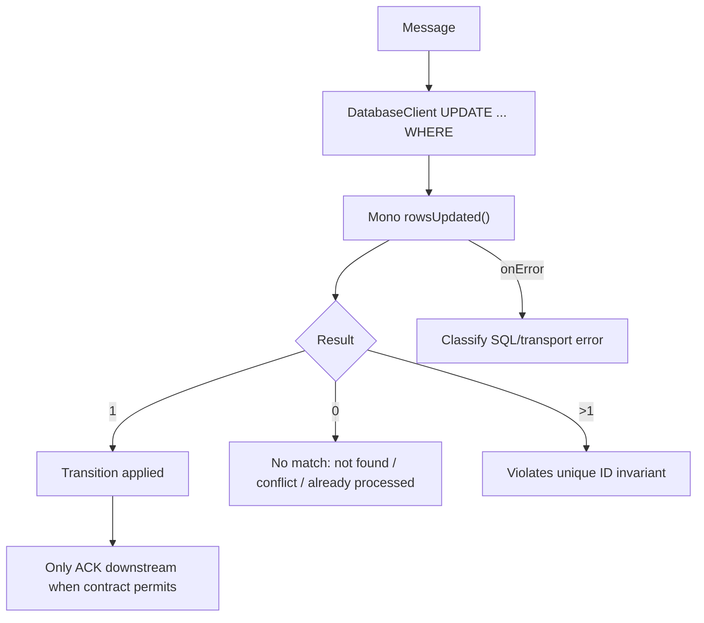
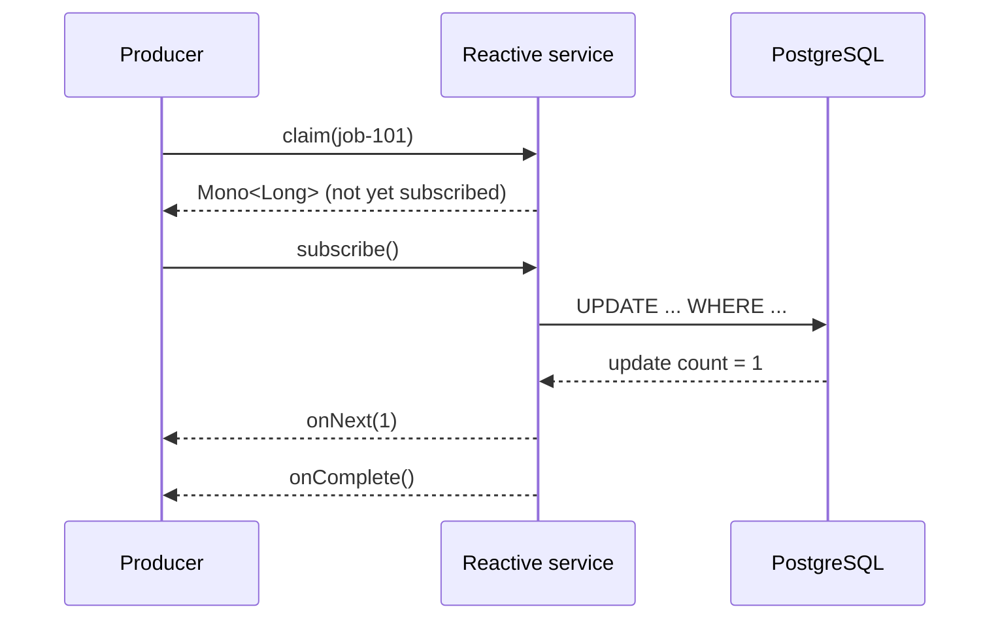
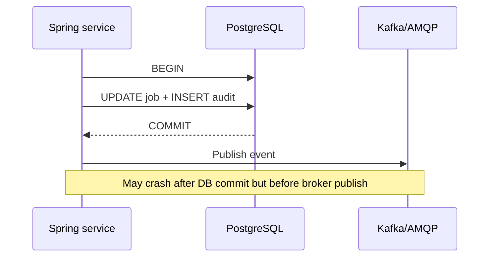
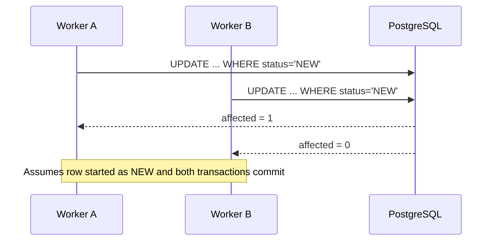

# Reactive updates and affected rows

> **Chapter:** R2DBC Adapter  
> **Module:** SPRING_INTEGRATION_ADAPTERS  
> **Module context:** Connect external systems to Spring Integration using inbound/outbound adapters, gateways, pollers, and MessageChannels. Practice exchange flows over files, SFTP, HTTP, JMS, AMQP, Kafka, and databases; focus on message contracts, error handling, and connection lifecycles.

## 1. Learning Objectives

After this lesson, you will be able to:

- Explain that a **reactive UPDATE** is an SQL operation that executes only when the reactive Publisher is subscribed, and **affected rows** is the number of rows the database reports were modified.
- Distinguish between `0`, `1`, `>1`, and **onError** results; avoid equating row counts directly with business states.
- Write conditional `UPDATE ... WHERE ...` statements with `DatabaseClient`, using `fetch().rowsUpdated()` to obtain `Mono<Long>`.
- Configure `R2dbcEntityTemplate.update(...).matching(...).apply(...)` with Spring Data `Criteria` and `Update`, also returning `Mono<Long>`.
- Use optimistic locking (`@Version` or `version=:expected` criteria), compare-and-set, and affected-row checks to prevent lost updates.
- Understand the difference between the **R2DBC outbound channel adapter** `R2dbcMessageHandler` (typically completing with `Mono<Void>`) and a custom service that needs to **return row counts**.
- Design state transitions `NEW → PROCESSING → DONE` with owner/token, idempotency, and handling timeouts with unknown outcomes.
- Configure reactive transactions with `TransactionalOperator` to update data and write audit logs atomically.
- Perform PostgreSQL `UPDATE ... RETURNING` when you need the **updated row**, not just the row count.
- Test with `StepVerifier`/PostgreSQL, handle pool/lock/transaction/retry errors, and monitor activity in Spring Integration flows.

## 2. Scenario: a Spring Message requests a database update

An inbound adapter receives an order processing notification from HTTP, JMS, AMQP, or Kafka. Spring Integration routes the notification to a service that updates job state in PostgreSQL:

```text
Command: CLAIM(job-101, worker-A)
SQL:     UPDATE delivery_jobs
         SET status='PROCESSING', claim_owner='worker-A'
         WHERE job_id='job-101' AND status='NEW'

Possible outcomes:
  affected rows = 1 -> SQL updated exactly one row
  affected rows = 0 -> no row matched the condition
  error             -> no valid DML result to interpret
```

This is why **affected rows** matter. An UPDATE statement that throws no SQL error **does not prove** it modified the row business logic expected.



**Principle:** the affected-row count is a signal **from the SQL statement**, whereas business ACK, delivery to external systems, and cross-system consistency must be decided separately.

### 2.1. Three layers of an update

| Layer | Unit | Question |
| --- | --- | --- |
| **Spring Integration** | `Message<ClaimCommand>` and `MessageChannel` | Was the command delivered to the handler? |
| **R2DBC / SQL** | `Mono<Long>` from `rowsUpdated()` | Did the UPDATE finish? How many rows were affected? |
| **Business** | `ClaimOutcome`/ACK | Was the right job claimed by the right owner, and can downstream work proceed? |

A message placed onto a `MessageChannel` is not proof the database committed. A completed UPDATE statement is not proof downstream HTTP/Kafka/AMQP processed it.

## 3. What exactly are affected rows?

When the database processes an `UPDATE`, the driver can report the **update count**, i.e., the number of rows reported as affected by the SQL statement. With Spring Framework 6.x `DatabaseClient`:

```java
Mono<Long> updated = databaseClient
        .sql("UPDATE delivery_jobs SET status = 'DONE' " +
             "WHERE job_id = :jobId AND status = 'PROCESSING'")
        .bind("jobId", "job-101")
        .fetch()
        .rowsUpdated();
```

This is a **Publisher**. Declaring `Mono<Long>` does not mean the query has executed; subscription triggers the operation.

### 3.1. Interpreting the four result types

| Result | What can be concluded | What cannot be concluded |
| --- | --- | --- |
| **`1`** | The database reported exactly one row matched and was affected by the UPDATE. | Does not prove external systems ACKed or that the business command had never run previously. |
| **`0`** | No row matched all UPDATE criteria at the time the statement took effect. | Cannot conclude `job_id` does not exist; status/version/owner may have changed. |
| **`>1`** | Multiple rows satisfied the condition (if the query allows it). | Do not treat as success when business logic permits only one record. |
| **`onError`** | The statement/DB access failed along the pipeline. | Cannot conclude the transaction definitely rolled back if the error/timeout occurred near commit time. |

**Subtle detail:** in PostgreSQL, `UPDATE` can report a row as updated even when the SET values equal the existing values. Therefore **affected rows do not necessarily equal rows whose values actually changed**. Define valid state transitions with `WHERE` and business invariants.

### 3.2. Distinguishing 0 rows from an SQL error

Example:

```sql
UPDATE delivery_jobs
SET status = 'PROCESSING'
WHERE job_id = 'not-exists' AND status = 'NEW';
```

If no row matches, the normal result is **0 affected rows** and the statement completes. Conversely, missing columns, constraint violations, DB down, or permission denied are **errors**, not `0`.

In Reactor:

- `Mono.just(0L)`: data signal with value `0`.
- `Mono.just(1L)`: data signal with value `1`.
- `Mono.error(exception)`: error.
- `Mono.empty()`: emits no element; **does not mean `0`**.

Do not use `defaultIfEmpty(0L)` to mask errors; `onError` is not an empty `onComplete`.

### 3.3. Dialect and driver effects

Returned row counts depend on the R2DBC driver contract, SQL dialect, and how `Result` is consumed. In this lesson, examples target PostgreSQL and Spring Framework 6.x. Special statements, stored procedures, batches, or SQL returning multiple result sets must be **tested against the real driver** before using counts for business decisions.

## 4. Reactive R2DBC: SQL executes upon subscription



`DatabaseClient`, `R2dbcEntityTemplate`, and many Spring Data R2DBC methods return **cold Publishers**. When subscribed again, the SQL **can run again**.

```java
Mono<Long> claim = repository.claim("job-101", "worker-A");

// Here we only created a Publisher.
// This does not prove the SQL has executed.

Mono<String> result = claim.map(count ->
        count == 1L ? "CLAIMED" : "NOT_CLAIMED");
```

If the same `claim` is subscribed twice, two UPDATE commands may run at two different times; for example, the first returns `1` and the second returns `0` because the status transitioned from `NEW` to `PROCESSING`.

**Do not call `subscribe()` arbitrarily** inside repositories/services. Return the Publisher to Spring WebFlux, a reactive message handler, or the caller responsible for subscribing and coordinating completion/errors.

### 4.1. Why can retries replay an UPDATE?

`retryWhen(...)` essentially re-subscribes to the source on error. If the earlier UPDATE already committed but the client hit a timeout/connection reset before receiving the update count, the retry runs the SQL again.

With a **`NEW → PROCESSING`** transition, the conditional WHERE usually causes the retry to return `0` after the first attempt succeeded. Still, `0` must be **reconciled against owner/token** to tell "I already claimed it" apart from "someone else claimed it".

With `SET balance = balance + 100`, a retry can **add twice**. Never assume an UPDATE is idempotent simply because it is wrapped in a `Mono`.

## 5. Preparing the Spring Boot and PostgreSQL application

Examples target **Java 17+, Spring Boot 3.x, Spring Framework 6.x, Spring Data R2DBC 3.x, and Spring Integration 6.1+**. Keep dependency versions compatible via the Spring Boot BOM; verify exact APIs for other versions when deploying.

### 5.1. Maven dependencies

```xml
<dependencies>
    <dependency>
        <groupId>org.springframework.boot</groupId>
        <artifactId>spring-boot-starter-integration</artifactId>
    </dependency>
    <dependency>
        <groupId>org.springframework.boot</groupId>
        <artifactId>spring-boot-starter-data-r2dbc</artifactId>
    </dependency>
    <dependency>
        <groupId>org.springframework.integration</groupId>
        <artifactId>spring-integration-r2dbc</artifactId>
    </dependency>
    <dependency>
        <groupId>org.postgresql</groupId>
        <artifactId>r2dbc-postgresql</artifactId>
        <scope>runtime</scope>
    </dependency>
    <dependency>
        <groupId>io.projectreactor</groupId>
        <artifactId>reactor-test</artifactId>
        <scope>test</scope>
    </dependency>
</dependencies>
```

To use an R2DBC pool, you may also need `io.r2dbc:r2dbc-pool` depending on your project's configuration/BOM. Do not confuse the R2DBC PostgreSQL driver with the JDBC driver.

### 5.2. R2DBC configuration

Example `application.yml`:

```yaml
spring:
  r2dbc:
    url: r2dbc:postgresql://127.0.0.1:5432/integration_demo
    username: ${DB_USER}
    password: ${DB_PASSWORD}
```

These are Spring Boot placeholders read from **environment variables**, not real passwords stored in the repository. Production environments need TLS, authentication, least-privilege database users, and proper secrets management.

### 5.3. The delivery_jobs table

Create the following schema in the **test** database:

```sql
CREATE TABLE delivery_jobs (
    job_id          VARCHAR(64) PRIMARY KEY,
    status          VARCHAR(24) NOT NULL DEFAULT 'NEW',
    payload_json    TEXT NOT NULL,
    claim_owner     VARCHAR(64),
    claim_token     VARCHAR(64),
    attempt_count   INTEGER NOT NULL DEFAULT 0,
    version         BIGINT NOT NULL DEFAULT 0,
    updated_at      TIMESTAMPTZ NOT NULL DEFAULT NOW(),
    processed_at    TIMESTAMPTZ
);

CREATE INDEX idx_jobs_status_updated
    ON delivery_jobs(status, updated_at, job_id);

INSERT INTO delivery_jobs(job_id, status, payload_json)
VALUES
    ('job-101', 'NEW', '{"deviceId":"sensor-01"}'),
    ('job-102', 'NEW', '{"deviceId":"sensor-02"}'),
    ('job-103', 'DONE', '{"deviceId":"sensor-03"}');
```

Conventions:

| Field | Role |
| --- | --- |
| `job_id` | Business unique key; `PRIMARY KEY` ensures updating one ID affects at most one row. |
| `status` | Status `NEW`, `PROCESSING`, `DONE`, `RETRY`, or `DEAD`. |
| `claim_owner` | Worker assigned to process the job. |
| `claim_token` | Stable token for **one claim request** to reconcile retries. |
| `attempt_count` | Number of recorded claim attempts. |
| `version` | Version for optimistic concurrency. |
| `updated_at` | Tracks last modification time. |
| `processed_at` | Timestamp when business processing completed. |

This schema is for learning. Recovering from worker crashes requires adding **lease_until**, claim timeouts, attempt policies, and a sweep mechanism for stuck tasks; `PROCESSING` alone is not enough for production systems.

### 5.4. DTOs and statuses

Create `ClaimCommand.java`:

```java
public record ClaimCommand(
        String jobId,
        String workerId,
        String claimToken
) {
}
```

Create two files `ClaimStatus.java` and `ClaimOutcome.java` (each `public` type in its own file):

```java
public enum ClaimStatus {
    CLAIMED,
    NOT_CLAIMED,
    ALREADY_APPLIED,
    CONFLICT
}
```

```java
public record ClaimOutcome(
        String jobId,
        ClaimStatus status,
        long affectedRows
) {
}
```

In Java, each `public` type requires its own file matching the type name; these snippets are shown separately for clarity. `affectedRows` is the metric from SQL, while `ClaimStatus` is how the application **interprets** that metric per contract.

## 6. DatabaseClient UPDATE and Mono<Long>

### 6.1. Repository performing claims

Create `DeliveryJobRepository.java`:

```java
import org.springframework.r2dbc.core.DatabaseClient;
import org.springframework.stereotype.Repository;
import reactor.core.publisher.Mono;

@Repository
public class DeliveryJobRepository {

    private final DatabaseClient db;

    public DeliveryJobRepository(DatabaseClient db) {
        this.db = db;
    }

    public Mono<Long> tryClaim(ClaimCommand cmd) {
        requireValid(cmd);

        return db.sql(
                        "UPDATE delivery_jobs " +
                        "SET status = 'PROCESSING', " +
                        "    claim_owner = :owner, " +
                        "    claim_token = :token, " +
                        "    attempt_count = attempt_count + 1, " +
                        "    version = version + 1, " +
                        "    updated_at = CURRENT_TIMESTAMP " +
                        "WHERE job_id = :id AND status = 'NEW'")
                .bind("id", cmd.jobId())
                .bind("owner", cmd.workerId())
                .bind("token", cmd.claimToken())
                .fetch()
                .rowsUpdated();
    }

    private static void requireValid(ClaimCommand cmd) {
        if (cmd == null
                || !valid(cmd.jobId())
                || !valid(cmd.workerId())
                || !valid(cmd.claimToken())) {
            throw new IllegalArgumentException(
                    "Invalid job/worker/token");
        }
    }

    private static boolean valid(String value) {
        return value != null
                && value.matches("[A-Za-z0-9_-]{1,64}");
    }
}
```

**Step-by-step explanation:**

1. `sql(...)` defines the UPDATE with named parameters.
2. `WHERE job_id=:id AND status='NEW'` is the **compare-and-set condition**.
3. `bind(...)` safely passes values; never concatenate raw input IDs into SQL.
4. `attempt_count = attempt_count + 1` runs only when the WHERE clause matches.
5. `version = version + 1` increments the version on each successful claim.
6. `fetch().rowsUpdated()` returns `Mono<Long>`; SQL executes upon subscription.
7. `1` means one row was updated; `0` requires reconciliation—do not assume the command definitely failed.

**Warning:** Java `requireValid(...)` here throws synchronously **before returning a Mono** if input is invalid. That is intentional synchronous validation; post-subscription DB errors still arrive via `onError` on the Publisher.

### 6.2. A simpler conditional UPDATE

To study the difference between row counts and business outcomes:

```java
Mono<Long> affected = db.sql(
                "UPDATE delivery_jobs " +
                "SET status = 'DONE', processed_at = CURRENT_TIMESTAMP " +
                "WHERE job_id = :id AND status = 'PROCESSING'")
        .bind("id", "job-101")
        .fetch()
        .rowsUpdated();
```

If `job-101` is still `NEW`, this query **does not** update; count = `0`. No SQL error occurs. Do not immediately append `affected.then()` if callers need to distinguish 0 vs. 1, because `then()` **discards the count value** and keeps only complete/error signals.

### 6.3. Interpreting affected rows

```java
public Mono<ClaimOutcome> claimOnce(ClaimCommand cmd) {
    return tryClaim(cmd)
            .map(count -> {
                if (count == 1L) {
                    return new ClaimOutcome(
                            cmd.jobId(), ClaimStatus.CLAIMED, count);
                }
                if (count == 0L) {
                    return new ClaimOutcome(
                            cmd.jobId(), ClaimStatus.NOT_CLAIMED, count);
                }
                throw new IllegalStateException(
                        "Expected at most one affected row: " + count);
            });
}
```

This is an **additional method in `DeliveryJobRepository`**, calling `tryClaim(...)` above. With `PRIMARY KEY(job_id)`, `count>1` is an alarming invariant violation; never silently treat it as success.

`NOT_CLAIMED` is an initial technical outcome; section 7 distinguishes **already claimed by myself**, **claimed by someone else**, and **not found**.

## 7. Why doesn't 0 affected rows mean NOT_FOUND?

Suppose `tryClaim("job-101")` returns 0. There are at least four possibilities:

1. `job-101` does not exist.
2. `job-101` is already `DONE`.
3. Another worker claimed it and moved it to `PROCESSING`.
4. **This exact request succeeded earlier**, but the DB response was lost and the caller retried with the same `claimToken`.

Therefore you must not return `404 Not Found` solely from `count=0`. A subsequent state read can help interpret it:

```java
public record ClaimSnapshot(
        String status,
        String owner,
        String token
) {
}
```

Add to `DeliveryJobRepository`:

```java
public Mono<ClaimSnapshot> findClaimSnapshot(String jobId) {
    return db.sql(
                    "SELECT status, claim_owner, claim_token " +
                    "FROM delivery_jobs WHERE job_id = :id")
            .bind("id", jobId)
            .map((row, metadata) -> new ClaimSnapshot(
                    row.get("status", String.class),
                    row.get("claim_owner", String.class),
                    row.get("claim_token", String.class)
            ))
            .one();
}
```

`Mono.empty()` here represents a non-existent row. That differs from an UPDATE's `Mono.just(0L)`.

### 7.1. Reconciling by token

```java
public Mono<ClaimOutcome> claimAndReconcile(ClaimCommand cmd) {
    return tryClaim(cmd).flatMap(count -> {
        if (count == 1L) {
            return Mono.just(new ClaimOutcome(
                    cmd.jobId(), ClaimStatus.CLAIMED, count));
        }
        if (count != 0L) {
            return Mono.error(new IllegalStateException(
                    "Unexpected update count=" + count));
        }

        return findClaimSnapshot(cmd.jobId())
                .map(row -> {
                    boolean sameClaim =
                            "PROCESSING".equals(row.status())
                            && cmd.workerId().equals(row.owner())
                            && cmd.claimToken().equals(row.token());

                    return new ClaimOutcome(
                            cmd.jobId(),
                            sameClaim
                                    ? ClaimStatus.ALREADY_APPLIED
                                    : ClaimStatus.CONFLICT,
                            0L);
                })
                .defaultIfEmpty(new ClaimOutcome(
                        cmd.jobId(), ClaimStatus.NOT_CLAIMED, 0L));
    });
}
```

**This is an illustrative reconciliation pattern.** It inspects state at a point in time; it does **not** merge the UPDATE + SELECT into a single transaction immune to all races. In a multi-worker system, state can still change after the SELECT. The example also intentionally classifies `DONE` as `CONFLICT` even with the same token; production must define how to recognize already-completed requests, such as via durable idempotency records/results. For strongly consistent results, design appropriate transactions/isolation or an `UPDATE ... RETURNING` SQL contract.

`claimToken` must remain stable across retries of **the same request**. If every attempt generates a new token, you cannot distinguish a successful claim whose reply was lost from a completely separate claim.

### 7.2. ACK rules by ClaimOutcome

| ClaimStatus | Meaning | What to do next |
| --- | --- | --- |
| `CLAIMED` | The current UPDATE affected exactly one row. | Worker may begin processing per contract. |
| `ALREADY_APPLIED` | No UPDATE this time, DB shows the same token/owner owns it. | Can proceed/reconcile per idempotency policy. |
| `CONFLICT` | Row exists but is no longer in the expected status/owner. | Do not process on someone else's behalf; return conflict or log for investigation. |
| `NOT_CLAIMED` | After count 0, row was not found. | Can return not found per contract, accounting for races/consistency. |
| **onError/timeout** | No reliable SQL result. | Do not blindly mark success/failure; keep status unknown and reconcile. |

Row count is an **input** to a decision, not the entire decision.

## 8. R2dbcEntityTemplate: updating with Criteria and Update

Spring Data R2DBC offers a fluent entity API:

```java
import org.springframework.data.r2dbc.core.R2dbcEntityTemplate;
import org.springframework.data.relational.core.query.Criteria;
import org.springframework.data.relational.core.query.Query;
import org.springframework.data.relational.core.query.Update;
import reactor.core.publisher.Mono;

public Mono<Long> markDone(
        R2dbcEntityTemplate template,
        String jobId) {

    Query filter = Query.query(
            Criteria.where("job_id").is(jobId)
                    .and("status").is("PROCESSING"));

    Update changes = Update.update("status", "DONE");

    return template.update(DeliveryJob.class)
            .matching(filter)
            .apply(changes);
}
```

This example assumes `DeliveryJob.class` is mapped with `@Table("delivery_jobs")` and matching columns. `.apply(changes)` returns **`Mono<Long>` of UPDATED rows**, not the modified entity.

### 8.1. Entity for Spring Data mapping

```java
import org.springframework.data.annotation.Id;
import org.springframework.data.relational.core.mapping.Column;
import org.springframework.data.relational.core.mapping.Table;

@Table("delivery_jobs")
public record DeliveryJob(
        @Id @Column("job_id") String jobId,
        String status,
        @Column("claim_owner") String claimOwner,
        @Column("version") Long version
) {
}
```

`R2dbcEntityTemplate` uses converters/metadata to resolve table/column names. `DatabaseClient` with raw SQL uses the column names you write explicitly. **Do not mix Java property names with SQL column names** without clear mapping/naming strategies.

### 8.2. Query + Update without preloading the entity

In `markDone(...)`, you do not need to SELECT the entity before updating. `UPDATE WHERE status='PROCESSING'` runs directly, saving a round trip compared to:

```text
SELECT row;
if status == PROCESSING:
    UPDATE row;
```

The SELECT-then-UPDATE pattern without a condition in the UPDATE is prone to **time-of-check/time-of-use races** if another worker changes status in between. Pushing preconditions into SQL `WHERE` lets the database evaluate them atomically at update time.

### 8.3. Template update(entity) vs. update().matching().apply()

The two APIs serve different needs:

| API | Return type | When to use |
| --- | --- | --- |
| `template.update(entity)` | Saved `Mono<Entity>` per Spring Data API. | When you hold an entity with ID/version metadata and want the entity back. |
| `template.update(Entity.class).matching(query).apply(update)` | `Mono<Long>`. | When updating conditionally and inspecting **affected rows**. |
| `DatabaseClient.sql(...).fetch().rowsUpdated()` | `Mono<Long>`. | When you need exact SQL, atomic increments, CTEs, or dialect-specific clauses. |
| `DatabaseClient.sql("UPDATE ... RETURNING ...").map(...).one()` | `Mono<ResultRow>`. | When you need the new row data back from PostgreSQL. |

Choose the API based on the **result contract**, not merely shorter syntax.

## 9. Optimistic locking and version

### 9.1. The lost update problem

Two workers read the same row with `version=3`:

```text
Worker A reads status=NEW, version=3
Worker B reads status=NEW, version=3
Worker A writes PROCESSING, version=4
Worker B also overwrites with another value if version is not checked
```

If UPDATE matches only `job_id`, the later worker can overwrite the earlier worker's update. **Optimistic locking** puts version in `WHERE`:

```sql
UPDATE delivery_jobs
SET status = 'PROCESSING',
    version = version + 1,
    updated_at = CURRENT_TIMESTAMP
WHERE job_id = :id
  AND version = :expectedVersion
  AND status = 'NEW';
```

- `count=1`: claim succeeded via compare-and-set.
- `count=0`: row missing or version/status already changed.
- `onError`: another DB/SQL error—never lump together with conflict.

### 9.2. DatabaseClient checking expected version

```java
public Mono<Long> claimWithVersion(
        String jobId,
        long expectedVersion,
        String owner) {

    return db.sql(
                    "UPDATE delivery_jobs " +
                    "SET status='PROCESSING', " +
                    "    claim_owner=:owner, " +
                    "    version=version+1, " +
                    "    updated_at=CURRENT_TIMESTAMP " +
                    "WHERE job_id=:id AND version=:version " +
                    "AND status='NEW'")
            .bind("id", jobId)
            .bind("owner", owner)
            .bind("version", expectedVersion)
            .fetch()
            .rowsUpdated();
}
```

This is an additional method in `DeliveryJobRepository`. If an idempotency token is needed, add `claim_token=:token` to SET and a reconciliation path on count 0.

### 9.3. @Version in Spring Data R2DBC

Spring Data supports `@Version` when updating an aggregate/entity. Example versioned entity class:

```java
import org.springframework.data.annotation.Id;
import org.springframework.data.annotation.Version;
import org.springframework.data.relational.core.mapping.Column;
import org.springframework.data.relational.core.mapping.Table;

@Table("delivery_jobs")
public class VersionedJob {

    @Id
    @Column("job_id")
    private String jobId;

    private String status;

    @Version
    private Long version;

    public String getJobId() { return jobId; }
    public void setJobId(String value) { this.jobId = value; }

    public String getStatus() { return status; }
    public void setStatus(String value) { this.status = value; }

    public Long getVersion() { return version; }
    public void setVersion(Long value) { this.version = value; }
}
```

When updating a previously loaded entity:

```java
Mono<VersionedJob> saved = template.update(existingVersionedJob);
```

Spring Data automatically applies the version constraint when updating the entity per mapping, and can emit `OptimisticLockingFailureException` when the version no longer matches.

**Distinction:**

- `template.update(entity)` with `@Version`: returns the entity or **`onError` from optimistic locking** per API.
- `DatabaseClient` with hand-written UPDATE + WHERE version: returns `0` rows on mismatch; the application translates that into a conflict.
- Fluent `template.update(Entity.class).matching(...).apply(...)`: returns affected-row count; does not automatically throw an exception like updating a `@Version` entity.

Do not construct a fresh `VersionedJob` with arbitrary ID/version expecting Spring Data to know the entity already exists; understand new-entity detection and metadata rules when using `save`/`insert`/`update`.

## 10. PostgreSQL UPDATE RETURNING: getting new rows instead of counts

PostgreSQL supports:

```sql
UPDATE delivery_jobs
SET status = 'PROCESSING',
    claim_owner = :owner,
    claim_token = :token,
    version = version + 1,
    attempt_count = attempt_count + 1,
    updated_at = CURRENT_TIMESTAMP
WHERE job_id = :id AND status = 'NEW'
RETURNING job_id, status, claim_owner, version;
```

`RETURNING` is useful when you want **post-UPDATE values** without running a separate SELECT. Use `DatabaseClient.map(...).one()` to read the returned row:

```java
public record ClaimReceipt(
        String jobId,
        String status,
        String owner,
        Long version
) {
}
```

```java
public Mono<ClaimReceipt> claimReturning(ClaimCommand cmd) {
    return db.sql(
                    "UPDATE delivery_jobs " +
                    "SET status='PROCESSING', " +
                    "    claim_owner=:owner, claim_token=:token, " +
                    "    attempt_count=attempt_count+1, " +
                    "    version=version+1, " +
                    "    updated_at=CURRENT_TIMESTAMP " +
                    "WHERE job_id=:id AND status='NEW' " +
                    "RETURNING job_id, status, claim_owner, version")
            .bind("id", cmd.jobId())
            .bind("owner", cmd.workerId())
            .bind("token", cmd.claimToken())
            .map((row, metadata) -> new ClaimReceipt(
                    row.get("job_id", String.class),
                    row.get("status", String.class),
                    row.get("claim_owner", String.class),
                    row.get("version", Long.class)
            ))
            .one();
}
```

This is a method in `DeliveryJobRepository`. Because of `WHERE job_id=:id` and the PK, the query returns at most one row. If no row matches, it returns `Mono.empty()`; clients can use `switchIfEmpty(...)` to produce `NOT_CLAIMED` or reconcile.

### 10.1. RETURNING vs. rowsUpdated()

| Goal | Method |
| --- | --- |
| Need only the UPDATE count | `.fetch().rowsUpdated()`. |
| Need new status/version from PostgreSQL | `UPDATE ... RETURNING` + `.map(...).one()`. |
| Need multiple bulk-updated rows | `UPDATE ... RETURNING` + `.map(...).all()`. |

Do not call `rowsUpdated()` expecting data from `RETURNING`. The two ways of consuming `Result` have **different value contracts**. For non-PostgreSQL SQL, `RETURNING` support and exact syntax vary by dialect.

### 10.2. RETURNING does not replace transactions outside the DB

A `ClaimReceipt` describes the result of an SQL update. It does not prove publishing that info to Kafka/AMQP succeeded. If you need to emit a claim event, write an **outbox** row in the same SQL transaction and have a separate component forward it to the broker.

## 11. R2DBC outbound channel adapter: why is there no affected rows reply?

Spring Integration's `R2dbcMessageHandler` is a **`ReactiveMessageHandler`** for executing `INSERT`, `UPDATE`, or `DELETE` from a Spring Message. Java DSL can define the endpoint:

```java
import java.util.Map;

import org.springframework.context.annotation.Bean;
import org.springframework.context.annotation.Configuration;
import org.springframework.data.r2dbc.core.R2dbcEntityTemplate;
import org.springframework.data.relational.core.query.Criteria;
import org.springframework.integration.config.EnableIntegration;
import org.springframework.integration.dsl.IntegrationFlow;
import org.springframework.integration.r2dbc.dsl.R2dbc;
import org.springframework.integration.r2dbc.outbound.R2dbcMessageHandler;
import org.springframework.messaging.Message;

@Configuration
@EnableIntegration
public class JobR2dbcOutboundConfiguration {

    @Bean
    IntegrationFlow claimWriteFlow(R2dbcEntityTemplate template) {
        return IntegrationFlow
                .from("claimWriteChannel")
                .handleReactive(
                        R2dbc.outboundChannelAdapter(template)
                                .queryType(R2dbcMessageHandler.Type.UPDATE)
                                .tableName("delivery_jobs")
                                .criteria((Message<ClaimCommand> msg) ->
                                        Criteria.where("job_id")
                                                .is(msg.getPayload().jobId())
                                                .and("status").is("NEW"))
                                .values((Message<ClaimCommand> msg) ->
                                        Map.of(
                                                "status", "PROCESSING",
                                                "claim_owner",
                                                    msg.getPayload().workerId(),
                                                "claim_token",
                                                    msg.getPayload().claimToken()
                                        ))
                )
                .get();
    }
}
```

### 11.1. What the adapter does

- Receives a `Message<ClaimCommand>` from the channel.
- Generates an UPDATE using `tableName`, `criteria`, and `values`.
- Uses Spring Data R2DBC via a reactive **Publisher**.
- `handleReactive(...)` (Spring Integration 6.1+) manages subscription per the `ReactiveMessageHandler` contract.
- The endpoint typically completes with **`Mono<Void>`**, **without automatically emitting a Spring reply carrying `rowsUpdated`**.

### 11.2. What the adapter does not do automatically

- Does not emit `ClaimOutcome` distinguishing counts 0, 1, >1.
- Does not guarantee `void publish(...)` on a `@MessagingGateway` waited for a database commit.
- Does not automatically provide multi-table transactions or broker-wide exactly-once delivery.
- Does not automatically deduplicate retries of a write command.
- Does not replace a custom reactive service when callers need strict affected-row checks.

In section 11's example, an UPDATE affecting **0 rows** can still complete SQL without error. If business logic must treat **count=0** as a conflict, do not use an outbound adapter that discards the row count.

### 11.3. When affected rows are needed in Spring Integration

There are two design options:

**Option A — handle business logic in a reactive service** and expose the result via an API/flow with a response:

```text
Input ClaimCommand
  -> ClaimService.claim() returns Mono<ClaimOutcome>
  -> caller subscribes / checks outcome
  -> continues workflow when CLAIMED or ALREADY_APPLIED
```

**Option B — one-way yet still evaluates row count before completing**: write a custom `ReactiveMessageHandler` that calls the repository, records metrics, signals an error if needed, and returns `Mono<Void>`. Still, this endpoint **is not a request-reply gateway**.

### 11.4. Custom ReactiveMessageHandler checking count

```java
import org.springframework.context.annotation.Bean;
import org.springframework.context.annotation.Configuration;
import org.springframework.integration.config.EnableIntegration;
import org.springframework.integration.dsl.IntegrationFlow;
import org.springframework.messaging.ReactiveMessageHandler;
import reactor.core.publisher.Mono;

@Configuration
@EnableIntegration
public class CheckedClaimFlowConfiguration {

    @Bean
    IntegrationFlow checkedClaimFlow(DeliveryJobRepository repository) {

        ReactiveMessageHandler handler = message -> {
            ClaimCommand cmd = (ClaimCommand) message.getPayload();

            return repository.tryClaim(cmd)
                    .flatMap(count -> {
                        if (count == 1L) {
                            // External side effects start only after
                            // the UPDATE completes per this Publisher.
                            return Mono.<Void>empty();
                        }

                        if (count == 0L) {
                            return Mono.error(new IllegalStateException(
                                    "Claim was not applied: " + cmd.jobId()));
                        }

                        return Mono.error(new IllegalStateException(
                                "Unexpected affected rows: " + count));
                    });
        };

        return IntegrationFlow.from("checkedClaimChannel")
                .handleReactive(handler)
                .get();
    }
}
```

**Important:** The handler above only expresses a **policy where count 1 is considered success**; a count of 0 might actually be a retry of an already successful claim. Production needs `claimAndReconcile(...)` or proper transaction/idempotency logic, not just throwing an exception. This handler is a **terminal one-way endpoint**; `Mono<Void>` only completes/errors and does not return `ClaimOutcome` as a Spring reply.

If callers need a `ClaimOutcome`, build an appropriate request-reply service/gateway and make sure you do not return an **unsubscribed `Mono`** as a payload. The boundary between reactive publishers and Spring Message replies must be designed intentionally, not assumed from `handleReactive`.

## 12. Reactive transactions: committing UPDATE and audit together

### 12.1. Why is a single statement with count=1 not enough?

Suppose upon a successful claim the system must write an **audit row**. If the UPDATE succeeds and then the audit INSERT fails, we do not want the job status changed without an audit trail.

Use a DB transaction to protect **both SQL statements sharing the same R2DBC resource**.

Create table:

```sql
CREATE TABLE delivery_job_audit (
    audit_id    BIGSERIAL PRIMARY KEY,
    job_id      VARCHAR(64) NOT NULL,
    claim_token VARCHAR(64) NOT NULL,
    action      VARCHAR(32) NOT NULL,
    created_at  TIMESTAMPTZ NOT NULL DEFAULT NOW(),
    CONSTRAINT uq_job_claim_audit UNIQUE (job_id, claim_token, action)
);
```

### 12.2. Creating TransactionalOperator

If the application has a `ReactiveTransactionManager` for the same R2DBC ConnectionFactory:

```java
import org.springframework.context.annotation.Bean;
import org.springframework.context.annotation.Configuration;
import org.springframework.transaction.ReactiveTransactionManager;
import org.springframework.transaction.reactive.TransactionalOperator;

@Configuration
public class R2dbcTransactionConfiguration {

    @Bean
    TransactionalOperator transactionalOperator(
            ReactiveTransactionManager manager) {
        return TransactionalOperator.create(manager);
    }
}
```

`TransactionalOperator` binds the reactive transaction to the **Reactor Context/subscription**; it is not equivalent to a thread-local JDBC transaction that can magically span HTTP/Kafka.

### 12.3. Service for update + audit

```java
import org.springframework.r2dbc.core.DatabaseClient;
import org.springframework.transaction.reactive.TransactionalOperator;
import reactor.core.publisher.Mono;

public class JobClaimTransactionService {

    private final DeliveryJobRepository jobs;
    private final DatabaseClient db;
    private final TransactionalOperator tx;

    public JobClaimTransactionService(
            DeliveryJobRepository jobs,
            DatabaseClient db,
            TransactionalOperator tx) {
        this.jobs = jobs;
        this.db = db;
        this.tx = tx;
    }

    public Mono<ClaimOutcome> claimWithAudit(ClaimCommand cmd) {

        Mono<ClaimOutcome> work = jobs.tryClaim(cmd)
                .flatMap(count -> {
                    if (count == 0L) {
                        return Mono.just(new ClaimOutcome(
                                cmd.jobId(), ClaimStatus.NOT_CLAIMED, 0L));
                    }

                    if (count != 1L) {
                        return Mono.error(new IllegalStateException(
                                "Unexpected affected rows: " + count));
                    }

                    return db.sql(
                                    "INSERT INTO delivery_job_audit " +
                                    "(job_id, claim_token, action) " +
                                    "VALUES (:id, :token, :action)")
                            .bind("id", cmd.jobId())
                            .bind("token", cmd.claimToken())
                            .bind("action", "CLAIMED")
                            .fetch()
                            .rowsUpdated()
                            .flatMap(auditCount -> {
                                if (auditCount != 1L) {
                                    return Mono.error(
                                            new IllegalStateException(
                                                    "Audit insert did not affect 1 row"));
                                }

                                return Mono.just(new ClaimOutcome(
                                        cmd.jobId(),
                                        ClaimStatus.CLAIMED, count));
                            });
                });

        return work.as(tx::transactional);
    }
}
```

**Preconditions for this example:**

- `DeliveryJobRepository` and `DatabaseClient` must use the same R2DBC transaction manager/connection factory.
- The UPDATE and audit INSERT sit in the **same reactive chain**; do not manually call `subscribe()` on each step.
- If the audit INSERT fails, the transaction rolls back the UPDATE via DB mechanics, preventing half-claimed jobs.
- `NOT_CLAIMED` in this example writes no audit and reflects only count 0; if you need to distinguish an already successful retry, use external reconciliation or an extended contract.
- A completed `Mono` means the reactive transaction finished per contract; you still must handle network errors where the caller **is unsure of the outcome** if the completion signal is lost.

### 12.4. Transactions protect only the database, not Kafka/HTTP



When reliable event emission is required, use a **transactional outbox** (write outbox in the same transaction as the UPDATE), a separate publisher, and idempotent consumers. Never describe a DB transaction as "exactly-once Kafka delivery".

## 13. Bulk UPDATE and multiple affected rows

### 13.1. When count > 1 is valid

Not every UPDATE is meant to touch only one row. For example, maintenance may move multiple `RETRY` jobs back to `NEW`:

```sql
UPDATE delivery_jobs
SET status = 'NEW', updated_at = CURRENT_TIMESTAMP
WHERE status = 'RETRY';
```

For this operation, a count of `10` can be completely valid. The business contract should specify:

- Whether the expected count has limits/thresholds.
- Whether the updated row IDs must be logged for audit.
- Whether permission policies govern bulk UPDATEs.
- Whether batch sizing is needed to avoid overly large locks/updates.
- Whether transactions/locks will slow down other workers.

### 13.2. Bounded-scope bulk UPDATE

To avoid uncontrolled UPDATEs on large tables, select IDs via a PostgreSQL CTE:

```sql
WITH candidates AS (
    SELECT job_id
    FROM delivery_jobs
    WHERE status = 'RETRY'
    ORDER BY updated_at, job_id
    LIMIT :limit
    FOR UPDATE SKIP LOCKED
)
UPDATE delivery_jobs AS j
SET status = 'NEW', updated_at = CURRENT_TIMESTAMP
FROM candidates
WHERE j.job_id = candidates.job_id
RETURNING j.job_id;
```

Here `RETURNING` yields the exact IDs updated. You can map them to `Flux<String>` and `collectList()` **once the batch is bounded**; the list length equals the number of returned rows. This is PostgreSQL-specific SQL and must be tested against a real database.

### 13.3. Affected count is not the number of messages in the flow

If `Flux<Message<ClaimCommand>>` contains 20 messages and each message runs its own UPDATE:

- There are **20 SQL statements** and 20 row counts, each potentially 0 or 1.
- The sum `sum(counts)` is the total rows affected by UPDATEs, not guaranteed to equal the message count.
- One message can update multiple rows if its WHERE clause is too broad.
- An exception mid-batch can leave downstream having processed part of the batch before failure.

Do not use `maxMessagesPerPoll(1)` to assume one UPDATE = one row. The poller limits message receives, not how many rows SQL affects.

## 14. Retries, mid-flight failures, and idempotency

### 14.1. Each error type leads to a different policy

| Event | Should retry? | Note |
| --- | --- | --- |
| Connection refused **before SQL executes** | Yes, with backoff and deadline. | If a prior attempt existed, still reconcile state. |
| DB restart mid-UPDATE | Depends on state, classify first. | Caller may not know whether statement/transaction committed. |
| Lock timeout/deadlock | Can retry the **whole** transaction when safe. | Limit attempts, backoff/jitter, protect idempotency. |
| Audit unique constraint | Do not blindly retry. | May indicate a reused token or invariant bug. |
| SQL wrong column/table | Do not auto-retry. | Fix migration/schema. |
| Count 0 | **Not an exception**. | Reconcile NOT_FOUND/CONFLICT/ALREADY_APPLIED. |
| Count > 1 on PK | Do not retry as transient. | Report invariant/data integrity bug. |
| Downstream HTTP ran but DB ACK did not | Needs idempotency/reconciliation. | Cannot infer side effects from update count alone. |

### 14.2. Bounded retry

Conceptual policy example:

```java
import java.time.Duration;

import org.springframework.dao.TransientDataAccessException;
import reactor.util.retry.Retry;

Mono<ClaimOutcome> operation = repository.claimAndReconcile(cmd)
        .retryWhen(
                Retry.backoff(2, Duration.ofMillis(200))
                        .maxBackoff(Duration.ofSeconds(2))
                        .filter(error ->
                                error instanceof TransientDataAccessException));
```

**This snippet illustrates calling `claimAndReconcile(cmd)` on the repository from section 7**, not a complete class. In Spring Data Access, only certain exceptions extend `TransientDataAccessException`; in practice inspect causes/SQLState and driver policies. Most importantly, `claimAndReconcile` must tolerate safe retries using a **stable token**, and if the outcome remains unclear after an error, reconcile before taking further action.

Do not retry infinitely, do not retry all `RuntimeException`s, and do not generate a new token for the same request.

### 14.3. Do not blindly retry balance increments

```sql
UPDATE wallet_accounts
SET balance = balance + :amount
WHERE account_id = :id;
```

If the first commit succeeded and the response was lost, a retry can **add twice**. A safe pattern requires a durably stored unique **operation ID**, ensuring the UPDATE and idempotency record commit in the same transaction; when the same operation ID arrives again, return the prior result instead of repeating the addition.

Never treat `affectedRows=1` as proof of "added only once across the entire request lifecycle".

### 14.4. Retry timeout is an unknown state

A failure timeline:

```text
Client sends UPDATE
      |
      v
Database UPDATES and COMMITS
      |
      v
Network drops before client receives count
      |
      v
Client sees timeout / error
```

In this situation, the client must not conclude "the UPDATE never happened". Without a `claimToken`, `version`, or state record for reconciliation, retrying can cause duplicate side effects.

**A business state of `UNKNOWN` is a valid choice** when verification is not yet possible, rather than returning a false success/failure.

## 15. Concurrency, row locks, and database isolation

### 15.1. Compare-and-set in a single UPDATE

With two workers trying to claim the same `job-101`:



In PostgreSQL with appropriate row-level locking/isolation, a conditional UPDATE lets the database serialize contention on the row. This is the foundation of compare-and-set.

**However:** do not use a prior SELECT to claim ownership of a row. The decisive outcome is the **conditional UPDATE/claim statement** and its completed affected-row count.

### 15.2. When processing many jobs: SKIP LOCKED

Multiple workers can claim disjoint rows via the PostgreSQL pattern:

```sql
WITH picked AS (
    SELECT job_id
    FROM delivery_jobs
    WHERE status = 'NEW'
    ORDER BY updated_at, job_id
    LIMIT :batchSize
    FOR UPDATE SKIP LOCKED
)
UPDATE delivery_jobs AS j
SET status = 'PROCESSING',
    attempt_count = attempt_count + 1,
    updated_at = CURRENT_TIMESTAMP
FROM picked
WHERE j.job_id = picked.job_id
RETURNING j.job_id;
```

This claims **a batch** in a single statement. To track owner/expiry, add worker ID/token/lease columns. `SKIP LOCKED` does not replace deadlines/post-downstream ACKs and does not grant eternal processing rights.

### 15.3. Essential transaction properties

| Concept | Key takeaway |
| --- | --- |
| **Atomic statement** | UPDATE + WHERE is evaluated by the database as one statement. |
| **Row lock** | Concurrent UPDATEs on the same row may wait on each other. |
| **Transaction** | Groups multiple statements to commit/roll back together. |
| **Isolation** | Controls visibility across transactions per DB policy. |
| **Optimistic lock** | `WHERE version=:expected` with 0 affected rows signals conflict. |
| **Lease** | Enables recovering tasks from disconnected/crashed workers. |
| **Outbox** | Delivers events to external systems reliably. |

Avoid keeping DB transactions open during slow HTTP/AMQP/Kafka calls, as that holds connections and locks long. Instead, separate **claim/commit**, **external processing**, and **ACK/update**.

## 16. Completion and ACK in Spring Integration

### 16.1. Multiple completion stages

```text
MessageChannel.send(...) returned
          |
          v
Reactive handler subscribed
          |
          v
UPDATE statement completed with row count
          |
          v
Reactive transaction completed / committed
          |
          v
Business command validated (CLAIMED / CONFLICT / ALREADY)
          |
          v
Downstream HTTP/Kafka/AMQP acknowledged, if needed
```

**Do not collapse these milestones into a single "success" state.** With an outbound channel adapter, a `void publish(...)` method may only prove the message entered the flow.

### 16.2. The application must define which ACK applies

| Contract | When to ACK? |
| --- | --- |
| "Command accepted into durable queue" | After enqueueing to durable broker/storage. |
| "Job UPDATED in database" | After transaction completion signal + expected outcome. |
| "Event published to broker" | After broker ACK, or per outbox contract. |
| "Final task processed" | After business side effects and durable status update. |

For events from JMS/AMQP/Kafka, auto-ACKing the source **before** SQL completion can lose events if the DB write fails. Inspect how the upstream connector applies ack/retry, synchronous/asynchronous channel topology, and reactive completion signals.

### 16.3. How to verify an update took effect

If the system needs to report **CLAIMED** to callers, design a request-reply API/service returning a strongly typed result:

```java
public interface ClaimService {
    Mono<ClaimOutcome> claim(ClaimCommand command);
}
```

The implementation can invoke `claimAndReconcile(...)` or a transaction service. When using a Spring Integration gateway, define how the **Publisher is subscribed** and **the outcome is returned as a reply**; do not return a `Mono` as a payload assuming a caller expects only `ClaimOutcome`.

## 17. Backpressure, pooling, and timeouts

### 17.1. Reactive does not make the database infinite

The R2DBC driver can perform async I/O, yet PostgreSQL still has limits:

- Number of DB connections in the pool.
- Transaction/row locks.
- Disk I/O, CPU, and network.
- Concurrent UPDATE statements.
- Connection/pool acquire wait times.
- Buffers in message channels or brokers.

If producers send 5,000 commands/s while the database handles 500/s, pending requests will pile up unless queues/concurrency are bounded.

### 17.2. Concurrency limiting example

If the application processes a `Flux<ClaimCommand>` batch:

```java
Flux<ClaimOutcome> outcomes = Flux.fromIterable(commands)
        .flatMap(
                command -> repository.claimAndReconcile(command),
                8
        );
```

This assumes `commands` is a validated collection of commands. `flatMap(..., 8)` limits concurrency to roughly **8 inner publishers** in this pipeline. It does **not** globally limit other producers in the app and can reorder results relative to input order.

If sequential ordering is mandatory:

```java
Flux<ClaimOutcome> ordered = Flux.fromIterable(commands)
        .concatMap(repository::claimAndReconcile);
```

Measure throughput, lock contention, latency, and memory. Never open unbounded pools/connections just to mask short-term wait times.

### 17.3. Types of timeouts

| Timeout | Scope |
| --- | --- |
| Connection timeout | Opening a connection to the DB. |
| Pool acquire timeout | Waiting for an idle connection. |
| Statement timeout | SQL running or waiting on locks too long. |
| Transaction timeout | Transaction exceeding its limit. |
| Reactor `timeout(...)` | Time limit per subscription/operator. |
| Business deadline | Total duration of the request and its attempts. |
| Broker ACK deadline | Deadline for responding to the event source. |

A client-side `Mono.timeout(...)` can cancel the subscription, yet it is **not** proof that the DB server rolled back. For side-effecting writes, idempotency and reconciliation are still required.

## 18. Observability: measuring both counts and outcomes

### 18.1. Useful metrics

| Suggested metric | Meaning |
| --- | --- |
| `r2dbc_update_attempt_total` | Total SQL UPDATEs initiated/subscribed. |
| `r2dbc_update_affected_total` | Total affected rows from completed UPDATEs. |
| `r2dbc_update_zero_total` | Number of count = 0 occurrences. |
| `r2dbc_update_multi_total` | Statements updating multiple rows when analysis is needed. |
| `r2dbc_update_error_total` | SQL/connection/constraint errors by type. |
| `r2dbc_update_latency_p95` | UPDATE latency. |
| `claim_conflict_total` | How many commands failed to win a claim. |
| `claim_already_applied_total` | How many retries matched a prior token. |
| `r2dbc_pool_active` / `r2dbc_pool_pending` | Pool capacity/waiting. |
| `transaction_rollback_total` | Number of transaction rollbacks. |
| `job_processing_expired_total` | Jobs stuck past lease/deadline. |
| `downstream_ack_lag` | Time from claim to completion of external action. |

These names are **suggestions**, not all automatically exported by Micrometer. Attach low-cardinality labels like **operation**, **status**, **error class** (never use high-cardinality raw job IDs as metric labels).

### 18.2. Logging must distinguish outcomes

```text
jobId=job-101 command=CLAIM attempt=1 affectedRows=1 outcome=CLAIMED
jobId=job-101 command=CLAIM attempt=2 affectedRows=0 outcome=ALREADY_APPLIED
jobId=job-102 command=CLAIM attempt=1 affectedRows=0 outcome=CONFLICT
jobId=job-103 command=CLAIM attempt=1 error=R2dbcTimeout outcome=UNKNOWN
```

This is an **illustrative log format**, not default Spring Integration output. Never log credentials, PII, secret tokens, or full JSON payloads. While claim token here is an idempotency identifier, restrict logging it if used as a capability token in real systems.

### 18.3. Instrumenting reactive completion at the right time

```java
Mono<Long> observed = repository.tryClaim(cmd)
        .doOnSubscribe(s -> metrics.started())
        .doOnNext(count -> metrics.recordAffected(count))
        .doOnError(error -> metrics.failed(error))
        .doFinally(signal -> metrics.finished(signal));
```

This snippet assumes a `metrics` service records measurements. `doFinally` observes `ON_COMPLETE`, `ON_ERROR`, or `CANCEL`; distinguish terminal signals carefully. **Do not increment "SQL succeeded" merely upon calling the method that returns `Mono`**.

## 19. Testing with StepVerifier and PostgreSQL

### 19.1. Test objectives

The test suite should verify:

- SQL UPDATE emits exact `0/1` counts.
- Query/transaction failures emit `onError` instead of count 0.
- Retrying with the same token after a successful claim can return `ALREADY_APPLIED`.
- Concurrent workers do not both receive `CLAIMED` for one `NEW` job.
- Audit INSERT failure rolls back the UPDATE.
- Callers do not ACK when the publisher has not completed or was cancelled.

Use PostgreSQL Testcontainers or an equivalent test environment to verify dialect, locking, and transactions. H2 R2DBC does not fully substitute for PostgreSQL when using `SKIP LOCKED` or `UPDATE RETURNING`.

### 19.2. Testing count = 1

JUnit example with an injected repository and a test database seeded with `job-101` in `NEW` status:

```java
import org.junit.jupiter.api.Test;
import reactor.test.StepVerifier;

@Test
void firstClaimAffectsOneRow() {
    ClaimCommand command =
            new ClaimCommand("job-101", "worker-A", "token-101");

    StepVerifier.create(repository.tryClaim(command))
            .expectNext(1L)
            .verifyComplete();
}
```

Snippet inside a test class having a `repository` field. Tests must use isolated database fixtures or roll back/clean up between runs.

### 19.3. Testing count = 0 from conditional update

After `job-101` is claimed, attempt to claim again:

```java
@Test
void secondClaimAffectsZeroRows() {
    ClaimCommand command =
            new ClaimCommand("job-101", "worker-A", "token-101");

    StepVerifier.create(repository.tryClaim(command))
            .expectNext(0L)
            .verifyComplete();
}
```

This **assumes** the test database already has `job-101` in `PROCESSING` from a fixture or setup step. Do not depend on execution order between two `@Test` methods.

Count 0 is a valid SQL result; if business logic requires distinguishing the same token, test `claimAndReconcile(command)` and expect `ALREADY_APPLIED`.

### 19.4. Testing 0 rows vs. onError

```java
@Test
void missingJobIsNotSqlError() {
    ClaimCommand command =
            new ClaimCommand("job-unknown", "worker-A", "token-x");

    StepVerifier.create(repository.tryClaim(command))
            .expectNext(0L)
            .verifyComplete();
}
```

To test onError, temporarily target a test database missing the table or lacking UPDATE privilege. **Do not** write `expectNext(0L)` for connection errors; use `expectError(...)` matching the expected exception class/policy.

### 19.5. Testing transaction rollback

Experiment:

1. Seed a `NEW` job.
2. Intentionally trigger an audit constraint conflict with an existing row sharing `job_id`, `claim_token`, and `action`.
3. Call `claimWithAudit(...)` and subscribe via `StepVerifier`, expecting an error.
4. Query the database **after transaction rollback**.
5. Verify the job is still `NEW` and `attempt_count` did not increment.

Do not only assert the exception class while ignoring data: the goal is to prove **both the UPDATE and audit INSERT rolled back together**.

### 19.6. Testing UPDATE RETURNING

```java
@Test
void returningProducesReceipt() {
    ClaimCommand command =
            new ClaimCommand("job-102", "worker-B", "token-102");

    StepVerifier.create(repository.claimReturning(command))
            .assertNext(receipt -> {
                org.junit.jupiter.api.Assertions.assertEquals(
                        "job-102", receipt.jobId());
                org.junit.jupiter.api.Assertions.assertEquals(
                        "PROCESSING", receipt.status());
            })
            .verifyComplete();
}
```

When `WHERE` does not match, `claimReturning(...)` can return `Mono.empty()`. It does **not** emit a `ClaimReceipt` with `affectedRows=0`; that is a different contract.

### 19.7. Testing optimistic locking under contention

- Two workers read the same `version=0`.
- Both call UPDATE with `WHERE job_id=:id AND version=0`.
- With proper DB and transaction setup, only one worker gets count 1.
- The other worker gets 0, interpreted as conflict/version mismatch.
- Inspect status/version in the DB after both requests.

To test concurrency, do not rely on `Thread.sleep()` as ordering proof; use concurrent subscriptions and proper synchronization primitives/test schedulers.

## 20. End-to-end test matrix

| Scenario | Outcome to verify |
| --- | --- |
| `job_id` exists, status `NEW` | `UPDATE WHERE` returns `1`, state changes to `PROCESSING`. |
| Non-existent ID | Count `0`, not an SQL error. |
| Job already `DONE` | Count `0`, not overwritten. |
| Same-token retry after claim | Count `0`, yet outcome can be `ALREADY_APPLIED` after reconciliation. |
| Different token competing to claim | One count `1`, others count `0` per contract. |
| UPDATE missing ID in WHERE | Risk of count `>1` and modifying multiple jobs. |
| UPDATE SET same old value | PostgreSQL may report count `1` for matched row. |
| SQL wrong column | Error signal, never converted to count `0`. |
| Connection refused / DB restart | Error or unknown outcome; handled by retry/reconciliation. |
| Unsubscribed Publisher | No guarantee SQL executed. |
| Two subscriptions to same cold Mono | UPDATE may execute twice. |
| Repeated increment command | Do not blindly retry because it can add multiple times. |
| Optimistic version mismatch | Count `0` or exception depending on entity mapping API. |
| `template.update(entity)` with `@Version` | Version check and proper optimistic-lock error. |
| `template.update(...).apply(...)` | Returns `Mono<Long>` affected rows. |
| Outbound R2DBC adapter UPDATE count=0 | Does not automatically emit a `CONFLICT` Spring reply. |
| Custom ReactiveMessageHandler | Can inspect count before complete/error. |
| `UPDATE ... RETURNING` | Returns new row or `Mono.empty()`; do not confuse with count. |
| Audit INSERT fails | Transaction rolls back the claim UPDATE too. |
| Multi-row batch update | Count >1 can be valid per business logic. |
| Pool exhausted | Timeout/concurrency limits apply, no unbounded memory growth. |
| Downstream publish fails after DB commit | Outbox/idempotency present; do not assume DB rolls back broker. |
| Worker crashes after claim | Lease expiry and recovery exist. |
| Cancellation after SQL sent | Do not assert SQL definitely did not commit. |
| Early source broker ACK | No event loss if DB write fails. |

## 21. Troubleshooting

| Symptom | Possible cause | Investigation direction |
| --- | --- | --- |
| No row changed yet no exception | `WHERE` did not match; count=0 was ignored. | Check `rowsUpdated()`, ID, status, and version. |
| UPDATE count=1 yet caller still errors | Reply/ACK lost or downstream error. | Check transactions/traces and DB state by ID. |
| Multiple rows modified | Missing/wrong `WHERE`, missing PK/unique constraint. | Review SQL, audits, transactions, and update permissions. |
| Outbound flow reports complete even though job status didn't change | Adapter does not return row count; UPDATE touched 0 rows. | Use a custom service that inspects count. |
| Count always 0 on retry | First attempt already changed status or another worker claimed it. | Check claim token/owner and reconcile. |
| Audit unique violation | Duplicate token/action or stale seed data. | Verify idempotency and transaction rollback. |
| `OptimisticLockingFailureException` error | Version mismatch or entity no longer exists. | Reload/compare state; do not retry infinitely. |
| Transaction does not roll back as expected | Two SQLs subscribed separately or using different ConnectionFactories. | Put both in the same reactive chain/transaction manager. |
| SQL never ran | Publisher never subscribed. | Check WebFlux / Integration reactive handler boundary. |
| High pool pending count | Slow SQL/locks, high concurrency. | Reduce load, bound pool/queues, optimize indexes. |
| Retries cause duplicate side effects | Missing stable operation ID and deduplication. | Use tokens/unique constraints and authoritative state. |
| `UPDATE RETURNING` returns no row | WHERE did not match or count API used instead of row API. | Use `map(...).one()`; check dialect and SQL. |

## 22. Practice exercises

**Exercise 1 — Basic affected rows.** Create the `delivery_jobs` table and seed `job-101` as `NEW`. Run `tryClaim(...)` and confirm count `1`. Run it again and explain why count is `0` with no SQL exception.

**Exercise 2 — Distinguishing NOT_FOUND and CONFLICT.** Trigger count `0` on a missing ID and a `DONE` ID. Add a status SELECT or `UPDATE RETURNING` to define accurate business responses.

**Exercise 3 — Stable token.** Resend the same `ClaimCommand` after a successful claim. Compare the result with a command using a different `claimToken` and design an `ALREADY_APPLIED` policy.

**Exercise 4 — Optimistic locking.** Have two workers read the same version. Add `WHERE version=:expected` and verify only one update gets count=1.

**Exercise 5 — Entity Template.** Write `template.update(DeliveryJob.class).matching(...).apply(...)` and compare `Mono<Long>` with `template.update(entity)` returning an entity.

**Exercise 6 — Spring Integration adapter.** Use `R2dbc.outboundChannelAdapter(...).queryType(UPDATE)` to update status. Create a count=0 case and explain why the flow does not return `CONFLICT` by default.

**Exercise 7 — Custom reactive handler.** Use `handleReactive(ReactiveMessageHandler)` to inspect count before deciding complete/error. Add token reconciliation so a successful retry is not misclassified as failure.

**Exercise 8 — Transaction rollback.** Claim a job and insert an audit record inside `TransactionalOperator`. Intentionally violate the audit unique constraint and verify the job remains `NEW`.

**Exercise 9 — PostgreSQL RETURNING.** Write `UPDATE ... RETURNING job_id, version` and use `map(...).one()` to get the receipt; when WHERE does not match, verify `Mono.empty()`.

**Exercise 10 — Bulk update.** Create 100 `RETRY` jobs and use a CTE batch limited to 10; measure counts and changed IDs. Verify no out-of-scope rows are updated.

**Exercise 11 — DB outage and timeout.** Stop the DB mid-UPDATE and observe errors/unknown outcomes; design retries with backoff/jitter and token-based reconciliation.

**Exercise 12 — Broker ACK.** Feed Kafka/AMQP into an UPDATE flow. Design when to ACK the source, when to write to an outbox, and when to emit events to prevent loss/duplicates.

**Exercise 13 — Metrics.** Record count=0/1/error separately, p95 latency, pending pool acquisitions, and claim conflicts. Explain why raw job IDs should not be used as metric labels.

**Exercise 14 — Security.** Verify DB role UPDATE privileges on the exact table, dynamic SQL safeguards, parameter binding, status/owner/token validation, and retention/audit policies.

## 23. Self-check questions

1. What return type does `DatabaseClient.fetch().rowsUpdated()` produce in Spring Framework 6.x?
2. Why does creating `Mono<Long>` not guarantee the database has been updated yet?
3. Does count `0` always mean the row does not exist?
4. Does count `1` prove downstream Kafka/AMQP has processed the event?
5. When is count `>1` valid?
6. Why can PostgreSQL report count `1` even when SET assigns the same old value?
7. Why is `Mono.empty()` different from `Mono.just(0L)`?
8. Should checking `status='NEW'` be placed in a prior SELECT or directly in the UPDATE WHERE?
9. How does `version=:expected` prevent lost updates?
10. How does `template.update(entity)` with `@Version` differ from updates returning `rowsUpdated()` in how conflicts are signaled?
11. When `tryClaim(...)` returns 0 on a retry after a successful commit, how do you verify it?
12. Why must `claimToken` remain unchanged across attempts?
13. Does the `R2dbcMessageHandler` outbound adapter automatically return `ClaimOutcome`/affected-row counts to callers?
14. What is the role of `handleReactive(...)` in Spring Integration 6.1+?
15. Why can `.then()` lose row count information?
16. How does `UPDATE ... RETURNING` differ from `rowsUpdated()` in emitted data?
17. Why must UPDATE and audit calls share the same reactive transaction?
18. Does a PostgreSQL transaction automatically roll back a Kafka publish?
19. Why can retrying `balance=balance+100` be dangerous?
20. Should count `0` be retried like a network exception?
21. What does `flatMap(...,8)` limit, and does it limit total application load?
22. Does an UPDATE with an SQL error return count `0` instead of onError?
23. When a worker crashes after claiming but before ACK, what mechanism enables recovery?
24. To reliably test affected-row semantics, why use real PostgreSQL/Testcontainers?
25. Which metrics should be monitored to distinguish WHERE mismatches, database errors, and downstream timeouts?

**Answer hints:** (1) `Mono<Long>`. (2) Publishers require subscription. (3) No, status/version/owner may differ. (4) No. (5) On bulk updates per contract. (6) PostgreSQL counts matched rows updated, not just value changes. (7) Empty emits no value; 0 is a value. (8) In UPDATE WHERE to prevent races. (9) Only one writer with the expected version gets count=1. (10) `@Version` can throw an optimistic lock exception; conditional SQL normally returns 0. (11) Read authoritative claim owner/token/status. (12) To identify the same request. (13) No. (14) Connects a reactive handler to lifecycle/subscription. (15) `then()` discards item counts. (16) RETURNING emits rows; rowsUpdated emits counts. (17) Consistent rollback if audit fails. (18) No. (19) Can add twice. (20) No; must interpret per business logic. (21) Inner publishers in that pipeline; not app-wide. (22) Normal errors emit onError. (23) Lease/expiry, retries, idempotency. (24) Dialect/locking/transaction/count must be measured on a real driver. (25) Zero-counts, conflicts, latency, errors, pool pending, commits, ACK lag.

## 24. References

- [Spring Framework — Data Access with R2DBC: Updating and rowsUpdated](https://docs.spring.io/spring-framework/reference/data-access/r2dbc.html).
- [Spring Framework API — UpdatedRowsFetchSpec](https://docs.spring.io/spring-framework/docs/6.2.14/javadoc-api/org/springframework/r2dbc/core/UpdatedRowsFetchSpec.html).
- [Spring Data R2DBC — Persisting Entities, Updating Data, and Optimistic Locking](https://docs.spring.io/spring-data/relational/reference/r2dbc/entity-persistence.html).
- [Spring Data R2DBC API — ReactiveUpdateOperation.TerminatingUpdate](https://docs.spring.io/spring-data/relational/docs/3.5.13/api/org/springframework/data/r2dbc/core/ReactiveUpdateOperation.TerminatingUpdate.html).
- [Spring Integration Reference — R2DBC Support](https://docs.spring.io/spring-integration/reference/r2dbc.html).
- [Spring Integration Reference — Reactive Streams Support](https://docs.spring.io/spring-integration/reference/reactive-streams.html).
- [Project Reactor — Reference Guide](https://projectreactor.io/docs/core/release/reference/).
- [PostgreSQL — UPDATE](https://www.postgresql.org/docs/current/sql-update.html).

**Key takeaway:** **A reactive UPDATE** produces a Publisher that executes only when subscribed; `DatabaseClient.fetch().rowsUpdated()` and `R2dbcEntityTemplate.update(...).apply(...)` can return **`Mono<Long>` affected rows**. `0` does not automatically mean "does not exist", `1` does not automatically mean "downstream ACKed", and `onError` cannot be substituted with count 0. For critical commands, put preconditions inside UPDATE WHERE, check row counts, use versions/tokens/idempotency to reconcile retries, wrap multi-SQL work in transactions, and separate DB ACKs from Kafka/HTTP/JMS/AMQP ACKs.
