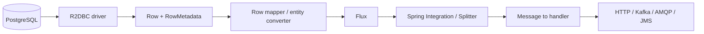
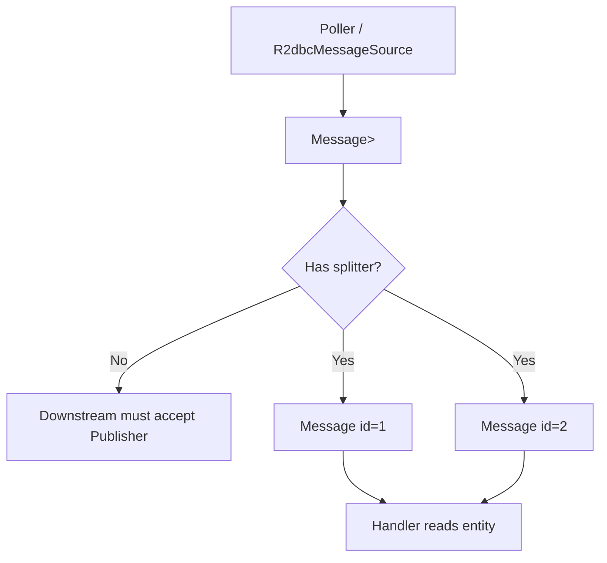
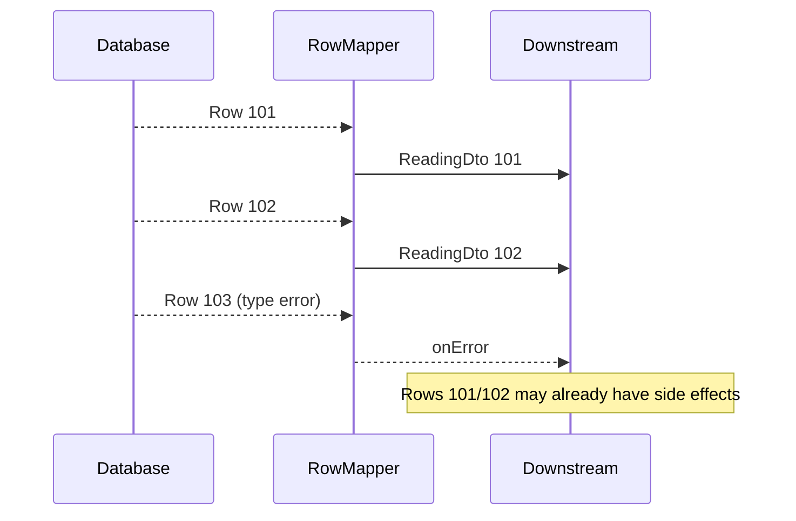
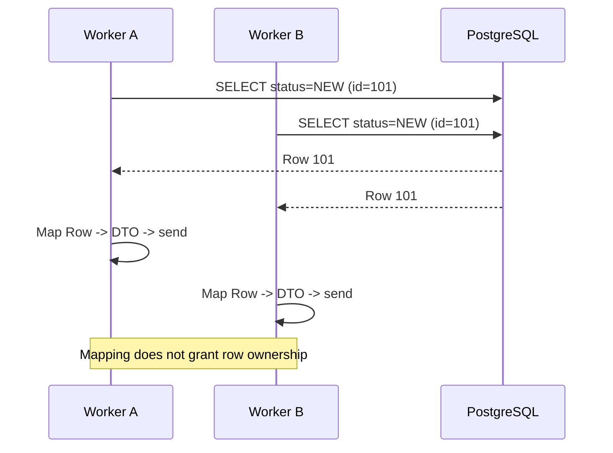

# Row mapping in R2DBC

> **Chapter:** R2DBC Adapter  
> **Module:** SPRING_INTEGRATION_ADAPTERS  
> **Context:** Connect external systems to Spring Integration using inbound/outbound adapters, gateways, pollers, and MessageChannels. Practice with files, SFTP, HTTP, JMS, AMQP, Kafka, and databases; focus on message contracts, errors, data integrity, and connection lifecycles.

## 1. Learning Objectives

After this lesson, you will be able to:

- Explain **row mapping** as the step that turns an SQL row (`Row`) into a Java object or Map during reactive data reads.
- Distinguish between `io.r2dbc.spi.Row`, `RowMetadata`, `DatabaseClient`, `R2dbcEntityTemplate`, `R2dbcEntityOperations`, and `R2dbcMessageSource`.
- Write `DatabaseClient.sql(...).map((row, metadata) -> ...).all()` returning `Flux<DTO>` and `.one()` returning `Mono<DTO>`.
- Read columns by **name or index**, manage aliases, data types, SQL NULLs, and conversion errors.
- Map POJOs/entities via `@Table`, `@Id`, `@Column`, and Spring Data R2DBC converters.
- Understand that `DatabaseClient.fetch().all()` returns Maps and how they differ from type-checked DTOs.
- Configure `R2dbc.inboundChannelAdapter(...).payloadType(...)`: one poll can produce **`Message<Flux<Entity>>`**, not automatically one Spring Message per row.
- Use `FluxMessageChannel`, splitters, transformers, and handlers properly to forward individual records from the database to external systems.
- Handle schema mismatches, mapping exceptions, partial emissions, retries, backpressure, claim/ACK, and idempotency.
- Test row mapping with `StepVerifier` and PostgreSQL R2DBC, and create a production checklist.

## 2. Where does row mapping sit in an integration system?

Suppose PostgreSQL stores temperature reading records. The Spring Integration system must read new data, convert SQL columns into Java events, and send them to HTTP, JMS, AMQP, or Kafka.

A `SELECT` returns **rows**, whereas Java message handlers usually want **strongly typed DTOs** such as `ReadingDto` or `SensorReadingEntity`.



**Row mapping** decides "which column goes into which field, under which Java type", not **whether the record has been delivered successfully**. Retries, ACKs, ownership, and idempotency belong to other layers.

### 2.1. Distinguishing four layers

| Layer | Typical components | Responsibility |
| --- | --- | --- |
| DB access | `io.r2dbc.spi.ConnectionFactory`, driver | Supplies connections, runs SQL, and streams results. |
| Row mapping | `Row`, `RowMetadata`, `DatabaseClient.map`, Spring Data converters | Converts columns into Maps, DTOs, or entities. |
| Reactive stream | `Flux<T>`, `Mono<T>`, subscriber | Emits items, complete/error signals, demand/cancellation. |
| Spring Integration | `R2dbcMessageSource`, `MessageChannel`, splitter | Wraps results in Spring Messages and routes to endpoints. |

Do not equate R2DBC `ConnectionFactory` with TCP adapter connection factories. They share a name but belong to **two different ecosystems and protocols**.

### 2.2. One row, one item, one message are three concepts

```text
One SELECT with 3 rows
        |
        v
DatabaseClient.map(...).all()
        |
        v
Flux<ReadingDto>  -- 3 onNext() signals on subscribe

Spring Integration R2DBC inbound default:
one receive() -> Message<Flux<ReadingDto>>
                           |
                           v
                       Splitter
                           |
                           +--> Message<ReadingDto> (#1)
                           +--> Message<ReadingDto> (#2)
                           +--> Message<ReadingDto> (#3)
```

**One message with a Flux payload is not three Spring Messages.** For a handler to see individual DTOs, you need a splitter or a consumer that explicitly handles a Publisher.

## 3. Row and RowMetadata in the R2DBC SPI

### 3.1. What is Row?

`io.r2dbc.spi.Row` represents **one row** of an SQL result when provided by the driver to the mapping callback. You can read columns by name or index:

```java
import io.r2dbc.spi.Row;

Long id = row.get("id", Long.class);
String sensorId = row.get("sensor_id", String.class);
Long firstColumn = row.get(0, Long.class);
```

These are **snippets inside a callback that receives `row`**, not a complete Java class. Indexes in the R2DBC SPI are **0-based**; order depends on the query's column list.

Do not call `row.get(0, String.class)` if the first column is `BIGINT`; the driver may not support the conversion or the result may be semantically wrong. Always know the **SQL projection** before reading by index.

### 3.2. What is RowMetadata used for?

`io.r2dbc.spi.RowMetadata` describes result metadata, such as returned column names and driver-supplied type information. The `DatabaseClient.map(...)` callback receives both `Row` and `RowMetadata`:

```java
.map((row, metadata) -> {
    // Extract values from row.
    // Can consult metadata when handling dynamic projections.
    return /* mapped object */ null;
})
```

This snippet only illustrates the callback signature—**do not use it verbatim** (a real mapping callback must return a non-null object).

`RowMetadata` is useful for dynamic projections, safe column-name logging, or generic mappers. For stable DTOs, **reading columns by names declared in the SQL contract** is generally easier to maintain than relying on indexes.

### 3.3. Lifetime of a Row

`Row` is data provided by the driver while consuming results. Do not store `Row` or `RowMetadata` references for use after the callback finishes.

**Right:** read and copy the needed scalar values inside the mapping callback, construct the DTO, and emit the DTO.

**Avoid:** emitting the `Row` object itself to another handler and accessing it after the result cursor/connection has closed; this couples business flows to driver state and resource lifecycles.

### 3.4. Sources of early errors

| Symptom | Possible cause |
| --- | --- |
| Reading column by name that does not exist | SELECT is missing the column or uses a different alias. |
| Reading column by wrong index | Projection order changed. |
| `row.get(..., BigDecimal.class)` fails | SQL type or driver conversion is incompatible. |
| Mapper returns `null` | Reactor forbids emitting null items. |
| Empty/missing data breaks business contract | Mapper lacks validation or unexpected SQL NULL occurred. |
| Duplicate column names from JOIN | Overlapping aliases or shadowed/ambiguous data. |

## 4. Designing a PostgreSQL table for the examples

### 4.1. Schema and sample data

This lesson uses a test PostgreSQL table `sensor_readings`:

```sql
CREATE TABLE sensor_readings (
    id             BIGSERIAL PRIMARY KEY,
    sensor_id      VARCHAR(64) NOT NULL,
    temperature_c  NUMERIC(10, 2) NOT NULL,
    note           TEXT,
    measured_at    TIMESTAMPTZ NOT NULL DEFAULT NOW(),
    status         VARCHAR(16) NOT NULL DEFAULT 'NEW'
);

CREATE INDEX idx_sensor_readings_status_id
    ON sensor_readings (status, id);

CREATE INDEX idx_sensor_readings_sensor_id
    ON sensor_readings (sensor_id, measured_at DESC);

INSERT INTO sensor_readings
    (sensor_id, temperature_c, note, status)
VALUES
    ('sensor-01', 21.50, 'Normal', 'NEW'),
    ('sensor-02', 39.25, NULL, 'NEW'),
    ('sensor-03', 18.75, 'Checked', 'DONE');
```

Data definitions:

| SQL Column | Type | Suggested Java type | Mapping note |
| --- | --- | --- | --- |
| `id` | `BIGSERIAL/BIGINT` | `Long` | Unique key; avoid `Integer` when IDs can grow large. |
| `sensor_id` | `VARCHAR` | `String` | Java name `sensorId` needs mapping or manual conversion. |
| `temperature_c` | `NUMERIC(10,2)` | `BigDecimal` | Avoid uncontrolled rounding with `double`. |
| `note` | `TEXT NULL` | nullable `String` | Can be `null` inside DTO; never emit null as an item. |
| `measured_at` | `TIMESTAMPTZ` | `OffsetDateTime` | Verify timezone/driver conversion. |
| `status` | `VARCHAR` | `String` or validated enum | Validate allowed statuses. |

This is a learning table; production often adds `claim_owner`, `lease_until`, `attempt_count`, or an outbox depending on the delivery contract.

### 4.2. Why should NUMERIC use BigDecimal?

`BigDecimal` preserves decimal precision of SQL `NUMERIC` values far better than automatic conversion to binary `double`, especially for measurements with strict rounding rules.

```java
import java.math.BigDecimal;

BigDecimal value = new BigDecimal("21.50");
System.out.println(value.toPlainString());  // 21.50
```

When comparing:

- `compareTo(...)` is appropriate for numeric value comparison.
- `equals(...)` also compares `scale`: `21.5` and `21.50` are not `equals` even though numerically equal.
- SQL `NUMERIC(10,2)` bounds precision/scale; test out-of-range inputs and values with many fractional digits.

## 5. Preparing Spring Boot, driver, and dependencies

Examples target **Java 17+, Spring Boot 3.x, Spring Framework 6.x, Spring Data R2DBC 3.x, and Spring Integration 6.x**; in real projects pick compatible versions via the Spring Boot BOM. For newer versions, verify the corresponding APIs.

### 5.1. Maven dependencies

```xml
<dependencies>
    <dependency>
        <groupId>org.springframework.boot</groupId>
        <artifactId>spring-boot-starter-integration</artifactId>
    </dependency>
    <dependency>
        <groupId>org.springframework.boot</groupId>
        <artifactId>spring-boot-starter-data-r2dbc</artifactId>
    </dependency>
    <dependency>
        <groupId>org.springframework.integration</groupId>
        <artifactId>spring-integration-r2dbc</artifactId>
    </dependency>
    <dependency>
        <groupId>org.postgresql</groupId>
        <artifactId>r2dbc-postgresql</artifactId>
        <scope>runtime</scope>
    </dependency>
    <dependency>
        <groupId>io.projectreactor</groupId>
        <artifactId>reactor-test</artifactId>
        <scope>test</scope>
    </dependency>
</dependencies>
```

The R2DBC driver is distinct from the JDBC driver. Having only `org.postgresql:postgresql` (JDBC) is insufficient for an R2DBC `ConnectionFactory`.

### 5.2. Database configuration

`application.yml`:

```yaml
spring:
  r2dbc:
    url: r2dbc:postgresql://127.0.0.1:5432/integration_demo
    username: ${DB_USER}
    password: ${DB_PASSWORD}
```

`${DB_USER}` and `${DB_PASSWORD}` in this example are placeholders resolved from environment variables; never commit real passwords to Git. Ensure the database exists, the schema is created, and the user has the required `SELECT`/`UPDATE` permissions.

With proper Boot auto-configuration, you can inject:

- `io.r2dbc.spi.ConnectionFactory`.
- `org.springframework.r2dbc.core.DatabaseClient`.
- `org.springframework.data.r2dbc.core.R2dbcEntityTemplate`.
- A reactive transaction manager when configuration conditions are satisfied.

Do not declare duplicate `@Bean`s with the same role if Boot already manages these components.

### 5.3. How to run the examples?

1. Start test PostgreSQL.
2. Create the table and seed rows from section 4.
3. Configure `spring.r2dbc.url` and credentials.
4. Add the repository and DTO classes from section 6.
5. Run the `StepVerifier` integration tests in section 17.
6. When practicing the inbound adapter, enable the flow from section 11 **instead of other flows reading the same table**, observe handler logs, and see how polls can re-read rows.

SQL/Java example outputs describe **expected results**, not claims of having been executed in this document.

## 6. Manual mapping: DatabaseClient Row → DTO

### 6.1. Immutable DTO for the integration contract

Create `ReadingDto.java`:

```java
import java.math.BigDecimal;
import java.time.OffsetDateTime;

public record ReadingDto(
        Long id,
        String sensorId,
        BigDecimal temperatureC,
        String note,
        OffsetDateTime measuredAt,
        String status
) {
}
```

With a Java record:

- Fields are initialized via the constructor, making it safe to pass across processing steps without accidental mutation.
- `note` can hold `null` to reflect SQL NULL.
- Fields `id`, `sensorId`, `temperatureC`, `measuredAt`, and `status` are declared NOT NULL in the schema, though boundary validation is still good practice if queries add JOINs or transformations.
- A record does not automatically provide JSON validation, idempotency, or authorization.

### 6.2. Repository using DatabaseClient

Create `ReadingRowRepository.java`:

```java
import java.math.BigDecimal;
import java.time.OffsetDateTime;

import org.springframework.r2dbc.core.DatabaseClient;
import org.springframework.stereotype.Repository;
import reactor.core.publisher.Flux;
import reactor.core.publisher.Mono;

@Repository
public class ReadingRowRepository {

    private final DatabaseClient db;

    public ReadingRowRepository(DatabaseClient db) {
        this.db = db;
    }

    public Flux<ReadingDto> findNewReadings(int limit) {
        if (limit < 1 || limit > 100) {
            return Flux.error(new IllegalArgumentException(
                    "limit must be between 1 and 100"));
        }

        return db.sql(
                        "SELECT id, sensor_id, temperature_c, " +
                        "note, measured_at, status " +
                        "FROM sensor_readings " +
                        "WHERE status = :status " +
                        "ORDER BY id LIMIT :maxRows")
                .bind("status", "NEW")
                .bind("maxRows", limit)
                .map((row, metadata) -> new ReadingDto(
                        row.get("id", Long.class),
                        row.get("sensor_id", String.class),
                        row.get("temperature_c", BigDecimal.class),
                        row.get("note", String.class),
                        row.get("measured_at", OffsetDateTime.class),
                        row.get("status", String.class)
                ))
                .all();
    }

    public Mono<ReadingDto> findById(long id) {
        return db.sql(
                        "SELECT id, sensor_id, temperature_c, " +
                        "note, measured_at, status " +
                        "FROM sensor_readings WHERE id = :id")
                .bind("id", id)
                .map((row, metadata) -> new ReadingDto(
                        row.get("id", Long.class),
                        row.get("sensor_id", String.class),
                        row.get("temperature_c", BigDecimal.class),
                        row.get("note", String.class),
                        row.get("measured_at", OffsetDateTime.class),
                        row.get("status", String.class)
                ))
                .one();
    }
}
```

**Breakdown:**

1. `DatabaseClient.sql(...)` creates an R2DBC query spec.
2. `bind(...)` binds **values** to named parameters, avoiding raw SQL concatenation.
3. `map((row, metadata) -> ...)` converts **each row** into a `ReadingDto`; here only `row` is used, while `metadata` remains available if needed.
4. `all()` returns `Flux<ReadingDto>`, i.e., 0..N items.
5. `one()` returns `Mono<ReadingDto>`, i.e., 0..1 item; suitable for PK queries.
6. Because `Flux`/`Mono` are Publishers, calling the method does not query SQL until subscribed.

**Note:** SQL `LIMIT 100` bounds at most one SELECT; `maxMessagesPerPoll(1)` on an upstream adapter is a different concept and does not limit row count.

### 6.3. Avoiding code duplication with a shared mapper

You can extract the mapper into a pure helper function:

```java
import io.r2dbc.spi.Row;
import io.r2dbc.spi.RowMetadata;

import java.math.BigDecimal;
import java.time.OffsetDateTime;

public final class ReadingMappers {

    private ReadingMappers() {
    }

    public static ReadingDto toDto(
            Row row, RowMetadata metadata) {

        return new ReadingDto(
                row.get("id", Long.class),
                row.get("sensor_id", String.class),
                row.get("temperature_c", BigDecimal.class),
                row.get("note", String.class),
                row.get("measured_at", OffsetDateTime.class),
                row.get("status", String.class)
        );
    }
}
```

In the repository:

```java
return db.sql(
                "SELECT id, sensor_id, temperature_c, " +
                "note, measured_at, status " +
                "FROM sensor_readings WHERE status='NEW' " +
                "ORDER BY id LIMIT :maxRows")
        .bind("maxRows", limit)
        .map(ReadingMappers::toDto)
        .all();
```

This repository snippet is simply an **alternative variant** of the method in section 6.2. `ReadingMappers::toDto` matches the two-parameter mapping callback signature, unifying the column contract and making unit testing easier.

## 7. Mapping by name or by index?

### 7.1. By name/alias: readable and maintainable

```java
String sensorId = row.get("sensor_id", String.class);
BigDecimal temperature = row.get(
        "temperature_c", BigDecimal.class);
```

Advantage: prepending a column to SELECT usually does not break name-based mapping. Disadvantage: if the schema/alias changes without updating the mapper, errors surface at query execution time.

### 7.2. By index: dependent on projection order

```java
// SELECT id, sensor_id, temperature_c ...
Long id = row.get(0, Long.class);
String sensorId = row.get(1, String.class);
BigDecimal temperature = row.get(2, BigDecimal.class);
```

Indexes are **0-based**. Changing SELECT to `SELECT sensor_id, id, ...` makes the same index return different data or fail with type errors. Index access fits small tested mappers with fixed projections, while **named aliases are generally safer** for long-lived integration modules.

### 7.3. JOINs and duplicate column names

Suppose a `sensor_registry` table also has an `id` column. Query:

```sql
SELECT r.id, s.id, r.sensor_id
FROM sensor_readings AS r
JOIN sensor_registry AS s
  ON s.sensor_id = r.sensor_id;
```

returns two columns both named `id`, making `row.get("id")` ambiguous (depending on driver and projection behavior). **Fix with unique aliases**:

```sql
SELECT
    r.id AS reading_id,
    s.id AS registry_id,
    r.sensor_id AS sensor_id
FROM sensor_readings AS r
JOIN sensor_registry AS s
  ON s.sensor_id = r.sensor_id;
```

Then:

```java
Long readingId = row.get("reading_id", Long.class);
Long registryId = row.get("registry_id", Long.class);
```

`sensor_registry` is an **illustrative extension** not created in section 4, so add its schema if actually running the JOIN.

### 7.4. Uppercase aliases and PostgreSQL double quotes

PostgreSQL normally folds **unquoted identifiers** to lowercase:

```sql
SELECT sensor_id AS sensorId
FROM sensor_readings;
```

The alias may be exposed as `sensorid`. If you want to preserve camelCase for consumers relying on exact column labels:

```sql
SELECT sensor_id AS "sensorId"
FROM sensor_readings;
```

Then `row.get("sensorId", String.class)` matches the projection contract. Many mappers/maps support case-insensitive lookup by default, yet **do not rely on that to replace explicit aliases** across dialects and drivers.

## 8. SQL NULL, missing columns, and invalid types

### 8.1. SQL NULL is not a null item in Flux

Row `sensor-02` has `note = NULL`:

```java
String note = row.get("note", String.class);
// note may be null, while ReadingDto itself is a non-null object.
```

Valid:

```java
new ReadingDto(
        2L,
        "sensor-02",
        new BigDecimal("39.25"),
        null,
        OffsetDateTime.now(),
        "NEW");
```

Invalid in Reactor:

```java
// DO NOT DO THIS: mapper emits a null item.
.map((row, metadata) -> row.get("note", String.class))
```

On rows where `note` is null, the mapping callback returns `null` and the reactive stream errors because Reactive Streams forbids `onNext(null)`.

If the goal is to emit only non-null `note` values, filter beforehand or wrap null via `Optional`/DTO:

```java
Flux<String> notes = repository.findNewReadings(20)
        .map(ReadingDto::note)
        .filter(java.util.Objects::nonNull);
```

**That snippet also fails on null:** `map(ReadingDto::note)` cannot return null, so the downstream filter never gets to run. The right way is:

```java
Flux<String> notes = repository.findNewReadings(20)
        .filter(reading -> reading.note() != null)
        .map(ReadingDto::note);
```

Or use `handle(...)`/`flatMap(...)` with a contract that never emits null. The key is to **exclude null values before turning them into Reactor items**.

### 8.2. Missing column vs. SQL NULL

| Case | Meaning |
| --- | --- |
| Column `note` exists, SQL NULL value | `row.get("note", String.class)` can return Java null. |
| SELECT omits `note` | `row.get("note", String.class)` can throw because the column label is absent. |
| Column is `NUMERIC` but mapper asks for `OffsetDateTime` | Conversion/type mismatch error. |
| Query returns 0 rows | `Flux.empty()` / `Mono.empty()` per API, not a DTO filled with nulls. |
| Mapper returns a null item | Reactive operator error, not a valid item. |

**Do not catch all exceptions and return `null` to "skip bad records"**: that can hide serious migration bugs and break batch/ACK logic. Separate bad-data rows destined for a DLQ from schema/driver errors that require alerts or halting.

### 8.3. Business NOT NULL validation

DDL may declare `NOT NULL`, yet a later SELECT with a `LEFT JOIN` or expression can return null. Validate in the mapper:

```java
Long id = java.util.Objects.requireNonNull(
        row.get("id", Long.class), "Missing id");

String sensorId = java.util.Objects.requireNonNull(
        row.get("sensor_id", String.class), "Missing sensor_id");
```

Throwing in the mapper emits `onError` in the reactive query. If earlier items were already processed downstream, never assume the batch "did nothing"; **partial emission** must be accounted for on retry.

### 8.4. Binding null in SQL vs. reading null from Row

Reading an SQL NULL column: call `row.get(..., Type.class)` and receive Java null. When **writing** SQL NULL with `DatabaseClient`, use `bindNull(...)`:

```java
Mono<Long> clearNote(DatabaseClient db, long id) {
    return db.sql(
                    "UPDATE sensor_readings " +
                    "SET note = :note WHERE id = :id")
            .bindNull("note", String.class)
            .bind("id", id)
            .fetch()
            .rowsUpdated();
}
```

This is a method inside a Java class. Do not call `.bind("note", null)`: the binding API needs the type when the value is null and may reject null.

## 9. DatabaseClient.fetch(): when you want a Map instead of a DTO

`DatabaseClient` also provides default mapping via `fetch()`:

```java
import java.util.Map;
import reactor.core.publisher.Flux;

Flux<Map<String, Object>> rows = db.sql(
                "SELECT id, sensor_id, temperature_c " +
                "FROM sensor_readings ORDER BY id LIMIT 10")
        .fetch()
        .all();
```

`Map` form is helpful for:

- Ad hoc queries or prototypes.
- Dynamic projections without a predefined DTO.
- Generic connector systems discovering column names at runtime.
- Inspecting data structure before locking down a stable schema.

Drawbacks:

- No compile-time checks on `"sensor_id"` or `BigDecimal` types.
- Consumers can hit `ClassCastException` on wrong casts.
- Column renames go unnoticed until runtime.
- Map null values and key casing/storage depend on mapper/driver; test the real contract.

### 9.1. Comparing Map and DTO

| Aspect | `Flux<Map<String,Object>>` | `Flux<ReadingDto>` |
| --- | --- | --- |
| Java schema | Flexible | Explicit, more type-safe |
| IDE/compiler support | Limited | Strong |
| Dynamic projections | Good fit | Less convenient |
| Null checks / validation | Each consumer handles it | Centralized in mapper/constructor |
| Impact of column rename | Runtime | Also runtime, yet localized in mapper |
| Message serialization | Needs Map contract | DTO has clear Java schema |

`Map` can be appropriate for dynamic connectors, but does not replace **data contract versioning** between services.

### 9.2. Do not cast BigDecimal from a Map to Double

Wrong:

```java
Double temperature = (Double) rowMap.get("temperature_c");
```

If the driver returns `BigDecimal` for PostgreSQL `NUMERIC`, this cast fails.

Right once the schema is confirmed:

```java
BigDecimal temperature =
        (BigDecimal) rowMap.get("temperature_c");
```

When handling multiple dialects, inspect `Number` types or use an explicit conversion service; **do not just call `toString()` and parse everything** without controlling locale, precision, and nullability.

## 10. Spring Data R2DBC entity mapping with @Table and @Column

You do not always need to hand-write `DatabaseClient` mappers. Spring Data R2DBC supports entity mapping via metadata, constructor/property binding, and converters.

### 10.1. Entity class

Create `SensorReadingEntity.java`:

```java
import java.math.BigDecimal;
import java.time.OffsetDateTime;

import org.springframework.data.annotation.Id;
import org.springframework.data.relational.core.mapping.Column;
import org.springframework.data.relational.core.mapping.Table;

@Table("sensor_readings")
public class SensorReadingEntity {

    @Id
    private Long id;

    @Column("sensor_id")
    private String sensorId;

    @Column("temperature_c")
    private BigDecimal temperatureC;

    private String note;

    @Column("measured_at")
    private OffsetDateTime measuredAt;

    private String status;

    public SensorReadingEntity() {
    }

    public Long getId() { return id; }
    public void setId(Long id) { this.id = id; }

    public String getSensorId() { return sensorId; }
    public void setSensorId(String sensorId) {
        this.sensorId = sensorId;
    }

    public BigDecimal getTemperatureC() { return temperatureC; }
    public void setTemperatureC(BigDecimal value) {
        this.temperatureC = value;
    }

    public String getNote() { return note; }
    public void setNote(String note) { this.note = note; }

    public OffsetDateTime getMeasuredAt() { return measuredAt; }
    public void setMeasuredAt(OffsetDateTime measuredAt) {
        this.measuredAt = measuredAt;
    }

    public String getStatus() { return status; }
    public void setStatus(String status) { this.status = status; }
}
```

**Explanation:**

- `@Table("sensor_readings")` identifies the table.
- `@Id` identifies the key property needed for entity updates and record identity.
- `@Column("sensor_id")` maps Java camelCase to SQL snake_case column names.
- `@Column("temperature_c")` avoids relying on implicit naming strategies.
- `@Column("measured_at")` maps the timestamp column.
- `note` and `status` match column names directly so annotations are optional in this example.
- No-arg constructor and getters/setters support materialization under the configured mapping setup.

`@Table` **does not create tables** automatically by default. Migrations or schema setup steps are still required for the table to exist.

### 10.2. Querying with R2dbcEntityTemplate

Create `ReadingEntityRepository.java`:

```java
import org.springframework.data.domain.Sort;
import org.springframework.data.r2dbc.core.R2dbcEntityTemplate;
import org.springframework.data.relational.core.query.Criteria;
import org.springframework.data.relational.core.query.Query;
import org.springframework.stereotype.Repository;
import reactor.core.publisher.Flux;
import reactor.core.publisher.Mono;

@Repository
public class ReadingEntityRepository {

    private final R2dbcEntityTemplate template;

    public ReadingEntityRepository(
            R2dbcEntityTemplate template) {
        this.template = template;
    }

    public Flux<SensorReadingEntity> findNew(int limit) {
        if (limit < 1 || limit > 100) {
            return Flux.error(new IllegalArgumentException(
                    "Invalid limit"));
        }

        Query query = Query.query(
                        Criteria.where("status").is("NEW"))
                .sort(Sort.by(Sort.Direction.ASC, "id"))
                .limit(limit);

        return template.select(SensorReadingEntity.class)
                .matching(query)
                .all();
    }

    public Mono<SensorReadingEntity> findById(long id) {
        return template.selectOne(
                Query.query(Criteria.where("id").is(id)),
                SensorReadingEntity.class
        );
    }
}
```

APIs:

- `template.select(Entity.class).matching(query).all()` returns `Flux<Entity>`.
- `template.selectOne(query, Entity.class)` returns `Mono<Entity>`.
- The Spring Data mapper uses metadata/annotations to map rows.
- SQL is generated per dialect and `Criteria` instead of hand-writing every projection/WHERE.

**Do not confuse `R2dbcEntityTemplate` with a JPA/Hibernate EntityManager.** Spring Data R2DBC does not provide full JPA-style lazy loading, unit-of-work, or ORM relationship management.

### 10.3. When to choose DatabaseClient vs. template?

| Need | Consider |
| --- | --- |
| Standard SQL with clear entity mapping | `R2dbcEntityTemplate`. |
| Queries with multiple JOINs, CTEs, custom projections | `DatabaseClient` and manual mapper. |
| PostgreSQL `UPDATE ... RETURNING` | `DatabaseClient`. |
| Building DTOs from 3–5 columns with custom aliases | `DatabaseClient.map(...)`. |
| CRUD using `@Table`/`@Id`/`@Column` | `R2dbcEntityTemplate`. |
| Queries/updates with `Criteria` | `R2dbcEntityTemplate`. |
| Spring Integration `R2dbcMessageSource` | Pass an `R2dbcEntityOperations`, typically `R2dbcEntityTemplate`. |

Both APIs **access the same R2DBC database**, with different mapping contracts.

## 11. Row mapping in the R2DBC inbound channel adapter

This is the most important part for bringing row mapping into the **SPRING_INTEGRATION_ADAPTERS** module.

Spring Integration's `R2dbcMessageSource` is an inbound source triggered by a **poller**. It executes the configured SELECT query and places the result in a Spring Message whose payload is a Publisher.

### 11.1. Default: Map per row

Without `payloadType`, each row is typically represented as a **Map keyed by column name** (using Spring Data's case-insensitive row-mapper Map):

```text
Poller -> R2dbcMessageSource
               |
               v
    Message<Flux<Map<String,Object>>>
               |
               v
       Splitter / consumer
               |
               +--> Message<Map<String,Object>>
```

Do not assume `Message<Map>` appears directly from `receive()`; by default the payload is a `Flux` of Maps for multi-row queries.

### 11.2. Setting payloadType to map Entities

If the source is configured as:

```java
R2dbc.inboundChannelAdapter(
        template,
        "SELECT id, sensor_id, temperature_c, note, " +
        "measured_at, status " +
        "FROM sensor_readings " +
        "WHERE status='NEW' ORDER BY id LIMIT 25")
        .payloadType(SensorReadingEntity.class)
        .expectSingleResult(false)
```

then SELECTed rows map to `SensorReadingEntity`, and **one `receive()`** produces one message carrying **`Flux<SensorReadingEntity>`**.

**`payloadType(Entity.class)` chooses the element type inside the Publisher; it does not turn the message source into one message per row.**

### 11.3. Full Java DSL with splitter

Create `ReadingInboundConfiguration.java`:

```java
import org.springframework.context.annotation.Bean;
import org.springframework.context.annotation.Configuration;
import org.springframework.data.r2dbc.core.R2dbcEntityTemplate;
import org.springframework.integration.config.EnableIntegration;
import org.springframework.integration.dsl.IntegrationFlow;
import org.springframework.integration.dsl.MessageChannels;
import org.springframework.integration.r2dbc.dsl.R2dbc;

@Configuration
@EnableIntegration
public class ReadingInboundConfiguration {

    @Bean
    IntegrationFlow readingInboundFlow(
            R2dbcEntityTemplate template) {

        return IntegrationFlow
                .from(
                        R2dbc.inboundChannelAdapter(
                                template,
                                "SELECT id, sensor_id, temperature_c, " +
                                "note, measured_at, status " +
                                "FROM sensor_readings " +
                                "WHERE status='NEW' " +
                                "ORDER BY id LIMIT 25")
                                .payloadType(SensorReadingEntity.class)
                                .expectSingleResult(false),
                        endpoint -> endpoint.poller(p ->
                                p.fixedDelay(2_000)
                                 .maxMessagesPerPoll(1))
                )
                .channel(MessageChannels.flux())
                .split()
                .channel(MessageChannels.flux())
                .handle(SensorReadingEntity.class, (reading, headers) -> {
                    System.out.printf(
                            "Reading id=%s sensor=%s temp=%s note=%s%n",
                            reading.getId(),
                            reading.getSensorId(),
                            reading.getTemperatureC(),
                            reading.getNote()
                    );
                    return null;
                })
                .get();
    }
}
```

Explanation:

1. `R2dbc.inboundChannelAdapter(template, sql)` builds the `R2dbcMessageSource` spec.
2. `payloadType(...)` uses Spring Data mapping to instantiate entities.
3. `expectSingleResult(false)` keeps multiple rows represented as a `Flux`.
4. The poller calls `receive()` on schedule—here roughly every 2 seconds per `fixedDelay`.
5. `maxMessagesPerPoll(1)` limits **how many `receive()` calls occur per poll cycle**, not one row.
6. `MessageChannels.flux()` uses reactive channels in the flow.
7. `split()` turns each Publisher item into an individual message.
8. The handler simply logs for learning. Logging does not equal an ACK to external systems.

**Important warning:** The example above **only SELECTs** `status='NEW'`. Because status never changes, subsequent polls will re-read **the same rows**. Never turn this logging flow into a non-idempotent side-effecting workflow without adding claim/ACK.

### 11.4. Comparing without splitter vs. with splitter



If you remove `split()` and write:

```java
.handle(SensorReadingEntity.class, (reading, headers) -> {
    System.out.println(reading.getSensorId());
    return null;
})
```

the handler can hit a **payload type mismatch**, because the payload is still a `Flux`. Do not assume `FluxMessageChannel` automatically unwraps a Publisher into individual entities.

### 11.5. What does expectSingleResult(true) do?

Per the `R2dbcMessageSource` API:

- `expectSingleResult(false)`: payload is `Flux<?>` holding multiple rows (default).
- `expectSingleResult(true)`: payload is `Mono<?>` in single-result mode.
- Whether `Mono` or `Flux`, it is still a **Publisher**, not a POJO materialized at `receive()`.
- With `true`, the SQL should express the "one row" intent via a unique key or `LIMIT 1`.

Do not use `expectSingleResult(true)` to paper over a query that can return multiple rows without defining which row should be chosen.

### 11.6. Splitters add metadata but do not create business keys

When splitting messages, Spring Integration can add sequence/correlation headers. These help coordinate messages within a flow, yet **do not replace the persisted `sensor_readings.id` key**.

If sending readings to Kafka/AMQP and deduplication is required, put a **business reading ID or event ID** in the payload/header contract so consumers can identify events across retries and reconnects.

## 12. Mapping to outbound message contracts

SQL entities often contain internal fields that should not be exposed externally. For example, a Kafka consumer only needs:

```java
import java.math.BigDecimal;
import java.time.OffsetDateTime;

public record ReadingEvent(
        String eventId,
        String sensorId,
        BigDecimal temperatureC,
        OffsetDateTime measuredAt
) {
}
```

Transform the mapped entity into an event:

```java
ReadingEvent event = new ReadingEvent(
        "reading-" + entity.getId(),
        entity.getSensorId(),
        entity.getTemperatureC(),
        entity.getMeasuredAt()
);
```

Creating an outbound DTO at the **transformer/service boundary** is better than sending the raw database entity when:

- The table has internal fields like `status`/`claim_owner` that must not leak.
- The JSON/event contract uses different names from SQL columns.
- You want versioning decoupled from database migrations.
- Unit conversions or timestamp normalization are needed.
- Consumers must tolerate adding database columns without breaking events.

### 12.1. Pure transformer before publishing

```java
import org.springframework.integration.dsl.IntegrationFlow;

IntegrationFlow transformFlow = IntegrationFlow
        .from("mappedReadingMessages")
        .transform(SensorReadingEntity.class, entity ->
                new ReadingEvent(
                        "reading-" + entity.getId(),
                        entity.getSensorId(),
                        entity.getTemperatureC(),
                        entity.getMeasuredAt()
                ))
        .handle(message -> {
            // Replace with Kafka/AMQP/HTTP outbound adapter with its own ACK contract.
            System.out.println(message.getPayload());
        })
        .get();
```

This is an illustrative configuration snippet inside `@Configuration` or a bean method; it does not define the producer feeding `mappedReadingMessages`. **Do not** make blocking HTTP/DB calls inside a pure mapper "for convenience"—mappers should be fast, purely data-driven, and easy to retry/test.

### 12.2. Stable event IDs

If a row ID is `101`, an event ID like `reading-101` should **remain constant across redeliveries**. Generating a fresh UUID on every retry prevents downstream from detecting duplicate events.

Spring's `MessageHeaders.ID` is the ID of a specific **Spring Message**; it can change when the same row is re-read. Do not use it in place of a business row key when idempotency across polls/instances is the goal.

### 12.3. Do not let data conversions corrupt data

| DB Input | Outbound event | Check |
| --- | --- | --- |
| `NUMERIC(10,2)` | `BigDecimal` or decimal string | Precision, scale, JSON serialization. |
| `TIMESTAMPTZ` | ISO-8601 with offset/UTC | Timezone and precision. |
| `TEXT NULL` | Optional/omitted field | Consumer schema rules for null vs. absent. |
| `BIGINT` | `long`/string ID | JS consumers may hit safe-integer limits. |
| Internal `status` | Not emitted by default | Security and API contract. |

A mapping that "compiles cleanly" can still **lose precision or shift timestamps** when serialized to HTTP/Kafka; always test the outbound wire contract.

## 13. Special SQL types and custom conversions

### 13.1. UUID, JSON, ARRAY, ENUM

Certain DB types deserve special care:

- `UUID`: drivers may support `java.util.UUID` directly.
- `NUMERIC`: prefer `BigDecimal`.
- `TIMESTAMP` and `TIMESTAMPTZ`: pick `LocalDateTime` or `OffsetDateTime` matching the DB type and driver.
- PostgreSQL `JSONB`: drivers may expose dedicated codec types or read strings differently; test mapping instead of assuming `String`.
- SQL `ARRAY`: maps to Java arrays/collections depending on driver and converters.
- SQL enums or VARCHAR values: can be mapped as `String` and parsed to a Java enum against a whitelist.
- Binary data: avoid holding driver `ByteBuffer`s past the callback; copy bytes if needed and bound payload sizes.

**Never assume every R2DBC driver ships the exact same converters.** Test against your deployed dialect and pinned dependency versions.

### 13.2. Custom converters

Spring Data R2DBC supports **custom conversions** via `R2dbcCustomConversions` and converters annotated with `@ReadingConverter`/`@WritingConverter` per its configuration mechanism.

When designing them:

1. Identify the exact SQL type returned by the driver.
2. Identify the target Java domain type.
3. Write a **pure, deterministic** converter.
4. Register the converter through the Spring Data R2DBC configuration matching your version.
5. Test both read and write directions if bidirectional.
6. Perform no network I/O or blocking inside converters.

**Avoid registering overly broad "type-fixing" converters** that alter mapping across unrelated entities unexpectedly.

### 13.3. Enums should be explicitly validated

Example:

```java
public enum ReadingStatus {
    NEW, PROCESSING, DONE
}

static ReadingStatus parseStatus(String raw) {
    try {
        return ReadingStatus.valueOf(raw);
    }
    catch (IllegalArgumentException e) {
        throw new IllegalArgumentException(
                "Unsupported reading status", e);
    }
}
```

These belong inside an appropriate Java class/enum. When the database contains a new status not yet supported by the app, have an explicit policy: reject/alert, route separately, or coordinate schema versioning—never silently coerce unknown statuses to `NEW`.

## 14. Nullability, constructor binding, and entity evolution

### 14.1. Mapping into immutable records

Spring Data R2DBC supports entity materialization via constructor binding on supported Java types, including Java records on compatible versions. However:

- Property and column names still need accurate mapping.
- Constructor parameters must align with metadata and conversion policies.
- SQL NULL can populate nullable reference-type properties, but is invalid for non-nullable primitives.
- Avoid putting business logic or side effects inside constructors.

When you want explicit control over mapping, `DatabaseClient.map(...)` into a record is transparent; when entity mappings are stable, `R2dbcEntityTemplate` cuts boilerplate.

### 14.2. Java primitives and SQL NULL

Broken contract:

```java
public record BadReading(long id, double temperatureC) {
}
```

If SQL returns NULL or `NUMERIC` needs preserved precision, primitives can fail or force lossy conversions.

Depending on your domain, use:

```java
public record SafeReading(Long id, BigDecimal temperatureC) {
}
```

Then validate non-null constraints per schema; **reference types do not reject null automatically**—they simply let you represent and check values.

### 14.3. Migrations adding/removing columns

| Schema change | Mapping impact |
| --- | --- |
| Adding an unused column | Explicit SELECT/mappers are largely unaffected. |
| Renaming `sensor_id` | Name-based manual mappers/`@Column` can break. |
| Changing `NUMERIC` to `VARCHAR` | Conversions/validations must be updated. |
| Changing nullable to NOT NULL | Existing data and producers need coordinated migration. |
| JOIN adding another `id` column | Must alias to avoid collisions. |
| Adding a new status | Consumer enums/validations need compatibility policies. |

Prefer **explicit SELECT projections** and versioned migrations. Never use `SELECT *` as a fixed public contract between services and databases.

## 15. Reactive mapping, errors, and partial emissions

### 15.1. A mapper can fail after emitting several rows

A query returns three rows:

```text
Row #1 -> mapped ReadingDto(101) -> onNext
Row #2 -> mapped ReadingDto(102) -> onNext
Row #3 -> conversion error      -> onError
```

If downstream already sent rows #1–2 to Kafka, retrying the entire `Flux` can re-emit #1–2. A row mapping error **does not guarantee earlier side effects rolled back**.



**Avoid `onErrorContinue` as a blanket strategy** to skip failing rows. Schema/driver errors should raise alerts rather than being silently treated as "dirty rows to ignore".

### 15.2. Retries must classify error sources

| Error | Retry? | Explanation |
| --- | --- | --- |
| Database temporary disconnect | Bounded retry possible. | Needs total deadline/backoff and state reconciliation. |
| SQL schema missing column | Do not auto-retry. | This is a migration or query bug. |
| Mapper requested wrong Java type | Do not blindly retry. | Fix the conversion contract. |
| Row data violates domain invariant | Use explicit reject/quarantine policy. | Do not infinitely retry one row and stall the batch. |
| Downstream temporarily slow | Retry with idempotency. | Earlier rows may already be processed. |
| Pool acquire timeout | Throttled retry possible. | Reduce concurrency and monitor pool. |

When an error happens, **do not fake success** with `onErrorResume(error -> Flux.empty())` across the board. That can silently drop data that needed processing.

### 15.3. Routing invalid rows to a separate path

A production strategy can:

1. Perform basic mapping into a DTO capable of representing nulls and raw values safely.
2. Validate the DTO with a dedicated domain validator.
3. On validation failure, durably record the event ID + reason in a **quarantine/dead-letter store**.
4. Do not ACK the source row until either success or quarantine persistence completes.
5. Continue to the next row only when the contract permits.
6. Provide replay tooling after data/schema fixes.

If a conversion error happens **before a DTO can even be constructed**, handle it at the mapper/query boundary, e.g., with safer query projections or controlled raw value extraction.

### 15.4. Cancellation and Row lifecycle

A subscriber can cancel a `Flux` mid-SELECT. When that happens:

- Queries/results/connections must clean up per the driver/Spring contract.
- Never retain `Row` references past mapping time.
- Never treat `cancel` as `onComplete`.
- Never ACK the entire batch without proof the remaining rows were processed.
- Monitor active/pending pool connections and cancellation counts.

In Spring Data/Spring Framework, let `DatabaseClient`/`R2dbcEntityTemplate` manage resource lifecycles rather than manually opening `Connection`s and risking leaked closes.

## 16. Batches, pagination, backpressure, and pollers

### 16.1. SQL LIMIT bounds mapped rows

```sql
SELECT id, sensor_id, temperature_c, note, measured_at, status
FROM sensor_readings
WHERE status = 'NEW'
ORDER BY id
LIMIT 25;
```

A single query returns at most 25 rows per the SQL contract. Meanwhile:

- `maxMessagesPerPoll(1)` only limits `receive()` invocations per poll cycle.
- `Flux.request(n)` is subscriber demand, not SQL `LIMIT n`.
- `flatMap(..., 4)` bounds concurrent inner Publishers in that Reactor pipeline.
- R2DBC pool max size bounds database connections, not upstream queues.

**Do not treat one parameter as a substitute for all four limits.**

### 16.2. Keyset pagination for large datasets

If a table holds millions of rows:

```sql
SELECT id, sensor_id, temperature_c, note, measured_at, status
FROM sensor_readings
WHERE id > :lastId
ORDER BY id
LIMIT :pageSize;
```

Use `lastId` as a scan cursor, one query per page. Keyset pagination avoids large `OFFSET` pitfalls, yet **a cursor is not a processed-event ACK**.

If you commit the cursor before outbound publishing succeeds, a crash can skip unfinished rows on the next run. Reliable delivery requires claim/ACK/lease rather than tracking `lastId` alone.

### 16.3. Backpressure does not fix mapping bugs

A `FluxMessageChannel` can propagate reactive demand in a flow when segments are compatible. Still:

- A blocking handler on a Reactor event-loop still stalls threads.
- Unbounded `collectList()` still buffers every row in RAM.
- A poller can trigger a new Publisher while the previous one is still running.
- Mapping many large JSON columns still consumes CPU and memory.
- Too many subscribers can exhaust the pool.

Prioritize narrow query projections, SQL `LIMIT`, proper indexes, bounded concurrency, and measuring processing latency.

### 16.4. Flux operators after mapping

```java
Flux<ReadingEvent> events = repository.findNewReadings(25)
        .filter(row -> "NEW".equals(row.status()))
        .map(row -> new ReadingEvent(
                "reading-" + row.id(),
                row.sensorId(),
                row.temperatureC(),
                row.measuredAt()
        ));
```

`map` only transforms data. When calling an external service returning `Mono<Void>`:

```java
Mono<Void> sent = repository.findNewReadings(25)
        .concatMap(reading -> externalSender.send(reading))
        .then();
```

These snippets assume `repository` and `externalSender` exist in scope. `concatMap` processes inner publishers sequentially, while `flatMap(sender::send, 4)` enables bounded concurrency. **Do not** trigger async I/O inside `map` and ignore the returned Publisher.

## 17. Testing row mapping with StepVerifier

### 17.1. Test preparation

Use **real PostgreSQL** via Testcontainers or an equivalent integration test environment. H2 R2DBC can differ from PostgreSQL on `NUMERIC`, timezones, SQL dialects, and converters.

Seed independent data per test to avoid relying on rows left behind by prior runs. The `@Test` methods below are **methods inside a test class** assuming `ReadingRowRepository repository` and `ReadingEntityRepository entityRepository` are injected.

### 17.2. Testing two NEW rows

```java
import org.junit.jupiter.api.Test;
import reactor.test.StepVerifier;

import static org.junit.jupiter.api.Assertions.*;

@Test
void mapsNewRowsToDto() {
    StepVerifier.create(repository.findNewReadings(10))
            .assertNext(reading -> {
                assertEquals("sensor-01", reading.sensorId());
                assertEquals(
                        0,
                        new java.math.BigDecimal("21.50")
                                .compareTo(reading.temperatureC()));
                assertNotNull(reading.measuredAt());
            })
            .assertNext(reading -> {
                assertEquals("sensor-02", reading.sensorId());
                assertNull(reading.note());
            })
            .verifyComplete();
}
```

This test assumes the test table holds **exactly two NEW rows** ordered by `ORDER BY id` from section 4. With different seed data, reset the schema/fixture before asserting.

### 17.3. Testing zero rows

```java
@Test
void missingIdProducesEmptyMono() {
    StepVerifier.create(repository.findById(999_999L))
            .verifyComplete();
}
```

`Mono.empty()` is a valid outcome when `WHERE` finds no match. Do not conflate it with a connection error.

### 17.4. Testing entity mapping

```java
@Test
void springDataMapsEntityColumns() {
    StepVerifier.create(entityRepository.findNew(10))
            .assertNext(entity -> {
                assertEquals("sensor-01", entity.getSensorId());
                assertNotNull(entity.getTemperatureC());
                assertNotNull(entity.getMeasuredAt());
            })
            .expectNextCount(1)
            .verifyComplete();
}
```

This test verifies `@Table`/`@Column` and Spring Data R2DBC converters. When tables add or alter columns, maintain migration compatibility tests.

### 17.5. Testing Reactor null payloads

```java
import reactor.core.publisher.Flux;
import reactor.test.StepVerifier;

@Test
void mappingToNullItemIsAnError() {
    Flux<String> invalid = Flux.just("sensor-01", "sensor-02")
            .map(sensor -> "sensor-02".equals(sensor)
                    ? null
                    : sensor);

    StepVerifier.create(invalid)
            .expectNext("sensor-01")
            .expectError(NullPointerException.class)
            .verify();
}
```

This is a pure Reactor test needing no DB. It proves a mapper **must not emit null items**, whereas a DTO containing a null field remains a valid item.

### 17.6. Testing aliases and data types

In a PostgreSQL test, run:

```sql
SELECT
    sensor_id AS "sensorId",
    temperature_c AS "temperatureC"
FROM sensor_readings
ORDER BY id
LIMIT 1;
```

Then map:

```java
Mono<String> description = db.sql(
                "SELECT sensor_id AS \"sensorId\", " +
                "temperature_c AS \"temperatureC\" " +
                "FROM sensor_readings ORDER BY id LIMIT 1")
        .map((row, metadata) ->
                row.get("sensorId", String.class) + ":" +
                row.get("temperatureC", BigDecimal.class))
        .one();
```

**Note:** this illustrates a Java string literal with escaped quotes; use `\"` in Java to represent `"` inside SQL. The test verifies exact aliases when using mixed-case identifiers.

### 17.7. Testing partial emission and retries

Simulate a Flux emitting two valid rows then hitting a mapping error on the third, inspecting `onError` and replay behavior on resubscription:

```java
import reactor.core.publisher.Flux;
import reactor.test.StepVerifier;

@Test
void partialEmissionThenError() {
    Flux<Integer> values = Flux.concat(
            Flux.just(101, 102),
            Flux.error(new IllegalStateException("Bad row 103")));

    StepVerifier.create(values)
            .expectNext(101, 102)
            .expectError(IllegalStateException.class)
            .verify();
}
```

Lesson: when `onError` occurs, the first two rows **were already emitted**. A retry can replay them; downstream handlers need idempotency if they cause side effects.

## 18. R2DBC row mapping test matrix

| Scenario | Expected result |
| --- | --- |
| SELECT 0 rows | Flux/Mono completes empty, no null objects. |
| SELECT 1 row | One DTO/entity emitted with exact fields. |
| SELECT multiple rows | One `onNext` per mapped row per query contract. |
| `TEXT NULL` column | DTO field can be null, no null item emitted. |
| Mapper directly returns null | Reactive mapping error. |
| Missing column label | Clear mapping/query error, not masked as empty. |
| Wrong Java type | Conversion error or invalid data per driver. |
| `NUMERIC(10,2)` | `BigDecimal` preserves exact value/scale. |
| `TIMESTAMPTZ` | Timestamp + offset read/serialized per policy. |
| Quoted camelCase alias | Mapper reads exact name with controlled projection. |
| JOIN with two `id` columns | Unique aliases prevent column ambiguity. |
| DatabaseClient fetch Map | Consumer handles types/keys and nulls. |
| DTO from manual mapper | Mapping checked at compile time on Java fields. |
| Entity `@Table`/`@Column` | Spring Data maps snake_case ↔ camelCase properly. |
| Entity missing required column | Error or null handled per validation policy. |
| Schema adds column | Explicit projection is not broken inadvertently. |
| Schema renames column | Tests catch mapper/migration mismatch. |
| R2DBC inbound without `payloadType` | Items are typically Maps, not arbitrary entities. |
| R2DBC inbound `payloadType=Entity` | Flux of Entity, still requires subscription. |
| Removing splitter in inbound flow | Handler receives Publisher, not individual entities. |
| Splitter with reactive channel | Emits `Message<Entity>` per item. |
| Poller `maxMessagesPerPoll(1)` | One `receive()` can still contain many rows. |
| Query without status update | Subsequent polls can re-read the same rows. |
| Mapping fails after 2 rows | `onError`; earlier 2 rows may already be processed. |
| Two instances concurrently SELECT `NEW` | Needs atomic claim/lease/idempotency. |
| Subscriber cancels | Cleans up resources, does not ACK whole batch. |
| PostgreSQL/JSONB driver differs from assumptions | Integration test confirms actual converters. |

## 19. Delivery semantics: accurate mapping alone is not enough

### 19.1. SELECT first, ACK later

Even with perfect row mapping, two workers can still SELECT the same `NEW` row:



### 19.2. Atomic claims and leases

A production design can:

1. **Atomically claim** a batch, e.g., PostgreSQL `UPDATE ... RETURNING`/`FOR UPDATE SKIP LOCKED` in an appropriate statement/transaction.
2. Map **only the claimed rows** into DTOs.
3. Persist owner, lease deadline, and attempt count.
4. Send downstream with a stable event ID.
5. Transition to `DONE` only after ACK per contract.
6. If a worker dies, lease expiration lets recovery retry.
7. Downstream consumers implement idempotency to tolerate redeliveries.

**Do not treat `R2dbcMessageSource.updateSql` as a post-handler ACK.** It may mark rows read/claimed before downstream completes.

### 19.3. Database and broker boundary

If PostgreSQL commits a claim and then Kafka publishing fails, an R2DBC transaction cannot roll back Kafka. If Kafka receives the event and the database ACK fails, the row may be redelivered.

For high reliability, consider **transactional outbox + replay + idempotent consumers**. DTO mappings must keep event IDs and schema versions stable for retries and reconciliation.

## 20. Troubleshooting and metrics

### 20.1. Diagnostic table

| Symptom | Common cause | How to verify |
| --- | --- | --- |
| `ClassCastException` from Map → Double | SQL NUMERIC returns BigDecimal. | Log runtime class safely; test on real PostgreSQL. |
| `BadSqlGrammarException` | Wrong table/column/alias in SQL. | Inspect migrations, SQL, and dialect. |
| Mapping error "column not found" | SELECT omitted column or wrong alias. | Compare projection against mapper. |
| `NullPointerException` in Reactor `map` | Mapper emitted null item or unchecked null field. | Test SQL NULLs and mapping logic. |
| Entity field `sensorId` is null | `@Column`/naming or missing projection. | Check metadata, SQL, and converters. |
| Shifted timestamp timezone | Wrong type/timezone/serialization. | Compare UTC/offsets across DB, driver, and JSON. |
| Events sent multiple times | Poller re-reading status `NEW` or Flux retry. | Trace business row ID, claim/ACK, and subscriptions. |
| Handler receives Flux instead of entity | Missing splitter or Publisher not consumed. | Check payload types and channel configuration. |
| Reading one row yet query never runs | Publisher was never subscribed. | Measure subscriptions and DB query metrics. |
| Pool connections grow / never released | Long cursors, broken cancel/cleanup, overload. | Monitor R2DBC pool active/pending/idle. |
| Rows contain huge JSON payloads | Wide projections / oversized payloads. | Restrict columns, batch sizes, and record sizes. |
| Mapper fails after emitting items | Partial emission followed by `onError`. | Trace event IDs and retry policies. |

### 20.2. Suggested metrics

| Metric | Purpose |
| --- | --- |
| `r2dbc_query_subscribe_total` | Counts queries actually subscribed. |
| `r2dbc_rows_mapped_total` | Successfully mapped rows. |
| `r2dbc_mapping_error_total` | Errors classified by sanitized column/error type. |
| `r2dbc_query_latency_p95` | Is SQL + mapping slow? |
| `r2dbc_pool_active/pending` | Is the pool congested? |
| `r2dbc_inbound_poll_total` | Is the poller running? |
| `r2dbc_batch_rows_p95` | How many rows does a poll SELECT? |
| `r2dbc_publisher_cancel_total` | Unexpected cancellations. |
| `duplicate_reading_ids_total` | Rows re-emitted / processed twice by consumers. |
| `oldest_new_row_age` | Is a backlog building up? |
| `claimed_vs_acked_gap` | Are many rows claimed without completing? |
| `downstream_ack_latency` | Latency from mapping to external system ACK. |

These names are **instrumentation suggestions**, not all automatically produced by Spring Integration/Micrometer. Avoid using raw sensor IDs or job IDs as labels to prevent unbounded cardinality.

### 20.3. Debugging mapping without exposing sensitive data

You can log:

```java
repository.findNewReadings(20)
        .doOnNext(reading ->
                System.out.printf(
                        "mapped id=%s status=%s%n",
                        reading.id(), reading.status()))
        .doOnError(error ->
                System.err.println(
                        "R2DBC mapping failure: " +
                        error.getClass().getSimpleName()));
```

This creates an **illustrative Publisher** and still needs a subscriber. Never log full JSON payloads, database passwords, PII, or secrets in errors; logging IDs, batch sizes, timing, and error classes is sufficient in most cases.

## 21. Practice exercises

**Exercise 1 — SQL → DTO.** Create the `sensor_readings` table, write `DatabaseClient.sql(...).map(...).all()`, and verify `Long`/`String`/`BigDecimal`/`OffsetDateTime` mappings.

**Exercise 2 — Nullability.** Seed a `note=NULL` row. Verify the DTO holds the null field, while `Flux.map(ReadingDto::note)` throws unless null is filtered out beforehand.

**Exercise 3 — Reusable mapper.** Extract `ReadingMappers.toDto(Row,RowMetadata)` and reuse it across two different SELECT queries sharing a projection. Add unit tests catching missing columns.

**Exercise 4 — Index vs. name.** Reorder SELECT columns and compare index-based mapping against name-based mapping. Explain why aliases are preferred.

**Exercise 5 — JOIN aliases.** Create `sensor_registry` with an `id` column, JOIN it, and use `reading_id`/`registry_id`. Verify the two IDs are never mixed up.

**Exercise 6 — Map vs. DTO.** Use `DatabaseClient.fetch().all()` and convert Maps to DTOs; compare type safety, SQL NULL handling, and maintainability.

**Exercise 7 — R2dbcEntityTemplate.** Add `SensorReadingEntity` with `@Table/@Column`. Query with `template.select(...).matching(query).all()` and compare with manual mappers.

**Exercise 8 — Narrow projection.** Select only `id`, `sensor_id`, and `temperature_c` for a summary view. Use a dedicated DTO instead of forcing it into an entity requiring many fields.

**Exercise 9 — R2DBC inbound.** Create `R2dbcMessageSource` with `payloadType(SensorReadingEntity.class)` and a splitter; observe one Publisher per poll yet multiple messages downstream.

**Exercise 10 — Without splitter.** Remove the splitter, log the payload type immediately after the source (on an appropriate channel), and explain why an entity handler fails to receive individual objects.

**Exercise 11 — Configuring expectSingleResult.** Compare `false` and `true` with an SQL `LIMIT 1` query; describe Flux vs. Mono and subscriptions.

**Exercise 12 — Partial emission.** Give the third row an unmappable type; observe that earlier rows may still be emitted and require idempotency on retry.

**Exercise 13 — Backpressure.** Increase row counts, cap SQL batch sizes and downstream concurrency; measure pool connections, mapping latency, and memory.

**Exercise 14 — Custom converter.** Read PostgreSQL JSONB/enum columns and write an explicit converter or DTO mapping, measuring real driver behavior rather than guessing.

**Exercise 15 — Claim/ACK.** Design atomic claims + leases/ACKs for `NEW` readings, ensuring only claimed IDs are published and timeouts retry with the same ID.

**Exercise 16 — Schema evolution.** Rename a column in the test database, run mapper tests, and build a backward-compatible migration across service versions.

## 22. Self-check questions

1. In R2DBC row mapping, what source object is converted into what target type?
2. Which package do `Row` and `RowMetadata` belong to?
3. In the R2DBC SPI, is the first column index 0 or 1?
4. Why are column-name mappers usually easier to maintain than index-based mappers?
5. What risk arises when an SQL JOIN returns two columns named `id`?
6. How does PostgreSQL treat unquoted camelCase aliases?
7. What Publisher type does `DatabaseClient.map(...).all()` return?
8. What does `.one()` return if SELECT matches zero rows?
9. Does creating a `Flux` prove the SQL query has run?
10. Does Reactor allow a mapper to emit `null` as an item?
11. How should SQL NULL in the `note` column be represented?
12. Why must nulls be filtered **before** `map(ReadingDto::note)`?
13. Why should SQL `NUMERIC` be mapped to `BigDecimal`?
14. What do `@Table` and `@Column` help Spring Data R2DBC with?
15. At what abstraction level does `R2dbcEntityTemplate` differ from `DatabaseClient`?
16. When should you use a dedicated DTO instead of publishing a DB entity directly to Kafka?
17. By default, what type does `R2dbcMessageSource` map each row to when `payloadType` is omitted?
18. Does `payloadType(Entity.class)` turn one poll into N Spring Messages?
19. Why is a splitter needed when a handler expects `SensorReadingEntity`?
20. Does `expectSingleResult(true)` return a POJO directly or a Publisher?
21. Does `maxMessagesPerPoll(1)` mean SELECT returns only one row?
22. Why can polling `status='NEW'` without updating re-emit data?
23. Does a mapping failure on row #3 roll back side effects of rows #1–2?
24. Why can retrying a cold Flux cause consumers to receive duplicate events?
25. Does R2DBC entity mapping automatically guarantee exactly-once delivery?
26. When a schema adds a JSONB column, what must be checked regarding drivers and converters?
27. Is keyset pagination equivalent to a processing ACK?
28. How do you prevent two workers from claiming the same row?
29. When a subscriber cancels, which resources must be cleaned up?
30. Which metrics help detect mapping errors, backlogs, and overload?

**Answer hints:** (1) SQL `Row` into DTO/Map/entity. (2) `io.r2dbc.spi`. (3) 0. (4) Less coupled to projection ordering. (5) Ambiguous column names; aliases needed. (6) Typically folded to lowercase unless quoted. (7) `Flux<T>`. (8) `Mono.empty()`. (9) No, subscription is required. (10) No. (11) Nullable field inside the DTO. (12) Because `map` returning null fails before `filter`. (13) Preserves precision/scale. (14) Table/property/column mapping. (15) Template is entity-mapping-first; DatabaseClient is SQL-first. (16) When external contracts differ from internal DB data. (17) Column-keyed Map. (18) No, one Message containing a Publisher. (19) Splits each item into its own Message. (20) `Mono<?>`. (21) No. (22) Status has not been ACKed/claimed. (23) No. (24) Resubscribing re-executes the query. (25) No. (26) SQL type, codec/converter, nullability, serializer. (27) No. (28) Atomic claim/lease/owner. (29) Cursor/result/connection/transaction. (30) Query errors, mapped rows, pool, oldest NEW age, duplicate IDs, downstream ACK latency.

## 23. References

- [Spring Framework Reference — Data Access with R2DBC](https://docs.spring.io/spring-framework/reference/data-access/r2dbc.html).
- [Spring Framework API — DatabaseClient](https://docs.spring.io/spring-framework/docs/6.2.14/javadoc-api/org/springframework/r2dbc/core/DatabaseClient.html).
- [R2DBC SPI Specification — Rows and Row Metadata](https://r2dbc.io/spec/1.0.0.RELEASE/spec/html/).
- [Spring Data R2DBC Reference — Mapping](https://docs.spring.io/spring-data/relational/reference/r2dbc/mapping.html).
- [Spring Data R2DBC Reference — Entity Persistence](https://docs.spring.io/spring-data/relational/reference/r2dbc/entity-persistence.html).
- [Spring Integration Reference — R2DBC Support](https://docs.spring.io/spring-integration/reference/r2dbc.html).
- [Spring Integration Reference — Splitter](https://docs.spring.io/spring-integration/reference/splitter.html).
- [Spring Integration Reference — Reactive Streams Support](https://docs.spring.io/spring-integration/reference/reactive-streams.html).
- [Project Reactor — Reference Guide](https://projectreactor.io/docs/core/release/reference/).

**Key takeaway:** **Row mapping in R2DBC** converts each SQL `Row` into a `Map`, DTO, or Java entity. `DatabaseClient.map((row, metadata) -> ...).all()` gives direct mapping control; `R2dbcEntityTemplate` uses `@Table`/`@Column` and converters for entity mapping. Carefully manage aliases, SQL NULLs, type conversions, precision, and timestamps. With Spring Integration R2DBC inbound, `payloadType` sets the row type **inside the `Flux`**, rather than splitting into individual Spring Messages automatically—use a splitter or Publisher-aware consumer. Accurate mapping is necessary; reliable data transfer also requires subscriptions, batch/concurrency limits, claim/ACK, retries, and idempotency.
