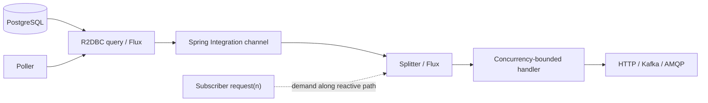
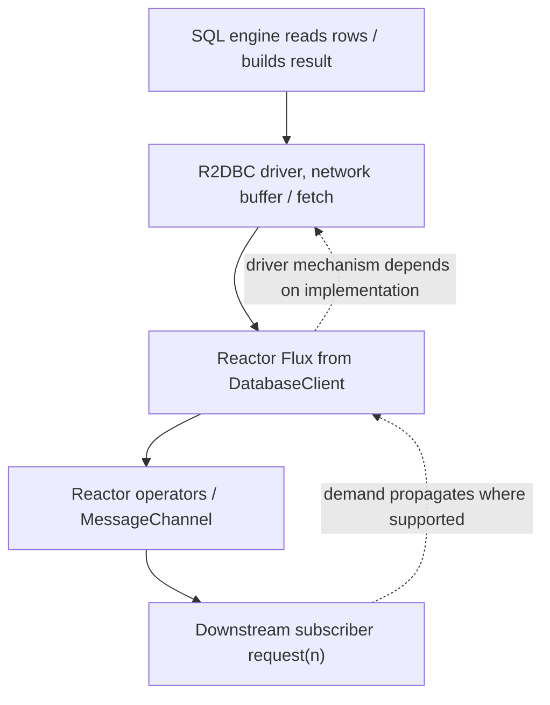
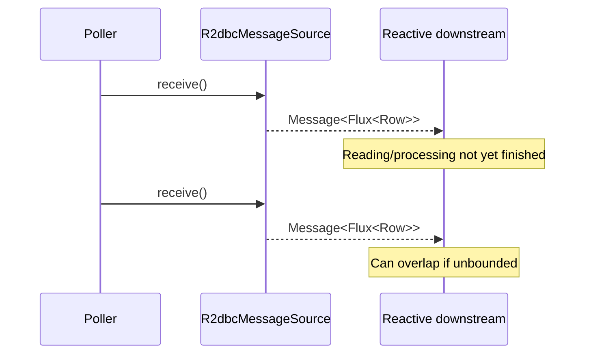
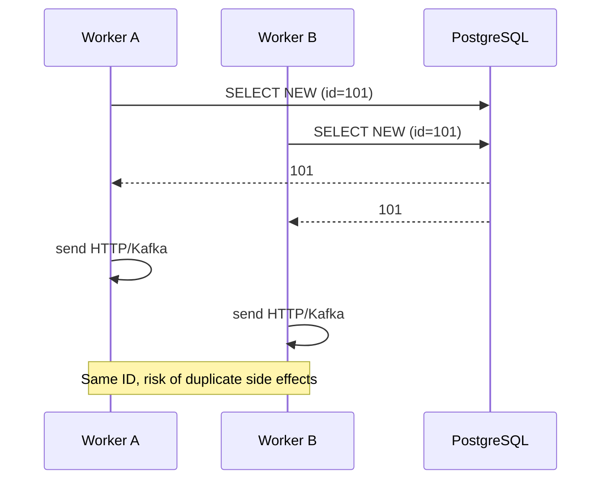

# Backpressure when reading many records

> **Chapter:** R2DBC Adapter  
> **Module:** SPRING_INTEGRATION_ADAPTERS  
> **Context:** Connect external systems to Spring Integration via inbound/outbound adapters, gateways, pollers, and MessageChannels. Practice with files, SFTP, HTTP, JMS, AMQP, Kafka, and databases; focus on message contracts, errors, connection lifecycles, and operability.

## 1. Learning Objectives

After this lesson, you will be able to:

- Explain **backpressure** under the Reactive Streams contract: subscribers use `request(n)` to signal demand; publishers must not emit `onNext` beyond active demand.
- Distinguish between **subscriber demand**, **SQL `LIMIT`**, **fetch size/prefetch**, **poll count**, **buffer size**, **concurrency**, and **connection pool size**.
- Write `DatabaseClient` queries returning `Flux<T>`, and coordinate batch processing with `concatMap`, `flatMap(..., concurrency)`, and suitable Reactor operators.
- Understand why R2DBC is a reactive API yet the database/driver may still prefetch or buffer; `request(n)` does not necessarily map to a network fetch of strictly `n` rows.
- Configure Spring Integration's `R2dbcMessageSource`: the poller emits **`Message<Flux<T>>`**, the splitter turns each row into a message, and channels/reactive endpoints determine demand boundaries.
- Identify why `fixedDelay`/`maxMessagesPerPoll` do not by themselves limit total rows or concurrent reactive tasks.
- Build a **bounded pipeline** with SQL batches, bounded concurrency, deadlines, retries, and pool monitoring.
- Handle `cancel`, `timeout`, and `onError` without confusing them with ACK/commit; avoid losing or duplicating events when errors occur mid-batch.
- Design **atomic claims, leases, post-downstream ACKs, and idempotency** when multiple instances read the same table.
- Test demand with `StepVerifier` and test resources with PostgreSQL/Testcontainers.

## 2. Problem: producer reads faster than consumer processes

A system writes events into an `integration_events` table. A Spring Integration application periodically reads `NEW` rows and sends them to an external API.

For example:

- The database can return thousands of rows quickly in a single SELECT.
- The external API can handle only a small number of concurrent requests.
- If the application eagerly reads the entire table, creates a request per row, and puts everything into an unbounded queue, memory/pools can overload.
- If you try to "solve" it by dropping older messages, the system will **lose events** when reliable delivery is required.

**Backpressure** helps a downstream reactive subscriber control the volume of items emitted by an upstream Publisher. However, Spring Integration also involves a **poller**, **MessageChannel**, **R2DBC driver**, **database connections**, and **external adapters**. Not every layer automatically shares the same demand signal.



### 2.1. What backpressure is NOT

| Concept | What does it guarantee? | What does it NOT guarantee? |
| --- | --- | --- |
| Reactor `request(n)` | Limits `onNext` signals emitted upstream per the subscription's outstanding demand. | That the database sends strictly `n` rows over the network or keeps at most `n` rows in memory. |
| SQL `LIMIT 50` | A single SELECT query returns no more than 50 rows per SQL semantics. | That only one query is running or that each row is ACKed. |
| `maxMessagesPerPoll(1)` | Poller calls `MessageSource.receive()` at most once in that poll task. | That only one SQL row is read. |
| `fixedDelay(2000)` | Paces scheduled triggers of the poll task. | That all reactive subscribers from the previous poll have finished. |
| `flatMap(..., 4)` | Bounds active inner publishers in that pipeline. | That the entire application/broker has only four pending requests. |
| Connection pool `max-size=10` | At most roughly ten active connections in the configured pool. | That only ten requests are waiting or queries won't hold locks long. |
| Queue capacity 100 | Caps messages buffered in that queue. | That producers slow down; queues may reject or block depending on API. |

**These are complementary mechanisms**, not different names for the same limit.

## 3. Reactive Streams: subscription, request(n), cancel

### 3.1. Four participants in the contract

Reactive Streams defines these roles:

- `Publisher<T>`: source capable of emitting data.
- `Subscriber<T>`: receiver of data.
- `Subscription`: link between one publisher and one subscriber, exposing `request(long n)` and `cancel()`.
- `Processor`: both subscribes upstream and publishes downstream when one component fulfills both roles.

Basic signaling:

```text
Publisher.subscribe(Subscriber)
            |
            v
Subscriber.onSubscribe(Subscription)
            |
            +-- request(2) ---------------------+
            |                                   |
            |                           onNext(row 1)
            |                           onNext(row 2)
            |
            +-- request(1) ---------------------+
                                                |
                                        onNext(row 3)
                                        onComplete()
```

A Publisher **must not** exceed total active demand, though Reactor operators can create internal subscriptions, adjust upstream requests, and prefetch/buffer in between.

### 3.2. request(n) is a signal count, not an SQL command

`request(10)` means the subscriber is ready to receive up to ten more items on that subscription.

It does **not** mean:

- SQL automatically adds `LIMIT 10`.
- A PostgreSQL cursor fetches strictly ten rows at a time.
- Ten rows have committed or been ACKed downstream.
- A database connection is returned immediately upon the tenth item.
- Remaining rows are deleted or marked processed.

A driver may prefetch multiple rows, and a server may execute a broad query and stream results incrementally; exact behavior depends on the driver, statement settings, transactions, and SQL dialect.

### 3.3. Demand example with StepVerifier

```java
import org.junit.jupiter.api.Test;
import reactor.core.publisher.Flux;
import reactor.test.StepVerifier;

class DemandTest {

    @Test
    void downstreamControlsRequests() {
        Flux<Integer> source = Flux.range(1, 4);

        StepVerifier.create(source, 0)
                .thenRequest(1)
                .expectNext(1)
                .thenRequest(2)
                .expectNext(2, 3)
                .thenRequest(1)
                .expectNext(4)
                .verifyComplete();
    }
}
```

This test verifies the **Reactor contract** against an in-memory source; it does **not** verify PostgreSQL row fetching behavior. Checking real drivers and resources requires integration tests.

### 3.4. What is Cancel?

`Subscription.cancel()` stops further item emissions from the publisher per contract; with R2DBC, it can trigger query/result cleanup and return the connection depending on implementation.

`cancel` **does not mean**:

- Committed statements are rolled back.
- Earlier HTTP/Kafka side effects are undone.
- Already-emitted rows were ACKed.
- The database immediately halts all I/O the instant the application invokes cancel.

Every side-effecting pipeline must distinguish **COMPLETE**, **ERROR**, **CANCEL**, and **TIMEOUT** in logs, metrics, and retry decisions.

## 4. Flux and the R2DBC driver: how far does backpressure reach?

### 4.1. A SELECT returning Flux<T>

Spring Framework `DatabaseClient` can produce a `Flux`:

```java
import org.springframework.r2dbc.core.DatabaseClient;
import reactor.core.publisher.Flux;

Flux<EventRow> events = db.sql(
                "SELECT id, event_key, payload_json, " +
                "status, created_at " +
                "FROM integration_events WHERE status = 'NEW' " +
                "ORDER BY id LIMIT 50")
        .map((row, metadata) -> new EventRow(
                row.get("id", Long.class),
                row.get("event_key", String.class),
                row.get("payload_json", String.class),
                row.get("status", String.class),
                row.get("created_at", java.time.OffsetDateTime.class)
        ))
        .all();
```

This snippet assumes `db` is present; `EventRow` is defined in section 7. Calling `sql(...).map(...).all()` **builds a Publisher**, without necessarily running SELECT yet. Upon subscription, the driver acquires a connection, executes SQL, emits mapped rows, and completes or errors.

### 4.2. Distinguishing four stages



- **Database:** picks execution plan, indexes, sorts, transaction snapshot; may process many rows before client receipt.
- **Driver:** decodes protocol data into `Row`; may use fetch policies, buffering, and transaction rules.
- **Reactor:** honors requested item counts per Reactive Streams.
- **Spring Integration:** channels, splitters, and handlers determine whether demand propagates or switches to another dispatch mechanism.

**Never assert that calling `request(1)` forces PostgreSQL to keep only one row in RAM.** That assumption easily leads to poor designs under heavy load.

### 4.3. Fetch size/prefetch is not SQL LIMIT

Some R2DBC drivers expose **fetch size** or fetch policies on statements/connections. Their behavior depends on the driver, transactions, auto-commit, and how the driver uses cursors.

- **SQL `LIMIT`** caps how many rows a query can return.
- **Fetch size** (when supported by the driver) is a hint/policy on server fetch chunk sizes.
- **Reactor `limitRate(n)`** shapes demand on a Publisher segment.
- **Operator prefetch** governs request/buffer sizes between operators.

Do not copy `fetchSize(...)` onto a Spring `DatabaseClient` API if the version in use does not expose that method. When tuning at the driver layer, consult the exact **driver Javadoc + version** and measure in a real environment.

### 4.4. Why can connections stay held for a long time?

A `Flux` query can hold result/connection resources until completion, error, or cancellation, especially with server-side cursors or transactions.

If a source reads a million rows and each row waits 500 ms on an external API, you can hold connections for a very long time by coupling reads directly to slow downstream processing.

A usually better solution:

1. SELECT/claim **small batches**.
2. Separate the DB claim/commit phase from slow API calls.
3. Process batches with bounded concurrency.
4. ACK each event per policy after downstream completes.
5. Fetch the next batch when capacity is available.
6. Monitor active connections, transaction duration, and lag.

## 5. SQL LIMIT, WHERE, ORDER BY: the first line of defense

### 5.1. Read only necessary rows

Avoid writing:

```sql
SELECT *
FROM integration_events
WHERE status = 'NEW';
```

With a large backlog, the query can transfer huge data, hold connections, and overload downstream.

Choose explicit projections and batch limits:

```sql
SELECT id, event_key, payload_json, status, created_at
FROM integration_events
WHERE status = 'NEW'
ORDER BY id
LIMIT 50;
```

Add an index supporting the filter and sort order:

```sql
CREATE INDEX idx_integration_events_status_id
    ON integration_events (status, id);
```

`LIMIT 50` guarantees the query returns at most 50 rows per SQL semantics. It does **not** stop two concurrent queries from selecting the same `NEW` rows; that requires atomic claims/leases or coordination.

### 5.2. Avoid SELECT * on wide tables

`payload_json` may be a large string. If you only need IDs to claim, read narrow columns first via an appropriate query; if payload is needed, read it later by claimed ID or return it directly in `UPDATE ... RETURNING` if design permits.

Narrowing projections helps:

- Reduce network bytes transferred.
- Reduce CPU spent mapping data.
- Reduce application allocations/GC.
- Reduce the risk of logging/leaking out-of-contract data.

**Do not** omit payload when downstream actually needs it if that turns into uncontrolled N queries per row; measure total round trips of your chosen design.

### 5.3. Keyset pagination

When reading reports or historical scans with a stable ID ordering:

```sql
SELECT id, event_key, payload_json, status, created_at
FROM integration_events
WHERE id > :lastId
ORDER BY id
LIMIT :pageSize;
```

Keyset pagination typically avoids large `OFFSET` costs. However:

- The cursor is only a **scan position**, not a downstream ACK.
- Auto-incrementing IDs do not always match commit order across concurrent transactions.
- Saving the cursor before processing/ACK finishes can skip rows on a crash.
- Filtering `status='NEW'` while statuses mutate across pages can shift the result set.

For reliable event delivery, prefer **claim/ACK/retry** or an outbox instead of treating `lastId` as a complete delivery offset.

## 6. Setting up Spring Boot + PostgreSQL R2DBC

Examples target **Java 17+, Spring Boot 3.x, Spring Integration 6.x, Spring Data R2DBC 3.x**. Let the Spring Boot BOM manage compatible dependency versions; verify Javadoc of the exact running versions when upgrading.

### 6.1. Maven dependencies

```xml
<dependencies>
    <dependency>
        <groupId>org.springframework.boot</groupId>
        <artifactId>spring-boot-starter-integration</artifactId>
    </dependency>
    <dependency>
        <groupId>org.springframework.boot</groupId>
        <artifactId>spring-boot-starter-data-r2dbc</artifactId>
    </dependency>
    <dependency>
        <groupId>org.springframework.integration</groupId>
        <artifactId>spring-integration-r2dbc</artifactId>
    </dependency>
    <dependency>
        <groupId>org.postgresql</groupId>
        <artifactId>r2dbc-postgresql</artifactId>
        <scope>runtime</scope>
    </dependency>
    <dependency>
        <groupId>io.r2dbc</groupId>
        <artifactId>r2dbc-pool</artifactId>
    </dependency>
    <dependency>
        <groupId>io.projectreactor</groupId>
        <artifactId>reactor-test</artifactId>
        <scope>test</scope>
    </dependency>
</dependencies>
```

The R2DBC PostgreSQL driver differs from the JDBC driver. An `io.r2dbc.spi.ConnectionFactory` created by Boot or application config is required. `r2dbc-pool` must match versions chosen by the BOM.

### 6.2. application.yml

```yaml
spring:
  r2dbc:
    url: r2dbc:postgresql://127.0.0.1:5432/integration_demo
    username: ${DB_USER}
    password: ${DB_PASSWORD}
    pool:
      enabled: true
      initial-size: 2
      max-size: 10
      max-acquire-time: 3s
      max-idle-time: 10m
```

`${DB_USER}` and `${DB_PASSWORD}` are Spring environment placeholders; never store real passwords in Git. Create the DB beforehand and grant only necessary privileges.

These are **starter demo values**, not default production settings. With multiple app instances, total connection budgets must account for all other services sharing PostgreSQL.

### 6.3. Integration table

```sql
CREATE TABLE integration_events (
    id            BIGSERIAL PRIMARY KEY,
    event_key     VARCHAR(80) NOT NULL UNIQUE,
    payload_json  TEXT NOT NULL,
    status        VARCHAR(20) NOT NULL DEFAULT 'NEW',
    claim_owner   VARCHAR(80),
    claim_token   VARCHAR(80),
    lease_until   TIMESTAMPTZ,
    attempt_count INTEGER NOT NULL DEFAULT 0,
    created_at    TIMESTAMPTZ NOT NULL DEFAULT NOW(),
    processed_at  TIMESTAMPTZ
);

CREATE INDEX idx_integration_events_status_id
    ON integration_events (status, id);

INSERT INTO integration_events(event_key, payload_json)
VALUES
  ('event-101', '{"deviceId":"sensor-01"}'),
  ('event-102', '{"deviceId":"sensor-02"}'),
  ('event-103', '{"deviceId":"sensor-03"}');
```

`event_key` is the **business idempotency key** and must remain stable across retries. `status`/`claim_owner`/`claim_token`/`lease_until` are meaningful only when the application actually implements a claim/ACK protocol; having the columns alone does not create delivery guarantees.

### 6.4. Entity used in the adapter

Create `IntegrationEventRow.java`:

```java
import java.time.OffsetDateTime;
import org.springframework.data.annotation.Id;
import org.springframework.data.relational.core.mapping.Column;
import org.springframework.data.relational.core.mapping.Table;

@Table("integration_events")
public record IntegrationEventRow(
        @Id Long id,
        @Column("event_key") String eventKey,
        @Column("payload_json") String payloadJson,
        String status,
        @Column("created_at") OffsetDateTime createdAt
) {
}
```

A Java record works well as immutable data. Annotations are optional when manually mapping via `DatabaseClient`, while `@Table`/`@Column` are useful for `R2dbcEntityTemplate` and `R2dbcMessageSource.payloadType(...)`.

## 7. Bounded batch reads with DatabaseClient

### 7.1. Complete repository

Create `EventBatchReader.java`:

```java
import java.time.OffsetDateTime;
import org.springframework.r2dbc.core.DatabaseClient;
import org.springframework.stereotype.Repository;
import reactor.core.publisher.Flux;

@Repository
public class EventBatchReader {

    private final DatabaseClient db;

    public EventBatchReader(DatabaseClient db) {
        this.db = db;
    }

    public Flux<IntegrationEventRow> readNewBatch(int batchSize) {
        if (batchSize < 1 || batchSize > 100) {
            return Flux.error(new IllegalArgumentException(
                    "batchSize must be in [1,100]"));
        }

        return db.sql(
                        "SELECT id, event_key, payload_json, " +
                        "status, created_at " +
                        "FROM integration_events " +
                        "WHERE status = 'NEW' " +
                        "ORDER BY id LIMIT :maxRows")
                .bind("maxRows", batchSize)
                .map((row, metadata) ->
                        new IntegrationEventRow(
                                row.get("id", Long.class),
                                row.get("event_key", String.class),
                                row.get("payload_json", String.class),
                                row.get("status", String.class),
                                row.get("created_at",
                                        OffsetDateTime.class)
                        ))
                .all();
    }

    public Flux<IntegrationEventRow> readAfter(
            long lastId, int batchSize) {
        if (lastId < 0 || batchSize < 1 || batchSize > 100) {
            return Flux.error(new IllegalArgumentException(
                    "Invalid cursor or batchSize"));
        }

        return db.sql(
                        "SELECT id, event_key, payload_json, " +
                        "status, created_at " +
                        "FROM integration_events " +
                        "WHERE id > :lastId " +
                        "ORDER BY id LIMIT :maxRows")
                .bind("lastId", lastId)
                .bind("maxRows", batchSize)
                .map((row, metadata) ->
                        new IntegrationEventRow(
                                row.get("id", Long.class),
                                row.get("event_key", String.class),
                                row.get("payload_json", String.class),
                                row.get("status", String.class),
                                row.get("created_at",
                                        OffsetDateTime.class)
                        ))
                .all();
    }
}
```

**Design meaning:**

1. The repository returns `Flux<IntegrationEventRow>`, never subscribing on the caller's behalf.
2. SQL `LIMIT` bounds rows in a single query before Reactor operators run.
3. `ORDER BY id` ensures stable ordering within each query.
4. `map((row, metadata) -> ...)` turns `Row` into a DTO/record without retaining raw `Row` references outside the callback.
5. `readNewBatch` **does not claim** records. Use it for observability/backpressure labs, **not** as a production worker with non-idempotent side effects.
6. `readAfter` fits cursor scanning, yet the cursor is **not** an ACK.

### 7.2. When there are no rows

`readNewBatch(25)` can return `Flux.empty()` after finding 0 rows. This is an **empty completion**, not `onError` or proof the database is broken.

If SQL fails schema checks or the driver cannot connect, the Publisher emits **`onError`**; never catch errors and replace them with `Flux.empty()` across the board, as that masks data-loss conditions.

## 8. Throttling with Reactor operators

### 8.1. map and filter are data transformations

```java
Flux<String> ids = reader.readNewBatch(25)
        .filter(row -> "NEW".equals(row.status()))
        .map(IntegrationEventRow::eventKey);
```

`filter` after DB row emission **does not** make the SQL query read fewer rows. Push predicates down into `WHERE` whenever possible to save I/O.

`map` transforms items synchronously; it does **not** turn an I/O callback into a completion-tracked publisher. To invoke non-blocking HTTP, use `concatMap`/`flatMap` with `Mono`.

### 8.2. concatMap: sequential processing

Assuming an interface:

```java
import reactor.core.publisher.Mono;

public interface DownstreamSender {
    Mono<Void> send(IntegrationEventRow event);
}
```

Sequential processing pattern:

```java
import reactor.core.publisher.Mono;

public Mono<Void> sendSequentially(
        EventBatchReader reader,
        DownstreamSender sender) {

    return reader.readNewBatch(25)
            .concatMap(sender::send)
            .then();
}
```

`concatMap` waits for the previous inner publisher to complete before processing the next item in order. It fits when downstream requires strict ordering or cannot tolerate high concurrency, though throughput drops when remote APIs are slow.

**This is only a flow-control example**, lacking claim/ACK; running repeatedly on `NEW` rows can send duplicates.

### 8.3. flatMap with fixed concurrency

```java
public Mono<Void> sendWithBoundedConcurrency(
        EventBatchReader reader,
        DownstreamSender sender) {

    return reader.readNewBatch(25)
            .flatMap(sender::send, 4)
            .then();
}
```

In this pipeline, `flatMap(..., 4)` bounds concurrent inner publishers. Side effects can finish **out of SELECT order**. If ordering per aggregate/business key is mandatory, use `concatMap`, key-based partitioning, or an equivalent strategy.

**Important:** a limit of 4 does not automatically apply across 10 other instances, other producers, or all subscriptions of the same repository.

### 8.4. flatMapSequential: preserves output order, not side-effect order

```java
Flux<String> results = reader.readNewBatch(25)
        .flatMapSequential(
                row -> sender.send(row).thenReturn(row.eventKey()),
                4
        );
```

This operator can run multiple inner publishers concurrently while emitting **results** in input order. Calls to external systems can still execute and complete out of order.

Do not use `flatMapSequential` to promise that Kafka/HTTP will observe **side effects** in strict order.

### 8.5. buffer: groups items, does not create SQL batches

```java
Flux<java.util.List<IntegrationEventRow>> groups =
        reader.readNewBatch(50).buffer(10);
```

`buffer(10)` builds lists of up to 10 rows in the application. It **does not** turn five INSERTs into an SQL batch, nor change the SELECT row count.

When downstream exposes bulk endpoints, buffering can reduce network round trips. Still, limit **how many groups are in flight**; an unbounded `flatMap` over lists can still overload the target service.

### 8.6. collectList: buffers the whole batch in memory

```java
Mono<java.util.List<IntegrationEventRow>> snapshot =
        reader.readNewBatch(50).collectList();
```

Because the query already caps at 50 rows, this is reasonable when a batch must be handled as a unit. On an unbounded SELECT of millions of rows, `collectList()` can consume huge amounts of RAM.

### 8.7. limitRate and take vs. SQL LIMIT

```java
Flux<IntegrationEventRow> limitedDemand =
        reader.readNewBatch(50).limitRate(16);

Flux<IntegrationEventRow> earlyCancel =
        reader.readNewBatch(50).take(5);
```

- `limitRate(16)` shapes upstream Reactor demand; it does not rewrite SELECT to `LIMIT 16`.
- `take(5)` receives at most five items and cancels the subscription; the database may already have executed more work.
- `take(5)` is not an ACK of five rows and does not "return" the other 45 rows to a queue.
- `onBackpressureBuffer` should also not be used blindly on unbounded sources; set capacity limits and overflow policies.

## 9. onBackpressureBuffer, drop, latest: choices with consequences

### 9.1. Bounded buffer

```java
Flux<IntegrationEventRow> boundedQueue =
        reader.readNewBatch(50)
                .onBackpressureBuffer(20);
```

Key points:

- This operator may **request upstream faster than downstream consumes** and buffer some items.
- If the producer keeps exceeding capacity, overflow/error behavior depends on the configured overflow strategy.
- It does not reduce the number of rows the database must SELECT.
- Always bound capacity **and** define overflow behavior and overflow metrics.

An in-memory buffer is not a durable queue. On a process crash, data sitting in memory can be lost even though the publisher already emitted it.

### 9.2. Drop and latest are lossy choices

`onBackpressureDrop()` and `onBackpressureLatest()` fit **sampleable signals** (such as real-time UI charts), but are usually **unsuitable for business events requiring guaranteed delivery**.

| Use case | Can drop items? | Approach |
| --- | --- | --- |
| Continuous temperature updates for UI, only latest point needed | Maybe, when contract allows. | Latest/sample/throttle with documented loss policy. |
| Payments, orders, shipping confirmations | No. | Durable queue, claim/ACK, retry/idempotency. |
| Non-critical logs/traces | Possible by priority. | Bounded buffer and drop metrics. |
| Outbox events to Kafka | Should not drop. | Keep rows in DB/broker until ACK. |

**Do not use drop to "fix backpressure"** when dropped items carry mandatory business value.

### 9.3. Never block the event loop with blocking operations

Running blocking JDBC, blocking HTTP clients, or `Thread.sleep` inside a reactive handler on an event-loop degrades throughput and can stall subscriptions.

Prefer end-to-end reactive APIs. If interacting with blocking APIs is unavoidable, isolate them onto an appropriate scheduler such as `Schedulers.boundedElastic()`, bound concurrency, measure latency, and plan a replacement—never turn the entire pipeline into uncontrolled threads.

## 10. Spring Integration: R2dbcMessageSource and Message<Flux<T>>

`R2dbcMessageSource` is the **MessageSource** of the inbound R2DBC adapter. The poller calls `receive()` on schedule. Under the default `expectSingleResult=false`, each `receive()` can return a **Spring Message containing a `Flux` of rows**.

```text
Poller calls receive()
         |
         v
R2dbcMessageSource
         |
         v
Message<Flux<IntegrationEventRow>>
         |
         v
FluxMessageChannel / Splitter
         |
         +--> Message<IntegrationEventRow> #1
         +--> Message<IntegrationEventRow> #2
         +--> ...
         +--> Message<IntegrationEventRow> #N
```

### 10.1. One poll is not one row

If SQL has `LIMIT 50` and the poller uses `maxMessagesPerPoll(1)`:

- The poll task calls `receive()` at most once.
- The source can emit one `Message<Flux<T>>`.
- That `Flux` can contain up to 50 rows when subscribed.
- The splitter can produce up to 50 downstream messages.

**`maxMessagesPerPoll(1)` limits messages from the source, not rows inside the Publisher.**

### 10.2. Illustrative Java DSL

Create `R2dbcPollingConfiguration.java`:

```java
import org.springframework.context.annotation.Bean;
import org.springframework.context.annotation.Configuration;
import org.springframework.data.r2dbc.core.R2dbcEntityTemplate;
import org.springframework.integration.config.EnableIntegration;
import org.springframework.integration.dsl.IntegrationFlow;
import org.springframework.integration.dsl.MessageChannels;
import org.springframework.integration.r2dbc.dsl.R2dbc;

@Configuration
@EnableIntegration
public class R2dbcPollingConfiguration {

    @Bean
    IntegrationFlow pollNewEvents(
            R2dbcEntityTemplate template) {

        return IntegrationFlow
                .from(
                        R2dbc.inboundChannelAdapter(
                                template,
                                "SELECT id, event_key, payload_json, " +
                                "status, created_at " +
                                "FROM integration_events " +
                                "WHERE status = 'NEW' " +
                                "ORDER BY id LIMIT 25")
                                .payloadType(IntegrationEventRow.class)
                                .expectSingleResult(false),
                        endpoint -> endpoint.poller(p ->
                                p.fixedDelay(2_000)
                                 .maxMessagesPerPoll(1))
                )
                .channel(MessageChannels.flux())
                .split()
                .channel(MessageChannels.flux())
                .handle(IntegrationEventRow.class, (row, headers) -> {
                    System.out.printf(
                            "Received from DB: id=%d eventKey=%s%n",
                            row.id(), row.eventKey()
                    );
                    return null;
                })
                .get();
    }
}
```

**This is a SELECT-and-log demo**, not a production queue consumer. `status='NEW'` never changes, so **every poll can re-read old rows**. Do not connect this logging handler directly to non-idempotent side effects in real environments.

### 10.3. Why is a Splitter needed?

By default, the source payload is **`Flux<IntegrationEventRow>`**. A handler expecting an `IntegrationEventRow` will not automatically receive rows just by wiring a channel.

`split()` turns Publisher elements into separate Spring Messages so the handler processes one row at a time. Flow channel types and subscriptions affect how the splitter behaves; **use appropriate reactive channels and verify with integration tests**.

### 10.4. FluxMessageChannel does not automatically make the whole flow reactive

`MessageChannels.flux()` creates a `FluxMessageChannel`, a `ReactiveStreamsSubscribableChannel`. It lets downstream subscribers/processors participate in demand.

Still, verify:

- Is an appropriate **subscriber** initialized for the channel?
- Does any bridge to `DirectChannel`/`QueueChannel`/blocking handler change semantics?
- Is `split()` placed properly to consume the R2DBC Publisher?
- Are active handlers/inner publishers bounded?
- When an error comes from `Flux` after the poll task finishes, where is it handled?
- Does the upstream broker/HTTP source respond to backpressure or keep pushing into its own queue?

**The name "FluxMessageChannel" is not a promise that all work automatically bounds concurrency, ACKs, or persists data.**

### 10.5. expectSingleResult(true)

With `expectSingleResult(true)`, the source switches to single-result mode; per the API the payload is typically `Mono<T>`, **not** a Java entity materialized at `receive()` time.

```text
expectSingleResult(false):
  Message<Flux<Row>>    (default)

expectSingleResult(true):
  Message<Mono<Row>>
```

To fetch one row, the SQL should use a unique key or `LIMIT 1`. Both Publisher forms still need an appropriate subscriber/consumer.

## 11. Poller and overall read rate

### 11.1. Two kinds of clocks

- **Poller scheduling**: how often a message is fetched from `MessageSource`.
- **Reactive completion**: how long `Flux`/handlers take to read, process, and ACK all items.

A poll task can finish right after sending `Message<Flux<T>>` to a channel, **before** asynchronous downstream work completes. This depends on topology—never guess from `fixedDelay` alone.



### 11.2. Why fixedDelay polling alone is not enough

Suppose a batch has 25 rows and each downstream request is slow. The poller can keep triggering the source on schedule and spawning new Publishers. Multiple queries, subscriptions, and downstream requests can pile up and overlap.

How to handle it:

1. **Cap SQL batch size**.
2. **Bound total active batches/subscriptions** using an orchestrator/semaphore or a polling source that starts the next batch only after the previous one completes per contract.
3. Use **atomic claims** so two batches never own the same event.
4. Use **bounded concurrency** downstream.
5. Tune poll rates based on observed backlog and end-to-end latency.
6. Design lease-based recovery for process crashes.

**Do not call `Thread.sleep()` inside a poller to wait for handlers**, as that blocks threads and obscures completion semantics.

### 11.3. R2DBC inbound is not CDC

The R2DBC inbound adapter queries the database periodically; it does **not** tail transaction logs or guarantee immediate emission on row commit.

If very low latency is required or every change across many tables must be emitted, consider CDC or a transactional outbox. Either way, downstream still needs backpressure/rate limits and idempotency.

## 12. Protecting the database connection pool

### 12.1. The pool is a finite resource

An R2DBC `ConnectionFactory` can be wrapped by a pool, e.g., max 10 connections. When concurrent query subscriptions exceed capacity, requests wait to acquire a connection.

```text
100 producers
     |
     v
Reactive pipelines / bounded concurrency
     |
     v
R2DBC pool (max-size=10)
     |
     +--> active connections
     +--> idle connections
     +--> pending acquisition requests
     |
     v
PostgreSQL
```

**Pool `max-size`** limits connections, not waiting tasks. If pending acquisitions go unchecked, the application can still accumulate too many Publishers and trigger timeouts or memory pressure.

### 12.2. Causes of holding connections too long

- Large-row SELECT with a slow subscriber.
- Transactions spanning HTTP calls or sleeps.
- SQL lock contention.
- Unreleased driver fetches/cursors.
- Queries without statement timeouts.
- Subscribers failing to consume or cancel cleanly.
- Retries spawning parallel subscriptions while the DB is already slow.

### 12.3. Do not span DB transactions across HTTP calls

Anti-pattern:

```text
BEGIN transaction
SELECT/claim rows
hold row locks + connection
wait seconds for HTTP API
COMMIT
```

Usually safer pattern:

```text
Short transaction #1: claim rows + COMMIT
          |
          v
Call HTTP/Kafka/AMQP outside DB transaction
          |
          v
Short transaction #2: ACK DONE with owner/token
```

This requires **leases and idempotency** because a worker can crash in between. In exchange, it avoids holding DB connections/locks while waiting on remote services.

## 13. Reliable reading: atomic claim before sending

### 13.1. Why can plain SELECT cause duplicate reads?

Two instances both run:

```sql
SELECT id, event_key, payload_json
FROM integration_events
WHERE status = 'NEW'
ORDER BY id LIMIT 25;
```

Both can receive the same rows. Backpressure does not fix **ownership**: it only paces item emission.



### 13.2. PostgreSQL UPDATE RETURNING and SKIP LOCKED

To claim a batch, you can use a single **PostgreSQL statement**:

```sql
WITH picked AS (
    SELECT id
    FROM integration_events
    WHERE status = 'NEW'
    ORDER BY id
    LIMIT :batchSize
    FOR UPDATE SKIP LOCKED
)
UPDATE integration_events AS e
SET status = 'PROCESSING',
    claim_owner = :owner,
    claim_token = :token,
    lease_until = NOW() + INTERVAL '60 seconds',
    attempt_count = attempt_count + 1
FROM picked
WHERE e.id = picked.id
RETURNING e.id, e.event_key, e.payload_json,
          e.status, e.created_at;
```

- `FOR UPDATE SKIP LOCKED` lets multiple workers skip rows currently locked by another transaction while picking a batch.
- `UPDATE ... RETURNING` returns **the exact rows UPDATED**.
- `:batchSize` bounds claimed rows.
- `claim_owner` and `claim_token` identify the owner of the claim request.
- `lease_until` enables recovery if a worker dies before ACK.
- `attempt_count` supports retry policies.

This is **PostgreSQL-specific SQL**; test real locking and isolation behavior. To reclaim expired leases, add a corresponding recovery path/predicate; the example above only picks `NEW` and **does not automatically reclaim expired `PROCESSING` rows**.

### 13.3. Batch claim repository

```java
import java.time.OffsetDateTime;

import org.springframework.r2dbc.core.DatabaseClient;
import org.springframework.stereotype.Repository;
import reactor.core.publisher.Flux;
import reactor.core.publisher.Mono;

@Repository
public class EventClaimRepository {

    private final DatabaseClient db;

    public EventClaimRepository(DatabaseClient db) {
        this.db = db;
    }

    public Flux<IntegrationEventRow> claimBatch(
            String owner, String token, int batchSize) {

        if (owner == null || token == null
                || !owner.matches("[A-Za-z0-9_-]{1,80}")
                || !token.matches("[A-Za-z0-9_-]{1,80}")
                || batchSize < 1 || batchSize > 100) {
            return Flux.error(new IllegalArgumentException(
                    "Invalid claim options"));
        }

        return db.sql(
                        "WITH picked AS (" +
                        " SELECT id FROM integration_events " +
                        " WHERE status = 'NEW' ORDER BY id " +
                        " LIMIT :size FOR UPDATE SKIP LOCKED" +
                        ") UPDATE integration_events AS e " +
                        "SET status='PROCESSING', " +
                        "claim_owner=:owner, claim_token=:token, " +
                        "lease_until=NOW()+INTERVAL '60 seconds', " +
                        "attempt_count=attempt_count+1 " +
                        "FROM picked WHERE e.id = picked.id " +
                        "RETURNING e.id, e.event_key, e.payload_json, " +
                        "e.status, e.created_at")
                .bind("size", batchSize)
                .bind("owner", owner)
                .bind("token", token)
                .map((row, metadata) -> new IntegrationEventRow(
                        row.get("id", Long.class),
                        row.get("event_key", String.class),
                        row.get("payload_json", String.class),
                        row.get("status", String.class),
                        row.get("created_at", OffsetDateTime.class)
                ))
                .all();
    }

    public Mono<Long> acknowledge(
            long id, String owner, String token) {

        return db.sql(
                        "UPDATE integration_events " +
                        "SET status='DONE', " +
                        "processed_at=NOW(), lease_until=NULL " +
                        "WHERE id=:id AND status='PROCESSING' " +
                        "AND claim_owner=:owner AND claim_token=:token")
                .bind("id", id)
                .bind("owner", owner)
                .bind("token", token)
                .fetch().rowsUpdated();
    }
}
```

The result of `claimBatch` is `Flux<IntegrationEventRow>` holding the successfully claimed rows **when the publisher is subscribed**. Remember this query **has side effects**: re-subscribing can claim another batch.

**Do not blindly attach `retryWhen` to a claim Flux that performs UPDATEs**: an error after partial emission or an ambiguous commit result can cause a new subscription to claim extra or duplicate work. Record batches/tokens and base recovery on the DB's authoritative state.

### 13.4. ACK must check row count

`acknowledge(...)` returns `Mono<Long>`:

- `1`: one row matching owner/token transitioned to `DONE`.
- `0`: row missing, status/owner/token changed, or lease/recovery reassigned ownership.
- `onError`: DB error; do not assume whether the ACK committed.

Do not discard the count with `.then()` when business policy requires exact-one ACK. On count 0, reconcile instead of arbitrarily marking the event finished.

### 13.5. Backpressure and claims must work together

A reliable claim pipeline typically runs in cycles:

```text
Capacity available?
        |
        v
Claim up to N rows + commit
        |
        v
Process <= K events concurrently
        |
        v
ACK successful rows / record failed + retry metadata
        |
        v
Release capacity then claim next batch
```

If a crash occurs after claiming, data stays in `PROCESSING`, requiring **lease expiry recovery**. If a crash occurs after the side effect but before ACK, downstream can receive the event again, requiring an **idempotency key**.

Backpressure lessons **do not** replace delivery design: load bounding and state guarantees are twin goals that must be built together.

## 14. Boundaries with Kafka, AMQP, JMS, HTTP, and files

An integration flow rarely uses R2DBC alone. After mapping rows, data may flow through outbound Kafka/AMQP/JMS/HTTP adapters.

| Boundary | Backpressure issue | What else is needed? |
| --- | --- | --- |
| HTTP reactive client | Target API has latency, rate limits, timeouts. | Bounded concurrency, timeouts, retry budgets, and circuit breakers. |
| Kafka producer | Broker ACKs and producer buffers have their own semantics. | In-flight limits, error handling, key/partition ordering, idempotent consumers. |
| AMQP/JMS | Consumer prefetch/ACK and broker queue capacity are separate mechanisms. | Manual ACKs per contract, redelivery/DLQ, and backpressure bridge. |
| File/SFTP adapter | Poller reads many files, contents can be large. | Polling batch caps, file ownership, retries, and streaming/chunking. |
| Database inbound | Poller returns `Message<Flux>`, query can read many rows. | SQL `LIMIT`, reactive subscriptions, claim/ACK. |
| DirectChannel | Dispatch is synchronous by handler. | Does not automatically propagate Reactive Streams demand across the flow. |
| FluxMessageChannel | Supports reactive subscriptions/demand. | Verify subscribers, publisher lifecycle, concurrency, and error paths. |

**Never assume an HTTP API or Kafka broker directly receives and obeys `request(n)` from an R2DBC Reactor Flux.** You normally need a **rate-adaptation boundary** with bounded buffers, in-flight counters, or persistent queues.

### 14.1. When to ACK upstream?

Do not ACK a Kafka/JMS/AMQP input merely because `MessageChannel.send(...)` was called or a reactive Publisher was created.

Choose an explicit contract:

- **Received**: command is durably stored by the responsible processor.
- **DB committed**: data transaction committed.
- **Published**: broker confirmed receipt per policy.
- **Business processed**: final side effects finished and state durably recorded.

These stages differ. An outbox pattern can ACK input after data changes + outbox insert commit in one transaction, while a separate publisher delivers to Kafka/AMQP.

## 15. Errors, timeouts, and retries while streaming many rows

### 15.1. Partial emission

Example:

```text
Flux query emits row 101 -> handler sent successfully
Flux query emits row 102 -> handler sent successfully
Flux query row 103       -> mapping/driver error
                         -> onError
```

If you retry the whole SELECT `Flux`, rows 101/102 may be read again. **Backpressure does not automatically roll back side effects preceding `onError`**.

You need:

- Stable event IDs across retries.
- Post-downstream ACKs.
- Recovery/leases for un-ACKed rows.
- Idempotent consumers.
- Tracking partial progress per event ID rather than only per batch count.

### 15.2. Cold retries can start a new query

```java
import java.time.Duration;
import reactor.util.retry.Retry;

Flux<IntegrationEventRow> retried =
        reader.readNewBatch(25)
                .retryWhen(
                        Retry.backoff(
                                2, Duration.ofMillis(200))
                             .maxBackoff(Duration.ofSeconds(2)));
```

This is only a **pure-read query retry demo**. Production must filter transient exceptions and enforce a total deadline. Each retry can **resubscribe and re-run SQL**, rather than automatically resuming from the last row.

**Do not** apply this directly to `claimBatch` with `UPDATE RETURNING` without an idempotent claim/recovery protocol.

### 15.3. Inter-item timeout vs. total deadline

```java
import java.time.Duration;

Flux<IntegrationEventRow> gapTimed =
        reader.readNewBatch(25)
                .timeout(Duration.ofSeconds(3));
```

With `Flux.timeout(Duration)`, the timeout is typically the **wait between consecutive items**; if items arrive steadily yet slowly, the whole batch can run much longer.

For a small batch already bounded by SQL LIMIT:

```java
Mono<java.util.List<IntegrationEventRow>> batch =
        reader.readNewBatch(25)
                .collectList()
                .timeout(Duration.ofSeconds(8));
```

`collectList()` is safe here because of `LIMIT 25`; the deadline covers materializing the whole batch. A client-side timeout does not prove the transaction/statement rolled back; reconcile for side-effecting operations.

### 15.4. ErrorChannel and reactive errors

In Spring Integration, errors can arise **after the poller sends `Message<Flux>`**, when the publisher is subscribed. Do not assume the poller's `errorChannel` catches every error from downstream subscriptions.

- **Synchronous** errors creating/sending the message follow endpoint error handling.
- **Asynchronous** Publisher errors must be handled in the reactive chain or channel/handler error mechanisms.
- When a handler throws after some rows were processed, track per-row state.

Do not use `onErrorResume(error -> Flux.empty())` to "keep the flow moving" on serious DB errors; it turns failures into fake empty batches.

## 16. Cancellation, cleanup, and graceful shutdown

### 16.1. Cancel can happen mid-batch

When clients close connections, breakers trip, timeouts fire, or the app shuts down, downstream can cancel the subscription.

Consequences:

- Some rows were mapped/sent.
- Some rows were not emitted.
- Queries/connections must clean up per driver/Spring contracts.
- With claim/lease, claimed but un-ACKed rows still need recovery.
- Never infer full batch completion simply because the Publisher-creating method returned normally.

### 16.2. Proper shutdown

A shutdown policy should:

1. Stop accepting new inputs and stop pollers/new batch claims.
2. Avoid starting unnecessary new reactive subscriptions.
3. Wait for in-flight tasks to finish **up to a bounded deadline**.
4. Record ACKs for rows that genuinely succeeded.
5. Let un-ACKed rows recover via leases/retries.
6. Close connection pools and resources per application lifecycle.
7. Emit metrics for final state, in-flight count, and expired claims.

Never hold DB transactions open across the entire shutdown window to "protect" slow HTTP requests.

### 16.3. Never open raw connections and forget to return them

In most use cases, let `DatabaseClient`/`R2dbcEntityTemplate` manage the ConnectionFactory. If forced to use the R2DBC SPI directly, clean up along complete/error/cancel paths, e.g., with Reactor `usingWhen`.

Never hold a raw `Connection` singleton across concurrent subscriptions; that corrupts transaction isolation and lifetimes.

## 17. Observing backpressure through metrics

### 17.1. Metrics must separate read source from downstream

| Suggested metric | Explanation |
| --- | --- |
| `r2dbc_query_subscribed_total` | How many SQL Publishers actually started. |
| `r2dbc_query_completed_total` | How many subscriptions completed normally. |
| `r2dbc_query_error_total` | SQL/driver/mapping errors. |
| `r2dbc_query_cancel_total` | Cancelled subscriptions. |
| `r2dbc_rows_read_total` | Rows successfully emitted by mappers. |
| `r2dbc_rows_per_batch_p95` | Actual batch sizes. |
| `r2dbc_pool_active` / `pending` | Connection pool busy/waiting. |
| `r2dbc_query_latency_p95` | Query execution and result consumption time. |
| `downstream_inflight` | Concurrent external requests/handlers. |
| `downstream_latency_p95` | Remote API/broker ACK time. |
| `backlog_new_oldest_age` | Age of oldest `NEW` event. |
| `claim_lease_expired_total` | Claims not ACKed on time. |
| `events_acknowledged_total` | Events transitioned to `DONE`. |
| `duplicate_event_key_total` | Observed redelivery/retry rate. |
| `buffer_overflow_total` | Bounded buffer overflows. |

These names are **instrumentation suggestions**, not all automatically emitted by Spring/Micrometer. Never use high-cardinality `event_key`/`claim_token` values as metric labels.

### 17.2. Tracing subscriptions and terminal signals

```java
import reactor.core.publisher.Flux;

Flux<IntegrationEventRow> observed =
        reader.readNewBatch(25)
                .doOnSubscribe(subscription ->
                        System.out.println("Query subscribed"))
                .doOnNext(row ->
                        System.out.println(
                                "Mapped id=" + row.id()))
                .doOnError(error ->
                        System.err.println(
                                "SQL/mapping error: " +
                                error.getClass().getSimpleName()))
                .doFinally(signal ->
                        System.out.println("Final signal=" + signal));
```

This is a Publisher that does not execute without a subscriber. `doFinally` distinguishes `ON_COMPLETE`, `ON_ERROR`, and `CANCEL`.

In production, use structured logging/tracing and log limits; never print full JSON payloads containing sensitive data or credentials.

### 17.3. Distinguishing "fast DB" from "fast pipeline"

A query reading 25 rows in a few milliseconds does not mean 25 events were processed end-to-end. Track two latency groups:

- **DB query/mapping latency**: from subscribe to query/result completion.
- **Business processing/ACK latency**: from claim/read through remote side effects and DB ACK.

If queries are fast yet processing is slow, slow down claim/poll rates and bound concurrency. If queries are slow, inspect indexes, locks, pools, and SQL execution plans.

## 18. Testing with StepVerifier

### 18.1. Testing demand by item count

```java
import org.junit.jupiter.api.Test;
import reactor.core.publisher.Flux;
import reactor.test.StepVerifier;

@Test
void requestsDataIncrementally() {
    StepVerifier.create(Flux.range(1, 5), 0)
            .thenRequest(2)
            .expectNext(1, 2)
            .thenRequest(2)
            .expectNext(3, 4)
            .thenRequest(1)
            .expectNext(5)
            .verifyComplete();
}
```

This is a test method inside a JUnit class; it does not prove the PostgreSQL driver fetches strictly `request(n)` at the wire level.

### 18.2. Testing intentional cancellation

```java
@Test
void cancellationStopsFurtherDemand() {
    StepVerifier.create(Flux.range(1, 100), 0)
            .thenRequest(3)
            .expectNext(1, 2, 3)
            .thenCancel()
            .verify();
}
```

This test verifies subscription cancellation at the Reactor level. R2DBC integration tests should also inspect active/pending pool metrics and verify connections return when queries cancel.

### 18.3. Testing SQL LIMIT on PostgreSQL

Assuming `EventBatchReader reader` is injected into a test class with a PostgreSQL test database seeded with more than ten `NEW` rows:

```java
import reactor.test.StepVerifier;

@Test
void queryNeverExceedsBatchLimit() {
    StepVerifier.create(reader.readNewBatch(3).collectList())
            .assertNext(rows ->
                    org.junit.jupiter.api.Assertions.assertTrue(
                            rows.size() <= 3))
            .verifyComplete();
}
```

To make the test meaningful, ensure the initial fixture has **more than three rows**; with only two rows, the test passes without proving `LIMIT` works.

### 18.4. Testing flatMap concurrency

```java
import java.time.Duration;
import java.util.concurrent.atomic.AtomicInteger;
import reactor.core.publisher.Flux;
import reactor.core.publisher.Mono;
import reactor.test.StepVerifier;

@Test
void flatMapHasBoundedInnerConcurrency() {
    AtomicInteger active = new AtomicInteger();
    AtomicInteger maxSeen = new AtomicInteger();

    Mono<java.util.List<Integer>> result =
            Flux.range(1, 12)
                    .flatMap(i -> Mono.defer(() -> {
                        int now = active.incrementAndGet();
                        maxSeen.accumulateAndGet(now, Math::max);

                        return Mono.delay(Duration.ofMillis(20))
                                .map(tick -> i)
                                .doOnSuccess(value ->
                                        active.decrementAndGet());
                    }), 3)
                    .collectList();

    StepVerifier.create(result)
            .expectNextCount(1)
            .verifyComplete();

    org.junit.jupiter.api.Assertions.assertTrue(maxSeen.get() <= 3);
}
```

This is an illustrative Reactor test, not measuring a DB pool. When writing real benchmarks, account for schedulers/test timing and measure under steady load; the goal here is understanding `flatMap`'s **inner subscription limit**.

### 18.5. Testing empty, error, and partial emission

```java
@Test
void partialDataCanPrecedeAnError() {
    Flux<Integer> broken = Flux.concat(
            Flux.just(101, 102),
            Flux.error(new IllegalStateException("row 103 invalid")));

    StepVerifier.create(broken)
            .expectNext(101, 102)
            .expectError(IllegalStateException.class)
            .verify();
}
```

If rows 101/102 were already sent to external systems, retrying the whole stream can resend them; test consumer idempotency and recovery states.

### 18.6. Real database integration tests

Use PostgreSQL via Testcontainers or an equivalent test environment to test:

1. Query/projection/SQL `LIMIT` and indexes.
2. R2DBC connection pool active/idle/pending under many subscriptions.
3. Loads of 1, 5, 20, and 100 rows per batch.
4. Driver behavior under small subscriber demand.
5. Cancellation mid-way through a long query and resource cleanup.
6. DB restarts, connection timeouts, and lock waits.
7. Concurrent `SKIP LOCKED` claims with two instances.
8. Worker crashes after claim but before ACK, and lease recovery.
9. ACK count `0/1` when token/owner changes.
10. Slow external APIs and their effect on in-flight/backlog.
11. Restarts while buffered messages remain unprocessed.
12. Retrying partial batches with an idempotent downstream.

Do not use H2 R2DBC to draw firm conclusions about PostgreSQL `UPDATE ... RETURNING`, locking, isolation, and fetch implementation behavior.

## 19. End-to-end test matrix

| Scenario | Outcome to verify |
| --- | --- |
| Query returns 0 rows | Publisher completes empty; no fake events emitted. |
| SQL LIMIT 25 on large table | One query returns at most 25 rows. |
| `request(1)` on Reactor source | Receives at most one item before requesting more. |
| `request(1)` on PostgreSQL | Measure driver buffering/network; do not assume one row/trip. |
| `limitRate(16)` | Demand is shaped; SQL does not auto-add LIMIT. |
| `take(5)` | Subscriber takes 5 then cancels; resources cleaned up. |
| `flatMap(...,4)` | That path does not exceed designed concurrency. |
| `concatMap` | Inner operations run sequentially in the pipeline. |
| `collectList` on batch 25 | Memory bounded to batch; large batches need review. |
| Bounded buffer overflows | Explicit policy/error/metric, no silent data loss. |
| Unindexed SQL query | Measure query plan/latency instead of blaming Reactor. |
| One poll returns multi-row Flux | One `Message<Flux<T>>` yields many items on subscribe. |
| Removing splitter | Handler receives Publisher, not POJO rows directly. |
| `maxMessagesPerPoll(1)` | Limits receives, not row count. |
| Poll #2 before batch #1 finishes | Detect overlap and bound in-flight work. |
| No status update | Same events are re-read on subsequent polls. |
| Two instances SELECT `NEW` | Both can read the same row without claiming. |
| Two instances atomic claim | Only rows updated by claim are emitted to that owner. |
| Worker dies after claim | Lease expiry/recovery prevents permanent event loss. |
| Subscriber cancels | Do not mark batch complete or falsely ACK. |
| Flux emits 2 rows then errors | Error signal; retries may replay the 2 rows. |
| DB loses connection | Do not turn errors into fake empty batches. |
| Pool acquire timeout | Bounded pending count, no unbounded memory growth. |
| Slow downstream Kafka/HTTP | In-flight bounded; backlog may grow while data stays durable. |
| DB commits then broker publish fails | Outbox/replay and idempotency handle it. |
| Shutdown with in-flight | Stops new polls, finishes up to deadline, recovers un-ACKed rows. |

## 20. Common mistakes and fixes

| Mistake | Consequence | Fix |
| --- | --- | --- |
| Treating `Flux` as an already-read List | Misunderstands subscriptions and resource lifecycles. | Track subscribers and terminal signals. |
| Treating `request(n)` as SQL `LIMIT n` | DB may still read/buffer large data. | Use LIMIT and query plans at DB, demand in Reactor. |
| Treating `limitRate` as driver `fetchSize` | Misjudges network/memory usage. | Check driver-specific APIs and benchmark. |
| Treating pool `max-size` as request backlog limit | Pending queues/memory still grow. | Bound concurrency, queues, and timeouts. |
| `collectList` on unbounded SELECT | OOM or heavy GC. | SQL LIMIT / keyset paging. |
| Unbounded `flatMap` | Too many concurrent HTTP/DB tasks. | Set concurrency and capacity budgets. |
| `onBackpressureDrop` for payment events | Loss of business data. | Durable queues/claim/ACK/retries. |
| Ignoring `onError` from publisher | Hides DB errors or loses partial progress. | Subscription-level error handling keyed by event ID. |
| Subscribing to the same cold query multiple times | Query re-runs, rows may emit twice. | Single ownership, compose pipelines, idempotency. |
| Holding transactions during remote API calls | DB locks/connections held long. | Short claim commit then process outside transaction. |
| Assuming poller `fixedDelay` prevents overlap | Many Publishers in flight simultaneously. | Active-batch limits and atomic claims. |
| Thinking `Message<Flux<T>>` is already many messages | Handler type mismatch / missing subscription. | Splitter or proper reactive consumer. |
| Separate SELECT then UPDATE for claiming | Two workers read the same row. | `UPDATE RETURNING`/`SKIP LOCKED` and tokens. |
| ACK before downstream completes | Event loss on crash. | ACK per business delivery contract. |
| Continuously raising pool size on congestion | Overloads PostgreSQL. | Find DB/remote bottlenecks and tune throughput. |
| Treating CANCEL as SUCCESS | Skips unprocessed rows. | Separate complete/error/cancel, add recovery. |

## 21. Practice exercises

**Exercise 1 — Demand.** Use `StepVerifier.create(source, 0)` and `thenRequest(...)` on `Flux.range(1,20)`; explain outstanding demand mechanics.

**Exercise 2 — Bounded SQL.** Seed 10,000 test rows, run `SELECT ... LIMIT 25`, and measure row count/latency against an unbounded SELECT. Document query plans and network volume.

**Exercise 3 — limitRate.** Apply `limitRate(8)` on a Flux with `doOnRequest` and observe upstream requests. Explain why it does not alter SQL.

**Exercise 4 — concatMap/flatMap.** Simulate a slow 100 ms/item API. Compare duration, concurrency, and output order of `concatMap`, `flatMap(...,4)`, and `flatMapSequential`.

**Exercise 5 — Buffer.** Try `buffer(10)` and `collectList()` on a LIMITed query. Explain memory footprints and overflows across multiple subscriptions.

**Exercise 6 — R2DBC inbound.** Run an `R2dbcMessageSource` flow and observe `maxMessagesPerPoll(1)` still producing many downstream messages per poll via the splitter.

**Exercise 7 — Without splitter.** Log the payload class in a handler before any splitter; verify it is a Publisher rather than `IntegrationEventRow`.

**Exercise 8 — Poll overlap.** Make downstream processing slower than the polling interval. Measure active batches, pending pool acquisitions, and duplicate event IDs. Propose an active-batch cap.

**Exercise 9 — Cancellation.** Have a subscriber apply `take(5)` on a batch of 50; verify completion/cancel signals, connection cleanup, and why the entire batch must not be ACKed.

**Exercise 10 — Atomic claim.** Implement `UPDATE ... RETURNING` + `FOR UPDATE SKIP LOCKED` with two app instances. Confirm the same row is never emitted under two owners in the same claim round.

**Exercise 11 — Recovery.** Claim 25 rows, kill a worker before ACK, and simulate lease expiry. Design a recovery query, attempt limits, and stable event keys.

**Exercise 12 — Retrying partial emission.** Make a query emit two rows then error. Attach side effects with an idempotency key; verify retries do not duplicate business effects.

**Exercise 13 — Resources.** Configure a small R2DBC pool max-size and run many slow queries; measure pending acquisitions, query latency, timeouts, and memory.

**Exercise 14 — Broker boundary.** Send events to Kafka/AMQP/JMS. Describe clearly when to ACK DB, when to ACK the broker, and the role of a transactional outbox.

**Exercise 15 — Capacity design.** From measured DB and target API throughput, propose batch size, worker count, concurrency, pool size, and polling interval; define SLO/backlog alerts.

## 22. Self-check questions

1. What does `request(n)` regulate in Reactive Streams?
2. Does it automatically append `LIMIT n` to SQL?
3. Why might a driver prefetch rows even when a subscriber requests only one item?
4. When does a `Flux` from `DatabaseClient` normally execute?
5. What can happen when a cold Flux is subscribed twice?
6. How does `limitRate(16)` differ from SQL `LIMIT 16`?
7. Does `take(5)` ACK five rows or roll back the remaining 45 rows?
8. Why is `collectList()` dangerous if SQL is unbounded?
9. How do `concatMap` and `flatMap` differ in concurrency and ordering?
10. Does `flatMapSequential` guarantee side effects occur in order?
11. Why is `onBackpressureDrop` dangerous for payment events?
12. Does `ConnectionPool` max-size prevent pending queues from growing?
13. What payload type does `R2dbcMessageSource` put inside a Spring Message by default?
14. Why can a single `receive()` produce many row messages after a splitter?
15. Does `maxMessagesPerPoll(1)` stop SQL from returning many rows?
16. Does poller `fixedDelay` guarantee the previous reactive batch has finished?
17. Will a handler accepting only `IntegrationEventRow` automatically receive items from `Message<Flux<IntegrationEventRow>>`?
18. Why can SELECTing `status='NEW'` without updating emit duplicates?
19. Does backpressure automatically create ownership/locks on database rows?
20. Which part of duplicate reads does PostgreSQL `SKIP LOCKED` atomic claiming solve?
21. If a worker dies after claiming but before ACK, what mechanisms are needed?
22. Why can an ACK after a remote side effect still cause duplicates if the ACK is lost?
23. Does an error after emitting several rows roll back earlier HTTP calls?
24. Why can retrying a cold `Flux` re-emit earlier rows?
25. Do `timeout`/`cancel` prove the SQL statement rolled back?
26. When should DB claim transactions and remote API calls be separated?
27. How do you tell whether a pipeline is bottlenecked at the database or downstream?
28. Which metric names reflect unprocessed backlog?
29. Why test against real PostgreSQL/drivers instead of only `Flux.range`?
30. Does backpressure replace transactional outbox/idempotency?

**Answer hints:** (1) Subscriber's outstanding demand. (2) No. (3) Network/driver/server have their own buffers and fetch policies. (4) Upon proper subscription. (5) Query can re-execute. (6) Reactor demand vs. SQL row cap. (7) No. (8) Collects all items into RAM. (9) `concatMap` is sequential; `flatMap` allows concurrency and reordering. (10) No, it only orders output emissions. (11) Can drop events that must not be lost. (12) No. (13) A Publisher, typically `Flux`. (14) The Publisher has many items and the splitter separates them. (15) No, it limits `receive()` calls. (16) Not guaranteed with async processing. (17) Not without splitting/unwrapping. (18) No claim/ACK state transition. (19) No. (20) Prevents multiple workers from claiming the same rows in that statement. (21) Lease expiry/recovery, retry limits, and idempotency. (22) Retries can resend after side effects succeeded. (23) No. (24) Resubscribing re-executes the query. (25) No. (26) To avoid holding connections/locks across slow APIs. (27) Measure query latency/pool vs. in-flight/ACK latency. (28) Oldest NEW age or pending count. (29) Driver fetch/cancel/locking behavior differs from in-memory sources. (30) No.

## 23. References

- [Spring Integration Reference — R2DBC Support](https://docs.spring.io/spring-integration/reference/r2dbc.html).
- [Spring Integration Reference — Reactive Streams Support](https://docs.spring.io/spring-integration/reference/reactive-streams.html).
- [Spring Integration Reference — Splitter](https://docs.spring.io/spring-integration/reference/splitter.html).
- [Spring Framework — Data Access with R2DBC](https://docs.spring.io/spring-framework/reference/data-access/r2dbc.html).
- [Spring Data R2DBC Reference](https://docs.spring.io/spring-data/relational/reference/r2dbc.html).
- [Project Reactor Reference Guide — Backpressure and Batching](https://projectreactor.io/docs/core/release/reference/).
- [Reactive Streams Specification](https://www.reactive-streams.org/).
- [R2DBC Specification](https://r2dbc.io/spec/1.0.0.RELEASE/spec/html/).
- [PostgreSQL Documentation — SELECT, UPDATE, locking](https://www.postgresql.org/docs/current/sql-select.html).

**Key takeaway:** **Backpressure** limits upstream item emissions based on subscriber demand; it **does not automatically reduce SQL row counts, prevent poll overlap, or guarantee ACKs**. When reading many records with R2DBC, combine **SQL `LIMIT`/indexes, bounded concurrency/buffers, R2DBC connection pools, pollers, and `FluxMessageChannel`/splitters**. For durable event delivery over HTTP/Kafka/AMQP/JMS, add **atomic claims, leases, post-completion ACKs, bounded retries, idempotency, and an outbox where appropriate**.
