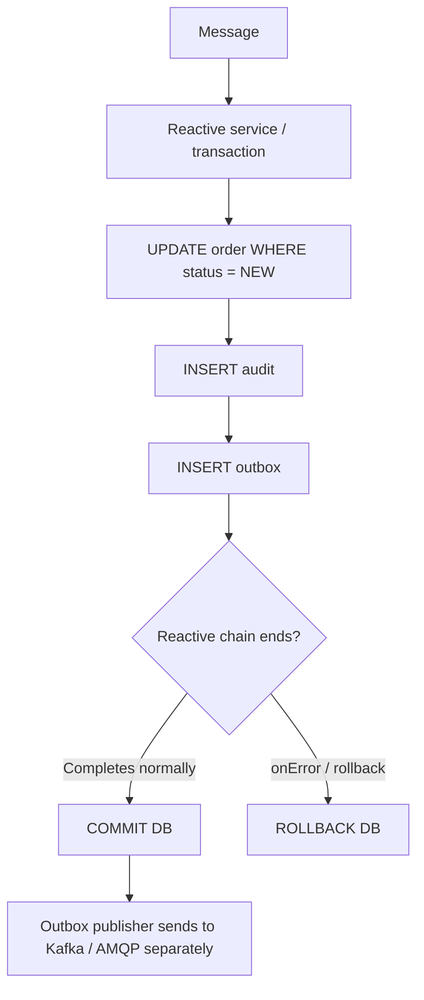
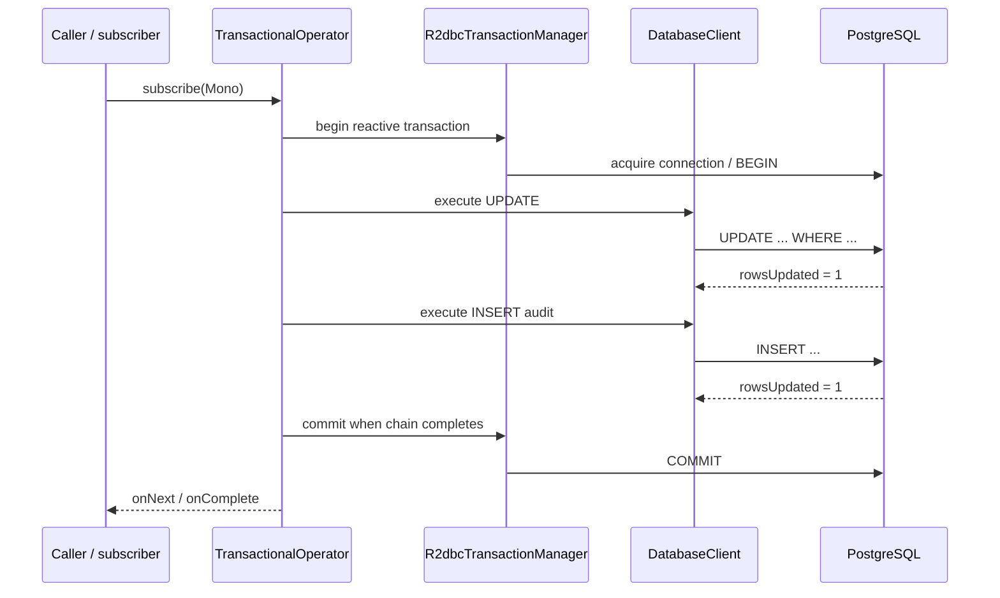
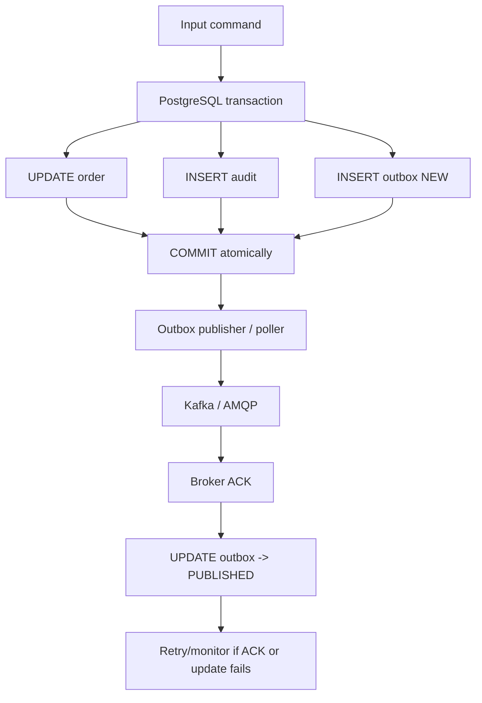
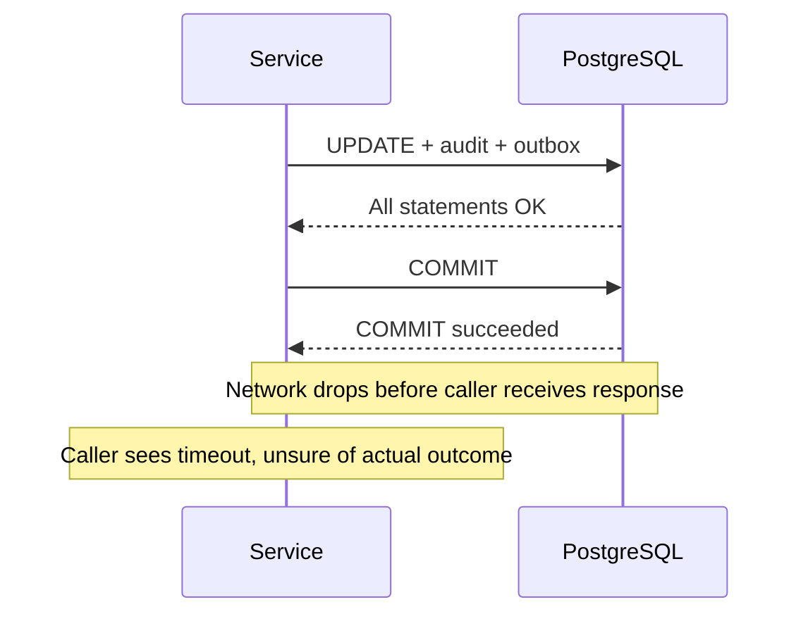

# Reactive transactions

> **Chapter:** R2DBC Adapter  
> **Module:** SPRING_INTEGRATION_ADAPTERS  
> **Context:** Connect external systems to Spring Integration using inbound/outbound adapters, gateways, pollers, and MessageChannels. Practice exchange flows over files, SFTP, HTTP, JMS, AMQP, Kafka, and databases; focus on message contracts, errors, data consistency, and connection lifecycles.

## 1. Learning Objectives

By the end of this lesson, you will be able to:

- Explain **reactive transactions** and how R2DBC transactions differ from thread-local JDBC transactions.
- Understand the roles of `io.r2dbc.spi.ConnectionFactory`, `R2dbcTransactionManager`, `ReactiveTransactionManager`, `TransactionalOperator`, `DatabaseClient`, and `R2dbcEntityTemplate`.
- Interpret how **subscription**, **Reactor Context**, `onComplete`, `onError`, and `cancel` affect commit/rollback.
- Use `TransactionalOperator` to execute multiple R2DBC SQL statements in the **same transaction**.
- Use `@Transactional` on methods returning `Mono`/`Flux`, recognizing self-invocation, detached subscriptions, and swallowed errors.
- Write flows that update order state, write audit records, and insert outbox rows atomically on PostgreSQL.
- Distinguish an UPDATE returning `0` affected rows, an SQL exception, and a transaction rollback per **business rules**.
- Connect a custom `ReactiveMessageHandler` into a Spring Integration `IntegrationFlow`, ensuring DB work is part of the subscribed reactive chain.
- Understand why an R2DBC transaction does not automatically include Kafka, AMQP, JMS, HTTP, file/SFTP, or broker offset commits.
- Design retries/idempotency, isolation/locking, timeouts, backpressure, connection pooling, recovery, and transaction tests with `StepVerifier`/PostgreSQL.

## 2. What problem do reactive transactions solve?

Suppose an application receives a Spring Message notifying that an order was paid. Before considering the message processed, three things must happen in PostgreSQL:

1. Transition the order from `NEW` to `PAID`.
2. Insert an audit record for reconciliation.
3. Insert an **outbox** record so another publisher sends an event to Kafka/AMQP.

If the three SQL operations run independently:

```text
UPDATE order -> succeeds
INSERT audit -> fails
INSERT outbox -> did not run
```

then data becomes inconsistent: the order is `PAID`, yet there is no audit record and no event to emit.

A **Transaction** groups operations into an **all-or-nothing** database unit: either all commit, or changes roll back per the DB's transaction mechanism.



**Transaction scope in this lesson:** SQL operations share the **same R2DBC transaction manager and ConnectionFactory**. This transaction does **not** cover HTTP calls, Kafka publishes, JMS/AMQP ACKs, or file/SFTP copies.

### 2.1. What transactions do NOT guarantee automatically

| Expectation | Reality |
| --- | --- |
| Three SQL statements share one DB transaction | Achievable using `TransactionalOperator` or properly used reactive `@Transactional`. |
| Sending a message to `MessageChannel` commits the DB | **False**; depends on subscription and completion. |
| `onComplete` from a query always means the broker ACKed | **False**; DB queries and brokers have separate contracts. |
| A DB transaction can roll back a succeeded HTTP request | **Impossible**. |
| Kafka/JMS and PostgreSQL share one transaction simply because Spring Integration is used | **Not by default**; cross-system consistency must be designed. |
| `@Transactional` on a `void` method covers all reactive work spawned later | **False**. |
| Transactions guarantee cross-system exactly-once delivery | **No**; requires idempotency/outbox/ACKs. |

### 2.2. Why does this matter in the adapters module?

Spring Integration decomposes flows into **MessageChannels**, inbound/outbound adapters, gateways, pollers, and handlers. That clarifies responsibilities while introducing asynchronous processing boundaries:

```text
HTTP inbound / Kafka inbound / JMS inbound
                |
                v
         MessageChannel
                |
                v
      ReactiveMessageHandler
                |
                v
      R2DBC transaction chain
                |
                v
     commit/rollback PostgreSQL
                |
                v
     broker ACK or response
```

If inputs are ACKed too early or DB work is not subscribed properly, the system can **lose data**. If retries happen after a DB commit whose reply was lost, the system can **process duplicates**. Both issues must be solved alongside ACID.

## 3. Components of an R2DBC transaction

| Component | Package / framework | Role |
| --- | --- | --- |
| `ConnectionFactory` | `io.r2dbc.spi` | Supplies database connections via Reactive Streams. |
| `Connection` | R2DBC SPI | Connection used for statements and DB transactions. |
| `R2dbcTransactionManager` | Spring Framework R2DBC | Manages begin/commit/rollback over a `ConnectionFactory`. |
| `ReactiveTransactionManager` | Spring transaction API | Abstraction interface for reactive transactions. |
| `TransactionalOperator` | Spring reactive transactions | Wraps a Publisher in a transaction. |
| `@Transactional` | Spring transaction annotation | Declares a transaction on an intercepted method with reactive return type/manager. |
| `DatabaseClient` | Spring Framework R2DBC | Executes SQL, binds parameters, maps rows, returns reactive Publishers. |
| `R2dbcEntityOperations` / `R2dbcEntityTemplate` | Spring Data R2DBC | CRUD and queries using entities/Criteria/converters. |
| `R2dbcMessageHandler` | Spring Integration R2DBC | Outbound adapter receiving Messages and performing reactive SQL writes. |
| `ReactiveMessageHandler` | Spring Messaging / Spring Integration | Handler contract returning `Mono<Void>` completion/error. |

**Name distinction:** `ConnectionFactory` here is the **R2DBC database factory**, not `TcpNetClientConnectionFactory` or `TcpNetServerConnectionFactory` from Spring Integration IP.

### 3.1. One transaction requires one consistent connection

When a transaction begins, Spring's R2DBC transaction support binds the proper connection for participating operations. Spring uses a **reactive transaction context** to retrieve the connection within the same chain.

- Operations using the same `ConnectionFactory` and Spring connection management can join the same transaction.
- Calling raw `ConnectionFactory.create()` arbitrarily and managing it separately can open a connection **outside** the active transaction.
- Two `ConnectionFactory` instances pointing to two different databases **do not automatically form** a distributed transaction.
- A pool holds many connections; an active transaction generally holds one dedicated connection for its lifetime.

Never keep a raw `Connection` as a singleton shared across subscriptions; connections carry state, transaction context, and resource lifecycles.

## 4. Reactor Context: the foundation differing from JDBC

### 4.1. Familiar JDBC transactions

In blocking JDBC code, Spring normally binds the transaction context to the **thread** executing the work. Synchronous code running on that thread uses the corresponding connection.

### 4.2. Reactive chains are not pinned to one thread

Reactor can hop across event-loops, schedulers, and asynchronous boundaries. Therefore, reactive transactions attach to the **subscription's Reactor Context**, not merely a Java ThreadLocal.



Simplified diagram; details of connection acquisition, BEGIN, and data/terminal signals depend on implementation. The key point is that **subscription drives the transaction lifecycle**.

### 4.3. Creating a Mono does not run a transaction yet

```java
Mono<Long> update = db.sql(
                "UPDATE integration_orders " +
                "SET status='PAID' WHERE order_id=:id")
        .bind("id", "order-101")
        .fetch()
        .rowsUpdated();

// So far only a Publisher is created; no SQL or transaction has run yet.
```

When a subscriber subscribes to a chain wrapped with `TransactionalOperator`, the transaction starts and the publisher executes.

### 4.4. A new subscription can start a new transaction

```java
Mono<Void> work = orderService.markPaid(command);

// Two independent subscriptions can re-execute the whole workflow.
// Do not treat a Mono variable as a cached commit result.
```

Reactive queries are typically **cold Publishers**. Subscribing twice can run SQL/side effects twice, each in its own transaction.

If a result must execute only once for multiple consumers in the same process, design explicit caching/sharing semantics; still, **in-memory caches do not replace business idempotency** across restarts/redeliveries.

## 5. Preparing Spring Boot and PostgreSQL

Examples target **Java 17+, Spring Boot 3.x, Spring Framework 6.x, Spring Data R2DBC 3.x, Spring Integration 6.1+**. Use the Spring Boot BOM to manage compatible versions. For newer Spring Boot/Spring Integration releases, check the corresponding APIs and auto-configuration instead of mixing examples across generations.

### 5.1. Maven dependencies

```xml
<dependencies>
    <dependency>
        <groupId>org.springframework.boot</groupId>
        <artifactId>spring-boot-starter-integration</artifactId>
    </dependency>
    <dependency>
        <groupId>org.springframework.boot</groupId>
        <artifactId>spring-boot-starter-data-r2dbc</artifactId>
    </dependency>
    <dependency>
        <groupId>org.springframework.integration</groupId>
        <artifactId>spring-integration-r2dbc</artifactId>
    </dependency>
    <dependency>
        <groupId>org.postgresql</groupId>
        <artifactId>r2dbc-postgresql</artifactId>
        <scope>runtime</scope>
    </dependency>
    <dependency>
        <groupId>io.r2dbc</groupId>
        <artifactId>r2dbc-pool</artifactId>
    </dependency>
    <dependency>
        <groupId>io.projectreactor</groupId>
        <artifactId>reactor-test</artifactId>
        <scope>test</scope>
    </dependency>
</dependencies>
```

`r2dbc-postgresql` differs from the JDBC driver `org.postgresql:postgresql`. R2DBC adapters need an **R2DBC ConnectionFactory**, and cannot accept a JDBC `DataSource` instead.

### 5.2. application.yml

```yaml
spring:
  r2dbc:
    url: r2dbc:postgresql://127.0.0.1:5432/integration_demo
    username: ${DB_USER}
    password: ${DB_PASSWORD}
    pool:
      enabled: true
      initial-size: 2
      max-size: 10
      max-acquire-time: 3s
      max-idle-time: 10m
```

`${DB_USER}` and `${DB_PASSWORD}` are **Spring environment placeholders** resolved at startup; never commit real passwords to source control. Production needs TLS, secrets management, least-privilege DB permissions, and connection budgets.

Spring Boot auto-configures `ConnectionFactory`, `DatabaseClient`, `R2dbcEntityTemplate`, and `ReactiveTransactionManager` when dependency/bean conditions match.

**Do not declare an extra ConnectionFactory/transaction manager unintentionally.** If two repositories use different factories, code can look transactional while actually updating two resources outside a shared transaction.

## 6. Database design for the practice

### 6.1. Orders table

```sql
CREATE TABLE integration_orders (
    order_id         VARCHAR(64) PRIMARY KEY,
    status           VARCHAR(24) NOT NULL DEFAULT 'NEW',
    version          BIGINT NOT NULL DEFAULT 0,
    last_operation   VARCHAR(80),
    updated_at       TIMESTAMPTZ NOT NULL DEFAULT NOW()
);
```

### 6.2. Audit table

```sql
CREATE TABLE integration_order_audit (
    audit_id       BIGSERIAL PRIMARY KEY,
    order_id       VARCHAR(64) NOT NULL,
    operation_id   VARCHAR(80) NOT NULL,
    action         VARCHAR(40) NOT NULL,
    created_at     TIMESTAMPTZ NOT NULL DEFAULT NOW(),
    CONSTRAINT uq_order_audit_operation
        UNIQUE (order_id, operation_id, action)
);
```

### 6.3. Outbox table

```sql
CREATE TABLE integration_outbox (
    event_id        VARCHAR(80) PRIMARY KEY,
    aggregate_id    VARCHAR(64) NOT NULL,
    event_type      VARCHAR(64) NOT NULL,
    payload_json    TEXT NOT NULL,
    status          VARCHAR(24) NOT NULL DEFAULT 'NEW',
    created_at      TIMESTAMPTZ NOT NULL DEFAULT NOW(),
    published_at    TIMESTAMPTZ
);

CREATE INDEX idx_integration_outbox_status_created
    ON integration_outbox(status, created_at, event_id);
```

This pattern persists **events to publish**, rather than sending directly to Kafka/AMQP inside the DB transaction.

### 6.4. Seed data

```sql
INSERT INTO integration_orders(order_id, status)
VALUES
    ('order-101', 'NEW'),
    ('order-102', 'NEW'),
    ('order-103', 'PAID');
```

The examples below assume the test database and tables are initialized. **Test results shown are expected outcomes**, not assertions that SQL was executed in the learner's environment.

### 6.5. Meaning of business keys

| Column | Meaning |
| --- | --- |
| `order_id` | Order key, ensuring an UPDATE targets one row. |
| `version` | Used for optimistic locking with multiple writers. |
| `last_operation` | Last operation identifier for retry reconciliation. |
| `operation_id` | Stable ID of **one business request**, kept constant across attempts. |
| `event_id` | Unique outbox key; this demo uses the same `operation_id`. |
| `status=NEW/PAID` | Order status, distinct from publish status. |
| `outbox.status=NEW` | Event waiting for the publisher to send. |
| `published_at` | Timestamp marking publish completion per contract. |

**Defining unique constraints is part of idempotency**, though constraints alone do not define what result to return when the same operation ID arrives again.

## 7. Creating TransactionalOperator

### 7.1. Bean configuration

When Spring Boot already provides an appropriate `ReactiveTransactionManager`, you only need a `TransactionalOperator`:

```java
import org.springframework.context.annotation.Bean;
import org.springframework.context.annotation.Configuration;
import org.springframework.transaction.ReactiveTransactionManager;
import org.springframework.transaction.reactive.TransactionalOperator;

@Configuration
public class ReactiveTransactionConfiguration {

    @Bean
    TransactionalOperator transactionOperator(
            ReactiveTransactionManager manager) {
        return TransactionalOperator.create(manager);
    }
}
```

When configuring manually, `R2dbcTransactionManager` takes the exact `ConnectionFactory`:

```java
import io.r2dbc.spi.ConnectionFactory;
import org.springframework.r2dbc.connection.R2dbcTransactionManager;
import org.springframework.transaction.ReactiveTransactionManager;

// Alternative example when Boot does not auto-create the manager:
ReactiveTransactionManager manager =
        new R2dbcTransactionManager(connectionFactory);
```

The second snippet assumes `connectionFactory` is already in scope—do not enable it as a second bean alongside an auto-configured one.

### 7.2. Wrapping a reactive chain in a transaction

```java
import org.springframework.transaction.reactive.TransactionalOperator;
import reactor.core.publisher.Mono;

Mono<Void> write = firstSql()
        .then(secondSql())
        .then()
        .as(tx::transactional);
```

This illustrates the pattern: `firstSql()`/`secondSql()` are real methods returning Publishers and `tx` is the operator. **Never** call `firstSql().subscribe()` before `secondSql()`: each new subscription can fall outside the transaction.

### 7.3. Correct structure

```text
compose SQL Publishers
          |
          v
TransactionalOperator.transactional(publisher)
          |
          v
caller/framework subscribes
          |
          +--> BEGIN
          +--> execute SQL #1
          +--> execute SQL #2
          +--> COMMIT or ROLLBACK
```

### 7.4. Incorrect structure

```java
// DO NOT DO THIS:
public void unsafeWrite() {
    firstSql().subscribe();
    secondSql().subscribe();
}
```

Even if `unsafeWrite()` is annotated with `@Transactional` on a normal class, that **does not put** two independent subscriptions into the same reactive transaction. You must **return a single composed Publisher** and let an appropriate boundary subscribe.

## 8. Complete example: atomic UPDATE, audit, outbox

### 8.1. Command and outcome

Create `MarkPaidCommand.java`:

```java
public record MarkPaidCommand(
        String orderId,
        String operationId,
        String eventJson
) {
}
```

Create `PaymentRecorded.java`:

```java
public record PaymentRecorded(
        String orderId,
        String operationId,
        long affectedRows
) {
}
```

An `operationId` identifies **one payment operation**. On retrying the same command, the ID must stay identical. Never generate a fresh UUID per attempt.

### 8.2. Transactional service using DatabaseClient

Create `OrderPaymentService.java`:

```java
import org.springframework.r2dbc.core.DatabaseClient;
import org.springframework.stereotype.Service;
import org.springframework.transaction.reactive.TransactionalOperator;
import reactor.core.publisher.Mono;

@Service
public class OrderPaymentService {

    private final DatabaseClient db;
    private final TransactionalOperator tx;

    public OrderPaymentService(
            DatabaseClient db,
            TransactionalOperator tx) {
        this.db = db;
        this.tx = tx;
    }

    public Mono<PaymentRecorded> markPaid(
            MarkPaidCommand command) {

        validate(command);

        Mono<PaymentRecorded> work = db.sql(
                        "UPDATE integration_orders " +
                        "SET status = 'PAID', " +
                        "    last_operation = :operation, " +
                        "    version = version + 1, " +
                        "    updated_at = CURRENT_TIMESTAMP " +
                        "WHERE order_id = :id AND status = 'NEW'")
                .bind("id", command.orderId())
                .bind("operation", command.operationId())
                .fetch()
                .rowsUpdated()
                .flatMap(affected -> {
                    if (affected != 1L) {
                        return Mono.error(
                                new IllegalStateException(
                                        "Order was not transitioned: " +
                                        command.orderId() +
                                        ", affected=" + affected));
                    }

                    return db.sql(
                                    "INSERT INTO integration_order_audit " +
                                    "(order_id, operation_id, action) " +
                                    "VALUES (:id, :operation, :action)")
                            .bind("id", command.orderId())
                            .bind("operation", command.operationId())
                            .bind("action", "MARK_PAID")
                            .fetch()
                            .rowsUpdated()
                            .flatMap(auditCount -> {
                                if (auditCount != 1L) {
                                    return Mono.error(
                                            new IllegalStateException(
                                                    "Audit insert count != 1"));
                                }

                                return db.sql(
                                                "INSERT INTO integration_outbox " +
                                                "(event_id, aggregate_id, " +
                                                "event_type, payload_json) " +
                                                "VALUES (:event, :aggregate, " +
                                                ":type, :body)")
                                        .bind("event", command.operationId())
                                        .bind("aggregate", command.orderId())
                                        .bind("type", "ORDER_PAID")
                                        .bind("body", command.eventJson())
                                        .fetch()
                                        .rowsUpdated();
                            })
                            .flatMap(outboxCount -> {
                                if (outboxCount != 1L) {
                                    return Mono.error(
                                            new IllegalStateException(
                                                    "Outbox insert count != 1"));
                                }

                                return Mono.just(new PaymentRecorded(
                                        command.orderId(),
                                        command.operationId(),
                                        affected));
                            });
                });

        return work.as(tx::transactional);
    }

    private static void validate(MarkPaidCommand command) {
        if (command == null
                || !valid(command.orderId(), 64)
                || !valid(command.operationId(), 80)
                || command.eventJson() == null
                || command.eventJson().isBlank()
                || command.eventJson().length() > 100_000) {
            throw new IllegalArgumentException(
                    "Invalid payment command");
        }
    }

    private static boolean valid(String s, int max) {
        return s != null
                && s.length() <= max
                && s.matches("[A-Za-z0-9_-]+");
    }
}
```

**Step-by-step walkthrough:**

1. `validate(...)` checks inputs **before starting a transaction**. The demo checks character length; production should check byte size, JSON schema, and authorization.
2. `UPDATE ... WHERE status='NEW'` performs a **conditional state transition** in the database.
3. `rowsUpdated()` returns `Mono<Long>`; if `0` or unexpectedly `>1`, the code emits `Mono.error(...)` to trigger rollback.
4. Only when UPDATE count is `1` does it INSERT the audit row.
5. Only when audit count is `1` does it INSERT the outbox row.
6. Only when all three succeed does the chain emit `PaymentRecorded`.
7. `.as(tx::transactional)` wraps the **entire reactive chain** in a transaction.
8. When the caller/framework subscribes: the transaction starts and SQL executes on the transactional resource.
9. When the chain completes normally, the manager commits; if any step errors, the manager rolls back per policy.
10. No Kafka/HTTP calls occur inside the transaction, and no manual `subscribe()` occurs mid-chain.

### 8.3. Why use flatMap instead of map?

```java
// Wrong thinking: map only transforms values; inner Publisher is not subscribed.
Mono<Mono<Long>> nested = updateCount.map(count ->
        insertAudit(count));
```

`map` produces `Mono<Mono<Long>>` when the callback returns a Mono. For reactive side effects needing completion in the same chain, use `flatMap` or `then` to **flatten/sequence** Publishers.

### 8.4. When a step fails

Suppose the audit INSERT hits a unique constraint violation:

```text
BEGIN
UPDATE integration_orders ...      -> 1 row
INSERT integration_order_audit ...  -> unique violation
INSERT integration_outbox ...       -> did not run
ROLLBACK
```

Expected after rollback:

- `integration_orders` remains `NEW` if it started as NEW.
- No new audit or outbox rows exist from the failed transaction.
- The subscriber receives an error per contract, not a successful `PaymentRecorded`.

**Verify with a database integration test**, not just by reading stack traces; what matters is that data rolled back consistently.

### 8.5. Data source and transaction manager must match

The example assumes `DatabaseClient` was created by Boot from the **same ConnectionFactory** managed by `R2dbcTransactionManager`.

If an SQL call uses a JDBC repository or a different `ConnectionFactory`, never assume it participates in this transaction.

## 9. Affected rows and business rollback conditions

### 9.1. UPDATE of 0 rows is not an SQL exception

```sql
UPDATE integration_orders
SET status='PAID'
WHERE order_id='order-999' AND status='NEW';
```

If no row matches, SQL completes normally with **0 affected rows**. The database does not automatically roll back because "no rows matched": to the DB, the statement is valid.

Therefore, the service must interpret the count:

| Result | Interpretation |
| --- | --- |
| `1` | State transition applied to exactly one row. |
| `0` | Missing row, different status, version conflict, or retry of an already committed command. |
| `>1` | Valid for bulk UPDATEs; violates invariant for PK `order_id`. |
| `onError` | SQL/driver/pool/transaction error, not count 0. |

### 9.2. To roll back on count 0, emit an error or decide explicitly

In `markPaid(...)`, `count != 1` becomes `Mono.error`, causing the transaction to roll back.

If business logic treats "nothing to update" as a normal outcome, it can return a domain outcome and commit an unchanged transaction. Document the rule clearly:

```text
0 rows:
  NOT_FOUND?
  ALREADY_PAID?
  CONFLICT?
  ALREADY_APPLIED_BY_THIS_OPERATION?
```

**Do not infer `NOT_FOUND` solely from 0 rows.** Query authoritative state or check an idempotency contract to distinguish cases.

### 9.3. Avoid swallowing exceptions inside the transaction

```java
// CAREFUL: replacing onError with a valid value can cause
// TransactionalOperator to see normal completion and COMMIT.
Mono<PaymentRecorded> fallback = work
        .onErrorResume(error -> Mono.just(
                new PaymentRecorded("unknown", "unknown", 0)));
```

If `onErrorResume(...)` sits **inside the transaction-wrapped Publisher**, an SQL error can be turned into normal completion before the transaction manager sees it. When business logic requires rollback, let the error propagate out to the transaction boundary or mark rollback-only via supported mechanisms.

Apply fallback **outside the transaction boundary** when you want to format an error response without altering the rollback decision.

## 10. Using @Transactional on reactive methods

### 10.1. Declarative example

Instead of calling `TransactionalOperator` manually, Spring supports declarative transactions with `@Transactional` on methods returning a Publisher:

```java
import org.springframework.r2dbc.core.DatabaseClient;
import org.springframework.stereotype.Service;
import org.springframework.transaction.annotation.Transactional;
import reactor.core.publisher.Mono;

@Service
public class DeclarativePaymentService {

    private final DatabaseClient db;

    public DeclarativePaymentService(DatabaseClient db) {
        this.db = db;
    }

    @Transactional
    public Mono<Void> updateAndAudit(
            String orderId, String operationId) {

        Mono<Long> update = db.sql(
                        "UPDATE integration_orders " +
                        "SET status='PAID', last_operation=:operation " +
                        "WHERE order_id=:id AND status='NEW'")
                .bind("id", orderId)
                .bind("operation", operationId)
                .fetch()
                .rowsUpdated();

        return update.flatMap(count -> {
            if (count != 1L) {
                return Mono.error(
                        new IllegalStateException("No matching order"));
            }

            return db.sql(
                            "INSERT INTO integration_order_audit " +
                            "(order_id, operation_id, action) " +
                            "VALUES (:id, :op, :action)")
                    .bind("id", orderId)
                    .bind("op", operationId)
                    .bind("action", "MARK_PAID")
                    .fetch()
                    .rowsUpdated()
                    .flatMap(auditCount -> auditCount == 1L
                            ? Mono.<Void>empty()
                            : Mono.error(new IllegalStateException(
                                    "Unexpected audit count")));
        });
    }
}
```

**Prerequisites:**

- Transaction management and an appropriate `ReactiveTransactionManager` are configured.
- The method is invoked **through a Spring proxy/interception** (not direct same-class internal calls).
- Reactive return type (`Mono`/`Flux`) with DB operations composed inside the returned Publisher.
- Callers must subscribe to the Publisher; do not spawn separate subscriptions inside the method.
- Do not use a JDBC `PlatformTransactionManager` as a substitute for a reactive manager.

### 10.2. Self-invocation

```java
@Service
class IncorrectService {

    public Mono<Void> entry() {
        return this.doWork();
    }

    @Transactional
    public Mono<Void> doWork() {
        return /* reactive DB work */ Mono.empty();
    }
}
```

With **proxy-based transaction interception**, `this.doWork()` stays **inside the same bean** and bypasses the proxy, so the annotation is ignored. Fix: invoke via another bean/proxy by design, or use `TransactionalOperator` explicitly.

### 10.3. @Transactional on a void method calling subscribe()

```java
// DO NOT DO THIS:
@Transactional
public void unsafe() {
    databaseClient.sql("DELETE FROM ...")
            .fetch().rowsUpdated()
            .subscribe();
}
```

This does not guarantee a reactive transaction. The `void` method returns before the Publisher finishes; the transaction cannot bind properly through Reactor Context from the annotation as intended.

### 10.4. Choosing @Transactional vs. TransactionalOperator?

| Need | Recommendation |
| --- | --- |
| Entire Publisher-returning method belongs to one transaction | `@Transactional` when proxy/manager are configured properly. |
| Only a **segment** of the chain should be transactional while HTTP/Kafka stay outside | `TransactionalOperator` wrapping only the DB segment. |
| Explicit transaction composition logic inside a flow | `TransactionalOperator`. |
| Transaction applied across services via standard interface/class patterns | `@Transactional`. |
| Invoking from a Spring Integration reactive handler | Service returns a transaction-wrapped Mono; handler returns the service's completion Publisher. |

Both styles must be tested on a **real DB**; do not pick annotations purely for shorter syntax.

## 11. Exact transaction scope: where to place the operator?

### 11.1. Wrapping two SQL statements in one transaction

```java
Mono<Void> dbWork = updateOrder()
        .then(insertAudit())
        .as(tx::transactional);
```

When both methods return cold Publishers, they execute sequentially inside the transaction upon subscription.

### 11.2. Wrapping only the first statement is wrong when atomicity is needed

```java
Mono<Void> incorrect = updateOrder()
        .as(tx::transactional)
        .then(insertAudit());
```

Here `insertAudit()` sits **outside** the transaction-wrapped publisher. It may run in a separate transaction or auto-commit. If the INSERT fails, the earlier UPDATE may already have committed.

### 11.3. Wrapping an HTTP call inside a DB transaction is ill-advised

```java
// Not recommended: holding a DB transaction open across a slow remote call.
Mono<Void> overlyBroad = updateOrder()
        .then(remoteHttpClient.send())
        .then(insertAudit())
        .as(tx::transactional);
```

A PostgreSQL transaction cannot roll back a succeeded HTTP request. While waiting on HTTP, connections/locks can stay held long and exhaust the pool.

Instead, use a short DB transaction + outbox/separate publisher, or split into claim/commit → external work → ACK/commit with leases/idempotency.

### 11.4. Avoid subscribing in the middle

```java
// DO NOT DO THIS:
Mono<Void> dbWork = updateOrder()
        .doOnSuccess(ignored -> insertAudit().subscribe())
        .then()
        .as(tx::transactional);
```

`insertAudit().subscribe()` creates an independent subscription that may run outside the transaction, and its errors may not propagate into `dbWork`. Use `then(insertAudit())` or `flatMap(...)` to compose.

## 12. Transactional outbox: consistency between DB and event broker

### 12.1. Why not publish inside the transaction?

Scenario:

```text
BEGIN PostgreSQL
UPDATE order -> PAID
Kafka publish -> succeeds
INSERT audit -> fails
ROLLBACK PostgreSQL
```

Kafka already received the event while the database rolled back: external subscribers now observe stale/incorrect state.

Reverse scenario:

```text
BEGIN PostgreSQL
UPDATE order + audit -> succeeds
COMMIT PostgreSQL
Application crashes before Kafka publish
```

The database has the change yet the event was never sent, causing a **missing notification**.

### 12.2. Outbox pattern



Outbox **does not completely eliminate duplicates**: if the broker receives the event and the publisher crashes before marking `PUBLISHED`, the event will be re-sent. Consumers must be **idempotent**, typically using `event_id` as the deduplication key.

### 12.3. Transaction boundary of the outbox publisher

The publisher works in batches:

1. Claim a batch of outbox rows and **commit the short claim**.
2. Send to Kafka/AMQP outside the DB transaction.
3. Wait for broker ACK per contract.
4. Mark `PUBLISHED` conditionally by owner/token.
5. If the publisher crashes before ACK, the lease expires and recovery retries.
6. Downstream deduplicates by `event_id`.

Never hold DB row locks/transactions open while waiting for a slow broker batch.

### 12.4. Do not equate outbox with the default R2DBC inbound adapter

`R2dbcMessageSource` + poller can SELECT outbox rows; yet if it only SELECTs `status='NEW'` without claiming, two instances can read duplicates.

Use atomic claiming and a proper state table, or a dedicated CDC/outbox relay, when reliable delivery is required. Spring Integration and R2DBC support wiring/flows, **without automatically generating a full delivery protocol**.

## 13. Integrating transactions into Spring Integration Java DSL

### 13.1. ReactiveMessageHandler calling a transactional service

Create `OrderPaymentIntegrationConfiguration.java`:

```java
import org.springframework.context.annotation.Bean;
import org.springframework.context.annotation.Configuration;
import org.springframework.integration.config.EnableIntegration;
import org.springframework.integration.dsl.IntegrationFlow;
import org.springframework.messaging.ReactiveMessageHandler;

@Configuration
@EnableIntegration
public class OrderPaymentIntegrationConfiguration {

    @Bean
    IntegrationFlow paymentCommandFlow(
            OrderPaymentService service) {

        ReactiveMessageHandler handler = message -> {
            MarkPaidCommand command =
                    (MarkPaidCommand) message.getPayload();

            // Service wraps UPDATE + audit + outbox in a transaction.
            // .then() keeps only completion/error for the terminal handler.
            return service.markPaid(command).then();
        };

        return IntegrationFlow
                .from("paymentCommands")
                .handleReactive(handler)
                .get();
    }
}
```

**Explanation:**

1. `MessageChannel` `paymentCommands` receives commands from inbound adapters, gateways, or internal services.
2. `ReactiveMessageHandler` returns a `Mono<Void>` chaining the service's work.
3. `service.markPaid(command)` returns a Publisher wrapped with `TransactionalOperator`.
4. Spring Integration 6.1+ `handleReactive(...)` handles `ReactiveMessageHandler` and subscription per endpoint lifecycle.
5. `.then()` preserves complete/error signals while **discarding `PaymentRecorded` data**.
6. No Spring reply message containing the business outcome is produced by this terminal outbound handler.
7. If callers need `PaymentRecorded` back, design a request-reply **gateway** or service API returning the reactive result.

**Note:** `message.getPayload()` is cast per the channel contract. Production should validate types/payloads/authorization, correlation IDs, error channels, and retry policies.

### 13.2. MessageChannel.send() is not a DB commit ACK

A producer:

```java
import org.springframework.integration.annotation.MessagingGateway;

@MessagingGateway(defaultRequestChannel = "paymentCommands")
public interface PaymentPort {
    void submit(MarkPaidCommand command);
}
```

can use `void submit(...)` to push into the flow. However, `void` **does not** return a business response confirming PostgreSQL committed and wrote the outbox.

If an HTTP caller must return "Payment durably recorded", subscribe/await the result from a service/gateway API with an explicit contract, rather than treating `send()` as proof of DB success.

### 13.3. Default R2DBC outbound adapter vs. custom handler

Spring Integration supports `R2dbcMessageHandler` via DSL:

```java
import java.util.Map;

import org.springframework.context.annotation.Bean;
import org.springframework.data.r2dbc.core.R2dbcEntityTemplate;
import org.springframework.data.relational.core.query.Criteria;
import org.springframework.integration.dsl.IntegrationFlow;
import org.springframework.integration.r2dbc.dsl.R2dbc;
import org.springframework.integration.r2dbc.outbound.R2dbcMessageHandler;
import org.springframework.messaging.Message;

@Bean
IntegrationFlow markOrderPaidAdapter(
        R2dbcEntityTemplate template) {

    return IntegrationFlow.from("simpleOrderUpdates")
            .handleReactive(
                    R2dbc.outboundChannelAdapter(template)
                            .queryType(R2dbcMessageHandler.Type.UPDATE)
                            .tableName("integration_orders")
                            .criteria((Message<MarkPaidCommand> m) ->
                                    Criteria.where("order_id")
                                            .is(m.getPayload().orderId())
                                            .and("status").is("NEW"))
                            .values((Message<MarkPaidCommand> m) ->
                                    Map.of("status", "PAID",
                                           "last_operation",
                                           m.getPayload().operationId()))
            )
            .get();
}
```

This is a **`@Bean` snippet in `@Configuration`**, configuring a one-way **single UPDATE**; it **does not** combine UPDATE + audit + outbox into a three-table transaction.

A single UPDATE is executed atomically by the database as one SQL statement, yet:

- The adapter normally signals completion/error as `Mono<Void>`.
- It does not emit a reply with `rowsUpdated()`.
- An UPDATE affecting `0` rows can still complete normally.
- It provides no built-in outbox, idempotency, or strict row-count check.

When business logic requires exact **count=1** and additional SQL statements in the same transaction, the custom service/hybrid gateway in sections 8–13 fits better.

### 13.4. Inbound R2DBC and transaction lifecycles

With `R2dbcMessageSource`, a single poll can emit:

```text
Message<Flux<RowEntity>>
      |
      v
FluxMessageChannel
      |
      v
Splitter / reactive downstream
      |
      v
Message<RowEntity>
```

One `Message<Flux<T>>` **does not** mean all rows were already processed when the poller sends the message. Putting `@Transactional` on the polling callback does not stretch the transaction across downstream subscriptions.

For reliable processing:

- Never keep DB transactions open across slow HTTP/Kafka calls.
- Perform an atomic DB claim in a short transaction and commit.
- Then let the splitter/processor handle items with clear ownership.
- ACK each row in the DB after downstream completes per contract.
- Use leases/recovery and idempotent consumers for redeliveries.

## 14. Does a transaction include Kafka/JMS/AMQP?

### 14.1. R2DBC local transactions are not distributed transactions

`R2dbcTransactionManager` manages transactions for a single R2DBC ConnectionFactory. It does not automatically span:

- Kafka producer transactions or consumer offsets.
- JMS/AMQP broker ACKs/transactions.
- HTTP requests/responses.
- File and SFTP writes/renames.
- JDBC transactions on another DataSource.
- Another database accessed via an independent ConnectionFactory.

**Specialized mechanisms may exist** per broker/framework, yet you must never assume a cross-system transaction exists simply because all endpoints sit in the same `IntegrationFlow`.

### 14.2. Choose the contract between DB and source

Suppose you receive a Kafka event and UPDATE PostgreSQL:

```text
Kafka receive
       |
       v
R2DBC transaction UPDATE + outbox
       |
       v
COMMIT database
       |
       v
Kafka input offset ACK/commit
```

If a crash occurs **after DB commit but before offset commit**, the event may be redelivered. Using `operationId` and unique constraints, the service must recognize **`ALREADY_APPLIED`** so side effects do not repeat.

If the source is ACKed **before DB commit**, a crash can **lose events**. Therefore source/broker ACKs must depend on a **durable outcome** per contract, not merely placing a message onto a channel.

### 14.3. Delivery semantics

| Goal | Mechanisms to consider |
| --- | --- |
| At-most-once (message loss allowed) | Early ACK / intentional drop policy, only when business permits. |
| At-least-once | ACK after durable processing + retry/redelivery. |
| Exactly-once effect in database | Unique operation IDs, transactional dedup + state transitions. |
| DB-to-broker reliable event publication | Transactional outbox + relay/retries. |
| Broker-to-DB reliable consumption | Durable broker offsets/ACKs + idempotent DB processing. |

Never claim "system-wide exactly-once" based solely on `@Transactional`.

## 15. Isolation levels and write contention

### 15.1. Atomicity vs. isolation

**Atomicity:** N SQL statements in one transaction commit or roll back together.

**Isolation:** How concurrent transactions observe and modify data relative to each other.

**Durability:** Once committed per DB contract, data persists per DB configuration.

Transactions do not automatically eliminate all races. Choose appropriate isolation levels and SQL WHERE/version/lock clauses.

### 15.2. Lost updates

Two workers concurrently read an order at `status=NEW, version=0`:

```text
Worker A: SELECT version 0
Worker B: SELECT version 0
Worker A: UPDATE status=PAID, version=1
Worker B: UPDATE status=CANCELLED if version is not checked
```

Optimistic concurrency solution:

```sql
UPDATE integration_orders
SET status = 'PAID',
    version = version + 1
WHERE order_id = :id
  AND version = :expectedVersion
  AND status = 'NEW';
```

- `rowsUpdated=1`: compare-and-set succeeded.
- `rowsUpdated=0`: row missing or status/version changed; classify conflict.
- `onError`: SQL/connection error, distinct from count 0.

### 15.3. Pessimistic locking

PostgreSQL supports `SELECT ... FOR UPDATE` to lock rows within a transaction when exclusivity is needed between SELECT and UPDATE.

```sql
BEGIN;
SELECT order_id, status, version
FROM integration_orders
WHERE order_id = 'order-101'
FOR UPDATE;

-- Check business rules, then UPDATE in the same transaction.
UPDATE integration_orders
SET status='PAID', version=version+1
WHERE order_id='order-101';
COMMIT;
```

This is an **illustrative SQL script**; in R2DBC code use the transaction operator/manager rather than issuing raw BEGIN/COMMIT haphazardly.

Never hold `FOR UPDATE` locks across remote HTTP/Kafka calls; long lock durations cause contention and pool exhaustion.

### 15.4. SKIP LOCKED for worker batch claiming

When multiple workers read a queue table:

```sql
WITH picked AS (
    SELECT event_id
    FROM integration_outbox
    WHERE status = 'NEW'
    ORDER BY created_at, event_id
    LIMIT :batchSize
    FOR UPDATE SKIP LOCKED
)
UPDATE integration_outbox AS o
SET status='PROCESSING'
FROM picked
WHERE o.event_id = picked.event_id
RETURNING o.event_id, o.payload_json;
```

PostgreSQL can claim batches atomically with this statement, though production needs **`owner`/`lease_until`/`attempt_count`** and recovery when a worker crashes. `SKIP LOCKED` is not a Kafka ACK and does not automatically recover stuck `PROCESSING` rows.

## 16. Transaction propagation and practical limits

### 16.1. REQUIRED

In many systems, `PROPAGATION_REQUIRED` is the default: join an existing transaction if present, otherwise start a new one.

In reactive code, "existing" is resolved via the **reactive transaction context**, not a ThreadLocal carried across schedulers.

### 16.2. REQUIRES_NEW and connection pools

Starting an independent new transaction while an outer transaction still holds a connection may require **another connection**. Under high concurrency and a small pool, connections can exhaust or resource-deadlock if every task holds an outer connection while waiting for an inner one.

Use separate new transactions only when business logic truly requires them; verify transaction manager and driver support.

### 16.3. Nested/savepoint behavior depends on environment

Do not assume every R2DBC setup supports nested transactions/savepoints identically. If partial rollback is required, verify Spring Framework/driver/database versions and test in practice.

Usually, structuring services with **one short transaction** is simpler, safer, and easier to observe than nested transaction layers.

### 16.4. Reactive Context across publishOn/subscribeOn

Reactor Context attaches to the subscription and propagates across Reactor operators properly. Switching schedulers with `publishOn`/`subscribeOn` **does not discard Reactor Context** the way ThreadLocals break across threads.

Still:

- A detached `subscribe()` has its own separate context.
- Uncomposed `CompletableFuture`/`@Async` callbacks can fall outside the reactive transaction.
- Blocking code inside a reactive transaction may not use context as expected.
- Mixing JDBC and R2DBC requires explicit separate transaction policies.

**Do not try to fix this with manual ThreadLocal transactions.**

## 17. Retries, timeouts, and uncertain commit outcomes

### 17.1. Failures before commit, after commit, and lost replies



In this case **never assert the transaction did not commit merely because the client timed out**.

### 17.2. Stable operation IDs and idempotency

Example `operation_id = op-202`:

- First attempt runs UPDATE order + INSERT audit + INSERT outbox, and commits.
- Caller times out before receiving success.
- Second attempt resends the **same operation ID**.
- `UPDATE ... WHERE status='NEW'` returns `0`, which may reflect **already applied from the prior attempt**.
- The service reconciles `last_operation`/audit/outbox matching that operation ID and equivalent payload.

If each retry generates a new operation ID, there is no basis to distinguish valid duplicates from different commands.

### 17.3. Reconciling outcomes on retry

You can query:

```sql
SELECT status, last_operation
FROM integration_orders
WHERE order_id = :id;
```

and:

```sql
SELECT event_id, aggregate_id, event_type, payload_json
FROM integration_outbox
WHERE event_id = :operationId;
```

If the order is `PAID` with `last_operation=:operationId` and the matching outbox row exists, the command can be interpreted as **`ALREADY_APPLIED`**. If the order shows a different operation or mismatched payload, return **`CONFLICT`** or invoke business reconciliation.

**Avoid plain SELECT then INSERT/UPDATE without unique constraints or conditional SQL**: snapshot state can change between operations under concurrency.

### 17.4. Bounded retries

```java
import java.time.Duration;
import org.springframework.dao.TransientDataAccessException;
import reactor.util.retry.Retry;

Mono<PaymentRecorded> result =
        paymentService.markPaid(command)
                .retryWhen(
                        Retry.backoff(2, Duration.ofMillis(200))
                                .maxBackoff(Duration.ofSeconds(2))
                                .filter(error ->
                                        error instanceof TransientDataAccessException));
```

This is an **illustrative snippet**, not a complete production policy. Retrying a `Mono` can **re-subscribe the entire transaction**. If the previous attempt committed yet lost the response, the next attempt may get count 0/conflict.

Production must:

- Retry only genuinely transient errors per driver/error class/SQLState.
- Keep the same operation ID.
- Reconcile before declaring retry failure.
- Cap attempts, elapsed time, backoff, and jitter.
- Never infinitely retry unique violations, validation errors, or schema mismatches.
- Never blindly retry cumulative side effects (`balance = balance + amount`).

### 17.5. Timeouts and cancellation

```java
Mono<PaymentRecorded> timed =
        paymentService.markPaid(command)
                .timeout(Duration.ofSeconds(5));
```

`timeout` bounds how long the caller waits on the Publisher. Once UPDATE/COMMIT has been sent to the database, cancelling the subscription on timeout **does not prove the DB definitely rolled back**.

You must configure:

- Server/driver SQL statement timeouts.
- Pool acquire timeouts.
- Total business deadlines across retries.
- Cancellation cleanup.
- Recovery/reconciliation by operation ID.

## 18. Accurate error handling and rollback

### 18.1. SQL errors

| Error type | What may happen | Resolution |
| --- | --- | --- |
| Primary/unique constraint violation | Duplicate audit/outbox insert. | Check idempotency/payload; do not blindly retry. |
| Foreign key / CHECK constraint | Invalid command data. | Reject/validate/fix schema. |
| SQL syntax / schema mismatch | Broken migration/query. | Alert and fix; do not retry infinitely. |
| Deadlock / serialization failure | Contending transactions. | Bounded retry of the **whole transaction** when safe. |
| Connection reset / DB restart | Transaction may have failed or commit outcome is unknown. | Retry with reconciliation and stable IDs. |
| Pool acquire timeout | Scarce DB resources. | Bounded concurrency, capacity planning. |
| UPDATE affected 0 | Condition unmet; not an exception by itself. | Classify NOT_FOUND/CONFLICT/ALREADY_APPLIED. |
| Reactive Publisher cancelled | Chain did not complete normally. | Clean up resources, inspect authoritative DB state. |

### 18.2. Anti-patterns that prevent rollback

- Catching exceptions and returning a normal result inside the transaction.
- `onErrorResume(...)` converting errors into empty/valid values before the transaction boundary.
- Calling `subscribe()` separately on one SQL statement, putting it outside the transaction.
- Using a different ConnectionFactory in one repository.
- Using a JDBC transaction manager for an R2DBC reactive chain.
- Returning from a `void` method while the Publisher is unsubscribed.
- Placing the transaction operator only around the first SQL statement.
- Not checking affected rows when that is a business condition for committing.

### 18.3. Error channels in Spring Integration

Reactive handler errors can occur **after** the poller/gateway has already pushed the message into a channel. Therefore:

- Synchronous error paths on sending a Spring Message cannot catch all DB errors.
- Error signals in `Mono`/`Flux` must be handled/observed per the reactive endpoint contract.
- Never rely on `try/catch` around `MessageChannel.send(...)` as the sole monitor for DB transactions.
- Track correlation IDs, retry attempts, authoritative state, and DLQ/quarantine for unprocessable items.

A custom handler returning `Mono.error` properly lets the transaction roll back and propagates errors to the subscriber; how upstream brokers NACK/requeue depends on the **adapter and ACK policy**.

## 19. Backpressure, pools, and transaction length

### 19.1. Why can reactive still overload?

Reactive does not give PostgreSQL infinite connections, locks, or disk I/O.

```text
Upstream events
      |
      v
MessageChannel / pending publishers
      |
      v
Bounded concurrency
      |
      v
R2DBC ConnectionPool (max-size)
      |
      v
PostgreSQL (locks, CPU, I/O)
```

If 1,000 commands wait while the pool max is 10 connections, remaining subscriptions queue and time out. Raising pool size endlessly can overwhelm the DB.

### 19.2. Bounding concurrency

```java
import reactor.core.publisher.Flux;

Flux<PaymentRecorded> results =
        Flux.fromIterable(commands)
                .flatMap(paymentService::markPaid, 4);
```

`flatMap(...,4)` limits concurrent **inner publishers** in this pipeline; it does not limit other pipelines in the app.

When business ordering is required, use `concatMap`, partition by aggregate key, or serialize appropriately. `flatMapSequential` keeps output order but does not guarantee DB side effects execute in strict order.

### 19.3. Keep transactions as short as possible

Holding transactions open long can:

- Pin a connection, causing pool waits.
- Hold row locks, causing lock contention.
- Increase deadlock/serialization conflict risk.
- Trigger transaction timeouts.
- Block maintenance/vacuum or add DB pressure depending on workload.

**Never call HTTP/Kafka inside a transaction just to "wait for ACK at the same time".** Use an outbox, or two short DB transactions in multi-step workflows.

### 19.4. SQL LIMIT and batch size

If a transaction claims/updates multiple rows, bound the batch:

```sql
WITH picked AS (
    SELECT event_id
    FROM integration_outbox
    WHERE status = 'NEW'
    ORDER BY created_at, event_id
    LIMIT :batchSize
    FOR UPDATE SKIP LOCKED
)
UPDATE integration_outbox AS o
SET status='PROCESSING'
FROM picked
WHERE o.event_id = picked.event_id
RETURNING o.event_id;
```

`LIMIT` bounds how many rows are claimed in one statement. It is **different** from `maxMessagesPerPoll`, Reactor demand, and R2DBC pool size.

## 20. Observing transactions with logs and metrics

### 20.1. Milestones worth measuring

| Suggested metric | Purpose |
| --- | --- |
| `r2dbc_tx_started_total` | Reactive transactions started. |
| `r2dbc_tx_committed_total` | Transactions committed successfully. |
| `r2dbc_tx_rolled_back_total` | Transactions rolled back. |
| `r2dbc_tx_latency_p95` | Transaction lifetime duration. |
| `r2dbc_tx_error_total` | Errors by SQL/driver category. |
| `r2dbc_pool_active` / `r2dbc_pool_pending` | Connection pool pressure. |
| `orders_updated_total` | Applied order state transitions. |
| `orders_conflict_total` | UPDATE count=0 / version mismatches. |
| `outbox_new_count` | Events waiting to publish. |
| `outbox_oldest_new_age` | Age of oldest outbox backlog item. |
| `outbox_publish_retry_total` | Republish attempts. |
| `duplicate_operation_id_total` | Duplicate commands reconciled. |
| `broker_ack_latency_p95` | Latency to complete broker publish. |

These metric names are **instrumentation suggestions**, not all automatically emitted by Spring Boot/Micrometer. Never use high-cardinality `orderId`/`operationId` as metric labels.

### 20.2. Log by business ID, never log secrets

```text
operation=op-101 order=order-101 stage=tx_begin
operation=op-101 order=order-101 stage=order_updated affected=1
operation=op-101 order=order-101 stage=audit_written affected=1
operation=op-101 order=order-101 stage=outbox_written affected=1
operation=op-101 order=order-101 stage=tx_committed
```

This is a **recommended log format**, not default output. `tx_committed` should be logged only when the successful commit signal is actually observed per contract, never right after building the `Mono`.

Never log database credentials, sensitive tokens, or raw JSON payloads containing personal data.

### 20.3. Never put non-idempotent side effects in doOnNext

```java
Mono<PaymentRecorded> observed =
        paymentService.markPaid(command)
                .doOnNext(record ->
                        metrics.paymentRecorded(record.orderId()))
                .doOnError(error ->
                        metrics.paymentError(error))
                .doFinally(signal ->
                        metrics.paymentSignal(signal));
```

This snippet uses an existing `metrics` service solely for instrumentation. `doFinally` observes complete/error/cancel. Still, hooks run **on every subscription/retry**; never use them to emit critical non-idempotent events.

## 21. Testing transactions with StepVerifier

### 21.1. Test framework

Use real PostgreSQL via Testcontainers or an equivalent test database to test:

- Real R2DBC driver and transaction manager.
- Unique constraints and rollbacks.
- `UPDATE ... WHERE` / affected rows.
- Concurrency, isolation, and locks.
- Connection pool and cancellation.
- Transactional outbox under crashes/retries.

H2 R2DBC can differ from PostgreSQL on transaction isolation, locking, `SKIP LOCKED`, and `RETURNING`.

### 21.2. Testing successful commit

Assuming the test class injects `OrderPaymentService paymentService` and `DatabaseClient db`, and the table is seeded with `order-101` as `NEW`:

```java
import org.junit.jupiter.api.Test;
import reactor.test.StepVerifier;

import static org.junit.jupiter.api.Assertions.*;

@Test
void writesOrderAuditAndOutboxAtomically() {
    MarkPaidCommand cmd = new MarkPaidCommand(
            "order-101",
            "op-test-101",
            "{\"orderId\":\"order-101\",\"status\":\"PAID\"}");

    StepVerifier.create(paymentService.markPaid(cmd))
            .assertNext(result -> {
                assertEquals("order-101", result.orderId());
                assertEquals(1L, result.affectedRows());
            })
            .verifyComplete();

    // Query tables after the Publisher completes and the transaction commits.
    StepVerifier.create(
            db.sql("SELECT status FROM integration_orders " +
                   "WHERE order_id = :id")
              .bind("id", "order-101")
              .map((row, meta) -> row.get("status", String.class))
              .one())
            .expectNext("PAID")
            .verifyComplete();

    StepVerifier.create(
            db.sql("SELECT COUNT(*) AS cnt FROM integration_outbox " +
                   "WHERE event_id = :id")
              .bind("id", "op-test-101")
              .map((row, meta) -> row.get("cnt", Long.class))
              .one())
            .expectNext(1L)
            .verifyComplete();
}
```

This is a **method inside a test class**, not a standalone runnable file. Reset test fixtures between tests; never depend on execution order.

### 21.3. Testing rollback when audit INSERT fails

Pre-insert an audit row with the same `(order_id, operation_id, action)` to trigger a unique violation when running the service:

```sql
INSERT INTO integration_order_audit(
    order_id, operation_id, action
)
VALUES ('order-102', 'op-conflict-102', 'MARK_PAID');
```

Then:

```java
@Test
void auditConflictRollsBackOrderUpdate() {
    MarkPaidCommand cmd = new MarkPaidCommand(
            "order-102",
            "op-conflict-102",
            "{\"orderId\":\"order-102\",\"status\":\"PAID\"}");

    StepVerifier.create(paymentService.markPaid(cmd))
            .expectError()
            .verify();

    StepVerifier.create(
            db.sql("SELECT status FROM integration_orders " +
                   "WHERE order_id = :id")
              .bind("id", "order-102")
              .map((row, meta) -> row.get("status", String.class))
              .one())
            .expectNext("NEW")
            .verifyComplete();

    StepVerifier.create(
            db.sql("SELECT COUNT(*) AS cnt FROM integration_outbox " +
                   "WHERE event_id = :id")
              .bind("id", "op-conflict-102")
              .map((row, meta) -> row.get("cnt", Long.class))
              .one())
            .expectNext(0L)
            .verifyComplete();
}
```

**What to prove:** the UPDATE ran inside the transaction yet rolled back when the audit insert failed. Do not only assert the exception class; re-query the tables.

### 21.4. Testing affected rows = 0

```java
@Test
void missingOrderDoesNotProduceSuccess() {
    MarkPaidCommand cmd = new MarkPaidCommand(
            "missing-999",
            "op-missing-999",
            "{\"orderId\":\"missing-999\"}");

    StepVerifier.create(paymentService.markPaid(cmd))
            .expectError(IllegalStateException.class)
            .verify();
}
```

In `markPaid`, count 0 is turned into `Mono.error` by **business policy**; the DB itself does not treat 0 affected rows as an SQL error.

### 21.5. Testing two independent subscriptions

```java
@Test
void secondSubscriptionMustNotReapplyPayment() {
    MarkPaidCommand cmd = new MarkPaidCommand(
            "order-101", "op-once-101", "{\"orderId\":\"order-101\"}");

    Mono<PaymentRecorded> work = paymentService.markPaid(cmd);

    StepVerifier.create(work)
            .expectNextCount(1)
            .verifyComplete();

    // Second subscription re-runs the transaction:
    // status is no longer NEW, so the current policy emits an error.
    StepVerifier.create(work)
            .expectError(IllegalStateException.class)
            .verify();
}
```

This example needs an isolated fixture starting with `order-101 = NEW`. Lesson: **a Mono does not cache results by default**. Production should support duplicate handling such as `ALREADY_APPLIED` instead of always treating retries as failures.

### 21.6. Testing cancellation and transaction cleanup

In integration tests:

1. Create an intentionally slow query/transaction with a safe timeout.
2. Subscribe and cancel in a controlled manner.
3. Observe the transaction manager and active/pending pool counts.
4. Re-read DB state to check whether it rolled back, committed, or remains unknown.
5. Never assume cancellation always guarantees rollback if network/commit outcomes were lost.

### 21.7. Testing concurrency

Two transactions concurrently UPDATE `order_id` with `status='NEW'`:

- Expect only one update to get affected rows = 1 per state transition.
- The other gets count 0 or a conflict/serialization error depending on isolation/SQL.
- Never produce two outbox events for two different operations when business rules allow one transition.
- Retries use stable IDs to avoid duplicates when replies are lost.

Tests must use **concurrent subscriptions** and a real database; `Thread.sleep` alone is insufficient to prove race behavior.

## 22. End-to-end test matrix

| Scenario | What to verify |
| --- | --- |
| One `NEW` order | UPDATE + audit + outbox commit together. |
| Audit INSERT fails | UPDATE rolls back; no outbox created. |
| Outbox INSERT fails | Order and audit also roll back. |
| UPDATE affected 0 | Per policy: domain conflict/error; no audit/outbox written. |
| UPDATE affected >1 on PK | Reports invariant error and rolls back. |
| Unsubscribed Mono | Do not assume SQL/transaction occurred. |
| Re-subscribing cold Mono | Transaction can re-run; idempotency required. |
| `@Transactional` called via Spring proxy | Reactive transaction works properly. |
| `@Transactional` self-invocation | Detects annotation skipped in proxy mode. |
| One step calls `subscribe()` separately | Escapes transaction; tests catch the bug. |
| Two different ConnectionFactories | Do not assume shared local transaction. |
| JDBC repository inside reactive service | Does not join R2DBC transaction by default. |
| `onErrorResume` swallows error inside tx | Must not commit against policy. |
| Transaction timeout | Check rollback/cancel and authoritative state. |
| Commit succeeds yet caller times out | Keep operation ID for reconciliation. |
| Duplicate operation ID | Side effects never applied twice. |
| Two concurrent commands on same order | Conditional UPDATE/version works properly. |
| Different isolation levels | Analyze real lock contention and conflicts. |
| Small pool size | Pending acquisitions bounded, no memory exhaustion. |
| Kafka publish fails after DB commit | Outbox retains event for retry. |
| Broker ACK then publisher crashes | Event may retry; consumer is idempotent. |
| Kafka input ACK before DB commit | Demonstrates event-loss risk and fix. |
| R2DBC inbound source emits Flux | Transaction does not automatically span downstream handlers. |
| Outbound adapter UPDATE count 0 | Does not automatically return business conflict. |
| Error signal after entering MessageChannel | Proper observability and error recovery exist. |
| Application shuts down mid-transaction | Verify cleanup, outbox recovery, and retries. |

## 23. Common mistakes

| Mistake | Consequence | Fix |
| --- | --- | --- |
| Treating `@Transactional` like JDBC thread-local over every callback | SQL statements may run outside the transaction. | Use reactive return types, Reactor Context, and proper manager. |
| Calling `subscribe()` mid-service | Detaches Publisher; loses sequence/error/tx context. | Compose one chain with `flatMap`/`then`. |
| Wrapping transaction only around first UPDATE | Audit/outbox execute outside the transaction. | Wrap the entire SQL chain. |
| Swallowing errors before transaction boundary | Manager may commit even when business wants rollback. | Propagate `Mono.error` or mark rollback per policy. |
| Not checking `rowsUpdated` | 0-row UPDATE looks "successful" at SQL layer. | Check count and domain outcomes. |
| Holding transaction while waiting for HTTP/Kafka ACK | DB locks/connections held long; external side effects don't roll back. | Short outbox/claim-commit-ACK steps. |
| Assuming broker offsets sit inside R2DBC transaction | Lost/duplicated messages on crash. | Idempotency and ACK sequencing. |
| Retrying with a new operation ID | Duplicate side effects. | Stable operation keys. |
| Infinitely retrying all exceptions | Retry storms / repeated constraint failures. | Classify transient vs. permanent; budgets/backoff. |
| Increasing pool size on lock contention | Shifts load onto DB and increases latency. | Optimize locks, concurrency, and tx duration. |
| Treating cancellation as guaranteed rollback | Commit outcome may be unknown. | Reconcile against authoritative state. |
| Testing only with mocked Monos | Misses real DB locks/rollbacks/isolation. | Testcontainers PostgreSQL. |
| Using `R2dbcMessageHandler` for strict multi-table atomic workflows without custom flow | Lacks row-count/transaction semantics. | Custom reactive service + `TransactionalOperator`. |
| Calling outbox "exactly-once delivery" | Relay crashes still produce duplicates. | Idempotent consumers and stable event IDs. |

## 24. Practice exercises

**Exercise 1 — Subscription.** Create a `Mono<Long>` from `DatabaseClient` and observe that SQL does not execute until `StepVerifier` subscribes.

**Exercise 2 — TransactionalOperator.** Write `updateOrder().then(insertAudit()).as(tx::transactional)`, force an audit failure, and verify the UPDATE rolls back.

**Exercise 3 — Wrong boundary.** Wrap the transaction only around UPDATE and run audit INSERT outside. Compare DB state when audit fails and explain why it is not atomic.

**Exercise 4 — @Transactional.** Move the service to the annotation on a `Mono<Void>`-returning method. Compare external proxy invocation against self-invocation.

**Exercise 5 — Context.** Use `publishOn` inside a transactional reactive chain and verify SQL stays in the same transaction; compare with manually calling `subscribe()` on a new Publisher.

**Exercise 6 — Affected rows.** On an already `PAID` order, `UPDATE WHERE status='NEW'` returns 0. Define `ALREADY_APPLIED`, `NOT_FOUND`, and `CONFLICT` policies using operation IDs.

**Exercise 7 — Outbox.** Implement `UPDATE order + INSERT audit + INSERT outbox` in one transaction; never send to Kafka inside the transaction.

**Exercise 8 — Publish and crash.** Simulate the broker receiving an outbox event while the app crashes before `status=PUBLISHED`. Explain why the event resends and design an idempotent consumer.

**Exercise 9 — Optimistic concurrency.** Have two workers read version 0 and run conditional UPDATEs. Verify one gets count 1 and the other gets conflict/0.

**Exercise 10 — Lock contention.** Hold a row lock in a test PostgreSQL transaction and measure the impact on the R2DBC pool and statement timeouts.

**Exercise 11 — Retries.** Use `retryWhen` with a transient-error filter and total deadline; simulate a lost commit response and reconcile using a stable operation ID.

**Exercise 12 — ReactiveMessageHandler.** Build `IntegrationFlow.from("paymentCommands").handleReactive(handler)` calling `OrderPaymentService`. Prove `void submit` does not automatically return a commit ACK.

**Exercise 13 — Inbound polling.** Use an R2DBC inbound source reading `NEW` outbox rows; show why `Message<Flux>` does not automatically keep a transaction open across handlers and why claim/ACK is required.

**Exercise 14 — Graceful shutdown.** Stop accepting new messages, enforce a deadline for in-flight tasks, and preserve un-ACKed outbox events for post-restart retries.

**Exercise 15 — Observability.** Instrument transaction begin/commit/rollback, pool pending counts, oldest outbox backlog, and duplicate operations; design alerts for `outbox_oldest_new_age`.

## 25. Self-check questions

1. How do reactive transactions differ from thread-local JDBC transactions?
2. What resource type does `R2dbcTransactionManager` manage?
3. Where must `TransactionalOperator` be placed so two SQL statements share one transaction?
4. Does creating a `Mono` execute SQL yet?
5. Why can subscribing to the same cold Mono twice start two transactions?
6. How does `flatMap` differ from `map` when a callback returns a Publisher?
7. Why is calling `subscribe()` inside a transactional service dangerous?
8. What does `@Transactional` on a `Mono`-returning method require for interception?
9. What bug can self-invocation `this.doWork()` cause?
10. Does `@Transactional` on a `void` method calling reactive SQL `subscribe()` guarantee a transaction?
11. Does an SQL UPDATE with 0 affected rows automatically roll back the database?
12. When should count 0 be turned into `Mono.error`?
13. If `onErrorResume` swallows an error inside a transaction, what can happen?
14. Why should UPDATE + audit INSERT + outbox INSERT commit together?
15. Can a PostgreSQL transaction roll back an already succeeded Kafka publish?
16. Does a transactional outbox eliminate all duplicate events?
17. Why do downstream broker consumers still need idempotency?
18. When a Kafka input is redelivered after DB commit, what should detect duplicates?
19. Does `MessageChannel.send()` returning normally prove PostgreSQL committed?
20. Does the `R2dbcMessageHandler` outbound adapter automatically return affected rows to callers?
21. Why shouldn't a DB transaction stay open across a slow HTTP request?
22. Which context does `PROPAGATION_REQUIRED` use to join an active transaction in a reactive chain?
23. Why can starting an independent new transaction require an additional connection?
24. How does optimistic locking with `version=:expected` prevent lost updates?
25. How does PostgreSQL `UPDATE ... RETURNING` help a claim transaction?
26. Does a timeout after sending COMMIT allow asserting the DB did not commit?
27. When should you retry vs. reconcile authoritative state?
28. Which metrics reveal long-running DB transactions and outbox backlogs?
29. Why is testing against real PostgreSQL more important than mocking Publishers?
30. Why is a successful DB commit not enough to claim an event reached Kafka/AMQP?

**Answer hints:** (1) Reactive uses Reactor Context/subscriptions; JDBC is typically thread-bound. (2) R2DBC `ConnectionFactory`/connections. (3) Wrapping the **entire** Publisher containing all SQL. (4) No, subscription is needed. (5) Cold Publishers can re-execute. (6) `flatMap` flattens nested async Publishers. (7) New subscriptions detach transaction/error chains. (8) Reactive manager, proxy/interception, Publisher return type, and subscription. (9) Bypasses Spring proxy. (10) No. (11) No. (12) When business rules require rollback unless the target row updates. (13) Transaction may see normal completion and commit. (14) To keep data, audit, and events consistent. (15) No. (16) No, relay crashes can replay events. (17) At-least-once delivery can duplicate. (18) Stable operation ID/unique key and reconciliation. (19) No. (20) No, the adapter mainly signals completion/error. (21) Holds locks/connections and cannot roll back remote side effects. (22) Reactor Context. (23) Outer transaction still holds its connection. (24) Only the writer with matching version succeeds. (25) Returns claimed rows directly without a separate SELECT. (26) No. (27) Transient/unknown outcomes require classification and idempotency. (28) Transaction latency, pool pending, outbox oldest age. (29) Tests real locks, isolation, rollback, and driver behavior. (30) DB commit only persists the outbox row; a separate relay handles broker publish/ACK and may retry.

## 26. References

- [Spring Framework — Transaction Management: Programmatic Reactive Transactions](https://docs.spring.io/spring-framework/reference/data-access/transaction/programmatic.html).
- [Spring Framework — Declarative Transaction Management](https://docs.spring.io/spring-framework/reference/data-access/transaction/declarative.html).
- [Spring Framework — Data Access with R2DBC](https://docs.spring.io/spring-framework/reference/data-access/r2dbc.html).
- [Spring Framework API — R2dbcTransactionManager](https://docs.spring.io/spring-framework/docs/current/javadoc-api/org/springframework/r2dbc/connection/R2dbcTransactionManager.html).
- [Spring Framework API — TransactionalOperator](https://docs.spring.io/spring-framework/docs/current/javadoc-api/org/springframework/transaction/reactive/TransactionalOperator.html).
- [Spring Data R2DBC Reference — Transaction Support](https://docs.spring.io/spring-data/relational/reference/r2dbc/entity-persistence.html).
- [Spring Integration Reference — R2DBC Support](https://docs.spring.io/spring-integration/reference/r2dbc.html).
- [Spring Integration Reference — Reactive Streams Support](https://docs.spring.io/spring-integration/reference/reactive-streams.html).
- [Project Reactor Reference](https://projectreactor.io/docs/core/release/reference/).
- [PostgreSQL Documentation — Transaction Isolation](https://www.postgresql.org/docs/current/transaction-iso.html).

**Key takeaway:** Spring R2DBC **reactive transactions** attach to **Reactor Context and a subscription**, managed via `R2dbcTransactionManager` and `TransactionalOperator` or `@Transactional` on properly proxied reactive methods. Wrap the **entire SQL chain** in the transaction, never call `subscribe()` mid-chain, and never swallow errors that would cause unintended commits. In Spring Integration, `MessageChannel.send()` is not a DB commit ACK; one-way outbound adapters do not replace strict affected-row/business-outcome checks. For Kafka/AMQP/JMS/HTTP, use a **transactional outbox, stable operation IDs, properly sequenced ACKs, bounded retries, and idempotent consumers**, because R2DBC transactions do not automatically become distributed transactions.
