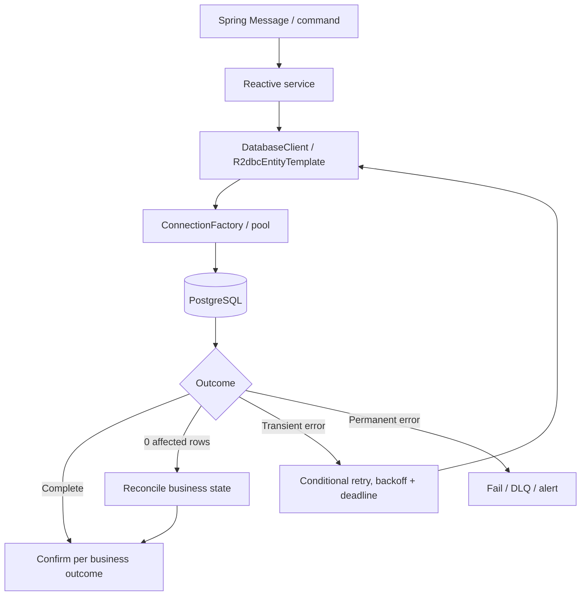
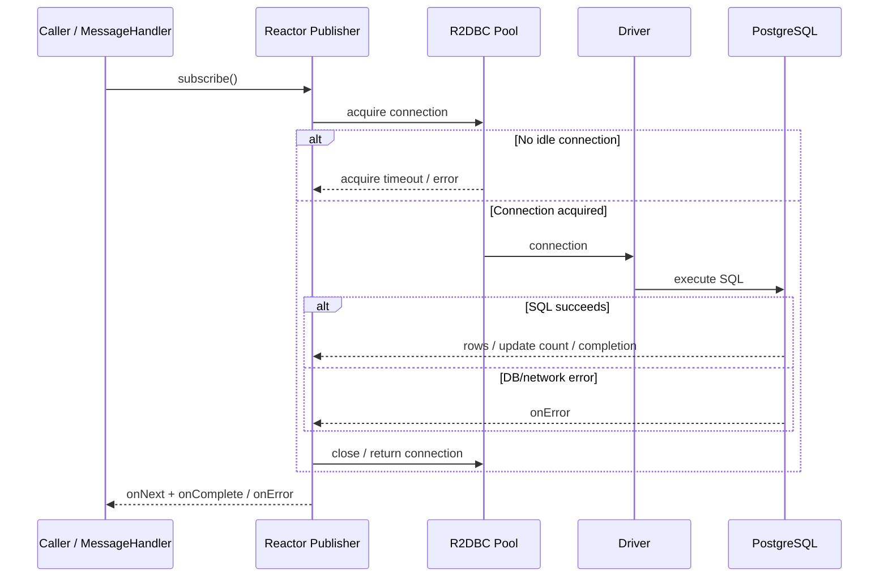
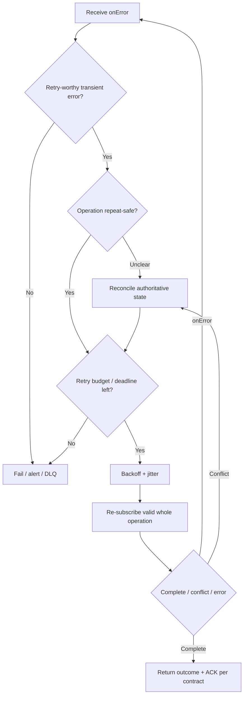
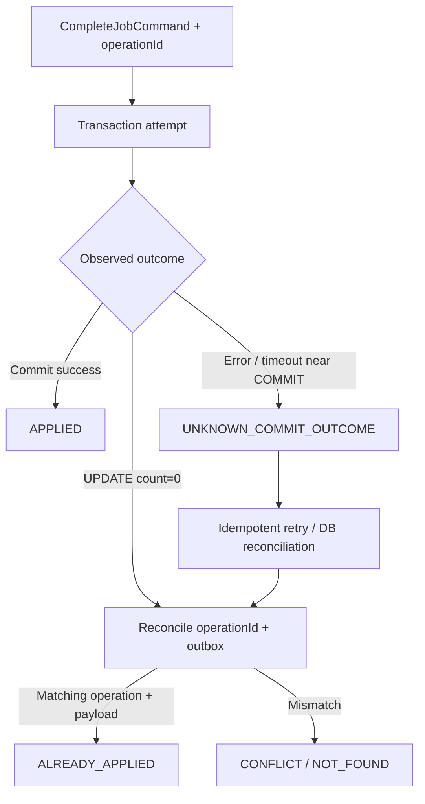

# Connection retries and transient errors

> **Chapter:** R2DBC Adapter  
> **Module:** SPRING_INTEGRATION_ADAPTERS  
> **Context:** Connect external systems to Spring Integration using inbound/outbound adapters, gateways, pollers, and MessageChannels. Practice with files, SFTP, HTTP, JMS, AMQP, Kafka, and databases; focus on message contracts, error handling, retries, idempotency, and connection lifecycles.

## 1. Learning Objectives

After this lesson, you will be able to:

- Distinguish **transient errors** (potentially self-recovering) from **permanent errors** (cannot be resolved by retrying alone) across network, connection pool, database, SQL, and business layers.
- Recognize driver `R2dbcException`/SQLSTATE and Spring-translated `DataAccessException`; never treat every `RuntimeException` as a temporary connection glitch.
- Explain why `ConnectionFactory`/pools do not automatically make a query retry-safe and why retrying a `Mono`/`Flux` typically **re-subscribes** to the source.
- Write `Retry.backoff(...)`, `filter(...)`, `jitter(...)`, and `timeout(...)` for R2DBC queries, distinguishing **backoff**, **retry budget**, **deadline**, and **circuit breaker**.
- Distinguish **pure-read retries** from `INSERT`/`UPDATE` retries with side effects; handle cases where **the database committed yet the caller did not receive the result**.
- Use stable operation IDs, unique constraints, and a transactional outbox to achieve **idempotent effects** during broker/HTTP redelivery.
- Place retries **outside the entire reactive transaction** when retrying after serialization/deadlock errors, instead of retrying a single SQL statement inside an aborted transaction.
- Integrate custom `ReactiveMessageHandler`s and R2DBC inbound/outbound adapters into Spring Integration without confusing sending a Spring Message with a database ACK/commit.
- Design proper connection timeouts, pool acquire timeouts, statement timeouts, total deadlines, backpressure, and concurrency limits.
- Write tests with Reactor `StepVerifier`, PostgreSQL/Testcontainers, and controlled fault injection; monitor transient errors and retry storms before deployment.

## 2. Real-world scenario: an unstable database mid-integration flow

An application receives payment events from Kafka or HTTP, validates data, writes to PostgreSQL, and creates an outbox event to forward to AMQP/Kafka. During network blips or PostgreSQL failover:

1. Opening a connection may be refused.
2. A query may drop mid-flight.
3. A transaction may roll back due to a deadlock/serialization failure.
4. A write may have **already committed**, while the response/ACK is lost in transit.
5. Pollers keep issuing more queries while the system is congested, triggering a **retry storm**.

If retries are unclassified, schema errors and duplicate keys repeat endlessly. If non-idempotent side-effecting UPDATEs are retried, business actions can execute twice.



**Core rule:** "The error looks temporary" **does not mean** "the operation can be re-executed without altering the business outcome". Both questions must be answered **separately**.

### 2.1. Three decisions that must not be mixed

| Question | Example | How to decide |
| --- | --- | --- |
| **Is the error recoverable?** | Connection reset, deadlock, SQL syntax error | Classify exception, SQLSTATE, DB health, and retry budget. |
| **Is the operation safe to repeat?** | SELECT, UPDATE with unique operation ID, balance increment | Check idempotency, transactions, and uncertain commit outcomes. |
| **When to ACK upstream?** | Kafka offset, AMQP delivery, HTTP 200 | After a sufficiently durable result per contract, not merely after building a Publisher. |

A good policy may decide **not to auto-retry** a transient error if the operation has no safe way to reconcile.

## 3. From ConnectionFactory to SQL: where can errors occur?



### 3.1. Errors at each stage

| Stage | Symptom | Investigation layer |
| --- | --- | --- |
| **Config / startup** | Missing driver, bad URL, bean creation failure | R2DBC SPI, classpath, Spring Boot auto-configuration. |
| **DNS / TCP / TLS** | Host unreachable, connection refused/reset, TLS handshake failure | Network, certificates, firewalls, DB endpoint/failover. |
| **Pool acquire** | Long waits or exhausted pool; rising pending requests | R2DBC pool size, acquire timeout, query duration, concurrency. |
| **SQL execution** | Deadlocks, lock timeouts, serialization errors, statement timeouts | Transactions/isolation, SQLSTATE, DB logs. |
| **Result mapping** | Missing columns, incompatible Java types, invalid nulls | Schema/row mapping, migrations, driver conversions. |
| **Commit / response** | DB may have committed yet response was lost | Idempotency, operation ID, reading authoritative state. |
| **Downstream** | Kafka/HTTP fails after DB commit | Outbox, broker ACKs, retries, consumer dedup. |

**No error at the SQL layer does not mean external side effects succeeded.** Similarly, `MessageChannel.send(...)` returning does not prove SQL executed or committed.

### 3.2. Errors raised after the method has returned

```java
Mono<Long> update = db.sql(
        "UPDATE integration_jobs SET status='DONE' WHERE job_id=:id")
        .bind("id", "job-101")
        .fetch()
        .rowsUpdated();

// This is a Publisher, not an executed SQL result yet.
```

With R2DBC, connection/SQL errors normally arrive via **`onError` after subscription**. A `try/catch` around the call creating the `Mono` will not catch these delayed errors.

Handle them via reactive operators, endpoint error handling, or a service exposing reactive results with clear contracts.

## 4. Transient, non-transient, and business conflicts

### 4.1. Transient does not mean guaranteed quick recovery

A **transient error** is a condition likely to clear after a short time or under changed load—such as DB failover, deadlock victim, or busy connection pool resources.

However:

- Repeated connection errors can indicate **misconfiguration**, not a brief outage.
- Query timeouts can stem from missing indexes and keep recurring under the same workload.
- Pool timeouts can stem from excessive concurrency; immediate retries only worsen congestion.
- A transaction timeout near commit time can leave an **unknown outcome**.

Therefore retries must have **limits**, **backoff**, **observability**, and **idempotency**.

### 4.2. Non-transient errors

Errors that generally **cannot be solved by retrying the same payload**:

- SQL syntax errors, missing tables/columns, broken schema migrations.
- Missing database privileges or invalid username/password.
- Duplicate key/foreign key/check constraints under the current business contract.
- DTO mapping type mismatches or unhandled nullable columns.
- Malformed input validation or incompatible event schemas.
- Business rules: job already `DONE`, stale version, invalid claim owner.

Never infinitely retry this group; many cases require fixing code/migrations/config or routing events to quarantine/DLQ.

### 4.3. Business conflicts are not driver errors

```sql
UPDATE integration_jobs
SET status='DONE'
WHERE job_id = :id AND status='PROCESSING';
```

`rowsUpdated() == 0L` is a **valid SQL result**, possibly because:

- `job_id` does not exist.
- The job is already `DONE`.
- The job is `NEW`.
- Owner/token/version no longer match if SQL checks additional criteria.
- This exact command committed earlier, while the caller lost the ACK.

Do not convert every count 0 into a transient exception just to plug into `retryWhen`; reconcile business state instead.

## 5. R2DBC exception hierarchy and SQLSTATE

### 5.1. Common exception classes

The R2DBC SPI defines `io.r2dbc.spi.R2dbcException` as the base R2DBC access error; drivers may use subclasses such as:

- `R2dbcTransientException`: branch of potentially transient errors per SPI classification.
- `R2dbcTransientResourceException`: e.g., resources/connections temporarily unavailable.
- `R2dbcTimeoutException`: timeout per driver mechanics.
- `R2dbcRollbackException`: error forcing transaction rollback, potentially linked to deadlocks/serialization conflicts.
- `R2dbcNonTransientException` and branches for SQL/constraint/permission/resource errors not fixed by repeating the same call.
- `R2dbcDataIntegrityViolationException`, `R2dbcBadGrammarException`, or `R2dbcPermissionDeniedException` (depending on SPI/driver) usually indicate errors unsuitable for automatic retries.

Spring Framework may **translate** errors into `org.springframework.dao.DataAccessException`. For example, `TransientDataAccessException` or other subclasses appear as the outer exception, with `R2dbcException` in the cause chain.

**Never assume exact exception classes from every driver/pool are fixed.** Test actual exception classes, SQLSTATEs, and cause chains in your deployed versions before finalizing policies.

### 5.2. Information worth recording

With `R2dbcException`:

```java
import io.r2dbc.spi.R2dbcException;

void inspect(R2dbcException exception) {
    String sqlState = exception.getSqlState();
    int vendorCode = exception.getErrorCode();

    System.out.printf(
            "SQLSTATE=%s vendorCode=%d exception=%s%n",
            sqlState,
            vendorCode,
            exception.getClass().getSimpleName());
}
```

This is an illustrative method. **Never** log raw SQL containing secrets, passwords, PII, or sensitive payloads. SQLSTATE/vendor codes assist diagnosis; final error handling also depends on transaction state and business rules.

### 5.3. Notable PostgreSQL SQLSTATE codes

| SQLSTATE | PostgreSQL description | Retry? |
| --- | --- | --- |
| `08001` | SQL client unable to establish connection | Retry candidate with backoff and readiness checks. |
| `08003` | Connection does not exist | Can open a new connection, yet prior command's outcome is **uncertain**. |
| `08006` | Connection failure | Bounded retry candidate; verify DB status. |
| `57P01` | Admin shutdown | Usually wait for DB recovery, with deadline/circuit breaker. |
| `40001` | Serialization failure | Typically retry the **whole transaction** after rollback. |
| `40P01` | Deadlock detected | Typically retry the **whole transaction**, with backoff/jitter. |
| `55P03` | Lock not available | Retry depends on lock/`NOWAIT` strategy; not by default. |
| `57014` | Query canceled | **Do not auto-retry**: may reflect user cancel or statement timeout. |
| `23505` | Unique violation | Do not blindly retry; check idempotency/business keys. |
| `23503` | Foreign key violation | Do not blindly retry; inspect data/constraints. |
| `42P01` | Undefined table | Schema/migration error; fix config/code. |
| `28P01` | Invalid password | Config/credentials error; do not retry with the same secret. |

These codes **illustrate PostgreSQL**, not all SQLSTATEs. Network errors can happen before the DB returns an SQLSTATE, and pool exceptions may **carry no** SQLSTATE.

**Do not write `state.startsWith("08")` without checking**: the broad connection exception class can include rejections that will not self-recover.

### 5.4. Error data should be classified by source

```text
Throwable from reactive chain
        |
        +-- DataAccessException (Spring translated)
        |       |
        |       +-- cause: R2dbcException + SQLSTATE
        |
        +-- R2dbcException (driver)
        |
        +-- Pool/Netty/TLS/runtime exception
        |
        +-- Business/validation exception
```

Do not force every error into SQLSTATE. For an `SSLHandshakeException` from an expired certificate, retrying connections with the same certificate brings no benefit even though it occurred at the connection layer.

## 6. Four questions before retrying

A useful decision flow:



### 6.1. Recommended criteria

1. **Transience:** What do SQLSTATE, cause, and health checks indicate?
2. **Operation type:** Read-only SELECT, idempotent upsert, or cumulative side effect?
3. **Transaction boundary:** Does the retry wrap a whole fresh transaction?
4. **Uncertain outcomes:** Are there operation IDs, unique constraints, and audit/outbox tables for reconciliation?
5. **Load limits:** Does the pool have capacity, and can downstream handle it?
6. **Budget:** How many attempts and total request time remain?
7. **Termination:** When unrecoverable, surface a clear error and route to DLQ/alerts.

Never turn retries into a way to "hide errors" on dashboards. Temporarily masking root causes leads to larger backlogs while the DB keeps failing.

## 7. Preparing Spring Boot and PostgreSQL

Examples use **Java 17+, Spring Boot 3.x, Spring Integration 6.x, Spring Data R2DBC 3.x, and BOM-compatible Reactor**. For other versions, check Javadoc of the selected APIs and real integration results.

### 7.1. Maven dependencies

```xml
<dependencies>
    <dependency>
        <groupId>org.springframework.boot</groupId>
        <artifactId>spring-boot-starter-integration</artifactId>
    </dependency>
    <dependency>
        <groupId>org.springframework.boot</groupId>
        <artifactId>spring-boot-starter-data-r2dbc</artifactId>
    </dependency>
    <dependency>
        <groupId>org.springframework.integration</groupId>
        <artifactId>spring-integration-r2dbc</artifactId>
    </dependency>
    <dependency>
        <groupId>org.postgresql</groupId>
        <artifactId>r2dbc-postgresql</artifactId>
        <scope>runtime</scope>
    </dependency>
    <dependency>
        <groupId>io.r2dbc</groupId>
        <artifactId>r2dbc-pool</artifactId>
    </dependency>
    <dependency>
        <groupId>io.projectreactor</groupId>
        <artifactId>reactor-test</artifactId>
        <scope>test</scope>
    </dependency>
</dependencies>
```

Never replace `r2dbc-postgresql` with JDBC `postgresql`. The Spring Boot BOM manages versions; avoid mixing Spring Integration and Spring Framework from mismatched generations.

### 7.2. application.yml

```yaml
spring:
  r2dbc:
    url: r2dbc:postgresql://127.0.0.1:5432/integration_demo
    username: ${DB_USER}
    password: ${DB_PASSWORD}
    pool:
      enabled: true
      initial-size: 2
      max-size: 10
      max-acquire-time: 3s
      max-idle-time: 10m
```

`${DB_USER}` and `${DB_PASSWORD}` are Spring placeholders loaded from environment variables. **Never commit credentials** to Git. Production requires TLS/server verification where appropriate, proper DNS/failover, and least-privilege DB users.

Pool settings shown are **demo values**, not optimal defaults. 10 app instances with max pool size 10 can open up to around 100 connections before counting other services.

### 7.3. Database schema for retries and idempotency

Create the PostgreSQL database `integration_demo` and tables:

```sql
CREATE TABLE integration_jobs (
    job_id            VARCHAR(64) PRIMARY KEY,
    status            VARCHAR(20) NOT NULL DEFAULT 'NEW',
    last_operation_id VARCHAR(80),
    version           BIGINT NOT NULL DEFAULT 0,
    updated_at        TIMESTAMPTZ NOT NULL DEFAULT NOW()
);

CREATE TABLE integration_job_audit (
    audit_id      BIGSERIAL PRIMARY KEY,
    job_id        VARCHAR(64) NOT NULL,
    operation_id  VARCHAR(80) NOT NULL,
    action        VARCHAR(32) NOT NULL,
    created_at    TIMESTAMPTZ NOT NULL DEFAULT NOW(),
    CONSTRAINT uq_job_audit UNIQUE (operation_id, action)
);

CREATE TABLE integration_outbox (
    event_id       VARCHAR(80) PRIMARY KEY,
    job_id         VARCHAR(64) NOT NULL,
    event_type     VARCHAR(40) NOT NULL,
    payload_json   TEXT NOT NULL,
    status         VARCHAR(20) NOT NULL DEFAULT 'NEW',
    created_at     TIMESTAMPTZ NOT NULL DEFAULT NOW(),
    published_at   TIMESTAMPTZ
);

CREATE INDEX idx_outbox_status_created
    ON integration_outbox(status, created_at, event_id);

INSERT INTO integration_jobs(job_id, status)
VALUES ('job-101', 'NEW'), ('job-102', 'NEW'),
       ('job-103', 'DONE');
```

**Business invariants:**

- `job_id` is the job key, ensuring PK UPDATE affects at most one row.
- `operation_id` stays constant across retries of the same command.
- `last_operation_id` identifies the transition that occurred.
- `event_id=operation_id` in this example so one command never creates multiple outbox events.
- Audit has a unique constraint for reconciliation.
- Outbox rows are written **in the same DB transaction** as the UPDATE; publishing to the broker happens **after commit** via a separate relay.

### 7.4. Command records

Create `CompleteJobCommand.java`:

```java
public record CompleteJobCommand(
        String jobId,
        String operationId,
        String eventJson
) {
}
```

Create `JobOutcome.java`:

```java
public enum JobStatus {
    APPLIED,
    ALREADY_APPLIED
}
```

```java
public record JobOutcome(
        String jobId,
        String operationId,
        JobStatus status
) {
}
```

**Each `public` type goes in its own Java file matching its name.** This pattern keeps outcomes clear so callers distinguish a fresh commit from an already-recorded retry.

## 8. DatabaseClient: read queries and write commands

### 8.1. Simple SELECTs are easier retry candidates

Create `JobReadRepository.java`:

```java
import org.springframework.r2dbc.core.DatabaseClient;
import org.springframework.stereotype.Repository;
import reactor.core.publisher.Mono;

@Repository
public class JobReadRepository {

    private final DatabaseClient db;

    public JobReadRepository(DatabaseClient db) {
        this.db = db;
    }

    public Mono<String> findStatus(String jobId) {
        return db.sql(
                        "SELECT status FROM integration_jobs " +
                        "WHERE job_id = :id")
                .bind("id", jobId)
                .map((row, meta) ->
                        row.get("status", String.class))
                .one();
    }
}
```

`Mono<String>` can complete empty if no job exists. Never lump empty results together with connection failures.

A pure SELECT carries less side-effect risk than an UPDATE, yet if a caller emits `Flux` results to Kafka/HTTP and retries after partial emission, **downstream can still receive duplicates**.

### 8.2. Conditional status update

Snippet inside a repository with a `db` field:

```java
Mono<Long> update = db.sql(
                "UPDATE integration_jobs " +
                "SET status = 'DONE', " +
                "    last_operation_id = :operation, " +
                "    version = version + 1, " +
                "    updated_at = NOW() " +
                "WHERE job_id = :id AND status = 'NEW'")
        .bind("id", command.jobId())
        .bind("operation", command.operationId())
        .fetch()
        .rowsUpdated();
```

`rowsUpdated()` returns `Mono<Long>` in Spring Framework 6.x. Count 0 is **not** a connection error by itself; inspect the current job or transaction logs.

**Key point:** if the UPDATE committed yet the response was lost, a retry can return 0 because status is already DONE. Zero does not mean the prior request was not applied.

## 9. Reactor Retry: backoff, jitter, filter, and budget

### 9.1. retry vs. retryWhen

`retry(n)` can re-subscribe immediately with no default backoff. That is risky when the database is overloaded.

`retryWhen(Retry.backoff(...))` lets you configure:

- Maximum retry attempts.
- Exponentially increasing wait intervals (exponential backoff).
- Jitter to spread client retry timestamps.
- Transient exception filters.
- Hooks to measure attempts/metrics.
- Exhaustion behavior when retries run out.

```java
import java.time.Duration;
import reactor.util.retry.Retry;

Retry retrySpec = Retry.backoff(3, Duration.ofMillis(200))
        .maxBackoff(Duration.ofSeconds(2))
        .jitter(0.3);
```

`Retry.backoff(3, ...)` allows **up to three retries after the initial attempt**, not three total executions. Retry counts and total duration must be sized against API/request deadlines.

### 9.2. Why is jitter needed?

Suppose 1,000 instances reconnect simultaneously after a PostgreSQL failover. If all retry at 200ms, 400ms, 800ms, each wave creates a massive spike.

`jitter(0.3)` randomizes wait intervals within bounds, reducing client synchronization. It **does not** replace circuit breakers or rate limiters: if the database stays down for minutes, retries must still halt/throttle and allow recovery.

### 9.3. Place retries at the operation level, not after uncontrolled side effects

```java
Mono<String> status = repository.findStatus("job-101")
        .retryWhen(
                Retry.backoff(2, Duration.ofMillis(100))
                     .maxBackoff(Duration.ofSeconds(1))
                     .filter(PgRetryClassifier::isRetryCandidate));
```

This uses the classifier from section 10. `findStatus` is a side-effect-free SELECT. For UPDATE/INSERT, beyond transient classification you need **business idempotency** before applying similar retries.

`retryWhen` **re-subscribes** to the source Publisher; it does not "resume" mid-way through a failed SQL statement.

### 9.4. Total deadline

```java
Mono<String> withDeadline = repository.findStatus("job-101")
        .retryWhen(
                Retry.backoff(2, Duration.ofMillis(100))
                     .maxBackoff(Duration.ofSeconds(1))
                     .filter(PgRetryClassifier::isRetryCandidate))
        .timeout(Duration.ofSeconds(4));
```

`timeout(...)` wraps the outside of retries to bound the **entire pipeline including attempts and backoff**. Connection/pool/statement timeouts must still be configured separately; they protect different layers.

**Never treat a timeout as proof a statement did not run or commit.** Especially for writes, reconcile state by operation ID.

## 10. Classifier for retry-worthy errors

### 10.1. Conservative SQLSTATE-based filter

This is a **PostgreSQL-specific** example. Create `PgRetryClassifier.java`:

```java
import java.util.Set;

import io.r2dbc.spi.R2dbcException;
import io.r2dbc.spi.R2dbcTransientException;
import org.springframework.dao.TransientDataAccessException;

public final class PgRetryClassifier {

    private static final Set<String> CANDIDATE_STATES = Set.of(
            "08001", // Cannot establish connection
            "08003", // Connection does not exist
            "08006", // Connection failure
            "57P01", // Admin shutdown
            "40001", // Serialization failure
            "40P01"  // Deadlock
    );

    private PgRetryClassifier() {
    }

    public static boolean isRetryCandidate(Throwable error) {
        boolean springTransient = false;
        boolean spiTransientWithoutSqlState = false;

        for (Throwable current = error;
                current != null;
                current = current.getCause()) {

            if (current instanceof R2dbcException r2dbc) {
                String sqlState = r2dbc.getSqlState();
                if (sqlState != null && !sqlState.isBlank()) {
                    // SQLSTATE present: follow whitelist; do not let
                    // TransientDataAccessException wrapper override a permanent state.
                    return CANDIDATE_STATES.contains(sqlState);
                }
                if (current instanceof R2dbcTransientException) {
                    spiTransientWithoutSqlState = true;
                }
            }

            if (current instanceof TransientDataAccessException) {
                springTransient = true;
            }
        }

        return spiTransientWithoutSqlState || springTransient;
    }
}
```

**This classifies "errors worth considering for retry", not a blanket license to retry every operation.** Operation-level preconditions still apply: idempotent or equipped with reconciliation/transaction replay.

### 10.2. Limitations of the classifier

- `R2dbcException.getSqlState()` can be null.
- Pool acquire errors may be wrapped in exceptions outside the R2DBC SPI.
- Spring's `TransientDataAccessException` may wrap a driver error lacking SQLSTATE; test actual behavior.
- `08003/08006` at transaction commit still carry an **unknown outcome**.
- `55P03` (lock not available) is omitted from the whitelist to avoid automatic retries when lock policy is undefined.
- `57014` (query canceled) is omitted because it may stem from intentional cancellation.
- `57P01` is a reconnect candidate once the server returns; immediate retries will not necessarily succeed.
- A PostgreSQL classifier cannot be reused verbatim for MySQL/SQL Server or other drivers.

**Never match raw message text** (`"connection was closed"` substring). Messages vary across locales, driver versions, and nested causes.

### 10.3. Adding safe logging for retry attempts

```java
Retry retrySpec = Retry.backoff(3, Duration.ofMillis(200))
        .maxBackoff(Duration.ofSeconds(2))
        .jitter(0.3)
        .filter(PgRetryClassifier::isRetryCandidate)
        .doBeforeRetry(signal ->
                System.out.printf(
                        "Retry #%d after %s%n",
                        signal.totalRetries() + 1,
                        signal.failure().getClass().getSimpleName()));
```

Never log sensitive payloads, passwords, JDBC/R2DBC URLs containing credentials, or full SQL with parameter values.

### 10.4. When retries are exhausted

Customize `onRetryExhaustedThrow(...)` to preserve the root cause, letting the caller decide NACK, HTTP 503, or DLQ. However:

- Never convert exhausted failures into `Mono.empty()` and ACK as success.
- Never return "invalid data" when the DB is down.
- Never loop retries forever inside an HTTP request whose deadline already expired.
- Never spin up more workers while the DB pool is exhausted.

## 11. Retrying Flux/SELECT: read-only does not always make the whole flow safe

### 11.1. Retrying a multi-row query

```java
Flux<String> pendingJobs = db.sql(
                "SELECT job_id FROM integration_jobs " +
                "WHERE status='NEW' ORDER BY job_id LIMIT 50")
        .map((row, metadata) ->
                row.get("job_id", String.class))
        .all()
        .retryWhen(
                Retry.backoff(2, Duration.ofMillis(100))
                        .filter(PgRetryClassifier::isRetryCandidate));
```

A `SELECT` query does not mutate data, making retries simpler than DML. Still, if `Flux` emits two rows and then hits `onError`, `retryWhen` can **re-subscribe to the whole query**, emitting those two rows again.

If downstream already sent each row to Kafka/HTTP, even with read-only SQL, **pipeline side effects can repeat**. Never attach whole-`Flux` retries without accounting for partial emissions.

### 11.2. Example of a retry re-emitting data

```java
import reactor.core.publisher.Flux;
import reactor.util.retry.Retry;

Flux<Integer> source = Flux.defer(() ->
        Flux.concat(
                Flux.just(101, 102),
                Flux.error(new IllegalStateException("temporary"))));

Flux<Integer> repeated = source.retryWhen(Retry.max(1));
```

`repeated` can emit `101, 102, 101, 102` and then error. This exercise illustrates **resubscription**, not directly PostgreSQL driver mechanics.

### 11.3. Cursor vs. ACK

```sql
SELECT job_id, status
FROM integration_jobs
WHERE job_id > :cursor
ORDER BY job_id
LIMIT :batchSize;
```

Keyset pagination helps when scanning large tables, yet `cursor` is not proof earlier events finished processing.

- Committing the cursor before downstream ACKs can skip events on a crash.
- Multiple workers need claims/leases to avoid processing the same rows.
- Auto-increment keys do not always match exact commit order of concurrent transactions.
- Retrying a query from an old cursor can replay data; consumers need idempotency.

### 11.4. Flux timeouts

```java
Flux<String> gapTimed = pendingJobs
        .timeout(Duration.ofSeconds(3));

Mono<java.util.List<String>> wholeBatchTimed = pendingJobs
        .collectList()
        .timeout(Duration.ofSeconds(8));
```

`Flux.timeout(Duration)` mainly bounds the **interval between signals**, whereas `collectList().timeout(...)` bounds the **total time to materialize the batch**. Use `collectList()` only when SQL already caps batch size to avoid unbounded RAM buffering.

## 12. Retrying transactions: place retries outside the transaction boundary

### 12.1. Never retry one SQL statement inside an aborted transaction

In PostgreSQL, a statement error can put the current transaction into an **aborted** state. Retrying just that statement in the same transaction keeps failing without recovering the transaction.

```java
// DO NOT DO THIS: methods are illustrative placeholders.
Mono<Void> unsafe = updateJob()
        .retryWhen(Retry.backoff(2, Duration.ofMillis(100)))
        .then(insertAudit())
        .as(tx::transactional);
```

For deadlocks/serialization failures, you must normally **roll back the current attempt and retry the entire transaction in a fresh attempt**.

### 12.2. Wrap all SQL inside TransactionalOperator

```text
completeOnce(command):
    work = conditional UPDATE job
           -> check affected rows
           -> INSERT audit
           -> INSERT outbox
    return transactional(work)
```

This is **structural pseudocode**; the full Java implementation is in section 13. `TransactionalOperator` binds the transaction to the subscription's Reactor Context, not a fixed ThreadLocal.

Place the retry outside the transactional call:

```java
Mono<JobOutcome> resilient =
        Mono.defer(() -> service.completeOnce(command))
                .retryWhen(
                        Retry.backoff(2, Duration.ofMillis(200))
                                .maxBackoff(Duration.ofSeconds(2))
                                .jitter(0.3)
                                .filter(PgRetryClassifier::isRetryCandidate))
                .timeout(Duration.ofSeconds(8));
```

Each resubscription starts a **new transaction** after the prior transaction rolled back. If the response was lost at COMMIT time, starting a new transaction is safe only if the command has a **stable operation ID and reconciliation logic**.

### 12.3. Transaction errors eligible for retry

| Case | Appropriate retry scope |
| --- | --- |
| SQLSTATE `40001` serialization failure | Entire new transaction, with backoff. |
| SQLSTATE `40P01` deadlock | Entire new transaction, with backoff. |
| Connection failure before SQL starts | Acquire new connection, retry whole operation. |
| Lost commit reply | Reconcile by operation ID; do not assume rollback. |
| Unique violation `23505` | Do not blindly retry; check duplicate/idempotency. |
| UPDATE count = 0 | Business state reconciliation, not a transient SQL error. |

### 12.4. Reactive @Transactional also requires proxy and subscription

`@Transactional` can guard methods returning `Mono`/`Flux` if a `ReactiveTransactionManager` is present and Spring intercepts properly. Calling `this.method()` inside the same bean in proxy mode bypasses the transaction interceptor.

Never create `Mono`s and call `subscribe()` separately per SQL step. Compose with `flatMap`/`then` so the caller/framework subscribes to **one resulting Publisher**.

## 13. End-to-end example: transaction + operation ID reconciliation

A `CompleteJobCommand` contains `jobId`, `operationId`, and `eventJson`. The outcome is `APPLIED` when the current run commits the change, and `ALREADY_APPLIED` when the database proves the operation already committed previously with matching content.

### 13.1. Service code

Create `JobCompletionService.java`:

```java
import org.springframework.r2dbc.core.DatabaseClient;
import org.springframework.stereotype.Service;
import org.springframework.transaction.reactive.TransactionalOperator;
import reactor.core.publisher.Mono;

@Service
public class JobCompletionService {

    private final DatabaseClient db;
    private final TransactionalOperator tx;

    public JobCompletionService(
            DatabaseClient db, TransactionalOperator tx) {
        this.db = db;
        this.tx = tx;
    }

    public Mono<JobOutcome> completeOnce(
            CompleteJobCommand cmd) {

        validate(cmd);

        Mono<JobOutcome> work = db.sql(
                        "UPDATE integration_jobs " +
                        "SET status='DONE', " +
                        "last_operation_id=:operation, " +
                        "version=version+1, updated_at=NOW() " +
                        "WHERE job_id=:id AND status='NEW'")
                .bind("id", cmd.jobId())
                .bind("operation", cmd.operationId())
                .fetch()
                .rowsUpdated()
                .flatMap(count -> {
                    if (count == 1L) {
                        return insertAuditAndOutbox(cmd);
                    }
                    if (count == 0L) {
                        return reconcileCommittedOperation(cmd);
                    }
                    return Mono.error(new IllegalStateException(
                            "Unexpected affected rows: " + count));
                });

        // All three SQL statements and reconciliation path stay in the transaction.
        return work.as(tx::transactional);
    }

    private Mono<JobOutcome> insertAuditAndOutbox(
            CompleteJobCommand cmd) {

        return db.sql(
                        "INSERT INTO integration_job_audit " +
                        "(job_id, operation_id, action) " +
                        "VALUES (:job, :operation, :action)")
                .bind("job", cmd.jobId())
                .bind("operation", cmd.operationId())
                .bind("action", "COMPLETE")
                .fetch()
                .rowsUpdated()
                .flatMap(auditCount -> {
                    if (auditCount != 1L) {
                        return Mono.error(new IllegalStateException(
                                "Unexpected audit count: " + auditCount));
                    }

                    return db.sql(
                                    "INSERT INTO integration_outbox " +
                                    "(event_id, job_id, event_type, " +
                                    "payload_json) " +
                                    "VALUES (:event, :job, :type, :body)")
                            .bind("event", cmd.operationId())
                            .bind("job", cmd.jobId())
                            .bind("type", "JOB_COMPLETED")
                            .bind("body", cmd.eventJson())
                            .fetch()
                            .rowsUpdated();
                })
                .flatMap(outboxCount -> {
                    if (outboxCount != 1L) {
                        return Mono.error(new IllegalStateException(
                                "Unexpected outbox count: " + outboxCount));
                    }
                    return Mono.just(new JobOutcome(
                            cmd.jobId(), cmd.operationId(),
                            JobStatus.APPLIED));
                });
    }

    private Mono<JobOutcome> reconcileCommittedOperation(
            CompleteJobCommand cmd) {

        return db.sql(
                        "SELECT status, last_operation_id " +
                        "FROM integration_jobs WHERE job_id=:id")
                .bind("id", cmd.jobId())
                .map((row, meta) -> new JobSnapshot(
                        row.get("status", String.class),
                        row.get("last_operation_id", String.class)))
                .one()
                .switchIfEmpty(Mono.error(
                        new IllegalStateException("Job not found")))
                .flatMap(job -> {
                    if (!"DONE".equals(job.status())
                            || !cmd.operationId().equals(
                                    job.lastOperationId())) {
                        return Mono.error(new IllegalStateException(
                                "Job state conflicts with operation"));
                    }
                    return checkOutbox(cmd);
                });
    }

    private Mono<JobOutcome> checkOutbox(
            CompleteJobCommand cmd) {

        return db.sql(
                        "SELECT job_id, event_type, payload_json " +
                        "FROM integration_outbox WHERE event_id=:id")
                .bind("id", cmd.operationId())
                .map((row, meta) -> new OutboxSnapshot(
                        row.get("job_id", String.class),
                        row.get("event_type", String.class),
                        row.get("payload_json", String.class)))
                .one()
                .switchIfEmpty(Mono.error(
                        new IllegalStateException(
                                "Operation has no matching outbox")))
                .flatMap(row -> {
                    boolean sameCommand =
                            cmd.jobId().equals(row.jobId())
                            && "JOB_COMPLETED".equals(row.eventType())
                            && cmd.eventJson().equals(row.payloadJson());

                    if (!sameCommand) {
                        return Mono.error(new IllegalStateException(
                                "Operation ID reused for different payload"));
                    }

                    return Mono.just(new JobOutcome(
                            cmd.jobId(), cmd.operationId(),
                            JobStatus.ALREADY_APPLIED));
                });
    }

    private static void validate(CompleteJobCommand cmd) {
        if (cmd == null
                || !valid(cmd.jobId(), 64)
                || !valid(cmd.operationId(), 80)
                || cmd.eventJson() == null
                || cmd.eventJson().isBlank()
                || cmd.eventJson().length() > 100_000) {
            throw new IllegalArgumentException("Invalid command");
        }
    }

    private static boolean valid(String value, int max) {
        return value != null
                && value.length() <= max
                && value.matches("[A-Za-z0-9_-]+");
    }

    private record JobSnapshot(
            String status, String lastOperationId) {
    }

    private record OutboxSnapshot(
            String jobId, String eventType, String payloadJson) {
    }
}
```

### 13.2. Why is this code safer to repeat than a single UPDATE?

1. `UPDATE ... WHERE status='NEW'` is a conditional transition.
2. When count=1, audit and outbox are inserted in the **same transaction**.
3. If audit/outbox fails, the transaction rolls back the UPDATE, leaving no half-completed state.
4. When count=0, it inspects the job and outbox by **operationId**.
5. If `DONE` exists with matching operation and payload, it returns `ALREADY_APPLIED`.
6. If operation or payload differs, it signals a business conflict rather than retrying under transient policy.
7. Unique constraints reinforce duplicate prevention.
8. Callers ACK inputs per contract only after the service returns a durable outcome.

**Note:** This demo compares `eventJson` as a **plain string**. Production should use canonical JSON or versioned fingerprints if serializers can emit equivalent content with different formatting. Also enforce authorization, byte-size limits, and schema validation separately.

### 13.3. Outbox is not a Kafka ACK yet

An outbox row in `NEW` means the DB persisted the intent to publish. It **does not** prove the event is already in Kafka/AMQP.

A separate outbox relay must publish, wait for broker ACK, and mark `PUBLISHED`. If it crashes after broker ACK yet before updating the DB, the event may be resent; consumers must deduplicate by `event_id`.

### 13.4. Facade placing Retry outside the transaction

Create `JobCompletionFacade.java`:

```java
import java.time.Duration;

import org.springframework.stereotype.Service;
import reactor.core.publisher.Mono;
import reactor.util.retry.Retry;

@Service
public class JobCompletionFacade {

    private final JobCompletionService service;

    public JobCompletionFacade(JobCompletionService service) {
        this.service = service;
    }

    public Mono<JobOutcome> completeReliably(
            CompleteJobCommand cmd) {

        return Mono.defer(() -> service.completeOnce(cmd))
                .retryWhen(
                        Retry.backoff(2, Duration.ofMillis(200))
                                .maxBackoff(Duration.ofSeconds(2))
                                .jitter(0.3)
                                .filter(
                                        PgRetryClassifier::isRetryCandidate))
                .timeout(Duration.ofSeconds(8));
    }
}
```

`Retry` in the facade **retries the whole operation**; `completeOnce` wraps the transaction. A retry after a lost commit response can return `ALREADY_APPLIED` instead of writing twice.

## 14. ConnectionFactory, pools, and reconnects

### 14.1. ConnectionFactory knows nothing about business idempotency

`io.r2dbc.spi.ConnectionFactory.create()` returns a connection Publisher. A pool can hand out a new connection after an old one breaks, yet **has no idea** whether the prior UPDATE committed.

Distinguish:

| Concept | Guarantee |
| --- | --- |
| Reconnect | Attempts to obtain a valid new connection. |
| SQL retry | Attempts to re-execute a statement/transaction. |
| Idempotency | Prevents extra business effects when the same operation repeats. |
| Recovery | Finds and reprocesses un-ACKed work items after restart. |

### 14.2. Pool acquire timeout and load congestion

A pool with `max-size=10` does not mean only ten requests exist. Hundreds of publishers can wait to acquire, consuming memory and raising latency.

Immediate retries after a pool timeout usually **increase pending requests**. Reduce concurrency, tune SQL/indexes/locks, apply backoff+jitter, and bound total requests.

### 14.3. Connection scenarios

| Scenario | Action |
| --- | --- |
| DB restart/failover, connection refused | Bounded retry, check readiness, monitor DB. |
| Slow DNS failover propagation | Backoff; verify real DNS/TTL config. |
| Invalid/expired TLS certificate | Fix certificate/truststore; do not blindly retry. |
| Wrong username/password | Fix secret/permissions; do not retry with same config. |
| Pool overloaded by lock contention | Reduce load/transaction duration; do not merely raise max-size. |
| Network drops at COMMIT | Reconcile by operation ID before acting further. |

### 14.4. Lifecycle on shutdown

On application shutdown, stop polling/accepting new tasks, grant in-flight subscriptions a bounded completion window, never ACK early, close the pool, and let un-ACKed rows recover via broker/outbox/leases.

Never hold a raw `Connection` singleton across concurrent operations; let `DatabaseClient`/`R2dbcEntityTemplate` manage connections.

## 15. Timeouts across multiple layers

### 15.1. Comparison table

| Timeout | Protects | Does NOT mean |
| --- | --- | --- |
| Connect timeout | Opening a connection to PostgreSQL. | SQL statement deadline. |
| Pool acquire timeout | Waiting for a connection from the pool. | That the query rolled back. |
| PostgreSQL `statement_timeout` | Statement execution / lock wait time. | Entire workflow retry budget. |
| PostgreSQL `lock_timeout` | Waiting on locks. | Deadlock detection. |
| Transaction timeout | Transaction duration. | Kafka/HTTP ACK. |
| Reactor `timeout(...)` | Publisher operator deadline/gap. | That DB definitely did not commit. |
| HTTP business deadline | Total caller wait time. | Individual retry duration. |

### 15.2. Lost reply

```text
Client sends UPDATE
     |
     v
DB processes and COMMITS
     |
     v
Network drops before client receives reply
     |
     v
Client sees timeout/error
```

**Do not conclude the UPDATE never ran.** In this case, stable operation IDs + audit/outbox provide the data for reconciliation.

### 15.3. Circuit breakers and bulkheads

- **Circuit breaker:** sheds DB calls when failures persist, using appropriate half-open probes.
- **Bulkhead/semaphore:** caps in-flight DB calls to prevent flooding the pool.
- **Retry:** retries only classified errors within deadlines.
- **Durable queue:** holds events when DB outages outlast the retry budget.
- **Idempotency:** prevents duplicate effects on source replays.

These mechanisms complement each other. Never count business conflicts as DB health failures that trip a circuit breaker.

## 16. Spring Integration R2DBC outbound and custom reactive handlers

### 16.1. One-way outbound adapter

```java
import java.util.Map;

import org.springframework.context.annotation.Bean;
import org.springframework.context.annotation.Configuration;
import org.springframework.data.r2dbc.core.R2dbcEntityTemplate;
import org.springframework.data.relational.core.query.Criteria;
import org.springframework.integration.config.EnableIntegration;
import org.springframework.integration.dsl.IntegrationFlow;
import org.springframework.integration.r2dbc.dsl.R2dbc;
import org.springframework.integration.r2dbc.outbound.R2dbcMessageHandler;
import org.springframework.messaging.Message;

@Configuration
@EnableIntegration
public class SimpleJobUpdateFlow {

    @Bean
    IntegrationFlow jobUpdateFlow(R2dbcEntityTemplate template) {
        return IntegrationFlow.from("jobUpdates")
                .handleReactive(
                        R2dbc.outboundChannelAdapter(template)
                                .queryType(R2dbcMessageHandler.Type.UPDATE)
                                .tableName("integration_jobs")
                                .criteria((Message<CompleteJobCommand> m) ->
                                        Criteria.where("job_id")
                                                .is(m.getPayload().jobId())
                                                .and("status").is("NEW"))
                                .values((Message<CompleteJobCommand> m) ->
                                        Map.of(
                                                "status", "DONE",
                                                "last_operation_id",
                                                m.getPayload().operationId()))
                )
                .get();
    }
}
```

This snippet illustrates only a **single UPDATE** via `R2dbcMessageHandler`, without writing audit/outbox in the same transaction.

- `handleReactive(...)` handles `ReactiveMessageHandler` in Java DSL (Spring Integration 6.1+).
- The default outbound adapter signals completion/error as `Mono<Void>`, **without returning `rowsUpdated()`**.
- An UPDATE with count=0 can complete normally; strict business outcomes need a custom service.
- Never wrap HTTP/Kafka + DB in a single retry simply because all endpoints share a flow.

### 16.2. ReactiveMessageHandler with explicit transaction and retry

```java
import org.springframework.context.annotation.Bean;
import org.springframework.context.annotation.Configuration;
import org.springframework.integration.config.EnableIntegration;
import org.springframework.integration.dsl.IntegrationFlow;
import org.springframework.messaging.ReactiveMessageHandler;

@Configuration
@EnableIntegration
public class ReliableJobFlowConfiguration {

    @Bean
    IntegrationFlow reliableJobFlow(JobCompletionFacade facade) {
        ReactiveMessageHandler handler = message -> {
            CompleteJobCommand cmd =
                    (CompleteJobCommand) message.getPayload();

            return facade.completeReliably(cmd).then();
        };

        return IntegrationFlow.from("completeJobCommands")
                .handleReactive(handler)
                .get();
    }
}
```

`.then()` keeps completion/error while discarding `JobOutcome`. This is a terminal **one-way handler**; if callers need the domain outcome back, use a reactive service API or a request-reply gateway with an explicit contract.

**Never call `facade.completeReliably(cmd).subscribe()` and return `Mono.empty()`**. That detaches DB error/commit from the handler lifecycle and allows upstream sources to ACK before DB completion.

### 16.3. Retrying the whole MessageChannel can repeat other side effects

```text
Receive Kafka -> HTTP call -> R2DBC UPDATE -> Kafka publish
```

If you retry the **whole flow** on a DB error, the earlier HTTP call may repeat. If you retry after a succeeded broker publish whose ACK was lost, the Kafka event may also re-emit.

Scope retries around **operations with idempotent contracts**, and handle ACKs/dedup separately at each boundary.

## 17. R2DBC inbound poller, Flux, and redelivery

### 17.1. One poll can contain many rows

`R2dbcMessageSource` normally emits one `Message<Flux<T>>` when `expectSingleResult=false`, rather than N Spring Messages by default.

```text
Poller -> R2dbcMessageSource
                   |
                   v
           Message<Flux<JobEntity>>
                   |
                   v
            FluxMessageChannel
                   |
                   v
                Splitter
                   |
                   +-- Message<JobEntity> #1
                   +-- Message<JobEntity> #2
```

`maxMessagesPerPoll(1)` limits `receive()` invocations, **not row counts**. Use SQL `LIMIT` and a proper claim strategy.

### 17.2. SELECT retry vs. event redelivery

If a query emits row #1 and then fails on row #2, retrying can re-read #1. If #1 was already sent to HTTP/Kafka, external deduplication is required.

If `updateSql` on an R2DBC source marks rows read/claimed, that **is not automatically a post-processing ACK**. Workers dying between claim and downstream ACK need leases/recovery.

### 17.3. Two pollers can read duplicates

```sql
SELECT event_id, payload_json
FROM integration_outbox
WHERE status='NEW'
ORDER BY created_at
LIMIT 25;
```

Two instances can SELECT the same rows. Backpressure and `fixedDelay` do not grant exclusive row ownership.

With PostgreSQL you can claim in batches:

```sql
WITH picked AS (
    SELECT event_id
    FROM integration_outbox
    WHERE status='NEW'
    ORDER BY created_at, event_id
    LIMIT :batchSize
    FOR UPDATE SKIP LOCKED
)
UPDATE integration_outbox AS o
SET status='PROCESSING'
FROM picked
WHERE o.event_id=picked.event_id
RETURNING o.event_id, o.job_id, o.payload_json;
```

This is a **PostgreSQL-specific atomic claim statement**. Production schemas need owner/token/lease_until/attempt_count and recovery; never blindly retry a `Flux` of `UPDATE ... RETURNING` because re-subscribing can claim a **different batch**.

## 18. Broker/HTTP retries and source ACKs

### 18.1. Multiple retry layers can multiply attempts

| Layer | What triggers retry | Risk |
| --- | --- | --- |
| Reactor `retryWhen` | R2DBC `onError` | SQL/transaction re-executes. |
| Kafka redelivery | Uncommitted offset | Same event consumed again. |
| AMQP/JMS redelivery | NACK/requeue/connection loss | Message redelivered to consumer. |
| HTTP retry | Timeout/5xx | Server may have processed while reply was lost. |
| File/SFTP poller | File still detected | Same file read again. |
| Outbox relay | Unknown broker ACK | Same event published multiple times. |

For example, 3 DB retries per broker delivery times 5 broker redeliveries multiplies SQL attempts dramatically. Enforce a **total retry budget**, idempotency, and capacity limits instead of enabling unbounded retries everywhere.

### 18.2. When to ACK the source?

1. Receive message with a stable `operationId`.
2. Validate payload/schema/authorization.
3. Execute DB transaction + outbox or detect `ALREADY_APPLIED`.
4. ACK the source per contract only once a **durable state** exists.
5. If DB is unavailable, hold/requeue per policy; never ACK early.
6. For permanent payload errors, route to a durably recorded DLQ/quarantine to stop infinite redeliveries.

### 18.3. No distributed rollback by default

`R2dbcTransactionManager` only manages transactions on an R2DBC connection. It cannot roll back a completed Kafka publish, HTTP response, JMS/AMQP ACK, or file rename.

**Transactional outbox** guarantees DB state and **publish intent** commit together, while the relay may still retry after the broker received the event. Consumers need **idempotent processing** keyed by `event_id`.

## 19. Reconciling state when commit outcomes are uncertain

### 19.1. Four distinct business outcomes



An integration service should distinguish:

- **APPLIED**: a new transaction wrote business state and outbox.
- **ALREADY_APPLIED**: the same operation ID committed earlier, verified by persisted data.
- **CONFLICT**: incompatible state/owner/version/payload.
- **UNKNOWN_COMMIT_OUTCOME**: insufficient evidence to confirm commit vs. rollback.

`TransientDataAccessException` alone cannot decide among these four states. Exception classification and business reconciliation are two separate steps.

### 19.2. When to return an HTTP response?

| Case | Handling |
| --- | --- |
| DB commits and command applied | Return corresponding business success. |
| Retry with same operation ID, matching data | Return success/deduplicated outcome per contract. |
| Operation ID reused for different payload | Return conflict/validation failure. |
| DB unavailable, cannot reconcile yet | Return service unavailable or accepted for later reconciliation per API contract. |
| DB committed outbox, broker hasn't ACKed yet | Do not claim Kafka delivery finished; can return "persisted/accepted" per contract. |

Exact HTTP status codes (200/201/202/409/503) depend on API design; never hardcode all cases to a single status.

### 19.3. Timeouts do not erase events

With a persistent broker source or outbox, a timed-out request must **leave a trail for retry/reconciliation**. Never drop events from an in-memory buffer and treat `Mono.timeout` as a rollback or completion.

If a job is `DONE`, its `NEW` outbox event must still be published by the relay. If the broker receives the event yet the DB `PUBLISHED` update is lost, the relay may republish; consumers must deduplicate.

## 20. Observability: distinguishing root errors, retries, and duplicates

### 20.1. Suggested metrics

| Metric | Helps answer |
| --- | --- |
| `r2dbc_operation_attempts_total` | How many DB attempts per operation type? |
| `r2dbc_operation_retries_total` | How many retries occurred? |
| `r2dbc_retry_exhausted_total` | Operations that exhausted retry budgets. |
| `r2dbc_sqlstate_errors_total` | Which SQLSTATEs are rising (grouped by category/code)? |
| `r2dbc_connection_failures_total` | How often connection drops occur? |
| `r2dbc_pool_active`/`idle`/`pending` | Is the pool congested? |
| `r2dbc_pool_acquire_latency_p95` | Are connection acquires slow? |
| `r2dbc_query_latency_p95` | Are queries slow or locked? |
| `r2dbc_tx_commit_total`/`rollback_total` | Are transactions committing/rolling back as expected? |
| `r2dbc_tx_duration_p95` | How long do transactions stay open? |
| `job_already_applied_total` | How many duplicate requests were recognized? |
| `job_business_conflict_total` | How many commands were rejected due to state? |
| `outbox_new_count`/`oldest_age` | Is the unpublished event backlog growing? |
| `outbox_publish_retries_total` | Is the relay continuously retrying the broker? |
| `downstream_ack_latency_p95` | Is the bottleneck at the DB or the broker? |

Names are **instrumentation suggestions**, not all built-in Spring/Micrometer names. Never put high-cardinality `jobId`, `operationId`, or raw SQL into **metric labels**.

### 20.2. Logs must separate attempt, outcome, and source

```text
operation=op-101 job=job-101 attempt=1
  stage=db_write errorClass=R2dbcTransientResourceException
  sqlState=08006 outcome=UNKNOWN

operation=op-101 job=job-101 attempt=2
  stage=db_reconcile outcome=ALREADY_APPLIED

operation=op-101 job=job-101
  stage=outbox_pending publishStatus=NEW
```

This is an illustrative log format, not default output. Retain Spring Message `correlationId`, business operation ID, and trace ID for reconciliation. Never log credentials, full JSON payloads, or sensitive data.

### 20.3. Hooks on reactive chains

```java
Mono<JobOutcome> monitored = facade.completeReliably(command)
        .doOnSubscribe(s -> metrics.started())
        .doOnNext(result -> metrics.recordOutcome(result.status()))
        .doOnError(error -> metrics.operationError(error))
        .doFinally(signal -> metrics.finished(signal));
```

Assumes an existing `metrics` service. `doFinally` sees complete/error/cancel. Because hooks run per subscription, never use `doOnNext` to publish critical non-idempotent events.

### 20.4. Dashboard to spot retry storms

An operations dashboard should show simultaneously:

- Error rate by SQLSTATE/exception.
- Attempts per operation and retry exhaustion rate.
- Pool pending, active, and acquire latency.
- Query/transaction p95 and lock waits.
- Outbox backlog and age of oldest `NEW` event.
- Broker ACK latency and redelivery counts.
- `ALREADY_APPLIED` counts and business conflicts.
- DB recovery time after failover.

If `pool_pending`, `retry_total`, and `query_latency` rise together, simply raising `max-size` can worsen PostgreSQL congestion.

## 21. Testing with StepVerifier and fault injection

### 21.1. Testing retries in Reactor without a database

Create a Publisher that fails twice then succeeds:

```java
import java.util.concurrent.atomic.AtomicInteger;
import org.junit.jupiter.api.Test;
import reactor.core.publisher.Mono;
import reactor.test.StepVerifier;
import reactor.util.retry.Retry;

import static org.junit.jupiter.api.Assertions.assertEquals;

@Test
void retriesUntilThirdSubscription() {
    AtomicInteger attempts = new AtomicInteger();

    Mono<String> unstable = Mono.defer(() -> {
        int n = attempts.incrementAndGet();
        if (n <= 2) {
            return Mono.error(new IllegalStateException("transient-test"));
        }
        return Mono.just("OK");
    });

    StepVerifier.create(unstable.retryWhen(Retry.max(2)))
            .expectNext("OK")
            .verifyComplete();

    assertEquals(3, attempts.get());
}
```

This is a **JUnit method inside a test class**, not a standalone runnable Java file. It proves retries **re-subscribe to the source**, not real R2DBC classifiers or DB transactions.

### 21.2. Testing that permanent errors are not retried

```java
@Test
void permanentErrorIsNotRetried() {
    AtomicInteger attempts = new AtomicInteger();

    Mono<String> invalid = Mono.defer(() -> {
        attempts.incrementAndGet();
        return Mono.error(new IllegalArgumentException("bad input"));
    });

    StepVerifier.create(
                    invalid.retryWhen(
                            Retry.max(3)
                                    .filter(error ->
                                            error instanceof IllegalStateException)))
            .expectError(IllegalArgumentException.class)
            .verify();

    assertEquals(1, attempts.get());
}
```

A production classifier checks Spring/R2DBC exception types and SQLSTATEs, not only `IllegalStateException`. This test verifies **filter behavior**.

### 21.3. Testing partial emission followed by error

```java
import reactor.core.publisher.Flux;

@Test
void reSubscriptionCanDuplicateEarlierRows() {
    Flux<Integer> source = Flux.defer(() ->
            Flux.concat(
                    Flux.just(101, 102),
                    Flux.error(new IllegalStateException("temporary"))));

    StepVerifier.create(source.retryWhen(Retry.max(1)))
            .expectNext(101, 102, 101, 102)
            .expectError()
            .verify();
}
```

If rows 101 and 102 triggered HTTP calls or Kafka publishes, retrying after `onError` duplicates side effects unless consumers are idempotent.

### 21.4. Testing PostgreSQL commit and retry with same operation ID

Assuming the test class has `JobCompletionFacade facade` and the test database is seeded with `job-101 = NEW`:

```java
@Test
void sameOperationIdIsIdempotent() {
    CompleteJobCommand cmd = new CompleteJobCommand(
            "job-101", "op-101",
            "{\"jobId\":\"job-101\",\"status\":\"DONE\"}");

    StepVerifier.create(facade.completeReliably(cmd))
            .expectNextMatches(result ->
                    result.status() == JobStatus.APPLIED)
            .verifyComplete();

    StepVerifier.create(facade.completeReliably(cmd))
            .expectNextMatches(result ->
                    result.status() == JobStatus.ALREADY_APPLIED)
            .verifyComplete();
}
```

Reset fixtures between test runs; never depend on test method ordering.

Also verify in the database:

- `integration_jobs` has `DONE` and `last_operation_id='op-101'`.
- Exactly **one** audit row exists for `op-101`.
- Exactly **one** outbox row exists with `event_id='op-101'`.
- Version does not increment a second time when retrying the same command.

### 21.5. Testing rollback on audit failure

Pre-seed an audit record with a conflicting operation ID while the job stays `NEW`:

```sql
INSERT INTO integration_job_audit(job_id, operation_id, action)
VALUES ('job-102', 'op-conflict', 'COMPLETE');
```

Then invoke `completeOnce(new CompleteJobCommand("job-102", "op-conflict", "{}"))` via `StepVerifier` and expect an error. Because `INSERT audit` violates the unique constraint, the entire transaction must roll back `UPDATE integration_jobs`.

Verify via SELECT **after the error terminal signal**:

- `job-102` is still `NEW`.
- `last_operation_id` is unchanged.
- No new outbox `event_id='op-conflict'` row exists from the failed transaction.

**Do not only assert the exception** while ignoring database state: the goal is proving transaction atomicity.

### 21.6. Testing operation ID reuse with a different payload

Run once with `eventJson=A`, then call again with the same `operationId` but `eventJson=B`.

Expect the service **not** to treat this as a valid duplicate. `reconcileCommittedOperation` must emit a business conflict/error and never create a second outbox row.

Production should use payload fingerprinting/canonicalization to avoid confusing JSON whitespace differences with real data changes.

### 21.7. Testing exception classification with fakes or real drivers

`PgRetryClassifier` needs dedicated tests for:

| Error data | Expectation |
| --- | --- |
| SQLSTATE `40001` | Transient candidate, retry whole transaction. |
| SQLSTATE `40P01` | Transient candidate, retry whole transaction. |
| SQLSTATE `08006` | Transient candidate, needs unknown-commit reconciliation. |
| SQLSTATE `23505` | Do not blindly retry; possible duplicate business op. |
| SQLSTATE `42P01` | Do not blindly retry; schema error. |
| SQLSTATE `28P01` | Do not blindly retry; bad secret/privileges. |
| Exception without SQLSTATE | Inspect SPI/Spring wrapper or pool class; conservative policy. |
| Validation/domain error | Never auto-retried by R2DBC policy. |

You can use stub/mock exceptions or integration tests triggering real SQL errors on PostgreSQL. Never guess constructors of driver-specific exceptions; match the exact version in use.

### 21.8. Database fault injection

In a **dedicated test** Testcontainers/PostgreSQL environment:

1. Stop the DB before opening a connection; verify bounded retries followed by an error when budget exhausts.
2. Restart the DB mid-query; record the actual exception/SQLSTATE types.
3. Hold a row lock to create controlled lock waits/timeouts.
4. Run two concurrent transactions designed to trigger deadlocks or serialization failures.
5. Kill connections at different points (before SQL, mid-SQL, near commit) and observe unknown outcomes.
6. Verify the pool reclaims/returns connections after errors/cancellations.
7. Verify operation IDs prevent retries from creating two outbox events.

**Never run fault injection against shared or production databases.** These steps are practice scenarios, not claims of runs executed while authoring this text.

## 22. End-to-end test matrix

| Scenario | Expected outcome |
| --- | --- |
| PostgreSQL healthy | Command returns `APPLIED`; job/audit/outbox commit together. |
| Retry with same operation ID | `ALREADY_APPLIED`, no duplicate audit/outbox rows. |
| Same operation ID, different payload | Business conflict, no blind retry. |
| Job does not exist | `NOT_FOUND`/business error, not treated as transient. |
| Job already `DONE` by another operation | `CONFLICT`, not overwritten. |
| SQLSTATE `08006` before query | Can retry within deadline. |
| SQLSTATE `08006` near commit | Uncertain outcome; reconcile by operation ID. |
| SQLSTATE `40001` | Rollback and retry whole transaction. |
| SQLSTATE `40P01` | Rollback and retry whole transaction. |
| SQLSTATE `23505` | Reconcile unique key; do not retry forever. |
| SQLSTATE `42P01` | Report schema/migration error; do not retry. |
| SQLSTATE `28P01` | Report credential/permission error; do not retry. |
| R2DBC pool acquire timeout | Measure pending count, bound concurrency and retry budget. |
| Extended DB outage | Circuit breaker/deadline; no infinite retries. |
| Reconnect after DB restart | Pool/driver recovery; do not assume all prior statements rolled back. |
| SELECT `Flux` emits 2 rows then errors | Retry may re-emit those 2 rows. |
| `Flux.take(5)` cancel | Clean up resources; do not ACK whole batch. |
| Transaction audit INSERT fails | UPDATE rolls back and no outbox is written. |
| Error swallowed before tx boundary | Tests detect risk of unintended commit. |
| Separate `subscribe()` inside service | Tests detect lost transaction/error propagation. |
| Outbound R2DBC adapter count=0 | SQL can complete without returning a business conflict. |
| Spring Integration poll overlap | Active batches/ownership bounded. |
| Kafka redelivery + R2DBC retry | Same operation produces no duplicate effects. |
| Broker ACK after DB commit | No input loss when DB write fails. |
| Relay publish succeeds yet DB ACK lost | Event may republish; consumer is idempotent. |
| Shutdown with in-flight work | No early ACK; recovery handles unfinished rows. |

## 23. Quick troubleshooting

| Symptom | Possible cause | Investigation |
| --- | --- | --- |
| Retries climb endlessly while DB is down | Missing budget/breaker, overload. | Check retries, readiness, pool pending; cap attempts. |
| SQL syntax errors retried forever | Overly broad `RuntimeException` filter. | Inspect SQLSTATE `42...`; fix schema/query. |
| UPDATE affected rows = 0 on retry | Prior attempt committed or another op updated the job. | Inspect `last_operation_id`, audit, and outbox. |
| Duplicate outbox rows | Missing unique event ID or split transactions. | Check DDL and transaction boundaries. |
| Unique violation for the same command | Outbox/audit already committed earlier, missing reconciliation. | Reconcile by operation ID/payload. |
| Reactor timeout yet DB already wrote | Lost response near commit. | SELECT authoritative state; do not blindly retry. |
| Pool acquire timeout under load | Slow transactions/queries, high concurrency. | Check pool pending, lock waits, durations. |
| Retries raise SQL latency | Retry storm / thundering herd. | Backoff+jitter, rate limits, circuit breaker. |
| Kafka message ACKed before DB commit | Async handler/gateway didn't await completion. | Review reactive subscriptions and adapter ACK policies. |
| R2DBC inbound reads rows repeatedly | SELECT `NEW` without claiming, poll overlap. | Atomic claim/lease/ACK and idempotency. |
| DB error doesn't reach error handler | `onError` occurred after MessageChannel send. | Check subscriber/`ReactiveMessageHandler` error paths. |
| Retrying a transaction stays "aborted" | SQL retry placed inside the failed transaction. | Move retry outside the transaction. |
| Consumer sees duplicates despite one DB outbox row | Relay lost broker ACK or marker update. | Deduplicate consumer by `event_id`. |

## 24. Pre-production operations checklist

- [ ] Transient vs. non-transient SQL errors distinguished; never retry every exception.
- [ ] SQLSTATE/cause logging present **without leaking sensitive data**.
- [ ] Retries enforce max attempts, exponential backoff, jitter, and total deadline.
- [ ] DB transactions retried **as a whole** after rollback.
- [ ] No detached manual `subscribe()` calls inside a transaction chain.
- [ ] Operation IDs preserved across Kafka/HTTP/JMS/AMQP redeliveries.
- [ ] Unique constraints defined for operation/outbox per business contract.
- [ ] Reconciliation paths exist for `APPLIED`/`ALREADY_APPLIED`/`CONFLICT`/unknown outcomes.
- [ ] UPDATE count=0 never treated as proof the DB is down.
- [ ] Pool max-size, pending acquire timeout, and SQL statement timeout balanced.
- [ ] In-flight concurrency bounded and pool/lock/query latencies measured.
- [ ] R2DBC poller uses SQL `LIMIT` and does not equate one poll with one row.
- [ ] Multiple workers use atomic claims, leases/recovery, and post-processing ACKs.
- [ ] Clear boundary between broker source ACKs and DB commit/outbox persistence.
- [ ] Outbox relay/consumers support redelivery and idempotency.
- [ ] Dashboards track retries, failed ops, oldest outbox age, and pool pending.
- [ ] DLQ/quarantine exists for permanent payload errors.
- [ ] Tested on real PostgreSQL: rollback, commit, deadlocks, DB restarts, lost responses.
- [ ] Tested shutdown/restart with in-flight and un-ACKed work.
- [ ] Retry policies do not repeat external non-DB side effects unexpectedly.

## 25. Practice exercises

**Exercise 1 — Error classification.** Build a table for SQLSTATEs `08006`, `40001`, `40P01`, `23505`, `42P01`, `28P01`. Explain for each whether to retry or fix config/code.

**Exercise 2 — Backoff.** Configure `Retry.backoff(3, 200ms).maxBackoff(2s).jitter(0.3)`; log attempt counts with `doBeforeRetry`. Distinguish 3 retries from 3 executions.

**Exercise 3 — Permanent filter.** Use `StepVerifier` to emit a validation error and prove the filter does not retry.

**Exercise 4 — Partial Flux.** Make a Flux emit two items and error with retries enabled. Explain why downstream HTTP/Kafka may receive duplicates.

**Exercise 5 — Connection pool.** Create a small R2DBC pool with many slow queries in a test; measure pending counts, acquire latency, and the impact of rapid retries.

**Exercise 6 — Transaction boundaries.** Intentionally place `retryWhen` inside a transaction around a failing SQL UPDATE; compare with retrying outside `TransactionalOperator`.

**Exercise 7 — Audit rollback.** Trigger a unique constraint conflict on audit; verify the UPDATE rolls back and no outbox row is created.

**Exercise 8 — Stable operation ID.** Call `completeOnce(cmd)` twice with the same operation ID/payload; verify `APPLIED` then `ALREADY_APPLIED`.

**Exercise 9 — Payload conflict.** Reuse an operation ID with different JSON; verify the service returns a conflict.

**Exercise 10 — Lost commit response.** Simulate a lost response after commit in an isolated test; resend the same operation ID and reconcile instead of re-writing.

**Exercise 11 — SQLSTATE classifier.** Write tests for missing SQLSTATE, permanent, and transient causes; confirm `57014` is not auto-retried per the demo whitelist.

**Exercise 12 — Spring Integration handler.** Create `handleReactive(handler)` calling `completeReliably`; verify errors propagate to the reactive subscriber.

**Exercise 13 — R2DBC poller.** Use `R2dbcMessageSource` reading 25 rows, `FluxMessageChannel`, and a splitter. Explain how `maxMessagesPerPoll` differs from SQL `LIMIT`.

**Exercise 14 — Kafka/AMQP ACK.** Diagram the timeline: receive → DB commit/outbox → broker ACK, identifying two crash points that cause redelivery and the role of idempotency.

**Exercise 15 — Metrics.** Build a dashboard for retry counts, pool pending, SQLSTATE errors, transaction latency, and oldest outbox age. Set SLO alerts and run a DB restart fault-injection test.

## 26. Self-check questions

1. How do transient errors differ from permanent errors?
2. Does a transient connection error automatically make every UPDATE safe to retry?
3. Why can `retryWhen` re-execute an entire query?
4. At what scope do SQLSTATE `40001` and `40P01` normally require retrying?
5. Should SQLSTATE `23505` be retried blindly?
6. Should SQLSTATE `28P01` be retried with the same password?
7. Does `rowsUpdated()==0` prove the database is down?
8. Why is a stable operation ID needed across retries?
9. If SQL commits yet the response is lost, does the caller know for certain the transaction rolled back?
10. How many retries after the initial attempt does `Retry.backoff(3,...)` allow?
11. What problem does jitter help mitigate?
12. Why is a total deadline needed in addition to `maxRetries`?
13. Which resource does `R2dbcTransactionManager` manage?
14. Why does retrying one statement inside an aborted transaction usually fail to help?
15. Does retrying an entire DB transaction guarantee exactly-once broker delivery?
16. Does Spring's `TransientDataAccessException` always contain an SQLSTATE?
17. If a SELECT `Flux` emits 2 rows and errors, can retrying emit duplicates?
18. Does `maxMessagesPerPoll(1)` limit SELECT to one row?
19. Does an outbound `R2dbcMessageHandler` automatically return row counts to callers?
20. Does a one-way `handleReactive` automatically return a business `JobOutcome`?
21. Why shouldn't Kafka be ACKed before DB commit?
22. What does a transactional outbox solve, and what risk remains?
23. Why can't pool acquire timeouts be cured by increasing retries infinitely?
24. When should circuit breakers/bulkheads be used?
25. When a DB commit outcome cannot be determined, what state should be reported?
26. Which metrics help identify a retry storm?
27. Why test against real PostgreSQL instead of only mocking Monos?
28. Why doesn't `@Transactional` automatically span independent `subscribe()` calls?
29. How should an operation ID reused with a different payload be handled?
30. Does backpressure replace idempotency and retry policies?

**Answer hints:** (1) Recoverable over time vs. requiring data/config fixes. (2) No, idempotency must also be checked. (3) Retries re-subscribe. (4) A whole fresh transaction after rollback. (5) No, check business duplicates. (6) No. (7) No, that is a WHERE outcome. (8) To identify and reconcile the same command. (9) No. (10) Up to three retries. (11) Thundering herd. (12) Prevents total duration from breaching SLAs. (13) R2DBC connections/transactions. (14) The transaction is already marked aborted/rollback-only. (15) No. (16) No. (17) Yes. (18) No, only `receive()` calls. (19) Not by default. (20) No, only complete/error. (21) Prevents event loss if DB write fails. (22) Atomic DB state + publish intent; relays can still send duplicates. (23) Worsens pending queues/overload. (24) During prolonged outages or when in-flight exceeds capacity. (25) `UNKNOWN_COMMIT_OUTCOME` / pending reconciliation. (26) Retry rate, exhausted count, SQLSTATEs, pool pending, latency. (27) Real driver/locking/transaction/failover differ from mocks. (28) Each subscription has its own Reactor Context. (29) Conflict if payload/job differs. (30) No.

## 27. References

- [Spring Integration Reference — R2DBC Support](https://docs.spring.io/spring-integration/reference/r2dbc.html).
- [Spring Integration Reference — Reactive Streams Support](https://docs.spring.io/spring-integration/reference/reactive-streams.html).
- [Spring Framework Reference — Data Access with R2DBC](https://docs.spring.io/spring-framework/reference/data-access/r2dbc.html).
- [Spring Framework Reference — Programmatic Transaction Management](https://docs.spring.io/spring-framework/reference/data-access/transaction/programmatic.html).
- [Spring Framework API — R2dbcTransactionManager](https://docs.spring.io/spring-framework/docs/current/javadoc-api/org/springframework/r2dbc/connection/R2dbcTransactionManager.html).
- [Spring Framework API — DatabaseClient](https://docs.spring.io/spring-framework/docs/current/javadoc-api/org/springframework/r2dbc/core/DatabaseClient.html).
- [R2DBC Specification — Errors and ConnectionFactory](https://r2dbc.io/spec/1.0.0.RELEASE/spec/html/).
- [Project Reactor Reference — Retry and Error Handling](https://projectreactor.io/docs/core/release/reference/).
- [PostgreSQL Documentation — Error Codes](https://www.postgresql.org/docs/current/errcodes-appendix.html).
- [PostgreSQL Documentation — Transaction Isolation](https://www.postgresql.org/docs/current/transaction-iso.html).

**Key takeaway:** **Connection retries and transient errors** involve far more than calling `retryWhen`. Classify SQLSTATE/Spring exceptions, verify whether operations are safe to repeat, configure **backoff + jitter + attempt limits + deadlines**, retry **entire transactions** after rollback, and reconcile when COMMIT outcomes are uncertain. In Spring Integration R2DBC, `MessageChannel.send()` is not a DB ACK, inbound polls can emit multi-row `Message<Flux<T>>`, and one-way outbound adapters do not return business row counts. For reliable flows between PostgreSQL and Kafka/HTTP/JMS/AMQP, use **stable operation IDs, unique constraints, a transactional outbox, properly timed ACKs, idempotent consumers, bounded concurrency, and metric observability**.
