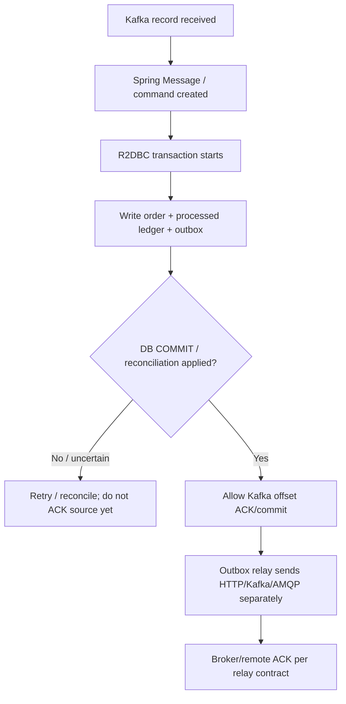
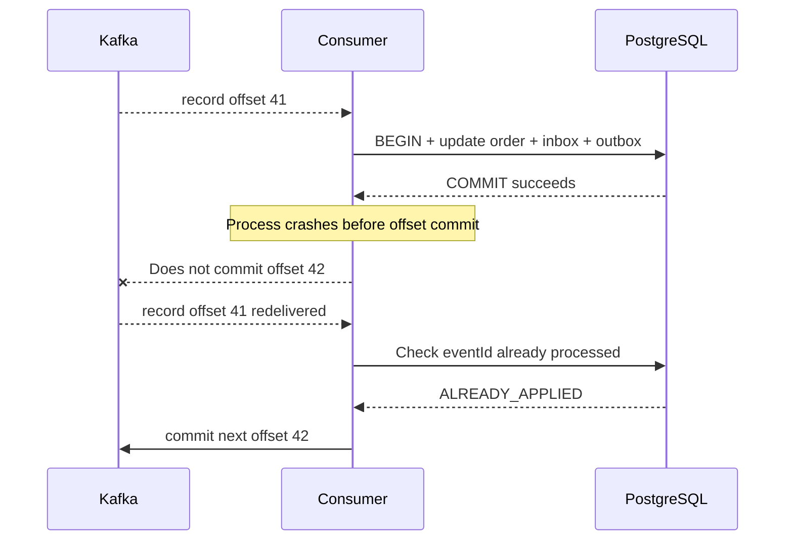
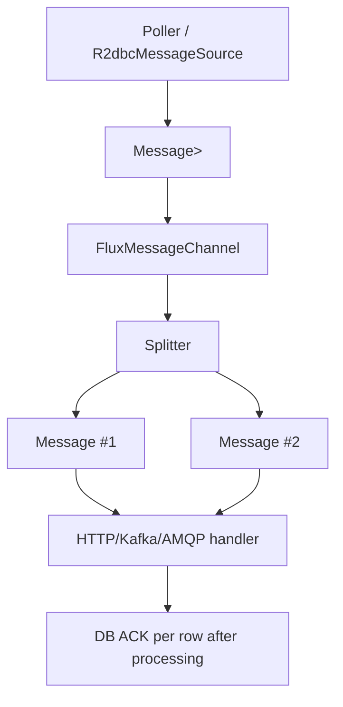

# Committing offsets after successful processing

> **Chapter:** R2DBC Adapter  
> **Module:** SPRING_INTEGRATION_ADAPTERS  
> **Context:** Connect external systems to Spring Integration using inbound/outbound adapters, gateways, pollers, and MessageChannels; exchange data via files, SFTP, HTTP, JMS, AMQP, Kafka, and databases. This lesson focuses on the boundary **database processing – source acknowledgment – event forwarding**, along with message contracts, errors, and connection lifecycles.

## 1. Learning Objectives

After this lesson, you will be able to:

- Distinguish **Kafka consumer offsets** from **R2DBC database transaction commits**, table-scan checkpoints, JMS/AMQP message acknowledgments, and business ACKs.
- Explain that **committing offsets after processing** means confirming source progress only after required business results are **durably persisted**, not merely after `MessageChannel.send(...)` returns.
- Describe crash windows across **receive → process → DB COMMIT → offset COMMIT** and why this pattern normally delivers **at-least-once** semantics rather than automatic exactly-once effects.
- Build an R2DBC service that updates an order, records a processed-event ledger, and inserts a transactional outbox entry in **one transaction**, with stable operation/event IDs to handle redeliveries.
- Configure a Kafka manual-acknowledgment example to **await R2DBC transaction completion** before calling `acknowledge()`, while understanding blocking-listener trade-offs and reactive alternatives.
- Distinguish `Acknowledgment.acknowledge()` from a **durably committed broker offset** under async/batch settings.
- Understand per-`topic-partition` offsets, the **contiguous progress** rule, out-of-order completion risks, and rebalances.
- Design `R2dbcMessageSource` polling with `Message<Flux<T>>` and **claim/lease/ACK**; avoid confusing polling checkpoints with Kafka offsets.
- Explain why an R2DBC source's `updateSql` or a SQL SELECT does not automatically equal an ACK **after downstream success**.
- Design retries, transient-error handling, backpressure, poison messages, DLQs, recovery, observability, and tests with `StepVerifier`/PostgreSQL.

## 2. Defining the word "offset" accurately

### 2.1. Kafka has consumer offsets

In Kafka, a **topic** is divided into **partitions**, and each record has an **offset** within its partition. The consumer group stores committed progress so consumers resume reading after restarts or rebalances.

For example, partition 2 has:

```text
Topic: payment-events
Partition: 2

Record offset:      100     101     102     103
                    |       |       |       |
                    v       v       v       v
                 Event A Event B Event C Event D

Consumer group commits offset 102
  -> normal resume position is record offset 102
  -> records before 102 are considered past committed progress
```

**In Kafka, the committed offset is the next position to read**, not a business ID and not an R2DBC transaction.

Thus if the record being processed has offset `101`, the commit position to move past it is normally **`102`**. Kafka acknowledgment APIs may accept the current record and compute the next offset internally; do not manually add `+1` when the API handles it.

### 2.2. R2DBC does not have a "Kafka offset"

`DatabaseClient`, `R2dbcEntityTemplate`, `R2dbcMessageSource`, and `R2dbcMessageHandler` do not own **Kafka consumer group offsets**. R2DBC runs SQL over `ConnectionFactory` and manages database transactions.

When an **R2DBC inbound poller** reads a PostgreSQL table, the application can design:

- **Checkpoints/cursors**: last scanned ID or timestamp.
- **Claim states**: `NEW → PROCESSING → DONE`.
- **Leases**: time-bounded ownership recoverable when a worker dies.
- **Ack markers**: completed processing status in the database.
- **Outbox**: durable list of events to emit.

These are **application-defined business mechanisms**, not a built-in offset-commit API on `R2dbcMessageSource`.

### 2.3. JMS and AMQP use ACKs, not Kafka offsets

| Source / target | Progress unit | Typical acknowledgment |
| --- | --- | --- |
| Kafka consumer | `topic + partition + offset` | Commit consumer group offset via Kafka API/container. |
| JMS consumer | Message/session delivery state | Client/session ACK or transaction per provider/config. |
| AMQP consumer | Delivery tag/message | ACK/NACK/requeue per channel/broker protocol. |
| R2DBC poller | App-defined row ID, status, checkpoint | SQL update/claim/ACK transaction. |
| HTTP request | Request/response and operation ID | HTTP status/response per API contract. |
| File/SFTP poller | File path, metadata, persistent accept filter | Rename/move/claim/marker and retry policy. |

Do not call every mechanism "committing a Kafka offset". The common rule is **never acknowledge a source before sufficient proof exists that the required processing completed**.

## 3. Defining "successful processing" by contract

A Spring Message crosses multiple layers. For a payment command:



Do not conflate these milestones:

1. **Received:** Kafka listener/poller received the record.
2. **Dispatched:** `MessageChannel` accepted the message.
3. **Subscribed:** the reactive Publisher was subscribed.
4. **SQL executed:** the database ran SQL and emitted counts/rows.
5. **DB committed:** the R2DBC transaction committed, or outcome was durably reconciled.
6. **Source acknowledged:** Kafka offset or JMS/AMQP ACK executed per its mechanism.
7. **Downstream published:** an event was acknowledged by the target broker/API.

With the **transactional outbox** pattern, the **inbound consumer's** success milestone can be step **5**: the database persisted state + publish intent. Step **7** is the **outbox relay's** responsibility—no need to leave the Kafka input record un-ACKed until an external HTTP/Kafka call finishes.

### 3.1. Merely "DB write started" is not enough

```java
Mono<Long> update = databaseClient.sql(
                "UPDATE payment_orders SET status='PAID' " +
                "WHERE order_id=:id AND status='NEW'")
        .bind("id", "order-101")
        .fetch()
        .rowsUpdated();
```

`update` is only a **Publisher**. It may not be subscribed yet, SQL may not have run, and it certainly does not prove the transaction committed. Never commit offsets immediately after creating the `Mono`.

### 3.2. Never treat count 0 as a connection failure

An UPDATE `WHERE status='NEW'` can return `0` if the order is already `PAID`. That is a valid SQL outcome; check whether:

- The order does not exist.
- The order was processed by another operation.
- The same operation ID committed previously while the offset was not committed.
- Status/version/owner no longer match.

**To ACK safely after redelivery**, distinguish **`ALREADY_APPLIED`** from **`CONFLICT`**, rather than checking affected row count alone.

## 4. Crash windows and delivery semantics

### 4.1. Committing offset BEFORE DB transaction

```mermaid
sequenceDiagram
    participant K as Kafka
    participant C as Consumer
    participant DB as PostgreSQL
    K-->>C: record offset 41
    C->>K: commit next offset 42
    Note over C: Process crashes
    C--xDB: Did not commit DB in time
    Note over K,DB: Kafka thinks offset 41 is done; risk of losing business event
```

On restart, the consumer group resumes at offset `42` while record `41` was never durably persisted. That is **data loss from premature ACK**.

### 4.2. Committing DB BEFORE offset



This is the common choice to **avoid losing events**, accepting **redelivery**. Database idempotency is required so redelivery never causes double charges or duplicate events.

### 4.3. Ordering matrix

| DB transaction | Offset commit | Outcome to note |
| --- | --- | --- |
| Not committed | Committed | Risk of **event loss** as consumer advances past offset. |
| Committed | Not committed | **Redelivery**; verify operation ID and re-ACK. |
| Committed | Committed | Normal, though still does not prove outbox was published. |
| Rolled back | Not committed | Can retry/redeliver per error policy. |
| Uncertain commit outcome | Not committed | Reconcile authoritative data before ACKing or new side effects. |

An **at-least-once consumption** design typically accepts the window where the DB commits yet the offset hasn't committed. **Exactly-once effects** in the DB are a separate goal achieved via atomic state transitions + deduplication, not via the call order of two APIs.

## 5. Per-partition offsets and "gaps" during parallel processing

### 5.1. Kafka does not have one global offset for the entire topic

A consumer group tracks **independent progress per topic-partition**. You cannot take `max(offset)` across all partitions and commit a single global value.

```text
Topic payment-events

Partition 0:  100✓ 101✓ 102✗ 103✓
Partition 1:   54✓  55✓  56✓

P0: only safe to commit next offset 102
    (102 not done yet; 103 finishing early cannot skip it)
P1: can commit next offset 57
```

✓ = DB processing durably complete; ✗ = not yet complete.

**Contiguous rule:** when offset `102` has not succeeded, never commit past `102` on that partition just because `103` finished. Committing `104` lets Kafka skip record `102` after a restart.

### 5.2. Choosing topology to avoid committing past gaps

Options:

- Process sequentially per partition.
- Track "completed" state per offset, advancing commits only when **all prior offsets are contiguously complete**.
- Use a Kafka consumer framework with proper out-of-order acknowledgment management, understanding its limits, pause/rebalance, and memory behavior.
- Run parallel concurrency **across partitions**, while staying sequential within each partition when business ordering requires it.

Never run `flatMap(..., 16)` over a `Flux<ConsumerRecord>` and commit each early-finishing record's offset without gap tracking.

### 5.3. Rebalances and partition ownership

When a consumer group rebalances:

- A partition can move to another consumer.
- In-flight records on the old consumer may not be finished when ownership transfers.
- Offset commits can fail because generation/member IDs changed.
- The new consumer may **redeliver** records already written to the DB whose offsets were uncommitted.
- DB deduplication must work across **all instances**, not just an in-memory cache.

Never hold an `Acknowledgment` too long or invoke ACK from arbitrary threads without understanding the exact semantics of your container.

## 6. Preparing Spring Boot, R2DBC, and Kafka

Examples use **Java 17+, Spring Boot 3.x, Spring Framework 6.x, Spring Data R2DBC 3.x, Spring Integration 6.x, and Spring Kafka under the same BOM**. Verify exact classes if using a newer generation.

### 6.1. Maven dependencies

```xml
<dependencies>
    <dependency>
        <groupId>org.springframework.boot</groupId>
        <artifactId>spring-boot-starter-integration</artifactId>
    </dependency>
    <dependency>
        <groupId>org.springframework.boot</groupId>
        <artifactId>spring-boot-starter-data-r2dbc</artifactId>
    </dependency>
    <dependency>
        <groupId>org.springframework.integration</groupId>
        <artifactId>spring-integration-r2dbc</artifactId>
    </dependency>
    <dependency>
        <groupId>org.springframework.kafka</groupId>
        <artifactId>spring-kafka</artifactId>
    </dependency>
    <dependency>
        <groupId>org.springframework.integration</groupId>
        <artifactId>spring-integration-kafka</artifactId>
    </dependency>
    <dependency>
        <groupId>org.springframework.boot</groupId>
        <artifactId>spring-boot-starter-json</artifactId>
    </dependency>
    <dependency>
        <groupId>org.postgresql</groupId>
        <artifactId>r2dbc-postgresql</artifactId>
        <scope>runtime</scope>
    </dependency>
    <dependency>
        <groupId>io.r2dbc</groupId>
        <artifactId>r2dbc-pool</artifactId>
    </dependency>
    <dependency>
        <groupId>org.springframework.boot</groupId>
        <artifactId>spring-boot-starter-test</artifactId>
        <scope>test</scope>
    </dependency>
    <dependency>
        <groupId>io.projectreactor</groupId>
        <artifactId>reactor-test</artifactId>
        <scope>test</scope>
    </dependency>
</dependencies>
```

`spring-integration-kafka` supports Kafka adapters if using Spring Integration's Java DSL; the `@KafkaListener` example in section 11 uses Spring Kafka directly at the consumer boundary. Both styles can share the same R2DBC service, though you should not run **two consumers on the same topic/group** in a demo without intentionally designing distribution.

### 6.2. application.yml

```yaml
spring:
  r2dbc:
    url: r2dbc:postgresql://127.0.0.1:5432/integration_demo
    username: ${DB_USER}
    password: ${DB_PASSWORD}
    pool:
      enabled: true
      initial-size: 2
      max-size: 10
      max-acquire-time: 3s
  kafka:
    bootstrap-servers: 127.0.0.1:9092
    consumer:
      group-id: payment-db-writer
      enable-auto-commit: false
      auto-offset-reset: earliest
      key-deserializer: org.apache.kafka.common.serialization.StringDeserializer
      value-deserializer: org.apache.kafka.common.serialization.StringDeserializer
```

`${DB_USER}`/`${DB_PASSWORD}` represent environment variables `DB_USER`/`DB_PASSWORD`. The demo Kafka bootstrap server is localhost; real deployments must configure TLS/SASL, credentials, and proper broker addresses.

**Disabling `enable-auto-commit` is a prerequisite**, yet you must still configure ACK mode, error handlers, and consumer/container lifecycles properly. Disabling auto-commit **alone** is not enough for commit-after-DB.

### 6.3. Things not to enable accidentally

- `enable.auto.commit=true` on a consumer needing manual commits.
- Self-ACK logic in a transformer immediately upon receiving an event.
- A handler calling `Mono.subscribe()` and returning before SQL completes.
- Auto-recovery mechanisms dropping failed records without a durable DLT/quarantine.
- Container configs allowing out-of-order acknowledgment without understanding pause/rebalance semantics.

## 7. PostgreSQL schema for idempotent processing

To ensure retries never duplicate business state, build a **processed event ledger** in the same transaction as the order update and outbox.

### 7.1. Orders table

```sql
CREATE TABLE payment_orders (
    order_id         VARCHAR(64) PRIMARY KEY,
    status           VARCHAR(20) NOT NULL DEFAULT 'NEW',
    last_event_id    VARCHAR(80),
    updated_at       TIMESTAMPTZ NOT NULL DEFAULT NOW()
);
```

### 7.2. Inbox / processed ledger

```sql
CREATE TABLE processed_payment_events (
    event_id        VARCHAR(80) PRIMARY KEY,
    order_id        VARCHAR(64) NOT NULL,
    payload_digest  VARCHAR(64) NOT NULL,
    source_topic    VARCHAR(200) NOT NULL,
    source_partition INTEGER NOT NULL,
    source_offset   BIGINT NOT NULL,
    processed_at    TIMESTAMPTZ NOT NULL DEFAULT NOW(),
    CONSTRAINT uq_processed_source_position
        UNIQUE (source_topic, source_partition, source_offset)
);
```

`event_id` is the **business event identity**, while `topic-partition-offset` is the **source position**. They are separate keys because an event can be republished at a different offset and business deduplication must hold across sources and attempts.

### 7.3. Outbox

```sql
CREATE TABLE payment_outbox (
    event_id       VARCHAR(80) PRIMARY KEY,
    order_id       VARCHAR(64) NOT NULL,
    event_type     VARCHAR(64) NOT NULL,
    payload_json   TEXT NOT NULL,
    status         VARCHAR(24) NOT NULL DEFAULT 'NEW',
    created_at     TIMESTAMPTZ NOT NULL DEFAULT NOW(),
    published_at   TIMESTAMPTZ
);

CREATE INDEX idx_payment_outbox_status
    ON payment_outbox(status, created_at, event_id);
```

### 7.4. Sample data

```sql
INSERT INTO payment_orders(order_id, status)
VALUES
    ('order-101', 'NEW'),
    ('order-102', 'NEW'),
    ('order-103', 'PAID');
```

This table is a **lab schema**. Production requires retention, schema versioning, payload encryption for PII, partitioning as the ledger grows, and operation authorization.

### 7.5. Why put all three tables in the same transaction?

```text
BEGIN R2DBC transaction
  INSERT processed_payment_events (event_id unique)
  UPDATE payment_orders WHERE status='NEW'
  INSERT payment_outbox(event_id unique)
COMMIT
        |
        v
Allow ACK of Kafka input record
```

If the UPDATE conflicts or outbox INSERT fails, the transaction must roll back the processed ledger too. If the ledger committed while the business order/outbox was not written, **redelivery would falsely be accepted as an already-succeeded duplicate**—a critical bug.

## 8. Commands and outcomes with clear contracts

### 8.1. Business event

Create `PaymentEvent.java`:

```java
public record PaymentEvent(
        String eventId,
        String orderId,
        String payloadDigest,
        String outboxJson,
        String topic,
        int partition,
        long offset
) {
}
```

`payloadDigest` is a hash of the **canonicalized payload** (e.g., SHA-256 hex) computed under a consistent policy; avoid arbitrary unverifiable strings in production. `eventId` is not the Kafka offset.

### 8.2. Domain outcome

Create `PaymentStatus.java`:

```java
public enum PaymentStatus {
    APPLIED,
    ALREADY_APPLIED
}
```

Create `PaymentOutcome.java`:

```java
public record PaymentOutcome(
        String eventId,
        PaymentStatus status
) {
}
```

Each `public` type lives in its own Java file. Other outcomes such as `NOT_FOUND`, `CONFLICT`, `PERMANENT_FAILURE`, or `UNKNOWN_COMMIT_OUTCOME` can be modeled via domain results/exceptions per API contract rather than coercing them to `ALREADY_APPLIED`.

### 8.3. Publisher-returning API

```java
public interface PaymentEventProcessor {
    reactor.core.publisher.Mono<PaymentOutcome> apply(
            PaymentEvent event);
}
```

Calling `apply(...)` returns a `Mono` and **does not prove SQL has run**. Consumers must subscribe/await per the proper lifecycle before acknowledging offsets.

## 9. Transaction boundaries and failure matrix

| Failure | Database state | Offset action |
| --- | --- | --- |
| Validation fails before SQL | Nothing written | Do not commit as success; route to DLT/quarantine per policy. |
| Unique event ID already processed with matching payload | Durable state/outbox present | Can ACK as a valid duplicate after reconciliation. |
| Duplicate unique ID with different payload | Conflict / data integrity warning | Do not ACK as success; investigate or durable DLT. |
| DB unavailable before transaction | Unclear if prior attempt ran | Bounded retry/reconcile; do not ACK yet. |
| Definite DB rollback | No new state written | Do not ACK; retry per broker/container policy. |
| Connection reset near COMMIT | **Unknown** commit vs. rollback | Reconcile by event ID; do not assume failure. |
| DB commit succeeds, Kafka offset commit fails | Business state written | Redelivery may occur; deduplicate and re-ACK. |
| Offset committed, outbox unpublished | DB retains outbox `NEW` | Relay remains responsible for publishing. |
| Broker relay receives ACK yet outbox marker not updated | May resend same event | Downstream consumer needs idempotency. |

**Key point:** an offset commit records **consumer group progress**, not a multi-resource transaction between Kafka and PostgreSQL.

## 10. R2DBC service: committing business state + inbox + outbox together

### 10.1. Creating TransactionalOperator

When Spring Boot creates a `ReactiveTransactionManager` for the R2DBC `ConnectionFactory`, configure:

```java
import org.springframework.context.annotation.Bean;
import org.springframework.context.annotation.Configuration;
import org.springframework.transaction.ReactiveTransactionManager;
import org.springframework.transaction.reactive.TransactionalOperator;

@Configuration
public class PaymentTransactionConfiguration {

    @Bean
    TransactionalOperator paymentTx(ReactiveTransactionManager manager) {
        return TransactionalOperator.create(manager);
    }
}
```

`TransactionalOperator` binds transactions to the **Reactor Context/subscription**, not normal JDBC ThreadLocals. All SQL in the example must run via a `DatabaseClient` sharing the same R2DBC ConnectionFactory/transaction manager.

### 10.2. Service writing an event or reconciling duplicates

Create `R2dbcPaymentProcessor.java`:

```java
import org.springframework.r2dbc.core.DatabaseClient;
import org.springframework.stereotype.Service;
import org.springframework.transaction.reactive.TransactionalOperator;
import reactor.core.publisher.Mono;

@Service
public class R2dbcPaymentProcessor
        implements PaymentEventProcessor {

    private final DatabaseClient db;
    private final TransactionalOperator tx;

    public R2dbcPaymentProcessor(
            DatabaseClient db, TransactionalOperator tx) {
        this.db = db;
        this.tx = tx;
    }

    @Override
    public Mono<PaymentOutcome> apply(PaymentEvent event) {
        validate(event);

        Mono<PaymentOutcome> attempt = db.sql(
                        "INSERT INTO processed_payment_events " +
                        "(event_id, order_id, payload_digest, " +
                        "source_topic, source_partition, source_offset) " +
                        "VALUES (:event, :order, :digest, " +
                        ":topic, :part, :offset) " +
                        "ON CONFLICT (event_id) DO NOTHING " +
                        "RETURNING event_id")
                .bind("event", event.eventId())
                .bind("order", event.orderId())
                .bind("digest", event.payloadDigest())
                .bind("topic", event.topic())
                .bind("part", event.partition())
                .bind("offset", event.offset())
                .map((row, meta) ->
                        row.get("event_id", String.class))
                .one()
                .flatMap(insertedEventId -> updateOrderAndOutbox(event))
                .switchIfEmpty(Mono.defer(
                        () -> verifyAlreadyApplied(event)));

        return attempt.as(tx::transactional);
    }

    private Mono<PaymentOutcome> updateOrderAndOutbox(
            PaymentEvent event) {

        return db.sql(
                        "UPDATE payment_orders " +
                        "SET status='PAID', last_event_id=:event, " +
                        "updated_at=NOW() " +
                        "WHERE order_id=:order AND status='NEW'")
                .bind("order", event.orderId())
                .bind("event", event.eventId())
                .fetch()
                .rowsUpdated()
                .flatMap(count -> {
                    if (count != 1L) {
                        return Mono.error(new IllegalStateException(
                                "Order transition not applied: " +
                                event.orderId() + ", rows=" + count));
                    }

                    return db.sql(
                                    "INSERT INTO payment_outbox " +
                                    "(event_id, order_id, event_type, " +
                                    "payload_json) " +
                                    "VALUES (:event, :order, :type, :body)")
                            .bind("event", event.eventId())
                            .bind("order", event.orderId())
                            .bind("type", "ORDER_PAID")
                            .bind("body", event.outboxJson())
                            .fetch()
                            .rowsUpdated();
                })
                .flatMap(outboxCount -> {
                    if (outboxCount != 1L) {
                        return Mono.error(new IllegalStateException(
                                "Unexpected outbox count=" + outboxCount));
                    }

                    return Mono.just(new PaymentOutcome(
                            event.eventId(), PaymentStatus.APPLIED));
                });
    }

    private Mono<PaymentOutcome> verifyAlreadyApplied(
            PaymentEvent event) {

        return db.sql(
                        "SELECT p.order_id, p.payload_digest, " +
                        "o.status, o.last_event_id " +
                        "FROM processed_payment_events p " +
                        "JOIN payment_orders o ON o.order_id=p.order_id " +
                        "WHERE p.event_id=:event")
                .bind("event", event.eventId())
                .map((row, meta) -> new ProcessedSnapshot(
                        row.get("order_id", String.class),
                        row.get("payload_digest", String.class),
                        row.get("status", String.class),
                        row.get("last_event_id", String.class)))
                .one()
                .switchIfEmpty(Mono.error(
                        new IllegalStateException(
                                "Processed ledger missing for event")))
                .flatMap(saved -> {
                    boolean sameOperation =
                            event.orderId().equals(saved.orderId())
                            && event.payloadDigest().equals(
                                    saved.payloadDigest())
                            && "PAID".equals(saved.status())
                            && event.eventId().equals(
                                    saved.lastEventId());

                    if (!sameOperation) {
                        return Mono.error(new IllegalStateException(
                                "Event ID conflict or inconsistent state"));
                    }

                    return db.sql(
                                    "SELECT order_id, event_type, " +
                                    "payload_json FROM payment_outbox " +
                                    "WHERE event_id=:event")
                            .bind("event", event.eventId())
                            .map((row, meta) -> new OutboxSnapshot(
                                    row.get("order_id", String.class),
                                    row.get("event_type", String.class),
                                    row.get("payload_json", String.class)))
                            .one()
                            .switchIfEmpty(Mono.error(
                                    new IllegalStateException(
                                            "Outbox missing for applied event")))
                            .flatMap(outbox -> {
                                boolean matches =
                                        event.orderId().equals(outbox.orderId())
                                        && "ORDER_PAID".equals(outbox.eventType())
                                        && event.outboxJson().equals(
                                                outbox.payloadJson());

                                return matches
                                        ? Mono.just(new PaymentOutcome(
                                                event.eventId(),
                                                PaymentStatus.ALREADY_APPLIED))
                                        : Mono.error(
                                                new IllegalStateException(
                                                        "Outbox conflict"));
                            });
                });
    }

    private static void validate(PaymentEvent event) {
        if (event == null
                || !valid(event.eventId(), 80)
                || !valid(event.orderId(), 64)
                || !valid(event.topic(), 200)
                || event.payloadDigest() == null
                || !event.payloadDigest().matches("[0-9a-f]{64}")
                || event.outboxJson() == null
                || event.outboxJson().isBlank()
                || event.outboxJson().length() > 100_000
                || event.partition() < 0
                || event.offset() < 0) {
            throw new IllegalArgumentException("Invalid PaymentEvent");
        }
    }

    private static boolean valid(String s, int max) {
        return s != null
                && s.length() <= max
                && s.matches("[A-Za-z0-9_.-]+");
    }

    private record ProcessedSnapshot(
            String orderId, String payloadDigest,
            String status, String lastEventId) {
    }

    private record OutboxSnapshot(
            String orderId, String eventType, String payloadJson) {
    }
}
```

**Key steps:**

1. A new event ID is inserted into the ledger via `INSERT ... ON CONFLICT (event_id) DO NOTHING RETURNING event_id`.
2. If the insert succeeds, the service updates the order conditionally (`status='NEW'`) and inserts the outbox row.
3. If UPDATE returns 0, it emits `Mono.error` to **roll back** the ledger insert, preventing an unapplied command from looking "processed".
4. If the ledger already has the event ID, `verifyAlreadyApplied` checks **order ID, digest, status, `last_event_id`, and outbox payload**.
5. If everything matches, it returns `ALREADY_APPLIED` without creating new side effects.
6. If anything mismatches, it returns a domain/invariant error rather than assuming a valid duplicate.
7. `.as(tx::transactional)` wraps the ledger insert, order update, outbox insert, and reconciliation path.
8. Only when the **transaction publisher completes normally** can callers treat this outcome as durably succeeded per the DB contract.

### 10.3. Why is "present in the ledger" not enough?

If code only checks whether `event_id` exists and returns success, it can mask bugs from partially written data, broken migrations, or reused event IDs across different orders/payloads.

Here, `ALREADY_APPLIED` requires **consistent records across the ledger, order, and outbox**. This is an illustrative policy; if business rules allow orders to transition further after `PAID`, you may need historical state/audit entries instead.

### 10.4. Limitations of the example

- `payloadDigest` is computed by the caller/parser from a canonical payload; the demo checks **format**, not digest correctness itself. Production must recompute from trusted content, check JSON schemas, and authorize senders.
- `outboxJson()` is compared as a string; semantic equality across differing JSON serializations needs canonical JSON or versioned hashes.
- When `processed_payment_events` sees the same `event_id` at a different offset, the code detects a business duplicate: the new offset does not have to match the old offset.
- On the **same offset with a different event ID**, the unique constraint on source position raises an error—a signal requiring investigation.
- If the order is already `PAID` by another operation, the code signals a conflict rather than overwriting.
- Never place HTTP/Kafka side effects inside a reactive transaction. Write outbox and publish outside the transaction.
- Under high volume, configure ledger retention/archival and keep the deduplication window aligned with Kafka retention/replay windows.

### 10.5. Reactor subscription and transaction commit

```text
PaymentEventProcessor.apply(event) -> Mono<PaymentOutcome>
    |
    v
Subscriber subscribes
    |
    v
BEGIN -> INSERT ledger -> UPDATE order -> INSERT outbox
    |
    +-- onError => ROLLBACK / propagate failure
    |
    +-- normal termination => COMMIT -> outcome visible to caller
    |
    v
Caller is allowed to ACK source when business contract accepts
```

Never call `subscribe()` separately per SQL statement inside the service: that detaches connections/transactions and risks ACKing the source offset before a failing SQL step finishes.

## 11. Kafka manual ACK after R2DBC transaction

There are several ways to connect Kafka to R2DBC. The snippet below uses a **Spring Kafka record listener** at the boundary to make ACK ordering explicit while invoking the R2DBC service from section 10. Spring Integration Java DSL is covered in section 13.

### 11.1. Configuring manual ACK on the Kafka listener

```java
import org.apache.kafka.clients.consumer.ConsumerRecord;
import org.springframework.context.annotation.Bean;
import org.springframework.context.annotation.Configuration;
import org.springframework.kafka.config.ConcurrentKafkaListenerContainerFactory;
import org.springframework.kafka.core.ConsumerFactory;
import org.springframework.kafka.listener.ContainerProperties;

@Configuration
public class PaymentKafkaConfiguration {

    @Bean
    ConcurrentKafkaListenerContainerFactory<String, String>
    paymentManualAckContainerFactory(
            ConsumerFactory<String, String> consumerFactory) {

        var factory =
                new ConcurrentKafkaListenerContainerFactory<String, String>();

        factory.setConsumerFactory(consumerFactory);
        factory.getContainerProperties().setAckMode(
                ContainerProperties.AckMode.MANUAL_IMMEDIATE);
        factory.getContainerProperties().setSyncCommits(true);
        return factory;
    }
}
```

Pair this with `spring.kafka.consumer.enable-auto-commit=false` from section 6.

**Do not use this snippet alone as a production error config:** you still need `CommonErrorHandler`/retries/`DeadLetterPublishingRecoverer` per error class so unprocessable records are **skipped only after durable DLT/quarantine persistence**. Depending on the container and recoverer, a record can be considered recovered/committed even without calling `Acknowledgment.acknowledge()` in the listener.

### 11.2. Parser separating Kafka envelope from business record

```java
import org.apache.kafka.clients.consumer.ConsumerRecord;

public interface PaymentKafkaParser {
    PaymentEvent parse(ConsumerRecord<String, String> record);
}
```

An implementation must:

- Parse and validate JSON/schema from `record.value()`.
- Derive a durable `eventId`, **never** generating a fresh UUID per consumption.
- Compute `payloadDigest` over canonical/trusted payload.
- Build `outboxJson` deterministically or with versioning.
- Read `record.topic()`, `record.partition()`, and `record.offset()` as source metadata.
- Never trust an arbitrary operation ID from an unauthenticated client.

The parser here is an **injected contract**, keeping the listener focused on ACK ordering. Provide a matching implementation/bean when running in practice.

### 11.3. Sequential listener: ACK only after DB success

```java
import java.time.Duration;

import org.apache.kafka.clients.consumer.ConsumerRecord;
import org.springframework.kafka.annotation.KafkaListener;
import org.springframework.kafka.support.Acknowledgment;
import org.springframework.stereotype.Component;

@Component
public class PaymentKafkaConsumer {

    private final PaymentKafkaParser parser;
    private final PaymentEventProcessor processor;

    public PaymentKafkaConsumer(
            PaymentKafkaParser parser,
            PaymentEventProcessor processor) {
        this.parser = parser;
        this.processor = processor;
    }

    @KafkaListener(
            topics = "payment-events",
            containerFactory = "paymentManualAckContainerFactory")
    public void consume(
            ConsumerRecord<String, String> record,
            Acknowledgment acknowledgment) {

        PaymentEvent event = parser.parse(record);

        // Intentional BLOCKING bridge on the traditional Kafka
        // listener thread; never call .block() on an event loop.
        PaymentOutcome outcome = processor.apply(event)
                .timeout(Duration.ofSeconds(8))
                .block(Duration.ofSeconds(9));

        if (outcome == null
                || (outcome.status() != PaymentStatus.APPLIED
                    && outcome.status() != PaymentStatus.ALREADY_APPLIED)) {
            throw new IllegalStateException(
                    "No durable payment outcome for " + event.eventId());
        }

        // Runs only after the reactive transaction completes successfully.
        acknowledgment.acknowledge();
    }
}
```

**Timeline:**

1. The Kafka listener receives the record.
2. The parser builds an event with a stable ID and source metadata.
3. `processor.apply(event)` is subscribed via `block(...)` on the **traditional Kafka record-listener thread**.
4. The R2DBC transaction executes UPDATE + ledger + outbox.
5. On Publisher error/timeout, the exception propagates to the listener; **`acknowledge()` is not called** along the success path.
6. Upon `APPLIED` or `ALREADY_APPLIED`, `acknowledge()` is invoked.
7. If the offset commit fails after DB success, the record can redeliver and be recognized as a duplicate.

### 11.4. Why does the example intentionally block?

Standard record-style listeners are **synchronous** callbacks. `acknowledge()` must follow Publisher completion; calling `subscribe()` without awaiting causes premature ACKs.

Here `block()` is used strictly at a **traditional blocking boundary**, keeping ACK/record ownership on the listener thread and avoiding out-of-contract async ACKs. The trade-offs are:

- Each listener thread handles one record until the DB finishes.
- Can affect `max.poll.interval.ms` if blocked too long.
- Unsuitable if the method already runs on a Reactor/Netty event loop.
- Never keep a DB transaction open across slow remote HTTP calls.
- For fully non-blocking execution, use a reactive consumer design with explicit commit/partition-ordering management.

This example prioritizes **verifying ordering and failure semantics**, not peak throughput.

### 11.5. Notes on acknowledge and actual offset commits

Under `MANUAL_IMMEDIATE`, calling ACK on the **consumer/listener thread** normally triggers an offset commit per container policy. Still:

- When the broker commit is confirmed depends on `syncCommits`/async/container settings.
- Commits can fail during rebalances or broker unavailability.
- Never treat `acknowledge()` as proof that **all partitions** committed.
- Never call ACK before DB commit, to avoid losing events.
- Error handlers/recoverers may have their own commit logic; test on your exact version/config.

**The decisive point of this example is ordering:** finish the DB **before** requesting the offset commit. Retrying commit failures belongs to the broker container and replay idempotency.

### 11.6. Minimal JSON parser to run the lab

To provide an implementation of `PaymentKafkaParser`, assume a **trusted topic containing payment confirmation events** whose JSON has only `eventId` and `orderId`:

```json
{"eventId":"pay-101","orderId":"order-101"}
```

Example `JacksonPaymentKafkaParser.java`:

```java
import java.nio.charset.StandardCharsets;
import java.security.MessageDigest;
import java.security.NoSuchAlgorithmException;
import java.util.HexFormat;

import com.fasterxml.jackson.core.JsonProcessingException;
import com.fasterxml.jackson.databind.JsonNode;
import com.fasterxml.jackson.databind.ObjectMapper;
import com.fasterxml.jackson.databind.node.ObjectNode;
import org.apache.kafka.clients.consumer.ConsumerRecord;
import org.springframework.stereotype.Component;

@Component
public class JacksonPaymentKafkaParser implements PaymentKafkaParser {

    private final ObjectMapper mapper;

    public JacksonPaymentKafkaParser(ObjectMapper mapper) {
        this.mapper = mapper;
    }

    @Override
    public PaymentEvent parse(ConsumerRecord<String, String> record) {
        try {
            JsonNode root = mapper.readTree(record.value());
            if (root == null || !root.isObject() || root.size() != 2) {
                throw new IllegalArgumentException(
                        "Expected eventId and orderId only");
            }

            String eventId = required(root, "eventId");
            String orderId = required(root, "orderId");

            ObjectNode canonical = mapper.createObjectNode();
            canonical.put("eventId", eventId);
            canonical.put("orderId", orderId);

            ObjectNode outbox = mapper.createObjectNode();
            outbox.put("eventId", eventId);
            outbox.put("orderId", orderId);
            outbox.put("status", "PAID");

            String canonicalJson = mapper.writeValueAsString(canonical);

            return new PaymentEvent(
                    eventId, orderId, sha256(canonicalJson),
                    mapper.writeValueAsString(outbox),
                    record.topic(), record.partition(), record.offset());
        }
        catch (JsonProcessingException error) {
            throw new IllegalArgumentException(
                    "Invalid payment event JSON", error);
        }
    }

    private static String required(JsonNode root, String field) {
        JsonNode value = root.get(field);
        if (value == null || !value.isTextual()
                || value.textValue().isBlank()) {
            throw new IllegalArgumentException(
                    "Missing or invalid: " + field);
        }
        return value.textValue();
    }

    private static String sha256(String value) {
        try {
            byte[] hash = MessageDigest.getInstance("SHA-256")
                    .digest(value.getBytes(StandardCharsets.UTF_8));
            return HexFormat.of().formatHex(hash);
        }
        catch (NoSuchAlgorithmException error) {
            throw new IllegalStateException("SHA-256 unavailable", error);
        }
    }
}
```

This is a **lab parser**, not a real payment verification engine. Production must authenticate **producers, signatures or transport trust, schema/version, and order update permissions**, and verify the event genuinely confirms funds were received. Canonical JSON structures must be pinned/versioned across all producers/consumers so the same event never hashes differently after upgrades.

## 12. Challenge: committing offsets under parallel processing

### 12.1. Same-partition gap problem

Suppose offsets 50, 51, 52 arrive on the same partition:

```text
DB process(50): success
DB process(51): slow / error
DB process(52): success

Wrong: commit next offset 53 while 51 has not succeeded.

Right: advance only to next offset 51,
       or wait for 51 to succeed before advancing past 52.
```

A `flatMap` with concurrency > 1 can complete results out of order. Never ACK offset 52 as "progress up to 53" while offset 51 is unfinished.

### 12.2. Options for per-partition sequential processing

- Sequential per-record processing in the consumer thread as in section 11 is simpler and preserves order.
- You can raise Kafka listener container concurrency to process **multiple partitions across multiple consumer threads**, while still respecting ordering within each partition.
- With reactive Kafka, group by `topic-partition` and process with `concatMap` to preserve order per partition.
- If intra-partition concurrency is required, maintain a structure that **marks completed offsets and computes a contiguous watermark** before committing.

### 12.3. Commit tracking by contiguous watermark

Example tracker:

```text
nextSafeOffset = 50
completed = {}

complete(52): completed={52}; nextSafeOffset remains 50
complete(50): completed={50,52}; nextSafeOffset=51
complete(51): completed={50,51,52}; nextSafeOffset=53
commit(nextSafeOffset)
```

A real tracker needs:

- Separate state per topic-partition.
- Knowledge of the initial assigned/committed offset.
- Race protection and memory bounds on in-flight records.
- Handling revoked/reassigned partitions on rebalance.
- Pausing further reads when backlogs/gaps grow too large.
- Never clearing state before offset commit/ownership is properly handled.
- Handling DB completion followed by failed broker commits via idempotent replay.

An **in-memory hash map** does not provide exactly-once and is lost on crash; authoritative progress remains Kafka committed offsets + the processed ledger.

### 12.4. Kafka poll interval and long processing

If a record takes tens of minutes, blocking in a conventional listener can exceed `max.poll.interval.ms` and trigger a rebalance. A new consumer may receive the records while the old consumer is still running.

Solution: keep listener work bounded by splitting long tasks into a **durable enqueue/outbox** and ACKing after enqueue succeeds, or use framework-supported pause/resume/async processing per your version's docs.

Never raise the poll interval infinitely to mask the lack of a work queue.

## 13. Spring Integration: MessageChannel and R2DBC completion

### 13.1. One-way boundary

In Spring Integration, a flow can look like:

```text
Kafka inbound adapter
      |
      v
MessageChannel
      |
      v
R2dbcMessageHandler / ReactiveMessageHandler
      |
      v
R2DBC Mono<Void> complete/error
```

**Never claim** `MessageChannel.send()` returning means `Mono<Void>` completed. Synchronous/asynchronous topology and channel type govern waiting behavior. Calling Kafka ACK right after `send()` can ACK before the DB transaction.

### 13.2. Outbound R2DBC adapter vs. custom service

Spring Integration provides `R2dbcMessageHandler` for INSERT/UPDATE/DELETE from Spring Messages. While convenient for a single SQL write, it normally emits **completion/error**, without returning affected-row counts or running multi-table ledger/outbox transactions.

When the goal is **committing source offsets after durable DB processing**, a custom service returning `Mono<PaymentOutcome>` fits well because the coordinator can await an explicit outcome.

### 13.3. IntegrationFlow calling a custom ReactiveMessageHandler

```java
import org.springframework.context.annotation.Bean;
import org.springframework.context.annotation.Configuration;
import org.springframework.integration.config.EnableIntegration;
import org.springframework.integration.dsl.IntegrationFlow;
import org.springframework.messaging.ReactiveMessageHandler;

@Configuration
@EnableIntegration
public class PaymentIntegrationConfiguration {

    @Bean
    IntegrationFlow paymentProcessingFlow(
            PaymentEventProcessor processor) {

        ReactiveMessageHandler handler = message -> {
            PaymentEvent event =
                    (PaymentEvent) message.getPayload();

            return processor.apply(event).then();
        };

        return IntegrationFlow
                .from("paymentProcessingCommands")
                .handleReactive(handler)
                .get();
    }
}
```

`handleReactive(...)` (Spring Integration 6.1+ per supported version) manages `ReactiveMessageHandler` and Publisher lifecycles. `.then()` preserves completion/error while discarding `PaymentOutcome`.

**Important:** this is a **terminal one-way endpoint** returning no domain outcome to callers. If a Kafka consumer needs `APPLIED`/`ALREADY_APPLIED` to ACK, use a Publisher-returning service directly as in section 11, or build a request-reply gateway with tested completion and error propagation. **Never** send a message to `paymentProcessingCommands` and ACK merely because the channel accepted it.

### 13.4. When integrating a Kafka inbound adapter

With `spring-integration-kafka`, a message-driven Kafka inbound adapter feeds records into a Spring Integration flow. For accurate manual ACKs:

- Disable Kafka auto-commit and set the listener container to manual ACK.
- Preserve the **source record's** acknowledgment callback/metadata across all transformers if the flow relies on it.
- Invoke ACK only at an endpoint with proof of DB commit completion, not when constructing an async Publisher.
- Do not use `split`/`publishSubscribe` to fork multiple async branches and ACK before all required branches complete.
- Distinguish record ACK from contiguous per-partition offset commits under parallel processing.
- Test error propagation, rebalances, and recovery/DLT on **your exact adapter + channel topology**.

Never assume an ACK header always exists: header names and callback types depend on Kafka adapter mode, Spring Integration/Kafka versions, and converters.

## 14. R2DBC inbound poller: "offset" must be defined as a checkpoint or status ACK

### 14.1. What is the message source?

`R2dbcMessageSource` is a Spring Integration source triggered by a poller. In multi-result mode, one `receive()` call can emit **`Message<Flux<T>>`**.



`maxMessagesPerPoll(1)` limits `receive()` calls per poll task, **not SQL SELECT to one row**. For a 25-row batch, use `LIMIT 25` or an equivalent query bound.

### 14.2. Why is SELECT alone insufficient to know a row is processed?

```sql
SELECT id, event_key, payload_json
FROM r2dbc_work_queue
WHERE status='NEW'
ORDER BY id
LIMIT 25;
```

While rows remain `NEW`, the next poll can read them again. Two app instances can also SELECT the same rows. Using `Flux`/backpressure does not solve ownership by itself.

### 14.3. Simple checkpoints and their limits

An application can create a table:

```sql
CREATE TABLE r2dbc_scan_checkpoints (
    source_name VARCHAR(100) PRIMARY KEY,
    last_done_id BIGINT NOT NULL
);
```

For pure scans over a stable snapshot, saving `last_done_id` **only after all prior rows finish** reduces repeated reads.

However, ID-based checkpoints carry risks:

- `BIGSERIAL`/sequence IDs **do not guarantee commit order** across concurrent transactions.
- A row with an ID below the cursor can commit later and get skipped.
- If a worker crashes after downstream side effects yet before saving the checkpoint, rows are re-read.
- With multiple workers, a single global cursor cannot track per-row processing/ACK state.
- If the checkpoint commits before side effects, the app can **lose jobs**.

For work queues requiring guaranteed delivery, **atomic claim/lease + per-row ACK** is normally safer than checkpoint-only designs.

### 14.4. Work queue with ownership

```sql
CREATE TABLE r2dbc_work_queue (
    id             BIGSERIAL PRIMARY KEY,
    event_key      VARCHAR(80) NOT NULL UNIQUE,
    payload_json   TEXT NOT NULL,
    status         VARCHAR(20) NOT NULL DEFAULT 'NEW',
    claim_owner    VARCHAR(80),
    claim_token    VARCHAR(80),
    lease_until    TIMESTAMPTZ,
    attempt_count  INTEGER NOT NULL DEFAULT 0,
    created_at     TIMESTAMPTZ NOT NULL DEFAULT NOW(),
    finished_at    TIMESTAMPTZ
);

CREATE INDEX idx_r2dbc_work_status
    ON r2dbc_work_queue(status, id);
```

`status` tracks business processing state; it is **not** a Kafka offset.

### 14.5. Claiming a batch more safely than plain SELECT

PostgreSQL supports a batch-claiming statement:

```sql
WITH picked AS (
    SELECT id
    FROM r2dbc_work_queue
    WHERE status='NEW'
    ORDER BY id
    LIMIT :batchSize
    FOR UPDATE SKIP LOCKED
)
UPDATE r2dbc_work_queue AS q
SET status='PROCESSING',
    claim_owner=:owner,
    claim_token=:token,
    lease_until=NOW() + INTERVAL '60 seconds',
    attempt_count=attempt_count+1
FROM picked
WHERE q.id=picked.id
RETURNING q.id, q.event_key, q.payload_json;
```

The query picks rows not locked by another worker, claims them, and returns **the claimed rows**. This SQL is PostgreSQL-specific. Production systems must also implement **recovery for expired `PROCESSING` leases**, attempt limits, and stale-token handling.

### 14.6. ACKing a row after downstream completion

```sql
UPDATE r2dbc_work_queue
SET status='DONE',
    finished_at=NOW(),
    lease_until=NULL
WHERE id=:id
  AND status='PROCESSING'
  AND claim_owner=:owner
  AND claim_token=:token;
```

With `DatabaseClient.fetch().rowsUpdated()`:

| Affected rows | Meaning |
| --- | --- |
| `1` | Exact row still owned by owner/token was marked `DONE`. |
| `0` | Row no longer matches status/owner/token or is missing; reconcile. |
| `onError` | DB access error; cannot claim durable ACK yet. |

**ACKing a row after downstream side effects can still create duplicates** if the side effect succeeded yet the `DONE` UPDATE/response was lost. External consumers need stable `event_key`s and idempotency.

### 14.7. Choosing between checkpoints and claim/ACK

| Need | Design to consider |
| --- | --- |
| Report scan over fixed snapshot, safe to rerun whole job | Checkpoint/cursor by snapshot version and stable ordering. |
| Forwarding events to brokers with no missed items | Outbox or claim/lease/ACK. |
| Single worker, small batches, immutable data | Cursor may suffice if data/commit ordering is verified. |
| Multiple concurrent workers | Atomic claim + owner/lease/recovery. |
| Source is Kafka rather than a table | Kafka consumer offsets, separate from R2DBC SQL. |

### 14.8. Never treat updateSql as a post-processing ACK

Some R2DBC inbound source configs support an update query to mark rows read by the source. While useful for claiming/marking, it can run **while reading from the DB**, before splitters and downstream handlers complete.

Therefore **`updateSql` is not an "after Kafka publish/HTTP success" callback**. To guarantee per-row ACKs, update status when downstream signals completion, with ownership and recovery.

### 14.9. Java DSL R2DBC inbound poller: illustrating one poll yielding many rows

Create a Spring Data mappable DTO/entity:

```java
import org.springframework.data.annotation.Id;
import org.springframework.data.relational.core.mapping.Column;
import org.springframework.data.relational.core.mapping.Table;

@Table("r2dbc_work_queue")
public record QueueRow(
        @Id Long id,
        @Column("event_key") String eventKey,
        @Column("payload_json") String payloadJson
) {
}
```

Create a **read-and-log-only** flow to inspect payloads/sequences:

```java
import org.springframework.context.annotation.Bean;
import org.springframework.context.annotation.Configuration;
import org.springframework.data.r2dbc.core.R2dbcEntityTemplate;
import org.springframework.integration.config.EnableIntegration;
import org.springframework.integration.dsl.IntegrationFlow;
import org.springframework.integration.dsl.MessageChannels;
import org.springframework.integration.r2dbc.dsl.R2dbc;

@Configuration
@EnableIntegration
public class WorkQueuePollingConfiguration {

    @Bean
    IntegrationFlow observeQueueRows(R2dbcEntityTemplate template) {
        return IntegrationFlow.from(
                        R2dbc.inboundChannelAdapter(
                                template,
                                "SELECT id, event_key, payload_json " +
                                "FROM r2dbc_work_queue " +
                                "WHERE status='NEW' " +
                                "ORDER BY id LIMIT 20")
                                .payloadType(QueueRow.class)
                                .expectSingleResult(false),
                        endpoint -> endpoint.poller(p ->
                                p.fixedDelay(2_000)
                                 .maxMessagesPerPoll(1)))
                .channel(MessageChannels.flux())
                .split()
                .channel(MessageChannels.flux())
                .handle(QueueRow.class, (row, headers) -> {
                    System.out.printf("Queue id=%d key=%s%n",
                            row.id(), row.eventKey());
                    return null;
                })
                .get();
    }
}
```

**This is not a reliable production consumer:** it only SELECTs and logs; polls can re-read the same rows. `payloadType(QueueRow.class)` sets the type of **each item inside Flux**, while `split()` produces individual `Message<QueueRow>`s downstream. In real integration, replace with atomic claims and owner/token ACKs after downstream completion; never mark `DONE` inside the message source before handlers finish.

## 15. Backpressure and offset commits: limiting in-flight work to avoid gaps

### 15.1. Different limits

| Limit | Effect |
| --- | --- |
| Kafka `max.poll.records` | Max records returned per poll, does not govern SQL query count. |
| Kafka consumer concurrency | Consumer threads/instances reading partitions. |
| Reactor `flatMap(..., concurrency)` | Active inner publishers in one pipeline. |
| R2DBC pool max size | Database connections in the pool. |
| SQL `LIMIT` | Max rows per query. |
| Spring Integration `maxMessagesPerPoll` | `MessageSource.receive()` calls per poll cycle. |
| Buffer capacity | Items held in that buffer. |

Lowering concurrency reduces hard-to-commit offset gaps yet does not replace idempotency. Raising pool size does not fix lock contention or Kafka ordering.

### 15.2. Partition-oriented architecture

```text
Kafka topic
   |
   +-- Partition 0 -> sequential processing -> DB commit -> offset advance P0
   |
   +-- Partition 1 -> sequential processing -> DB commit -> offset advance P1
   |
   +-- Partition 2 -> sequential processing -> DB commit -> offset advance P2

Partitions can run in parallel;
one partition never commits past an unfinished record.
```

If throughput for one business aggregate must exceed a single partition, redesign the partition-key strategy or use out-of-order commit tracking, rather than blindly raising `flatMap`.

### 15.3. Async handlers and dispatch vs. completion

For R2DBC:

```java
Mono<PaymentOutcome> result = processor.apply(event);
```

This line **has not finished processing**. Even worse:

```java
result.subscribe();
acknowledgment.acknowledge();
```

is an **unsafe pattern**: ACK runs right after creating the subscription without waiting for SQL/transaction completion.

If using async callbacks, handle completion/error, ACK thread-safety, record ownership, and contiguous partition offsets per container/API contracts. The listener in section 11 uses an explicit synchronous bridge to avoid this trap.

### 15.4. When the DB is slower than Kafka

Never try to shrink lag by ACKing before the DB. Instead:

- Limit in-flight DB operations.
- Monitor pending pool acquisitions, statement timeouts, and retry rates.
- Use consumer polling/pause/resume as supported by the framework.
- Keep timeouts and processing times within `max.poll.interval.ms`.
- For long jobs, commit to a **short, atomic** durable inbox/queue/outbox first, then ACK the source.
- Provide dead-letter/recovery for unprocessable records instead of leaving them in RAM.

## 16. Retries, poison messages, and commit policy

### 16.1. Transient errors

Examples:

- PostgreSQL restart/failover, connection resets.
- Pool acquire timeouts from traffic spikes.
- Transaction serialization failures/deadlocks.
- Network timeouts at commit time.

These errors **can** have bounded retries, yet require idempotency since a prior attempt may have committed. For serialization failures/deadlocks, retry the **entire fresh transaction**.

### 16.2. Permanent errors

Examples:

- Invalid JSON/schema.
- Non-existent order ID per business policy.
- Duplicate Kafka event ID with a different payload digest.
- PostgreSQL missing table/column or wrong SQL privileges.
- Non-self-healing unique constraint/invariant conflicts.

Never infinitely retry. A standard policy separates: invalid payload errors → **durable DLT/quarantine**; schema/config errors → halt/alert for fix; business conflicts → record/audit and decide disposition.

### 16.3. ACKing after successful DLT transfer

For poison messages, "successful handling" is sometimes defined as **durably storing the record in a DLT** rather than updating the order. The order becomes:

```text
Unprocessable Kafka record
         |
         v
Classify permanent error
         |
         v
Publish to DLT/quarantine and await durable ACK
         |
         v
Commit original topic-partition offset
```

Never ACK the offset before DLT publishing finishes per contract, or the record can be lost from both the source and the DLT on a crash.

Spring Kafka's `DefaultErrorHandler` and recoverers have specific behaviors when attempts exhaust. **Read your version's policy for committing recovered records**; do not assume skipping `acknowledge()` in the listener guarantees the offset won't advance.

### 16.4. Multi-layer retry budgets

One Kafka redelivery can trigger R2DBC `retryWhen` multiple times; if the listener container and outbox relay also retry, total attempts multiply far beyond a single layer's retry count.

Bound:

- Attempts per R2DBC transaction.
- Total deadline of one listener invocation.
- Kafka/AMQP/JMS redelivery/backoff.
- Consumer circuit breakers/bulkheads.
- Database connection/pool quotas.
- DLT/alert thresholds for permanent events.
- Retention and reprocessing policies for processed ledgers/outboxes.

## 17. Timeouts, cancellation, and uncertain commit outcomes

### 17.1. Timeouts across layers

| Timeout | Scope |
| --- | --- |
| Database connect timeout | Opening R2DBC connections. |
| Pool acquire timeout | Waiting for an idle connection. |
| SQL statement/lock timeout | Queries or row locks waiting too long. |
| R2DBC transaction timeout | Long-running transactions. |
| Reactor `timeout(...)` | Publisher/whole-chain timeout by operator placement. |
| Kafka `max.poll.interval.ms` | Processing deadline between consumer group polls. |
| Kafka commit timeout | Deadline waiting for broker offset commit responses. |
| HTTP deadline | Total time caller waits for business response. |

### 17.2. Timeouts do not prove DB rollback

```text
Consumer sends SQL
  -> PostgreSQL UPDATES + INSERTS ledger/outbox
  -> COMMIT
  -> Network drops before client receives reply
  -> Reactor timeout -> listener error (no ACK)
  -> Kafka redelivery
  -> Service checks eventId -> ALREADY_APPLIED
  -> Allow offset ACK
```

Catching a timeout and returning `SUCCESS` without checking the DB, or retrying with a new event ID, are both wrong.

### 17.3. Cancellation does not erase side effects

When a subscriber cancels:

- Part of the SQL may already have executed.
- The transaction manager/driver may attempt rollback/cleanup, yet cases near COMMIT still require verifying authoritative state.
- Earlier HTTP/Kafka side effects do not roll back automatically.
- Never ACK source records merely because a timeout/cancel happened.
- Track cancellation rates and pool connection leaks.

## 18. Observability: tracking DB commits alongside offset commits

### 18.1. Metrics worth measuring

| Suggested metric | Purpose |
| --- | --- |
| `kafka_records_received_total` | Records received per topic/partition. |
| `kafka_records_db_applied_total` | New events that committed business state. |
| `kafka_records_db_already_applied_total` | Redeliveries recognized as valid duplicates. |
| `kafka_offset_commit_success_total` | Successful offset commits. |
| `kafka_offset_commit_failure_total` | Failed offset commits. |
| `kafka_consumer_lag` | Records behind committed position. |
| `kafka_rebalance_total` | Rebalances and ownership changes. |
| `payment_event_conflict_total` | Event ID/payload/owner conflicts. |
| `r2dbc_tx_commit_total`/`rollback_total` | DB transaction commits/rollbacks. |
| `r2dbc_tx_duration_p95` | Are transactions holding connections long? |
| `r2dbc_pool_active`/`pending` | Pool health. |
| `processed_ledger_insert_total` | New ledger entries. |
| `outbox_new_count`/`oldest_age` | Unpublished events and backlog age. |
| `downstream_publish_retry_total` | Relay/broker retries. |
| `r2dbc_claim_expired_total` | Work queue rows with expired un-ACKed leases. |

Names are **instrumentation suggestions**, not all available out-of-the-box in Spring Boot/Micrometer. Avoid using high-cardinality raw event IDs as metric labels.

### 18.2. Logging both positions

```text
eventId=pay-101 topic=payment-events partition=2 offset=41
  stage=db_transaction result=APPLIED

eventId=pay-101 topic=payment-events partition=2 offset=41
  stage=kafka_ack requested=true

eventId=pay-101 topic=payment-events partition=2 offset=41
  stage=outbox status=NEW

eventId=pay-101 topic=payment-events partition=2 offset=41
  stage=outbox_published brokerAck=true
```

This is illustrative logging, not default output. **Never** log "offset committed" merely on calling ACK without proof of broker commit per container policy.

### 18.3. Cross-boundary tracing

A useful trace links:

- Spring `MessageHeaders` correlation ID.
- Kafka `topic/partition/offset`.
- Business `eventId`/`operationId`.
- R2DBC transaction ID / log correlation (if available).
- Outbox `event_id`.
- Broker publish ACK or HTTP request ID.

Never use Spring Message ID as an idempotency key when the same business event can be wrapped into a **new message** on redelivery.

## 19. Testing with StepVerifier and real databases

### 19.1. Verify both types of "commit"

The test suite must distinguish:

- **R2DBC transaction commit:** order/ledger/outbox are consistent in PostgreSQL.
- **Kafka offset commit:** consumer group recorded progress per topic-partition.

Mocking `Mono.just(...)` only tests Java composition; it does not prove **transaction rollback**, **broker offset recovery**, **deadlocks**, **rebalances**, or **driver cancellation**.

Use PostgreSQL Testcontainers (or an equivalent test DB) and Kafka Testcontainers/embedded broker for real integration tests. Never inject faults into production databases.

### 19.2. Testing a new event applied exactly once

Assuming a JUnit integration test class injects `PaymentEventProcessor processor` and seeds `order-101` as `NEW`:

```java
import org.junit.jupiter.api.Test;
import reactor.test.StepVerifier;

import static org.junit.jupiter.api.Assertions.*;

@Test
void firstPaymentIsApplied() {
    PaymentEvent event = new PaymentEvent(
            "pay-101",
            "order-101",
            "a".repeat(64), // Valid-format fixture digest only
            "{\"eventId\":\"pay-101\",\"orderId\":\"order-101\",\"status\":\"PAID\"}",
            "payment-events",
            2,
            41L
    );

    StepVerifier.create(processor.apply(event))
            .assertNext(outcome -> {
                assertEquals("pay-101", outcome.eventId());
                assertEquals(PaymentStatus.APPLIED, outcome.status());
            })
            .verifyComplete();
}
```

Snippet inside a test class with a `processor` field and isolated DB fixture. `"a".repeat(64)` is a **syntactically valid dummy digest**, not the actual hash of the sample JSON. In real ingress, the parser computes a trusted SHA-256.

### 19.3. Testing redelivery after DB commit

After the prior state, the same event ID/payload arrives again:

```java
@Test
void redeliveryReturnsAlreadyApplied() {
    PaymentEvent event = seededCommittedEvent();

    StepVerifier.create(processor.apply(event))
            .assertNext(outcome ->
                    org.junit.jupiter.api.Assertions.assertEquals(
                            PaymentStatus.ALREADY_APPLIED,
                            outcome.status()))
            .verifyComplete();
}
```

`seededCommittedEvent()` is a fixture helper returning the **same event written prior to this test**. Never depend on execution order between `@Test` methods.

Beyond the outcome, verify via SQL:

```sql
SELECT COUNT(*) FROM processed_payment_events
WHERE event_id = 'pay-101';

SELECT COUNT(*) FROM payment_outbox
WHERE event_id = 'pay-101';

SELECT status, last_event_id FROM payment_orders
WHERE order_id = 'order-101';
```

Expect one ledger row, one outbox row, and the order in `PAID` with `last_event_id='pay-101'`. If row counts increase after redelivery, **idempotency is broken**.

### 19.4. Testing rollback when outbox INSERT fails

In an isolated fixture:

1. Seed `order-102 = NEW`.
2. Pre-insert into `payment_outbox` a record with `event_id='pay-conflict'` without a processed ledger entry.
3. Call `processor.apply(event)` with `eventId='pay-conflict'`, `orderId='order-102'`.
4. Ledger INSERT and order UPDATE run, then outbox INSERT hits the primary key.
5. `StepVerifier` must receive `onError`.
6. Query the DB **after transaction rollback** and verify `order-102` is still `NEW` and no new processed ledger entry exists.

Tests must verify DB state, not only exception classes. If outbox fails while the ledger stays committed, redelivery would be mistaken for completion.

### 19.5. Testing duplicate event ID with different payload

```text
Attempt 1: eventId=pay-101, orderId=order-101, digest=A -> APPLIED
Attempt 2: eventId=pay-101, orderId=order-101, digest=B -> CONFLICT/error
```

`verifyAlreadyApplied` must reject the second attempt. Never ACK as a valid duplicate solely because `event_id` matched.

### 19.6. Testing missing row and business conflict

If `order-999` does not exist or `order-103` is already `PAID` from another event, `UPDATE ... WHERE status='NEW'` returns 0.

In our example service, count 0 converts to `onError` and the transaction rolls back the ledger. The container should not ACK the source record as success. Subsequent policy (DLT/quarantine/reconciliation) follows business rules—**do not auto-retry like a network error**.

### 19.7. Testing offset watermark logic independently

Small Java example to study **contiguous completion**. This is **not a Kafka broker committer**; it only computes the next-safe offset for **one partition** on a single thread:

```java
import java.util.NavigableSet;
import java.util.TreeSet;

public final class ContiguousOffsetTracker {

    private long nextSafeOffset;
    private final NavigableSet<Long> completed = new TreeSet<>();

    public ContiguousOffsetTracker(long initialNextOffset) {
        this.nextSafeOffset = initialNextOffset;
    }

    public synchronized long completed(long offset) {
        if (offset >= nextSafeOffset) {
            completed.add(offset);
        }

        while (completed.remove(nextSafeOffset)) {
            nextSafeOffset++;
        }

        return nextSafeOffset;
    }

    public synchronized long nextSafeOffset() {
        return nextSafeOffset;
    }
}
```

Test:

```java
import org.junit.jupiter.api.Test;

import static org.junit.jupiter.api.Assertions.assertEquals;

@Test
void offsetCannotLeapOverIncompleteRecord() {
    ContiguousOffsetTracker tracker =
            new ContiguousOffsetTracker(50);

    assertEquals(50, tracker.completed(52));
    assertEquals(51, tracker.completed(50));
    assertEquals(53, tracker.completed(51));
}
```

A real application must bind the tracker to **topic-partition, assignment generation, synchronization, capacity bounds, rebalance handling, and Kafka commit outcomes**. If offset 51 never completes, the completed set could grow unboundedly; enforce pause/retry/DLT policies.

### 19.8. Testing ACK ordering in the listener

A unit test can inject a fake `PaymentEventProcessor` returning an incomplete `Mono` and mock `Acknowledgment`:

1. Invoke the listener on a test thread (since the example uses `block()`).
2. Before the Publisher completes, verify `acknowledge()` **has not been called**.
3. Emit `PaymentOutcome(APPLIED)` and complete.
4. Verify ACK was called exactly once.
5. With `Mono.error(...)`, verify ACK was **not** called on the success path.

This test verifies ordering **inside the listener code**, without replacing broker offset-commit/rebalance integration tests.

### 19.9. Testing Kafka broker + PostgreSQL

In an integration test using a Kafka test broker:

- Produce a record at offset N.
- Consumer receives record; PostgreSQL transaction commits.
- Intentionally crash the consumer **before offset commit succeeds**.
- Restart the same group; the record redelivers.
- Verify ledger/outbox still contain one event and the order is not modified twice.
- Allow offset commit to succeed and restart again; verify the consumer advances from the right offset.
- Test a failing record at offset N while N+1 finishes early: do not commit past N in the same partition.
- Test rebalance while in-flight; the new consumer handles redeliveries via deduplication.
- Test DLT publish success/failure per contract; never silently drop the original record.

## 20. End-to-end fault injection matrix

| Event | What to verify |
| --- | --- |
| PostgreSQL unavailable before SQL | No offset ACK; bounded retry/backoff. |
| Connection drops mid-SQL | Do not assert definite commit failure; reconcile. |
| PostgreSQL COMMIT succeeds yet response lost | Redelivery gets `ALREADY_APPLIED`, does not re-write. |
| Ledger INSERT succeeds yet UPDATE fails | Transaction rolls back ledger. |
| Order UPDATE succeeds yet outbox INSERT fails | Rolls back order and ledger. |
| Same event ID, different digest | Business conflict, not ACKed as success. |
| Same event ID at new Kafka offset | Duplicate reconciled by event ID. |
| Same topic-partition-offset, different event ID | Unique source-position conflict; investigate. |
| Kafka offset commit fails after DB success | Redelivery handled idempotently. |
| Kafka offset commit succeeds, outbox still `NEW` | Relay remains responsible for publishing. |
| Kafka rebalance mid-processing | No data loss; DB deduplication handles redelivery. |
| Offset 52 completes before 51 | Never commits past unfinished record 51. |
| Consumer processes slower than `max.poll.interval` | Proper rebalance/retry without committing stale ownership. |
| Poison / invalid JSON | Durable DLT/quarantine before skipping. |
| DLT publish fails | Do not acknowledge original record as recovered success. |
| Outbound HTTP/Kafka received yet relay ACK lost | Outbox may republish; consumer is idempotent. |
| R2DBC inbound SELECT `NEW` repeats | Never treat poll as ACK; use claim/lease. |
| R2DBC claim worker crashes | Lease expiry/recovery recovers un-ACKed rows. |
| R2DBC ACK affected rows=0 | Reconcile owner/token; do not fake `DONE`. |
| Pool exhausted | Concurrency/pending bounded; no retry storm. |
| Subscriber cancels | Do not ACK without a durable outcome. |
| Spring Integration async handler | Source ACK tied to completion rather than send. |
| Application shuts down mid-batch | Recovery from Kafka offsets and DB ledger/outbox. |

## 21. Troubleshooting

| Symptom | Common cause | How to check |
| --- | --- | --- |
| Kafka lag is 0 yet DB is missing events | Auto-commit/ACK too early, non-durable DLT recovery. | Check consumer config, offset commits, and transaction logs. |
| DB has `PAID` order yet Kafka redelivers record | DB committed before offset commit/crash. | Inspect processed ledger and Kafka committed offsets. |
| An event written twice | Missing stable event ID or split transactions. | Check `event_id`, unique constraints, and subscribe code. |
| Ledger has row yet outbox is missing | Transaction didn't wrap all 3 SQLs or stale bad data. | Check `TransactionalOperator` and shared ConnectionFactory. |
| `@KafkaListener` ACKs early | Called `subscribe()` then ACKed instead of awaiting Mono. | Trace execution timeline and completion/error signals. |
| Listener stalls, frequent rebalances | Slow DB, mismatched timeouts/`max.poll.interval.ms`. | Measure processing latency/poll interval; decouple via enqueue. |
| Offset commits after finished record while earlier record failed | Out-of-order ACK/commit leaped over gap. | Track next-safe offset per partition. |
| Unique violation on ledger | Duplicate source/event ID or reused key with different payload. | Read digest/source position before deciding. |
| Kafka record disappears on exception | Container error handler recovered/skipped record. | Inspect DLT recoverer and commit-recovered policy. |
| R2DBC poll reads the same row repeatedly | SELECT `NEW` does not change state. | Use owner/token claim/ACK and leases. |
| Claimed `PROCESSING` row stuck | Worker crashed without lease recovery. | Query expired leases and attempt counts. |
| Outbox grows endlessly while input offsets commit | Relay failing or not running. | Check oldest outbox age, broker ACKs/retries. |
| Event resent even though outbox says `PUBLISHED` | Crash/ACK ambiguity or consumer retry. | Deduplicate by `event_id` at consumer. |
| Pool pending rises alongside Kafka lag | Low DB throughput or long-held transaction locks. | Bound in-flight work; inspect SQL plans and locks. |

## 22. Pre-production design checklist

- [ ] Clearly separate Kafka offsets, R2DBC transactions, DB cursors/checkpoints, and JMS/AMQP ACKs.
- [ ] Kafka `enable.auto.commit=false` when manual commit is required.
- [ ] ACK mode and container error/recovery policies configured and thoroughly tested.
- [ ] Never ACK solely because `MessageChannel.send()` returned.
- [ ] Never call `Mono.subscribe()` and ACK before the DB Publisher completes.
- [ ] Allow source ACK only after DB commit or reconciled `ALREADY_APPLIED`.
- [ ] Stable event IDs, unique constraints, and a durable processed ledger exist.
- [ ] Ledger, business state, and outbox share one R2DBC transaction.
- [ ] Duplicate verification checks order/digest/outbox, not just event ID.
- [ ] Errors near COMMIT are reconciled; never assume rollback.
- [ ] Transient retries have budgets/backoff/jitter and proper transaction scope.
- [ ] Permanent errors reach durable DLT/quarantine before skipping/committing.
- [ ] Offset commits never skip past unfinished gaps in the same partition.
- [ ] Policies exist for rebalances, stale ownership, and in-flight completion.
- [ ] Never keep DB transactions open across slow HTTP/Kafka publishes.
- [ ] R2DBC inbound uses SQL batches, claim/lease/recovery, and per-row ACKs as needed.
- [ ] Never use simple cursors/checkpoints for at-least-once delivery when commit order is uncertain.
- [ ] Outbox relay and downstream consumers tolerate duplicates.
- [ ] DB pool/in-flight concurrency caps and alerts for Kafka lag/outbox backlog are in place.
- [ ] Tested crashes before/after DB commit, before/after offset commit, and DLT failures.
- [ ] Event replay/backfill procedures and appropriate ledger/outbox retention exist.

## 23. Practice exercises

**Exercise 1 — Commit position.** A topic partition has records at offsets 20–24. After processing up through 22, what is the next commit position? Why isn't 22 stored as the "next offset"?

**Exercise 2 — Crash before DB commit.** Diagram the timeline when a Kafka offset commits before the PostgreSQL UPDATE; pinpoint where data is lost.

**Exercise 3 — Crash after DB commit.** Diagram the timeline when order/outbox commit yet Kafka ACK never happens; explain redelivery and idempotency.

**Exercise 4 — Transaction.** Create `payment_orders`, `processed_payment_events`, and `payment_outbox`. Use `TransactionalOperator` to execute all 3 SQL statements atomically.

**Exercise 5 — Duplicate with matching payload.** Resend the same `PaymentEvent` with a stable event ID. Confirm `ALREADY_APPLIED` and verify the DB applies no second business transition.

**Exercise 6 — Duplicate with mismatched payload.** Send the same event ID with a different order or payload digest. Explain why a conflict must be returned.

**Exercise 7 — Rollback.** Make the outbox insert violate a constraint; verify both the order and ledger roll back.

**Exercise 8 — Manual ACK.** Configure a Kafka listener with `MANUAL_IMMEDIATE` and auto-commit disabled. Use a fake processor returning a controlled `Mono` and prove ACK happens only after completion.

**Exercise 9 — Blocking boundary.** Explain why `.block()` is used intentionally on a traditional listener thread yet must never run on a Reactor/Netty event loop.

**Exercise 10 — Contiguous offsets.** For offsets 100, 101, 102: finish 100 and 102 before 101. Compute the next-safe offset and simulate when 101 completes.

**Exercise 11 — Rebalance.** Have consumer A lose its partition after committing a record to the DB. Consumer B receives the record again; use the ledger to prevent double effects.

**Exercise 12 — Poison message.** Send a record with invalid JSON. Design retry/DLT handling so no record is lost if the DLT producer fails.

**Exercise 13 — Outbox.** Build a separate relay publishing `payment_outbox` and updating status only after broker ACK. Simulate a relay crash after publish but before UPDATE and verify consumer deduplication.

**Exercise 14 — R2DBC polling.** Use `R2dbcMessageSource`/`FluxMessageChannel`/splitter to read 20 rows; explain why one poll is not an offset commit.

**Exercise 15 — Claim/ACK.** Build a PostgreSQL work queue with owner/token/lease. Claim via `SKIP LOCKED` and ACK each row after downstream completion.

**Exercise 16 — Checkpoint.** Design a `last_done_id` table and demonstrate how two transactions acquiring sequence IDs out of commit order can skip rows when the cursor advances too fast.

**Exercise 17 — Backpressure.** Increase Kafka consumer concurrency and shrink the R2DBC pool size. Measure lag, pending connections, and transaction latency; propose a capacity budget.

**Exercise 18 — End-to-end chaos test.** Disconnect the database before/during COMMIT, kill the consumer before Kafka ACK, and restart. Verify zero lost events and single business state/outbox application.

## 24. Self-check questions

1. What attributes uniquely identify a Kafka offset?
2. Is Kafka's "committed offset" the record just processed or the next position to read?
3. Does R2DBC have a built-in Kafka consumer offset API?
4. Is a JMS/AMQP ACK the same as a Kafka offset commit?
5. Does `MessageChannel.send()` returning successfully mean R2DBC SQL committed?
6. Why must you subscribe to `Mono`/`Flux` to know a transaction completed?
7. What failure can committing an offset before DB commit cause?
8. What can committing the DB before the offset commit cause on a crash?
9. Why is a processed-event ledger needed?
10. Why must the ledger, order update, and outbox share the same transaction?
11. Why must duplicate event IDs also be checked against payload digests?
12. Is `ALREADY_APPLIED` a failure that should be retried infinitely?
13. When a DB commit response is lost, can you assume the transaction rolled back?
14. Does an outbox row in `NEW` prove downstream Kafka already received the event?
15. Does `@KafkaListener` in the example call `acknowledge()` before or after `block()`?
16. Does `AckMode.MANUAL_IMMEDIATE` guarantee the broker commit always succeeds?
17. Why does `max.poll.interval.ms` matter for long-blocking listeners?
18. Can Kafka offsets be committed as a single global number for an entire topic?
19. If offset 52 finishes while 51 has not, can you commit next offset 53?
20. What difficulty can concurrent `flatMap` introduce for offset commits?
21. Why is an in-memory offset tracker insufficient for exactly-once?
22. During a rebalance, why might a new consumer receive an event already written to the DB?
23. What payload type can `R2dbcMessageSource` emit when multiple rows match?
24. Does `maxMessagesPerPoll(1)` mean SQL reads only one row?
25. Does `updateSql` on an inbound source default to ACKing after downstream success?
26. Does a `BIGSERIAL id` checkpoint guarantee commit ordering?
27. Why do worker claims need owner/token/lease?
28. When may the offset of a poison message routed to a DLT be committed?
29. Is Kafka lag equal to 0 sufficient proof the database lost no events?
30. Which metrics help detect that DB throughput is below Kafka input and the outbox relay is failing?

**Answer hints:** (1) Topic, partition, offset. (2) Next position to read. (3) No. (4) No, those are protocol-specific ACKs. (5) No. (6) Publishers need subscription and terminal signals. (7) Event loss on crash. (8) Redelivery, requiring idempotency. (9) Durably stores event identity across restarts/replays. (10) Prevents the ledger from recording success when business/outbox writes failed. (11) Detects reused IDs with different content. (12) No, can be ACKed as a valid duplicate. (13) No, must reconcile. (14) No. (15) After transaction completion. (16) No, commits can still fail. (17) Consumer group can rebalance if processing takes too long. (18) No, per partition. (19) No. (20) Out-of-order completion creates gaps. (21) Crashes/rebalances lose the tracker; DB dedup and broker offsets are needed. (22) Prior offset was not committed. (23) `Message<Flux<T>>`. (24) No. (25) Not by default. (26) No. (27) Ownership, recovery, and safe ACKs. (28) After durable DLT/quarantine persistence per recovery contract. (29) No, early ACKs or non-durable skips may have occurred. (30) Kafka lag, pool pending, DB latency, outbox backlog/oldest age, broker ACK lag.

## 25. References

- [Apache Kafka Consumer Documentation — Offset commits](https://kafka.apache.org/documentation/#consumerconfigs).
- [Spring Kafka Reference — Committing Offsets / Listener Container](https://docs.spring.io/spring-kafka/reference/kafka/receiving-messages/message-listener-container.html).
- [Spring Kafka Reference — Handling Exceptions / DefaultErrorHandler](https://docs.spring.io/spring-kafka/reference/kafka/annotation-error-handling.html).
- [Spring Integration Reference — Kafka Support](https://docs.spring.io/spring-integration/reference/kafka.html).
- [Spring Integration Reference — R2DBC Support](https://docs.spring.io/spring-integration/reference/r2dbc.html).
- [Spring Integration Reference — Reactive Streams Support](https://docs.spring.io/spring-integration/reference/reactive-streams.html).
- [Spring Framework Reference — R2DBC Data Access](https://docs.spring.io/spring-framework/reference/data-access/r2dbc.html).
- [Spring Framework Reference — Programmatic Transaction Management](https://docs.spring.io/spring-framework/reference/data-access/transaction/programmatic.html).
- [Project Reactor Reference Guide](https://projectreactor.io/docs/core/release/reference/).
- [PostgreSQL Documentation — Transaction Isolation and Locking](https://www.postgresql.org/docs/current/transaction-iso.html).

**Key takeaway:** **Committing offsets after successful processing** means **never advancing the consumer source position before required outcomes are durably persisted**. With Kafka → R2DBC, write **business state + processed ledger + outbox in one transaction**, and ACK/commit the Kafka offset only after reconciled `APPLIED` or `ALREADY_APPLIED`. This normally provides **at-least-once delivery with idempotent database effects**, not a distributed transaction or exactly-once broker publish guarantee. For an **R2DBC inbound poller**, there is no built-in Kafka offset: use a carefully designed checkpoint or **atomic claim + lease + per-row ACK**, controlling concurrency, timeouts, recovery, and commit ordering.
