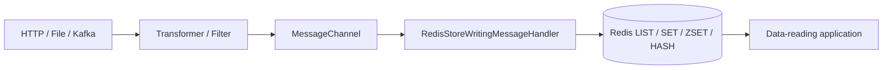

# Redis store outbound adapter in Spring Integration

## 1. What problem does the Redis store outbound adapter solve?

In an integration flow, data can arrive from HTTP, files, SFTP, JMS, Kafka, or an internal `MessageChannel`. Sometimes the flow's target is not a message-receiving service, but **a data structure stored in Redis**: an event list, a set of processed IDs, a status table keyed by order ID, or a leaderboard. The **Redis store outbound adapter** is the terminal endpoint of the flow, receiving a Spring Integration `Message<?>` and writing its **payload** into the chosen Redis collection.

In the **SPRING_INTEGRATION_ADAPTERS** module, this is a classic *outbound adapter*: transferring messages from Spring Integration's processing pipeline to an external system via `RedisConnectionFactory` or `RedisTemplate`. The implementing class is `RedisStoreWritingMessageHandler` (`org.springframework.integration.redis.outbound`). It acts as a `MessageHandler`, needs no poller to write, and produces no reply message for downstream steps.

For example, a system receives an order event over HTTP, validates and normalizes it into the string `order-1001:CREATED`, and stores it in the Redis List `orders:audit`. Another analytics application can read this collection via a Redis client or a matching inbound adapter.



### Distinguishing Redis adapters

| Component | Effect | Redis-side data | When to use |
|---|---|---|---|
| **Store outbound** | Writes payload to collection | `LIST`, `SET`, `ZSET`, `MAP`, `PROPERTIES` | Accumulating data, lookups, or sharing state |
| Redis Pub/Sub outbound | Publishes message to topic | Pub/Sub channel; no stored history to re-read | Notifying currently connected subscribers |
| Redis queue outbound | Pushes message into a Redis List per queue convention | List with configured push direction | Pairing with queue inbound for ordered consumption |
| Store inbound | Polls data from Redis collection | Reads existing collection | Bringing Redis data back as Spring `Message`s |
| Redis outbound gateway | Executes Redis command and returns result | Depends on command | Need a response from Redis, not just a one-way write |

> **Note:** The Redis *store outbound adapter* is not the same as `RedisMessageStore` used to store aggregator/resequencer message groups. Both use Redis but serve different contracts and purposes.

## 2. Message contract and mapping to Redis

A message has two parts: `payload` carrying the data to write, and `headers` carrying routing metadata such as the Redis key or hash field. The adapter does not automatically write the entire Spring `Message` as a single message object unless you explicitly transform the payload for that purpose.

### Supported collections

`collectionType` belongs to the enum `org.springframework.data.redis.support.collections.RedisCollectionFactoryBean.CollectionType`. If omitted, the handler defaults to `LIST`.

| `collectionType` | Redis type / meaning | Suitable payload | Typical behavior |
|---|---|---|---|
| `LIST` | Ordered list | Single value or `Collection` | Appends elements; preserves duplicates |
| `SET` | Deduplicated set | Single value or `Collection` | Adds members; existing values do not duplicate |
| `ZSET` | Score-ordered set | Value + score, or `Map<member, score>` | Adds/updates members by score |
| `MAP` | Redis Hash | `Map<field, value>` or single value with separate field | Writes field/value pairs |
| `PROPERTIES` | Redis-backed properties | `Properties` or key/value pairs | Writes named properties |

Collection choice directly dictates write semantics. For instance, `SET` fits a set of unique IDs, yet fails if you must record every occurrence of an event. `LIST` preserves duplicate records; `ZSET` requires defining what `score` means before designing the structure.

### `extractPayloadElements`: write individual elements or the whole payload?

The `extractPayloadElements` property (XML: `extract-payload-elements`) defaults to `true`:

- With a `Collection` and `LIST`/`SET`, `true` writes elements individually using `addAll` semantics; `false` writes the entire `Collection` as **one** element.
- With a `Map` and `MAP`/`PROPERTIES`, `true` writes multiple field/value pairs; `false` treats the entire `Map` as **one** value and requires a field name to store it under.
- With a single value like `String`, this flag does not change behavior: the value is still one element.
- With `ZSET`, a `Map` can represent *member → score* pairs. To store the whole map as a single member, configure a matching serializer and score resolution.

Example sending the same payload `List.of("A", "B")` to a Redis List:

| Configuration | Elements added to Redis List | Meaning |
|---|---:|---|
| `extractPayloadElements=true` | 2 | Two separate elements `A`, `B` |
| `extractPayloadElements=false` | 1 | One serialized element representing the entire `List` |

The second case does **not** mean Redis creates a nested List: Redis stores a single binary value at one List index. Reading applications need a matching serializer to decode it.

### Collection key, Map field, and ZSET score

Three easily confused concepts:

| Configuration / header | Role | Example |
|---|---|---|
| `key` or `keyExpression` | Selects the **Redis key holding the collection** | `orders:audit`, `inventory:shop-a` |
| `mapKeyExpression` or `RedisHeaders.MAP_KEY` | Selects the **field inside a Redis Hash**, needed only when writing a single value to `MAP`/`PROPERTIES` | `sku-100` |
| `RedisHeaders.ZSET_SCORE` | Score of a member in `ZSET` when payload is not a member → score map | `95.5` |

`key` and `keyExpression` are mutually exclusive alternatives; configure only one per handler. If neither is set, the handler can read the key from `RedisHeaders.KEY`; in real applications, set the key explicitly or enforce valid headers. `mapKeyExpression` defaults to reading `RedisHeaders.MAP_KEY`. For `ZSET`, the handler also supports `zsetIncrementExpression` (defaulting to `RedisHeaders.ZSET_INCREMENT_SCORE`) when increment semantics are needed instead of overwriting the score.

## 3. Setup and runnable Spring Boot example

The example below uses Java DSL to write Strings into a Redis List. It assumes a Spring Boot version compatible with your project's Spring Integration version and Redis running locally on port `6379`.

**Gradle** (letting Spring Boot manage compatible dependency versions):

```groovy
dependencies {
    implementation 'org.springframework.boot:spring-boot-starter-integration'
    implementation 'org.springframework.boot:spring-boot-starter-data-redis'
    implementation 'org.springframework.integration:spring-integration-redis'
}
```

**`application.yml`:**

```yaml
spring:
  data:
    redis:
      host: localhost
      port: 6379
```

`spring-boot-starter-data-redis` brings in Spring Data Redis and standard Redis client support; Spring Boot auto-configures `RedisConnectionFactory`. Outside Spring Boot, register a `RedisConnectionFactory` bean and configure Redis connectivity manually.

**Declaring the endpoint in Java DSL:**

```java
import org.springframework.context.annotation.Bean;
import org.springframework.context.annotation.Configuration;
import org.springframework.data.redis.connection.RedisConnectionFactory;
import org.springframework.data.redis.support.collections.RedisCollectionFactoryBean.CollectionType;
import org.springframework.integration.channel.DirectChannel;
import org.springframework.integration.config.EnableIntegration;
import org.springframework.integration.dsl.IntegrationFlow;
import org.springframework.integration.redis.dsl.Redis;
import org.springframework.messaging.MessageChannel;

@Configuration
@EnableIntegration
public class RedisStoreFlowConfig {

    @Bean
    MessageChannel orderAuditChannel() {
        return new DirectChannel();
    }

    @Bean
    IntegrationFlow orderAuditToRedis(RedisConnectionFactory connectionFactory) {
        return IntegrationFlow.from("orderAuditChannel")
                .handle(Redis.storeOutboundChannelAdapter(connectionFactory)
                        .collectionType(CollectionType.LIST)
                        .key("orders:audit"))
                .get();
    }
}
```

Here `orderAuditChannel` is the input. Each message crossing the `DirectChannel` reaches the handler and writes its payload into `orders:audit`. Because this endpoint is terminal, no `outputChannel` is set. With a synchronous `DirectChannel`, Redis write errors propagate back to the sender; behavior differs when the flow uses an async channel.

**Sending a message from a service:**

```java
import org.springframework.beans.factory.annotation.Qualifier;
import org.springframework.messaging.MessageChannel;
import org.springframework.messaging.support.MessageBuilder;
import org.springframework.stereotype.Service;

@Service
public class OrderAuditPublisher {
    private final MessageChannel channel;

    public OrderAuditPublisher(
            @Qualifier("orderAuditChannel") MessageChannel channel) {
        this.channel = channel;
    }

    public boolean publish(String orderId, String state) {
        return channel.send(MessageBuilder
                .withPayload(orderId + ":" + state)
                .build());
    }
}
```

Suppose you call `publish("order-1001", "CREATED")` and then `publish("order-1001", "PAID")`. You can inspect from a terminal:

```bash
redis-cli TYPE orders:audit
# list
redis-cli LRANGE orders:audit 0 -1
# 1) "order-1001:CREATED"
# 2) "order-1001:PAID"
```

This assumes the key had no prior data and no other producer wrote concurrently. For a List, the read order in Redis reflects collection insertions and interleaving across producers, not a global ordering guarantee across all message sources.

### Configuring the same endpoint with `@ServiceActivator`

To declare the handler directly instead of using Java DSL:

```java
import org.springframework.context.annotation.Bean;
import org.springframework.context.annotation.Configuration;
import org.springframework.data.redis.connection.RedisConnectionFactory;
import org.springframework.data.redis.support.collections.RedisCollectionFactoryBean.CollectionType;
import org.springframework.integration.annotation.ServiceActivator;
import org.springframework.integration.redis.outbound.RedisStoreWritingMessageHandler;
import org.springframework.messaging.MessageHandler;

@Configuration
class RedisStoreHandlerConfig {
    @Bean
    @ServiceActivator(inputChannel = "orderAuditChannel")
    MessageHandler redisOrderAuditHandler(RedisConnectionFactory connectionFactory) {
        RedisStoreWritingMessageHandler handler =
                new RedisStoreWritingMessageHandler(connectionFactory);
        handler.setCollectionType(CollectionType.LIST);
        handler.setKey("orders:audit");
        return handler;
    }
}
```

This is an **alternative** to the `IntegrationFlow` bean above. Do not register both endpoints consuming `orderAuditChannel` if your goal is to write each message once: on a point-to-point channel, consumers compete for messages.

### XML configuration

```xml
<int-redis:store-outbound-channel-adapter
        id="orderAuditRedisWriter"
        channel="orderAuditChannel"
        connection-factory="redisConnectionFactory"
        collection-type="LIST"
        key="orders:audit"
        extract-payload-elements="true" />
```

The `int` and `int-redis` namespaces must be declared in the Spring XML document. XML is useful when a project already maintains integration flows declaratively; Java DSL and `@ServiceActivator` follow the exact same message-handling concept.

## 4. Common design scenarios

### Scenario A: Building a set of processed IDs (`SET`)

The system needs to track which orders have already been accepted for application-level deduplication. Assuming payloads are always `String`:

```java
@Bean
IntegrationFlow processedIdsFlow(RedisConnectionFactory factory) {
    return IntegrationFlow.from("processedIdChannel")
            .handle(Redis.storeOutboundChannelAdapter(factory)
                    .collectionType(CollectionType.SET)
                    .key("orders:processed"))
            .get();
}
```

Sending `order-1001`, `order-1002`, and `order-1001` leaves only two distinct members in `SMEMBERS orders:processed`. However, `SET` deduplicating on insert **does not automatically make all preceding processing idempotent**: side effects such as database writes or HTTP calls may already have happened before writing to Redis.

### Scenario B: Writing individual fields into a Hash (`MAP`)

Suppose an inventory system stores quantities by `sku` and isolates each tenant in a dedicated Redis key. When the payload is a single value, the hash field must be specified via `mapKeyExpression`.

```java
import org.springframework.context.annotation.Bean;
import org.springframework.data.redis.connection.RedisConnectionFactory;
import org.springframework.data.redis.support.collections.RedisCollectionFactoryBean.CollectionType;
import org.springframework.integration.dsl.IntegrationFlow;
import org.springframework.integration.redis.outbound.RedisStoreWritingMessageHandler;

@Bean
IntegrationFlow inventoryFlow(RedisConnectionFactory factory) {
    RedisStoreWritingMessageHandler writer =
            new RedisStoreWritingMessageHandler(factory);
    writer.setCollectionType(CollectionType.MAP);
    writer.setKeyExpressionString("'inventory:' + headers['tenantId']");
    writer.setMapKeyExpressionString("headers['sku']");

    return IntegrationFlow.from("inventoryWriteChannel")
            .handle(writer)
            .get();
}
```

Send a message:

```java
MessageBuilder.withPayload("42")
        .setHeader("tenantId", "shop-a")
        .setHeader("sku", "sku-100")
        .build();
```

Expected Redis output:

```bash
redis-cli HGET inventory:shop-a sku-100
# "42"
```

If the payload is `Map.of("sku-100", "42", "sku-200", "13")` and `extractPayloadElements=true`, the adapter writes multiple fields into the same Redis Hash without needing a separate per-element field header. With `extractPayloadElements=false`, you must specify `mapKeyExpression` and a serializer capable of representing the entire Map as a single value.

**Protecting dynamic keys:** `tenantId`/`sku` must be validated for non-blank, format, length, and authorization prior to the handler. Never accept an arbitrary client-supplied key expression that could overwrite another application's Redis namespace.

### Scenario C: Leaderboard (`ZSET`)

A `Map<String, Double>` payload directly provides *member → score* entries:

```java
@Bean
IntegrationFlow leaderboardFlow(RedisConnectionFactory factory) {
    return IntegrationFlow.from("leaderboardChannel")
            .handle(Redis.storeOutboundChannelAdapter(factory)
                    .collectionType(CollectionType.ZSET)
                    .key("ranking:weekly"))
            .get();
}

// Example payload to send to leaderboardChannel:
Map<String, Double> scores = Map.of("alice", 98.5, "bob", 76.0);
```

After sending `scores` with default `extractPayloadElements=true`:

```bash
redis-cli ZSCORE ranking:weekly alice
# "98.5"
redis-cli ZREVRANGE ranking:weekly 0 -1 WITHSCORES
# Members sorted in descending score order
```

For a single member payload, provide the score via header `RedisHeaders.ZSET_SCORE`. If omitted, the handler uses a default score of `1`. Distinguish between **setting a score** and **incrementing a score**; for accumulation, configure `zsetIncrementExpression` accordingly and test duplicate-delivery behavior.

## 5. Serializers: the most common source of bugs between two apps

Redis stores bytes, whereas Spring Integration receives Java objects. How serializers convert keys and values must align across writers and readers.

By default, when creating the handler from a `RedisConnectionFactory`:

| Mode | Default template / serializer | Consequence |
|---|---|---|
| `extractPayloadElements=true` | `StringRedisTemplate` using String serializer for keys, values, and hash fields/values | Ideal for String data; does not automatically support arbitrary POJOs |
| `extractPayloadElements=false` | `RedisTemplate` with String serializer for keys/hash keys and JDK serialization for values/hash values | Can store serializable Java objects, yet bytes are no longer human-readable in `redis-cli` |
| Explicit `RedisTemplate` | Uses configured `keySerializer`, `valueSerializer`, `hashKeySerializer`, `hashValueSerializer` | Full control over data types, format, and producer/consumer compatibility |

Illustrative example supplying an application-managed template (assuming both values and hash values are Strings):

```java
@Bean
RedisTemplate<String, String> integrationStringRedisTemplate(
        RedisConnectionFactory connectionFactory) {
    RedisTemplate<String, String> template = new RedisTemplate<>();
    template.setConnectionFactory(connectionFactory);
    StringRedisSerializer serializer = new StringRedisSerializer();
    template.setKeySerializer(serializer);
    template.setValueSerializer(serializer);
    template.setHashKeySerializer(serializer);
    template.setHashValueSerializer(serializer);
    template.afterPropertiesSet();
    return template;
}

@Bean
@ServiceActivator(inputChannel = "stringStoreChannel")
MessageHandler stringStoreHandler(
        @Qualifier("integrationStringRedisTemplate")
        RedisTemplate<String, String> template) {
    RedisStoreWritingMessageHandler handler =
            new RedisStoreWritingMessageHandler(template);
    handler.setCollectionType(CollectionType.MAP);
    handler.setKey("catalog:prices");
    return handler;
}
```

The corresponding imports are `org.springframework.data.redis.core.RedisTemplate`, `org.springframework.data.redis.serializer.StringRedisSerializer`, `org.springframework.integration.annotation.ServiceActivator`, and `org.springframework.messaging.MessageHandler`.

When business objects require JSON, choose a uniform JSON serializer, define types explicitly, and test decoding in the reading application. Avoid long-term reliance on JDK serialization across services with different languages or class versions. `StringRedisSerializer` cannot substitute directly for a POJO serializer: sending an incompatible object will fail serialization.

## 6. Errors, reliability, and connection lifecycle

The store outbound adapter writes to Redis when the handler receives a message. As an outbound endpoint, it does not poll, returns no reply from a write call, and defines no retry policy, TTL, or end-to-end *exactly-once* guarantee for the pipeline. Those belong to the surrounding flow and infrastructure design.

| Issue | Common symptom | Resolution |
|---|---|---|
| Redis unreachable | `RedisConnectionFailureException` or client connection error | Check host, port, auth/TLS, timeout; consider bounded retries in the flow or producer |
| Key exists with wrong type | Redis returns type error (`WRONGTYPE`) | Separate Redis namespaces by structure, check `TYPE`, avoid reusing keys across List/Set/Hash |
| Payload mismatches serializer | Serialization exception or unreadable values | Lock down data type contract and align serializers |
| Missing key or hash field | Expression evaluates to `null`/empty; write fails | Validate headers, set static keys, or add an error-handling branch |
| Duplicate writes on retry | `LIST` gains duplicate entries; `MAP`/`SET`/`ZSET` have varying overwrite behavior | Pick the right structure, add idempotency keys, or define duplicate rules |
| Unbounded Redis growth | `LIST`/`SET`/`HASH` keeps growing | Design retention, list trimming, TTLs, or dedicated cleanup policies |

**Note on retries and idempotency:** in a synchronous flow, Redis may succeed in writing right before the caller loses the connection and misses the result. Retrying the same payload inserts another element into a `LIST`. If business logic demands exactly-once processing per business key, implement explicit deduplication or atomic writes (such as Lua scripts, suitable Redis commands, or a dedicated gateway)—do not infer that guarantee from the outbound adapter alone.

**Note on Spring Integration errors:** With `DirectChannel`, exceptions usually propagate back to the sender. With `ExecutorChannel` or async flows, errors surface as `ErrorMessage`s on the error channel; configure observability and handling matching the channel type. Logs should include message ID, correlation ID, normalized Redis key, and collection type; avoid logging sensitive payload contents.

**Note on TTL:** the adapter writes to collections and does not automatically run `EXPIRE` on every incoming message. When using Redis for caches or temporary state, configure TTLs via a separate step (`RedisTemplate.expire` or appropriate Redis command) and clarify whether TTL is set only on creation or refreshed on every write.

## 7. Hands-on: verify a Redis Store flow yourself

1. Start Redis and the Spring Boot app containing `orderAuditToRedis` from section 3. Verify `redis-cli PING` returns `PONG`.
2. Send two string messages to `orderAuditChannel` and use `TYPE orders:audit`, `LLEN orders:audit`, and `LRANGE orders:audit 0 -1` to check element count and contents.
3. Switch the target to `SET` with a **new key** like `orders:processed` and send the same ID twice; confirm `SCARD orders:processed` does not increase on the second send.
4. Set up the Hash flow from section 4; send a string payload with headers `tenantId` and `sku`. Run `HGET inventory:shop-a sku-100` to verify the value landed in the right field.
5. Send a message missing `sku` and observe error handling. Add a `filter`/`transform` step to reject non-conforming messages before writing.
6. Try a `List<String>` payload with `extractPayloadElements=true`; observe multiple elements in the Redis List. When testing `false`, use a **different key**, configure a matching serializer, and inspect the result in Java rather than assuming `redis-cli LRANGE` prints plain readable strings.

### Self-check questions

- When should you use `store-outbound-channel-adapter` instead of `queue-outbound-channel-adapter` or Pub/Sub outbound?
- If you send `List.of("x", "y")` to a `LIST`, how does `extractPayloadElements=true` differ from `false`?
- Why do `keyExpression` and `mapKeyExpression` answer two different questions?
- What happens when retrying a message written to a `LIST` versus a `SET`?
- Why must serializers match the Redis-reading application and why is a separate TTL policy needed?

## 8. References

- [Spring Integration Reference — Redis Support, RedisStore Outbound Channel Adapter section](https://docs.spring.io/spring-integration/reference/redis.html#redisstore-outbound-channel-adapter).
- [Spring Integration API — `RedisStoreWritingMessageHandler`](https://docs.spring.io/spring-integration/api/org/springframework/integration/redis/outbound/RedisStoreWritingMessageHandler.html).
- [Spring Data Redis API — `RedisCollectionFactoryBean.CollectionType`](https://docs.spring.io/spring-data/redis/docs/current/api/org/springframework/data/redis/support/collections/RedisCollectionFactoryBean.CollectionType.html).

**Core takeaway:** finalize the collection type, Redis key, payload shape, and serializer before wiring the outbound adapter to a `MessageChannel`; then proactively design error handling, retries, deduplication, and data lifecycle around your business rules.
