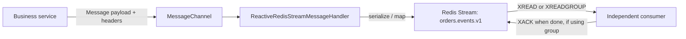

# Redis Stream Outbound Adapter in Spring Integration

## 1. Goal and problem statement

In an order-processing system, once an order is confirmed, the order service needs to publish an `OrderPlaced` event so inventory, notification, and analytics services can process it independently. Calling each service directly over HTTP couples the emitter to the addresses and availability of every recipient. **Redis Streams** provides an ordered event log per stream: the producer appends records, and consumers can read them later even if they were offline when written (provided the records have not been deleted or trimmed).

The **Redis Stream outbound channel adapter** connects a Spring Integration `MessageChannel` to a write operation against a Redis Stream. In Spring Integration, this component is `ReactiveRedisStreamMessageHandler`, introduced in version **5.4**. The handler accepts a Spring `Message<?>`, determines the target stream, maps data into a Redis record, and calls `ReactiveStreamOperations.add(...)` (corresponding to `XADD`) to append the record.

By the end of this lesson, you will be able to:

- Distinguish Redis Stream outbound from Pub/Sub outbound, Redis Lists, and reply-returning gateways.
- Configure the handler using `@ServiceActivator` (and Java DSL in supported versions), and append a real event to a stream.
- Choose the stream key, payload extraction mode, serializer, and `HashMapper` compatible with consumers.
- Inspect records using `redis-cli`, identify errors, and design retries, idempotency, and retention for production.

## 2. Processing flow and data contract



The following table shows an **illustrative logical record model** of an order event before mapping or serialization under a concrete configuration:

| Component | Example | Meaning |
| --- | --- | --- |
| Stream key | `orders.events.v1` | Redis key name of Stream type; fixed or computed from the message. |
| Record ID | `1790000000000-0` | Illustrative ID generated by Redis on `XADD *`; not the business `eventId`. |
| Payload | `{"eventId":"evt-1001","orderId":"ORD-42","type":"OrderPlaced"}` | Event data that consumers must decode. |
| Spring Message headers | `correlationId`, `traceId` | Internal flow metadata; **not automatically** written as Redis fields when `extractPayload=true`. |

A Redis Stream stores records as **ID + field/value pairs**, not directly as Spring `Message<?>` objects. When writing a `String` or POJO, Spring Data Redis may use `ObjectRecord` and a `HashMapper` to produce fields; what appears in `XRANGE` depends on your mapping and serializer configuration. Thus, the JSON above is an **illustrative business contract**, not a guarantee that Redis automatically creates a `payload` field containing JSON.

### Comparing Redis messaging mechanisms

| Mechanism | Write command | Read command | Best fit |
| --- | --- | --- | --- |
| Redis Pub/Sub | `PUBLISH` | Subscribers receive only while subscribed; Redis keeps no Pub/Sub history | Real-time notifications where missing messages while offline is acceptable. |
| Redis List | `LPUSH`/`RPUSH` | `LPOP`/`RPOP` or blocking commands | Simple queues; elements are normally removed from the list on pop. |
| **Redis Stream** | **`XADD`** | `XREAD`/`XREADGROUP`; supports IDs and consumer groups | Events needing retention, positional reads, and consumption state tracking. |

The outbound adapter is a **one-way output endpoint**. It writes records, does not return a `RecordId` like an outbound gateway, does not read data, and does not configure consumer groups. Managing groups, pending entries, and `XACK` is the **consumer's** responsibility; group-level acknowledgments only apply when using `XREADGROUP`.

## 3. Environment setup

Examples use Java 17+, Spring Boot with Spring Integration, and Redis running at `localhost:6379`. In a Spring Boot application, add dependencies managed by Boot's BOM:

```xml
<dependencies>
    <dependency>
        <groupId>org.springframework.boot</groupId>
        <artifactId>spring-boot-starter-integration</artifactId>
    </dependency>
    <dependency>
        <groupId>org.springframework.integration</groupId>
        <artifactId>spring-integration-redis</artifactId>
    </dependency>
    <dependency>
        <groupId>org.springframework.boot</groupId>
        <artifactId>spring-boot-starter-data-redis-reactive</artifactId>
    </dependency>
</dependencies>
```

```yaml
# application.yml (Spring Boot 3.x example)
spring:
  data:
    redis:
      host: localhost
      port: 6379
```

The Lettuce client in the Redis starter supports reactive connections. The bean passed to the handler must have type **`ReactiveRedisConnectionFactory`**; a `RedisConnectionFactory` that only supports synchronous operations does not satisfy this contract. The app can use the `LettuceConnectionFactory` auto-configured by Boot. Start a test Redis instance (if not already running) in your environment and verify:

```bash
redis-cli PING
# PONG
```

The stream name need not be pre-created: `XADD` creates the stream key on the first append, as long as the key does not already exist under a different Redis type.

## 4. Complete example: publishing an order event with `@ServiceActivator`

Define the `orderEvents` channel and attach the outbound handler with `@ServiceActivator`. This bean configuration works from Spring Integration 5.4 onward, including Spring Boot 3.x applications using Spring Integration 6.x:

```java
// RedisStreamOutboundConfig.java
import org.springframework.context.annotation.Bean;
import org.springframework.context.annotation.Configuration;
import org.springframework.data.redis.connection.ReactiveRedisConnectionFactory;
import org.springframework.integration.annotation.ServiceActivator;
import org.springframework.integration.channel.DirectChannel;
import org.springframework.integration.redis.outbound.ReactiveRedisStreamMessageHandler;
import org.springframework.messaging.MessageChannel;

@Configuration
public class RedisStreamOutboundConfig {

    @Bean
    MessageChannel orderEvents() {
        return new DirectChannel();
    }

    @Bean
    @ServiceActivator(inputChannel = "orderEvents")
    ReactiveRedisStreamMessageHandler orderEventsWriter(
            ReactiveRedisConnectionFactory connectionFactory) {

        ReactiveRedisStreamMessageHandler handler =
                new ReactiveRedisStreamMessageHandler(
                        connectionFactory, "orders.events.v1");
        handler.setExtractPayload(true); // true by default
        return handler;
    }
}
```

`DirectChannel` dispatches messages to the registered endpoint; `@ServiceActivator` uses the handler to write to Redis. No `Poller` is needed for this outbound step because the handler triggers whenever a message arrives on the channel. This is Redis **Stream** outbound, distinct from `RedisPublishingMessageHandler` used for Redis Pub/Sub.

Business code can send a JSON event conforming to the agreed contract:

```java
// OrderEventPublisher.java
import org.springframework.beans.factory.annotation.Qualifier;
import org.springframework.messaging.MessageChannel;
import org.springframework.messaging.support.MessageBuilder;
import org.springframework.stereotype.Service;

@Service
public class OrderEventPublisher {

    private final MessageChannel orderEvents;

    public OrderEventPublisher(@Qualifier("orderEvents") MessageChannel orderEvents) {
        this.orderEvents = orderEvents;
    }

    public void publishOrderPlaced() {
        String json = """
                {"eventId":"evt-1001","orderId":"ORD-42",
                 "type":"OrderPlaced","schemaVersion":1}
                """;

        boolean accepted = orderEvents.send(
                MessageBuilder.withPayload(json)
                        .setHeader("correlationId", "req-9001")
                        .build());

        if (!accepted) {
            throw new IllegalStateException("Flow did not accept message");
        }
    }
}
```

Call `publishOrderPlaced()` from business logic or an integration test while Redis is running. `send(...) == true` only confirms **the channel accepted the message**; with a reactive handler, never infer from this that Redis finished writing or that a consumer processed it. Observe write results and errors on the reactive execution path; when strict write confirmation is required, design a direct write step returning `Mono<RecordId>` or an explicit application confirmation mechanism.

### Inspecting results in Redis

After the write completes:

```bash
redis-cli TYPE orders.events.v1
# stream
redis-cli XLEN orders.events.v1
# 1 (if this is the first record)
redis-cli XRANGE orders.events.v1 - + COUNT 5
redis-cli XINFO STREAM orders.events.v1
```

`XRANGE` prints the actual IDs and field/value entries. If fields serialize to binary or Redis displays fields like `_class` or `_raw`, inspect `RedisSerializationContext` and your object-mapping setup rather than assuming the adapter wrote incorrectly. Running the publish method again **appends** another record with a new ID; Redis does not replace old records by business `eventId`.

## 5. Alternative configuration with Java DSL (Spring Integration 7.1+)

Starting in **Spring Integration 7.1**, you can use the `Redis.streamOutboundChannelAdapter(...)` builder directly inside an `IntegrationFlow`. This is an **alternative** to `@ServiceActivator` in section 4; enable only one approach per channel. On Spring Integration 6.x, declare the handler directly as in section 4.

```java
// Approach for Spring Integration 7.1+
import org.springframework.context.annotation.Bean;
import org.springframework.context.annotation.Configuration;
import org.springframework.data.redis.connection.ReactiveRedisConnectionFactory;
import org.springframework.integration.dsl.IntegrationFlow;
import org.springframework.integration.redis.dsl.Redis;

@Configuration
class RedisStreamDslConfig {

    @Bean
    IntegrationFlow orderEventsToRedisStream(
            ReactiveRedisConnectionFactory connectionFactory) {

        return IntegrationFlow.from("orderEvents")
                .handle(Redis.streamOutboundChannelAdapter(
                                connectionFactory, "orders.events.v1")
                        .extractPayload(true))
                .get();
    }
}
```

`IntegrationFlow.from("orderEvents")` declares the flow's input; Spring Integration creates or wires the named channel. The DSL methods `.serializationContext(...)`, `.hashMapper(...)`, and `.extractPayload(boolean)` expose the handler's corresponding options.

**Dynamic stream keys.** Constructor `ReactiveRedisStreamMessageHandler(factory, String)` uses a fixed stream key. The other constructor accepts an `org.springframework.expression.Expression` to resolve the stream key per incoming message, and also works with the `@ServiceActivator` style in section 4. For example, once an event has been validated and tagged with header `targetStream`:

```java
Expression keyExpression = new SpelExpressionParser()
        .parseExpression("headers['targetStream']");

ReactiveRedisStreamMessageHandler handler =
        new ReactiveRedisStreamMessageHandler(factory, keyExpression);
```

Here `factory` is an existing `ReactiveRedisConnectionFactory`; additional imports are `org.springframework.expression.Expression` and `org.springframework.expression.spel.standard.SpelExpressionParser`. Verify the header exists, is permitted, and points to a valid stream name **before** passing the message to the handler. Never accept arbitrary stream names from external requests, as doing so can spawn unbounded keys or write into the wrong data stream.

## 6. Payload, serialization, and hash mapping

Four settings directly shape what consumers read:

| Setting | Role | Notes |
| --- | --- | --- |
| `setExtractPayload(true)` / `.extractPayload(true)` | Uses the Spring Message **payload** as record data. | Default behavior. Header `correlationId` in the example does not become a Redis field automatically. |
| `setExtractPayload(false)` / `.extractPayload(false)` | Maps the entire `Message<?>` object. | More complex serialization and Spring type coupling; verify with consumers. |
| `setSerializationContext(...)` / `.serializationContext(...)` | Configures how stream keys, hash fields, and hash values are encoded. | Writer and reader must use compatible serializers. |
| `setHashMapper(...)` / `.hashMapper(...)` | Maps Java objects into Redis field/value pairs. | Needed for multi-attribute data or polyglot consumers. |

Setter methods apply directly on the handler from version 5.4; the DSL equivalents apply only when your project supports `RedisStreamOutboundChannelAdapterSpec` (7.1+).

Under Spring Data Redis's contract, `Record#getStream()` uses the key serializer; field names use the **hash-key serializer**; field values use the **hash-value serializer**. For cross-service exchange, standardize a schema (`eventId`, `eventType`, `schemaVersion`, `occurredAt`, `data`) encoded as UTF-8/JSON or agreed string fields. If storing whole JSON blobs, verify how `ObjectRecord` maps a `String` (which may generate a `_raw` field plus type metadata). If you want individual fields like `eventId` and `orderId` written directly, control map conversion and serializers explicitly and inspect `XRANGE` before publishing the contract.

Illustrative Redis field/value contract when two services agree on explicit fields:

```text
XADD orders.events.v1 *
  eventId evt-1001
  eventType OrderPlaced
  schemaVersion 1
  orderId ORD-42
```

This is an **illustrative Redis command for the schema**, not guaranteed output from the default setup in section 4. When you need exact control over every Redis field and to obtain the `RecordId`, Spring Data Redis lets you use `StreamRecords.mapBacked(...)` with `ReactiveRedisTemplate.opsForStream().add(...)` directly; the Spring Integration adapter addresses **one-way channel integration**.

An important principle: `eventId` handles business deduplication, whereas `RecordId` locates a record inside a stream. The two values are not interchangeable. Any `traceId`, `correlationId`, tenant, or version needed by consumers must be placed intentionally into the **payload/field contract**.

## 7. When does writing succeed vs. processing succeed?

These milestones are independent:

1. **Flow accepts message:** the application sends the message into `MessageChannel`.
2. **Redis accepts record:** `XADD` completes and Redis assigns a record ID.
3. **Consumer receives record:** one or more consumers read via `XREAD` or `XREADGROUP`.
4. **Consumer processes and acknowledges:** with a consumer group, the consumer calls `XACK` after finishing business work.

The outbound adapter is responsible only for **the write step**. It does not guarantee steps 3 or 4. `XACK` does not delete records from the stream; deletion or trimming is governed by retention policy. Slow consumers can still build backlogs even while the producer writes normally.

### Error handling and retries

- **Redis unreachable / timeout / serialization error:** the write fails; observe exceptions on the reactive path, check endpoint error configuration, and log `eventId` and stream key. Never rely solely on `MessageChannel.send`'s boolean return to mark a business event as published.
- **Uncertain whether `XADD` succeeded:** retrying may create **two records with different IDs** for the same `eventId`. Consumers must be idempotent—for instance, tracking processed `eventId`s or enforcing unique constraints in a database.
- **App updates the database then crashes before publishing:** the two actions do not share a single transaction automatically. For mandatory events, use a **transactional outbox**: persist business changes and an outbox row in the same database transaction, then let a worker publish to Redis and mark the outbox entry after confirmation.
- **Overloading Redis:** bound queued messages, monitor write latency and error counts, and never retry infinitely in a tight hot loop. Implement backoff policies and dead-letter/failure paths.

Never treat Redis Streams + adapter as a business-level exactly-once guarantee. Standard design uses **at-least-once across retried steps** paired with idempotent consumers, monitoring, and recovery.

## 8. Production: retention, partitioning, and observability

**Retention.** A stream grows indefinitely if you only call `XADD`. Use `XTRIM` or `MAXLEN`/`MINID` policies to bound storage, sizing thresholds for the replay window of your slowest consumer. Trimming too early drops unprocessed records. Starting in Spring Integration **6.5**, `ReactiveRedisStreamMessageHandler` provides `setAddOptionsFunction(Function<Message<?>, RedisStreamCommands.XAddOptions>)` to build `XADD` options per message, including trimming policies compatible with your Redis and Spring Data versions. Java DSL 7.1+ provides `.addOptionsFunction(...)` accordingly.

**Stream keys and versioning.** Name streams by domain, e.g. `orders.events.v1`, keeping key counts manageable. For breaking schema changes, publish to a new version or support dual-version consumers during transition. If splitting streams per tenant or event type, account for ordering: record order holds **only within each stream**, not globally across streams.

**Minimum metrics to monitor:** publish successes/failures, write latency, Redis connectivity, `XLEN`, stream growth rate, `XINFO STREAM`, and when using consumer groups, `XINFO GROUPS`, `XPENDING`, and processing latency. Alert on consecutive producer failures or backlogs breaching thresholds. Keep unnecessary sensitive data out of payloads and logs.

**Distinguish data security from durability.** Redis offers persistence and replication depending on deployment configuration; `XADD` returning success does not alone guarantee records survive every failure. For critical events, specify required durability levels, backup strategies, and recovery capabilities.

## 9. Hands-on exercise and self-check checklist

**Exercise:** A payment service must emit `PaymentCaptured` for an invoicing service. Create a `paymentEvents` flow writing to `payments.events.v1` with payload fields `eventId`, `paymentId`, `orderId`, `capturedAt`, and `schemaVersion`. Send the same event twice and inspect `XRANGE`. Answer for yourself: why can two distinct record IDs exist for the same `eventId`, and where should deduplication occur?

Completion checklist:

- [ ] Application has `ReactiveRedisConnectionFactory` and `spring-integration-redis` compatible with its Spring Boot version.
- [ ] The flow or `@ServiceActivator` consumes from the right channel and writes to the right stream key.
- [ ] Published a record and verified with `XLEN`/`XRANGE`, including checking whether serializers produce binary data.
- [ ] Defined `extractPayload`, schema/serialization, and how essential headers map into the payload.
- [ ] Defined retry, idempotency, retention, and long-running monitoring policies.

## References

- [Spring Integration Reference – Redis Stream Outbound Channel Adapter](https://docs.spring.io/spring-integration/reference/redis.html#redis-stream-outbound-channel-adapter): Java DSL, Java config, and handler options.
- [Spring Integration API – `ReactiveRedisStreamMessageHandler`](https://docs.spring.io/spring-integration/api/org/springframework/integration/redis/outbound/ReactiveRedisStreamMessageHandler.html): constructors, `extractPayload`, `serializationContext`, `hashMapper`, and `addOptionsFunction`.
- [Spring Data Redis – Redis Streams](https://docs.spring.io/spring-data/redis/reference/redis/redis-streams.html): `Record`, `StreamOperations`, serialization, object mapping, and consumer groups.
