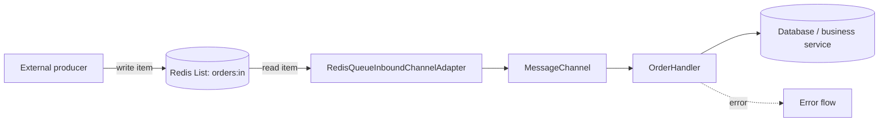
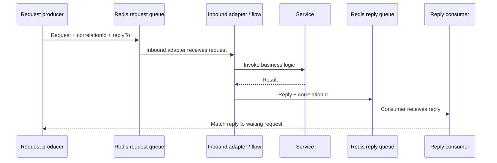

# Redis queue inbound gateway

## Objective

After this lesson, you will be able to explain how a message from a Redis List enters a Spring Integration processing flow, configure a queue receiving endpoint, define the data contract between producer and consumer, and select error-handling strategies suited to queue semantics.

## Where does a Redis queue sit in Spring Integration?

Redis is often used as a lightweight queue between processes: application A writes work items to Redis, and application B pulls each item for processing. Spring Integration brings that boundary into the messaging model through adapters and `MessageChannel`s.

For a Redis List, the standard inbound component is `RedisQueueInboundChannelAdapter` in the `spring-integration-redis` module. The adapter reads elements from a Redis key and emits payloads as Spring `Message<?>`s onto its output channel. It acts as the flow's entry gate: external systems push data into Redis, and the Spring Integration flow receives data from the queue and routes it to services, routers, transformers, or other endpoints.

The lesson title uses “gateway” in the sense of an entry gate for messages. Clearly distinguish the endpoint type: a queue inbound channel adapter is one-way—it receives messages and forwards them into a channel. The adapter itself does not establish a correlated request/reply exchange. If business logic requires replying to each request, the flow must explicitly define a reply path, reply destination, and correlation key; that pattern is covered in its own section below.



The adapter frees the flow from managing Redis connections, queue read commands, and message conversion manually. The flow remains responsible for business logic, data validation, and deciding what happens when processing fails.

## Dependencies and connection setup

The application needs Spring Integration Redis and a Redis connection factory provided by Spring Data Redis. With Spring Boot, dependency versions should be aligned via the BOM of the active Boot version.

```xml
<dependency>
    <groupId>org.springframework.integration</groupId>
    <artifactId>spring-integration-redis</artifactId>
</dependency>
```

If the application does not yet include a Redis client and connection config, add the Spring Data Redis dependency or matching starter. Configure `RedisConnectionFactory` with host, port, database, authentication credentials, and TLS per your deployment environment. Never place real passwords in source code; use secrets or environment variables managed by your deployment platform.

Producer and consumer must agree on the queue key and value serialization. For instance, if the producer writes JSON as a string, the consumer must read strings or decode the matching bytes. Do not assume every `RedisTemplate` uses the same serializer: default serializers, key serializers, and value serializers can differ. A serializer mismatch causes consumers to read unreadable bytes or receive unexpected Java types.

## Configuring the inbound adapter with Java DSL

The example below creates a flow receiving data from queue `orders:in` and forwarding payloads to `OrderHandler`. `RedisConnectionFactory` is injected from Spring Data Redis configuration.

```java
import org.springframework.context.annotation.Bean;
import org.springframework.context.annotation.Configuration;
import org.springframework.data.redis.connection.RedisConnectionFactory;
import org.springframework.integration.dsl.IntegrationFlow;
import org.springframework.integration.redis.inbound.RedisQueueInboundChannelAdapter;

@Configuration
class RedisInboundConfiguration {

    @Bean
    IntegrationFlow redisOrdersInboundFlow(
            RedisConnectionFactory connectionFactory,
            OrderHandler orderHandler) {

        RedisQueueInboundChannelAdapter inboundAdapter =
                new RedisQueueInboundChannelAdapter(
                        connectionFactory, "orders:in");

        return IntegrationFlow.from(inboundAdapter)
                .handle(orderHandler, "handle")
                .get();
    }
}
```

The handler should accept the payload type produced by the configured serializer. For example, if Redis holds JSON text, the handler can accept `String` and use `ObjectMapper` to deserialize into a DTO. In production systems, separate envelope validation, DTO decoding, and business execution into distinct steps so invalid-data errors are classified accurately.

```java
import org.springframework.stereotype.Component;

@Component
class OrderHandler {

    public void handle(Object payload) {
        // Convert payload using the serializer agreed with the producer.
        // Validate schema and data before invoking business logic.
    }
}
```

The queue name is an integration contract between producer and consumer. Name queues with namespaces and environments—such as `orders:in:dev` or `billing:invoice:in`—instead of generic keys like `queue`. With multiple message types, consider splitting queues by processing purpose so a slow consumer group does not stall unrelated work.

## Message contract

A Redis List only stores elements according to the chosen serializer. When messages cross process boundaries, do not rely on headers that only exist in one application's memory. Information needed for independent consumer processing must live inside the explicitly serialized payload or envelope.

Example JSON envelope:

```json
{
  "eventId": "evt-8d12",
  "eventType": "OrderCreated",
  "schemaVersion": 1,
  "occurredAt": "2026-11-23T07:00:00Z",
  "correlationId": "req-42",
  "payload": {
    "orderId": "ORD-1008",
    "customerId": "CUS-205"
  }
}
```

`eventId` identifies a single event and supports duplicate prevention. `eventType` and `schemaVersion` specify how to interpret the payload. `occurredAt` supports origin-time checks and incident investigation. `correlationId` links messages belonging to the same request or workflow. The `payload` section holds business data; avoid embedding Java objects serialized via mechanisms tied to internal classes when producer and consumer deploy independently.

When evolving schemas, enforce compatibility rules. Consumers may ignore optional new fields, yet must reject or handle unsupported versions deliberately. Never silently interpret a malformed payload as default values, which creates hard-to-detect business corruption.

## Queue inbound and request/reply

An inbound adapter fits one-way flows: a message enters the queue, and a consumer receives it and performs work. If the producer needs a result back, design an explicit reply path. A common pattern places `replyTo` and `correlationId` in the envelope; once the consumer finishes, it sends the result to the designated reply queue via a matching Redis outbound component.



The reply consumer uses `correlationId` to match results to the original request. If multiple requests share one reply queue, each request needs a correlation ID unique within the required scope, and the caller must handle timeouts, pending request tracking, late replies, and orphaned replies. If creating a dedicated reply queue per request, enforce creation, expiration, and cleanup rules so unused keys do not accumulate.

Never treat receiving a reply as proof the request executed exactly once. A producer might retry on timeout even though the consumer already finished; a consumer might send a reply right as the connection drops before the producer receives it. Designs must tolerate redeliveries and duplicate processing.

## Consumption semantics and error handling

A Redis List is a simple queue structure. When the adapter pulls an element via a pop command, that element is removed from the List at retrieval time. Therefore, if the process stops after popping but before finishing business work, the element is no longer in the queue for another consumer to pick up. Redis Lists do not provide built-in acknowledgments and pending-message recovery like Redis Streams consumer groups.

This directly shapes handler design:

- Make processing idempotent. Record processed `eventId`s or enforce unique business keys so retries create no duplicate side effects.
- Separate transient errors from data errors. Connection or downstream service glitches can be retried within bounds; schema-invalid payloads must be routed to a quarantine path for investigation.
- When retrying, record the message and attempt count in a controlled manner. Avoid immediate re-push loops where one bad message consumes all consumer capacity.
- Design a dead-letter queue (DLQ) or dedicated failure store. Record the payload, event ID, timestamp, failure reason, and attempt count to support data repair or controlled replay.
- Use `errorChannel`, error flows, and advice suited to your Spring Integration topology to observe and handle exceptions. Identify whether failures happened in receive, transformation, or the handler; never assume exceptions automatically return messages to the Redis List.

Redis Lists fit when you need a simple work queue and accept building recovery yourself. If you need consumer groups, acknowledgments, pending lists, and reclaiming of incomplete messages, evaluate Redis Streams. If you need to broadcast to active subscribers and accept offline subscribers missing messages, Redis Pub/Sub is the proper fit; Pub/Sub never substitutes for a durable queue.

## Operations and adapter lifecycle

The inbound adapter is an endpoint participating in the Spring Integration lifecycle. At startup, the endpoint starts per lifecycle settings; at shutdown, give it time to stop pulling new work and finish in-flight processing. Check `autoStartup`, `phase`, and shutdown timeout settings for your Spring Integration version when controlling startup or shutdown ordering.

With blocking-pop queues, timeouts and wait intervals affect endpoint stop responsiveness and idle behavior when the queue is empty. Check your version's API to configure receive timeouts; never attach a periodic poller out of habit when the adapter already manages its own read loop. Give each consumer appropriate connection pools and resource bounds. Avoid letting many blocking tasks exhaust connections needed by other Redis operations.

Monitor at least queue length, enqueue/dequeue rates, successful completions, errors, processing latency, and retry counts. With Redis Lists, `LLEN` reports instantaneous queue length, yet does not reveal the oldest message's age; to measure lag, include timestamps in the envelope or add dedicated instrumentation. Never log sensitive full payloads.

When running multiple consumer instances, instances pull from the same queue and share the workload. This boosts throughput, yet completion order can diverge from arrival order due to varying processing times. If business rules require per-key ordering, partition queues by key or serialize processing per key—never infer completion order from List order across concurrent consumers.

## Example order-processing flow

Suppose the Order API writes an `OrderCreated` envelope into `orders:in`. The adapter pops the item and emits a message into the flow. The flow checks `schemaVersion`, converts the payload into `OrderCreated`, verifies whether `eventId` was already processed, and calls `OrderService`. Upon saving the order, the service records `eventId` inside the same business transaction boundary whenever possible. If the producer resends the same event, the handler detects the existing ID and skips creating a second order.

If `OrderService` temporarily cannot reach the database, a bounded retry policy governs where retries occur. With a Redis List, the message has already been popped, so in-process retries cannot survive a sudden process crash. When post-crash recovery is mandatory, persist a copy of the message before processing, use a retry queue with explicit state transitions, or switch to Redis Streams or a broker with built-in acknowledgments.

## Testing

Integration tests should use real Redis in the test environment, such as Redis Testcontainers, to verify serialization and message consumption matching production. A baseline test suite should:

1. Start Redis and configure a connection factory matching the application setup.
2. Start the inbound flow and push a valid envelope onto the target queue.
3. Verify the handler receives the expected payload, Java type, and contract fields.
4. Send a schema-invalid payload to verify the error flow or DLQ.
5. Resend the same `eventId` to verify idempotent handling.
6. Stop the application mid-processing to verify the designed recovery policy.

Do not merely mock `RedisTemplate` and conclude the adapter works: mocks cannot verify real Redis commands, serializers, pop semantics, or live connections.

## Design checklist

- [ ] Producer and consumer agree on queue name, serializer, and schema version.
- [ ] Envelope includes event ID and correlation ID when business correlation is needed.
- [ ] Handler validates data before executing business side effects.
- [ ] Duplicate handling enforces an idempotency key or equivalent safeguard.
- [ ] Retries are bounded, backed off, and paired with a quarantine store for failed messages.
- [ ] Risk of post-pop message loss on consumer crash has been evaluated.
- [ ] Metrics cover queue depth, throughput, errors, and processing latency.
- [ ] Integration tests run against real Redis and cover mid-processing shutdowns.

## Conclusion

The Redis queue inbound adapter provides a simple entry point to bring Redis List items into a `MessageChannel` for processing by Spring Integration components. Solution quality depends on message contracts, serializers, idempotency, and recovery strategies. With List queues, pay special attention to the fact that popping removes messages before business logic finishes; if acknowledgments and pending-message recovery are required, choose a data structure or broker with matching semantics.
