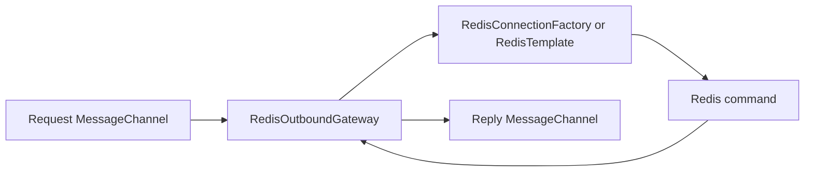

# Redis outbound command gateway

## Objective

After this lesson, you will be able to:

- Explain the role of `RedisOutboundGateway` inside a Spring Integration flow.
- Map a `Message` to a Redis command name and its argument list.
- Configure `RedisConnectionFactory` or `RedisTemplate`, argument serializers, and a reply channel.
- Read the result types returned by individual Redis commands, handle `null` results, and design safe retries.
- Distinguish the command gateway from Redis publish, queue, and store outbound adapters.

## What problem does the gateway solve?

A Spring Integration flow typically receives and transforms `Message<?>`s. When you need to invoke a Redis operation, you could write a standalone service using `RedisTemplate`. However, if you want to keep the Redis operation as an endpoint inside the flow—complete with a request channel, reply channel, and downstream routing of results—`RedisOutboundGateway` is the right fit.

The Redis outbound command gateway executes a Redis command through the generic `RedisConnection#execute` API. The command is resolved from configuration or the message; arguments are extracted from the payload or a configured mapping strategy. The command result is wrapped in a reply message for downstream endpoints to process further.



The gateway fits when you need to invoke commands like `GET`, `SET`, `INCR`, `MGET`, or other Redis commands not covered by specialized adapters. It executes commands upon receiving a message; it is not a polling source.

## Request and reply message contract

The gateway receives a Spring Integration `Message`. Key contract elements:

| Element | Role |
|---|---|
| `payload` | Default source of command arguments when neither `argument-expressions` nor `arguments-strategy` is configured. |
| `redis_command` header | Default source of the command name when no other `command-expression` is set. |
| `command-expression` | SpEL expression returning the Redis command name. Can be fixed (e.g., `'INCR'`) or derived from the message. Must not evaluate to `null`. |
| `argument-expressions` | Comma-separated list of SpEL expressions producing arguments in the exact order required by the Redis command. |
| `arguments-strategy` | Custom `ArgumentsStrategy` implementation mapping a message to arguments. Mutually exclusive with `argument-expressions`. |
| `arguments-serializer` | `RedisSerializer` used to encode each argument into `byte[]` as needed. |
| Reply message | Payload is the command result. Its Java type depends on the command and Redis client; the gateway does not guarantee every result is a `String`. |

When neither an arguments strategy nor `argument-expressions` is configured, the gateway uses the payload as the argument source. For example, with `INCR`, the payload can be the key name to increment. With `SET`, the command needs at least a key and value, so two arguments must be mapped in exact order.

By default, the command name is read from the `redis_command` header. With a fixed command expression like `'INCR'`, the message needs no such header. When allowing dynamic commands, validate and restrict permitted command names against an allowlist before sending messages to the gateway.

## Connecting to Redis

Spring Integration uses Spring Data Redis abstractions to establish connections. The application needs the `spring-integration-redis` dependency and a compatible Redis client, typically Lettuce or Jedis. Align versions with your project's Spring Boot or Spring Integration BOM.

The gateway accepts one of two options:

- `RedisConnectionFactory`: abstraction managing Redis connections; if omitted, the endpoint can look up a bean named `redisConnectionFactory`.
- `RedisTemplate`: used when the application already has a configured template bean to pass to the gateway.

`connection-factory` and `redis-template` are mutually exclusive—choose one. In Java configuration, `RedisOutboundGateway` constructors likewise accept one or the other.

## Example: incrementing a counter with `INCR`

The example below reads a key name from the payload, executes `INCR`, and sends the new value onto a `QueueChannel` for another endpoint or service to consume.

```java
import org.springframework.context.annotation.Bean;
import org.springframework.context.annotation.Configuration;
import org.springframework.data.redis.connection.RedisConnectionFactory;
import org.springframework.data.redis.serializer.StringRedisSerializer;
import org.springframework.integration.channel.DirectChannel;
import org.springframework.integration.channel.QueueChannel;
import org.springframework.integration.dsl.IntegrationFlow;
import org.springframework.integration.redis.dsl.Redis;
import org.springframework.messaging.Message;
import org.springframework.messaging.MessageChannel;
import org.springframework.messaging.PollableChannel;
import org.springframework.messaging.support.MessageBuilder;

@Configuration
class RedisCommandFlowConfiguration {

    @Bean
    MessageChannel redisCommandRequests() {
        return new DirectChannel();
    }

    @Bean
    PollableChannel redisCommandReplies() {
        return new QueueChannel();
    }

    @Bean
    IntegrationFlow incrementRedisCounter(RedisConnectionFactory connectionFactory) {
        return IntegrationFlow.from("redisCommandRequests")
                .handle(Redis.outboundGateway(connectionFactory)
                        .command("INCR")
                        .argumentsSerializer(new StringRedisSerializer()))
                .channel("redisCommandReplies")
                .get();
    }
}
```

DSL imports include `org.springframework.integration.redis.dsl.Redis`; the serializer is `org.springframework.data.redis.serializer.StringRedisSerializer`. The example assumes a `RedisConnectionFactory` bean is configured to connect to Redis.

Sending a request and reading the reply from a service injected with both channel beans:

```java
Long increment(MessageChannel redisCommandRequests, PollableChannel redisCommandReplies) {
    redisCommandRequests.send(
            MessageBuilder.withPayload("metrics:orders").build());

    Message<?> reply = redisCommandReplies.receive(1_000);
    return reply == null ? null : (Long) reply.getPayload();
}
```

`metrics:orders` is the key passed as the argument to `INCR`. Redis increments the integer stored at that key and returns the updated value; for this command, the result is typically represented as a `Long`. `INCR` automatically initializes a missing key to `0` before incrementing. If the key holds a value that cannot be parsed as an integer, Redis returns an error.

Here `DirectChannel` invokes the handler synchronously on the sender's thread, while `QueueChannel` holds the reply message for the caller to pull with `receive`. When using an `ExecutorChannel` or another asynchronous channel, design reply waiting and correlation to match your application's execution model.

## Mapping multiple arguments in XML

For commands taking multiple arguments, `argument-expressions` defines each value in the exact order expected by the Redis command. The example below writes the payload to key `orders:1001` via `SET`:

```xml
<bean id="redisStringSerializer"
      class="org.springframework.data.redis.serializer.StringRedisSerializer" />

<int-redis:outbound-gateway
        request-channel="redisSetRequests"
        reply-channel="redisSetReplies"
        connection-factory="redisConnectionFactory"
        command-expression="'SET'"
        argument-expressions="'orders:1001', payload"
        arguments-serializer="redisStringSerializer" />
```

In this configuration, the first expression produces the key argument and the second extracts the value from `payload`. `StringRedisSerializer` serializes the arguments sent to Redis; this is a command-argument serializer, not a promise that the reply payload will automatically be converted to a `String`.

To compute argument counts or structures with Java logic, implement `ArgumentsStrategy` and wire it into the gateway. Never configure `arguments-strategy` and `argument-expressions` simultaneously. When `argument-expressions` is used, `use-command-variable` exposes the evaluated command name as `#cmd` in the SpEL context; this attribute has no effect unless `argument-expressions` is used.

## Replies and key attributes

| Attribute | Meaning and usage |
|---|---|
| `request-channel` | Channel receiving request messages. |
| `reply-channel` | Channel receiving reply messages. Can also fall back to the message's reply-channel header per standard Spring Integration gateway rules. |
| `requires-reply` | Defaults to `true`. If Redis returns `null`, the gateway throws `ReplyRequiredException`. Set to `false` when `null` is a valid outcome and the flow allows emitting no reply message. |
| `reply-timeout` | Wait timeout when sending the reply message, useful for bounded reply channels. This is NOT the Redis command execution timeout or connection timeout. |
| `arguments-serializer` | Serializes each command argument into a byte array as needed. Choose a serializer matching how your app reads and writes Redis data. |

Result types depend on the command: `INCR` returns a numeric value; `MGET` can return `List<byte[]>`. Define a clear type contract per flow and transform results downstream when business logic expects a specific type—never blindly assume every reply payload is a string.

Key scenarios to watch:

- `GET` on a missing key can return `null`. With `requires-reply=true`, the gateway throws `ReplyRequiredException`; if missing keys are normal, set `requires-reply=false` and handle the no-reply branch.
- Connection errors, Redis command errors, and serialization failures fail the endpoint. Route errors through Spring Integration error handling, log with context, and separate retryable errors from ones requiring manual intervention.
- Configure connection and command execution timeouts on the Redis client/connection factory. `reply-timeout` only governs sending the reply message to the reply channel.

## Retries, consistency, and security

A Redis command can execute on the server while the response drops over the network. When an application retries after missing a response, it often cannot tell whether the first execution happened. Design retries around command and business idempotency:

- Re-sending `SET` with the same key and value normally yields the same final state.
- Re-sending `INCR`, `LPUSH`, or another additive command mutates state a second time. Never auto-retry non-idempotent commands without an idempotency key, deduplication guard, or compensating business design.
- For multi-step operations, evaluate Lua scripts or appropriate Redis atomic mechanisms rather than assuming separate messages form a transaction.

Dynamic commands must be constrained by an allowlist; never let external input pick arbitrary commands. Use least-privilege Redis ACLs, partition keys by application namespace, and avoid granting dangerous administrative commands to business flows. Account for command cost on large datasets; for example, `KEYS` can block Redis on a large keyspace, so choose lookups suited to your data structures.

## Comparing with other Redis outbound endpoints

| Endpoint | Primary operation | Returns command result to flow? |
|---|---|---|
| Redis outbound channel adapter | Publishes message to a Redis topic via Pub/Sub. | No; one-way outbound adapter. |
| Redis queue outbound channel adapter | Pushes payload onto a Redis List. | No; one-way outbound adapter. |
| Redis store outbound channel adapter | Writes payload into a collection (List, Set, ZSet, Map, or Properties). | No command-reply model. |
| Redis outbound command gateway | Executes an arbitrary Redis command via `RedisConnection#execute`. | Yes; command output becomes the reply message. |
| Redis queue outbound gateway | Sends requests using a queue request/reply protocol with conversation UUIDs and Redis Lists. | Yes; replies arrive via the dedicated queue protocol. |

The key distinction is that the command gateway returns the output of the Redis command invoked. The queue outbound gateway coordinates two peers via Lists and conversation IDs; the two endpoints are not interchangeable.

## Hands-on practice

1. Configure a Redis client and `RedisConnectionFactory`, then build a flow receiving messages on a `DirectChannel`.
2. Use the command gateway to execute `INCR` with the key name as payload. Verify the reply type and value through a `QueueChannel`.
3. Switch to `GET` on a nonexistent key. Observe `requires-reply=true`, then test `false` and handle the empty-reply case.
4. Configure `SET` with two arguments via `argument-expressions`; verify with an independent Redis client that the serializer wrote the exact key and value.
5. Simulate connection failures and evaluate which commands can be safely retried—specifically examine the case where `INCR` executed on Redis yet the client missed the reply.

## Common pitfalls

- Missing the `redis_command` header while no `command-expression` is set, leaving the gateway unable to resolve a command.
- Configuring a `command-expression` that evaluates to `null`.
- Passing the wrong argument count or order; e.g., `SET` expects key before value.
- Using a serializer incompatible with stored Redis data, producing unexpected byte arrays or command errors.
- Expecting every command to return a `String`, when actual types depend on the command and Redis client.
- Confusing `reply-timeout` with the Redis command execution timeout.
- Blindly retrying non-idempotent commands after timeouts, inflating counters or duplicating writes.

## Conclusion

`RedisOutboundGateway` brings Redis operations into a flow under the request/reply model: the input message determines command and arguments, the gateway calls Redis, and the result continues downstream via the reply channel. Good designs clearly define message contracts, serializers, reply types, `null`-result handling, timeouts, and per-command retry policies.

## References

- [Spring Integration Reference — Redis Support](https://docs.spring.io/spring-integration/reference/redis.html)
- [Spring Data Redis Reference](https://docs.spring.io/spring-data/redis/reference/)
