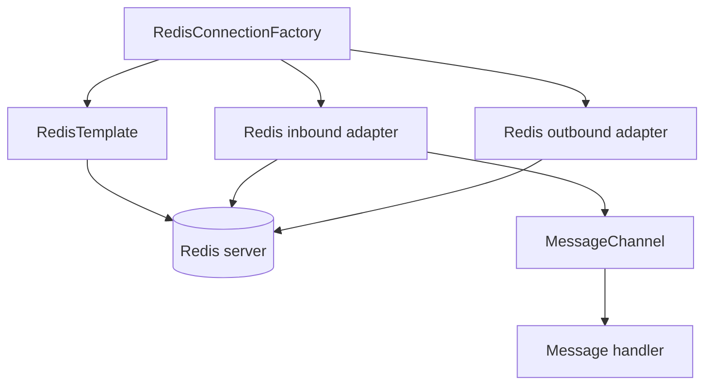

# Redis connection factory and serializers

## Objective

In Spring Integration, Redis adapters require a connection to Redis and a consistent data-conversion convention shared with message producers. This lesson covers the role of `RedisConnectionFactory`, how to configure connections with Lettuce or Spring Boot, how to choose key and value serializers, and how to ensure producers, inbound adapters, and outbound adapters agree on one message format.

This belongs to the `SPRING_INTEGRATION_ADAPTERS` module: connecting external systems into Spring Integration flows through adapters, gateways, and `MessageChannel`s. Redis serves as a concrete example for practicing connection configuration, message contracts, error handling, and resource lifecycles.

## What does `RedisConnectionFactory` do?

`RedisConnectionFactory` is Spring Data Redis's abstraction for creating Redis connections. Components like `RedisTemplate`, `StringRedisTemplate`, and many Spring Integration endpoints accept this factory rather than managing sockets, the RESP protocol, authentication, or connection setup manually.

In a flow, the factory is typically declared as a Spring bean and injected into adapters. Adapters use the factory to run Redis operations; the flow focuses on moving messages across `MessageChannel`s and executing business logic.



The factory does not dictate JSON structure or payload encoding—that belongs to serializers and the data contract. Distinguish three layers:

| Component | Responsibility |
|---|---|
| `RedisConnectionFactory` | Creates connections and applies client, endpoint, authentication, TLS, and timeout configuration |
| Redis operation / template / adapter | Executes commands such as `GET`, `SET`, `LPUSH`, `BRPOP`, or corresponding operations |
| `RedisSerializer` | Converts keys and values between Redis bytes and Java types |

One factory can be shared across many templates and adapters. Never instantiate a new factory per message or per handler invocation; doing so inflates connection overhead and makes resource lifecycles hard to control.

## Choosing a client and configuring connections

Spring Data Redis supports clients such as Lettuce and Jedis. Lettuce is Netty-based and supports synchronous, asynchronous, and reactive APIs; it is the common default in modern Spring Boot applications. Jedis may also be used when an application has standardized on it. Pick one client matching your stack, usage pattern, and operational requirements; avoid pulling in multiple unnecessary client libraries side by side.

With Spring Boot, let auto-configuration build `RedisConnectionFactory` from external properties. Spring Boot 3 example:

```yaml
spring:
  data:
    redis:
      host: ${REDIS_HOST:localhost}
      port: ${REDIS_PORT:6379}
      username: ${REDIS_USERNAME:}
      password: ${REDIS_PASSWORD:}
      database: 0
      timeout: 2s
```

Property prefixes may differ in older Spring Boot generations; follow the documentation for your application's exact version. Pull sensitive values from a secret manager or environment variables managed by your deployment platform. Never commit Redis passwords into a repository.

When manual configuration is needed, declare a `LettuceConnectionFactory` with `RedisStandaloneConfiguration`:

```java
import java.time.Duration;

import org.springframework.context.annotation.Bean;
import org.springframework.context.annotation.Configuration;
import org.springframework.data.redis.connection.RedisPassword;
import org.springframework.data.redis.connection.RedisStandaloneConfiguration;
import org.springframework.data.redis.connection.lettuce.LettuceClientConfiguration;
import org.springframework.data.redis.connection.lettuce.LettuceConnectionFactory;

@Configuration
class RedisConnectionConfiguration {

    @Bean
    LettuceConnectionFactory redisConnectionFactory() {
        RedisStandaloneConfiguration server =
                new RedisStandaloneConfiguration("localhost", 6379);
        server.setDatabase(0);
        // Load password from secure deployment environment configuration.
        // server.setPassword(RedisPassword.of(redisPassword));

        LettuceClientConfiguration client =
                LettuceClientConfiguration.builder()
                        .commandTimeout(Duration.ofSeconds(2))
                        .shutdownTimeout(Duration.ZERO)
                        .build();

        return new LettuceConnectionFactory(server, client);
    }
}
```

This is a standalone Redis example for development. When deploying, replace host, port, database, and credentials with environment configuration. If Redis requires TLS, enable SSL in `LettuceClientConfiguration` and configure trust material per your organization's policy. For Redis Sentinel or Cluster, use the corresponding topology configuration rather than standalone.

Choose timeouts based on Redis latency and operation characteristics. Too short causes spurious failures under load; too long holds requests or workers when Redis stalls. For blocking pop commands in queue adapters, distinguish message-wait timeouts from command timeouts and application shutdown timeouts—they serve different purposes.

### Connections and lifecycle

`LettuceConnectionFactory` is a lifecycle-managed Spring bean. Let the Spring container initialize and destroy the factory along with the application lifecycle. Never call `destroy()` manually after individual messages. At shutdown, the application should stop accepting new work, finish or hand off active tasks per system policy, and then close Redis resources.

Lettuce shares a single connection across many usage modes; do not assume every operation needs a connection pool. Enable pooling only when usage patterns and concurrent connection demand genuinely require it, and configure explicit limits. For blocking commands, size waiting tasks, held blocking connections, and remaining capacity for regular commands separately.

## Serializers are the byte contract between applications

Redis stores keys and values as bytes. When a Java app writes an object, a serializer converts it to bytes; when reading, a serializer converts bytes back to a Java type. If producer and consumer use different serializers, the consumer receives undecodable bytes or misinterprets payloads.

`RedisTemplate` exposes serializers for multiple positions:

| Serializer | Data converted |
|---|---|
| Key serializer | Keys for Redis structures such as strings, lists, sets |
| Value serializer | Values for key-value operations |
| Hash key serializer | Field names inside a Redis Hash |
| Hash value serializer | Values of individual fields inside a Redis Hash |
| Default serializer | Fallback serializer when a specific position is unset |

Never configure only the value serializer and assume keys and hashes share the same format. Specify every position your application uses.

### `StringRedisSerializer` and `StringRedisTemplate`

When messages are plain text or JSON text, `StringRedisSerializer` is a clean choice. `StringRedisTemplate` comes pre-configured for strings and suits producers pushing JSON into a Redis List.

```java
import org.springframework.data.redis.core.StringRedisTemplate;
import org.springframework.stereotype.Component;

@Component
class OrderQueuePublisher {

    private final StringRedisTemplate redis;

    OrderQueuePublisher(StringRedisTemplate redis) {
        this.redis = redis;
    }

    void publish(String json) {
        redis.opsForList().leftPush("orders:in", json);
    }
}
```

Here `json` is already a JSON string produced from a DTO via `ObjectMapper`. Redis stores the string bytes; consumers must read and decode strings under the exact same convention.

When a dedicated `RedisTemplate` is needed, configure key, value, and hash serializers explicitly:

```java
import org.springframework.context.annotation.Bean;
import org.springframework.context.annotation.Configuration;
import org.springframework.data.redis.connection.RedisConnectionFactory;
import org.springframework.data.redis.core.RedisTemplate;
import org.springframework.data.redis.serializer.StringRedisSerializer;

@Configuration
class RedisTemplateConfiguration {

    @Bean
    RedisTemplate<String, String> textRedisTemplate(
            RedisConnectionFactory connectionFactory) {
        RedisTemplate<String, String> template = new RedisTemplate<>();
        StringRedisSerializer strings = new StringRedisSerializer();

        template.setConnectionFactory(connectionFactory);
        template.setKeySerializer(strings);
        template.setValueSerializer(strings);
        template.setHashKeySerializer(strings);
        template.setHashValueSerializer(strings);
        template.afterPropertiesSet();
        return template;
    }
}
```

### JSON and DTOs

JSON decouples producer and consumer Java classes. The producer serializes a DTO to JSON text; the consumer receives the string and deserializes it to a DTO with `ObjectMapper`.

```java
import com.fasterxml.jackson.core.JsonProcessingException;
import com.fasterxml.jackson.databind.ObjectMapper;

record OrderCreated(String eventId, String orderId, int schemaVersion) {}

class OrderJsonCodec {

    private final ObjectMapper objectMapper;

    OrderJsonCodec(ObjectMapper objectMapper) {
        this.objectMapper = objectMapper;
    }

    String encode(OrderCreated event) throws JsonProcessingException {
        return objectMapper.writeValueAsString(event);
    }

    OrderCreated decode(String json) throws JsonProcessingException {
        return objectMapper.readValue(json, OrderCreated.class);
    }
}
```

Define explicit message schemas and versions. When adding a new field, decide whether it is required and whether older consumers can ignore it safely. When changing field types or business semantics, bump the version and enforce compatibility rules. Never use Java class names as the sole contract between independently deployed services.

### Java serialization

Some default or legacy setups use `JdkSerializationRedisSerializer`. This encodes Java objects into a binary form coupled to Java serialization mechanics and exact classes. While convenient inside homogeneous Java systems, it tightly couples producers and consumers to class names, `serialVersionUID`, and deployment versions, and payloads are hard to inspect in Redis tools.

For multi-service integration or evolving schemas, JSON or another schema-backed format is far easier to operate. Never deserialize untrusted external Java payloads; accept payloads only from controlled sources using formats with strict validation rules.

## Configuring serializers on Redis adapters

A common misconception is assuming configuring a `RedisTemplate`'s serializers automatically makes every Spring Integration Redis adapter use that template bean. Adapters often manage Redis operations internally from `RedisConnectionFactory` and maintain their own serializer settings. Check the API of your active Spring Integration version and configure serializers directly on the endpoint when supported.

Example inbound adapter reading JSON text from a Redis List:

```java
import org.springframework.context.annotation.Bean;
import org.springframework.context.annotation.Configuration;
import org.springframework.data.redis.connection.RedisConnectionFactory;
import org.springframework.data.redis.serializer.StringRedisSerializer;
import org.springframework.integration.dsl.IntegrationFlow;
import org.springframework.integration.redis.inbound.RedisQueueInboundChannelAdapter;

@Configuration
class RedisInboundConfiguration {

    @Bean
    IntegrationFlow ordersInboundFlow(
            RedisConnectionFactory connectionFactory,
            OrderHandler orderHandler) {
        RedisQueueInboundChannelAdapter adapter =
                new RedisQueueInboundChannelAdapter(
                        connectionFactory, "orders:in");
        adapter.setSerializer(new StringRedisSerializer());

        return IntegrationFlow.from(adapter)
                .handle(orderHandler, "handle")
                .get();
    }
}
```

`OrderHandler` here receives a String payload, validates the envelope, and decodes JSON. If your library version exposes a different serializer API, use that version's API; the rule is that the adapter's serializer must match how producers write data. Never assume an endpoint inherits another bean's serializer if the endpoint does not use that bean.

Apply the exact same rule to outbound adapters: pick a serializer that writes payload bytes matching the queue contract and ensure inbound consumers can decode that format. If one side writes JSON text while the other expects Java serialization, they cannot exchange valid messages even when connected to the same Redis server.

## Inspecting bytes and verifying live data

When debugging serializer errors, verify which key holds the data, its Redis structure, and which layer converts bytes. Redis CLI displays readable text for text payloads; binary payloads print escape sequences or unreadable glyphs. Never conclude data is corrupted solely from terminal display output.

Useful inspection commands in development:

```text
TYPE orders:in
LLEN orders:in
LRANGE orders:in 0 4
```

These confirm the Redis type and part of the List's contents. Never run delete or pop commands on production queues for debugging, as doing so discards waiting messages. To inspect payloads safely, use a dedicated test queue or an authorized copy of the data.

In logs, prefer event IDs, correlation IDs, schema versions, and decoding outcomes. Avoid logging personal data, tokens, passwords, or sensitive full payloads. Log payload lengths and error categories to diagnose issues without leaking data.

## Handling connection errors and serialization errors

Connection errors and serializer errors must be classified separately:

| Error type | Examples | Handling approach |
|---|---|---|
| Connection | Redis unreachable, bad credentials, TLS handshake failure | Check endpoint, secrets, certificates, network policies, timeouts; retry with backoff for recoverable errors |
| Serialization | Undecodable bytes, wrong charset, unexpected payload type | Check producer/consumer serializers, key/value serializers, and actual schema |
| Schema | Missing required field, unsupported version | Reject cleanly; route message to DLQ or quarantine |
| Business | Structurally valid data violating order rules | Return business error or route to manual handling per policy |

Connection retries cannot fix malformed payloads. Conversely, routing valid payloads to a DLQ solely due to a brief Redis disconnect adds unnecessary manual cleanup. Identify whether failure occurred during receive, deserialization, transformation, or business handling so the right policy applies.

With List queues, remember that popping an element may already have removed it from the List before the flow completes. If the consumer stops after receiving a message, reconnecting will not automatically restore the popped item. When requirements demand acknowledgments, pending lists, and post-crash reclaiming, evaluate Redis Streams consumer groups or an ACK-capable broker.

## Testing the configuration

Integration tests against real Redis verify that factory, serializers, and adapters interoperate cleanly. Use Redis Testcontainers to spin up an isolated server in tests.

A solid test suite should:

1. Start a Redis container and configure `RedisConnectionFactory` using the container's host and port.
2. Write JSON text to a test queue using `StringRedisTemplate`.
3. Start the inbound adapter with `StringRedisSerializer` and verify the handler receives the exact string.
4. Decode JSON into a DTO and assert event ID, schema version, and business fields.
5. Send invalid JSON or an unsupported version to verify the error flow/DLQ.
6. Verify the application closes the factory and adapter per lifecycle when the context stops.

Also test producer–consumer compatibility across schema changes. Mocking `RedisConnectionFactory` helps unit-test handler logic, yet cannot replace integration tests exercising real serializers and Redis commands.

## Implementation checklist

- [ ] Choose the right Redis client and topology: standalone, Sentinel, or Cluster.
- [ ] Configure host, port, database, username/password, TLS, and timeouts from environment config.
- [ ] Use a single Spring-managed `RedisConnectionFactory`.
- [ ] Explicitly define serializers for keys, values, hash keys, and hash values.
- [ ] Align producer, inbound adapter, and outbound adapter on the same byte contract.
- [ ] Use JSON or another schema-driven format for cross-service messages.
- [ ] Include version, event ID, and correlation ID when required by business flows.
- [ ] Separate connection, serialization, schema, and business errors.
- [ ] Maintain integration tests against real Redis and shutdown lifecycle tests.
- [ ] Never log secrets or sensitive payloads.

## Conclusion

`RedisConnectionFactory` supplies Redis connections to templates and Spring Integration adapters; serializers determine which bytes are written and how those bytes return as Java data. These two configurations handle distinct concerns yet must stay aligned. When producer and consumer agree on keys, serializers, and schemas, Redis adapters move messages into and out of `MessageChannel`s predictably. When failures occur, classify them as connection, decoding, or business errors so each layer handles them properly while keeping resource lifecycles under Spring's management.
