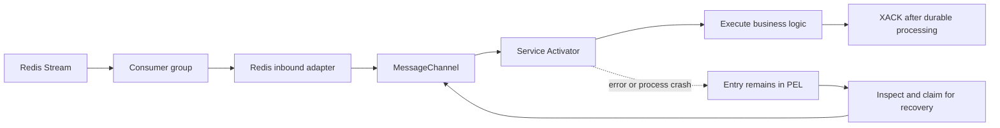

# Consumer groups and stream offsets

In the `SPRING_INTEGRATION_ADAPTERS` module, Redis Streams serves as a message source connected to Spring Integration via an inbound adapter. Consumer groups let multiple instances process one stream together; stream IDs, delivered progress, and the pending list govern which messages are re-read, which must be acknowledged, and which need recovery after failures.

When designing this flow, distinguish **delivered to a consumer** from **successfully processed**. Redis tracks these two states separately. Understanding this distinction prevents message loss during failures while keeping duplicate processing under control.

## Objectives

After this lesson, you will be able to:

- Explain stream ID, consumer group, consumer, last-delivered ID, and Pending Entries List (PEL).
- Create a consumer group, read new messages, and acknowledge messages using Redis Streams commands.
- Distinguish reading new messages from re-reading pending messages.
- Recover abandoned messages when a consumer stops unexpectedly.
- Design the inbound adapter, `MessageChannel`, and service handler in Spring Integration with an appropriate acknowledgment strategy.
- Select retry strategies, deduplication mechanisms, and lag monitoring for consumer groups.

## 1. Redis Streams concepts

A Redis Stream stores entries in order. Each entry has an ID and a set of field/value pairs. Redis normally generates IDs formatted as `<milliseconds>-<sequence>`, e.g., `1700000000000-0`. The first part typically represents a millisecond timestamp; the second disambiguates entries created within the same millisecond. The ID is an ordered identifier, not a contiguous sequence number like a Kafka partition offset.

One stream can have multiple consumer groups. Each group tracks its own reading progress, so two separate groups receive every entry independently. Within a single group, multiple consumers split new entries among themselves.

| Component | Meaning |
|---|---|
| Stream | Entry log, e.g. `orders` |
| Entry ID | Ordered identifier of one entry, e.g. `1700000000000-0` |
| Consumer group | Processing group with independent read progress, e.g. `order-workers` |
| Consumer | A member of a group, typically representing one application instance |
| Last-delivered ID | Highest ID delivered to the group so far |
| Pending Entries List (PEL) | List of entries delivered to consumers yet not acknowledged |
| Acknowledgment | Confirms an entry was processed; in Redis Streams this uses `XACK` |

**The last-delivered ID is not the position of the last successfully processed message.** When Redis hands an entry to a consumer, the group's delivery progress advances even while that entry still sits in the PEL. `XACK` removes the entry from the PEL; it neither deletes the entry from the stream nor erases stream IDs.

Picture a group in this state:

- Last-delivered ID is `105-0`.
- Entry `103-0` has been acknowledged.
- Entry `104-0` is pending on consumer `worker-01`.
- Entry `105-0` is pending on consumer `worker-02`.

The group has delivered up to `105-0`, yet two entries remain unacknowledged. Looking at last-delivered ID alone is therefore insufficient to conclude the system finished processing all messages.

## 2. How does a consumer group operate?

When a consumer reads new entries using the special ID `>`, Redis returns only entries never previously delivered to any consumer in that group. Redis updates delivery progress and records each delivered entry in the PEL under the receiving consumer.

After successful processing, the application acknowledges the entry. If a consumer stops before acknowledging, the entry remains in the PEL. Another consumer can take over that entry after an appropriate idle timeout.

Overall flow connecting Redis Streams with Spring Integration:



The inbound adapter receives entries from the stream and converts them into Spring Messages pushed onto a channel. A Service Activator or handler receives the payload and executes business work. Entry identity must be retained across the message or envelope so the system can acknowledge the right entry after completion.

In practice, exactly how the adapter reads and acknowledges messages depends on the Spring Integration version, Spring Data Redis version, and configured acknowledgment mode. Verify explicitly when the adapter auto-acknowledges versus when it delegates manual acknowledgment to the app. If the adapter acknowledges as soon as it submits a message to an asynchronous channel, a subsequent handler failure means the message was acknowledged too early. For flows demanding durable processing, tie acknowledgment to the business outcome, not merely channel handoff.

## 3. Creating a group, appending entries, and reading new messages

The examples below use stream `orders` and group `order-workers`.

Create the group from the beginning of the stream:

```redis
XGROUP CREATE orders order-workers 0-0 MKSTREAM
```

- `orders` is the stream name.
- `order-workers` is the consumer group.
- `0-0` tells the group to start from existing entries in the stream.
- `MKSTREAM` creates the stream if the key does not exist yet.

If the group should only receive entries appended after group creation, use `$` instead of `0-0`. This choice directly determines what initial data the group processes. When initializing applications repeatedly, treat an already-existing group (`BUSYGROUP`) as normal initialization rather than a fatal startup error.

Append an order event:

```redis
XADD orders * orderId 1001 status PAID
```

Redis returns the newly created entry's ID. Keep this ID to inspect pending entries or acknowledge the message.

Read up to 10 new entries, blocking at most 2 seconds:

```redis
XREADGROUP GROUP order-workers worker-01 COUNT 10 BLOCK 2000 STREAMS orders >
```

Here `worker-01` is the consumer name. The `>` symbol asks Redis for new entries never yet delivered to any consumer in the group. Once received, process each entry and acknowledge by its matching ID:

```redis
XACK orders order-workers 1700000000000-0
```

Replace the example ID with the actual ID returned by Redis. Multiple IDs can be acknowledged in a single `XACK` command. Acknowledge only entries that have satisfied your application's business completion rules.

## 4. Re-reading pending entries and understanding progress

There are two distinct reading needs:

1. **Reading new entries:** use `>`. Redis delivers only entries never delivered before in the group.
2. **Re-reading the current consumer's pending entries:** pass a concrete ID, typically starting at `0`, to `XREADGROUP`. Redis returns pending entries owned by the calling consumer.

Example re-reading pending entries for `worker-01`:

```redis
XREADGROUP GROUP order-workers worker-01 COUNT 10 STREAMS orders 0
```

This does not re-read the entire stream from scratch. It fetches pending entries currently assigned to `worker-01` itself. If a different consumer died and left pending entries behind, a new consumer will not receive them by reading `>`. You must inspect and transfer ownership of pending entries.

Useful inspection commands:

```redis
XINFO GROUPS orders
XINFO CONSUMERS orders order-workers
XPENDING orders order-workers
```

`XINFO GROUPS` reports group status, including last-delivered ID and lag metrics depending on Redis version. `XINFO CONSUMERS` reports per-consumer status in the group. `XPENDING` shows counts and metadata for unacknowledged entries. When investigating incidents, inspect delivery progress, pending counts, and per-consumer activity together; a lone last-delivered ID never tells the full processing story.

## 5. Recovering entries when a consumer fails

Suppose `worker-01` received an order event and stopped before acknowledging. The entry remains in the PEL assigned to `worker-01`. Without a recovery mechanism, the message stays stranded even though healthy consumers are running.

First, inspect pending entries:

```redis
XPENDING orders order-workers
```

To view details by ID range or consumer, use the extended `XPENDING` form. Once an entry has stayed idle long enough and its owning consumer is no longer processing it, transfer ownership to another consumer using `XAUTOCLAIM` (Redis 6.2+):

```redis
XAUTOCLAIM orders order-workers worker-02 60000 0-0 COUNT 10
```

This finds pending entries idle for at least 60,000 milliseconds and transfers eligible ones to `worker-02`. Output includes a cursor to continue scanning alongside the claimed entries. When processing many pending items, keep scanning from the returned cursor until the pass finishes.

Set the idle threshold longer than normal message processing time, factoring in load spikes and downstream dependency latencies. Too short a threshold lets a second worker claim an entry still running on a slow first worker. Too long delays recovery after real crashes. When claiming, systems must accept redelivery and handle duplicates safely.

## 6. Integrating consumer groups into Spring Integration

In an integration flow, the inbound adapter connects to the stream and consumer group, `MessageChannel` carries messages to processors, and the service handler executes business logic. When configuring, specify clearly:

| Configuration decision | What to define |
|---|---|
| Stream key | Stream name the adapter reads |
| Consumer group | Processing group sharing read progress |
| Consumer name | Unique name per active consumer in the group |
| Read behavior | Read new entries, read own pending entries, or run pending claiming |
| Batch size | Maximum entries fetched per read |
| Block/poll timeout | Wait timeout for new entries before cycling the read loop |
| Message conversion | How Redis fields/values map into payload and headers |
| Acknowledgment | When and which component invokes acknowledgment |
| Error handling | Retries, error channel, dead-letter stream routing, and alerts |

A consumer name should distinguish simultaneously running instances. Sharing one consumer name across multiple instances obscures pending tracking and entry ownership. In multi-instance deployments, derive consumer names from an identifier stable for the process's lifetime.

Watch the channel type. With a synchronous channel, the handler can finish on the calling thread before the adapter moves on, depending on adapter dispatch behavior. With an executor channel or async processing, the adapter only knows dispatch occurred, not that business work succeeded. Design acknowledgment around asynchronous boundaries—never assume sending to a `MessageChannel` means business execution completed.

Exact APIs and property names for the Redis Stream inbound adapter vary across library versions. Check your active Spring Integration and Spring Data Redis versions to select the right builder, endpoint type, read mode, and acknowledgment API. The Redis commands shown here describe Redis Streams behavior; they are not default Spring property names.

## 7. Retries, acknowledgment, and deduplication

Redis Streams consumer groups support message redelivery, yet do not create an atomic transaction across Redis and your business database. Two classic scenarios arise:

- **Business committed, then app crashes before `XACK`:** Redis keeps the entry in the PEL and can redeliver it. The handler sees the same entry again.
- **App calls `XACK` before business commits:** if the process dies after acknowledgment, the entry leaves the PEL even though business changes were never durably saved. The message can be lost from processing.

Thus the safe order is normally:

1. Receive entry and retain its stream ID.
2. Check or record a deduplication key.
3. Execute business changes and commit durable state.
4. Acknowledge the entry only after the business step succeeds.
5. If acknowledgment fails, accept future redelivery and let deduplication protect data integrity.

A common pattern stores `(stream key + entry ID)` in a `processed_event` table with a unique constraint inside the same transaction as business updates. On redelivery, the app detects the existing key, skips repeating side effects, and proceeds to acknowledge. If business logic calls external services, use idempotency keys or status reconciliation.

Never label this model exactly-once solely because it has consumer groups and `XACK`. In practice, designs target **at-least-once delivery paired with idempotent processing**. This makes clear that messages may arrive multiple times while correctness is enforced at the business layer.

For transient failures, apply bounded retries with backoff. For bad data or unrecoverable failures, record the entry and failure metadata to a dead-letter stream with attempt count and reason, then acknowledge the original entry per agreed policy. Writing to the dead-letter stream should itself be idempotent so crashing between writing to the DLQ and ACKing the original does not create duplicate error records.

## 8. Scaling consumers and processing order

Multiple consumers in the same group share new entries: each new entry goes to one consumer in the group. If multiple independent app groups all need every event, create a dedicated group for each—each group keeps its own progress and PEL.

Adding consumers increases throughput, yet does not preserve business completion order. Redis delivers entries in stream order; parallel handlers can finish in a different order. If events for one order must run sequentially, serialize by business key, route onto partitioned channels, or bound concurrency. To scale across independent lanes, shard data across multiple streams by business key or domain.

Large batch sizes improve read efficiency yet put more entries in flight and into the PEL if a worker crashes. Overly short block timeouts increase polling chatter; overly long timeouts delay shutdown responsiveness or state transitions. Tune values from real traffic, processing times, and recovery targets.

## 9. Retention and monitoring

Consumer groups only work while records remain in the stream long enough to process or recover. Trimming a stream too early leaves pending entries requiring investigation or replay without payloads. Retention policies must account for consumption speed, expected outage durations, oldest pending age, and replay needs. Never judge retention safety from current stream length alone.

Monitor at minimum:

- Pending entry count per group and age of the oldest pending entry.
- Group last-delivered ID and group lag when exposed by your Redis version.
- Active consumer count, abnormally idle consumers, and processing throughput.
- Rates of acknowledgments, retries, claims, and dead-lettering.
- End-to-end latency from entry append to business completion.

When a group falls behind, pinpoint whether the bottleneck sits in reading, channels, handlers, or downstream dependencies. Rising pending counts may stem from slow handlers, crashed consumers, repeated failures, or missed acknowledgments. A group whose last-delivered ID keeps advancing can still have a large backlog of unfinished pending entries.

## 10. Operational example: processing order events

Suppose payment events are written to stream `orders`, and Spring Integration forwards entries to an order-updating handler.

1. Create group `order-workers` from `0-0` if historical entries must be processed; handle already-existing groups cleanly.
2. Each app instance joins the group with a distinct consumer name.
3. The inbound adapter reads new entries and passes payloads with stream IDs onto the channel.
4. The service handler checks the deduplication key, updates the order in a transaction, and commits.
5. After business work succeeds, acknowledgment confirms the exact stream ID.
6. If an instance dies before acknowledging, the entry stays in the PEL. A recovery worker checks idle time and claims it onto a healthy consumer.
7. The handler receives the entry again, sees the event was already processed if the earlier transaction committed, and acknowledges it.
8. If an event fails persistently, write details to a dead-letter stream per retry policy and alert operators to investigate.

This workflow keeps the system moving after a consumer failure while containing the impact of duplicate deliveries.

## 11. Common pitfalls

| Symptom | Likely cause | What to check |
|---|---|---|
| Consumer skips pre-existing entries | Group created with ID `$` | Check group creation offset; consider creating a new group or running replay |
| Last-delivered ID advances yet pending stays high | Entries delivered but never acknowledged | Inspect `XPENDING`, handlers, and acknowledgment calls |
| New consumer misses dead consumer's pending entries | `>` reads only never-delivered entries | Run pending inspection and `XAUTOCLAIM` recovery |
| Same entry processed multiple times | Consumer crashed before `XACK` or entry reclaimed | Make handlers idempotent and tune idle thresholds |
| Failed entry disappears from processing | `XACK` executed before business commit | Move acknowledgment after durable business commits |
| Pending grows continuously | Slow handlers, recurring errors, or missing ACKs | Check processing latency, retries, error flows, and consumer health |
| Failed message written to DLQ multiple times | DLQ write and original ACK lack deduplication | Use stream ID as idempotency key for DLQ writes |

## 12. Production readiness checklist

- [ ] Explicit choice of starting group at `0-0` vs. `$` with full understanding of existing data impact.
- [ ] Every active consumer uses a distinguishable name.
- [ ] Verified exact acknowledgment timing on the active adapter version.
- [ ] Messages preserve stream ID across channels and handlers.
- [ ] Business logic enforces deduplication / idempotency.
- [ ] Pending entries have inspection, claiming, and retry procedures.
- [ ] Idle threshold matches real processing times.
- [ ] Dead-letter policy defined for errors that cannot retry forever.
- [ ] Retention spans outages, investigations, and replays.
- [ ] Alerts configured when pending counts, lag, or message age exceed thresholds.

## Conclusion

Consumer groups distribute new entries across consumers while tracking per-group delivery state. The last-delivered ID tracks delivery progress; the PEL tracks entries awaiting acknowledgment. In Spring Integration, the inbound adapter, `MessageChannel`, and service handler must coordinate acknowledgment so entries are confirmed only after durable business completion. Pairing pending recovery, idempotent processing, and lag monitoring yields a fault-tolerant, scalable Redis Streams pipeline.
