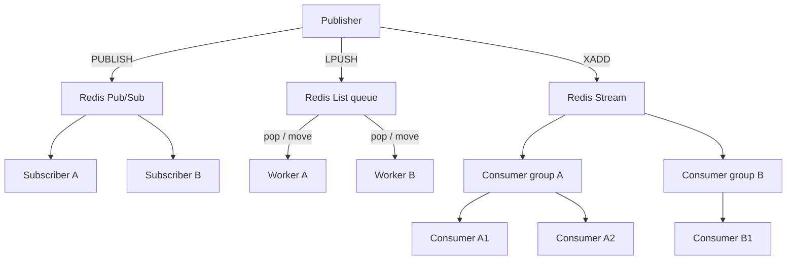
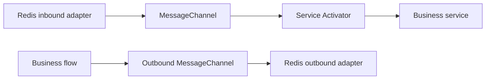

# Pub/Sub vs. queues and streams

In the `SPRING_INTEGRATION_ADAPTERS` module, Redis supports three common messaging patterns: Pub/Sub, List-based queues, and Streams. All three connect to Spring Integration via adapters, `MessageChannel`s, and handlers, yet they solve distinct problems. Pub/Sub broadcasts notifications to active subscribers; queues distribute tasks across competing consumers; Streams persist ordered entries and support consumer groups, pending lists, and acknowledgments.

Choosing the wrong model leads to dropped notifications when subscribers disconnect, stranded work after worker crashes, or an inability to replay events. This lesson compares delivery semantics, persistence, error handling, and how each model integrates into a Spring Integration flow.

## Objectives

After this lesson, you will be able to:

- Distinguish Redis Pub/Sub, List queues, and Redis Streams by how they store and deliver messages.
- Pick the right model for real-time notifications, background jobs, or replayable event streams.
- Explain fan-out, competing consumers, acknowledgments, pending entries, and retention.
- Recognize risks of message loss, duplicate deliveries, and out-of-order processing.
- Connect each model to Spring Integration using inbound/outbound adapters and `MessageChannel`s.
- Design retries, deduplication, monitoring, and recovery when consumers fail.

## 1. Three models solving three different needs

### Pub/Sub: broadcasting notifications to online subscribers

Redis Pub/Sub uses channels where publishers emit messages. Every subscriber listening on that channel receives the message. Subscribers can subscribe to an exact channel or a channel pattern.

Example:

```redis
SUBSCRIBE order-events
```

From another client, the publisher runs:

```redis
PUBLISH order-events '{"orderId":1001,"status":"PAID"}'
```

If three subscribers listen to `order-events`, all three receive the notification. The publisher does not target a single worker to execute a job. This is a fan-out model: one publish yields multiple deliveries across subscribers.

Pub/Sub does not store messages for subscribers to read later. If a subscriber is disconnected when a message is published, it misses that message. The integer returned by `PUBLISH` reports how many subscribers the server counted receiving the message—not how many finished business processing. Pub/Sub has no per-message acknowledgment, pending list, or built-in replay.

Therefore, Pub/Sub fits time-sensitive signals that matter right now—such as live status updates, UI refreshes, cache invalidations, or wake-up signals. If subscribers must receive every single event reliably, bare Pub/Sub does not meet that requirement.

### Queue: distributing a single task to one consumer

Queues typically use a Redis List. Producers push work items onto the list; workers read from the list. When one worker pops an element, that element leaves the queue. Each task goes to a single worker among competing consumers.

Example using `LPUSH` to enqueue and `BRPOP` to pop from the opposite end of the list:

```redis
LPUSH order:queue '{"taskId":"task-1001","orderId":1001}'
BRPOP order:queue 0
```

Pairing `LPUSH` and `BRPOP` like this yields FIFO pop order for items added to the same list. Workers wait via blocking pop, avoiding busy polling when the queue is empty.

However, popping removes the element immediately upon handing it to a worker. If the worker crashes after popping but before saving its result, the task is gone from the queue. A Redis List stores data under a key, yet popping is a destructive consumption step. Recoverability across Redis restarts also depends on persistence and replication setup.

You can build a more reliable queue by atomically moving work from a ready list to a processing list. Workers acknowledge by removing the item from the processing list upon completion. This requires an additional recovery mechanism to detect abandoned tasks and return them to the queue. Redis Lists do not provide consumer groups, pending entry lists, or lease timeouts natively as part of the queue primitive.

### Stream: persisting an event log and tracking consumer progress

Redis Streams append entries to a stream, each with an ID and field/value pairs. Producers append via `XADD`. Consumers can read independently; with consumer groups, multiple consumers split new entries while Redis tracks delivered-but-unacknowledged entries.

Example:

```redis
XADD orders * orderId 1001 status PAID
XGROUP CREATE orders order-workers 0-0 MKSTREAM
XREADGROUP GROUP order-workers worker-01 COUNT 10 BLOCK 2000 STREAMS orders >
XACK orders order-workers 1700000000000-0
```

The ID in `XACK` must match the actual ID of the received entry. Entries remain in the stream according to retention policy. When a consumer group delivers an entry, it is recorded in the Pending Entries List (PEL). After business completion, the consumer acknowledges via `XACK`. If the consumer crashes beforehand, the entry stays pending so it can be re-read or claimed by another consumer.

One stream can serve multiple independent consumer groups. Each group tracks its own progress and receives every entry. This works well when multiple systems process the same event stream—for instance, one group updating orders, another updating reports, and a third sending notifications.

## 2. Direct comparison

| Criterion | Pub/Sub | List queue | Stream |
|---|---|---|---|
| Delivery style | Fan-out to active subscribers | One worker pops one item | Independent readers or work-sharing inside a group |
| Message retention | Not retained for later reading | Kept in List until popped/deleted | Kept until deleted or trimmed |
| Offline subscriber/consumer | Misses messages | Work remains in queue if unpopped | Entries stay in stream; group tracks progress |
| Acknowledgment | None per message | Must build manually via processing list or custom store | Native `XACK` and PEL inside consumer groups |
| Replay | Unsupported | Needs separate copy or custom design | Re-readable by ID or via a separate group |
| Worker load sharing | Not its purpose; every subscriber gets a copy | Workers compete to pop items | Consumers in the same group split entries |
| Multiple apps each receiving all events | Each app subscribes while online | Usually needs one queue per app | Create a separate group per app |
| Progress tracking | No processing progress | Application tracks state | Last-delivered ID, PEL, and group metadata |
| Crash recovery | No stored message to recover | Needs processing list and reaper | Pending entries can be claimed |
| Best suited for | Ephemeral real-time notifications | Simple background tasks | Event processing needing ACK, replay, and multiple groups |

Never assume Streams automatically guarantee zero data loss across every failure. Entries stay in a stream until deleted or trimmed, yet durability during Redis failures still depends on AOF/RDB configuration, replication, failover, and operational policies. Similarly, List queues recover popped tasks only when the application builds state tracking and recovery properly.

## 3. Visualizing delivery flows



In Pub/Sub, A and B both receive the same notification while subscribed. In a queue, A and B compete to take distinct tasks. In a Stream, consumers A1 and A2 share progress inside group A, while group B maintains independent progress and also receives the stream's entries.

A `MessageChannel` inside Spring Integration is only an internal in-app handoff point. It never turns Pub/Sub into a durable queue or turns a List queue into a Stream. Storage and delivery semantics remain governed by Redis and the adapter.

## 4. Redis Pub/Sub: fan-out and delivery limits

A publisher sends a message to a channel:

```redis
PUBLISH inventory.changed '{"sku":"SKU-01","quantity":12}'
```

Subscribers can listen on an exact channel:

```redis
SUBSCRIBE inventory.changed
```

Or subscribe by pattern:

```redis
PSUBSCRIBE inventory.*
```

Messages sent to matching channels are delivered to active subscribers. Pattern subscriptions are handy when many channels follow a naming convention, yet patterns must be managed carefully to avoid delivering unintended duplicates when a client subscribes to both an exact channel and an overlapping pattern.

Key characteristics to remember:

- **Fan-out:** every active subscriber on the channel receives the notification.
- **No backlog:** reconnecting subscribers do not receive messages emitted while offline.
- **No business ACK:** the publisher cannot tell whether subscribers committed data or finished work.
- **No ID-based replay:** Pub/Sub keeps no message log for consumers to re-read.
- **Throughput and latency:** suited for lightweight signals distributed rapidly to online components.

For example, when a product price changes, an app can publish `product.price.changed` so instances refresh caches. If an instance misses the notification, it reloads from the primary data source on startup or cache expiry. This works whenever caches can be rebuilt. If notifications represent mandatory transactions, use a queue or Stream and keep Pub/Sub as a secondary hint.

## 5. Redis List queues: competing consumers and job processing

With queues, multiple workers listen on one list. Redis hands each element to one worker via pop. Align push and pop ends to preserve FIFO order.

A simple queue:

```redis
LPUSH email:queue '{"taskId":"mail-001","to":"user@example.test"}'
BRPOP email:queue 0
```

The blocking pop waits indefinitely while the queue is empty. Applications need a clean shutdown strategy so workers exit gracefully and handle connection errors.

### Moving to a processing list pattern

To reduce job-loss risk when a worker dies after popping, atomically move items from the ready queue to a processing list via `BLMOVE` (Redis 6.2+):

```redis
LPUSH email:queue '{"taskId":"mail-001","to":"user@example.test"}'
BLMOVE email:queue email:processing RIGHT LEFT 0
```

Once finished, the worker acknowledges by removing the matching element:

```redis
LREM email:processing 1 '{"taskId":"mail-001","to":"user@example.test"}'
```

On older Redis versions, `BRPOPLPUSH` is the common blocking command for moving elements between two lists; it was deprecated in Redis 6.2 in favor of `BLMOVE`.

This pattern introduces an explicit intermediate state: the element left the ready queue and resides in processing. Even so, Redis does not know if the worker is still alive. If a worker crashes after moving an item, the task stays in `processing`. A recovery process must detect overdue tasks and return them to the ready queue or route them to error handling.

A plain processing list does not store start timestamps, lease owners, or attempt counts in structured form. Production designs typically track metadata separately by task ID—such as a hash for status and a sorted set for deadlines. When claiming or requeuing, use appropriate atomic operations (transactions or Lua scripts) so two workers cannot claim one task simultaneously.

Embed a unique task ID in payloads. Deleting solely by identical payload causes `LREM` to remove the wrong entry if two tasks share identical content. Handlers must also be idempotent because a worker may commit business work yet crash before removing the task from `processing`, causing redelivery.

## 6. Redis Streams: consumer groups, pending entries, and replay

Streams fit when messages are both tasks to process and events that must be retained for a window. Producers append entries:

```redis
XADD orders * orderId 1001 status PAID
```

Create a consumer group:

```redis
XGROUP CREATE orders order-workers 0-0 MKSTREAM
```

`0-0` tells the group to start from existing entries. To receive only entries added after group creation, use `$`. This choice determines whether the group processes historical data already sitting in the stream. During repeated app initialization, handle existing-group responses (`BUSYGROUP`) gracefully.

Read new entries:

```redis
XREADGROUP GROUP order-workers worker-01 COUNT 10 BLOCK 2000 STREAMS orders >
```

The `>` symbol tells Redis to deliver entries never yet given to any consumer in the group. Delivered-but-unacknowledged entries sit in the PEL. After business completion:

```redis
XACK orders order-workers 1700000000000-0
```

Another consumer group, such as `billing-reporters`, can read the exact same stream independently:

```redis
XGROUP CREATE orders billing-reporters 0-0 MKSTREAM
```

Each group keeps independent progress. Group A acknowledging an entry does not remove it for group B. Still, entries can be deleted or trimmed by retention policies, so long-term replay windows must be sized upfront.

### Pending entries and recovery

If a consumer receives an entry and crashes before `XACK`, the entry stays in the PEL. Inspect with:

```redis
XPENDING orders order-workers
XINFO GROUPS orders
XINFO CONSUMERS orders order-workers
```

A running consumer can re-read its own pending entries using a concrete ID instead of `>`. To transfer pending entries from an old consumer to a healthy one, use `XAUTOCLAIM` (Redis 6.2+):

```redis
XAUTOCLAIM orders order-workers worker-02 60000 0-0 COUNT 10
```

`60000` is the minimum idle time in milliseconds. Pick a threshold comfortably longer than normal processing duration—too short allows claiming work still running on a slow consumer. Once claimed, entries may be reprocessed, so handlers must handle duplicates safely.

### Replay and retention

A new group can read retained entries starting from a chosen ID. An existing group can also re-read from an ID during controlled replays. Replay cannot recover entries already deleted or trimmed. Retention policies must balance Redis RAM against outage, investigation, and replay windows.

Stream IDs are ordered, yet are not contiguous sequence numbers like Kafka partition offsets. IDs normally take the form `<milliseconds>-<sequence>`. Never manually increment IDs or assume the gap between two IDs indicates how many messages were missed.

## 7. Connecting with Spring Integration

Spring Integration integrates Redis structures using inbound adapters, outbound adapters, or endpoints tailored to each structure. An outbound adapter receives Spring Messages from a channel and sends data to Redis. An inbound adapter listens, polls, or reads from Redis and emits Spring Messages onto a channel.

| Redis model | Outbound role | Inbound role | Key considerations |
|---|---|---|---|
| Pub/Sub | Publishes messages to a Redis channel | Subscribes to channels/patterns and emits messages into flow | No backlog or acknowledgment |
| List queue | Pushes tasks onto a list | Waits/polls list and converts tasks to messages | Requires pop, processing, ACK, and recovery conventions |
| Stream | Appends entries equivalent to `XADD` | Reads stream, typically via consumer groups | Requires managing groups, consumers, pending entries, and ACKs |

Exact class names, builders, and properties evolve across Spring Integration and Spring Data Redis versions. Always check your project's library version when picking adapters or message sources rather than mechanically mapping Redis commands to Spring property names.

### `MessageChannel` is the internal contract

A typical flow looks like:



Payloads should represent business data, while headers carry transport metadata like channel, stream key, stream ID, consumer group, correlation ID, or receive timestamp. For queues and Streams, preserve task IDs / entry IDs throughout the flow so handlers or acknowledgment steps know exactly which message to ACK.

Choose the channel matching your execution semantics:

- `DirectChannel` dispatches synchronously to subscribers on the calling thread, allowing synchronous error visibility depending on adapter ACK mode.
- `QueueChannel` buffers messages in application memory for a consumer to poll later; it does not replace Redis persistence and loses buffered items if the process crashes.
- Executor-backed channels process asynchronously; outbound channel send succeeding does not mean business logic committed.

For Streams or queues requiring post-commit acknowledgment, verify whether the adapter supports manual acknowledgment and exposes the callback to handlers. If an adapter auto-acknowledges immediately upon sending into an async channel, handlers can fail after the entry was already acknowledged. Configure or structure endpoints so acknowledgment binds to actual business completion.

### Message conversion and error handling

Redis Pub/Sub typically carries bytes/strings; Lists hold elements; Streams carry entry IDs plus field/value pairs. Adapters must translate these into consistent Spring Message payloads. Define serializers, encodings, schemas, and handling for missing or invalid fields. Never assume every producer sends identical formats just because they share a channel or stream.

Error channels capture exceptions raised inside an integration flow. For transient failures, apply bounded retries with backoff; for unrecoverable data errors, write failure records to a dead-letter queue or dead-letter stream. Preserve source IDs, attempt counts, failure reasons, and timestamps for reconciliation. Writing to a DLQ and acknowledging the original message should also be idempotent in case the app stops between the two steps.

## 8. Delivery semantics and business correctness

The three models deliver different guarantees:

- **Pub/Sub:** messages reach currently online subscribers with no business acknowledgment and no replay. Offline subscribers miss messages.
- **Simple List queue:** popping delivers a message and deletes it from the queue. If the worker crashes post-pop, work is lost. Processing-list patterns mitigate this yet require application-built recovery.
- **Stream consumer group:** delivered-but-unACKed entries remain in the PEL and can be redelivered. Paired with retries and recovery, this provides at-least-once delivery.

None of the three creates an atomic transaction across Redis and a business database. For example, if a handler commits an order update and crashes before `XACK`, the Stream can redeliver the entry. Conversely, calling `XACK` before committing lets the entry leave the PEL while business state wasn't saved.

A practical strategy:

1. Preserve a unique message identifier (task ID or stream ID).
2. Check deduplication keys or record the message in a processing table.
3. Apply business updates and commit durable state.
4. Acknowledge or remove from processing only after business success.
5. If acknowledgment fails, allow redelivery and rely on idempotency to avoid repeated side effects.

With relational databases, store `(source + messageId)` in a `processed_message` table with a unique constraint inside the business transaction. For external API calls, pass idempotency keys or reconcile status. Never call this exactly-once merely because `XACK` exists; correctness relies on at-least-once delivery paired with idempotent processing.

## 9. Choosing a model by requirement

| Requirement | Typical best fit | Reason |
|---|---|---|
| Instant signals to online instances | Pub/Sub | Simple fan-out, low latency |
| Cache invalidation hints rebuildable if missed | Pub/Sub | Caches can reload from primary source |
| Handing one task to one worker in a pool | List queue or Stream group | Supports competing consumers |
| Tasks requiring acknowledgments and crash recovery | Stream group | PEL, `XACK`, pending claiming |
| Multiple apps independently reading every event | Stream with separate groups | Independent progress per group |
| Replaying retained historical events | Stream | Entry IDs and positional re-reads |
| Small, simple queue without history where custom recovery is acceptable | List queue | Minimal structure and fewer concepts |
| Events must not be dropped while subscribers are offline | Stream or durable queue | Pub/Sub maintains no backlog |

Quick rule of thumb:

- If messages are ephemeral signals for active components and can be missed, pick Pub/Sub.
- If messages are tasks for a single worker to execute, pick a queue.
- If you need an event log, multiple consumer groups, acknowledgments, recovery, and replay, pick Streams.
- When requirements exceed Redis's scope (multi-month retention, massive partitioning, cross-organization event logs), evaluate dedicated message brokers or event-streaming platforms.

## 10. Design example: order payment events

Suppose a system emits `OrderPaid` after payment succeeds. Three consumers react: updating the admin UI, sending an email, and updating reports.

**Using Pub/Sub:** the publisher emits `order.paid`. Online admin UI instances update live. Offline instances reload state from APIs on reconnect. This suits UI live-updates, yet must not be the sole mechanism guaranteeing emails and reports run.

**Using a single queue:** the publisher pushes one task to a queue; competing workers pop tasks. If one queue serves both email and reporting, only one worker gets each task, so both workflows won't receive every event. To deliver copies to both, create separate queues or fan out before enqueueing.

**Using Streams:** the publisher appends one entry to `orders`. Group `email-workers` sends emails, `report-workers` updates reports, and `admin-notifications` triggers alerts. Each group tracks independent progress; failures in one group never stall others. The email worker calls `XACK` after the email provider accepts the request and state is recorded. Because email sending is an external side effect that can repeat, enforce an idempotency key or reconciliation if the worker dies before `XACK`.

In practice, models combine cleanly: a Stream handles durable event processing, and once processed, a component emits a Pub/Sub hint notifying open UIs of fresh data. Here Pub/Sub acts purely as a refresh signal while primary data remains queryable.

## 11. Operations and monitoring

Key metrics vary by model:

| Model | Metrics / checks |
|---|---|
| Pub/Sub | Subscriber count, publish rate, app-side processing latency, subscriber reconnect count |
| List queue | Queue length, oldest task age, processing count, overdue tasks, retries, and dead-letters |
| Stream | Group lag (where supported), pending count, oldest pending age, consumer idle time, ACK and claim rates |

With Pub/Sub, Redis has no backlog to count missed messages. To verify subscribers processed everything, emit heartbeats, persist state, or reconcile from a durable store.

With List queues, low queue length does not guarantee health: tasks may be stuck in the processing list. Monitor ready length, processing length, and task age. Reapers must cap retries so permanently broken tasks do not loop endlessly.

With Streams, growing pending counts signal slow handlers, dead consumers, recurring failures, or missed acknowledgments. Monitor last-delivered ID, PEL size, and per-consumer status. Size trim policies to cover expected outages, investigations, and replays.

Across all three models, monitor Redis memory, persistence, replication, client connections, timeouts, and resource limits. Redis storage settings never replace application-level retries and deduplication.

## 12. Common pitfalls

| Symptom | Cause | Mitigation |
|---|---|---|
| Reconnected subscriber misses messages | Pub/Sub retains no backlog | Switch to Streams/queues if zero loss is required, or reload from primary source |
| Multiple subscribers all process the same notification | Pub/Sub fans out to every subscriber | Expected behavior; for single-worker execution, use a queue or Stream group |
| Publisher thinks work succeeded because `PUBLISH` returned > 0 | Return value counts receiving subscribers, not business ACKs | Track processing outcomes separately |
| Tasks vanish when a worker stops | Worker used destructive pop | Use a processing list, leases, and reaper, or migrate to Streams |
| Task processed twice | Worker committed business work before ACKing/removing task | Add task IDs and idempotent handlers |
| Tasks stay stuck in processing forever | No recovery process running | Monitor deadlines and requeue or DLQ cleanly |
| New worker misses old worker's pending entries in Stream | Reading `>` fetches only never-delivered entries | Inspect PEL and claim pending entries |
| Stream group lag or pending count grows | Slow consumers, handler errors, or missing ACKs | Scale capacity, fix bugs, tune batches, and monitor claims |
| Duplicate emails or business updates | Message redelivered after failure | Use idempotency keys or a processed-message table |

## 13. Pre-deployment checklist

- [ ] Determined whether messages are ephemeral signals, single-worker tasks, or replayable events.
- [ ] Clarified whether offline subscribers are allowed to miss messages.
- [ ] Decided whether one message fans out to every app or goes to a single consumer.
- [ ] For List queues, implemented processing state, timeouts, a reaper, and retry policies.
- [ ] For Streams, defined group start ID, consumer names, acknowledgment timing, and retention.
- [ ] Messages preserve task IDs or stream IDs across `MessageChannel`s and handlers.
- [ ] Verified exact ACK timing for your Redis adapter version and channel type.
- [ ] Business logic enforces idempotency on redelivery.
- [ ] Error flows, dead-lettering, and alerts cover non-retryable failures.
- [ ] Verified Redis persistence, replication, and resource limits against data durability goals.

## Conclusion

Pub/Sub provides fan-out to online subscribers; Redis Lists build competing-consumer queues; Redis Streams offer an entry log with consumer groups, pending tracking, and acknowledgments. Pick a model based on whether messages must be retained, delivered to one or many consumers, acknowledged, recovered, and replayed. In Spring Integration, inbound/outbound adapters and `MessageChannel`s bridge these models into business flows, while retry correctness still depends on timely acknowledgments and idempotent processing.
