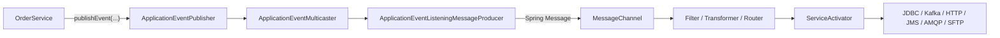
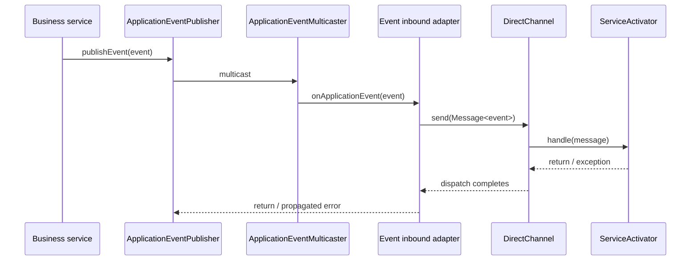
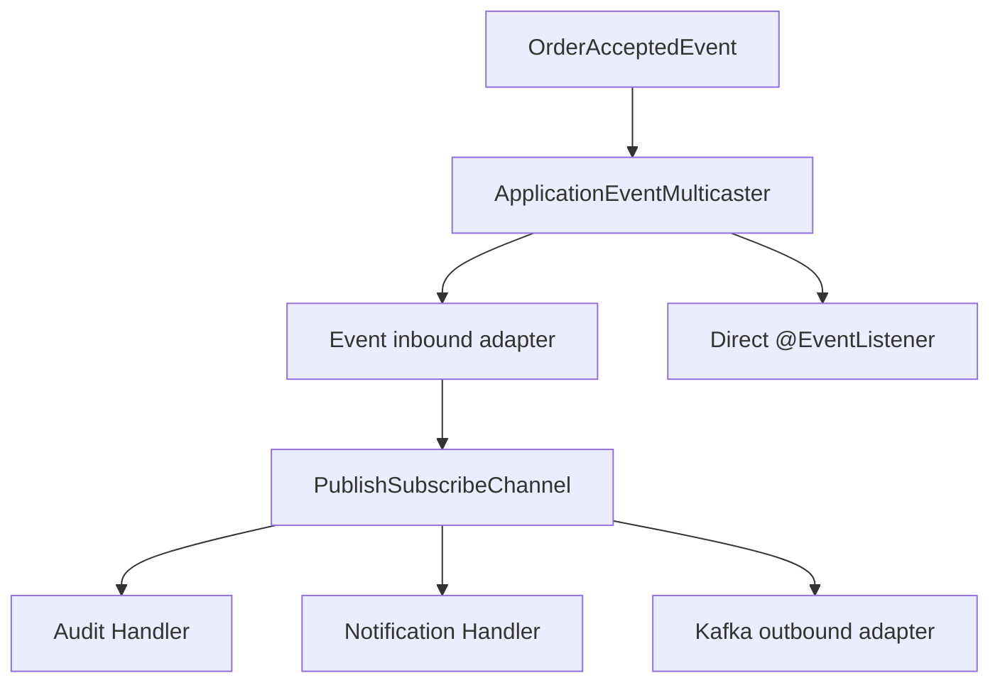
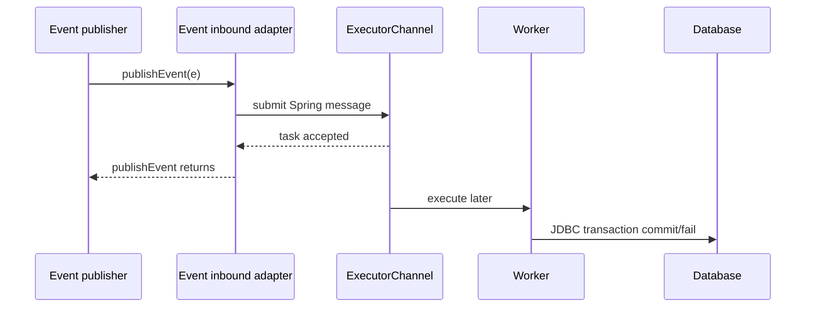
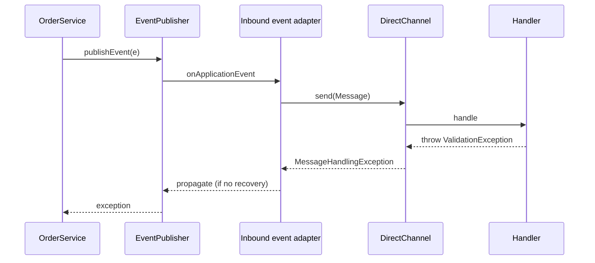
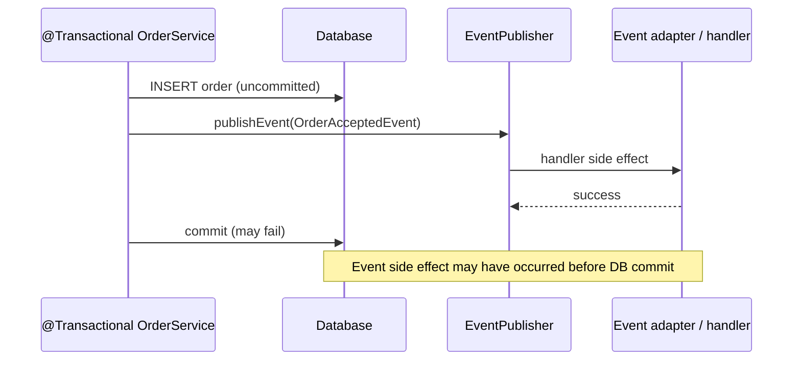
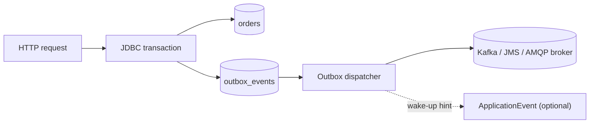
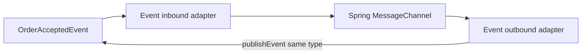

# Receiving Spring ApplicationEvents with an Adapter

**Spring `ApplicationEvent`** is the mechanism for publishing notifications between components within a Spring `ApplicationContext`. The **Spring Integration Event Inbound Adapter** receives those notifications and converts them into a `Message<?>` sent to a `MessageChannel`, from which you can use filters, transformers, routers, service activators, and outbound adapters. The primary class is **`ApplicationEventListeningMessageProducer`**.

This lesson belongs to the **Event Adapter** chapter of the **SPRING_INTEGRATION_ADAPTERS** module. The module focuses on connecting external systems using inbound/outbound adapters, gateways, pollers, and `MessageChannel`; practicing with files, SFTP, HTTP, JMS, AMQP, Kafka, and databases, including message contracts, errors, and lifecycle. Specifically, this lesson focuses on **internal Spring event sources**, not a message broker outside the JVM.

> **Remember:** `ApplicationEventListeningMessageProducer` is **inbound** because it emits a **Spring Integration message** into an output channel. It does **not** automatically send to Kafka/JMS/AMQP, does not durably store events, and does not replay events after a JVM crash.

## 1. Learning Objectives

After this lesson, you will be able to:

1. Distinguish between `ApplicationEvent`, `ApplicationEventPublisher`, `ApplicationEventMulticaster`, `ApplicationListener`, and Spring `Message<?>`.
2. Trace the path `publishEvent(...) → ApplicationEventListeningMessageProducer → MessageChannel → MessageHandler`.
3. Add the `spring-integration-event` dependency and configure an event inbound adapter in Java.
4. Use `setEventTypes(...)` to receive only intended events.
5. Explain the three payload creation branches: standard `ApplicationEvent`, `PayloadApplicationEvent`, and an event with a `Message` as its source.
6. Use `setPayloadExpressionString(...)` to extract data via SpEL.
7. Build a Spring Boot demo that publishes `OrderAcceptedEvent` and receives it in a `@ServiceActivator`.
8. Configure Java DSL or the `int-event` XML namespace as an alternative to plain Java beans.
9. Compare `DirectChannel`, `PublishSubscribeChannel`, `ExecutorChannel`, and `QueueChannel`.
10. Analyze synchronous errors, `errorChannel`, retries, swallowed errors, and business completion.
11. Avoid confusing event publication with JDBC transaction commit; use `@TransactionalEventListener` or an outbox within the right scope.
12. Test routing, payload conversion, event loops, startup/shutdown, and production design when crossing process boundaries.

## 2. The Problem: Internal Domain Events Entering an Integration Flow

Suppose `OrderService` accepts an order and then needs to send an audit record, call HTTP, publish to Kafka, or write a file. If it directly invokes every adapter, the service becomes tightly coupled to each technology. You can publish a **Spring application event** to decouple notification creation from the processing branches.



All components up to an outbound adapter can reside within the **same JVM**. Receiving an application event does not mean a message has been persisted in Kafka or a database.

### 2.1. Distinguishing the Components

| Component | Role | Not |
|---|---|---|
| `ApplicationEventPublisher` | Publishes events to the Spring context | A Kafka producer |
| `ApplicationEvent` | Object representing a Spring event | Automatically a Spring Integration message |
| `PayloadApplicationEvent<T>` | Wrapper for a published POJO/record | A durable envelope |
| `ApplicationEventMulticaster` | Dispatches events to Spring listeners | A durable broker |
| `GenericApplicationListener` | Listener contract that can filter by type | A Spring `PollableChannel` |
| **`ApplicationEventListeningMessageProducer`** | Inbound event → Spring message output | An outbound event publisher |
| `MessageChannel` | Connects Integration endpoints | A Kafka topic |
| `@ServiceActivator` | Processes messages from a channel | `@EventListener` |
| `ApplicationEventPublishingMessageHandler` | Spring message → Spring application event | An inbound adapter |

### 2.2. When Do You Need an Event Adapter?

Use an event adapter if your application has a Spring Integration flow and wants built-in support for:

- Message routing/filtering/transformation, enrichment, and correlation.
- An event-driven consumer on a `SubscribableChannel`.
- One audit branch and one branch forwarding events to a broker.
- Error channels/metrics/test channels in the Spring Messaging style.
- Swapping downstream transports without changing the `publishEvent(...)` API of the business service.

If you only have a single method reacting to a very simple event, a direct `@EventListener` usually requires less configuration.

## 3. How Do ApplicationEvent and Spring Message Differ?

`ApplicationEvent` belongs to Spring Framework; Spring Integration uses `Message<T>` from Spring Messaging.

```text
ApplicationEvent
  source: Object
  timestamp: long
  domain-specific fields: eventId, orderId, version,...

Spring Message<T>
  payload: T
  headers: MessageHeaders
    id
    timestamp
    custom metadata
```

| Property | Spring event | Spring Integration message |
|---|---|---|
| Purpose | Broadcast events within the context | Pass payload/headers through a flow |
| Default routing | Select `ApplicationListener` by event type | Select channel subscriber/flow endpoint |
| Metadata | `source`, timestamp, domain fields | Message headers + payload |
| Execution | Multicaster can be sync/async | Channel can be sync/async/queue |
| Replay after crash | Not built-in | Depends on configured storage/transport |
| Transaction | Does not automatically wait for DB commit | Does not automatically create a distributed transaction |
| Broker offset/ack | No | Only when connected to a specific Kafka/JMS/AMQP adapter |

Do not use `MessageHeaders.ID` as a business event ID. An event re-converted into a Spring message may receive a different message ID. Generate an independent business `eventId` for idempotency.

### 3.1. Spring Framework Allows Publishing POJOs/Records

`ApplicationEventPublisher` has overloads:

```java
void publishEvent(ApplicationEvent event);
void publishEvent(Object event);
```

When publishing an object that does not extend `ApplicationEvent`, Spring can wrap it in a `PayloadApplicationEvent<T>`. The adapter receives the payload event and typically converts the **original payload** into the Spring message payload.

## 4. How Does ApplicationEventListeningMessageProducer Work?

Full class name: `org.springframework.integration.event.inbound.ApplicationEventListeningMessageProducer`. It implements `GenericApplicationListener`, extends `ExpressionMessageProducerSupport`, and sends a Spring message to the output channel when a matching event arrives.



This path describes a **synchronous multicaster + DirectChannel**. With an `ExecutorChannel` or a multicaster using a `TaskExecutor`, the publisher may complete before the handler does.

### 4.1. This Is a Push Listener, Not a Poller

File/SFTP/JDBC inbound adapters typically retrieve data using a poller. The event inbound adapter receives a **callback from ApplicationEventMulticaster**, so it is not `MessageSource.receive()`:

```text
Spring event: publish -> listener callback -> MessageChannel
File polling: scheduler -> MessageSource.receive() -> MessageChannel
```

Do not design a `@Poller` just for the adapter to receive Spring ApplicationEvents.

### 4.2. Lifecycle and Application Context

The adapter is a Spring-managed bean. It can receive events while the context is alive and the listener is registered. Events published **before the adapter is ready** or after the context closes may not be received. Lifecycle events such as `ContextRefreshedEvent` can also be emitted by the multicaster; filter types to avoid mismatched payloads.

**`ApplicationEvent` has no default durable buffer.** Even though the adapter implements Spring lifecycle, starting/stopping it does not turn it into a broker with retained messages.

## 5. Dependencies and Environment Configuration

This feature belongs to the `spring-integration-event` module. With Spring Boot, use the compatible BOM:

```xml
<dependencies>
    <dependency>
        <groupId>org.springframework.boot</groupId>
        <artifactId>spring-boot-starter-integration</artifactId>
    </dependency>
    <dependency>
        <groupId>org.springframework.integration</groupId>
        <artifactId>spring-integration-event</artifactId>
    </dependency>
</dependencies>
```

Do not manually pin a `spring-integration-event` version that diverges from `spring-integration-core` managed by the Boot BOM. The Java demo uses Java 17+ and common class APIs in Spring Integration 6.x/7.x; check the exact BOM/Javadoc for production.

Key imports:

```java
import org.springframework.context.ApplicationEvent;
import org.springframework.context.ApplicationEventPublisher;
import org.springframework.integration.event.inbound.ApplicationEventListeningMessageProducer;
import org.springframework.integration.channel.DirectChannel;
import org.springframework.integration.annotation.ServiceActivator;
import org.springframework.messaging.Message;
import org.springframework.messaging.MessageChannel;
```

**Class name warning:** The reverse outbound direction uses `org.springframework.integration.event.outbound.ApplicationEventPublishingMessageHandler`, not `ApplicationEventListeningMessageProducer`.

## 6. Complete Spring Boot Example: OrderAcceptedEvent

Design:

```text
OrderApplicationService.accept(orderId)
  -> ApplicationEventPublisher.publishEvent(OrderAcceptedEvent)
  -> ApplicationEventListeningMessageProducer
       setEventTypes(OrderAcceptedEvent.class)
  -> DirectChannel("ordersEventChannel")
  -> OrderEventHandler @ServiceActivator
```

The demo does not require a Kafka broker, JDBC, or external services, because it only observes the step of **receiving an ApplicationEvent as a Spring Message**.

### 6.1. Event Class: OrderAcceptedEvent.java

```java
package com.example.events;

import java.util.Objects;
import org.springframework.context.ApplicationEvent;

public final class OrderAcceptedEvent extends ApplicationEvent {
    private final String eventId;
    private final String orderId;

    public OrderAcceptedEvent(
            Object source, String eventId, String orderId) {
        super(source);
        this.eventId = Objects.requireNonNull(eventId, "eventId");
        this.orderId = Objects.requireNonNull(orderId, "orderId");
    }

    public String getEventId() {
        return eventId;
    }

    public String getOrderId() {
        return orderId;
    }
}
```

`source` must be non-null; this example uses a business service as the source. Do **not** serialize the entire `source` object to send over Kafka/HTTP; `source` may hold a Spring bean, transaction state, or unsafe references.

### 6.2. Adapter Bean and Output Channel: EventInboundConfig.java

```java
package com.example.events;

import org.springframework.beans.factory.annotation.Qualifier;
import org.springframework.context.annotation.Bean;
import org.springframework.context.annotation.Configuration;
import org.springframework.integration.channel.DirectChannel;
import org.springframework.integration.config.EnableIntegration;
import org.springframework.integration.event.inbound.ApplicationEventListeningMessageProducer;
import org.springframework.messaging.MessageChannel;

@Configuration
@EnableIntegration
public class EventInboundConfig {

    @Bean("ordersEventChannel")
    public MessageChannel ordersEventChannel() {
        return new DirectChannel();
    }

    @Bean("ordersEventInboundAdapter")
    public ApplicationEventListeningMessageProducer ordersEventAdapter(
            @Qualifier("ordersEventChannel") MessageChannel channel) {

        ApplicationEventListeningMessageProducer adapter =
                new ApplicationEventListeningMessageProducer();

        // Receive only the target domain event.
        adapter.setEventTypes(OrderAcceptedEvent.class);
        adapter.setOutputChannel(channel);
        return adapter;
    }
}
```

Key points:

1. `@EnableIntegration` activates Spring Integration infrastructure in a manually configured context.
2. `ordersEventChannel` is the **output channel of the inbound adapter**, not a broker topic.
3. `setEventTypes(...)` acts as an allowlist to exclude context lifecycle events.
4. `DirectChannel` dispatches synchronously to the handler on the caller thread.
5. An event can still be received directly by other `@EventListener`s; the adapter does not take exclusive ownership of the event.
6. Registering two adapters listening to `OrderAcceptedEvent` can produce two Spring messages; fan-out must be designed intentionally.

### 6.3. Handler: OrderEventHandler.java

```java
package com.example.events;

import org.springframework.integration.annotation.ServiceActivator;
import org.springframework.messaging.Message;
import org.springframework.stereotype.Component;

@Component
public class OrderEventHandler {

    @ServiceActivator(inputChannel = "ordersEventChannel")
    public void handle(Message<OrderAcceptedEvent> message) {
        OrderAcceptedEvent event = message.getPayload();

        if (event.getOrderId().isBlank()) {
            throw new IllegalArgumentException(
                    "Invalid orderId");
        }

        System.out.printf(
                "EVENT thread=%s eventId=%s orderId=%s messageId=%s%n",
                Thread.currentThread().getName(),
                event.getEventId(),
                event.getOrderId(),
                message.getHeaders().getId());
    }
}
```

The handler receives `Message<OrderAcceptedEvent>` because in this demo the event has a service bean as its source and no payload expression. In production, replace logging with a service having transaction/idempotency support or an outbound adapter with appropriate error/durability policies.

### 6.4. Publisher Service: OrderApplicationService.java

```java
package com.example.events;

import java.util.UUID;
import org.springframework.context.ApplicationEventPublisher;
import org.springframework.stereotype.Service;

@Service
public class OrderApplicationService {

    private final ApplicationEventPublisher publisher;

    public OrderApplicationService(
            ApplicationEventPublisher publisher) {
        this.publisher = publisher;
    }

    public void accept(String orderId) {
        // Demo: no DB transaction.
        String eventId = UUID.randomUUID().toString();

        publisher.publishEvent(
                new OrderAcceptedEvent(this, eventId, orderId));
    }
}
```

`publisher.publishEvent(...)` sends the event into the **current ApplicationContext**, without calling a Kafka topic or JMS broker. With a synchronous multicaster and channel, this call may block until the handler returns.

### 6.5. Main Class and ApplicationRunner

```java
package com.example.events;

import org.springframework.boot.ApplicationRunner;
import org.springframework.boot.SpringApplication;
import org.springframework.boot.autoconfigure.SpringBootApplication;
import org.springframework.context.annotation.Bean;

@SpringBootApplication
public class EventAdapterDemoApplication {

    public static void main(String[] args) {
        SpringApplication.run(
                EventAdapterDemoApplication.class, args);
    }

    @Bean
    ApplicationRunner sample(OrderApplicationService orders) {
        return args -> {
            orders.accept("ORD-101");
            orders.accept("ORD-202");
        };
    }
}
```

Place the classes in the `com.example.events` package. Typical observed output:

```text
EVENT thread=main eventId=... orderId=ORD-101 messageId=...
EVENT thread=main eventId=... orderId=ORD-202 messageId=...
```

Thread names/ordering depend on configuration, but without async enabled, the handler is invoked on the publisher thread. `ApplicationRunner` runs after the context has basically initialized, which is safer for demos than publishing inside a constructor/`@PostConstruct`.

## 7. Rules for Converting Events into Spring Messages

Do not assume **every** event becomes a Spring message carrying the event object. According to the Spring Integration Reference:

| Input event | Rule | Emitted payload/message |
|---|---|---|
| `OrderAcceptedEvent` with regular source, no expression | Default | Payload is **`OrderAcceptedEvent`** |
| `OrderAcceptedEvent` with regular source, with expression | Evaluate SpEL on event | Payload is **expression result** |
| `ApplicationEvent` with `Message<?>` as source | Prioritize source Message | **Forwards the Message as-is** |
| `PayloadApplicationEvent<T>` | Payload event supported since Spring 4.2 | Original payload **T** |
| Event not in `setEventTypes` | Does not match filter | **No message sent** |
| Without `setEventTypes` | Adapter accepts all matching event types | May include context events |

### 7.1. Event Source Is a Message

```java
Message<String> original =
        MessageBuilder.withPayload("ORD-101")
                .setHeader("eventId", "evt-400")
                .build();

ApplicationEvent wrapped =
        new ApplicationEvent(original) {};

publisher.publishEvent(wrapped);
```

Additional imports needed: `org.springframework.messaging.Message`, `org.springframework.messaging.support.MessageBuilder`, `org.springframework.context.ApplicationEvent`.

When the adapter receives this type, if the source is a `Message`, it passes **that message** through — the `"ORD-101"` payload and `eventId` header are preserved per the contract. This example requires an adapter with a matching event-type filter (`wrapped` is an anonymous subclass), not the adapter filtering only `OrderAcceptedEvent.class` from the demo.

Do **not** treat the source reference as a durable envelope. It exists in memory and may contain objects that should not be serialized.

### 7.2. Do Not Drop Important Business Metadata

If the handler needs `eventId` for deduplication, `orderId` for routing, or `aggregateVersion` for ordering, keep the DTO intact or use a transformer to turn it into a message with headers. Extracting only `orderId` at the inbound adapter can lose `eventId`.

## 8. Inbound Filtering with setEventTypes(...)

By default, the adapter accepts all matching events. In a Spring context, `ContextRefreshedEvent`, `ContextClosedEvent`, and many framework events can occur. A handler typed as `Message<OrderAcceptedEvent>` can fail if another event type slips through.

```java
adapter.setEventTypes(OrderAcceptedEvent.class);
```

To receive two types when the flow has a router:

```java
adapter.setEventTypes(
        OrderAcceptedEvent.class,
        OrderCancelledEvent.class);
```

In this snippet, `OrderCancelledEvent` must be defined separately. `setEventTypes(Class<?>...)` also supports payload event types, not only `ApplicationEvent` subclasses, because the adapter implements `GenericApplicationListener`.

### 8.1. Filtering Is Not Business Validation

`setEventTypes(OrderAcceptedEvent.class)` only checks the **type**, and does not automatically validate:

- Is `orderId` blank?
- Does `eventId` already exist?
- Does `aggregateVersion` increment properly?
- Is the actor authorized to create the event?
- Does the event contain sensitive data that needs masking?

Place validation in the domain service or in a downstream transformer/filter. Never let user payloads determine class filtering or SpEL expressions.

## 9. payloadExpression: Changing the Payload Contract

`ApplicationEventListeningMessageProducer` extends `ExpressionMessageProducerSupport`, supporting:

```java
adapter.setPayloadExpressionString("orderId");
```

With `OrderAcceptedEvent.getOrderId()`, the expression `orderId` is evaluated on the event if the source is not a `Message`, producing a Spring message with a `String` payload such as `"ORD-101"`.

### 9.1. Alternative Configuration

```java
@Bean("ordersEventInboundAdapter")
ApplicationEventListeningMessageProducer ordersEventAdapter(
        @Qualifier("ordersEventChannel") MessageChannel channel) {

    ApplicationEventListeningMessageProducer adapter =
            new ApplicationEventListeningMessageProducer();
    adapter.setEventTypes(OrderAcceptedEvent.class);
    adapter.setPayloadExpressionString("orderId");
    adapter.setOutputChannel(channel);
    return adapter;
}
```

This is an **alternative** to the bean in section 6.2. The corresponding handler must accept `Message<String>`:

```java
@ServiceActivator(inputChannel = "ordersEventChannel")
public void handleOrderId(Message<String> message) {
    System.out.println(message.getPayload());
}
```

This is also an **alternative** to the handler typed `OrderAcceptedEvent`; do not let two handlers compete on the same `DirectChannel` when you want each event processed exactly once.

### 9.2. Prefer a Transformer for Complex Payloads

```text
Event inbound adapter
  -> Message<OrderAcceptedEvent>
  -> Transformer: OrderAcceptedEvent -> OrderNotificationDTO
  -> Message<OrderNotificationDTO> (+ correlation headers)
  -> Outbound adapter
```

This approach makes schema checks, validation, and metadata handling easier than long SpEL expressions. For events whose source is a `Message`, the source `Message` is forwarded as-is; do not assume `payloadExpression` always overrides it.

## 10. PayloadApplicationEvent with Java Records

Spring allows `publishEvent(Object)` with records/POJOs:

```java
package com.example.events;

public record InventoryAdjusted(
        String eventId, String sku, int delta) {}
```

```java
publisher.publishEvent(
        new InventoryAdjusted("evt-301", "SKU-9", -4));
```

Spring Framework wraps the object in `PayloadApplicationEvent<InventoryAdjusted>`. The adapter can filter by the **payload class**:

```java
ApplicationEventListeningMessageProducer adapter =
        new ApplicationEventListeningMessageProducer();

adapter.setEventTypes(InventoryAdjusted.class);
adapter.setOutputChannel(inventoryEventsChannel);
```

`inventoryEventsChannel` is a `MessageChannel` bean defined in a separate configuration. The handler receives:

```java
@ServiceActivator(inputChannel = "inventoryEventsChannel")
public void onInventory(Message<InventoryAdjusted> message) {
    InventoryAdjusted event = message.getPayload();
    System.out.println(event.sku() + " " + event.delta());
}
```

**Important point:** Event type resolution can involve `ResolvableType` and generic payload types. For complex generic events, test on the exact Spring version to confirm filtering rather than inferring everything from Java type erasure.

## 11. Java DSL and the Inbound Event Producer

If using the Spring Integration Java DSL, register the event producer bean first, then let the flow use it as an event-driven source.

```java
package com.example.events;

import org.springframework.context.annotation.Bean;
import org.springframework.context.annotation.Configuration;
import org.springframework.integration.dsl.IntegrationFlow;
import org.springframework.integration.event.inbound.ApplicationEventListeningMessageProducer;

@Configuration
public class EventDslConfig {

    @Bean
    ApplicationEventListeningMessageProducer inboundEventSource() {
        ApplicationEventListeningMessageProducer p =
                new ApplicationEventListeningMessageProducer();
        p.setEventTypes(OrderAcceptedEvent.class);
        return p;
    }

    @Bean
    IntegrationFlow ordersEventFlow(
            ApplicationEventListeningMessageProducer inboundEventSource) {

        return IntegrationFlow.from(inboundEventSource)
                .handle(OrderAcceptedEvent.class, (event, headers) -> {
                    System.out.println("DSL " + event.getOrderId());
                    return null;
                })
                .get();
    }
}
```

This is an **alternative** to the entire adapter/channel/handler setup in section 6; do not add both to the same `ApplicationContext` simultaneously if you only want one logical subscriber.

Java DSL also lets you configure an error channel directly on the endpoint:

```java
IntegrationFlow.from(
        inboundEventSource,
        endpoint -> endpoint.errorChannel(eventErrorChannel))
    .handle(...)
    .get();
```

The snippet with `...` is only to illustrate the DSL API, not standalone compilable code. `eventErrorChannel` is a `MessageChannel` with a subscriber; when applying it, complete the handler/recovery logic.

### 11.1. Why Is PollerSpec Not Used?

`IntegrationFlow.from(MessageSource, PollerSpec)` is for polling sources. `ApplicationEventListeningMessageProducer` is an **event listener**, receiving callbacks instead of periodically calling `receive()`.

## 12. XML Namespace for the Event Inbound Adapter

```xml
<?xml version="1.0" encoding="UTF-8"?>
<beans xmlns="http://www.springframework.org/schema/beans"
       xmlns:xsi="http://www.w3.org/2001/XMLSchema-instance"
       xmlns:int="http://www.springframework.org/schema/integration"
       xmlns:int-event="http://www.springframework.org/schema/integration/event"
       xsi:schemaLocation="
          http://www.springframework.org/schema/beans
          http://www.springframework.org/schema/beans/spring-beans.xsd
          http://www.springframework.org/schema/integration
          http://www.springframework.org/schema/integration/spring-integration.xsd
          http://www.springframework.org/schema/integration/event
          http://www.springframework.org/schema/integration/event/spring-integration-event.xsd">

    <int:channel id="ordersEventChannel"/>

    <int-event:inbound-channel-adapter
        channel="ordersEventChannel"
        event-types="com.example.events.OrderAcceptedEvent"/>

    <int:service-activator
        input-channel="ordersEventChannel"
        ref="orderEventHandler"
        method="handle"/>
</beans>
```

`orderEventHandler` must be a bean in the context (created by `@Component` or XML). Do not simultaneously define both a Java adapter and an XML adapter for the same event unless you intentionally want to double messages. Do not place both `@ServiceActivator` and an XML service activator with the same business logic unless you want them competing on a `DirectChannel`.

Optional error channel configuration:

```xml
<int-event:inbound-channel-adapter
    channel="ordersEventChannel"
    event-types="com.example.events.OrderAcceptedEvent"
    error-channel="ordersEventErrors"/>

<int:channel id="ordersEventErrors"/>
```

There must be a consumer for `ordersEventErrors`; an error channel does not automatically persist durably or create a Kafka DLT.

## 13. Threading, Channels, and Fan-Out

The Spring event multicaster and Spring Integration channels **can both distribute messages**, but at **two different layers**:



If you have both a direct `@EventListener` writing to an audit DB and a `ServiceActivator` receiving from the event adapter also writing audit records, **one event can cause two side effects**. Designate a single business owner or use `eventId` idempotency.

### 13.1. DirectChannel — Synchronous with the Publisher

```text
HTTP request thread
  -> OrderService.accept(...)
  -> publishEvent(...)
  -> ApplicationEventListeningMessageProducer
  -> DirectChannel
  -> ServiceActivator
  -> return / throw
  -> publishEvent(...) returns / throws
```

This is the default path in the demo. If the handler takes 800 ms, the publisher can be blocked for 800 ms. Synchronous errors have the chance to propagate back to the publisher, which helps define clear transaction/error boundaries.

### 13.2. PublishSubscribeChannel — Multiple Branches

`PublishSubscribeChannel` sends a Spring message to multiple subscribers. This is suitable when audit, metrics, and Kafka outbound all need to receive the same event. However, **fan-out is not a distributed transaction**. If the audit DB branch succeeds while Kafka outbound fails, you need recovery/compensation or an outbox. When using an executor with publish-subscribe, ordering and error propagation also change.

### 13.3. DirectChannel with Two Subscribers Is Not Broadcast

`DirectChannel` is a point-to-point channel based on a dispatcher strategy. When two service activators subscribe to the same channel, the framework selects one subscriber to handle the message, **without guaranteeing that both receive every message**.

Therefore, do not attach two `@ServiceActivator(inputChannel="ordersEventChannel")` methods and expect both to write audit logs for one event. To broadcast, switch to `PublishSubscribeChannel` or design separate explicit flows/adapter listeners.

### 13.4. ExecutorChannel — Async Handoff

`ExecutorChannel` delegates work to an executor:



Consequences:

- The publisher returning only proves the **task was accepted**, not that the DB commit succeeded.
- Worker exceptions do not necessarily propagate to the publisher thread.
- Thread-bound transaction/security/trace context can be lost when switching threads.
- Two events for the same order may complete out of order.
- If tasks sit only in an in-memory queue, a JVM crash can lose accepted work.

### 13.5. QueueChannel — Non-Durable Buffer by Default

`QueueChannel` accepts messages and waits for a `PollingConsumer`/poller to process them. A `QueueChannel` backed by the default in-memory queue does not survive restarts; if you need durable handoff, you need an appropriate `MessageStore`/transaction policy.

```text
publishEvent
  -> inbound adapter
  -> QueueChannel.enqueue(message)    [accepted]
  -> publisher returns

Later:
  -> PollingConsumer.dequeue
  -> ServiceActivator
  -> JDBC/HTTP side effect
```

Do not treat `enqueue success` as `business success`. If audit/financial events must not be lost, use a transactional outbox or a broker configured with appropriate durability.

### 13.6. Comparing Channels

| Channel | When does the handler run? | Best suited for | Risks |
|---|---|---|---|
| `DirectChannel` | Same thread as publisher/listener | Sync flows, clear exceptions | Upstream blocking |
| `PublishSubscribeChannel` | All subscribers, sync if no executor | Internal fan-out | Partial success across branches |
| `ExecutorChannel` | Worker thread | Controlled async execution | Different ordering/error/context behavior |
| `QueueChannel` | When downstream polls | Buffering, poller-based backpressure | In-memory queue is not durable by default |

## 14. Spring ApplicationEventMulticaster Is Synchronous by Default

Spring Framework uses `SimpleApplicationEventMulticaster` with synchronous listener invocation by default. Therefore `publishEvent(...)` can block while listeners execute. This is a property **of the Spring event bus**, separate from choosing a `MessageChannel`.

### 14.1. What Does Replacing It with an Executor Mean?

You can configure an `applicationEventMulticaster` bean with a `TaskExecutor`:

```java
@Bean(name = "applicationEventMulticaster")
ApplicationEventMulticaster applicationEventMulticaster(
        TaskExecutor taskExecutor) {
    SimpleApplicationEventMulticaster multicaster =
            new SimpleApplicationEventMulticaster();
    multicaster.setTaskExecutor(taskExecutor);
    return multicaster;
}
```

Imports are from `org.springframework.context.event.ApplicationEventMulticaster`, `SimpleApplicationEventMulticaster`, and `org.springframework.core.task.TaskExecutor`. You must configure a `taskExecutor` bean and evaluate which listener types are allowed to run asynchronously.

**This is a context-wide choice**, not just a change to the event inbound adapter. Some transactional listeners or context lifecycle listeners have special constraints during dispatch; read the current `supportsAsyncExecution`/Javadoc instead of assuming every listener can safely run asynchronously.

### 14.2. Async Multicaster vs. ExecutorChannel

- Async **multicaster**: the `onApplicationEvent` listener runs on an executor thread.
- `ExecutorChannel`: the adapter has already received the event, while the downstream message handler runs on a worker.
- `QueueChannel`: the adapter enqueues, and a polling consumer receives later.
- `@Async @EventListener`: Spring annotation listeners can run asynchronously, which does not mean all adapter listeners automatically become async.

In all three cases, the original business transaction is **not automatically synchronized** with the final side effect.

### 14.3. Ordering Between Events

`ApplicationEvent` by default has no Kafka partition key or ordered log. If two threads publish `OrderAcceptedEvent` for the same order and downstream runs multi-threaded, there is no guarantee of total business ordering. You need `aggregateVersion`, optimistic locking, or a switch to a durable transport partitioned by business key when ordering across multiple pods is truly required.

## 15. Exception Propagation and errorChannel

With the default multicaster, `DirectChannel`, and **no error channel**, a downstream `ServiceActivator` throwing an exception can cause `publishEvent(...)` to throw a `MessagingException`/related exception.



If an `errorChannel` or custom multicaster `ErrorHandler` is present, the exception may be routed/caught instead of returning to the publisher. If asynchronous, exceptions typically cannot propagate down the publisher's call stack.

### 15.1. Configuring an Error Channel

```java
@Bean("ordersEventErrors")
MessageChannel ordersEventErrors() {
    return new DirectChannel();
}

@Bean("ordersEventInboundAdapter")
ApplicationEventListeningMessageProducer ordersEventAdapter(
        @Qualifier("ordersEventChannel") MessageChannel output,
        @Qualifier("ordersEventErrors") MessageChannel errors) {

    ApplicationEventListeningMessageProducer p =
            new ApplicationEventListeningMessageProducer();
    p.setEventTypes(OrderAcceptedEvent.class);
    p.setOutputChannel(output);
    p.setErrorChannel(errors);
    return p;
}
```

This replaces the bean configuration in section 6 rather than adding another bean with the same name. Error handler:

```java
@ServiceActivator(inputChannel = "ordersEventErrors")
public void onError(ErrorMessage errorMessage) {
    Throwable failure = errorMessage.getPayload();
    System.err.println("EVENT PROCESSING ERROR: " + failure);
}
```

Import `org.springframework.messaging.support.ErrorMessage`. The error message may carry the failed message/cause; the exact contract depends on the layer emitting the error.

### 15.2. Swallowed Errors and False Success

If the `errorChannel` subscriber only logs and returns normally, the publisher may see `publishEvent(...)` return successfully **even though the business side effect failed**. That is acceptable when the error flow handles durable recovery, but dangerous if logs are treated as "proof of processing".

Do not equate **`ErrorMessage`** with a **Kafka dead-letter topic**. To durably store failed records, you need a storage/outbound adapter with ACK/retry checks and operational ownership.

### 15.3. Retries and Poison Events

An `ApplicationEvent` has no broker-managed offset, so there is no automatic redelivery after a restart. When retrying downstream:

1. Classify transient vs. permanent errors.
2. Bound attempts and backoff; avoid blocking the publisher indefinitely.
3. Attach a business `eventId` for idempotent side effects.
4. Once retries are exhausted, store in a durable quarantine/outbox/DLT depending on the specific transport.
5. If recovery itself also fails, do not report success.
6. Measure both attempt counts and business commit outcomes.

## 16. Transactions: publishEvent Inside @Transactional

A common misconception: "Spring ApplicationEvent will only run after JDBC commit." **By default, that is false.** When a service inside a JDBC `@Transactional` method calls `publishEvent(...)`, a synchronous listener can run **right inside the method before the DB commit**:



For example, if the adapter sends an HTTP webhook and the database then rolls back, the partner may have already received "order accepted" for a nonexistent order.

### 16.1. @TransactionalEventListener

Spring Framework supports handling events by transaction phase:

```java
@TransactionalEventListener(phase = TransactionPhase.AFTER_COMMIT)
public void handleAfterCommit(OrderSubmitted event) {
    // Runs after the transaction that published the event is committed.
}
```

Phases: `BEFORE_COMMIT`, `AFTER_COMMIT` (default), `AFTER_ROLLBACK`, `AFTER_COMPLETION`. When there is no active transaction, the listener by default **does not run**, unless `fallbackExecution=true` is set.

**However:** `ApplicationEventListeningMessageProducer` is not a `@TransactionalEventListener`. If the producer receives `OrderSubmitted` itself before DB commit, it can still dispatch early.

### 16.2. Bridging Two Event Types So the Adapter Only Receives After Commit

```text
OrderService @Transactional
    -> UPDATE orders
    -> publishEvent(OrderSubmittedEvent)
    -> JDBC commit succeeds

@TransactionalEventListener(AFTER_COMMIT)
    -> publishEvent(OrderCommittedEvent)
    -> Event inbound adapter
         setEventTypes(OrderCommittedEvent.class)
    -> Spring Integration flow
```

You must use **two distinct event types** so the event inbound adapter does not receive `OrderSubmittedEvent` before commit. This is a timing choice within the same JVM; it **still provides no durable handoff**. A JVM crash right after DB commit before the after-commit callback publishes can still lose the event.

### 16.3. JDBC Inside an AFTER_COMMIT Callback

Spring notes that an after-commit callback may still see resources of the completed transaction. If you need to perform additional JDBC writes inside an after-commit callback, merely calling a repository under the old transaction may not commit as expected. Use a new service with `@Transactional(propagation = Propagation.REQUIRES_NEW)` or an explicit transaction boundary.

### 16.4. Transactional Outbox When Events Must Not Be Lost

A more appropriate design for DB→Kafka/JMS/AMQP:



Within **one DB transaction**, write both the business data and the outbox record. A dispatcher with retry/reconciliation reads the outbox, publishes to the broker, and marks `SENT` only after ACK; if a crash occurs after broker ACK before marking `SENT`, it may republish, so consumers need `eventId` deduplication.

Spring `ApplicationEvent` can serve merely as a **dispatcher wake-up signal**, not the sole durable source of truth.

## 17. Boundaries with Other Adapters in the Module

| Source/Target | Default durability/ack | Integration direction |
|---|---|---|
| Spring ApplicationEvent | In-memory, no broker offset/ack | Inbound event adapter |
| Spring DirectChannel | Sync dispatch, no persistence | ServiceActivator |
| Spring in-memory QueueChannel | In-memory enqueue | Poller/MessageStore if durability is needed |
| Kafka outbound | Broker ACK/producer transaction per config | KafkaProducerMessageHandler |
| JMS/AMQP outbound | Message persistence/broker ACK per config | JMS/AMQP adapter |
| HTTP outbound | Request/response, timeout/retry | HTTP gateway |
| File/SFTP outbound | File write/remote session | File/SFTP handler |
| JDBC | JDBC transaction | JDBC adapter/service |
| Transactional outbox | DB transaction | Durable bridge between DB and broker |

A flow:

```text
ApplicationEvent
 -> Event inbound adapter
 -> DirectChannel
 -> Transformer
 -> Kafka outbound adapter
 -> KafkaTemplate / broker
```

It is **not** automatically atomic with a JDBC commit just by using `ApplicationEvent`. A Kafka ACK also does not automatically guarantee that downstream systems have committed their database/HTTP side effects.

### 17.1. Events Do Not Automatically Cross to Other Pods

Two pods of the same application with the same `ApplicationContext` name are still **two JVMs/processes**; `publishEvent(...)` on pod A does not automatically reach the adapter on pod B. If cross-process fan-out is needed, use a broker, network gateway, or separate distributed storage.

### 17.2. HTTP and Idempotency

When an event inbound flow calls an HTTP outbound gateway, a request timeout can happen **after the partner has already processed the request**. Retrying without an idempotency key can duplicate transactions. `ApplicationEvent` does not resolve HTTP outcome ambiguity.

## 18. Feedback Loops Between Inbound and Outbound Event Adapters

Spring Integration has a reverse adapter: `ApplicationEventPublishingMessageHandler` (Spring message → Spring application event).



If the outbound handler publishes the exact event type that the inbound adapter is listening for, the application can create an infinite feedback loop or event storm. With a synchronous multicaster, there is also a risk of recursive calls/stack overflow.

### 18.1. Prevention

- Strictly filter `setEventTypes(...)`.
- Use distinct event types for inbound and outbound (`OrderAcceptedEvent` distinct from `AuditCompletedEvent`).
- Include correlation/`eventId` and loop detection/TTL if topologies are complex.
- Do not wire two adapters in a cycle without a termination condition.
- Test for a finite number of messages after one input.
- If a flow goes out to a broker and comes back internally, require idempotency and source identification.

### 18.2. publish-payload on the Outbound Adapter

`ApplicationEventPublishingMessageHandler` has `setPublishPayload(true)`:

```java
ApplicationEventPublishingMessageHandler handler =
        new ApplicationEventPublishingMessageHandler();
handler.setPublishPayload(true);
```

This is an example of the **outbound direction** to illustrate the loop risk, not a configuration of the inbound producer. When outbound publishes a payload event type allowed by the inbound filter, the inbound adapter can receive it again.

## 19. When to Use @EventListener Directly

| Criterion | `@EventListener` | Event Inbound Adapter |
|---|---|---|
| Single simple callback | Very suitable | May add unnecessary wiring |
| MessageChannel/endpoint pattern | Must design yourself | Built-in |
| Filter/router/transformer | Written inside listener | Uses IntegrationFlow |
| ErrorMessage/errorChannel | Not default | Supported via Spring Integration |
| Headers and correlation | Map manually | Creates/preserves Spring Message headers |
| Internal fan-out | Multiple listeners | PublishSubscribeChannel / multiple flows |
| Durable queue | Not built-in | Also not built-in |
| Sending to Kafka/JMS/HTTP/SFTP | Requires custom code/adapter | Convenient outbound adapter integration |

Choose `@EventListener` if a bean only needs a simple reaction within the same context. Choose the adapter when you already use Spring Integration and need to **convert events into Spring messages** to orchestrate multiple endpoints.

### 19.1. Do Not Write the Same Business Effect Twice

Do not have both an `@EventListener(OrderAcceptedEvent.class)` writing to an audit DB and an Event Adapter → ServiceActivator writing to the same audit DB unless you intentionally want two independent handlers. Use one owner, or `eventId`/unique constraints if side effects may receive duplicates.

## 20. Testing the Adapter with a Spring Test Context

Proper tests should verify **event type → Spring message payload → destination channel**, not merely mock `publishEvent`.

### 20.1. Test Dependency

```xml
<dependency>
    <groupId>org.springframework.boot</groupId>
    <artifactId>spring-boot-starter-test</artifactId>
    <scope>test</scope>
</dependency>
```

### 20.2. Testing with QueueChannel as an Observation Point

```java
package com.example.events;

import static org.assertj.core.api.Assertions.assertThat;

import org.junit.jupiter.api.Test;
import org.springframework.beans.factory.annotation.Autowired;
import org.springframework.context.ApplicationEventPublisher;
import org.springframework.context.annotation.Bean;
import org.springframework.context.annotation.Configuration;
import org.springframework.integration.channel.QueueChannel;
import org.springframework.integration.config.EnableIntegration;
import org.springframework.integration.event.inbound.ApplicationEventListeningMessageProducer;
import org.springframework.messaging.Message;
import org.springframework.test.context.junit.jupiter.SpringJUnitConfig;

@SpringJUnitConfig(classes = EventAdapterTest.TestConfig.class)
class EventAdapterTest {

    @Configuration
    @EnableIntegration
    static class TestConfig {

        @Bean
        QueueChannel testEvents() {
            return new QueueChannel();
        }

        @Bean
        ApplicationEventListeningMessageProducer adapter(
                QueueChannel testEvents) {
            ApplicationEventListeningMessageProducer p =
                    new ApplicationEventListeningMessageProducer();
            p.setEventTypes(OrderAcceptedEvent.class);
            p.setOutputChannel(testEvents);
            return p;
        }
    }

    @Autowired ApplicationEventPublisher publisher;
    @Autowired QueueChannel testEvents;

    @Test
    void routesApplicationEventAsMessage() {
        publisher.publishEvent(
            new OrderAcceptedEvent(
                this, "evt-001", "ORD-101"));

        Message<?> message = testEvents.receive(1_000);
        assertThat(message).isNotNull();
        assertThat(message.getPayload())
                .isInstanceOf(OrderAcceptedEvent.class);

        OrderAcceptedEvent event =
                (OrderAcceptedEvent) message.getPayload();

        assertThat(event.getEventId()).isEqualTo("evt-001");
        assertThat(event.getOrderId()).isEqualTo("ORD-101");
    }
}
```

`QueueChannel` here is used only in tests for `receive(timeout)`, not to provide durability guarantees for a production application. The event class belongs to the demo package in section 6.

### 20.3. Testing Filtering of Other Event Types

```java
publisher.publishEvent("unrelated payload");

Message<?> unexpected = testEvents.receive(100);
assertThat(unexpected).isNull();
```

In a test context whose adapter only filters `OrderAcceptedEvent.class`, this `String` payload event is not sent to the test channel. If sharing a context and the queue still contains messages from a previous test, drain them or isolate the test; otherwise assertions may fail due to leftover data.

### 20.4. Testing Expressions and Source Messages

- In a separate test context, set `setPayloadExpressionString("orderId")`; publish an event and assert the payload is `String "ORD-101"`.
- Create an event whose source is a Spring `Message<String>` containing an `eventId` header; assert downstream receives the exact payload/header.
- Test the `InventoryAdjusted` POJO with `setEventTypes(InventoryAdjusted.class)`.
- Test lifecycle/startup events by publishing before/after the context is initialized.
- Do not equate an in-memory test pass with surviving a JVM crash.

### 20.5. Testing Exceptions/errorChannel

- `DirectChannel` + throwing handler, no `errorChannel`: assert the publisher receives the exception per contract.
- With `errorChannel` and an error subscriber: confirm `ErrorMessage` contains the cause/failed message.
- Async channel: verify that the publisher returning does not mean business commit.
- JDBC rollback: publish before commit and check whether downstream already ran.
- Outbox: crash after DB commit before broker publish and verify dispatcher retry.

## 21. Observability and Operations

| Suggested metric/trace | Purpose |
|---|---|
| `application_event_published_total` | How many events were published? |
| `event_adapter_received_total{type}` | How many events did the adapter receive? |
| `event_adapter_filtered_total{type}` | Which events were dropped by type? |
| `event_channel_dispatch_error_total` | Channel/subscriber failures? |
| `event_handler_success_total` | How many times did the business side effect succeed? |
| `event_handler_failure_total` | Which category did handler failures fall into? |
| `event_handler_duration_p95/p99` | How long was the publisher blocked? |
| `event_executor_queue_depth` | Is async backlog growing? |
| `event_error_channel_unhandled_total` | Are there unrecovered/untriaged errors? |
| `event_broker_publish_failure_total` | Kafka/JMS/AMQP outbound failures? |
| `event_idempotency_duplicate_total` | How often were duplicate `eventId`s seen? |
| `event_outbox_oldest_pending_age` | Are DB events waiting too long to be published? |

These are **suggested business metric names**, not a guarantee that Spring/Micrometer automatically emits every meter. Measure **received**, **dispatched**, and **business committed** separately.

### 21.1. Structured Logging

```text
eventType=OrderAcceptedEvent
eventId=evt-101
orderId=ORD-101
springMessageId=...
publisherThread=http-nio-8080-exec-7
handlerThread=http-nio-8080-exec-7
dispatch=SUCCESS
businessCommit=SUCCESS
```

These are example thread/field names. Avoid logging payloads containing PII, credentials, or security tokens. When using async, tracing/security context needs to propagate via a verified executor strategy.

### 21.2. Lifecycle Monitoring

- Is the adapter bean registered in the same `ApplicationContext` as the publisher?
- Does the type filter match the actual event?
- Does the channel have a subscriber when the event is emitted?
- During startup, are events published early before the handler is ready?
- Does the async queue exceed capacity when downstream is slow?
- During shutdown, are in-flight tasks dropped?
- Has the outbox/broker published durably before returning a success status?

## 22. Failure Scenarios and Diagnosis

| Symptom | Possible Cause | How to Check |
|---|---|---|
| No message emitted | Adapter not registered or type filter mismatch | Bean list, event type, listener setup |
| Receiving `ContextRefreshedEvent` instead of domain event | Missing `setEventTypes` | Type allowlist |
| Handler receives `String` instead of `OrderAcceptedEvent` | `payloadExpression` or payload event present | Message payload class |
| `eventId` header disappears | Expression extracts only `orderId` | Transformer/header enrichment |
| Publisher blocks for a long time | Sync multicaster/`DirectChannel` handler is slow | Thread dump, handler p99 |
| Publisher returns early but DB is not written | `ExecutorChannel`/`QueueChannel` | Dispatch vs. business timing |
| Publisher reports success even though handler threw | Error channel/custom error handler swallowed it | `ErrorMessage` recovery policy |
| Spring handler runs twice | Duplicate listeners/adapters or double publish | `eventId`, subscriptions |
| Event lost during startup | Published before adapter was ready | Context lifecycle |
| Pod B does not receive events from Pod A | Spring event bus is JVM-local | Use broker/outbox |
| Duplicate HTTP/Kafka sends | Retry/replay without business idempotency | `eventId`/unique key |
| DB rolled back yet webhook was sent | Published inside transaction before commit | `@TransactionalEventListener`/outbox |
| Event loop, stack overflow | Inbound and outbound share the same type | Type filtering/topology |
| Executor backlog grows | Slow downstream, no backpressure | Queue depth, saturation |
| `ErrorMessage` has nowhere to go | `errorChannel` lacks a subscriber | Channel graph/handler |

### 22.1. Investigation Procedure

1. Identify event type, `eventId`, publisher thread, and context.
2. Verify the adapter is registered once and `setEventTypes` is correct.
3. Check payload conversion: event object, `PayloadApplicationEvent`, source `Message`, SpEL.
4. Check whether `DirectChannel` has a subscriber and the method signature matches.
5. Distinguish synchronous errors from async executor/queue behavior.
6. Check whether `errorChannel` has durable recovery or only logging.
7. Check JDBC/HTTP/Kafka side effects and idempotency.
8. If transactions are involved, confirm whether publication happens before or after commit.
9. If data is lost across restarts, establish a durable source of truth (outbox/broker) rather than hoping to replay `ApplicationEvent`.

## 23. Misconceptions to Avoid

| Misconception | Correct Understanding |
|---|---|
| "`ApplicationEventListeningMessageProducer` is a Kafka producer." | It emits a Spring message into a `MessageChannel`. |
| "Event inbound must use a poller." | It receives pushes via `ApplicationListener`. |
| "`ApplicationEvent` is durable across restarts." | Not by default; it is a JVM-internal event. |
| "Without filtering `eventTypes`, only domain events arrive." | Context lifecycle events can also arrive. |
| "Every event becomes an `ApplicationEvent` payload." | `PayloadApplicationEvent` and source `Message` behave differently. |
| "`payloadExpression` does not change the handler signature." | The payload can change from an event to a `String`. |
| "`DirectChannel` broadcasts to all subscribers." | No; use `PublishSubscribeChannel` for broadcast. |
| "An in-memory `QueueChannel` guarantees no event loss." | Crashes can lose queued work. |
| "Async publisher returning means the DB transaction is done." | Returning may only mean the task was accepted. |
| "`ErrorChannel` is itself a Kafka DLT." | `ErrorMessage` does not automatically persist or replay. |
| "A success log means the broker ACKed." | You must inspect the producer send/transaction outcome. |
| "`@Transactional` always delays `ApplicationEvent` until after commit." | A synchronous event listener can run before commit. |
| "`@TransactionalEventListener` is the same class as the event adapter." | It is a separate mechanism; you must bridge/filter properly. |
| "An `AFTER_COMMIT` callback replaces an outbox." | The crash window still exists. |
| "`ApplicationEvent` automatically reaches all pods." | Only within the same application context/process. |
| "Connecting inbound to outbound with the same type is harmless." | It can create an infinite loop. |
| "Having a Spring Message ID is enough for deduplication." | You need a business `eventId`/idempotency. |

## 24. Hands-On Exercises

### Exercise 1 — End-to-End Event Adapter

Run the demo in section 6 and verify that each `OrderAcceptedEvent` becomes a `Message<OrderAcceptedEvent>` on `ordersEventChannel`.

### Exercise 2 — Type Allowlist

Remove `setEventTypes` and observe the events received in a test context, then add the filter back and prove that only `OrderAcceptedEvent` enters the flow.

### Exercise 3 — payloadExpression

Set `setPayloadExpressionString("orderId")`, change the handler to `Message<String>`, and explain why `eventId` metadata is lost unless mapped into headers.

### Exercise 4 — Payload Record

Publish an `InventoryAdjusted` record via `publishEvent(Object)`, filter by `InventoryAdjusted.class`, and inspect the Spring message payload.

### Exercise 5 — Spring Message Source

Create an `ApplicationEvent` with a `Message<String>` source carrying an `eventId` header; verify that the adapter forwards the message intact per contract.

### Exercise 6 — DirectChannel vs. PublishSubscribeChannel

Register two handlers and compare delivery between the two channel types. When are both business branches invoked?

### Exercise 7 — Async Multicaster

Create a custom `applicationEventMulticaster` with an executor and a slow handler. Measure publisher latency and compare with the synchronous default.

### Exercise 8 — ExecutorChannel

Replace the output `DirectChannel` with an `ExecutorChannel` and inject a worker error. Check whether the publisher receives the exception and where business completion actually occurs.

### Exercise 9 — QueueChannel Durability

Enqueue an event into an in-memory `QueueChannel` and kill the JVM before DB processing. Explain the data loss and how a durable outbox/handoff solves it.

### Exercise 10 — Error Channel

Have the handler throw an exception and test both without `errorChannel` and with `errorChannel`. Why can log-and-return hide a business failure?

### Exercise 11 — Transaction Timing

Inside a JDBC `@Transactional` method, publish before commit and then roll back. Observe whether the event listener's side effect has already happened.

### Exercise 12 — After-Commit Bridge

Use `@TransactionalEventListener(AFTER_COMMIT)` to publish a different event type; filter the adapter to receive only the post-commit event. Inject a crash between DB commit and event publication.

### Exercise 13 — Transactional Outbox

Write the order and outbox row in the same JDBC transaction; have a dispatcher use a Kafka outbound adapter to send the message. Demonstrate recovery when the process crashes before send and idempotency after send.

### Exercise 14 — Java DSL

Write `IntegrationFlow.from(inboundEventSource)` with a handler lambda. Run only one adapter source to avoid duplicates.

### Exercise 15 — XML Namespace

Convert the Java bean adapter to `int-event:inbound-channel-adapter` and verify there is no double registration.

### Exercise 16 — Feedback Loop

Connect event inbound with `ApplicationEventPublishingMessageHandler` outbound in a lab environment; observe the loop risk, then separate event types and add guards.

### Exercise 17 — Integration Tests

Use `@SpringJUnitConfig` and `QueueChannel` to assert payloads, filtering of unrelated events, source `Message` headers, error paths, and timeouts.

### Exercise 18 — Production Architecture Review

Design an order service system that emits internal events, writes to JDBC, sends to Kafka, and calls an HTTP webhook. Distinguish in-process events, broker ACK, and DB commit; choose error handling, outbox, `eventId`, replay/monitoring, and the crash windows to test.

## 25. Self-Check Questions

1. Do `ApplicationEventPublisher` and `MessageChannel` serve the same role?
2. Does `ApplicationEventListeningMessageProducer` receive data via callback or poller?
3. Why does the class name contain `Producer` even though it is called an inbound adapter?
4. Which Maven artifact adds Spring event adapter support?
5. What is the role of `GenericApplicationListener`?
6. If `eventTypes` is not set, can the adapter receive lifecycle events?
7. For a regular event with no expression, what is the Spring message payload?
8. What can produce a `PayloadApplicationEvent<T>`?
9. What does the adapter forward when an event has a `Message` as its source?
10. On what object is `payloadExpression` evaluated?
11. Why does setting the expression `orderId` cause the handler to receive a `String`?
12. Does an event with a `Message` source preserve custom headers?
13. Which thread does `DirectChannel` use?
14. Do two `DirectChannel` subscribers both receive every message?
15. When should you choose `PublishSubscribeChannel`?
16. How does an async multicaster differ from `ExecutorChannel`?
17. When `publishEvent` returns in an async flow, is the business side effect guaranteed to be complete?
18. Does `errorChannel` receive the domain event or an `ErrorMessage`?
19. Why is logging in `errorChannel` insufficient for durable recovery?
20. Does an event published inside a JDBC `@Transactional` method automatically wait for commit?
21. What is the default phase of `@TransactionalEventListener`?
22. What does `fallbackExecution` on a transactional event listener mean?
23. When writing to JDBC inside `AFTER_COMMIT`, why might `REQUIRES_NEW` be needed?
24. Does an `AFTER_COMMIT` bridge eliminate the crash window?
25. Why is a transactional outbox needed if events must not be lost?
26. Which direction is `ApplicationEventPublishingMessageHandler` used for?
27. How do you prevent an event loop between inbound and outbound adapters?
28. Does a Spring event in Pod A automatically reach Pod B?
29. When is a direct `@EventListener` simpler than an event adapter?
30. What test proves an event is converted into the right Spring `Message`?

## 26. Summary

`ApplicationEventListeningMessageProducer` is the bridge from **Spring `ApplicationEvent`** to **Spring Integration `Message<?>`**:

```text
Business service
   -> ApplicationEventPublisher.publishEvent(event)
   -> ApplicationEventMulticaster
   -> ApplicationEventListeningMessageProducer
        setEventTypes(...) / payloadExpression (optional)
   -> output MessageChannel
   -> Filter / Transformer / Router / ServiceActivator
   -> JDBC / Kafka / HTTP / JMS / AMQP / SFTP / File
```

To use it properly, filter event types, define payloads/headers clearly, distinguish sync from async dispatch, design error propagation, and watch out for feedback loops and transaction timing. **Spring `ApplicationEvent` is an internal signal, not a durable broker.** If requirements prohibit losing events across DB commits, restarts, or network failures, add an outbox, idempotency, retries, and an appropriately durable transport.

## References

- [Spring Integration Reference — Spring ApplicationEvent Support](https://docs.spring.io/spring-integration/reference/event.html)
- [Spring Integration API — ApplicationEventListeningMessageProducer](https://docs.spring.io/spring-integration/api/org/springframework/integration/event/inbound/ApplicationEventListeningMessageProducer.html)
- [Spring Integration API — ApplicationEventPublishingMessageHandler](https://docs.spring.io/spring-integration/api/org/springframework/integration/event/outbound/ApplicationEventPublishingMessageHandler.html)
- [Spring Integration Reference — Channel Adapter](https://docs.spring.io/spring-integration/reference/channel-adapter.html)
- [Spring Integration Reference — Message Channels](https://docs.spring.io/spring-integration/reference/channel.html)
- [Spring Integration Reference — Error Handling](https://docs.spring.io/spring-integration/reference/error-handling.html)
- [Spring Framework Reference — ApplicationContext Events](https://docs.spring.io/spring-framework/reference/core/beans/context-introduction.html)
- [Spring Framework Reference — Transaction-bound Events](https://docs.spring.io/spring-framework/reference/data-access/transaction/event.html)
- [Spring Framework API — ApplicationEventPublisher](https://docs.spring.io/spring-framework/docs/current/javadoc-api/org/springframework/context/ApplicationEventPublisher.html)
- [Spring Framework API — TransactionalEventListener](https://docs.spring.io/spring-framework/docs/current/javadoc-api/org/springframework/transaction/event/TransactionalEventListener.html)
