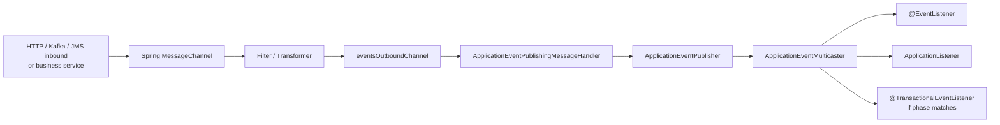
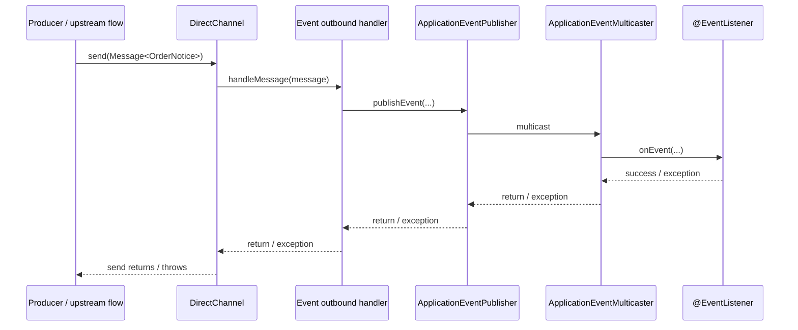
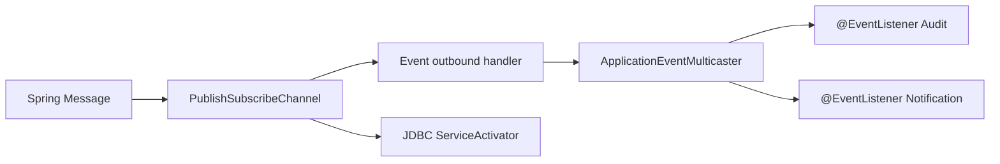
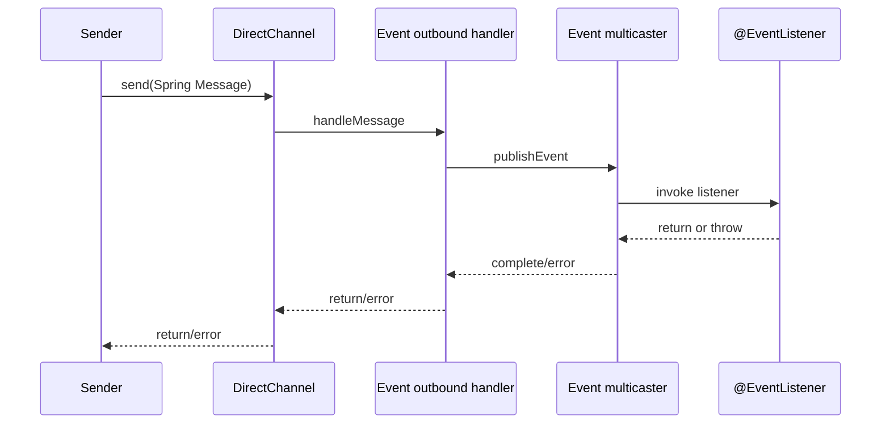
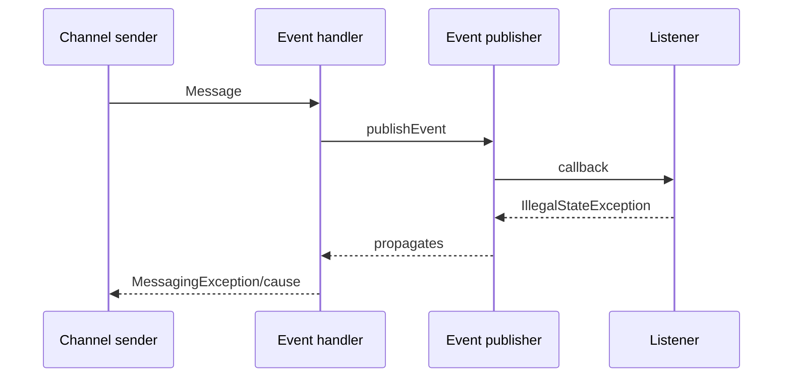
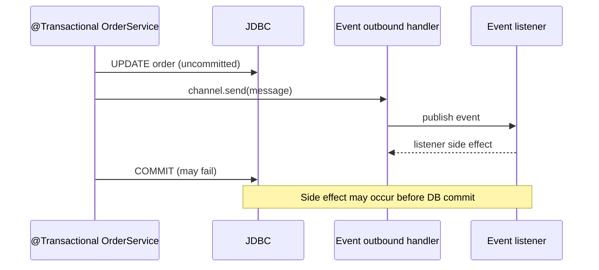
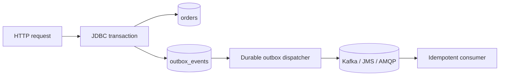
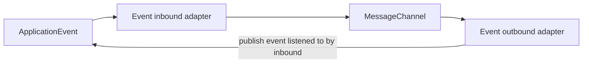

# Sending Spring ApplicationEvents from Messages

The **Spring Integration Event Outbound Channel Adapter** converts a Spring Messaging `Message<?>` flowing through a `MessageChannel` into an event published via the **`ApplicationEventPublisher`** of the same Spring `ApplicationContext`. The component that performs this is **`ApplicationEventPublishingMessageHandler`**. This is the **reverse** direction of the event inbound adapter: instead of listening to `ApplicationEvent`s to create messages, it receives messages from a flow to **publish Spring `ApplicationEvent`s** to `ApplicationListener` or `@EventListener` components.

This lesson belongs to the **Event Adapter** chapter of the **SPRING_INTEGRATION_ADAPTERS** module. The module focuses on connecting external systems using inbound/outbound adapters, gateways, pollers, and `MessageChannel`; practicing with files, SFTP, HTTP, JMS, AMQP, Kafka, and databases; and handling message contracts, errors, and connection lifecycles. This lesson focuses on **publishing internal events from Spring Integration messages**, and then explains the boundary with durable transports when a flow involves Kafka/JMS/AMQP, HTTP, SFTP, or JDBC.

> **Principle:** By default, the outbound handler **wraps `Message<?>` in a `MessagingEvent`**. If the payload **is already an `ApplicationEvent`**, the handler publishes **the event as-is**. If `publishPayload=true` is enabled, the handler sends the **payload directly** to `ApplicationEventPublisher`: a POJO/record will be wrapped by Spring Framework into a `PayloadApplicationEvent` if needed. Do not treat any of these mechanisms as a durable message broker.

## 1. Learning Objectives

Upon completing this lesson, you will be able to:

1. Diagram the path `MessageChannel → ApplicationEventPublishingMessageHandler → ApplicationEventPublisher → ApplicationListener`.
2. Distinguish between **event inbound** `ApplicationEventListeningMessageProducer` and **event outbound** `ApplicationEventPublishingMessageHandler`.
3. Explain `MessagingEvent`, `getMessage()`, payload, headers, and Spring `ApplicationEvent`.
4. Choose accurately among the three publishing cases: payload event, `publishPayload=false`, and `publishPayload=true`.
5. Configure Spring Boot, `spring-integration-event`, `@EnableIntegration`, `DirectChannel`, and `@ServiceActivator` on the handler bean.
6. Write Java DSL `IntegrationFlow.from(...).handle(...)` and XML `int-event:outbound-channel-adapter`.
7. Receive events via `@EventListener`, `ApplicationListener`, or `@TransactionalEventListener` with the correct contract.
8. Explain `DirectChannel`/`ExecutorChannel`/`QueueChannel`, pollers, fan-out, and timing.
9. Understand how listener exceptions, multicaster error handlers, retries, backpressure, and `errorChannel` work.
10. Recognize loop risks when combining event inbound and outbound adapters in the same context.
11. Distinguish Spring application events from Kafka/JMS/AMQP broker events, durability, replay, and acknowledgments.
12. Design idempotency, outbox/inbox, and transaction phases when JDBC/HTTP/SFTP side effects exist.
13. Write tests proving that `MessagingEvent` preserves headers, payload events match expected types, and synchronous errors propagate.
14. Observe lifecycle, metrics, and failure windows in production.

## 2. Source and Target of the Outbound Event Adapter

For example, `OrderProcessingFlow` receives a Spring message from an HTTP inbound gateway, a Kafka inbound adapter, or a business service. After transformation, the flow sends the message to `eventsOutboundChannel`; the event outbound handler publishes a Spring event for beans in the same context to receive:



An implicit condition in the diagram is that listeners are registered in the **target Spring application context** and match the event type. Spring events do not automatically transfer between two JVMs/pods; each process has its own context and listeners.

### 2.1. Do Not Confuse the Directions of the Two Adapters

| Criterion | Event **inbound** adapter | Event **outbound** adapter |
|---|---|---|
| Class | `ApplicationEventListeningMessageProducer` | `ApplicationEventPublishingMessageHandler` |
| Actual input | `ApplicationEvent` notification | Spring `Message<?>` |
| Actual output | Spring `MessageChannel` | `ApplicationEventPublisher` |
| Spring Integration pattern | Message-producing inbound endpoint | Message-consuming outbound endpoint |
| Special contract | `eventTypes`, `payloadExpression` | `publishPayload` |
| Connects to Kafka broker? | Not automatically | Not automatically |
| Needs a poller? | No: event callback | **Only when input channel is a PollableChannel** |
| Error handling | Failure publishing Spring message | Failure publishing Spring event/listener |
| Durability | In-memory by default | In-memory by default |

**The word "outbound"** describes **the direction a Spring message leaves the integration flow**, not that it has crossed the network or reached a broker.

## 3. Two Abstractions: Message and ApplicationEvent

Spring Messaging `Message<T>` carries a payload and headers:

```text
Spring Message<OrderNotification>:
  payload:
    eventId: evt-101
    orderId: ORD-101
    state: ACCEPTED
  headers:
    id: <message UUID>
    timestamp: <creation time>
    correlationId: corr-9001
    sourceSystem: orders-service
```

Spring Framework `ApplicationEvent` extends `EventObject`, having `source` and timestamp. `ApplicationEventPublisher` notifies Spring application listeners of the event. If you publish an object that **does not extend `ApplicationEvent`**, Spring Framework can wrap it into a **`PayloadApplicationEvent<T>`**.

| Property | Spring `Message<?>` | Spring `ApplicationEvent` |
|---|---|---|
| Structure | Payload + `MessageHeaders` | Source + timestamp + event fields |
| Journey | `MessageChannel` and integration endpoints | `ApplicationEventMulticaster` and application listeners |
| Receiving style | `@ServiceActivator`, message handler | `@EventListener`, `ApplicationListener` |
| Lifecycle | Endpoint/channel | Spring `ApplicationContext` |
| Default durability | Channel-dependent; `DirectChannel` is non-durable | Non-durable/in-process |
| Correlation | App-defined headers/`eventId` | App-defined fields/`eventId` |
| Retry | Advice/error flow per endpoint | Listener/multicaster policy; no default broker replay |

**`MessageHeaders.ID` is not a business event ID.** An event can be recreated under a new message ID on retry. For sensitive side effects, use a business-meaningful `eventId`.

## 4. What Does ApplicationEventPublishingMessageHandler Do?

Full class name: `org.springframework.integration.event.outbound.ApplicationEventPublishingMessageHandler`. It extends `AbstractMessageHandler`, implements `ApplicationEventPublisherAware`, and receives a `Message<?>` then publishes an event to the context.



The diagram depicts the **default synchronous multicaster + DirectChannel**. If replaced with an async multicaster, `ExecutorChannel`, or `QueueChannel`, the publisher may return before the business listener finishes.

### 4.1. Automatic Injection of ApplicationEventPublisher

When the handler is a **Spring-managed bean**, the framework calls `setApplicationEventPublisher(...)` via `ApplicationEventPublisherAware`. There is no need to create an arbitrary `ApplicationEventPublisher` or call the setter manually in standard configuration.

If you manually instantiate `new ApplicationEventPublishingMessageHandler()` outside a Spring context and call `handleMessage`, it may not have a publisher injected and will lack lifecycle management. Register it as a bean/endpoint so Spring manages it.

### 4.2. An Outbound Handler Is One-Way

`ApplicationEventPublishingMessageHandler` is a `MessageHandler`; it does not provide a Kafka consumer ACK or a reply message under a request–reply protocol. `ApplicationEventPublisher.publishEvent` normally returns `void`; do not interpret the return of `send()` on a Spring channel as the outcome of all downstream listeners in async cases.

## 5. The Three Most Important Payload Cases

The Spring Integration documentation describes the **exact** logic:

1. If `message.getPayload() instanceof ApplicationEvent`, publish **the payload as the original event**.
2. If it is not an `ApplicationEvent` and `publishPayload=false` (default), wrap **the entire `Message<?>`** in a `MessagingEvent`.
3. If it is not an `ApplicationEvent` and `publishPayload=true`, publish **the payload directly** through Spring's `ApplicationEventPublisher`.

| Spring Message payload | `publishPayload` | Event published | Suitable listener | Are headers still accessible? |
|---|---|---|---|---|
| `OrderAcceptedEvent extends ApplicationEvent` | `false` | Original `OrderAcceptedEvent` | `@EventListener(OrderAcceptedEvent)` | Spring headers are not forwarded automatically |
| `OrderAcceptedEvent extends ApplicationEvent` | `true` | Original `OrderAcceptedEvent` | `@EventListener(OrderAcceptedEvent)` | Spring headers are not forwarded automatically |
| `OrderNotice` Java record/POJO | `false` | **`MessagingEvent`** | `@EventListener(MessagingEvent)` | Yes, via `getMessage()` |
| `OrderNotice` Java record/POJO | `true` | Payload `OrderNotice`; Spring may wrap as `PayloadApplicationEvent<OrderNotice>` | `@EventListener(OrderNotice)` | Headers are not forwarded automatically |
| `String` | `false` | **`MessagingEvent`** | `@EventListener(MessagingEvent)` | Yes, via wrapped message |
| `String` | `true` | `String` payload, Spring wraps as payload event | `@EventListener(String)` | Headers are not forwarded automatically |
| `PayloadApplicationEvent<OrderNotice>` | Both | The `PayloadApplicationEvent` itself | `@EventListener(OrderNotice)` or matching listener | Outer Spring headers are not forwarded automatically |

### 5.1. What Is MessagingEvent?

`MessagingEvent` belongs to package **`org.springframework.integration.event.core.MessagingEvent`**. It is a subclass of Spring `ApplicationEvent` used to wrap a Spring `Message<?>`. It provides:

```java
Message<?> message = messagingEvent.getMessage();
Object payload = message.getPayload();
MessageHeaders headers = message.getHeaders();
```

This allows Spring listeners to access **both the original payload and headers** sent by the integration flow. `getSource()` also points to the message, but calling `getMessage()` is clearer.

### 5.2. publishPayload=true and Losing Outer Headers

With `publishPayload=true`, the handler invokes Spring event publication on the **payload**, without packaging `MessageHeaders`. For instance, a `Message<OrderNotice>` carrying header `correlationId=corr-1` becomes a payload event containing `OrderNotice` **without the listener automatically seeing that header**.

If correlation/trace/audit metadata matters, you have these options:

- Put business `eventId`, `correlationId`, and `tenantId` inside an event DTO with an explicit schema.
- Keep `publishPayload=false`, so listeners receive `MessagingEvent` and call `getMessage().getHeaders()`.
- Use a transformer to construct a dedicated event class copying metadata from headers into fields.
- Do not rely on thread-local trace context if there is an async handoff.

### 5.3. `ApplicationEvent` Is Always Published Directly

Even when `publishPayload=false`, if the payload is a subclass of `ApplicationEvent`, the handler **does not wrap it in `MessagingEvent`**. This is an important exception: do not write `@EventListener(MessagingEvent.class)` expecting to receive every message passing through the outbound adapter.

## 6. Maven Dependencies and Versioning

Use a Spring Boot BOM compatible with Spring Integration:

```xml
<dependencies>
    <dependency>
        <groupId>org.springframework.boot</groupId>
        <artifactId>spring-boot-starter-integration</artifactId>
    </dependency>
    <dependency>
        <groupId>org.springframework.integration</groupId>
        <artifactId>spring-integration-event</artifactId>
    </dependency>
</dependencies>
```

`spring-integration-event` is a separate module; do not add only `spring-integration-core` and assume the outbound event handler class is always on the classpath. Do not mix Spring Framework and Spring Integration versions outside the BOM without verifying compatibility.

Main imports:

```java
import org.springframework.integration.event.outbound.ApplicationEventPublishingMessageHandler;
import org.springframework.integration.event.core.MessagingEvent;
import org.springframework.integration.annotation.ServiceActivator;
import org.springframework.integration.channel.DirectChannel;
import org.springframework.messaging.Message;
import org.springframework.messaging.MessageChannel;
import org.springframework.messaging.support.MessageBuilder;
```

The APIs mentioned in this lesson are present in modern Spring Integration branches; if you are working on a very old codebase, check the Javadoc/version before copying code. `publishPayload` has been available since Spring Integration 4.2.

## 7. Demo A — Sending a Spring Message as MessagingEvent (Default)

We will build a Spring Boot application where a service creates `Message<OrderNotice>` and sends it to a `DirectChannel`; the outbound handler publishes a **`MessagingEvent`**, and an `@EventListener` accesses the payload and headers.

### 7.1. Domain Payload: OrderNotice.java

```java
package com.example.events;

public record OrderNotice(
        String eventId,
        String orderId,
        String state) {
}
```

`OrderNotice` **does not extend `ApplicationEvent`**. In Demo A, `publishPayload` is left at its default `false` so the listener receives `MessagingEvent`.

### 7.2. Spring Integration Config: EventOutboundConfig.java

```java
package com.example.events;

import org.springframework.beans.factory.annotation.Qualifier;
import org.springframework.context.annotation.Bean;
import org.springframework.context.annotation.Configuration;
import org.springframework.integration.annotation.ServiceActivator;
import org.springframework.integration.channel.DirectChannel;
import org.springframework.integration.config.EnableIntegration;
import org.springframework.integration.event.outbound.ApplicationEventPublishingMessageHandler;
import org.springframework.messaging.MessageChannel;

@Configuration
@EnableIntegration
public class EventOutboundConfig {

    @Bean("ordersToApplicationEvents")
    public MessageChannel ordersToApplicationEvents() {
        return new DirectChannel();
    }

    @Bean
    @ServiceActivator(inputChannel = "ordersToApplicationEvents")
    public ApplicationEventPublishingMessageHandler eventOutboundHandler() {
        ApplicationEventPublishingMessageHandler handler =
                new ApplicationEventPublishingMessageHandler();

        // Default is false; set explicitly to document the contract.
        handler.setPublishPayload(false);
        return handler;
    }
}
```

**Explanation:**

1. `ordersToApplicationEvents` is the Spring **input channel of the outbound adapter**.
2. `@ServiceActivator` on `@Bean` creates a **consumer endpoint** that subscribes to the channel and invokes the handler.
3. Spring manages the handler and injects `ApplicationEventPublisher`.
4. `publishPayload=false` wraps `Message<OrderNotice>` in `MessagingEvent`.
5. Using `DirectChannel` keeps the path synchronous with the sender if the multicaster is also synchronous.
6. Only **one** handler should subscribe to the channel in the demo; multiple service activators on the same `DirectChannel` compete rather than broadcast.

### 7.3. Business Service Sending the Spring Message: OrderNoticeService.java

```java
package com.example.events;

import java.util.Objects;
import java.util.UUID;

import org.springframework.beans.factory.annotation.Qualifier;
import org.springframework.messaging.Message;
import org.springframework.messaging.MessageChannel;
import org.springframework.messaging.support.MessageBuilder;
import org.springframework.stereotype.Service;

@Service
public class OrderNoticeService {

    private final MessageChannel outboundChannel;

    public OrderNoticeService(
            @Qualifier("ordersToApplicationEvents")
            MessageChannel outboundChannel) {
        this.outboundChannel = outboundChannel;
    }

    public void accept(String orderId) {
        Objects.requireNonNull(orderId, "orderId");

        OrderNotice notice = new OrderNotice(
                UUID.randomUUID().toString(),
                orderId,
                "ACCEPTED");

        Message<OrderNotice> message =
                MessageBuilder.withPayload(notice)
                    .setHeader("correlationId", "order-" + orderId)
                    .setHeader("sourceSystem", "orders-module")
                    .build();

        boolean sent = outboundChannel.send(message);
        if (!sent) {
            throw new IllegalStateException(
                    "Spring channel rejected the message");
        }
    }
}
```

`send(message)` is not Kafka's `KafkaTemplate.send`. When synchronous, it can surface exceptions from downstream listeners, whereas when async, `true` may only indicate the message was accepted/queued.

### 7.4. Spring Event Listener: OrderNoticeAudit.java

```java
package com.example.events;

import org.springframework.context.event.EventListener;
import org.springframework.integration.event.core.MessagingEvent;
import org.springframework.messaging.Message;
import org.springframework.stereotype.Component;

@Component
public class OrderNoticeAudit {

    @EventListener
    public void onMessagingEvent(MessagingEvent event) {
        Message<?> message = event.getMessage();

        if (!(message.getPayload() instanceof OrderNotice notice)) {
            return; // Other MessagingEvents unrelated to this use case.
        }

        Object correlation =
                message.getHeaders().get("correlationId");

        System.out.printf(
            "AUDIT eventId=%s orderId=%s state=%s corr=%s%n",
            notice.eventId(),
            notice.orderId(),
            notice.state(),
            correlation);
    }
}
```

Note that `@EventListener(MessagingEvent)` can receive **other `MessagingEvent`s** published in the same context. If an application has multiple `IntegrationFlow`s using event outbound adapters, filter by payload class and a trusted `sourceSystem`/route/header.

### 7.5. Launching from ApplicationRunner

```java
package com.example.events;

import org.springframework.boot.ApplicationRunner;
import org.springframework.boot.SpringApplication;
import org.springframework.boot.autoconfigure.SpringBootApplication;
import org.springframework.context.annotation.Bean;

@SpringBootApplication
public class EventOutboundDemoApplication {

    public static void main(String[] args) {
        SpringApplication.run(
                EventOutboundDemoApplication.class, args);
    }

    @Bean
    ApplicationRunner runOnce(OrderNoticeService service) {
        return args -> {
            service.accept("ORD-101");
            service.accept("ORD-202");
        };
    }
}
```

Place the classes in the `com.example.events` package so Boot component scanning discovers all of them. Expected output:

```text
AUDIT eventId=... orderId=ORD-101 state=ACCEPTED corr=order-ORD-101
AUDIT eventId=... orderId=ORD-202 state=ACCEPTED corr=order-ORD-202
```

Do not rely on log ordering across multiple threads if the application configures an executor. The demo only logs and has no persistent audit database.

### 7.6. Demo A Contract Checklist

- Payload is `OrderNotice` (does not extend `ApplicationEvent`).
- Outbound handler has **`publishPayload=false`**.
- The published event is **`MessagingEvent`**.
- Listener receives `MessagingEvent`, then calls `event.getMessage()`.
- Headers `correlationId` and `sourceSystem` are present on the wrapped message.
- Events stay within the **same Spring `ApplicationContext`**, and no Kafka broker is called.
- Events have no durable replay after a crash.

## 8. Demo B — Publishing the Payload with publishPayload=true

When you want the listener to receive the domain object directly, change the config (replacing the handler in Demo A):

```java
@Bean
@ServiceActivator(inputChannel = "ordersToApplicationEvents")
public ApplicationEventPublishingMessageHandler eventOutboundHandler() {

    ApplicationEventPublishingMessageHandler handler =
            new ApplicationEventPublishingMessageHandler();
    handler.setPublishPayload(true);
    return handler;
}
```

With a message payload of `OrderNotice`, the handler calls `publishEvent(notice)`. Spring Framework supports `publishEvent(Object)` and can wrap `notice` into `PayloadApplicationEvent<OrderNotice>`.

### 8.1. Listener by Domain Type

```java
@Component
public class OrderNoticePayloadListener {

    @EventListener
    public void onNotice(OrderNotice notice) {
        System.out.println(
            "PAYLOAD eventId=" + notice.eventId()
            + " orderId=" + notice.orderId());
    }
}
```

In Demo B, `@EventListener(OrderNotice.class)` is selected by payload type. You no longer need a listener accepting `MessagingEvent` to read the event content.

**Trade-off:** Spring headers like `correlationId`/`sourceSystem` are **not automatically available** on the event object. If needed, add correlation fields to the `OrderNotice` DTO or use Demo A.

### 8.2. Why Doesn't the POJO Listener Receive MessagingEvent in Demo A?

With `publishPayload=false`, the actual event class is `MessagingEvent`, so Spring does not implicitly unwrap the payload to match an `OrderNotice` listener. `@EventListener(OrderNotice.class)` is a different contract that only matches when the payload is published directly.

### 8.3. Comparing the Two Modes

| Configuration | `@EventListener(MessagingEvent)` | `@EventListener(OrderNotice)` |
|---|---|---|
| `publishPayload=false`, payload `OrderNotice` | Receives event, accesses message/headers | Not selected merely because inner payload is `OrderNotice` |
| `publishPayload=true`, payload `OrderNotice` | Not a `MessagingEvent` wrapper | Yes |
| Payload is any `ApplicationEvent` | Matches actual event class; not `MessagingEvent` by default | Only if listener type matches actual event |

**Do not register two `@Bean` configurations with the same name and the same channel in one context.** The two demos are alternatives; when comparing them in tests, create a separate test context for each mode.

## 9. Demo C — Payload Already Extends ApplicationEvent

If the Spring message payload is already an `ApplicationEvent`, the adapter **publishes the event as-is**, **without needing `publishPayload=true`**.

### 9.1. Domain Event: OrderShippedEvent.java

```java
package com.example.events;

import org.springframework.context.ApplicationEvent;

public final class OrderShippedEvent extends ApplicationEvent {

    private final String eventId;
    private final String orderId;

    public OrderShippedEvent(
            Object source, String eventId, String orderId) {
        super(source);
        this.eventId = eventId;
        this.orderId = orderId;
    }

    public String getEventId() {
        return eventId;
    }

    public String getOrderId() {
        return orderId;
    }
}
```

Sender:

```java
Message<OrderShippedEvent> message = MessageBuilder
        .withPayload(
            new OrderShippedEvent(this, "evt-400", "ORD-101"))
        .setHeader("traceRef", "trace-9001")
        .build();

ordersToApplicationEvents.send(message);
```

Listener:

```java
@EventListener
public void onShipped(OrderShippedEvent event) {
    System.out.println(
        "SHIPPED " + event.getOrderId()
        + " eventId=" + event.getEventId());
}
```

Even with `setPublishPayload(false)`, the event outbound handler still publishes the original `OrderShippedEvent`. `traceRef` is a header on the **outer Spring message** and **is not automatically copied into `OrderShippedEvent`**.

### 9.2. Why Should event.source Not Be Treated as Context Metadata?

`ApplicationEvent` has `getSource()`. It may point to `this` (a Spring bean), a domain object, or another reference. Do not turn `getSource()` into a Kafka/JMS/HTTP payload without checking, as doing so can leak internal objects or sensitive data.

If you want durable/cross-process events, use a DTO with an explicit schema such as `eventId`, `aggregateId`, `eventType`, `eventVersion`, and `occurredAt`.

## 10. Java DSL with ApplicationEventPublishingMessageHandler

Besides `@ServiceActivator` on a `@Bean`, Java DSL can use the same handler inside an `IntegrationFlow`.

```java
package com.example.events;

import org.springframework.context.annotation.Bean;
import org.springframework.context.annotation.Configuration;
import org.springframework.integration.dsl.IntegrationFlow;
import org.springframework.integration.event.outbound.ApplicationEventPublishingMessageHandler;

@Configuration
public class EventOutboundDslConfig {

    @Bean
    ApplicationEventPublishingMessageHandler eventHandler() {
        ApplicationEventPublishingMessageHandler handler =
                new ApplicationEventPublishingMessageHandler();
        handler.setPublishPayload(true);
        return handler;
    }

    @Bean
    IntegrationFlow eventOutFlow(
            ApplicationEventPublishingMessageHandler eventHandler) {

        return IntegrationFlow
                .from("ordersToApplicationEvents")
                .handle(eventHandler)
                .get();
    }
}
```

`ordersToApplicationEvents` must exist as a channel bean or be created by the DSL resolver per bean/name conventions. **This configuration replaces Demo A's `@Bean @ServiceActivator`**; do not register the same handler bean both with an annotation endpoint and with DSL `.handle(...)` to avoid two endpoints receiving messages unexpectedly.

### 10.1. Java DSL Functional Form

The Spring Integration Reference also shows this form:

```java
@Bean
public IntegrationFlow eventsOutFlow(
        ApplicationEventPublishingMessageHandler eventHandler) {

    return flow -> flow.handle(eventHandler);
}
```

With the functional form, the framework assigns the flow's input channel based on bean name/endpoint conventions; if callers should send to a known channel, `IntegrationFlow.from("ordersToApplicationEvents")` above is easier to read and test.

### 10.2. Pipeline with a Transformer Before Outbound

```java
@Bean
IntegrationFlow noticesToEvents(
        ApplicationEventPublishingMessageHandler eventHandler) {

    return IntegrationFlow
        .from("incomingOrderMessages")
        .filter(OrderNotice.class,
            notice -> !"IGNORED".equals(notice.state()))
        .transform(OrderNotice.class, notice -> notice)
        .handle(eventHandler)
        .get();
}
```

Here the transformer is an identity function solely to illustrate where the transformation step sits. Production code should use a transformer that **actually maps the event schema/headers**, or omit this step to avoid unnecessary complexity. The input channel `incomingOrderMessages` is where messages arrive from services/other adapters. `eventHandler` is configured with `publishPayload` according to the required contract.

## 11. XML outbound-channel-adapter and Poller

Spring Integration provides the `int-event` namespace with `outbound-channel-adapter`:

```xml
<?xml version="1.0" encoding="UTF-8"?>
<beans xmlns="http://www.springframework.org/schema/beans"
       xmlns:xsi="http://www.w3.org/2001/XMLSchema-instance"
       xmlns:int="http://www.springframework.org/schema/integration"
       xmlns:int-event="http://www.springframework.org/schema/integration/event"
       xsi:schemaLocation="
          http://www.springframework.org/schema/beans
          http://www.springframework.org/schema/beans/spring-beans.xsd
          http://www.springframework.org/schema/integration
          http://www.springframework.org/schema/integration/spring-integration.xsd
          http://www.springframework.org/schema/integration/event
          http://www.springframework.org/schema/integration/event/spring-integration-event.xsd">

    <int:channel id="ordersToApplicationEvents"/>

    <int-event:outbound-channel-adapter
        channel="ordersToApplicationEvents"
        publish-payload="true"/>
</beans>
```

Notes:

- `publish-payload="true"` is equivalent to `handler.setPublishPayload(true)`.
- Omitting that attribute defaults to `false`: POJO messages are wrapped in `MessagingEvent`.
- The configured channel is the **input** of the outbound adapter.
- No poller is needed if the channel is a `DirectChannel`/`SubscribableChannel`.

### 11.1. QueueChannel Requires a Poller

If `ordersToApplicationEvents` is a `QueueChannel`, the endpoint receives messages via polling:

```xml
<int:channel id="ordersToApplicationEvents">
    <int:queue capacity="500"/>
</int:channel>

<int-event:outbound-channel-adapter
    channel="ordersToApplicationEvents"
    publish-payload="false">
    <int:poller fixed-rate="100"
                max-messages-per-poll="10"/>
</int-event:outbound-channel-adapter>
```

**Explanation:** The poller fetches up to 10 Spring messages per run and invokes the outbound event handler. `fixed-rate="100"` is in milliseconds in this configuration. The queue in this example is an **in-memory RAM queue**, not durable; a crash before polling can lose enqueued messages.

### 11.2. Poller task-executor

The namespace allows specifying `task-executor` to offload polling to an executor:

```xml
<int:channel id="ordersToApplicationEvents">
    <int:queue/>
</int:channel>

<int-event:outbound-channel-adapter
    channel="ordersToApplicationEvents">
    <int:poller
        fixed-rate="100"
        max-messages-per-poll="1"
        task-executor="eventDispatchExecutor"/>
</int-event:outbound-channel-adapter>
```

A suitable `eventDispatchExecutor` bean (such as `ThreadPoolTaskExecutor`) must be defined in the context. When multiple workers publish events concurrently, completion ordering and exception handling differ from a synchronous `DirectChannel`. **Do not choose `QueueChannel` merely because the component is named an outbound adapter**, but only for deliberate backpressure/async and durability design.

## 12. Synchronous Channels, Fan-Out, and Completion Points

An outbound event handler can sit behind various channel types. **When `MessageChannel.send(...)` returns** is part of the contract that must be established before discussing processing outcomes.

| Channel | Path to outbound handler | Does caller wait for listeners? | Durable by default? |
|---|---|---|---|
| `DirectChannel` | Handler runs on the calling thread | Possible, when multicaster is sync | No |
| `ExecutorChannel` | Dispatches to an executor | Not necessarily | No |
| `QueueChannel` | Enqueues; endpoint polls later | No | No for RAM queue |
| `PublishSubscribeChannel` | Fans out Spring message to multiple handlers | Depends on executor | No |
| `QueueChannel` with durable store | Polls and runs transactions per store | Depends on config | Per message store |

### 12.1. Double Fan-Out: Spring Integration Then Spring Event



If both the JDBC service activator and `@EventListener Audit` write to the audit DB, one message can cause **two side effects**. Fan-out does not automatically provide deduplication or a shared transaction. You must designate an owner by `eventId`.

### 12.2. DirectChannel Does Not Run on a Single Global Worker

`DirectChannel` dispatches **on the caller's thread**. If three HTTP requests or Kafka consumers call `send()` concurrently, a singleton `@EventListener` can receive callbacks from three threads. Listeners must be thread-safe; the event bus does not lock across the entire order domain.

### 12.3. Spring Send Success Is Not a Broker ACK

In a synchronous flow, `send()` returning shows that the handler did not throw when invoked. It does **not** prove a Kafka producer ACK, JMS durable store, or external JDBC commit if the event listener merely enqueues a task. With async dispatch, `send()` can complete **before the listener even starts**.

## 13. ApplicationEventMulticaster: Sync and Async

By default, Spring Framework typically uses `SimpleApplicationEventMulticaster` with **synchronous** listener invocation unless an executor is customized.



With a synchronous multicaster, a slow listener can block the caller's thread. Adding an executor changes both the return timing and the error propagation path.

### 13.1. Async Multicaster Is an ApplicationContext-Level Change

```java
@Bean(name = "applicationEventMulticaster")
ApplicationEventMulticaster applicationEventMulticaster(
        TaskExecutor executor) {

    SimpleApplicationEventMulticaster m =
            new SimpleApplicationEventMulticaster();
    m.setTaskExecutor(executor);
    return m;
}
```

Imports:

```java
import org.springframework.context.event.ApplicationEventMulticaster;
import org.springframework.context.event.SimpleApplicationEventMulticaster;
import org.springframework.core.task.TaskExecutor;
```

An appropriate `TaskExecutor` bean is required. Some listeners do not support async execution; check `supportsAsyncExecution()`/Spring Framework Javadoc for your version. Do not enable an executor on the multicaster without checking all other listeners in the context.

### 13.2. Four Distinct Kinds of Async

- `ExecutorChannel`: the message has not reached the outbound handler on the original thread.
- Async multicaster: the outbound handler publishes, but the listener executes via an executor.
- `QueueChannel`: the message sits in a queue waiting for a poller.
- `@Async @EventListener`: an individual listener method opts into async execution.

**Switching threads means transaction/thread-local contexts do not transfer automatically**, exceptions may not propagate back to the sender, and completion can occur out of order.

## 14. Event Ordering Across Threads

`Spring ApplicationEvent` has no Kafka partition log. Suppose you send:

```text
e1: ORD-101 state=ACCEPTED version=1
e2: ORD-101 state=SHIPPED version=2
```

With a single thread and a synchronous path, callbacks normally match the send sequence. But with two upstream threads, an executor, or an async HTTP listener, `e2` can finish before `e1`.

### 14.1. Per-Aggregate Versioning

```java
public record OrderStateChanged(
        String eventId,
        String orderId,
        long aggregateVersion,
        String state) {}
```

A DB handler can use `aggregateVersion` and optimistic locking/a state machine to detect stale events. If scaling across multiple pods and per-key ordering is needed, choose a Kafka partition key/`orderId` or an equivalent transport, while still ensuring causal ordering at the producer.

### 14.2. @Order Only Controls Listener Invocation Order

```java
@EventListener
@Order(10)
public void validate(OrderNotice notice) { /* validate */ }

@EventListener
@Order(20)
public void observe(OrderNotice notice) { /* log */ }
```

`@Order` can specify listener invocation order during synchronous dispatch, **not** create a distributed transaction; async completion order can still differ.

## 15. Error Propagation and Already-Completed Side Effects

With a synchronous multicaster + `DirectChannel` and no error handler swallowing errors, when an event listener throws an exception, the failure can return to the Spring channel sender:



### 15.1. Failing Listener Example

```java
@EventListener
public void onNotice(OrderNotice notice) {
    if ("INVALID".equals(notice.state())) {
        throw new IllegalArgumentException(
                "Unsupported order state");
    }
}
```

This matches the `publishPayload=true` contract. With the default `publishPayload=false`, the listener receives `MessagingEvent` and extracts `OrderNotice` from `event.getMessage()`.

### 15.2. Retrying the Whole Event Can Duplicate Side Effects

```text
Publish event:
  Listener A -> writes to audit DB successfully
  Listener B -> HTTP timeout

Retry entire handler:
  Listener A -> may write audit a second time
  Listener B -> retries HTTP
```

You cannot roll back A's JDBC transaction solely via an exception from B. If retries are necessary, use a business `eventId`, a unique constraint/inbox, or split side effects into independent durable consumers.

### 15.3. ErrorChannel Does Not Automatically Protect DirectChannel

Errors on a synchronous `DirectChannel` can throw straight back to the caller, **without automatically** becoming a global `ErrorMessage` unless a dedicated endpoint/gateway/poller or error flow is configured. With an executor/poller, errors can route to the corresponding `errorChannel`; a subscriber and recovery policy are required.

**Logging an error ≠ durable event storage.** If an error handler logs and returns, the caller may assume completion; evaluate durable recovery and telemetry.

### 15.4. Multiple Listeners and Mid-Way Failure

If listener A completes and listener B throws, a synchronous multicaster may stop publishing to subsequent listeners (depending on custom error handler configuration). Do not claim "every listener received the event" merely because the event outbound handler was invoked.

## 16. Transaction Timing: JDBC Commit Does Not Wait for Events

If a service sends a Spring message inside a JDBC `@Transactional` method body:



This is especially dangerous if the listener calls a webhook/SMTP/Kafka before the order transaction ultimately rolls back.

### 16.1. @TransactionalEventListener and Matching the Event Type

```java
@TransactionalEventListener(
        phase = TransactionPhase.AFTER_COMMIT)
public void onOrderNotice(OrderNotice notice) {
    // After transaction commit succeeds.
}
```

**Watch the contract:**

- With `publishPayload=true` and a POJO payload `OrderNotice`, the listener can receive `OrderNotice`.
- With **default `publishPayload=false`**, the actual event is `MessagingEvent`. For after-commit handling, the listener must accept `MessagingEvent` and unwrap the message, or you must flip the flag.
- When the payload extends `ApplicationEvent`, the listener must accept that event class.

### 16.2. Transaction Phases and No-Transaction Behavior

`BEFORE_COMMIT`, `AFTER_COMMIT` (default), `AFTER_ROLLBACK`, `AFTER_COMPLETION`. When publishing without an active transaction, a transactional event listener by default **does not run**, unless `fallbackExecution=true`.

### 16.3. Async Threads Can Lose JDBC Transaction Context

If an `ExecutorChannel` sits before the outbound handler, the handler may run on a thread **not bound to `OrderService`'s transaction**. In that case `@TransactionalEventListener(AFTER_COMMIT)` may not be invoked. `ThreadLocal` transaction semantics do not cross thread boundaries automatically.

Reactive transactions use Reactor context rather than classic thread-bound transactions; modern Spring Framework supports transaction-bound events via mechanisms requiring the appropriate context.

### 16.4. AFTER_COMMIT Is Not a Durable Outbox

```text
JDBC COMMIT succeeds
    -> JVM crashes before AFTER_COMMIT callback
    -> Spring event not published, no replay log
```

To guarantee zero event loss, write an **outbox row alongside the business state in one JDBC transaction**. The event outbound handler can act as a wake-up signal for the dispatcher, not as the sole durable source.

### 16.5. Writing to the DB Inside an AFTER_COMMIT Listener

Spring may still keep certain transaction resources bound after commit. If the listener needs to write to the database in another transaction, use a separate service with `@Transactional(propagation = REQUIRES_NEW)` or an explicit transaction boundary rather than assuming writes under the old transaction will commit again.

## 17. Outbox/Inbox for Business Effects Across Kafka/JMS/HTTP



1. Write the order + outbox `eventId` in the **same DB transaction**.
2. The dispatcher reads/claims outbox rows in `PENDING` status.
3. Publish to the broker and verify the ACK/transaction outcome per transport.
4. Mark `SENT` after success.
5. A crash after ACK before `SENT` may republish the event: downstream deduplicates by `eventId`.
6. Spring event outbound can act as a **wake-up hint**, but the dispatcher must still poll/check pending rows after a restart.

```sql
CREATE TABLE outbox_events (
    event_id VARCHAR(128) PRIMARY KEY,
    aggregate_id VARCHAR(128) NOT NULL,
    event_type VARCHAR(128) NOT NULL,
    payload TEXT NOT NULL,
    status VARCHAR(20) NOT NULL,
    created_at TIMESTAMP NOT NULL DEFAULT CURRENT_TIMESTAMP
);
```

Illustrative schema; production adds locking/claiming, retry scheduling, indexes, auditing, and retention.

### 17.1. Inbox

```sql
CREATE TABLE processed_events (
    event_id VARCHAR(128) PRIMARY KEY,
    processed_at TIMESTAMP NOT NULL DEFAULT CURRENT_TIMESTAMP
);
```

Within the same JDBC transaction as the side effect, insert `eventId` using a unique constraint; if it already exists, skip the duplicate or reconcile. **Spring Message ID** cannot replace a business `eventId` when a republish produces a new message ID.

## 18. Loops Between Event Inbound and Outbound Adapters

When both exist:

- `ApplicationEventListeningMessageProducer`: receives an `ApplicationEvent` and emits a Spring `Message`.
- `ApplicationEventPublishingMessageHandler`: receives a Spring `Message` and publishes an `ApplicationEvent`.

A miswired topology can create a loop:



### 18.1. publishPayload=false Creates a Loop with MessagingEvent

```text
Message<OrderNotice>
  -> outbound publishPayload=false
  -> MessagingEvent(source = Message<OrderNotice>)
  -> inbound receives MessagingEvent whose source is a Message
  -> inbound forwards the original Message into the channel
  -> outbound publishes MessagingEvent again
  -> ...
```

A synchronous path can lead to recursion/`StackOverflowError`; an async path can turn into an event storm and OOM.

### 18.2. publishPayload=true Can Still Loop

```text
Message<OrderNotice>
  -> outbound publishPayload=true
  -> PayloadApplicationEvent<OrderNotice>
  -> inbound adapter filters OrderNotice.class
  -> Message<OrderNotice>
  -> outbound publishes again
  -> ...
```

Changing the flag does **not** automatically prevent loops.

### 18.3. Prevention

1. Separate event types and event directions: inbound listens for `AuditCompletedEvent`, outbound publishes `OrderAcceptedEvent`.
2. Do not connect the inbound output channel back to an outbound input channel carrying the same event type.
3. Add routing guards using `sourceSystem`, direction, `eventId`, and `hopCount`/TTL.
4. Limit fan-out and set alerts on event rate, queue depth, and retry counts.
5. Write an integration test verifying that one input generates a finite number of events.
6. When crossing a broker, use deduplication/inbox and source/destination topic guards.

## 19. Boundaries with Other Adapters

| Component | Scope | Durability/ack |
|---|---|---|
| `ApplicationEventPublisher` | Spring context / same JVM | No default durable replay |
| Event outbound handler | In-process Spring message → event | Does not create broker ACK |
| `DirectChannel` | In-process sync | Not persisted |
| RAM `QueueChannel` | In-process buffer | Does not survive crash |
| Kafka outbound adapter | Kafka cluster/topic | Broker ACK/transaction per config |
| JMS/AMQP outbound adapter | Broker destinations | Persistence/ack/DLQ per broker |
| HTTP outbound gateway | Network | Timeouts have ambiguity; needs idempotency |
| SFTP/File outbound | Filesystem/remote server | Durable file contract depends on write/rename |
| JDBC/outbox | DB | Transaction and durable status |

When a Kafka inbound adapter receives a record and sends it via event outbound to an async listener, **the Kafka offset can commit before the JDBC side effect** if the Kafka callback completes early. Use a synchronous/durable handoff or an idempotent consumer/inbox; do not ACK Kafka merely because an event was "published locally".

### 19.1. Events Do Not Automatically Cross to Other Pods

Two pods running the same source code and bean names are still **two independent Spring `ApplicationContext`s**. An event outbound on Pod A does not automatically reach an event listener on Pod B. For cross-process fan-out, use Kafka/JMS/AMQP, a network gateway, or durable shared storage.

### 19.2. Security and Sensitive Data

With `publishPayload=false`, `MessagingEvent.getMessage()` contains all headers. Do not put tokens/PII into headers if listeners are not authorized to read them. With `publishPayload=true`, the DTO must carry validated correlation/tenant fields; do not trust headers that were stripped for authorization decisions. Thread-bound security/tracing context does not automatically propagate across async boundaries.

## 20. Integration Test: MessagingEvent Preserves Headers

Use a synchronous test context with `DirectChannel`. No Kafka broker is needed to verify wrapper semantics.

### 20.1. Test Dependency

```xml
<dependency>
    <groupId>org.springframework.boot</groupId>
    <artifactId>spring-boot-starter-test</artifactId>
    <scope>test</scope>
</dependency>
```

### 20.2. Java Test

```java
package com.example.events;

import static org.assertj.core.api.Assertions.assertThat;

import java.util.concurrent.atomic.AtomicReference;
import org.junit.jupiter.api.Test;
import org.springframework.beans.factory.annotation.Autowired;
import org.springframework.beans.factory.annotation.Qualifier;
import org.springframework.context.annotation.Bean;
import org.springframework.context.annotation.Configuration;
import org.springframework.context.event.EventListener;
import org.springframework.integration.annotation.ServiceActivator;
import org.springframework.integration.channel.DirectChannel;
import org.springframework.integration.config.EnableIntegration;
import org.springframework.integration.event.core.MessagingEvent;
import org.springframework.integration.event.outbound.ApplicationEventPublishingMessageHandler;
import org.springframework.messaging.Message;
import org.springframework.messaging.MessageChannel;
import org.springframework.messaging.support.MessageBuilder;
import org.springframework.test.context.junit.jupiter.SpringJUnitConfig;

@SpringJUnitConfig(classes = EventOutboundTest.Config.class)
class EventOutboundTest {

    @Configuration
    @EnableIntegration
    static class Config {
        @Bean("outboundEvents")
        MessageChannel outboundEvents() {
            return new DirectChannel();
        }

        @Bean
        @ServiceActivator(inputChannel = "outboundEvents")
        ApplicationEventPublishingMessageHandler handler() {
            ApplicationEventPublishingMessageHandler handler =
                    new ApplicationEventPublishingMessageHandler();
            handler.setPublishPayload(false);
            return handler;
        }

        @Bean
        Recorder recorder() {
            return new Recorder();
        }
    }

    static class Recorder {
        final AtomicReference<MessagingEvent> last =
                new AtomicReference<>();

        @EventListener
        public void record(MessagingEvent event) {
            last.set(event);
        }
    }

    @Autowired
    @Qualifier("outboundEvents")
    MessageChannel channel;

    @Autowired Recorder recorder;

    @Test
    void wrapsOriginalMessageWithHeaders() {
        OrderNotice dto = new OrderNotice(
                "evt-test", "ORD-101", "ACCEPTED");

        Message<OrderNotice> source = MessageBuilder
                .withPayload(dto)
                .setHeader("correlationId", "corr-77")
                .build();

        assertThat(channel.send(source)).isTrue();
        MessagingEvent seen = recorder.last.get();
        assertThat(seen).isNotNull();
        assertThat(seen.getMessage()).isSameAs(source);
        assertThat(seen.getMessage().getPayload()).isEqualTo(dto);
        assertThat(seen.getMessage().getHeaders()
                .get("correlationId")).isEqualTo("corr-77");
    }
}
```

The test uses the `OrderNotice` record from Demo A and the default synchronous multicaster; therefore assertions can run immediately after `send()`. This test does not prove durable delivery/rollback semantics.

### 20.3. Testing publishPayload=true in a Separate Context

```java
static class PayloadRecorder {
    final AtomicReference<OrderNotice> last =
            new AtomicReference<>();

    @EventListener
    public void record(OrderNotice notice) {
        last.set(notice);
    }
}
```

Change the handler to `setPublishPayload(true)` and create an isolated test context. Assert that this listener receives `OrderNotice`, while the outer `correlationId` header does not automatically become a field on the event DTO.

### 20.4. Testing Original ApplicationEvent

Use `Message<OrderShippedEvent>` and test both `false` and `true` flags in separate contexts. `@EventListener(OrderShippedEvent)` should receive the original event; `@EventListener(MessagingEvent)` is not the right listener for that custom event.

### 20.5. Testing Error Paths

- Have a synchronous listener throw; verify `channel.send(...)` throws an exception.
- Add a custom async multicaster; prove the caller can return before the error occurs.
- With multiple listeners, let A commit and B fail; observe partial success and duplicates on retry.
- Change the input channel to `QueueChannel`; require a poller and verify `send()` succeeds before the callback runs.
- Use `CountDownLatch`/timed await instead of sleep to avoid flaky async tests.

## 21. Lifecycle and Operational Observability

### 21.1. Startup

```text
ApplicationContext refresh
  -> create MessageChannel
  -> create ApplicationEventPublishingMessageHandler
  -> Spring injects ApplicationEventPublisher
  -> register ServiceActivator / IntegrationFlow endpoint
  -> register Spring @EventListener methods
  -> business services begin sending messages
```

Do not send to a `DirectChannel` from a constructor before the endpoint has subscribed; for demos, use `ApplicationRunner` after startup. If there are no subscribers, `send` can fail. With an in-memory `QueueChannel` buffer, distinguish accepted messages from events actually published.

### 21.2. Shutdown

- Stop inbound sources/gateways before closing the outbound endpoint.
- Drain queues/executors if present within the shutdown deadline.
- In-flight Spring events have no persistent broker offset to replay.
- Do not report business success while async side effects are not yet durably completed.
- With an outbox, a restarted dispatcher must resume pending rows.

### 21.3. Metrics Distinguishing Three Milestones

| Suggested metric | Meaning |
|---|---|
| `event_outbound_message_received_total` | Spring messages received by the handler |
| `spring_application_event_published_total` | Calls made to the publisher |
| `event_listener_business_commit_total` | Completed business effects |
| `event_listener_failure_total` | Listener exceptions |
| `event_listener_latency_p99` | Handler duration |
| `event_executor_queue_depth` | Async backlog |
| `event_feedback_loop_detected_total` | Loop guard triggered |
| `event_duplicate_id_total` | Duplicate business event IDs |
| `outbox_oldest_pending_seconds` | Durable events not yet forwarded to broker |
| `downstream_publish_failure_total` | Kafka/JMS/HTTP network errors |

Metric names are suggestions only, not a guarantee that the framework emits every meter automatically. Log `eventId`, actual event class, payload type, `correlationId`, source channel, listener thread, and transaction status; avoid PII/credentials.

## 22. Quick Diagnosis Table

| Symptom | Common Cause | What to Check |
|---|---|---|
| `@EventListener(OrderNotice)` does not run | Flag is false so `MessagingEvent` is emitted | `publishPayload` |
| `@EventListener(MessagingEvent)` does not run | Flag is true or payload is an `ApplicationEvent` | Payload runtime type |
| `correlationId` header missing | Payload published directly | Message wrapper vs. DTO |
| Outbound does not publish | Endpoint not subscribed to channel | Bean registration, DSL/XML |
| Manually created `@Bean` handler outside context fails | `ApplicationEventPublisher` not injected | Bean lifecycle |
| `QueueChannel` has messages but no events | Missing poller | Polling consumer config |
| Caller returns before listener finishes | `ExecutorChannel`/async multicaster | Thread boundary |
| Listener A writes duplicate DB rows | Retried whole event after B failed | `eventId`/inbox |
| Event only reaches Pod A | Spring event is in-process | Durable broker |
| `StackOverflow`/event storm | Inbound/outbound cycle | Graph/type filter |
| DB rolled back yet webhook already sent | Event fired in transaction before commit | Outbox/phase |
| `AFTER_COMMIT` listener does not run | No active tx/wrong event class | Fallback, `MessagingEvent` vs. POJO |
| Queue crash loses events | In-memory queue | Durable `MessageStore`/outbox |
| Kafka offset advances while DB is unfinished | Async local event side effect | Ack/completion barrier |

## 23. Mistakes to Avoid

| Misconception | Reality |
|---|---|
| "Event outbound adapter is a Kafka publisher." | It invokes `ApplicationEventPublisher` in the context. |
| "`publishPayload` defaults to true." | Defaults to **false**. |
| "POJO payloads are published as POJO events by default." | Wrapped in **`MessagingEvent`** by default. |
| "`ApplicationEvent` payloads also become `MessagingEvent`." | The original `ApplicationEvent` is published directly. |
| "`MessagingEvent` belongs to Spring Framework." | Class of **Spring Integration**, package `event.core`. |
| "Setting the flag to true preserves Spring headers." | Only the payload is published; headers are not carried along automatically. |
| "`@EventListener(POJO)` is invoked when the event is `MessagingEvent`." | Not merely because the POJO is inside the wrapped `Message`. |
| "Spring events have durable offsets/ACKs." | Not by default. |
| "`DirectChannel` broadcasts automatically." | No; use `PublishSubscribeChannel`. |
| "`QueueChannel` needs no poller." | Requires a polling consumer to fetch messages. |
| "Async success means business completed." | It may only mean accepted/enqueued. |
| "Retrying an event never duplicates side effects." | Listeners that already succeeded may run again. |
| "`publishEvent` automatically waits for JDBC commit." | Synchronous events can fire before commit. |
| "`AFTER_COMMIT` guarantees zero event loss." | The crash window before the callback still exists. |
| "Kafka inbound ACK protects async local listeners." | Not if the callback returns early. |
| "Enabling `publishPayload=true` prevents event loops." | Both modes can loop. |
| "`ApplicationEvent` reaches other pods automatically." | There is no cross-process transport. |
| "`MessageHeaders.ID` is a business `eventId`." | You need a stable `eventId` separate from message ID. |

## 24. Hands-On Exercises

### Exercise 1 — Default MessagingEvent

Run Demo A; assert that `@EventListener(MessagingEvent)` receives the event and `getMessage()` preserves payload and headers.

### Exercise 2 — publishPayload=true

Switch mode in a separate test context and receive `OrderNotice` via `@EventListener`. Why is outer `correlationId` gone?

### Exercise 3 — ApplicationEvent Payload

Send `Message<OrderShippedEvent>` with flag `false`; which listener receives it? Verify event identity.

### Exercise 4 — Business eventId

Send two Spring messages with different IDs but the same `OrderNotice.eventId`, and design a unique constraint/inbox to prevent duplicate side effects.

### Exercise 5 — Java DSL

Replace the `@ServiceActivator` bean endpoint with `IntegrationFlow.from(...).handle(handler)` and verify there is no double registration.

### Exercise 6 — XML Namespace

Configure `int-event:outbound-channel-adapter` with defaults and then with `publish-payload="true"`; observe the emitted event types.

### Exercise 7 — QueueChannel Poller

Change the input to `QueueChannel` and configure a poller every 100 ms. Inspect queue depth and event publishing.

### Exercise 8 — Missing Poller

Remove the poller from `QueueChannel`, send 5 messages, and verify that `send()` succeeding does not mean listeners received them.

### Exercise 9 — Async Multicaster

Configure a `TaskExecutor` on the multicaster and inject a listener delay/failure. Measure caller return vs. business completion.

### Exercise 10 — ExecutorChannel

Compare a synchronous channel and `ExecutorChannel` when a listener calls HTTP, simulating a timeout and a crash before completion.

### Exercise 11 — Fan-Out Partial Success

Use two listeners A and B; A commits to DB, B throws. What can retrying the whole handler do? Add idempotency.

### Exercise 12 — @TransactionalEventListener

With flag `true`, receive `OrderNotice` at `AFTER_COMMIT`; test commit, rollback, no transaction, and `fallbackExecution`.

### Exercise 13 — Transaction-Bound MessagingEvent

Keep flag `false`, try `@TransactionalEventListener(MessagingEvent)` and unwrap it, then compare against a POJO listener.

### Exercise 14 — Transactional Outbox

Write order and outbox rows in one JDBC transaction; have the Spring event only wake the dispatcher. Crash before broker send and verify recovery.

### Exercise 15 — MessagingEvent Loop

Wire the inbound producer and outbound handler to the same channel, use a counter guard to detect the loop, then separate event types.

### Exercise 16 — POJO Payload Loop

Use `publishPayload=true` with inbound filtering `OrderNotice.class`. Explain why a loop can still happen.

### Exercise 17 — Cross-Process

Run two separate JVMs; publish locally in JVM A and observe that JVM B does not receive it. Replace with Kafka/AMQP/JMS when needed.

### Exercise 18 — Kafka Inbound → Event Outbound

Have a Kafka listener forward messages to event outbound while the application listener performs async JDBC work. Test offset vs. business completion.

### Exercise 19 — Secure Tenant/Correlation Design

Design a DTO with `eventId`, `tenantId`, and `correlationId`. Compare wrapper vs. payload mode and masking/logging.

### Exercise 20 — Production Design Review

Design a flow combining JDBC + event outbound + Kafka/JMS + HTTP webhook: transaction boundaries, ownership, idempotency, outbox, retries, observability, and chaos crash windows.

## 25. Self-Check Questions

1. Is `ApplicationEventPublishingMessageHandler` inbound or outbound?
2. Where does it receive `Message<?>` from?
3. Which API does it use to emit a Spring `ApplicationEvent`?
4. Why is `ApplicationEventPublisher` not a Kafka producer?
5. What is the additional Maven dependency?
6. What does Spring use `ApplicationEventPublisherAware` for?
7. What is the default value of `publishPayload`?
8. When the payload is a POJO and the flag is false, which event class is emitted?
9. Which method on `MessagingEvent` retrieves the Spring `Message`?
10. What is the package of `MessagingEvent`?
11. When the flag is true, how does Spring Framework handle a published POJO?
12. Why are outer headers not carried automatically when publishing the payload?
13. When the payload extends `ApplicationEvent`, what does the handler do?
14. Does `@EventListener(OrderNotice)` automatically receive `MessagingEvent`?
15. Does `@EventListener(MessagingEvent)` receive an original `OrderShippedEvent`?
16. Where does Java DSL register the handler?
17. Which XML element represents the outbound event adapter?
18. Which component does `QueueChannel` require for polling?
19. Which thread does `DirectChannel` run the handler on?
20. Do two `DirectChannel` subscribers broadcast?
21. At which boundary does an async multicaster differ from `ExecutorChannel`?
22. How can retrying an entire event after one listener fails create duplicates?
23. What is the default phase of `TransactionalEventListener`?
24. When the actual event type is `MessagingEvent`, which type should a transaction-bound listener accept?
25. Does `AFTER_COMMIT` completely eliminate the crash window?
26. Which failure windows do inbox and outbox solve?
27. When a Kafka source offset commits while an async listener is still running, can data be lost?
28. How does an inbound/outbound loop occur with the flag set to false?
29. Does setting the flag to true automatically prevent event loops?
30. Do Spring events propagate automatically to other pods?
31. How do `eventId` and `MessageHeaders.ID` differ in responsibility?
32. How do the three milestones accepted, published, and business committed differ?
33. Which test verifies that headers are preserved in `MessagingEvent`?
34. When zero event loss from DB to broker is required, which pattern should you choose?

## 26. Summary

**`ApplicationEventPublishingMessageHandler`** takes a Spring `Message<?>` out of a Spring Integration flow and publishes it as a **Spring `ApplicationEvent` within the same application context**.

```text
Spring MessageChannel
 -> ApplicationEventPublishingMessageHandler
      payload instanceof ApplicationEvent -> publish original event
      publishPayload=false -> MessagingEvent(Message<?>)
      publishPayload=true -> publish payload directly
 -> ApplicationEventPublisher
 -> ApplicationEventMulticaster
 -> @EventListener / ApplicationListener
 -> business side effects / local processing
```

Key things to design explicitly: **actual event type**, header preservation, sync/async channels and multicaster, exception propagation, transaction timing, feedback-loop guards, and idempotency. Spring events are **not a durable broker** and have no replay/offset/cross-process delivery by default. When zero event loss and reliable processing are required, use outbox/inbox, durable transports, and failure-window testing.

## References

- [Spring Integration Reference — Spring ApplicationEvent Support](https://docs.spring.io/spring-integration/reference/event.html)
- [Spring Integration API — ApplicationEventPublishingMessageHandler](https://docs.spring.io/spring-integration/api/org/springframework/integration/event/outbound/ApplicationEventPublishingMessageHandler.html)
- [Spring Integration API — MessagingEvent](https://docs.spring.io/spring-integration/api/org/springframework/integration/event/core/MessagingEvent.html)
- [Spring Integration API — ApplicationEventListeningMessageProducer](https://docs.spring.io/spring-integration/api/org/springframework/integration/event/inbound/ApplicationEventListeningMessageProducer.html)
- [Spring Integration Reference — Message Channels](https://docs.spring.io/spring-integration/reference/channel.html)
- [Spring Integration Reference — Error Handling](https://docs.spring.io/spring-integration/reference/error-handling.html)
- [Spring Framework Reference — ApplicationContext Events](https://docs.spring.io/spring-framework/reference/core/beans/context-introduction.html)
- [Spring Framework Reference — Transaction-bound Events](https://docs.spring.io/spring-framework/reference/data-access/transaction/event.html)
- [Spring Framework API — ApplicationEventPublisher](https://docs.spring.io/spring-framework/docs/current/javadoc-api/org/springframework/context/ApplicationEventPublisher.html)
- [Spring Framework API — TransactionalEventListener](https://docs.spring.io/spring-framework/docs/current/javadoc-api/org/springframework/transaction/event/TransactionalEventListener.html)
