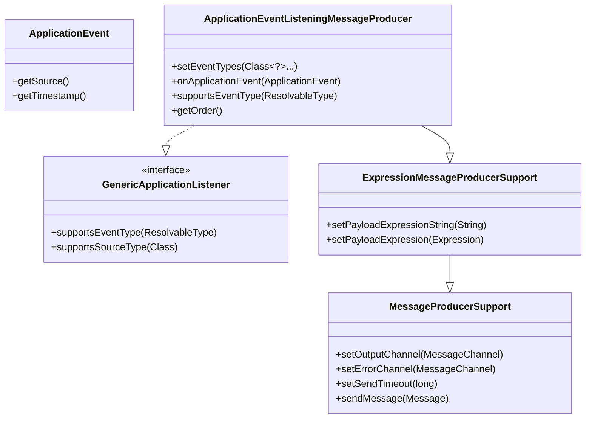
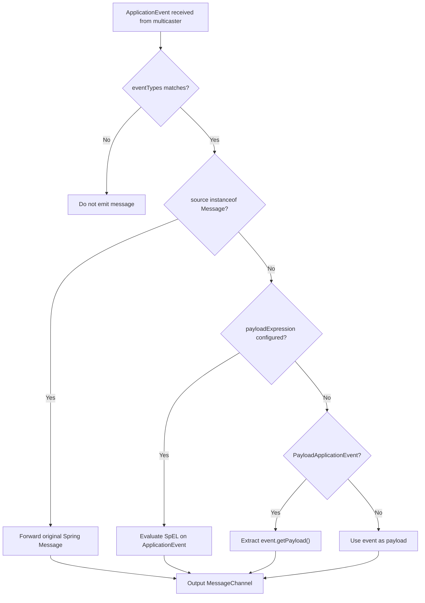
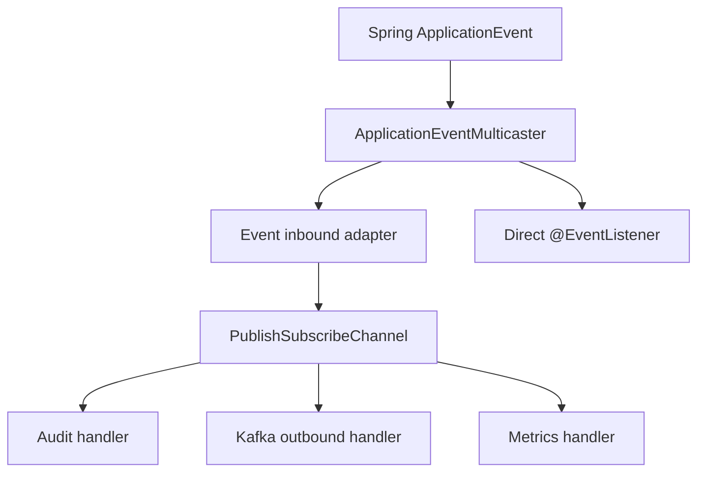
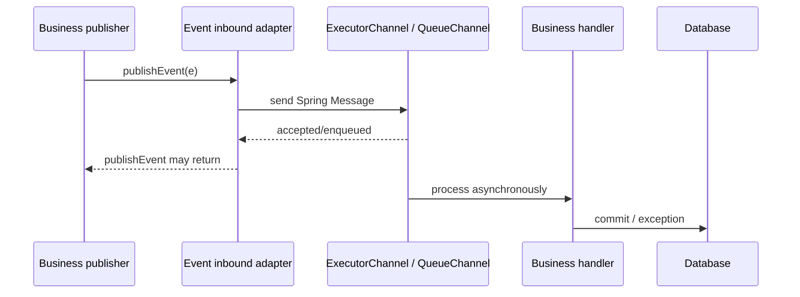
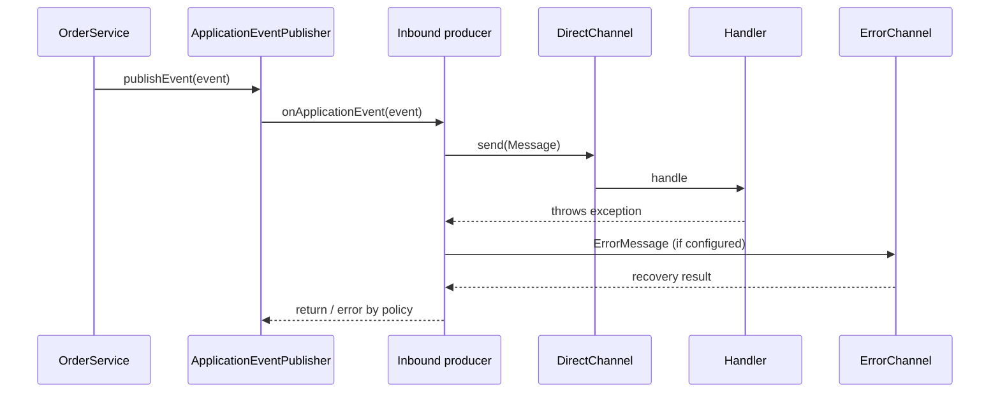
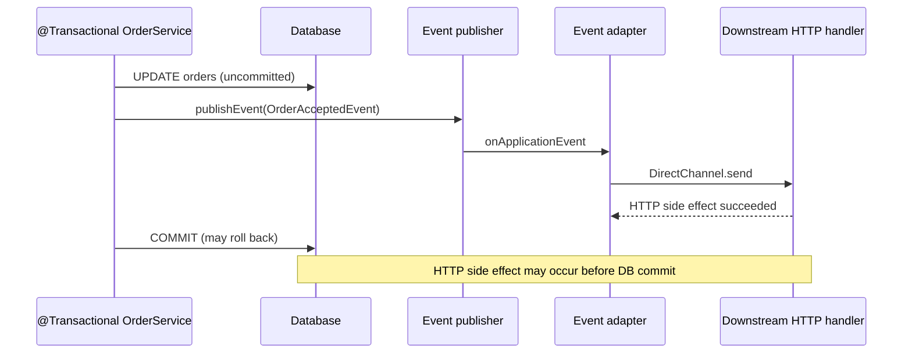
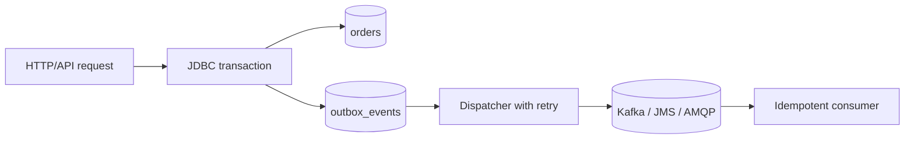
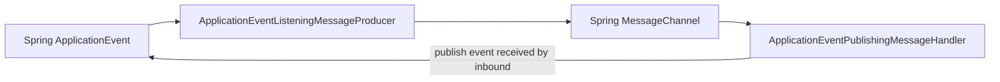

# ApplicationEventListeningMessageProducer

**`ApplicationEventListeningMessageProducer`** is the **event-driven inbound channel adapter** component in Spring Integration: it registers as a Spring `ApplicationListener`, listens for `ApplicationEvent`s published by `ApplicationEventPublisher` in an `ApplicationContext`, and converts matching events into Spring Messaging `Message<?>` objects for an **output `MessageChannel`**. This class lets internal events enter a Spring Integration pipeline without writing a manual listener that calls `channel.send(...)`.

This lesson belongs to the **Event Adapter** chapter in the **SPRING_INTEGRATION_ADAPTERS** module. The module connects external systems via inbound/outbound adapters, gateways, pollers, and `MessageChannel`; practices with files, SFTP, HTTP, JMS, AMQP, Kafka, and databases; and handles message contracts, errors, and lifecycle. Specifically here, the "external source to the flow" is the **Spring application event bus in the same context**, not a Kafka/JMS/AMQP broker. This lesson focuses on the API and actual semantics of **`ApplicationEventListeningMessageProducer`**, without confusing it with the reverse adapter `ApplicationEventPublishingMessageHandler`.

> **Core takeaway:** The event inbound adapter **listens for events** and **emits Spring messages**. It does not provide broker offsets, durable storage, cross-process delivery, or exactly-once business effects on its own. Those guarantees require the right transport, transaction, and idempotency architecture.

## 1. Learning Objectives

After this lesson, you will be able to:

1. Explain why `ApplicationEventListeningMessageProducer` is an inbound adapter even though its name contains `Producer`.
2. Describe the class inheritance hierarchy: `ExpressionMessageProducerSupport`, `MessageProducerSupport`, and `GenericApplicationListener`.
3. Distinguish between `ApplicationEvent`, `PayloadApplicationEvent<T>`, Spring `Message<T>`, and `MessageChannel`.
4. State the exact payload resolution precedence when an event has a `Message` as its source, has a `payloadExpression`, or is a payload event.
5. Configure `setEventTypes(Class<?>...)` and understand `supportsEventType(ResolvableType)`, `supportsSourceType(...)`, and the listener cache.
6. Write a Spring Boot demo: domain event → listener adapter → `DirectChannel` → `@ServiceActivator`.
7. Write an example using `setPayloadExpressionString(...)` to extract `orderId` or build a new payload contract.
8. Use Java DSL `IntegrationFlow.from(producer)` and XML `int-event:inbound-channel-adapter`.
9. Understand `setOutputChannel`, `setErrorChannel`, `setSendTimeout`, and the limitations of each option.
10. Distinguish sync/async event multicaster, `DirectChannel`, `ExecutorChannel`, `PublishSubscribeChannel`, and `QueueChannel`.
11. Analyze `@TransactionalEventListener`, event publication timing, and transactional outbox.
12. Identify loops with the event outbound adapter, duplicate listeners, and early event publication.
13. Build integration tests for event filtering, payload precedence, headers, and error propagation.
14. Design metrics, troubleshooting, and migration to Kafka/JMS/AMQP when durability is needed.

## 2. Flow Diagram


In the diagram:

- `ApplicationEventPublisher` is Spring Framework's API for publishing events.
- `ApplicationEventMulticaster` distributes events to registered listeners in the context.
- `ApplicationEventListeningMessageProducer` is **one listener**; it filters event types and converts them into Spring `Message<?>`.
- Output `MessageChannel` carries messages into the integration flow; the event adapter does not dictate whether downstream uses JDBC, Kafka, or HTTP.
- An event can also be received directly by other `@EventListener`s: the adapter **does not exclusively consume** the event.

### 2.1. Why Is This Inbound, Not Outbound?

| Perspective | Input | Output |
|---|---|---|
| Spring Framework event bus | `ApplicationEvent` notification | Callbacks to listeners |
| **Event inbound adapter** | `ApplicationEvent` | **Spring `Message<?>`** on output channel |
| Spring Integration flow | Spring Message | Filter/transformer/handler |
| Event outbound adapter (reverse) | Spring `Message<?>` | `ApplicationEventPublisher.publishEvent(...)` |
| Kafka outbound adapter (other) | Spring Message | Kafka producer record to broker |

The word **`Producer`** in the class name means "Spring Integration message producer", **not** a Kafka Producer.

### 2.2. Why Is No Poller Needed?

`ApplicationEventListeningMessageProducer` receives the `onApplicationEvent(...)` callback. It is **event-driven**; it does not periodically call `MessageSource.receive()` like a file/JDBC polling adapter.

```text
Spring event:
  publishEvent -> onApplicationEvent -> outputChannel.send

File/JDBC polling:
  scheduler -> MessageSource.receive -> outputChannel.send
```

Do not attach `@Poller`/`fixedDelay` to this class just because other inbound adapters in the module use pollers.

## 3. Class Structure and Important APIs

Import the class from package `org.springframework.integration.event.inbound`:

```java
import org.springframework.integration.event.inbound.ApplicationEventListeningMessageProducer;
```

Inheritance model:



### 3.1. Direct Class APIs

| API | Purpose | Important Notes |
|---|---|---|
| `new ApplicationEventListeningMessageProducer()` | Creates the adapter | Register as a Spring bean so Spring manages listener/lifecycle |
| `setEventTypes(Class<?>...)` | Selects event/payload event types | Accepts all types by default; configure an allowlist |
| `supportsEventType(ResolvableType)` | Queried by Spring multicaster for event eligibility | Not a domain content filter |
| `onApplicationEvent(ApplicationEvent)` | Callback executed when an event is dispatched to listener | Usually not called directly from business code |
| `getOrder()` | Participates in listener ordering per Spring `Ordered` | Does not guarantee business transaction ordering |
| `getComponentType()` | Spring Integration component metadata | Not a Kafka event type |

### 3.2. Inherited APIs to Know

| API | Source Class | Purpose |
|---|---|---|
| `setOutputChannel(...)` | `MessageProducerSupport` | Target to emit Spring Messages |
| `setOutputChannelName(...)` | `MessageProducerSupport` | Resolve target by bean name |
| `setErrorChannel(...)` | `MessageProducerSupport` | Route `ErrorMessage` on eligible exceptions |
| `setErrorChannelName(...)` | `MessageProducerSupport` | Error channel by bean name |
| `setSendTimeout(...)` | `MessageProducerSupport` | Timeout when sending to channels supporting waiting |
| `setPayloadExpressionString(...)` | `ExpressionMessageProducerSupport` | SpEL to extract payload from event |
| `setPayloadExpression(...)` | `ExpressionMessageProducerSupport` | Use a pre-parsed `Expression` |
| `setAutoStartup(...)`, `start()`/`stop()` | `AbstractEndpoint` | Spring Integration endpoint lifecycle |

Do not use `getComponentType()` to route business events, or treat `getOrder()` as an offset/partition value.

### 3.3. GenericApplicationListener and ResolvableType

Since Spring Integration 4.2, the adapter implements `GenericApplicationListener` so Spring's event infrastructure can inspect both **the event type** and **the payload type inside `PayloadApplicationEvent`**.

```text
ApplicationEvent:
   OrderAcceptedEvent extends ApplicationEvent
   -> ResolvableType of the actual event class

Payload event:
   publisher.publishEvent(new StockAdjusted(...))
   -> PayloadApplicationEvent<StockAdjusted>
   -> can match setEventTypes(StockAdjusted.class)
```

`supportsEventType(ResolvableType)` is used by the Spring multicaster; you do not need to call it yourself. `supportsSourceType(...)` belongs to the listener contract, **not a business filter on the `event.source` object**. To filter by `orderId`/tenant/version, use domain validation or a Spring Integration `filter`/router.

### 3.4. setEventTypes Affects the Listener Cache

The Javadoc explicitly notes: calling `setEventTypes(...)` also **re-registers the current adapter with `ApplicationEventMulticaster` to clear the listener cache**, which is then rebuilt for subsequent events.

Therefore:

- Configuring the allowlist **before the context becomes active** is the simplest approach.
- If changing the filter dynamically at runtime, test routing and concurrent publication rather than relying on a stale listener cache.
- Do not treat `setEventTypes` as a dynamic ACL/per-tenant access registration mechanism; class types are a coarse filter level.
- Use a Spring Integration router/filter if business policies change frequently.

## 4. Payload Resolution Order — The Most Important Detail

The Spring Integration Reference states the main cases:

1. If `ApplicationEvent.getSource()` is a **Spring `Message<?>`**, the adapter **forwards the Message as-is**.
2. If the source is not a `Message` and **`payloadExpression`** is configured, the adapter evaluates the expression against the `ApplicationEvent` to obtain the payload.
3. When receiving a matching **`PayloadApplicationEvent<T>`** and no higher-precedence case applies, the adapter uses the **payload `T`** instead of the wrapper.
4. For a regular `ApplicationEvent` whose source is not a `Message` and with no expression, the adapter uses the **event object** as the payload.



**Version-specific verification point:** When both `PayloadApplicationEvent` and `payloadExpression` are present, test the exact precedence via an integration test on your Spring Integration version; do not combine SpEL on a wrapper assuming the root is always the DTO. To be certain, keep one clear strategy per adapter/flow.

### 4.1. Mapping Table

| Published event | Does filter accept? | Expression set? | Emitted Spring message |
|---|---|---|---|
| `OrderAcceptedEvent`, source = `OrderService` | `OrderAcceptedEvent.class` | No | `Message<OrderAcceptedEvent>` |
| `OrderAcceptedEvent`, source = `OrderService` | `OrderAcceptedEvent.class` | `"orderId"` | `Message<String>` (`orderId`) |
| `ApplicationEvent` with source = `Message<String>` | Event class selected | Yes or No | **Original `Message<String>`**, headers preserved |
| `PayloadApplicationEvent<StockAdjusted>` | `StockAdjusted.class` | No | `Message<StockAdjusted>` |
| `PayloadApplicationEvent<StockAdjusted>` | No match | No | **No message emitted** |
| Context lifecycle event | Filter selects only `OrderAcceptedEvent` | No | **Nothing emitted** |
| Context lifecycle event | No `eventTypes` declared | No | May emit `Message<ContextRefreshedEvent>` |

### 4.2. Do Not Equate Event Metadata with MessageHeaders

`ApplicationEvent.getTimestamp()` is the timestamp of the source event. When the adapter creates a new Spring `Message<?>`, the message gets `MessageHeaders.ID` and `MessageHeaders.TIMESTAMP` per message creation rules. The two timestamps/IDs are not necessarily equal.

For an event whose source **is already a `Message`**, the adapter forwards the original message, so its original headers are preserved. This is completely different from a new message constructed from an event object.

### 4.3. Impact on Idempotency

When an event is re-emitted from another source, the adapter may create a new Spring message with a new header ID. Do **not** use `MessageHeaders.ID` as a business `eventId`. Put `eventId`/`aggregateId` on the domain event or attach them to headers via a transformer/enricher with explicit rules.

## 5. Dependencies and Environment Setup

With a Spring Boot BOM compatible with Spring Framework and Spring Integration:

```xml
<dependencies>
    <dependency>
        <groupId>org.springframework.boot</groupId>
        <artifactId>spring-boot-starter-integration</artifactId>
    </dependency>
    <dependency>
        <groupId>org.springframework.integration</groupId>
        <artifactId>spring-integration-event</artifactId>
    </dependency>
</dependencies>
```

This class belongs to the **`spring-integration-event`** module; having only `spring-integration-core` may not suffice. For the JUnit test examples later, also add:

```xml
<dependency>
    <groupId>org.springframework.boot</groupId>
    <artifactId>spring-boot-starter-test</artifactId>
    <scope>test</scope>
</dependency>
```

Do not pin dependency versions arbitrarily when already using the Spring Boot BOM. This lesson describes APIs present in Spring Integration 6.x/7.x branches; Java examples use Java 17+ and should be adjusted to match your actual BOM.

### 5.1. Important Imports

```java
import org.springframework.context.ApplicationEvent;
import org.springframework.context.ApplicationEventPublisher;
import org.springframework.context.PayloadApplicationEvent;
import org.springframework.integration.event.inbound.ApplicationEventListeningMessageProducer;
import org.springframework.integration.channel.DirectChannel;
import org.springframework.integration.annotation.ServiceActivator;
import org.springframework.messaging.Message;
import org.springframework.messaging.MessageChannel;
```

Spring `ApplicationEvent` and `PayloadApplicationEvent` come from Spring Framework. `Message<?>`/`MessageChannel` come from Spring Messaging. The adapter lives in Spring Integration.

## 6. Spring Boot Demo: Domain Event to Spring Message

Goal: an `OrderService` calls `publishEvent(new OrderAcceptedEvent(...))`; the adapter receives **only `OrderAcceptedEvent`**, sends it to a `DirectChannel`, and `@ServiceActivator` prints `eventId`/`orderId`.

### 6.1. Event Contract: OrderAcceptedEvent.java

```java
package com.example.eventadapter;

import java.util.Objects;
import org.springframework.context.ApplicationEvent;

public final class OrderAcceptedEvent extends ApplicationEvent {

    private final String eventId;
    private final String orderId;
    private final int aggregateVersion;

    public OrderAcceptedEvent(
            Object source,
            String eventId,
            String orderId,
            int aggregateVersion) {

        super(source);
        this.eventId = Objects.requireNonNull(eventId, "eventId");
        this.orderId = Objects.requireNonNull(orderId, "orderId");
        this.aggregateVersion = aggregateVersion;
    }

    public String getEventId() {
        return eventId;
    }

    public String getOrderId() {
        return orderId;
    }

    public int getAggregateVersion() {
        return aggregateVersion;
    }
}
```

`eventId` is the business idempotency key, `orderId` is the aggregate identity, and `aggregateVersion` is the business sequence number. `source` here will be the service bean, **not a JSON DTO to serialize**.

### 6.2. Adapter and Output Channel: OrderEventAdapterConfig.java

```java
package com.example.eventadapter;

import org.springframework.beans.factory.annotation.Qualifier;
import org.springframework.context.annotation.Bean;
import org.springframework.context.annotation.Configuration;
import org.springframework.integration.channel.DirectChannel;
import org.springframework.integration.config.EnableIntegration;
import org.springframework.integration.event.inbound.ApplicationEventListeningMessageProducer;
import org.springframework.messaging.MessageChannel;

@Configuration
@EnableIntegration
public class OrderEventAdapterConfig {

    @Bean("orderEventsFromContext")
    public MessageChannel orderEventsFromContext() {
        return new DirectChannel();
    }

    @Bean("orderAcceptedEventInbound")
    public ApplicationEventListeningMessageProducer eventInbound(
            @Qualifier("orderEventsFromContext")
            MessageChannel channel) {

        ApplicationEventListeningMessageProducer producer =
                new ApplicationEventListeningMessageProducer();

        // Only the selected business events.
        producer.setEventTypes(OrderAcceptedEvent.class);

        // Destination is the Spring Integration output channel.
        producer.setOutputChannel(channel);
        return producer;
    }
}
```

**Explanation of each decision:**

1. `@EnableIntegration` activates Spring Integration infrastructure for the configuration.
2. `DirectChannel` delivers messages to the subscriber on the **caller thread**.
3. `setEventTypes` excludes events such as `ContextRefreshedEvent` when the flow only expects `OrderAcceptedEvent`.
4. `setOutputChannel` is required by the flow design: the adapter must know where to send messages.
5. The adapter is a Spring bean, allowing Spring to manage its lifecycle and listener registration.
6. No `@Poller`, `MessageSource`, or Kafka `ConsumerFactory` is needed.
7. If multiple `ApplicationEventListeningMessageProducer` beans listen to the same event type, multiple messages/side effects can occur; design fan-out intentionally.

### 6.3. Service Activator: OrderAcceptedHandler.java

```java
package com.example.eventadapter;

import org.springframework.integration.annotation.ServiceActivator;
import org.springframework.messaging.Message;
import org.springframework.stereotype.Component;

@Component
public class OrderAcceptedHandler {

    @ServiceActivator(inputChannel = "orderEventsFromContext")
    public void onMessage(Message<OrderAcceptedEvent> message) {

        OrderAcceptedEvent event = message.getPayload();

        if (event.getOrderId().isBlank()) {
            throw new IllegalArgumentException(
                    "orderId must not be blank");
        }

        System.out.printf(
                "eventId=%s orderId=%s version=%d msgId=%s thread=%s%n",
                event.getEventId(),
                event.getOrderId(),
                event.getAggregateVersion(),
                message.getHeaders().getId(),
                Thread.currentThread().getName());
    }
}
```

Each matching event is converted into a Spring message with an `OrderAcceptedEvent` payload. A singleton handler can be invoked from **multiple threads** if multiple publisher threads emit events concurrently. Do not store a mutable `lastOrderId` field on the handler assuming single-threaded execution.

### 6.4. Publisher: OrderApplicationService.java

```java
package com.example.eventadapter;

import java.util.UUID;
import org.springframework.context.ApplicationEventPublisher;
import org.springframework.stereotype.Service;

@Service
public class OrderApplicationService {

    private final ApplicationEventPublisher publisher;

    public OrderApplicationService(
            ApplicationEventPublisher publisher) {
        this.publisher = publisher;
    }

    public void accept(String orderId) {
        String eventId = UUID.randomUUID().toString();

        publisher.publishEvent(
                new OrderAcceptedEvent(
                        this, eventId, orderId, 1));
    }
}
```

`publishEvent(...)` only sends to the current Spring `ApplicationContext`, not to a broker or another server.

### 6.5. Main and ApplicationRunner

```java
package com.example.eventadapter;

import org.springframework.boot.ApplicationRunner;
import org.springframework.boot.SpringApplication;
import org.springframework.boot.autoconfigure.SpringBootApplication;
import org.springframework.context.annotation.Bean;

@SpringBootApplication
public class EventAdapterApplication {

    public static void main(String[] args) {
        SpringApplication.run(EventAdapterApplication.class, args);
    }

    @Bean
    ApplicationRunner demo(OrderApplicationService service) {
        return args -> {
            service.accept("ORD-101");
            service.accept("ORD-202");
        };
    }
}
```

Place all classes above in package `com.example.eventadapter`. Typical observed output:

```text
eventId=... orderId=ORD-101 version=1 msgId=... thread=main
eventId=... orderId=ORD-202 version=1 msgId=... thread=main
```

Thread names are illustrative. With the default synchronous multicaster and `DirectChannel`, callbacks run on the publisher thread. `ApplicationRunner` is suitable for demos after the Spring context is basically constructed, better than publishing early in a constructor/`@PostConstruct`.

### 6.6. Measuring the Right Outcome

Signs proving the adapter works:

- The handler receives `Message<OrderAcceptedEvent>`, not a raw Kafka `ConsumerRecord`.
- `eventId` and `orderId` match what was published.
- No HTTP/Kafka/JMS broker is needed.
- Lifecycle events do not slip into the `OrderAcceptedEvent`-typed handler.
- If the handler throws, the error path depends on sync/async multicaster and `errorChannel`.
- Logs do not prove durability/replay if the process dies.

## 7. Demo: Transforming Payload with SpEL

`ExpressionMessageProducerSupport` provides:

```java
producer.setPayloadExpressionString("orderId");
```

With `OrderAcceptedEvent` exposing getter `getOrderId()`, the SpEL root is the **event object**; the expression `orderId` creates a `String` payload.

### 7.1. Alternative Adapter Configuration

```java
@Bean("orderAcceptedEventInbound")
public ApplicationEventListeningMessageProducer eventInbound(
        @Qualifier("orderEventsFromContext")
        MessageChannel channel) {

    ApplicationEventListeningMessageProducer producer =
            new ApplicationEventListeningMessageProducer();
    producer.setEventTypes(OrderAcceptedEvent.class);
    producer.setPayloadExpressionString("orderId");
    producer.setOutputChannel(channel);
    return producer;
}
```

**Do not create two beans with the same name in one application**: this replaces the bean in section 6.2. Now the handler must change its contract:

```java
@ServiceActivator(inputChannel = "orderEventsFromContext")
public void onOrderId(Message<String> message) {
    String orderId = message.getPayload();
    System.out.println("Order: " + orderId);
}
```

This also **replaces** the original `OrderAcceptedHandler`; do not register two `@ServiceActivator`s competing on a single `DirectChannel`.

### 7.2. Expressions Can Drop eventId and version

If only `orderId` is sent, the new message no longer automatically retains domain fields like `eventId` and `aggregateVersion`. For workflows requiring retries/idempotency or multi-tenant routing, use a transformer/DTO carrying all necessary metadata.

```text
ApplicationEventListeningMessageProducer
    -> Message<OrderAcceptedEvent>
    -> Transformer: event -> OrderNotificationDTO
    -> HeaderEnricher: correlationId, eventId
    -> Message<OrderNotificationDTO>
    -> Kafka/HTTP/JDBC outbound
```

### 7.3. Never Evaluate SpEL from User-Supplied Content

`payloadExpression` is an expression executed inside the application context. Do not allow HTTP clients to supply arbitrary expressions and evaluate them directly: that can cause unintended property/bean access, data leaks, or side effects. SpEL must be **trusted configuration**, tested alongside the DTO schema.

### 7.4. When SpEL Fails

If a getter does not exist, returns unexpected data, or the expression throws, the adapter can fail during the event → Spring message conversion step. Handle this via an error channel/propagation per contract. Never assume a SpEL failure means "the event was filtered out" and silently disappeared.

## 8. PayloadApplicationEvent with Java Records/POJOs

You do not necessarily have to subclass `ApplicationEvent`. Spring Framework supports `publishEvent(Object)`; a POJO/record can be wrapped into `PayloadApplicationEvent<T>`.

### 8.1. A Java Record as a Payload Event

```java
package com.example.eventadapter;

public record StockAdjusted(
        String eventId,
        String sku,
        int delta) {}
```

Publisher:

```java
publisher.publishEvent(
        new StockAdjusted("evt-301", "SKU-42", -3));
```

Spring can create a `PayloadApplicationEvent<StockAdjusted>` to dispatch to listeners. To make the adapter receive only `StockAdjusted`:

```java
ApplicationEventListeningMessageProducer producer =
        new ApplicationEventListeningMessageProducer();

producer.setEventTypes(StockAdjusted.class);
producer.setOutputChannel(inventoryFromEvents);
```

In this snippet, `inventoryFromEvents` is a `MessageChannel` bean injected from separate configuration. Downstream:

```java
@ServiceActivator(inputChannel = "inventoryFromEvents")
public void onStock(Message<StockAdjusted> message) {
    StockAdjusted payload = message.getPayload();
    System.out.println(payload.sku() + ": " + payload.delta());
}
```

### 8.2. Why Is GenericApplicationListener Necessary?

If you only check `event.getClass()`, the runtime wrapper is `PayloadApplicationEvent`, not `StockAdjusted`. `GenericApplicationListener` with `ResolvableType` enables matching the inner payload type when Spring Framework supplies sufficient type information.

When using complex generic types (`PayloadApplicationEvent<List<Something>>`), Java type erasure and publisher metadata can make matching behave differently than expected; verify with an integration test on the exact Spring version.

### 8.3. When to Prefer a POJO Over Extending ApplicationEvent

POJOs/records offer several advantages:

- The domain model has less coupling to Spring Framework.
- Fields are immutable and easy to serialize/schema-version when moving to Kafka/JMS/JSON.
- Domain logic can be tested without an `ApplicationContext`.
- You avoid accidentally serializing `getSource()` pointing to a Spring service bean.

However, `publishEvent(Object)` is still **in-process**: it does not turn a Java record into a persistent event stream.
## 9. Events with a Spring Message as Source: Preserving the Message

An `ApplicationEvent` constructor accepts `Object source`. If `source` **is itself a Spring `Message<?>`**, the adapter forwards **the original message** to the output channel instead of creating a new wrapper message with the event as payload.

### 9.1. Carrier Event Example

```java
package com.example.eventadapter;

import org.springframework.context.ApplicationEvent;
import org.springframework.messaging.Message;

public final class CarrierEvent extends ApplicationEvent {

    public CarrierEvent(Message<?> source) {
        super(source);
    }
}
```

Publishing:

```java
Message<String> sourceMessage = MessageBuilder
        .withPayload("ORD-101")
        .setHeader("eventId", "evt-401")
        .setHeader("sourceSystem", "demo")
        .build();

publisher.publishEvent(new CarrierEvent(sourceMessage));
```

Requires importing `org.springframework.messaging.support.MessageBuilder`. The adapter **must be configured to accept `CarrierEvent.class`**, instead of `OrderAcceptedEvent.class`:

```java
producer.setEventTypes(CarrierEvent.class);
producer.setOutputChannel(carrierEventMessages);
```

Handler receiving it:

```java
@ServiceActivator(inputChannel = "carrierEventMessages")
public void onCarrierMessage(Message<String> message) {
    System.out.println(message.getPayload());
    System.out.println(message.getHeaders().get("eventId"));
}
```

With direct synchronous dispatch, the delivered message can be the exact `sourceMessage` instance: headers such as `eventId` are preserved. Verify identity with `assertThat(received).isSameAs(sourceMessage)` in an integration test.

### 9.2. Precedence Over payloadExpression

If `CarrierEvent.getSource()` is already a `Message<?>`, the adapter **forwards that `Message` itself** per contract; `setPayloadExpressionString("...")` is not a reliable mechanism to replace the payload in this branch. Do not configure an expression expecting headers to be enriched/overridden here.

To transform the payload or headers, place a transformer or header enricher **after the output channel** and test the message contract.

### 9.3. Risks with Externally Created Messages

A message from a caller may have:

- Untrusted self-declared headers like `tenantId`, `authenticatedUser`, or `sourceSystem`.
- A mutable payload object being modified by another thread.
- Resource references such as `File`, `InputStream`, or JPA entity proxies.
- Stale state once handed off to an async channel.

Do not equate "preserving the `Message`" with validating data. Validate business identity and copy/canonicalize payloads before sensitive side effects.

## 10. Java DSL: IntegrationFlow.from(ApplicationEventListeningMessageProducer)

With the Java DSL, the producer is configured **without manually calling `setOutputChannel`**; the DSL builds the endpoint and wires the channel automatically.

### 10.1. Equivalent Configuration

```java
package com.example.eventadapter;

import org.springframework.context.annotation.Bean;
import org.springframework.context.annotation.Configuration;
import org.springframework.integration.dsl.IntegrationFlow;
import org.springframework.integration.event.inbound.ApplicationEventListeningMessageProducer;

@Configuration
public class OrderEventDslConfig {

    @Bean
    ApplicationEventListeningMessageProducer orderEventSource() {
        ApplicationEventListeningMessageProducer p =
                new ApplicationEventListeningMessageProducer();
        p.setEventTypes(OrderAcceptedEvent.class);
        return p;
    }

    @Bean
    IntegrationFlow orderEventFlow(
            ApplicationEventListeningMessageProducer orderEventSource) {

        return IntegrationFlow.from(orderEventSource)
                .handle(OrderAcceptedEvent.class,
                        (event, headers) -> {
                            System.out.println(event.getOrderId());
                            return null; // One-way handler.
                        })
                .get();
    }
}
```

This is an **alternative to the entire config + handler** in section 6. Do not register `OrderEventAdapterConfig` and `OrderEventDslConfig` targeting the same event in one context if each event should only be handled once.

### 10.2. Error Channel Directly on the DSL Endpoint

The Spring Integration Reference shows:

```java
@Bean
IntegrationFlow orderEventFlow(
        ApplicationEventListeningMessageProducer source,
        MessageChannel eventErrors) {

    return IntegrationFlow
            .from(source,
                    endpoint -> endpoint.errorChannel(eventErrors))
            .handle(OrderAcceptedEvent.class, (event, headers) -> {
                process(event);
                return null;
            })
            .get();
}
```

This snippet requires a `MessageChannel eventErrors` bean and an application-defined `process(...)` method. Use the exact overloads/options matching your Spring Integration BOM.

### 10.3. Do Not Confuse with MessageSource Polling

`IntegrationFlow.from(source, pollerSpec)` is for `MessageSource` sources. `ApplicationEventListeningMessageProducer` **registers as an `ApplicationListener`**, not a polling source. If you find yourself trying to configure a poller for event inbound in the Java DSL, you are choosing the wrong abstraction.

### 10.4. Why Does the DSL Still Need the Adapter Bean?

The DSL sets up wiring between the message producer and subsequent endpoints; it does not automatically turn `ApplicationEventPublisher` into a `MessageSource`. The adapter still handles `eventTypes`, output mapping, and lifecycle; the DSL merely reduces channel/endpoint boilerplate.

## 11. XML Namespace for ApplicationEventListeningMessageProducer

Spring Integration supports the `int-event` namespace with the `inbound-channel-adapter` element.

```xml
<?xml version="1.0" encoding="UTF-8"?>
<beans xmlns="http://www.springframework.org/schema/beans"
       xmlns:xsi="http://www.w3.org/2001/XMLSchema-instance"
       xmlns:int="http://www.springframework.org/schema/integration"
       xmlns:int-event="http://www.springframework.org/schema/integration/event"
       xsi:schemaLocation="
         http://www.springframework.org/schema/beans
         http://www.springframework.org/schema/beans/spring-beans.xsd
         http://www.springframework.org/schema/integration
         http://www.springframework.org/schema/integration/spring-integration.xsd
         http://www.springframework.org/schema/integration/event
         http://www.springframework.org/schema/integration/event/spring-integration-event.xsd">

    <int:channel id="orderEventsFromContext"/>

    <int-event:inbound-channel-adapter
        channel="orderEventsFromContext"
        event-types="com.example.eventadapter.OrderAcceptedEvent"/>

    <int:service-activator
        input-channel="orderEventsFromContext"
        ref="orderAcceptedHandler"
        method="onMessage"/>
</beans>
```

The `orderAcceptedHandler` bean must exist in the context. If `@ServiceActivator` is already present on the same handler/method, do not create an additional XML endpoint executing the same logic unintentionally. A `DirectChannel` with multiple subscribers **does not mean broadcast**: it dispatches to one subscriber according to its strategy.

### 11.1. event-types for Both ApplicationEvent and Payload Events

Per the official documentation:

```xml
<int-event:inbound-channel-adapter
    channel="inventoryEvents"
    event-types="com.example.eventadapter.StockAdjusted, java.util.Date"/>
```

`StockAdjusted` is the domain record/POJO defined in section 8. `Date` here simply illustrates that `event-types` can reference payload event types rather than requiring `ApplicationEvent` subclasses.

### 11.2. XML error-channel

```xml
<int-event:inbound-channel-adapter
    channel="orderEventsFromContext"
    event-types="com.example.eventadapter.OrderAcceptedEvent"
    error-channel="eventErrors"/>

<int:channel id="eventErrors"/>
```

An **error handler** subscribing to `eventErrors` and a recovery policy are still required. `error-channel` is not automatically a Kafka DLT and does not persist failed events across a JVM crash.

### 11.3. Do Not Register Three Adapters for the Same Event If You Only Want One

Java `@Bean`, Java DSL, and XML are **three configuration alternatives**. If you instantiate three `ApplicationEventListeningMessageProducer`s listening to `OrderAcceptedEvent` at the same time, one event can enter three flows or trigger multiple side effects. Choose one approach or design explicit fan-out with clear ownership and idempotency.

## 12. setEventTypes and supportsEventType: Deep Dive

### 12.1. Default Can Receive All Context Events

If `setEventTypes(...)` is not called, the adapter **does not restrict event types**, so it can receive:

- `ContextRefreshedEvent`.
- `ContextStartedEvent` / `ContextStoppedEvent`.
- `ContextClosedEvent`.
- Domain events emitted by business publishers.
- `PayloadApplicationEvent<T>` from `publishEvent(Object)`.

For a handler expecting only `OrderAcceptedEvent`, this causes mismatched payload types or conversion errors. Always specify an allowlist matching your contract.

### 12.2. Class Hierarchy and Payload Type Matching

`setEventTypes(SomeBaseEvent.class)` can accept subtypes compatible with the type hierarchy. For `PayloadApplicationEvent<T>`, Spring uses `ResolvableType` to inspect the generic payload type. Test subclasses, interfaces, generics, and wrapper behavior instead of guessing from class names alone.

### 12.3. Filtering by Fields Inside an Event

You cannot do this:

```java
// Invalid: setEventTypes requires Class<?>..., not a predicate.
producer.setEventTypes(event -> event.getOrderId().startsWith("VIP"));
```

To filter by `orderId`, `tenantId`, `eventVersion`, or business status, use a downstream `filter`/router/validator:

```java
// DSL example where message payload is already OrderAcceptedEvent.
return IntegrationFlow.from(orderEventSource)
        .filter(OrderAcceptedEvent.class,
                event -> event.getOrderId().startsWith("VIP-"))
        .handle(OrderAcceptedEvent.class, (event, headers) -> {
            processVipOrder(event);
            return null;
        })
        .get();
```

`processVipOrder`/DSL bean must be defined by the application. Type filtering avoids processing unrelated event classes; predicate filtering inspects business fields.

### 12.4. Changing the Filter While the App Is Running

The Javadoc states that `setEventTypes(...)` re-registers the adapter with `ApplicationEventMulticaster` to clear the listener cache. Although dynamic updates are supported, this is not a message replay mechanism: events that did not match the previous filter **were already dropped** and will not reappear after the change.

When changing the allowlist dynamically, test:

- Are old event types still received?
- Do new event types match properly?
- Is there concurrent publishing during the configuration change?
- Are there duplicate listeners/side effects after cache refresh?
- Are downstream beans ready for the new payload?

For frequently changing policies, prefer configuring a business filter/router rather than mutating `eventTypes` at runtime.

## 13. Channel Semantics: Sync, Async, and Fan-Out

`ApplicationEventListeningMessageProducer` only decides **when to create the Spring message**; `MessageChannel` decides **how to dispatch** it downstream.

| Output channel | Delivery to handler | When appropriate | Limitations |
|---|---|---|---|
| `DirectChannel` | Synchronous on listener/publisher thread | Simple flows, propagating exceptions | Slow handler slows publisher |
| `PublishSubscribeChannel` | Broadcasts to subscribers | Fan-out within the same JVM | Partial success; each branch has its own state |
| `ExecutorChannel` | Dispatches to an executor | Controlled async processing | Caller returns early; thread-bound context lost |
| `QueueChannel` | Enqueues; poller receives later | Buffering/rate decoupling | In-memory queue is not durable by default |
| Durable `QueueChannel` | `MessageStore` + suitable poller/transaction | Internal durable handoff | Requires atomic enqueue/dequeue setup |

### 13.1. DirectChannel Is Not a Single-Thread Event Loop

`DirectChannel` uses **the sending thread**. Two publishers emitting events concurrently can invoke the same `@ServiceActivator` bean in parallel from two threads. Do not store a mutable `currentOrderId` on a singleton handler thinking `DirectChannel` serializes the entire system.

### 13.2. PublishSubscribeChannel: Two Layers of Fan-Out



A single event can trigger both a direct `@EventListener` and multiple Spring Integration subscribers. If the same business side effect runs in two branches, deduplicate by architecture/`eventId`.

### 13.3. ExecutorChannel and QueueChannel



If an event goes to an executor or an in-memory queue, `publishEvent` returning **does not prove a DB commit**. A JVM crash after enqueue and before DB commit can lose the business effect. You need a durable handoff, outbox, or an appropriate transaction/ack barrier.

### 13.4. Error Semantics Also Change by Channel

- Sync `DirectChannel`: handler exceptions can propagate to the adapter/publisher.
- `ExecutorChannel`: exceptions usually happen in a worker thread with no caller stack to propagate to directly.
- `QueueChannel`: the publisher only knows about enqueueing; polling consumer failures have a separate error flow.
- `PublishSubscribeChannel`: one branch succeeding while another fails can leave partial side effects.

**Do not build retry logic solely on the Boolean result of `send()`** when downstream executes asynchronously.
## 14. Event Multicaster, Threads, and Ordering

By default, Spring Framework's `SimpleApplicationEventMulticaster` invokes listeners **synchronously** unless an executor is configured. Thus in the demo:

```text
OrderService.accept(...)
  -> publisher.publishEvent(...)
  -> ApplicationEventMulticaster
  -> onApplicationEvent(...) [adapter]
  -> DirectChannel.send(Message)
  -> @ServiceActivator.handle(Message)
  -> return / exception
  -> publishEvent(...) returns / throws
```

### 14.1. If the Multicaster Has a TaskExecutor

```java
@Bean(name = "applicationEventMulticaster")
ApplicationEventMulticaster applicationEventMulticaster(
        TaskExecutor taskExecutor) {

    SimpleApplicationEventMulticaster multicaster =
            new SimpleApplicationEventMulticaster();
    multicaster.setTaskExecutor(taskExecutor);
    return multicaster;
}
```

Imports:

```java
import org.springframework.context.event.ApplicationEventMulticaster;
import org.springframework.context.event.SimpleApplicationEventMulticaster;
import org.springframework.core.task.TaskExecutor;
```

A suitable `TaskExecutor` bean is required; do not drop this config into the default demo without updating test assumptions. Some listeners such as transactional listeners have restrictions on async execution; check `supportsAsyncExecution()` Javadoc/behavior for your Spring version.

### 14.2. ThreadLocal Is Not Preserved Across Executors

When the Spring multicaster or output channel uses an executor, `ThreadLocal`-based contexts such as JDBC transactions, MDC, and security context may not follow the worker without a propagation strategy. Do not rely on `@TransactionalEventListener(AFTER_COMMIT)` to protect a listener running on a thread without the expected transaction context.

### 14.3. Ordering Is Not Like a Kafka Partition Log

Spring `ApplicationEvent` has no ordered partition log, committed offsets, or consumer group assignment. If `OrderAcceptedEvent(version=1)` and `OrderAcceptedEvent(version=2)` are published from two threads, downstream processing can complete out of order when using executors/HTTP.

To preserve business ordering, use an aggregate version/optimistic locking or a durable partition-keyed transport with explicit ordering contracts.

## 15. ErrorChannel, Propagation, and Recovery

The Spring Integration documentation states:

- If **`errorChannel`** is configured on the event inbound adapter, when downstream throws an eligible exception, the adapter can send an `ErrorMessage` containing the failed message/exception to that channel.
- If **no `errorChannel`** is set and downstream channels are synchronous, the exception can propagate back to the `publishEvent(...)` caller.
- In async flows, propagation depends on the executor/poller/error flow.



### 15.1. Java Error Channel Configuration

```java
@Bean("eventErrors")
public MessageChannel eventErrors() {
    return new DirectChannel();
}

@Bean("orderAcceptedEventInbound")
public ApplicationEventListeningMessageProducer eventInbound(
        @Qualifier("orderEventsFromContext") MessageChannel output,
        @Qualifier("eventErrors") MessageChannel errors) {

    ApplicationEventListeningMessageProducer p =
            new ApplicationEventListeningMessageProducer();
    p.setEventTypes(OrderAcceptedEvent.class);
    p.setOutputChannel(output);
    p.setErrorChannel(errors);
    return p;
}
```

This is an **alternative** to the bean config in section 6.2; do not declare two beans with the same name simultaneously. An error consumer:

```java
@ServiceActivator(inputChannel = "eventErrors")
public void onEventError(ErrorMessage error) {
    Throwable cause = error.getPayload();
    System.err.println("Event flow failed: " + cause);
}
```

Import `org.springframework.messaging.support.ErrorMessage`.

### 15.2. When the Error Handler Only Logs and Returns

If recovery receives an `ErrorMessage` and **returns normally** without persisting the event or compensating business state, the publisher may assume the event was processed. This is a **false success** if the business contract requires durable side effects.

An `ErrorMessage` channel **is not a Kafka dead-letter topic**. For crash-safe recovery, you need durable storage, a broker DLT/DLQ, or an outbox.

### 15.3. Where Can Failures Occur?

| Failure point | Example | Remediation |
|---|---|---|
| Type/payload expression | Missing property or invalid SpEL | Validate contract, handle exception |
| Creating Spring message | Null payload/wrong type | Validation, explicit transform |
| Output channel send | No subscriber, send timeout | Fix wiring, capacity, bounded retries |
| Service activator | DB constraint, HTTP 500 | Idempotency, transaction/retry |
| Publish-subscribe branch 2 | Audit succeeds, webhook fails | Fan-out recovery, avoid duplicate side effects |
| Executor/poller | Worker rejection, queue full, crash | Backpressure, durable handoff |
| Event loop | Recursion or storm | Type separation/guards, monitor event rate |

### 15.4. Retrying an Event Can Re-Invoke an Already-Succeeded Branch

If `PublishSubscribeChannel` delivers an event to both an audit handler (DB committed) and an HTTP handler (timed out), retrying **the entire pipeline** can insert the audit row a second time. Use a business `eventId`/unique constraint or separate branches behind durable queues/groups.


## 16. Transaction Timing: ApplicationEvent Does Not Wait for JDBC Commit

Inside a Spring service with JDBC `@Transactional`, calling `publisher.publishEvent(...)` **does not automatically defer the event until after commit**. With an event adapter and synchronous channels, downstream processing can run **while the database transaction is still open**.



If a webhook/Kafka event is sent before DB commit and the DB then rolls back, external observers may see notifications for data that never existed.

### 16.1. `@TransactionalEventListener` Is a Different Listener

Spring Framework provides:

```java
@TransactionalEventListener(
        phase = TransactionPhase.AFTER_COMMIT)
public void afterCommitted(OrderSubmittedEvent event) {
    // Callback when the transaction associated with the event commits successfully.
}
```

Phases include `BEFORE_COMMIT`, `AFTER_COMMIT` (default), `AFTER_ROLLBACK`, and `AFTER_COMPLETION`. When there is no active transaction, the listener does not run by default unless `fallbackExecution=true` is set.

**`ApplicationEventListeningMessageProducer` is not itself a `@TransactionalEventListener`.** If it filters for `OrderSubmittedEvent`, it is still notified as soon as the event is published, even before JDBC commit.

### 16.2. After-Commit Bridge Pattern with Two Event Types

```text
OrderService @Transactional
   -> UPDATE orders
   -> publishEvent(OrderSubmittedEvent)
   -> COMMIT JDBC

@TransactionalEventListener(AFTER_COMMIT)
   -> publishEvent(OrderCommittedEvent)

ApplicationEventListeningMessageProducer
   -> setEventTypes(OrderCommittedEvent.class)
   -> DirectChannel
   -> Kafka / HTTP outbound adapter
```

There must be **two distinct event types**: if the producer also accepts `OrderSubmittedEvent`, the flow still runs before commit. This is only **in-JVM timing control**. A JVM crash after DB commit and before the after-commit callback can still lose the notification.

### 16.3. An After-Commit Callback Is Not Automatically a New Transaction

In Spring, post-commit resources may remain bound to the thread. If you need to write to JDBC inside the callback, invoke another service with `@Transactional(propagation = Propagation.REQUIRES_NEW)` or define an explicit transaction boundary rather than assuming any JDBC write in the callback will commit again.

### 16.4. Async Breaks Transaction Boundaries

If the event multicaster or output channel switches to another thread, the original `ThreadLocal` transaction does not carry over automatically. In that case `@TransactionalEventListener` or JDBC transactions in the worker must be designed around the actual API/transaction manager rather than relying on the caller thread.

## 17. Transactional Outbox, Inbox, and Durable Bridge

If the requirement is "when DB commits, an event **must eventually** be sent to Kafka/JMS/AMQP even across a JVM crash", Spring `ApplicationEvent` alone **cannot satisfy it**. Use a **transactional outbox**:



Process:

1. In one JDBC transaction, write the business entity + an outbox row carrying `eventId`, `aggregateId`, payload, and `PENDING`.
2. Once committed, the event is durably persisted in the DB. The in-memory event can serve merely as a `wake-up hint` for the dispatcher.
3. The dispatcher reads/claims rows, publishes to the broker, and waits for the appropriate acknowledgment.
4. After publishing succeeds, mark the row `SENT`.
5. A crash after broker ACK before marking `SENT` can cause the publisher to resend `eventId`; downstream must deduplicate.

```sql
CREATE TABLE outbox_events (
    event_id VARCHAR(128) PRIMARY KEY,
    aggregate_id VARCHAR(128) NOT NULL,
    event_type VARCHAR(128) NOT NULL,
    payload TEXT NOT NULL,
    status VARCHAR(20) NOT NULL,
    created_at TIMESTAMP NOT NULL DEFAULT CURRENT_TIMESTAMP
);
```

Illustrative schema; production needs indexes, claim locking, retry schedules, retention, and dead-letter/quarantine handling.

### 17.1. Inbox to Prevent Duplicates When Kafka/JMS/Retries Redeliver

```sql
CREATE TABLE processed_events (
    event_id VARCHAR(128) PRIMARY KEY,
    processed_at TIMESTAMP NOT NULL DEFAULT CURRENT_TIMESTAMP
);
```

Place inserting the processed event ID and the business update in the **same JDBC transaction**. The unique constraint ensures replaying the same `eventId` does not cause duplicate side effects. Do not substitute the Spring message header ID for `eventId` if the publisher can generate a new message on each retry.

### 17.2. Event Inbound Adapter in an Outbox Architecture

`ApplicationEventListeningMessageProducer` can listen for an internal `OutboxChangedEvent` to nudge the dispatcher to check the DB sooner, but the **outbox rows** themselves determine what needs to be sent:

```text
JDBC transaction COMMIT [business + outbox row]
   -> ApplicationEvent OutboxChangedEvent (optional hint)
   -> event inbound adapter
   -> dispatcher wake-up

At the same time:
   -> scheduled dispatcher scan pending outbox rows
   -> retry if hint is lost / JVM restarts
```

Do not make in-memory event publication the **only mechanism** triggering the durable publisher.

## 18. Caution with the Outbound Direction: Event Loops

Spring Integration has the reverse adapter `ApplicationEventPublishingMessageHandler`: receives a Spring `Message<?>` and publishes a Spring `ApplicationEvent`.



Without a stopping condition, each event can trigger **itself**. With synchronous dispatch, this risks recursion/`StackOverflowError`; with an executor, it can cause an event storm or queue exhaustion.

### 18.1. Loop When Outbound Wraps MessagingEvent

```text
Spring Message<OrderNotice>
  -> outbound publishPayload=false
  -> MessagingEvent(source=Spring Message)
  -> inbound adapter receives MessagingEvent
  -> source is a Message so inbound forwards the original message
  -> outbound publishes MessagingEvent again
  -> ...
```

The very rule **preserve original `Message` when `source instanceof Message`** can make the loop hard to spot if logs only print the payload.

### 18.2. Loop with PayloadApplicationEvent

```text
Spring Message<StockAdjusted>
  -> outbound publishPayload=true
  -> Spring PayloadApplicationEvent<StockAdjusted>
  -> inbound setEventTypes(StockAdjusted.class)
  -> Spring Message<StockAdjusted>
  -> outbound publishes again
  -> ...
```

Changing `publishPayload` to `true` **does not eliminate the loop**.

### 18.3. Preventing Loops at Topology and Contract Levels

- Separate event types by direction: `OrderAcceptedEvent` vs. `AuditCompletedEvent`.
- Do not wire the inbound output channel back to an outbound input channel carrying the same type.
- Use `sourceSystem`, `direction`, `eventId`, `hopCount`/TTL, and verified filters.
- Alert on event rate/stack depth/queue depth.
- Write integration tests with guard counters to avoid triggering a real endless loop.
- When crossing Kafka/JMS, add topic/destination guards and idempotent consumers.

## 19. Startup, Lifecycle, and Management

`ApplicationEventListeningMessageProducer` extends `AbstractEndpoint`/`MessageProducerSupport`, providing lifecycle APIs like `setAutoStartup`, `start`, `stop`, `isRunning`, and Spring Integration metrics/management integration.

### 19.1. Do Not Mistake Lifecycle for Replay

Javadoc shows `doStop()` is inherited/overridden with "no action by default" behavior in current versions. Therefore, do not **assume** calling `stop()` unregisters the event listener from the multicaster or buffers events for a later `start()`. What must be verified:

- Is the adapter bean registered as a listener in the context?
- Is it in the right active/running state at publish time?
- Are events published too early before the adapter/handler has subscribed?
- Does the flow have a subscriber when the inbound adapter calls `sendMessage`?
- During shutdown, are in-flight handlers/async tasks drained?

Do **not** use stop/start as a durable pause/resume queue. Unconsumed events do not automatically form a backlog.

### 19.2. Avoid Publishing Too Early from Constructors

```text
ApplicationContext starting
  -> business bean constructor publishes event
  -> event adapter not yet registered / output channel has no consumer
  -> event may be lost or dispatch may fail
```

Use `ApplicationRunner`/readiness-managed workflows for startup demos and event timing tests. However, this does **not** replace message durability: events can still be lost if the application dies mid-processing.

### 19.3. When Multiple ApplicationContexts Exist

Spring can have parent/child contexts. Event publication and propagation depend on context hierarchy and `ApplicationEventMulticaster` configuration. Do not assume every `ApplicationEvent` spreads across **all** contexts or all pods; verify the producer and listener are registered in the expected context.

### 19.4. Component Identity and Metrics

`getComponentType`/`getComponentName`/bean name support Spring Integration management. Name beans/flows clearly for tracing:

```text
bean: orderAcceptedEventInbound
channel: orderEventsFromContext
endpoint: orderAcceptedEventHandler
businessType: OrderAcceptedEvent
```

Do not mix component ID with `eventId`: component ID is for endpoint configuration/observability, while `eventId` is for business idempotency.

## 20. Integration Tests: Proving the Class Contract

Good tests should rely on a **real Spring `ApplicationContext`**: mocking `ApplicationEventPublisher` does not verify Spring multicasting, filtering, or message conversion.

### 20.1. Test Context with QueueChannel for Observation

```java
package com.example.eventadapter;

import static org.assertj.core.api.Assertions.assertThat;

import org.junit.jupiter.api.Test;
import org.springframework.beans.factory.annotation.Autowired;
import org.springframework.context.ApplicationEventPublisher;
import org.springframework.context.annotation.Bean;
import org.springframework.context.annotation.Configuration;
import org.springframework.integration.channel.QueueChannel;
import org.springframework.integration.config.EnableIntegration;
import org.springframework.integration.event.inbound.ApplicationEventListeningMessageProducer;
import org.springframework.messaging.Message;
import org.springframework.test.context.junit.jupiter.SpringJUnitConfig;

@SpringJUnitConfig(classes = EventInboundTest.TestConfig.class)
class EventInboundTest {

    @Configuration
    @EnableIntegration
    static class TestConfig {

        @Bean("capturedEvents")
        QueueChannel capturedEvents() {
            return new QueueChannel();
        }

        @Bean
        ApplicationEventListeningMessageProducer eventInbound(
                QueueChannel capturedEvents) {

            ApplicationEventListeningMessageProducer adapter =
                    new ApplicationEventListeningMessageProducer();
            adapter.setEventTypes(OrderAcceptedEvent.class);
            adapter.setOutputChannel(capturedEvents);
            return adapter;
        }
    }

    @Autowired ApplicationEventPublisher publisher;
    @Autowired QueueChannel capturedEvents;

    @Test
    void acceptsSelectedEventAsSpringMessage() {
        publisher.publishEvent(
                new OrderAcceptedEvent(
                        this, "evt-test-01", "ORD-101", 1));

        Message<?> received = capturedEvents.receive(1_000);
        assertThat(received).isNotNull();
        assertThat(received.getPayload())
                .isInstanceOf(OrderAcceptedEvent.class);

        OrderAcceptedEvent event =
                (OrderAcceptedEvent) received.getPayload();

        assertThat(event.getEventId()).isEqualTo("evt-test-01");
        assertThat(event.getOrderId()).isEqualTo("ORD-101");
    }

    @Test
    void ignoresUnrelatedPayloadEvent() {
        publisher.publishEvent("not-an-order-event");

        Message<?> notDelivered = capturedEvents.receive(100);
        assertThat(notDelivered).isNull();
    }
}
```

This is an isolated test context. `QueueChannel` is used only for `receive(timeout)` assertions; in production it is **not durable by default**. If a test suite shares a context and messages remain in the queue from another test, use context isolation or drain the queue to avoid false positives/negatives.

### 20.2. Testing payloadExpression in an Alternative Context

In a **different** `TestConfig`:

```java
adapter.setEventTypes(OrderAcceptedEvent.class);
adapter.setPayloadExpressionString("orderId");
adapter.setOutputChannel(capturedEvents);
```

Publish `OrderAcceptedEvent(...,"ORD-101",...)`, and assert:

```java
Message<?> received = capturedEvents.receive(1_000);
assertThat(received).isNotNull();
assertThat(received.getPayload()).isEqualTo("ORD-101");
assertThat(received.getPayload()).isInstanceOf(String.class);
```

Do not have two adapters (one sending the event, one sending a `String`) share a single test queue if you want assertions to verify one specific contract.

### 20.3. Testing Original Message When event.source Is a Message

Use the `CarrierEvent` subclass from section 9:

```java
Message<String> original = MessageBuilder
        .withPayload("ORD-101")
        .setHeader("eventId", "evt-original")
        .build();

publisher.publishEvent(new CarrierEvent(original));

Message<?> received = capturedEvents.receive(1_000);

assertThat(received).isSameAs(original);
assertThat(received.getHeaders().get("eventId"))
        .isEqualTo("evt-original");
```

Requires importing `org.springframework.messaging.support.MessageBuilder`. **Condition:** In this test context, the adapter must filter `CarrierEvent.class`, not `OrderAcceptedEvent.class`; this test demonstrates API precedence rather than being pasted directly into the section 20.1 context.

### 20.4. Testing PayloadApplicationEvent

In a third context:

```java
adapter.setEventTypes(StockAdjusted.class);
adapter.setOutputChannel(capturedEvents);
```

Publish:

```java
StockAdjusted event =
        new StockAdjusted("evt-stock", "SKU-42", -3);
publisher.publishEvent(event);

Message<?> received = capturedEvents.receive(1_000);
assertThat(received.getPayload()).isEqualTo(event);
```

Thanks to `GenericApplicationListener`/`ResolvableType`, the adapter receives the matching payload type. For complex generic wrappers, add dedicated tests.

### 20.5. Testing Without a Filter: Watch Out for Lifecycle Events

In a separate test, omit `setEventTypes` and attach a `QueueChannel`. When the context refreshes, context events may already be placed in the queue before the test runs. Do not assume `receive(1_000)` will return your domain event first: drain/control the environment or use a generic handler that classifies events.

### 20.6. Testing Synchronous Exceptions

With `DirectChannel` and a `@ServiceActivator` throwing an exception:

1. Without an adapter `errorChannel`: test that `publisher.publishEvent(...)` can throw the exception/wrapper.
2. With an adapter `errorChannel` and a handler receiving `ErrorMessage`: assert the failure is routed.
3. If the `ErrorMessage` handler only logs/returns, record caller behavior so you do not infer business commit.
4. With an async multicaster/`ExecutorChannel`: verify the caller can return before the worker fails.
5. With transactions: test DB commit/rollback independently of event publication.

### 20.7. Testing Lifecycle and Shutdown

- Publish in `ApplicationRunner` after context setup and observe delivery.
- Publish too early in an isolated test environment and observe there is no durable backlog.
- Change `eventTypes` while the context is running and verify the listener cache updates.
- Stop/start the adapter in a test environment and observe actual behavior on your Spring version instead of assuming stop = unregister listener.
- If an executor is used, test whether in-flight tasks drain within the shutdown deadline.

## 21. Observability and Performance

| Suggested metric | Meaning |
|---|---|
| `event_published_total{type}` | How many events did the business service publish? |
| `event_adapter_accepted_total{type}` | Did the adapter receive filter-matching events? |
| `event_adapter_filtered_total{type}` | Were events dropped due to type? |
| `event_to_message_duration_p99` | How long did conversion + dispatch take? |
| `event_message_send_failure_total` | Did output channel/handler fail? |
| `event_error_channel_handled_total` | How many `ErrorMessage`s were handled? |
| `event_handler_business_commit_total` | Did the side effect actually commit? |
| `event_handler_failure_total` | What caused handler failures? |
| `event_executor_queue_depth` | Is the async backlog congested? |
| `event_duplicate_event_id_total` | Were there duplicate business `eventId`s? |
| `event_feedback_loop_total` | Was a loop guard triggered? |
| `outbox_oldest_pending_seconds` | Are durable business events stuck? |

These are **suggested metric names**, not a claim that Spring/Micrometer automatically emits each meter. Use Spring Integration management/Actuator and custom instrumentation to measure **event published**, **message dispatched**, and **business effect committed** separately.

### 21.1. Structured Logging

```text
component=orderAcceptedEventInbound
springEventType=OrderAcceptedEvent
eventId=evt-101
aggregateId=ORD-101
aggregateVersion=1
messageId=...
channel=orderEventsFromContext
publisherThread=http-nio-8080-exec-5
handlerThread=http-nio-8080-exec-5
conversion=SUCCESS
businessCommit=SUCCESS
```

Thread names illustrate a synchronous path; with an executor they can differ. Never log credentials, raw PII, or access tokens in payloads/headers.

### 21.2. Performance Bottleneck

With synchronous multicasting + `DirectChannel`, a slow handler holds the publisher thread. If an event listener makes an HTTP call taking 5 seconds, the business method calling `publishEvent` can also block, hurting request latency and transaction duration.

Do not blindly switch to `ExecutorChannel` to "fix" latency if losing in-memory enqueued side effects during a crash is unacceptable. Distinguish **performance improvement** from **delivery guarantee**.

## 22. Troubleshooting Table

| Symptom | Possible Cause | Remediation |
|---|---|---|
| Handler does not receive events | Adapter bean not registered / does not match `eventTypes` | Check bean/context/type |
| Unexpectedly receiving `ContextRefreshedEvent` | Missing type allowlist | Set `setEventTypes` explicitly |
| Handler receives `String` instead of event | `payloadExpression` configured | Align handler DTO contract |
| SpEL exception | Missing/invalid getter | Test expression against actual event type |
| `eventId` header lost | New `Message` created from event without enrichment | Transformer/header enricher |
| Original headers still present | Event source is a Spring `Message` | Check message identity |
| `PayloadApplicationEvent` does not match | Wrong payload type/generics filter | Check `ResolvableType`/test |
| Published early and message never arrives | Listener/endpoint not ready yet | Startup sequencing/outbox |
| Publisher blocked | Slow sync multicast/`DirectChannel` handler | p95/p99/timeout |
| Publisher returns early, DB not done | Async multicaster/`ExecutorChannel`/`QueueChannel` | Completion barrier/durable handoff |
| Errors do not propagate | `ErrorChannel` or async worker | Check recovery/wiring |
| Event processed twice | Multiple adapters/listeners or retries | `eventId`/idempotency |
| Infinite loop | Inbound + outbound share the same type | Type routing/guards |
| Pod B does not receive events from Pod A | Event bus is context/process-local | Broker/shared store |
| DB rolls back yet event already sent | Published before transaction commit | Transaction phase/outbox |
| `AFTER_COMMIT` callback does not run | No active tx/wrong type | `TransactionalEventListener` setup |
| Queue backlog grows | Slow downstream | Backpressure/metrics/capacity |
| App restart loses events | No durable store | Transactional outbox |

### 22.1. Investigation Order

1. Record the actual event class/payload class and publisher context.
2. Verify the adapter bean exists, is registered as a listener, and has the right `setEventTypes`.
3. Check whether `ApplicationEvent.getSource()` is a Spring `Message`.
4. Verify `payloadExpression` and the downstream Spring message payload class.
5. Check whether the output channel has an appropriate subscriber/poller.
6. Distinguish the multicaster thread from the handler thread.
7. Check whether the error channel performs recovery or only logging.
8. Confirm business effects/DB commits/network ACKs independently of event publication.
9. If replay is needed, look for an outbox/broker/`MessageStore` with durable state.
10. If traffic spikes abnormally, check for a feedback loop.

## 23. Misconceptions to Avoid

| Misconception | Correct Understanding |
|---|---|
| "`ApplicationEventListeningMessageProducer` is a Kafka producer." | It creates a **Spring Integration message**, not a Kafka record. |
| "Inbound event adapter needs a poller." | It receives callbacks from the Spring event multicaster. |
| "Without `eventTypes`, only domain events arrive." | Lifecycle/context events can also arrive. |
| "`eventTypes` filters by `orderId` or tenant." | It only filters types; business filters need a separate endpoint. |
| "`supportsEventType` validates business fields." | It is type matching for the multicaster. |
| "`PayloadApplicationEvent` is always forwarded as the wrapper." | The adapter normally extracts the underlying payload when applicable. |
| "SpEL always runs before all other rules." | Events whose source is a `Message` are forwarded as-is. |
| "A `Message` source gets new `MessageHeaders`." | The adapter forwards the original `Message` and can preserve its ID/headers. |
| "Spring events have durable offsets." | No broker offset/replay by default. |
| "`setAutoStartup` buffers events before startup." | Lifecycle does not equal a durable queue. |
| "`DirectChannel` runs on a single dedicated thread." | It uses the caller thread; multiple publishers can run concurrently. |
| "`DirectChannel` with two subscribers broadcasts." | No; use `PublishSubscribeChannel`. |
| "`ErrorChannel` is automatically a DLT." | `ErrorMessage` does not persist or republish automatically. |
| "`publishEvent` returning means JDBC commit." | Only true if the business commit actually happened on the sync path. |
| "`ApplicationEvent` always runs after DB commit." | Synchronous listeners can run before commit. |
| "`AFTER_COMMIT` is a durable outbox." | The crash window still exists. |
| "Looping event inbound and outbound causes no harm." | It can cause recursion or an event storm. |
| "Events automatically spread to all pods." | There is no automatic cross-process delivery. |
| "Message header ID suffices for business deduplication." | You need a stable `eventId`. |
| "Testing with a mocked publisher proves adapter routing." | You must test with a real Spring context/multicaster. |

## 24. Hands-On Exercises

### Exercise 1 — Run the Basic Example

Run the demo in section 6. Distinguish `ApplicationEvent`, Spring `Message`, and the thread on which the handler executes.

### Exercise 2 — setEventTypes

Remove the filter and measure which event types the adapter receives. Restore `OrderAcceptedEvent.class` and prove lifecycle events no longer reach the handler.

### Exercise 3 — Payload Expression

Use `setPayloadExpressionString("orderId")` and change the handler to accept `String`. Explain why `eventId`/`aggregateVersion` are not automatically present in the new payload.

### Exercise 4 — Extract a DTO with All Fields

Write a transformer `OrderAcceptedEvent → OrderNotificationDTO` carrying `eventId`/`orderId`/`version`, avoiding single-field SpEL when deduplication is required.

### Exercise 5 — PayloadApplicationEvent

Publish a `StockAdjusted` Java record, filter with `StockAdjusted.class`, and assert the Spring message payload is the record rather than the wrapper.

### Exercise 6 — Event Source Is a Message

Create a `CarrierEvent` whose source is a `Message<String>` with an `eventId` header. Assert message identity/headers after the adapter.

### Exercise 7 — Precedence: Source Message vs. Expression

Configure an expression on an adapter receiving `CarrierEvent`, and publish an event with a `Message` source. Explain why the payload is not replaced by the expression as it is for normal events.

### Exercise 8 — Java DSL

Convert the bean adapter/output/handler into `IntegrationFlow.from(eventProducer)`. Verify there are no duplicate endpoints.

### Exercise 9 — XML Namespace

Configure `int-event:inbound-channel-adapter` with two event types. Verify XML and Java do not inadvertently create two adapters.

### Exercise 10 — Dynamic setEventTypes

Change types at runtime in an integration test and observe the listener cache/routing. Design a concurrent publication test and state its limitations.

### Exercise 11 — DirectChannel vs. PublishSubscribeChannel

Register two handlers; measure delivery with `DirectChannel` and then `PublishSubscribeChannel`. Explain the risk of partial side effects.

### Exercise 12 — ExecutorChannel

Inject a handler delay and compare when `publishEvent` returns versus when the DB side effect completes. Check the transaction context across threads.

### Exercise 13 — QueueChannel Durability

Enqueue an event into an in-memory `QueueChannel`, kill the JVM before polling, and verify there is no built-in replay.

### Exercise 14 — ErrorChannel

Have the handler throw; test propagation without `errorChannel` and receiving `ErrorMessage` with `errorChannel`. Contrast logging with durable recovery.

### Exercise 15 — Publishing Inside a JDBC Transaction

Inside `@Transactional`, publish an event and roll back. Observe that downstream can run before commit.

### Exercise 16 — After-Commit Bridge

Use distinct `OrderSubmittedEvent` and `OrderCommittedEvent` types. Filter the adapter to receive only the committed event; test the crash window after DB commit.

### Exercise 17 — Transactional Outbox

Write business state + outbox row in a DB transaction, with a dispatcher sending to Kafka with retries. Use the Spring event only as a wake-up hint; test restart recovery.

### Exercise 18 — Feedback Loop

Wire the event inbound and event outbound adapters with the same type in a lab with a counter guard; observe the loop, then fix it via event-type/direction routing.

### Exercise 19 — Multi-Tenant Security

Add `tenantId`, `eventId`, and `aggregateVersion` to the DTO; test that untrusted `event.source`/headers are not used for authorization.

### Exercise 20 — Production Integration Model

A service receives orders from Kafka, writes to JDBC, and emits an HTTP webhook and JMS message. Identify which parts the Spring event adapter handles and which parts need a broker/outbox/idempotency/error recovery.

## 25. Self-Check Questions

1. Why is `ApplicationEventListeningMessageProducer` an inbound adapter?
2. Which package and Maven module does the class belong to?
3. Which listener interface does it implement?
4. Why does the class extend `ExpressionMessageProducerSupport`?
5. Who calls `onApplicationEvent`?
6. How many event types does `setEventTypes` accept by default?
7. Why should you configure an event-type allowlist?
8. What does `supportsEventType(ResolvableType)` do?
9. Does `setEventTypes` affect the listener cache?
10. Does `supportsSourceType` replace business validation?
11. What payload does a regular event without an expression produce?
12. How is an event whose source is a Spring `Message` forwarded?
13. When the source is a `Message`, does `payloadExpression` replace the payload?
14. When is `PayloadApplicationEvent<T>` typically created?
15. For a POJO payload, which class do you filter by?
16. On what object is `setPayloadExpressionString("orderId")` evaluated?
17. Why can SpEL lose business metadata?
18. What object does `setOutputChannel` accept?
19. Does `setErrorChannel` durably persist errors by itself?
20. Why does the event adapter not need a poller?
21. How does `IntegrationFlow.from(eventProducer)` differ from polling a `MessageSource`?
22. What is the XML element for inbound events?
23. Which thread does `DirectChannel` run the handler on?
24. Are two subscribers on a `DirectChannel` guaranteed to both receive every event?
25. How does an async multicaster differ from `ExecutorChannel`?
26. When does `publishEvent` return before the business handler completes?
27. What is the default phase of `@TransactionalEventListener`?
28. Does `ApplicationEventListeningMessageProducer` automatically wait for JDBC commit?
29. Why does an after-commit bridge not replace an outbox?
30. What mechanism prevents duplicate side effects?
31. How does an inbound/outbound event loop form?
32. Do Spring events automatically cross between pods?
33. Why cannot message header ID replace a business `eventId`?
34. Which assertion should test original `Message` source identity?
35. How do the milestones event published, message dispatched, and business committed differ?
36. When durable event delivery across a database and Kafka is needed, which pattern is appropriate?

## 26. Summary

**`ApplicationEventListeningMessageProducer`** is a listener-aware inbound channel adapter that brings Spring events into a Spring Integration flow:

```text
ApplicationEventPublisher.publishEvent(...)
  -> ApplicationEventMulticaster
  -> ApplicationEventListeningMessageProducer
       setEventTypes(...)          [filter type]
       source instanceof Message? [keep Message intact]
       payloadExpression?         [map payload]
       PayloadApplicationEvent?   [extract domain payload]
  -> output MessageChannel
  -> Filter / Transformer / Router / ServiceActivator
  -> JDBC / HTTP / Kafka / JMS / AMQP / SFTP / File
```

To use this class effectively, master **event type filtering**, **payload resolution precedence**, **trustworthiness of `source`/headers**, **sync/async channels**, **error propagation**, and **transaction timing**. Spring events are not a durable broker, so when zero event loss or duplicate-free side effects are required, combine **idempotency, transactional outbox, durable transports, and crash-window testing**.

## References

- [Spring Integration Reference — Spring ApplicationEvent Support](https://docs.spring.io/spring-integration/reference/event.html)
- [Spring Integration API — ApplicationEventListeningMessageProducer](https://docs.spring.io/spring-integration/api/org/springframework/integration/event/inbound/ApplicationEventListeningMessageProducer.html)
- [Spring Integration API — ExpressionMessageProducerSupport](https://docs.spring.io/spring-integration/api/org/springframework/integration/endpoint/ExpressionMessageProducerSupport.html)
- [Spring Integration API — MessageProducerSupport](https://docs.spring.io/spring-integration/api/org/springframework/integration/endpoint/MessageProducerSupport.html)
- [Spring Integration Reference — Message Channels](https://docs.spring.io/spring-integration/reference/channel.html)
- [Spring Integration Reference — Error Handling](https://docs.spring.io/spring-integration/reference/error-handling.html)
- [Spring Framework Reference — ApplicationContext Events](https://docs.spring.io/spring-framework/reference/core/beans/context-introduction.html)
- [Spring Framework Reference — Transaction-bound Events](https://docs.spring.io/spring-framework/reference/data-access/transaction/event.html)
- [Spring Framework API — ApplicationEventPublisher](https://docs.spring.io/spring-framework/docs/current/javadoc-api/org/springframework/context/ApplicationEventPublisher.html)
- [Spring Framework API — GenericApplicationListener](https://docs.spring.io/spring-framework/docs/current/javadoc-api/org/springframework/context/event/GenericApplicationListener.html)
- [Spring Framework API — PayloadApplicationEvent](https://docs.spring.io/spring-framework/docs/current/javadoc-api/org/springframework/context/PayloadApplicationEvent.html)
- [Spring Framework API — TransactionalEventListener](https://docs.spring.io/spring-framework/docs/current/javadoc-api/org/springframework/transaction/event/TransactionalEventListener.html)
