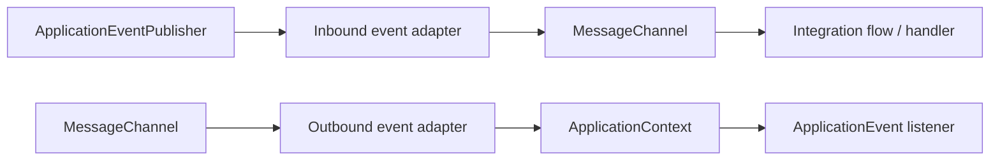

# Testing Event Adapters

Event adapters connect Spring's event lifecycle with message flows. The inbound event adapter listens for `ApplicationEvent`s in the `ApplicationContext` and converts them into Spring Integration `Message`s; the outbound event adapter receives messages from a `MessageChannel` and publishes their payload as application events. Testing both directions confirms the contract between publisher, adapter, channel, and listener, while catching bugs in event filtering, payload conversion, synchronous handling, and endpoint lifecycle.

In the Spring Integration Adapters module, event adapters are one way to connect external systems or internal application components into a flow. Even when a flow also exchanges data via files, SFTP, HTTP, JMS, AMQP, Kafka, or databases, testing still needs to clarify which messages are accepted, which payloads/headers are preserved, where errors go, and how connections start or stop. This lesson focuses on Spring Integration's application event adapters.

## 1. Defining the Contract to Test

Before writing tests, trace the event path in each direction:



For the inbound adapter, tests should answer:

- Which event types are accepted by the adapter? Are events of other types ignored?
- Is the payload inside the message the exact event that was published?
- Does the message arrive on the right channel at the right time per the sync/async configuration?
- If the channel or handler throws an exception, is the error propagated back to the publisher or routed through an error flow?

For the outbound adapter, tests should answer:

- Is a message sent to the channel published as an application event?
- Does an event listener in the same application context receive the expected type and data?
- When the publisher or listener fails, does the observed behavior match the application's policy?

Test behavior across the real adapter boundary at least once. Unit tests that only call a handler directly or mock `ApplicationEventPublisher` do not prove Spring properly registered the listener, endpoint, and channel.

## 2. Preparing Dependencies and a Sample Event

The application needs Spring Integration's event module. Tests commonly use Spring Boot Test or Spring Test together with Spring Integration Test when endpoint testing utilities are needed.

Maven example, letting versions be managed by the Spring Boot or Spring Integration BOM:

```xml
<dependency>
    <groupId>org.springframework.integration</groupId>
    <artifactId>spring-integration-event</artifactId>
</dependency>

<dependency>
    <groupId>org.springframework.integration</groupId>
    <artifactId>spring-integration-test</artifactId>
    <scope>test</scope>
</dependency>
```

If the project uses Spring Boot, you can add `spring-boot-starter-test` for JUnit Jupiter and AssertJ. Do not declare an individual version for each module when the project's BOM already manages versions; Spring Integration modules should align on one version line compatible with the Spring Framework version in use.

Create a business event with a stable identifier so tests can verify it easily:

```java
public final class OrderCreatedEvent extends ApplicationEvent {

    private final String orderId;

    public OrderCreatedEvent(Object source, String orderId) {
        super(source);
        this.orderId = orderId;
    }

    public String getOrderId() {
        return orderId;
    }
}
```

In a real application, events should carry the necessary business data and avoid holding objects tied to mutable internal state. If two components are deployed independently, treat the event as a data contract: clearly define its name, version, required fields, and how unknown fields are handled.

## 3. Testing the Inbound Event Adapter

`ApplicationEventListeningMessageProducer` listens for application events and sends messages to an output channel. The following configuration accepts only `OrderCreatedEvent`:

```java
@Configuration
@EnableIntegration
class EventAdapterConfiguration {

    @Bean
    QueueChannel orderEventsIn() {
        return new QueueChannel();
    }

    @Bean
    ApplicationEventListeningMessageProducer orderEventInboundAdapter(
            QueueChannel orderEventsIn) {

        var adapter = new ApplicationEventListeningMessageProducer();
        adapter.setEventTypes(OrderCreatedEvent.class);
        adapter.setOutputChannel(orderEventsIn);
        return adapter;
    }
}
```

The test publishes an event through the context's real `ApplicationEventPublisher` and receives the message from `QueueChannel`:

```java
@SpringBootTest
class InboundEventAdapterTests {

    @Autowired
    ApplicationEventPublisher eventPublisher;

    @Autowired
    QueueChannel orderEventsIn;

    @Test
    void convertsMatchingApplicationEventToMessage() {
        var event = new OrderCreatedEvent(this, "ORD-1001");

        eventPublisher.publishEvent(event);

        Message<?> message = orderEventsIn.receive(1_000);

        assertThat(message).isNotNull();
        assertThat(message.getPayload()).isSameAs(event);
        assertThat(((OrderCreatedEvent) message.getPayload()).getOrderId())
                .isEqualTo("ORD-1001");
    }
}
```

`QueueChannel` lets tests observe messages without running the entire downstream flow. A finite wait timeout makes tests fail clearly if the event never arrives. When the event multicaster runs synchronously, the message is usually available right after `publishEvent`; the timeout remains helpful if the context is configured with an asynchronous executor.

Add a test for event type filtering as well. Publish an event outside `eventTypes`, then verify the channel receives no message within a short timeout. If the adapter is configured to accept a base class or multiple event classes, test both subclasses and out-of-scope events to lock down the intended filtering behavior. Use a distinct event ID per test to avoid confusing leftover messages in the queue.

## 4. Testing the Outbound Event Adapter

`ApplicationEventPublishingMessageHandler` receives messages and publishes the payload as an application event. You can register the handler as a service activator on a channel:

```java
@Configuration
@EnableIntegration
class OutboundEventAdapterConfiguration {

    @Bean
    MessageChannel orderEventsOut() {
        return new DirectChannel();
    }

    @Bean
    @ServiceActivator(inputChannel = "orderEventsOut")
    MessageHandler orderEventOutboundAdapter() {
        return new ApplicationEventPublishingMessageHandler();
    }
}
```

Create a listener that observes events published in the context:

```java
@Component
class OrderEventProbe {

    private final BlockingQueue<OrderCreatedEvent> received =
            new LinkedBlockingQueue<>();

    @EventListener
    public void onOrderCreated(OrderCreatedEvent event) {
        received.offer(event);
    }

    OrderCreatedEvent poll(Duration timeout) throws InterruptedException {
        return received.poll(timeout.toMillis(), TimeUnit.MILLISECONDS);
    }
}
```

The test sends a message to the channel and waits for the listener to receive the event:

```java
@SpringBootTest
class OutboundEventAdapterTests {

    @Autowired
    MessageChannel orderEventsOut;

    @Autowired
    OrderEventProbe probe;

    @Test
    void publishesMessagePayloadAsApplicationEvent() throws Exception {
        var event = new OrderCreatedEvent(this, "ORD-1002");
        Message<OrderCreatedEvent> message =
                MessageBuilder.withPayload(event).build();

        assertThat(orderEventsOut.send(message)).isTrue();
        assertThat(probe.poll(Duration.ofSeconds(1))).isSameAs(event);
    }
}
```

The example uses a concrete `ApplicationEvent` as the payload so listeners can filter by event type. When the payload is a plain object, Spring may represent it as a `PayloadApplicationEvent`; in that case listeners and filters must be designed around the outer event type and actual payload. Test the exact contract chosen by the application rather than merely checking that some arbitrary event was emitted.

## 5. Testing Errors and Asynchronous Processing

Spring's default event multicaster invokes listeners synchronously on the publishing thread. If the application configures an executor for the multicaster or a listener offloads work to another executor, observation timing changes. Tests should not rely on fixed `Thread.sleep()` calls. Use `QueueChannel.receive(timeout)`, `BlockingQueue.poll(timeout)`, `CountDownLatch.await(timeout)`, or a conditional wait utility to await results with a time bound.

Error cases should be tested against the actual configuration:

| Situation | What to verify |
| --- | --- |
| Inbound adapter lacks a valid output channel | Context fails to start or configuration error is clearly reported |
| Handler behind inbound channel throws an exception | Exception propagates to publisher in sync mode, or routes to configured error handling |
| Outbound event listener throws an exception | Behavior matches sync/async event multicaster and application error handler |
| Wrong event type | No out-of-contract message is created |
| Slow listener | Test waits with a timeout; system exposes latency and backlog visibility |
| Context closes | Adapter stops receiving events and leaves no dangling executors or listeners past app lifecycle |

To test errors on the inbound path, wire the output channel to a `DirectChannel` with a test handler that intentionally throws an exception. In synchronous mode, the test can assert that the exception is observed when calling `publishEvent`. If the flow uses an `ExecutorChannel`, poller, or async event multicaster, the exception may occur on another thread; in that case inspect the configured error channel, error handler, or retry mechanism. Do not impose synchronous expectations on an inherently asynchronous flow.

Error testing should distinguish event publication errors from business processing errors. Successfully publishing an event only proves the event reached the dispatch mechanism; it does not prove every listener finished its work. If business rules require post-commit guarantees, separately test `@TransactionalEventListener` and the corresponding transaction state. In-memory application events are also not a durable message broker: an abrupt process stop can lose unfinished work.

## 6. Testing Headers, Payloads, and Redelivery

Spring Integration `Message`s have a payload and headers. When an event becomes a message, identify which fields belong to the payload and which are metadata added by the adapter or flow. Do not rely on an internal header not guaranteed by the application's public contract. If a flow needs a correlation ID, tenant ID, or trace ID, put them inside the event or create them in a separately tested transformation step.

Useful checks include:

- Verify the payload keeps the expected type and business data, especially when events use inheritance or conversion.
- Verify correlation IDs and required business headers are preserved or mapped per design.
- Verify events missing required fields are rejected at the validation handler with an observable error.
- Send the same event ID multiple times to verify whether the listener is idempotent when producers can emit duplicates.
- Assert ordering only when the system guarantees ordering. Multiple publishers or async executors can finish in a different order than published.

If an event becomes a message and continues on to Kafka, JMS, or AMQP, testing the event adapter does not replace testing the broker adapter's serializer, header mapping, and delivery confirmation. Maintain dedicated tests at those boundaries using sample payloads and verifying round-trips against the integration contract.

## 7. Test Isolation and Lifecycle Management

The Spring application context manages listeners and endpoints. A test suite that spins up multiple contexts or registers listeners manually without unregistering them can cause a single event to be processed multiple times. To keep tests stable:

1. Prefer letting Spring manage adapters and listeners via bean lifecycle; avoid manually registering listeners inside individual tests without a matching cleanup step.
2. Use unique event IDs per scenario and clear queues/probes after each test when contexts are reused.
3. Do not run tests in parallel against a shared queue or probe unless they are explicitly designed for isolation.
4. Use focused test contexts containing only the adapters under test when a large application has many unrelated listeners and flows.
5. Close contexts after tests and verify custom executors shut down cleanly.

When you need to mock a Spring Integration endpoint in a large flow test, you can use `spring-integration-test` utilities like `MockIntegrationContext` and endpoint-specific mocks. Swapping endpoints is useful for testing steps before/after an adapter, but keep at least one integration test that boots the real adapter to verify event and channel registration.

## 8. Checklist for an Event Adapter Test Suite

| Category | Minimum test cases |
| --- | --- |
| Startup | Context boots; adapter binds to the right channel and event type |
| Inbound | Valid events produce expected messages; out-of-scope events are ignored |
| Outbound | Valid messages emit expected events; listener receives expected payload |
| Contract | Payload type, data, correlation ID, and validation are verified |
| Synchronous | Result appears within the defined timeout |
| Asynchronous | Tests wait conditionally; no reliance on sleep or unguaranteed ordering |
| Errors | Exceptions propagate or route to error handling as configured |
| Lifecycle | Closing the context stops adapters/listeners/executors properly |
| Redelivery | Duplicate event IDs cause no duplicate side effects if idempotency is required |

A good test suite verifies both the happy path and how adapters react when contracts are violated. Test inbound and outbound through a real `ApplicationContext`, using observable channels, bounded waits, and clearly identified events. That way, Spring Integration configuration regressions are caught early before events feed a production flow.
