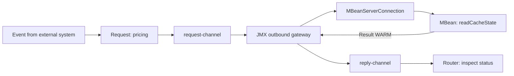

# JMX outbound gateway in Spring Integration

## 1. What problem does the JMX outbound gateway solve?

**Java Management Extensions (JMX)** provides an interface for observing and controlling Java components through **MBeans**. An MBean can expose *attributes* to read state and *operations* to execute a management method. For example, a cache service exposes an operation `readCacheState(String name)` returning `"WARM"`, `"COLD"`, or `"UNKNOWN"`.

When a Spring Integration flow needs to **invoke a JMX operation and use the return value in subsequent processing**, the right component is the **JMX operation-invoking outbound gateway**. The gateway receives a request message, invokes the MBean operation through `MBeanServerConnection`, and creates a reply message containing the operation's return value.

In the **`SPRING_INTEGRATION_ADAPTERS`** module, this lesson demonstrates connecting Spring Integration with a Java management component under a request/reply contract. The external flow may originate from file, SFTP, HTTP, JMS, AMQP, Kafka, or database adapters; after transforming the input data into a message, the gateway can inspect internal state before deciding the next processing route.

Example: a price-update event triggers checking the `pricing` cache state. Only when the cache is warm (`"WARM"`) does the flow allow publishing data; otherwise, the system can defer or run a warm-up step.



This is **outbound** because Spring Integration proactively calls an external management target outside the message flow; it is a **gateway** because one request corresponds to one reply when the operation returns a value. No *poller* is needed on this endpoint when requests are pushed onto the channel in an event-driven manner.

## 2. Comparing the outbound gateway with the operation-invoking channel adapter

| Criterion | JMX operation-invoking channel adapter | JMX operation-invoking outbound gateway |
| --- | --- | --- |
| Purpose | Sends a management command, typically a `void` operation | Invokes an operation **with a result** and returns it to the flow |
| Direction | Outbound | Outbound |
| Input | `channel` receiving messages | `request-channel` receiving messages |
| Output | Does not establish a reply route | `reply-channel` or `replyChannel` header |
| Example | `clearCache("pricing")` | `readCacheState("pricing") -> "WARM"` |
| Downstream use of result | No reply contract | Can route/transform/filter on the reply payload |

**Do not confuse with `@MessagingGateway`:** `@MessagingGateway` is a way to bring a Java API into/out of a Spring Integration flow. The JMX outbound gateway is an endpoint inside the flow dedicated to invoking an operation on an MBean. Both can work together: Java calls `@MessagingGateway` → request message → JMX outbound gateway → reply message → result returned to the Java method.

## 3. Request/reply contract and key configuration

The JMX outbound gateway is declared using the XML element:

```xml
<int-jmx:operation-invoking-outbound-gateway
    request-channel="cacheStatusRequests"
    reply-channel="cacheStatusReplies"
    mbean-server="mbeanServer"
    object-name="demo.integration:type=Cache,name=Status"
    operation-name="readCacheState"/>
```

| Attribute / value | Role | Notes |
| --- | --- | --- |
| `request-channel` | Channel receiving request messages | Usually a `DirectChannel` for synchronous processing |
| `reply-channel` | Channel receiving gateway reply messages | Can be omitted if the request carries a suitable `replyChannel` header |
| `mbean-server` | Reference to the `MBeanServerConnection`/`MBeanServer` bean | Defaults to looking up a bean named `mbeanServer` |
| `object-name` | `ObjectName` of the target MBean | Can be overridden by the `JmxHeaders.OBJECT_NAME` header |
| `operation-name` | Operation name on the MBean | Can be overridden by the `JmxHeaders.OPERATION_NAME` header |
| Request `payload` | Input argument(s) for the operation | Format depends on the number of parameters |
| Reply `payload` | Operation return value | For example `"WARM"` or an `Integer` value |

**Target selection rule:** the gateway checks `JmxHeaders.OBJECT_NAME` and `JmxHeaders.OPERATION_NAME` in the request first; if absent, it falls back to the configured `object-name` and `operation-name` defaults. Header values must be controlled because they can alter which operation gets executed.

### Mapping payload to JMX parameters

| Exposed operation | Example payload | Interpretation |
| --- | --- | --- |
| `String getVersion()` | `"trigger"` | No parameters: payload is ignored |
| `String readCacheState(String name)` | `"pricing"` | Single payload maps directly to single parameter |
| `int countByPrefix(String prefix, int limit)` | `List.of("prod-", 20)` | `List`/array represents parameters by position |
| `int countByPrefix(String prefix, int limit)` | `Map.of("prefix", "prod-", "limit", 20)` | `Map<String, ?>` maps parameters by **name** advertised in JMX metadata |

When using a `Map`, inspect actual parameter names in `MBeanInfo`/JConsole; displayed names may differ from Java variable names if the exporter does not provide metadata. With a `List` or array, order and types must match; do not assume a numeric string will automatically convert to `int`. For overloaded operations (same name, different signatures), inspect metadata to avoid selecting the wrong overload.

### How to choose `reply-channel`

There are two common approaches:

1. **Fixed channel in XML:** declare `reply-channel="cacheStatusReplies"`. Suits a predefined pipeline or examples using a `QueueChannel` to retrieve results manually.
2. **Channel from request header:** omit `reply-channel`; the gateway sends the reply to the channel in `IntegrationMessageHeaderAccessor.REPLY_CHANNEL` (usually set via `MessageHeaders.REPLY_CHANNEL`). This suits cases where upstream is a messaging gateway creating a per-request reply channel.

If you send messages directly into `request-channel` from Java and omit `reply-channel` in XML, **you must put a reply channel in the header**. Missing both causes the gateway to invoke the MBean successfully yet have no valid destination to return the result to the flow.

## 4. End-to-end example: querying cache status over JMX

This example uses a real MBean in the same JVM and a `QueueChannel` to receive replies. The snippets below fit in a Spring Framework/Spring Integration project using XML configuration.

### Step 1. Add the dependency

```xml
<dependency>
    <groupId>org.springframework.integration</groupId>
    <artifactId>spring-integration-jmx</artifactId>
</dependency>
```

When the project does not use dependency management (Spring Boot/BOM), pick a `spring-integration-jmx` version compatible with your Spring libraries. To compile the example, the project also needs core Spring Integration (via the appropriate transitive dependency) and Spring Framework.

### Step 2. Create an MBean with a value-returning operation

File `src/main/java/demo/jmx/CacheStatusService.java`:

```java
package demo.jmx;

import org.springframework.jmx.export.annotation.ManagedOperation;
import org.springframework.jmx.export.annotation.ManagedOperationParameter;
import org.springframework.jmx.export.annotation.ManagedResource;

@ManagedResource(objectName = "demo.integration:type=Cache,name=Status")
public class CacheStatusService {

    @ManagedOperation(description = "Read the state of the cache")
    @ManagedOperationParameter(
        name = "cacheName", description = "Name of the cache to check")
    public String readCacheState(String cacheName) {
        if ("pricing".equals(cacheName)) {
            return "WARM";
        }
        if ("catalog".equals(cacheName)) {
            return "COLD";
        }
        return "UNKNOWN";
    }

    @ManagedOperation(description = "Read the version of the cache")
    @ManagedOperationParameter(
        name = "cacheName", description = "Name of the cache to check")
    public String readCacheVersion(String cacheName) {
        return "v2:" + cacheName;
    }
}
```

`@ManagedResource` assigns the `ObjectName` to the MBean; `@ManagedOperation` exposes operations, and `@ManagedOperationParameter` declares parameter names in JMX metadata. For the MBean to be accessible, export the bean to the same `MBeanServer` used by the outbound gateway.

### Step 3. Configure server, exporter, and channels

File `src/main/resources/jmx-gateway.xml`:

```xml
<?xml version="1.0" encoding="UTF-8"?>
<beans xmlns="http://www.springframework.org/schema/beans"
       xmlns:xsi="http://www.w3.org/2001/XMLSchema-instance"
       xmlns:context="http://www.springframework.org/schema/context"
       xmlns:int="http://www.springframework.org/schema/integration"
       xmlns:int-jmx="http://www.springframework.org/schema/integration/jmx"
       xsi:schemaLocation="
           http://www.springframework.org/schema/beans
           https://www.springframework.org/schema/beans/spring-beans.xsd
           http://www.springframework.org/schema/context
           https://www.springframework.org/schema/context/spring-context.xsd
           http://www.springframework.org/schema/integration
           https://www.springframework.org/schema/integration/spring-integration.xsd
           http://www.springframework.org/schema/integration/jmx
           https://www.springframework.org/schema/integration/jmx/spring-integration-jmx.xsd">

    <!-- Register an MBeanServer shared by both the exporter and gateway. -->
    <context:mbean-server/>
    <context:mbean-export server="mbeanServer"/>

    <bean id="cacheStatusService" class="demo.jmx.CacheStatusService"/>

    <int:channel id="cacheStatusRequests"/>

    <!-- QueueChannel lets the example code actively pull the reply. -->
    <int:channel id="cacheStatusReplies">
        <int:queue capacity="10"/>
    </int:channel>

    <int-jmx:operation-invoking-outbound-gateway
        id="cacheStatusGateway"
        request-channel="cacheStatusRequests"
        reply-channel="cacheStatusReplies"
        mbean-server="mbeanServer"
        object-name="demo.integration:type=Cache,name=Status"
        operation-name="readCacheState"/>
</beans>
```

`<context:mbean-export>` is the Spring Framework exporter for application beans annotated with `@ManagedResource`. It differs from `IntegrationMBeanExporter`, which exposes Spring Integration's own channels/handlers to JMX for monitoring. This example only needs the Spring Framework exporter for `CacheStatusService`.

`cacheStatusRequests` is a `DirectChannel` by default: requests flow to the gateway synchronously on the thread calling `send(...)`. `cacheStatusReplies` is a `QueueChannel`: results are placed in the queue and retrieved via `receive(timeout)`. In a real application, replies can go directly to a `ServiceActivator`, router, or transformer instead of a queue.

### Step 4. Send a request and receive the reply

File `src/main/java/demo/jmx/RunJmxGateway.java`:

```java
package demo.jmx;

import org.springframework.context.support.ClassPathXmlApplicationContext;
import org.springframework.integration.support.MessageBuilder;
import org.springframework.messaging.Message;
import org.springframework.messaging.MessageChannel;
import org.springframework.messaging.PollableChannel;

public class RunJmxGateway {

    public static void main(String[] args) {
        try (var context = new ClassPathXmlApplicationContext("jmx-gateway.xml")) {
            MessageChannel requests = context.getBean(
                "cacheStatusRequests", MessageChannel.class);
            PollableChannel replies = context.getBean(
                "cacheStatusReplies", PollableChannel.class);

            boolean accepted = requests.send(
                MessageBuilder.withPayload("pricing").build());
            if (!accepted) {
                throw new IllegalStateException("Gateway did not accept request");
            }

            Message<?> reply = replies.receive(3_000);
            if (reply == null) {
                throw new IllegalStateException("No reply received within 3 seconds");
            }
            System.out.println("Cache status = " + reply.getPayload());
        }
    }
}
```

Expected output:

```text
Cache status = WARM
```

Equivalent JMX invocation path:

```java
Object result = mbeanServer.invoke(
    new javax.management.ObjectName("demo.integration:type=Cache,name=Status"),
    "readCacheState",
    new Object[] { "pricing" },
    new String[] { "java.lang.String" }
);
// result == "WARM"
```

The `mbeanServer.invoke(...)` snippet only illustrates the work performed by the gateway; you do not write it inside `RunJmxGateway`. Even though the result is just a string, passing through Spring Integration turns it into the **payload of a reply `Message<?>`**. Downstream steps can route based on that payload.

**Distinguishing wait times:** `replies.receive(3_000)` only bounds waiting to pull a message from the `QueueChannel`; it does not set a timeout on JMX operation execution. With `DirectChannel`, `requests.send(...)` can block before the program even reaches `receive(...)` if the MBean takes a long time.

## 5. Two cases requiring explicit reply configuration

### Case A: a fixed reply channel for the entire flow

The example above uses `reply-channel="cacheStatusReplies"`. This is convenient when a single processor consumes all replies in a fixed flow. However, if multiple requests are sent concurrently and multiple callers call `receive()` on **the same** queue, each caller could pick up another caller's reply.

The solution for concurrent workloads is using a separate reply channel per request, or correlating messages with a correlation ID and an aggregator/router targeting the right recipient. Never assume response ordering alone suffices to pair requests with results.

### Case B: reply channel supplied in the message header

Suppose you modify the gateway declaration to **omit** `reply-channel`:

```xml
<int-jmx:operation-invoking-outbound-gateway
    id="cacheStatusGateway"
    request-channel="cacheStatusRequests"
    mbean-server="mbeanServer"
    object-name="demo.integration:type=Cache,name=Status"
    operation-name="readCacheState"/>
```

The sender can create a dedicated `QueueChannel` and specify it in `MessageHeaders.REPLY_CHANNEL`:

```java
import org.springframework.integration.channel.QueueChannel;
import org.springframework.integration.support.MessageBuilder;
import org.springframework.messaging.Message;
import org.springframework.messaging.MessageHeaders;

QueueChannel myReplies = new QueueChannel();

requests.send(MessageBuilder.withPayload("catalog")
    .setHeader(MessageHeaders.REPLY_CHANNEL, myReplies)
    .build());

Message<?> reply = myReplies.receive(3_000);
// reply.getPayload() == "COLD" if the operation completes successfully.
```

In this example, `requests` is a `MessageChannel` retrieved from the `ApplicationContext`. A `@MessagingGateway` at the flow entry normally sets up the needed reply channel and correlation automatically, whereas manual message-sending code must provide them itself. Without a valid reply channel, the flow cannot deliver the result back to the caller as expected.

## 6. Selecting operations dynamically with JMX headers

The gateway can use its preconfigured operation or read `JmxHeaders.OBJECT_NAME` and `JmxHeaders.OPERATION_NAME` on each request. Headers are checked **before** configuration defaults.

For example, `CacheStatusService` also has `readCacheVersion(String cacheName)`. Even though XML defaults to `readCacheState`, the following request invokes `readCacheVersion`:

```java
import org.springframework.integration.jmx.JmxHeaders;
import org.springframework.integration.support.MessageBuilder;

requests.send(MessageBuilder.withPayload("pricing")
    .setHeader(JmxHeaders.OPERATION_NAME, "readCacheVersion")
    .build());

// Expected reply payload: "v2:pricing"
```

If another permitted MBean provides the result, you can also set `JmxHeaders.OBJECT_NAME` to its `ObjectName`. For requests coming from HTTP, Kafka, JMS, or external systems, **never copy MBean/operation names directly from untrusted sources into headers**. Map fixed business commands (such as `CHECK_CACHE`) to an internal allowlist of permitted `ObjectName`/operation pairs.

## 7. Using the reply to make routing decisions in the flow

Once the gateway returns the status, a router can choose the processing branch:

```xml
<int:router input-channel="cacheStatusReplies" expression="payload">
    <int:mapping value="WARM" channel="readyToPublish"/>
    <int:mapping value="COLD" channel="needsWarmup"/>
    <int:mapping value="UNKNOWN" channel="manualReview"/>
</int:router>

<int:channel id="readyToPublish"/>
<int:channel id="needsWarmup"/>
<int:channel id="manualReview"/>
```

This **replaces the `QueueChannel` in the manual example**: when using a router, declare `cacheStatusReplies` as a `DirectChannel` (or an appropriate point-to-point channel), because the router is a handler receiving the message immediately upon reply. Do not have both manual `receive()` code and a router consuming from the same queue if consumers need every result.

For audited or concurrent flows, preserve a stable correlation ID from the request, log the operation result, and record the exact decision timestamp. Spring Integration may copy ordinary headers from the request to the reply, yet you should verify how special headers like `replyChannel` and `errorChannel` behave across flow boundaries.

## 8. Common errors and operational practices

| Symptom | Possible cause | Resolution |
| --- | --- | --- |
| `InstanceNotFoundException` | MBean not exported yet, wrong `ObjectName`, or different server | Inspect JConsole/VisualVM; verify `mbeanServer` and registered name |
| `ReflectionException` / operation resolution error | Wrong operation name, parameter types, or parameter count | Check operation/signature in `MBeanInfo`; inspect payload |
| `MBeanException` / exception inside operation | The MBean method threw an error during execution | Inspect root cause; record correlation ID; apply appropriate retry rules |
| No reply appears on the queue | Missing/wrong `reply-channel`, missing reply header, operation returned `null`, or another consumer took the reply | Check routing, gateway logs, return value, and consumer count |
| Slow requests, `send()` hangs | Slow MBean execution or slow remote JMX | Measure actual invoke latency; set timeouts at the JMX/connection layer and limit long synchronous blocking |
| Caller receives someone else's reply | Multiple callers reading one shared queue | Use a per-request reply channel or proper request/reply correlation |
| Unexpected operation invoked | `JmxHeaders.OPERATION_NAME`/`OBJECT_NAME` supplied by external input | Govern, strip, or remap headers at the ingress boundary |

### Operational rules to maintain

1. **Choose suitable operations:** the outbound gateway is designed for calls that return a value. Avoid `void` operations or operations that can return `null` when downstream expects a reply: a Spring `Message` cannot carry a `null` payload, so the flow may not produce a reply as expected.
2. **Understand synchronous vs. asynchronous errors:** with `DirectChannel`, exceptions during operation invocation usually propagate to the request sender. If replaced with an `ExecutorChannel` or async mechanism, configure an `errorChannel`, timeouts, and dedicated error monitoring.
3. **Control side effects and blind retries:** an action like incrementing a counter may already have executed on the MBean even if the caller timed out. Only retry when the operation is idempotent or guarded against duplicate execution.
4. **Enforce JMX permissions:** export and allow only necessary operations. For remote JMX, configure authentication, TLS, and proper network scope; avoid logging sensitive data in payloads or headers.
5. **Manage lifecycles:** ensure the MBean is registered before requests arrive and the server/connection remains active. Declare connections as container-managed beans rather than creating a new connection per message.

### Manual verification checklist

1. Start the application and confirm `demo.integration:type=Cache,name=Status` appears in JConsole/VisualVM.
2. Verify the MBean exposes `readCacheState(java.lang.String)` and `readCacheVersion(java.lang.String)`.
3. Send payload `"pricing"` and confirm reply payload `"WARM"` arrives on the queue.
4. Send payload `"catalog"` and confirm `"COLD"`; send a request with operation header `readCacheVersion` and confirm `"v2:pricing"`.
5. Test a nonexistent `ObjectName` in a test environment and confirm the error is captured instead of waiting indefinitely for a reply.
6. Test omitting `reply-channel` and passing a per-request reply channel in the header; verify each caller receives its own result.

## 9. Self-check questions

1. Why should an operation returning cache state go through the JMX outbound gateway instead of the operation-invoking channel adapter?
2. When does the gateway use the `reply-channel` configured in XML, and when does it read from the `replyChannel` header?
3. Why can a shared `QueueChannel` cause two callers to receive each other's results?
4. Which operation does the gateway choose if XML sets `readCacheState` while the request carries `JmxHeaders.OPERATION_NAME` set to `readCacheVersion`?
5. What is the difference between the `QueueChannel.receive(3_000)` timeout and a JMX invocation timeout?
6. Why should you avoid retrying every JMX operation error if the operation has side effects?

## References

- [Spring Integration Reference — JMX Support](https://docs.spring.io/spring-integration/reference/jmx.html): configuring the operation-invoking outbound gateway, payload mapping, and reply channel selection.
- [Spring Integration API — `OperationInvokingMessageHandler`](https://docs.spring.io/spring-integration/api/org/springframework/integration/jmx/OperationInvokingMessageHandler.html): header precedence, configuration methods, and operation result handling.
- [Spring Integration Reference — Messaging Gateways](https://docs.spring.io/spring-integration/reference/gateway.html): Java/messaging gateway mechanics and reply channel creation at flow boundaries.
- [Spring Framework Reference — JMX Exporting](https://docs.spring.io/spring-framework/docs/integration/jmx/exporting.html): exporting `@ManagedResource` beans via `MBeanExporter`.
