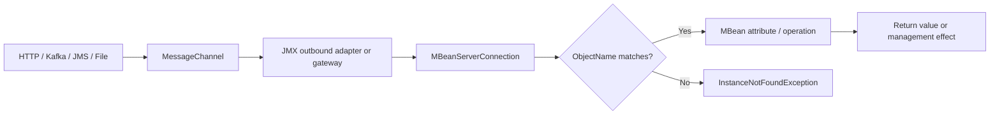

# MBeanServer and ObjectName in Spring Integration Adapter JMX

## 1. Why understand MBeanServer and ObjectName?

**Java Management Extensions (JMX)** is Java's standard mechanism for observing and controlling components running inside the JVM. An application can expose queue states, connection counts, memory usage, or management actions as an **MBean** (managed bean). To invoke the right operation or read the right attribute, a JMX client must answer two questions:

1. **Call through which server?** — `MBeanServer` or the general interface `MBeanServerConnection`.
2. **Call which object on that server?** — The `ObjectName` identifying the MBean.

These two elements also form the foundation of the **Adapter JMX** group in the `SPRING_INTEGRATION_ADAPTERS` module. Spring Integration endpoints such as the *attribute-polling inbound adapter*, *operation-invoking outbound adapter/gateway*, or *notification-listening adapter* must all identify the exact MBean target. They connect Java management interfaces with `MessageChannel`, transformers, routers, and flows originating from file, SFTP, HTTP, JMS, AMQP, Kafka, or databases.

Example: the system receives an event from Kafka requesting a cache clear on a Java service. The message enters Spring Integration; the outbound adapter uses `MBeanServer` to locate the MBean with the configured `ObjectName` and invokes `reset()`. If it points to the wrong server or object name, the call fails even when the payload and operation name are correct.



## 2. MBeanServer: MBean registry and access point

`javax.management.MBeanServer` is the central JVM-side JMX interface. It manages registered MBeans, supports lookups, and invokes management actions. An `MBeanServer` can hold many MBeans, yet **each `ObjectName` identifies at most one MBean at a time within that server**.

| JMX API | Meaning | Use case |
| --- | --- | --- |
| `registerMBean(mbean, objectName)` | Registers an MBean under a specific name | Exposes a managed object on the server |
| `unregisterMBean(objectName)` | Unregisters an MBean | Cleans up an application-owned object |
| `isRegistered(objectName)` | Checks whether an MBean exists under that name | Inspects registration status |
| `queryNames(pattern, query)` | Finds matching `ObjectName`s | Lists MBeans by domain/type/name |
| `getMBeanInfo(objectName)` | Reads attribute, operation, and notification metadata | Verifies operation signatures before invoking |
| `getAttribute(objectName, attribute)` | Reads an attribute | Fetches a state/metric value |
| `setAttribute(objectName, attribute)` | Writes a writable attribute | Adjusts management settings if permitted |
| `invoke(objectName, operation, args, signature)` | Invokes an MBean operation | Clears cache, resets metrics, triggers refresh |

### 2.1. Distinguishing `MBeanServer` and `MBeanServerConnection`

`MBeanServer` extends `MBeanServerConnection`:

- **`MBeanServer`** can directly register a local Java object via `registerMBean(...)`, typically used when the application **owns and exposes** MBeans inside the JVM.
- **`MBeanServerConnection`** provides observation/control operations such as `queryNames`, `getAttribute`, and `invoke`, usable for both local connections and remote JMX connections. It does not offer a method to register a local Java object with `registerMBean`.

Spring Integration endpoints interact with MBeans via the corresponding server/connection. When configuring an endpoint to read attributes or invoke operations, what matters is ensuring **the endpoint uses a connection pointing to the exact server hosting that MBean**.

### 2.2. Platform MBeanServer and standalone servers

In a typical Java JVM, you obtain the **platform MBeanServer** via:

```java
import java.lang.management.ManagementFactory;
import javax.management.MBeanServer;

MBeanServer server = ManagementFactory.getPlatformMBeanServer();
```

The platform server hosts standard JVM MBeans such as memory, threading, and garbage collectors; applications can register their own MBeans there too. Java also permits creating standalone `MBeanServer`s through `MBeanServerFactory`, so **not every MBean in the same JVM automatically appears on the same server**.

Spring Framework commonly provides a bean named `mbeanServer` shared across components. `MBeanExporter` handles **registering** application beans onto the server, while JMX adapters/gateways use that server to **access** MBeans. Simply being in the same Spring application does not guarantee two components point to the same server if developers configured separate servers.

## 3. ObjectName: the address of an MBean

`javax.management.ObjectName` identifies an MBean by its **domain** and set of **key properties**. Typical syntax:

```text
<domain>:<key1>=<value1>,<key2>=<value2>,...
```

Examples:

```text
learning.integration:type=QueueMetrics,name=Orders
java.lang:type=Memory
learning.integration:type=Cache,name=Pricing,tenant=internal
```

For `learning.integration:type=QueueMetrics,name=Orders`:

- `learning.integration` is the **domain**, grouping managed objects.
- `type=QueueMetrics` and `name=Orders` are **key properties**, distinguishing MBeans within the domain.
- `type`, `name`, and `tenant` are key names **by application convention**; JMX does not enforce those exact keys. Key properties are part of the MBean's identity.

`ObjectName` is a JMX management name—**not** a Java class name, Spring bean name, URL, Kafka topic name, or file path. Having a Java class named `QueueMetrics` does not automatically create a matching `ObjectName`; explicit registration/export is required.

### 3.1. Creating and inspecting an ObjectName in Java

```java
import javax.management.ObjectName;

ObjectName name = new ObjectName(
    "learning.integration:type=QueueMetrics,name=Orders");

System.out.println(name.getDomain());              // learning.integration
System.out.println(name.getKeyProperty("type"));    // QueueMetrics
System.out.println(name.getKeyProperty("name"));    // Orders
System.out.println(name.getCanonicalName());
System.out.println(name.isPattern());               // false
```

`getCanonicalName()` sorts key properties into a canonical form. Two strings containing the **same domain and same key/value pairs in a different order** identify the same MBean:

```java
ObjectName a = new ObjectName(
    "learning.integration:type=QueueMetrics,name=Orders");
ObjectName b = new ObjectName(
    "learning.integration:name=Orders,type=QueueMetrics");

System.out.println(a.equals(b)); // true
```

Use `ObjectName` or `getCanonicalName()` when comparing identities rather than comparing raw manually constructed strings.

### 3.2. Special characters and `ObjectName.quote(...)`

Tenant, cache, or queue names may contain commas, colons, equals signs, quotes, or wildcards. When building a key property, **quote the value** instead of raw string concatenation:

```java
String queueName = "orders,priority=high";

ObjectName safeName = new ObjectName(
    "learning.integration:type=QueueMetrics,name="
        + ObjectName.quote(queueName));

System.out.println(safeName);
// learning.integration:type=QueueMetrics,name="orders,priority=high"
```

`ObjectName.quote(...)` preserves key property values, including `*`/`?` characters that carry special meaning in search patterns. Still validate inputs against business rules: syntactically quoting a client-supplied name does not mean the client is **authorized** to access it.

### 3.3. Exact ObjectName vs. ObjectName pattern

JMX supports finding multiple MBeans using **ObjectName patterns**:

| Example | Meaning |
| --- | --- |
| `learning.integration:type=QueueMetrics,name=Orders` | Exact name of one MBean |
| `learning.integration:type=QueueMetrics,name=*` | Pattern matching any `name` with this exact set of key properties |
| `learning.integration:type=QueueMetrics,*` | Every MBean with `type=QueueMetrics`, even with extra key properties |
| `learning.integration:*` | Every MBean in the `learning.integration` domain |
| `java.lang:type=Memory` | Standard JVM memory MBean, if registered on that server |

```java
ObjectName pattern = new ObjectName(
    "learning.integration:type=QueueMetrics,*");

System.out.println(pattern.isPattern());  // true

for (ObjectName matched : server.queryNames(pattern, null)) {
    System.out.println(matched.getCanonicalName());
}
```

**Patterns are for querying**, whereas `registerMBean`, `getAttribute`, and `invoke` require a **concrete MBean name**. Never put `name=*` into the `object-name` of an outbound adapter meant to invoke an operation on a specific MBean. When dispatching to multiple targets, resolve and verify the actual MBeans first and pick an exact name per message.

## 4. Plain Java example: registering, finding, reading, and invoking an MBean

The example below clarifies the `MBeanServer`–`ObjectName` relationship before introducing `MessageChannel`. It uses a JDK **Standard MBean** without Spring, targeting Java 17+ to align with modern examples.

### 4.1. Defining the management interface

File `src/main/java/demo/jmx/QueueMetricsMBean.java`:

```java
package demo.jmx;

public interface QueueMetricsMBean {
    int getDepth();
    void reset();
}
```

By Standard MBean convention, class `QueueMetrics` implements the public `QueueMetricsMBean` interface. The getter `getDepth()` is exposed as JMX attribute **`Depth`**, while `reset()` becomes an operation.

File `src/main/java/demo/jmx/QueueMetrics.java`:

```java
package demo.jmx;

import java.util.concurrent.atomic.AtomicInteger;

public final class QueueMetrics implements QueueMetricsMBean {
    private final AtomicInteger depth = new AtomicInteger(7);

    @Override
    public int getDepth() {
        return depth.get();
    }

    @Override
    public void reset() {
        depth.set(0);
    }
}
```

### 4.2. Using MBeanServer

File `src/main/java/demo/jmx/JmxServerDemo.java`:

```java
package demo.jmx;

import java.lang.management.ManagementFactory;
import javax.management.MBeanInfo;
import javax.management.MBeanOperationInfo;
import javax.management.MBeanServer;
import javax.management.ObjectName;

public class JmxServerDemo {
    public static void main(String[] args) throws Exception {
        MBeanServer server = ManagementFactory.getPlatformMBeanServer();
        ObjectName name = new ObjectName(
            "learning.integration:type=QueueMetrics,name=Orders");

        // Each ObjectName can only be registered once on this server.
        server.registerMBean(new QueueMetrics(), name);
        try {
            int before = (Integer) server.getAttribute(name, "Depth");
            System.out.println("Depth before = " + before);

            MBeanInfo info = server.getMBeanInfo(name);
            for (MBeanOperationInfo operation : info.getOperations()) {
                System.out.println("Operation: " + operation.getName());
            }

            ObjectName search = new ObjectName(
                "learning.integration:type=QueueMetrics,*");
            System.out.println("Matching MBeans = "
                + server.queryNames(search, null).size());

            server.invoke(name, "reset", new Object[0], new String[0]);

            int after = (Integer) server.getAttribute(name, "Depth");
            System.out.println("Depth after = " + after);
        } finally {
            // Unregister only the MBean created by this program.
            server.unregisterMBean(name);
        }
    }
}
```

Typical output:

```text
Depth before = 7
Operation: reset
Matching MBeans = 1
Depth after = 0
```

This snippet illustrates three distinct mechanisms: **registering** an MBean via `registerMBean`, **identifying** it via `ObjectName`, and **interacting** via `getAttribute`/`invoke`. `new Object[0]` and `new String[0]` indicate `reset()` takes no parameters. If an operation takes parameters, `args` and `signature` arrays must match the order and types advertised by JMX.

If registration runs while another MBean already holds that name, JMX throws `InstanceAlreadyExistsException`. Do not call `unregisterMBean` on an existing name owned by another component just to avoid collisions. In real Spring applications, let `MBeanExporter` manage registration and unregistration lifecycles.

## 5. Bringing MBeanServer and ObjectName into Spring Integration

When Spring Integration sends a message to a JMX adapter/gateway, the message itself **does not carry a direct reference to a Java object**. The endpoint uses `ObjectName` to locate the MBean on the configured server/connection.

### 5.1. XML configuration: sharing one MBeanServer

Suppose `QueueMetrics` and `QueueMetricsMBean` from the previous example exist in the application. Spring can register the MBean via `MBeanExporter`:

```xml
<?xml version="1.0" encoding="UTF-8"?>
<beans xmlns="http://www.springframework.org/schema/beans"
       xmlns:xsi="http://www.w3.org/2001/XMLSchema-instance"
       xmlns:context="http://www.springframework.org/schema/context"
       xmlns:int="http://www.springframework.org/schema/integration"
       xmlns:int-jmx="http://www.springframework.org/schema/integration/jmx"
       xsi:schemaLocation="
           http://www.springframework.org/schema/beans
           https://www.springframework.org/schema/beans/spring-beans.xsd
           http://www.springframework.org/schema/context
           https://www.springframework.org/schema/context/spring-context.xsd
           http://www.springframework.org/schema/integration
           https://www.springframework.org/schema/integration/spring-integration.xsd
           http://www.springframework.org/schema/integration/jmx
           https://www.springframework.org/schema/integration/jmx/spring-integration-jmx.xsd">

    <!-- Declare a shared server for registering and invoking JMX. -->
    <context:mbean-server/>

    <bean id="queueMetrics" class="demo.jmx.QueueMetrics"/>

    <bean id="mbeanExporter"
          class="org.springframework.jmx.export.MBeanExporter">
        <property name="server" ref="mbeanServer"/>
        <property name="beans">
            <map>
                <entry key="learning.integration:type=QueueMetrics,name=Orders"
                       value-ref="queueMetrics"/>
            </map>
        </property>
    </bean>

    <int:channel id="resetCommands"/>

    <int-jmx:operation-invoking-channel-adapter
        id="resetMetricsAdapter"
        channel="resetCommands"
        mbean-server="mbeanServer"
        object-name="learning.integration:type=QueueMetrics,name=Orders"
        operation-name="reset"/>
</beans>
```

At startup, `MBeanExporter` registers `queueMetrics` under the chosen `ObjectName`. When a message arrives on `resetCommands`, the outbound adapter invokes `reset` through `mbeanServer`. For zero-parameter operations, the payload serves merely as a trigger, and the adapter does not produce a reply.

Sending a message from Java:

```java
import org.springframework.integration.support.MessageBuilder;
import org.springframework.messaging.MessageChannel;

MessageChannel resetCommands = context.getBean(
    "resetCommands", MessageChannel.class);

resetCommands.send(MessageBuilder.withPayload("reset-request").build());
```

Here `context` is the `ApplicationContext` that loaded the XML config. This is a **standalone implementation** of the plain JMX demo; do not run `JmxServerDemo`'s `registerMBean` at the same time as an `MBeanExporter` using the same name on the same server, as they will collide.

If the application uses Spring JMX annotations, replace the manual exporter configuration with `@ManagedResource(objectName = "...")`, `@ManagedAttribute`, `@ManagedOperation`, and `<context:mbean-export server="mbeanServer"/>`. Keep the `ObjectName` and server consistent.

### 5.2. ObjectName read from message headers

For JMX operation-invoking endpoints, `object-name` and `operation-name` can be set as configuration defaults or supplied dynamically via Spring Integration headers:

```java
import org.springframework.integration.jmx.JmxHeaders;
import org.springframework.integration.support.MessageBuilder;

var command = MessageBuilder.withPayload("reset-request")
    .setHeader(JmxHeaders.OBJECT_NAME,
        "learning.integration:type=QueueMetrics,name=Orders")
    .setHeader(JmxHeaders.OPERATION_NAME, "reset")
    .build();

resetCommands.send(command);
```

**Headers take precedence over default values** on endpoints supporting header-based MBean/operation selection. This enables a flow to select targets dynamically by business logic, yet can also invoke **an unintended MBean** if headers are copied from untrusted sources. Map external requests to target names from an allowlist before sending to the adapter.

### 5.3. MBeanServer used across multiple JMX endpoint types

| Endpoint | Role of `ObjectName` and server | Message flow |
| --- | --- | --- |
| Attribute-polling inbound adapter | Selects MBean and attribute read by poller | JMX → `MessageChannel` |
| Notification-listening inbound adapter | Selects notification-emitting MBean to listen to | JMX → `MessageChannel` |
| Operation-invoking outbound adapter | Selects MBean/operation and invokes on message | `MessageChannel` → JMX |
| Operation-invoking outbound gateway | Selects MBean/operation, invokes, and wraps result as reply | Request `MessageChannel` → JMX → Reply |

The term *outbound* describes proactively accessing JMX from a Spring Integration flow; *inbound* describes data/notifications entering the flow from JMX. Regardless of direction, a wrong `ObjectName` or wrong server prevents the endpoint from finding its target.

## 6. Local MBeanServer and remote JMX connections

If the MBean lives in the **same JVM**, you can typically use `ManagementFactory.getPlatformMBeanServer()` or a Spring-managed `mbeanServer` bean. If the MBean lives in **another JVM**, an `ObjectName` alone is not enough: you need an `MBeanServerConnection` connected to the target machine's JMX connector.

Remote JMX client connection example (URL, authentication, and TLS config come from the deployment environment):

```java
import javax.management.MBeanServerConnection;
import javax.management.ObjectName;
import javax.management.remote.JMXConnector;
import javax.management.remote.JMXConnectorFactory;
import javax.management.remote.JMXServiceURL;
import java.util.Map;

// url and environment are configured by the deployment environment.
JMXServiceURL url = new JMXServiceURL(jmxServiceUrl);
Map<String, ?> environment = jmxConnectionEnvironment;

try (JMXConnector connector = JMXConnectorFactory.connect(url, environment)) {
    MBeanServerConnection remote = connector.getMBeanServerConnection();
    ObjectName name = new ObjectName(
        "learning.integration:type=QueueMetrics,name=Orders");

    Integer depth = (Integer) remote.getAttribute(name, "Depth");
    System.out.println("Remote depth = " + depth);
}
```

`jmxServiceUrl` and `jmxConnectionEnvironment` are preconfigured variables provided in the calling context, not literal strings to copy verbatim. When integrating with Spring, declare the connection as a container-managed bean and reference it via `mbean-server` on JMX adapters/gateways; the application must manage its lifecycle and close the connection properly.

**Limitations to distinguish:**

- `ObjectName` is only an **identifier within a server**. The same `ObjectName` string on two JVMs/servers can point to two completely different MBeans.
- `MBeanServerConnection` is an **access channel** to the server; it does not automatically ensure network reachability, TLS, operation permissions, or appropriate timeouts.
- Never pass JMX endpoint URLs, credentials, or operation names directly from untrusted clients without validation and allowlisting.
- Remote connections can drop or time out; when retrying, account for operation side effects because the prior call may have executed even if the client never received the result.

## 7. Common errors: finding the right server and right ObjectName

| Symptom | Typical cause | How to verify |
| --- | --- | --- |
| `MalformedObjectNameException` | Invalid name syntax or unquoted key/value | Construct `new ObjectName(...)` in tests; use `ObjectName.quote(...)` for dynamic values |
| `InstanceNotFoundException` | MBean not registered; wrong domain/key properties; connected to wrong server/JVM | Call `queryNames(...)`, compare `getCanonicalName()`, verify active server/connection |
| `InstanceAlreadyExistsException` | Two exporters or components register the same name on the same server | Assign a clear registration owner; audit `MBeanExporter` configs |
| `AttributeNotFoundException` | Wrong attribute name or attribute not exposed | Call `getMBeanInfo()` and inspect `getAttributes()`; note `getDepth()` is `Depth` |
| `ReflectionException` | Wrong operation name/signature or method not exposed via JMX | Inspect `MBeanOperationInfo` and `signature` array |
| `MBeanException` | MBean operation threw an exception during execution | Analyze root cause and operation state before retrying |
| `IOException` on remote call | Network failure or JMX connector unavailable | Check address, connectivity, permissions, TLS, and timeout/reconnect policies |
| MBean visible in JConsole yet adapter cannot read it | JConsole and adapter are accessing **two different servers or JVMs**, or missing permissions | Compare target JVM, connection URL, canonical `ObjectName`, and JMX permissions |

### 7.1. Layer-by-layer diagnostic procedure

1. **Verify registration:** on the target JVM/server, run `queryNames(...)` or open JConsole/VisualVM to confirm the MBean name exists.
2. **Verify naming:** compare domain, key properties, and canonical form. Never infer names from Java class names or Spring bean IDs.
3. **Verify interface:** use `getMBeanInfo()` to inspect the attributes, operations, and parameter signatures JMX actually exposes.
4. **Verify connection:** check which `mbeanServer` bean the adapter uses; if remote, verify connector, credentials, TLS, network path, and target JVM.
5. **Verify message:** inspect `JmxHeaders.OBJECT_NAME`, `JmxHeaders.OPERATION_NAME`, payload, and mapping rules; strip headers outside the allowlist.
6. **Verify lifecycle:** confirm the MBean stays registered while the flow runs, is not unregistered prematurely or duplicated on restart, and handle connection errors/retries according to operation semantics.

### 7.2. Operational conventions

- Design stable structured names such as `<domain>:type=<component>,name=<instance>`, adding `tenant` or `node` when disambiguation is needed. Never put sensitive data into `ObjectName`, as it appears in management tools.
- Only allow adapters to invoke necessary MBeans/operations. JMX commands can have strong side effects like resets, reloads, or config mutations.
- MBeans are responsible for their own thread safety when concurrent requests arrive from channels or connectors. `MBeanServer` does not automatically make management methods thread-safe.
- Log canonical MBean names, operations, correlation IDs, execution durations, and errors for traceability; never log credentials or secret parameters.
- Treat registration/unregistration as the responsibility of one explicit component (`MBeanExporter` or dedicated management code) to avoid naming conflicts across instance restarts.

## 8. Hands-on exercise and self-check questions

**Exercise:** use `QueueMetrics` from section 4 and the Spring Integration configuration from section 5.

1. Call `getAttribute(..., "Depth")` and confirm the initial value is `7`.
2. Send a message to `resetCommands`; call `getAttribute(..., "Depth")` again and confirm it is `0`.
3. Query using the pattern `learning.integration:type=QueueMetrics,*` and verify the concrete name appears.
4. Try a wrong `ObjectName` with `name=Other`; observe `InstanceNotFoundException` and verify registered names on the server.
5. Create two `ObjectName`s with swapped key property order and check that `equals` returns `true`.
6. Try a queue name containing a comma; build it with `ObjectName.quote(...)` and compare with raw concatenation.

**Review questions:**

1. How does `MBeanServer` differ from `MBeanServerConnection` in capabilities, and why does that matter when managing MBeans inside vs. outside the JVM?
2. Why is an exact `ObjectName` more important than a Java class name when Spring Integration invokes an operation?
3. Can two `ObjectName`s with different key property orders be equal?
4. Why shouldn't a wildcard `ObjectName` be used directly when invoking an operation on a concrete MBean?
5. What happens if two `MBeanExporter`s register the same `ObjectName` on the same server?
6. Why might an MBean visible in JConsole still not be found by a JMX adapter?

## References

- [Java SE API — `MBeanServer`](https://docs.oracle.com/en/java/javase/21/docs/api/java.management/javax/management/MBeanServer.html): registering MBeans and management methods.
- [Java SE API — `ObjectName`](https://docs.oracle.com/en/java/javase/21/docs/api/java.management/javax/management/ObjectName.html): name syntax, patterns, key properties, quoting, and canonical names.
- [Java SE API — `MBeanServerConnection`](https://docs.oracle.com/en/java/javase/21/docs/api/java.management/javax/management/MBeanServerConnection.html): operations shared across local servers and remote connections.
- [Spring Framework Reference — JMX Exporting](https://docs.spring.io/spring-framework/reference/integration/jmx/exporting.html): `MBeanExporter`, MBean names, and Spring integration.
- [Spring Integration Reference — JMX Support](https://docs.spring.io/spring-integration/reference/jmx.html): how JMX adapters/gateways combine `MBeanServer`, `ObjectName`, and `MessageChannel`.
