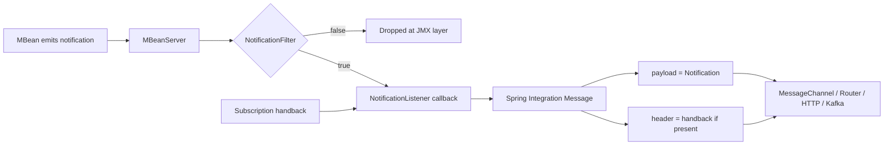

# Notification filter and handback in Spring Integration JMX Adapters

## 1. Problem: receiving only needed JMX events and knowing which subscription they belong to

A Java application can emit a **JMX notification** when a queue crosses a threshold, a connection drops, a cache refreshes, or a component changes state. Spring Integration provides the **notification-listening inbound channel adapter** to receive those notifications and push them onto a `MessageChannel` for further processing.

In the **`SPRING_INTEGRATION_ADAPTERS`** module, this flow can combine with transformers, filters, routers, gateways, or HTTP, JMS, AMQP, Kafka, file, SFTP, and database adapters. For example, an MBean reports rising pending messages; Spring Integration receives the alert and forwards it to an HTTP webhook or a Kafka topic.

However, one MBean may emit multiple notification types while the system only wants to handle a subset. Furthermore, if a listener is registered across multiple sources, you may want to know which **registration context** an event came from. JMX addresses these two needs with:

- **`NotificationFilter`**: decides whether a notification is delivered to the listener.
- **`handback`**: a context object supplied **when registering the listener** and passed back to that same listener whenever a notification arrives.



The adapter receives notifications in an event-driven way when the listener is invoked; it **does not require a poller**. This is an important difference from the JMX attribute-polling inbound adapter, which periodically calls `getAttribute()`.

## 2. JMX contract: Notification, filter, and handback

JMX uses the `javax.management.NotificationListener` interface with callback:

```java
void handleNotification(Notification notification, Object handback);
```

A listener is registered through `MBeanServerConnection` as:

```java
server.addNotificationListener(
    objectName,
    listener,
    filter,
    handback
);
```

Here, both `filter` and `handback` may be `null`. Do not confuse them with parts inside `Notification` itself:

| Concept | Supplied by | Scope | Purpose |
| --- | --- | --- | --- |
| `Notification` | Emitting MBean | **Per event** | Carries `type`, `source`, `sequenceNumber`, `timeStamp`, `message`, `userData` |
| `NotificationFilter` | Listener subscriber | **Per listener registration** | Decides whether to forward a notification to the listener |
| `handback` | Listener subscriber | **Per listener registration** | Attaches context to identify or process events in the callback |
| `Notification.userData` | Emitting MBean | **Per event** | Carries event data, e.g. `{queue: orders, pending: 120}` |

**Processing order:** MBean emits notification → JMX applies `NotificationFilter` → if accepted, the listener receives the `Notification` **and the exact `handback` configured at registration time**. The filter does not modify the notification; nor is `handback` computed by the MBean per event.

Two different listeners can register on the same MBean with different filters or handbacks. Therefore, `handback` works well as a route label like `orders-monitor`, `billing-monitor`, or a stable subscription ID; it should never contain passwords or tokens.

### 2.1. `NotificationFilter` is a Java interface

```java
package javax.management;

public interface NotificationFilter extends java.io.Serializable {
    boolean isNotificationEnabled(Notification notification);
}
```

The method returns `true` to receive the notification and `false` to ignore it. A filter can inspect `notification.getType()`, `getSource()`, `getUserData()`, or other contract-approved properties. Keep filters simple, fast, side-effect-free, and thread-safe.

The JDK provides `NotificationFilterSupport` for filtering by notification type, but when you need to check **both exact type and values inside `userData`**, a custom implementation is usually clearer and easier to test.

### 2.2. `handback` is not a property of the event

Plain JMX registration example:

```java
NotificationListener listener = (notification, handback) -> {
    System.out.println("type=" + notification.getType());
    System.out.println("subscription=" + handback);
};

NotificationFilter onlyBacklog = notification ->
    "demo.orders.queue.backlog".equals(notification.getType());

server.addNotificationListener(
    new ObjectName("demo.integration:type=Alerts,name=Orders"),
    listener,
    onlyBacklog,
    "orders-monitor"
);
```

With this registration, the callback receives the string `"orders-monitor"` for **every** notification passing the filter. Even if the MBean emits notifications with varying `userData`, `handback` stays the original registration label. You must unregister the listener properly with lifecycle management; the snippet above illustrates the callback mechanism without cleanup.

## 3. Spring Integration message contract

Spring Integration turns each received notification into a `Message<?>`:

- **Payload**: the `javax.management.Notification` object itself (possibly a subclass such as `AttributeChangeNotification`).
- **Header `JmxHeaders.NOTIFICATION_HANDBACK`**: contains the handback if configured as non-`null`.
- **Output channel**: the channel specified in the `channel` attribute of `notification-listening-channel-adapter`.

Example of reading the message in Java:

```java
import javax.management.Notification;
import org.springframework.integration.jmx.JmxHeaders;
import org.springframework.messaging.Message;

public void handle(Message<?> message) {
    Notification notification = (Notification) message.getPayload();
    Object handback = message.getHeaders().get(JmxHeaders.NOTIFICATION_HANDBACK);

    System.out.printf("type=%s, handback=%s, userData=%s%n",
        notification.getType(), handback, notification.getUserData());
}
```

**Do not assume** `JmxHeaders.NOTIFICATION_TYPE` is always present on messages from the *notification-listening* adapter: the reliable way to read the type is `((Notification) message.getPayload()).getType()`. `JmxHeaders.NOTIFICATION_TYPE` is normally used when the **publishing adapter** builds a JMX notification from a message, which is the opposite integration direction.

## 4. Complete example: receiving only queue alerts of 100 or more messages

Let's build a **Standard MBean** capable of emitting two notification types:

| Notification type | `userData` | Accepted by filter? |
| --- | --- | --- |
| `demo.orders.queue.backlog` | `queue=orders, pending=120` | Yes, because backlog ≥ 100 |
| `demo.orders.queue.backlog` | `queue=orders, pending=45` | No, below threshold |
| `demo.orders.queue.recovered` | `queue=orders, pending=0` | No, different type |

The registration handback is the label `ordersAlertSubscription`. When a notification is accepted, the endpoint builds a message with `payload=Notification` and the handback header; a service activator logs this information.

### 4.1. Dependency

With Maven using Spring Boot/BOM to manage versions:

```xml
<dependency>
    <groupId>org.springframework.integration</groupId>
    <artifactId>spring-integration-jmx</artifactId>
</dependency>
```

If the project lacks dependency management, declare a version matching the rest of your Spring Integration stack. The examples use Java 17+ and the Spring Integration XML namespace.

### 4.2. Define the notification-emitting MBean

File `src/main/java/demo/jmx/OrdersAlertsMBean.java`:

```java
package demo.jmx;

public interface OrdersAlertsMBean {
    void publishBacklog(String queueName, int pending);
    void publishRecovered(String queueName, int pending);
}
```

File `src/main/java/demo/jmx/OrdersAlerts.java`:

```java
package demo.jmx;

import java.util.Map;
import java.util.concurrent.atomic.AtomicLong;
import javax.management.MBeanNotificationInfo;
import javax.management.Notification;
import javax.management.NotificationBroadcasterSupport;

public class OrdersAlerts extends NotificationBroadcasterSupport
        implements OrdersAlertsMBean {

    public static final String TYPE_BACKLOG = "demo.orders.queue.backlog";
    public static final String TYPE_RECOVERED = "demo.orders.queue.recovered";

    private final AtomicLong sequence = new AtomicLong();

    @Override
    public void publishBacklog(String queueName, int pending) {
        publish(TYPE_BACKLOG, queueName, pending);
    }

    @Override
    public void publishRecovered(String queueName, int pending) {
        publish(TYPE_RECOVERED, queueName, pending);
    }

    private void publish(String type, String queueName, int pending) {
        Notification notification = new Notification(
            type,
            this,
            sequence.incrementAndGet(),
            System.currentTimeMillis(),
            "Queue " + queueName + ": pending=" + pending
        );
        notification.setUserData(Map.of(
            "queue", queueName,
            "pending", pending
        ));
        sendNotification(notification);
    }

    @Override
    public MBeanNotificationInfo[] getNotificationInfo() {
        return new MBeanNotificationInfo[] {
            new MBeanNotificationInfo(
                new String[] { TYPE_BACKLOG, TYPE_RECOVERED },
                Notification.class.getName(),
                "Notifications about Orders queue state"
            )
        };
    }
}
```

`OrdersAlerts` is a Standard MBean because it implements `OrdersAlertsMBean`, and emits notifications by extending `NotificationBroadcasterSupport`. `getNotificationInfo()` publishes event-type metadata. `AtomicLong` provides monotonically increasing sequence numbers within the process; sequence numbers help with observation, yet **do not provide durable delivery or deduplication across restarts**.

### 4.3. Create a NotificationFilter based on type and userData

File `src/main/java/demo/jmx/OrdersBacklogFilter.java`:

```java
package demo.jmx;

import java.util.Map;
import javax.management.Notification;
import javax.management.NotificationFilter;

public final class OrdersBacklogFilter implements NotificationFilter {
    private static final long serialVersionUID = 1L;

    @Override
    public boolean isNotificationEnabled(Notification notification) {
        if (!OrdersAlerts.TYPE_BACKLOG.equals(notification.getType())) {
            return false;
        }

        if (!(notification.getUserData() instanceof Map<?, ?> data)) {
            return false;
        }

        Object queue = data.get("queue");
        Object pending = data.get("pending");
        return "orders".equals(queue)
            && pending instanceof Number count
            && count.longValue() >= 100L;
    }
}
```

The filter drops `recovered` events and any backlog below 100. It also rejects notifications missing data or where `pending` is not a `Number`, avoiding `ClassCastException` if the MBean's contract changes. In a real system, monitor both the dropped-event rate and schema mismatches if those indicate source errors.

### 4.4. Create a consumer reading the notification and handback

File `src/main/java/demo/jmx/OrdersNotificationConsumer.java`:

```java
package demo.jmx;

import javax.management.Notification;
import org.springframework.integration.jmx.JmxHeaders;
import org.springframework.messaging.Message;

public final class OrdersNotificationConsumer {

    public void handle(Message<?> message) {
        if (!(message.getPayload() instanceof Notification notification)) {
            throw new IllegalArgumentException("Payload is not a JMX Notification");
        }

        Object handback = message.getHeaders()
            .get(JmxHeaders.NOTIFICATION_HANDBACK);

        System.out.printf(
            "ACCEPT type=%s, handback=%s, sequence=%d, data=%s%n",
            notification.getType(),
            handback,
            notification.getSequenceNumber(),
            notification.getUserData()
        );
    }
}
```

The consumer does not force `handback` to act as event data: `pending` lives in `notification.getUserData()`, whereas `handback` is solely subscription context. Across multiple downstream routes, convert the notification into a stable DTO before serializing to JSON or sending to Kafka/HTTP.

### 4.5. Spring Integration XML configuration

File `src/main/resources/jmx-notification-filter.xml`:

```xml
<?xml version="1.0" encoding="UTF-8"?>
<beans xmlns="http://www.springframework.org/schema/beans"
       xmlns:xsi="http://www.w3.org/2001/XMLSchema-instance"
       xmlns:context="http://www.springframework.org/schema/context"
       xmlns:int="http://www.springframework.org/schema/integration"
       xmlns:int-jmx="http://www.springframework.org/schema/integration/jmx"
       xsi:schemaLocation="
           http://www.springframework.org/schema/beans
           https://www.springframework.org/schema/beans/spring-beans.xsd
           http://www.springframework.org/schema/context
           https://www.springframework.org/schema/context/spring-context.xsd
           http://www.springframework.org/schema/integration
           https://www.springframework.org/schema/integration/spring-integration.xsd
           http://www.springframework.org/schema/integration/jmx
           https://www.springframework.org/schema/integration/jmx/spring-integration-jmx.xsd">

    <context:mbean-server/>

    <bean id="ordersAlerts" class="demo.jmx.OrdersAlerts"/>

    <!-- Export a Standard MBean to the exact server used by the listener. -->
    <bean id="mbeanExporter"
          class="org.springframework.jmx.export.MBeanExporter">
        <property name="server" ref="mbeanServer"/>
        <property name="beans">
            <map>
                <entry key="demo.integration:type=Alerts,name=Orders"
                       value-ref="ordersAlerts"/>
            </map>
        </property>
    </bean>

    <bean id="ordersBacklogFilter" class="demo.jmx.OrdersBacklogFilter"/>

    <!-- A subscription label; same value whether XML treats it as a string or bean ref. -->
    <bean id="ordersAlertSubscription" class="java.lang.String">
        <constructor-arg value="ordersAlertSubscription"/>
    </bean>

    <int:channel id="receivedOrdersNotifications"/>

    <int-jmx:notification-listening-channel-adapter
        id="ordersNotificationListener"
        channel="receivedOrdersNotifications"
        mbean-server="mbeanServer"
        object-name="demo.integration:type=Alerts,name=Orders"
        notification-filter="ordersBacklogFilter"
        handback="ordersAlertSubscription"/>

    <bean id="ordersNotificationConsumer"
          class="demo.jmx.OrdersNotificationConsumer"/>

    <int:service-activator
        input-channel="receivedOrdersNotifications"
        ref="ordersNotificationConsumer"
        method="handle"/>
</beans>
```

Key attributes to note:

| Attribute | Meaning | When omitted |
| --- | --- | --- |
| `channel` | Name of the `MessageChannel` receiving notifications that pass the filter | Endpoint requires a valid output channel |
| `mbean-server` | Reference to the `MBeanServer`/connection hosting the emitting MBean | Spring Integration looks up a bean named `mbeanServer` by convention |
| `object-name` | Emitting MBean the listener subscribes to | Required to identify the source |
| `notification-filter` | Reference to a bean implementing `javax.management.NotificationFilter` | Listener does not apply this custom filter |
| `handback` | Value/context attached to the listener registration | No handback header if the resolved value is `null` |

`notification-filter` and `handback` are mechanisms **of JMX listener registration**. They are not the names of a Spring Integration filter or a `reply-channel`.

`<int:channel/>` creates a `DirectChannel` by default. Thus the consumer runs on the corresponding notification emission/dispatch thread. If the handler performs slow or failure-prone work, decouple it using an appropriate queue/executor and error handling; never run slow HTTP calls directly inside an MBean callback.

### 4.6. Triggering notifications to test

File `src/main/java/demo/jmx/RunNotificationDemo.java`:

```java
package demo.jmx;

import org.springframework.context.support.ClassPathXmlApplicationContext;

public final class RunNotificationDemo {
    public static void main(String[] args) {
        try (var context = new ClassPathXmlApplicationContext(
                "jmx-notification-filter.xml")) {

            OrdersAlerts publisher = context.getBean(
                "ordersAlerts", OrdersAlerts.class);

            publisher.publishBacklog("orders", 120); // accepted
            publisher.publishBacklog("orders", 45);  // rejected by filter
            publisher.publishRecovered("orders", 0); // rejected by filter
        }
    }
}
```

The expected output is **one line** starting with `ACCEPT`, containing type `demo.orders.queue.backlog`, handback `ordersAlertSubscription`, and `pending=120` in `userData`. Do not rely on the display order of `Map` entries in assertions, as order is not guaranteed by this contract.

Once `ClassPathXmlApplicationContext` finishes initializing, the adapter must be registered with the `MBeanServer`. Spring Integration also handles `ContextRefreshedEvent` because `MBeanExporter` may not have finished exporting when the endpoint starts its lifecycle. Still, in real applications, test scenarios where an MBean appears after the adapter starts or is re-registered on restart.

## 5. Distinguishing JMX NotificationFilter from Spring Integration filter

Both mechanisms can coexist in one flow, but they operate at different points:

| Comparison point | JMX `NotificationFilter` | Spring Integration `<int:filter>` |
| --- | --- | --- |
| Timing | **Before the callback** to the JMX listener | **After the message enters** Spring Integration |
| Input | `javax.management.Notification` | `Message<?>` with payload and headers |
| API | `isNotificationEnabled(Notification)` | SpEL or Spring Integration method/selector |
| Access to handback? | No handback parameter in the filter interface | Can read header `JmxHeaders.NOTIFICATION_HANDBACK` |
| Purpose | Reduces irrelevant notifications delivered to the listener | Routes and enforces business rules on messages |

For instance, if JMX filters only by type, a downstream step can inspect tenant info from `handback` or `userData`:

```xml
<!-- Placed between adapter and handler in a separate configuration variant. -->
<int:filter
    input-channel="receivedOrdersNotifications"
    output-channel="validatedOrdersNotifications"
    expression="headers['jmx_notificationHandback'] == 'ordersAlertSubscription'"/>

<int:channel id="validatedOrdersNotifications"/>
```

When applying this alternative snippet, update the service activator's `input-channel` to `validatedOrdersNotifications` so two handlers do not compete for messages on one `DirectChannel`. Using `JmxHeaders.NOTIFICATION_HANDBACK` in Java avoids hardcoding the header key; `jmx_notificationHandback` in SpEL is the corresponding constant defined by Spring Integration.

**Why use both?** Filtering by type at the JMX layer avoids creating unnecessary messages; filtering after ingestion lets you use Spring Integration context like headers, correlation IDs, or transformed DTOs. Notifications dropped at the JMX layer **never become messages**, so they cannot be recovered by routers or retry endpoints unless the source re-emits them.

## 6. Handback is useful with multiple sources or subscriptions

Suppose a service has alert groups `orders` and `payments`. You can create two inbound adapters subscribing to different MBeans, each with its own handback:

```xml
<int-jmx:notification-listening-channel-adapter
    id="ordersListener"
    channel="businessEvents"
    object-name="demo.integration:type=Alerts,name=Orders"
    handback="orders-stream"/>

<int-jmx:notification-listening-channel-adapter
    id="paymentsListener"
    channel="businessEvents"
    object-name="demo.integration:type=Alerts,name=Payments"
    handback="payments-stream"/>
```

This is an **illustrative architectural variant**, assuming both MBeans exist on the server and `businessEvents` is declared. The handback header lets a router or service activator tell which subscription brought the notification into the flow, even when both MBeans emit the same `type`. If using this label for authorization, enforce trust policies on the subscription source; `handback` is **metadata**, not strong authentication proof.

To listen to multiple similarly named MBeans, **the notification-listening adapter supports `ObjectName` patterns**, such as:

```xml
<int-jmx:notification-listening-channel-adapter
    id="allQueueAlerts"
    channel="businessEvents"
    object-name="demo.integration:type=Alerts,name=*"/>
```

Understand the scope clearly: a pattern can match multiple MBeans on the server. The `handback` configured on one adapter reflects **that adapter's registration**, and does not automatically become the specific `ObjectName` of each pattern-matched source. When you need the exact emitter identity, inspect notification fields and JMX metadata from the MBean, and evaluate whether MBeans are dynamically registered/unregistered while the adapter is running. Never assume the adapter automatically tracks every future MBean without testing lifecycle behavior on your version.

## 7. Common errors, lifecycle, and reliability

| Symptom | Possible cause | How to diagnose |
| --- | --- | --- |
| No notifications reach the channel | Wrong `ObjectName`, MBean not registered yet, MBean emits nothing, or adapter not started | Inspect `MBeanServer`, listener state, and registration timing |
| Only some notifications arrive | Filter returns `false`, type mismatch, or unexpected threshold | Add test logging/counters in filter; check `getType()` and `getUserData()` |
| Handback header is missing | `handback` not configured or evaluates to `null` | Check `JmxHeaders.NOTIFICATION_HANDBACK` and listener config |
| Need to distinguish notifications yet handback is identical | Sharing one handback across multiple MBeans/subscriptions | Assign distinct subscription labels or normalize source metadata |
| `ClassCastException` inside filter | `userData` has unexpected type or is missing | Check `instanceof`, schema contract, and MBean version |
| Listener stops receiving after MBean restarts | MBean unregistered/re-registered or connection changed | Verify re-registration lifecycle and test MBean recreation |
| One notification stalls the emitter | Handler behind `DirectChannel` runs slow I/O or heavy computation | Offload processing to an async channel and manage errors/latency |
| Expecting retries even for filtered notifications | JMX notifications are not a durable queue | Persist events to a message broker/database when guaranteed delivery is required |
| Remote JMX connection error | Credentials, TLS, timeouts, or unstable connector | Check connection, permissions, and reconnect/subscription strategy |

### 7.1. Lifecycle notes

**Register before emitting:** notifications emitted **before** a listener registers can be lost permanently because standard JMX notifications do not keep history. Keep `MBeanExporter` and the adapter on the same server, verify startup order, and test restart scenarios.

**Unregistering:** when the adapter stops, Spring Integration handles unregistering the listener from `MBeanServer`. For plain JMX listeners, call `removeNotificationListener(...)` matching the registration to avoid resource leaks or duplicate deliveries on restart.

**Multiple subscribers:** one notification can reach multiple registered listeners, each with its own filter and handback; never treat `sequenceNumber` as a globally unique ID across JVMs or restarts.

**Remote connections:** `MBeanServerConnection` may represent a remote JMX connector, which requires configuring authentication, TLS, and operating around connection lifecycles. Filter and handback travel as part of listener registration; watch serialization compatibility if passing complex objects in remote setups. Simple, immutable handbacks are easier to operate.

**Keep callback errors bounded:** if a filter or handler throws an exception, the notification status can be hard to observe without proper logging or an error channel. Perform safe parsing/validation, avoid slow work inside callbacks, and monitor counts of accepted notifications, dropped notifications, and downstream errors.

### 7.2. Security and observability

1. Use exact `ObjectName`s or narrow patterns; avoid overly broad subscriptions.
2. Control notification/MBean read permissions and restrict remote JMX connections at the network, TLS, and account layers.
3. Never place secrets into `handback`, `Notification.message`, or `userData` if events enter logs or brokers.
4. Record `type`, `sequenceNumber`, `timeStamp`, handback label, filter outcome, and processing latency for diagnostics.
5. If downstream requires at-least-once processing, build a bridge to JMS/AMQP/Kafka or a durable store with retries and idempotency; JMX itself does not guarantee replay.

## 8. Hands-on exercise and self-check questions

### Verifiable practice

1. Run `RunNotificationDemo` and confirm only the `pending=120` backlog notification prints an `ACCEPT` line.
2. Change the condition in `OrdersBacklogFilter` to `count.longValue() >= 150L` and verify no notifications are received in the demo.
3. Keep the original filter, change `handback` to a different label, and confirm the header changes while `notification.getUserData()` stays the same.
4. Add a plain JMX listener with a different handback and a filter accepting only `demo.orders.queue.recovered`; prove two listeners can observe different event sets.
5. Temporarily remove `notification-filter` to observe both small backlogs and `recovered` notifications entering the channel, then restore the filter.
6. Emit a notification before creating the context/listener to observe the no-replay boundary.
7. Add an `errorChannel` or async channel to a pipeline variant and verify how handler exceptions are observed.

### Review questions

1. At which stage does JMX `NotificationFilter` execute compared to Spring Integration `<int:filter>`?
2. How do `Notification.userData` and `handback` differ in who provides them and their lifecycle scope?
3. Which single Java method must a `NotificationFilter` implement?
4. After the inbound adapter creates a message, do you read handback from the payload or from which header?
5. If a listener subscribes to multiple MBeans via an `ObjectName` pattern, does `handback` automatically identify the specific emitting MBean?
6. Why can notifications emitted before a listener registers generally not be recovered by adapter retries?
7. Why should slow HTTP/Kafka steps be decoupled from the JMX callback using an appropriate channel?

## References

- [Spring Integration Reference — JMX Support](https://docs.spring.io/spring-integration/reference/jmx.html): configuring `notification-listening-channel-adapter`, `notification-filter`, `handback`, `ObjectName` patterns, and registration lifecycle.
- [Spring Integration API — NotificationListeningMessageProducer](https://docs.spring.io/spring-integration/api/org/springframework/integration/jmx/inbound/NotificationListeningMessageProducer.html): `setFilter`, `setHandback`, `handleNotification`, `doStart`, and `doStop` methods.
- [Spring Integration API — JmxHeaders](https://docs.spring.io/spring-integration/docs/current/api/org/springframework/integration/jmx/JmxHeaders.html): `NOTIFICATION_HANDBACK`, `NOTIFICATION_TYPE`, and related headers.
- [Java SE API — NotificationFilter](https://docs.oracle.com/en/java/javase/21/docs/api/java.management/javax/management/NotificationFilter.html): JMX notification filtering interface.
- [Java SE API — NotificationBroadcasterSupport](https://docs.oracle.com/en/java/javase/21/docs/api/java.management/javax/management/NotificationBroadcasterSupport.html): how an MBean emits notifications to listeners.
- [Java SE API — MBeanServerConnection](https://docs.oracle.com/en/java/javase/21/docs/api/java.management/javax/management/MBeanServerConnection.html): registering and removing listeners, and local/remote JMX connections.
