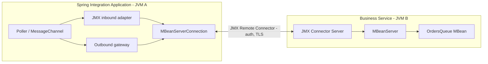

# Remote JMX connections in Spring Integration Adapter JMX

## 1. Why use a remote JMX connection?

**Java Management Extensions (JMX)** lets a Java application expose management state and actions through **MBeans**. When the Spring Integration application and the MBean run in the same JVM, JMX endpoints can use the local `MBeanServer`. In practice, the service being monitored often runs in **another JVM**, on a separate host, container, or network segment. In that case, having the right `ObjectName` is not enough: the application must establish a connection to the **target JVM's MBeanServer**.

In the **`SPRING_INTEGRATION_ADAPTERS`** module, remote JMX is a way to bring Java management systems into a `MessageChannel` flow, just like connecting files, SFTP, HTTP, JMS, AMQP, Kafka, or databases. For example, a polling flow can read `PendingCount` from an order-processing service and raise alerts, while an outbound gateway can invoke `readQueueState("orders")` and use the result to decide downstream routing.



**Inbound/outbound direction is defined from Spring Integration's perspective**, not TCP socket direction. An attribute-polling inbound adapter **pulls data from JMX into the message flow**; an operation-invoking outbound gateway **sends a request from the message flow out to JMX and receives a reply**. Both can share a single remote `MBeanServerConnection`.

## 2. Components of a remote JMX connection

| Concept | Role | Example |
| --- | --- | --- |
| **MBean** | Managed object exposing attributes/operations/notifications | `OrdersQueue` |
| **`ObjectName`** | Identifies an MBean **inside an MBeanServer** | `demo.integration:type=Queue,name=Orders` |
| **`MBeanServer`** | Server registering and managing MBeans in the target JVM | Target service's platform `MBeanServer` |
| **JMX Connector Server** | Exposes the management interface over a network protocol | JMX/RMI connector in the target JVM |
| **`JMXServiceURL`** | Describes the connector's location/protocol | `service:jmx:rmi:///jndi/rmi://app.internal:9010/jmxrmi` |
| **`JMXConnector`** | Client connector that opens/closes the connection and provides a connection handle | `JMXConnectorFactory.connect(...)` |
| **`MBeanServerConnection`** | Interface for calling `getAttribute`, `queryNames`, `invoke`, and registering notification listeners | `connector.getMBeanServerConnection()` |
| **`MBeanServerConnectionFactoryBean`** | Spring `FactoryBean` managing the remote connection across the `ApplicationContext` lifecycle | `remoteMBeanServer` bean |

### 2.1. How does `MBeanServer` differ from `MBeanServerConnection`?

`MBeanServer` extends `MBeanServerConnection`. On a local server, you can call `registerMBean(javaObject, objectName)` to register a Java object. On a remote client, you generally use `MBeanServerConnection` only to query or invoke already-registered MBeans; you cannot push a Java object from the client JVM into the target JVM via `registerMBean` on this interface.

Many Spring Integration JMX endpoints, such as `AttributePollingMessageSource` and `NotificationListeningMessageProducer`, expose `setServer(MBeanServerConnection)`. Thus, moving from local JMX to remote JMX leaves the message flow structure intact; the primary changes are the **connection bean**, `ObjectName`, and network operations policy.

### 2.2. `ObjectName` carries no host information

Two JVMs can both register an MBean named:

```text
demo.integration:type=Queue,name=Orders
```

Yet those are **two completely different MBeans**. A call reaches the intended MBean only when **the connection points to the right server** and `ObjectName` matches an MBean registered on that server. Do not encode host/port as key properties to substitute for configuring `JMXServiceURL` properly.

## 3. JMX/RMI architecture and prerequisites before connecting

The JDK provides a built-in management agent capable of exposing **remote JMX over RMI**. In a typical deployment, the client contacts an **RMI registry**, looks up `jmxrmi`, receives a remote stub, and then connects to the JMX connector's RMI endpoint.

Example URL:

```text
service:jmx:rmi:///jndi/rmi://app.internal.example:9010/jmxrmi
```

Here `app.internal.example:9010` is the registry lookup point; the **actual RMI endpoint** may use another port advertised by the server inside the stub. Opening only the registry port without opening the RMI connector port can let the initial lookup succeed while subsequent JMX calls fail.

### 3.1. What does the target JVM need?

1. An MBean already **registered** on the `MBeanServer` exposed by the connector; not every MBean on every server in the same JVM appears on the connector automatically.
2. A listening JMX/RMI connector reachable from the client JVM.
3. A hostname/IP that the client can **actually connect to**; with RMI, inspect `java.rmi.server.hostname` and the address embedded in the stub carefully.
4. Appropriate **authentication and encryption**, along with read vs. operation-invocation authorization policies.
5. Firewall/NetworkPolicy rules for **both the registry port and connector port** within permitted private network boundaries.

With the JDK management agent, common flags are:

```text
-Dcom.sun.management.jmxremote.port=9010
-Dcom.sun.management.jmxremote.rmi.port=9011
-Djava.rmi.server.hostname=app.internal.example
-Dcom.sun.management.jmxremote.authenticate=true
-Dcom.sun.management.jmxremote.ssl=true
```

These are **illustrative flags**, not a complete startup command: with `authenticate=true`, configure JMX account/permission sources; with `ssl=true`, configure certificates/keystores/truststores and verify TLS works. Never disable authentication or SSL just to make an example run in shared or production environments. Ports 9010/9011 are examples only; use ports allocated by operations.

**Why are two ports sometimes needed?** `com.sun.management.jmxremote.port` sets the management/registry port, while `com.sun.management.jmxremote.rmi.port` pins the connector's RMI port. Without pinning the RMI port, the server picks an ephemeral port, making firewall or Kubernetes deployments unpredictable. Behind NAT or proxies, the hostname in the stub must match an address reachable by clients.

### 3.2. JMX authentication and access control

Applications can use whatever authentication mechanism the connector configures (such as JDK password/access files, LDAP, or custom authenticators). With default file-based authentication, lock down permissions on the password file and separate read-only monitoring accounts from accounts allowed to invoke management operations. Prefer infrastructure-managed secret injection and **never commit** accounts or passwords in sample configs.

TLS must be configured and verified on both sides. JMX/RMI has nuances around the registry and connector; depending on configuration, the registry itself may also be protected separately by SSL. Never assume setting `ssl=true` alone secures every connection step. JDK documentation on RMI registry TLS, SSL client authentication, and access files is the authoritative reference during deployment.

## 4. Connecting directly to remote JMX in Java before introducing Spring

An effective diagnostic step is verifying that a plain Java JMX client can read the target MBean. This separates network/auth/TLS issues from Spring Integration wiring issues.

Suppose the environment supplies `JMX_SERVICE_URL`, `JMX_USER`, and `JMX_PASSWORD`, while truststore/TLS is configured by the runtime's security setup:

```java
package demo.client;

import java.util.Map;
import javax.management.MBeanServerConnection;
import javax.management.ObjectName;
import javax.management.remote.JMXConnector;
import javax.management.remote.JMXConnectorFactory;
import javax.management.remote.JMXServiceURL;

public final class RemoteJmxProbe {
    public static void main(String[] args) throws Exception {
        String serviceUrl = System.getenv("JMX_SERVICE_URL");
        String username = System.getenv("JMX_USER");
        String password = System.getenv("JMX_PASSWORD");

        if (serviceUrl == null || username == null || password == null) {
            throw new IllegalStateException("Missing remote JMX configuration");
        }

        Map<String, Object> environment = Map.of(
            JMXConnector.CREDENTIALS, new String[] { username, password }
        );

        JMXServiceURL url = new JMXServiceURL(serviceUrl);
        try (JMXConnector connector =
                 JMXConnectorFactory.connect(url, environment)) {

            MBeanServerConnection server = connector.getMBeanServerConnection();
            ObjectName target = new ObjectName(
                "demo.integration:type=Queue,name=Orders");

            if (!server.isRegistered(target)) {
                throw new IllegalStateException("MBean not found: " + target);
            }

            Object pending = server.getAttribute(target, "PendingCount");
            System.out.println("PendingCount = " + pending);

            Object reply = server.invoke(
                target,
                "readQueueState",
                new Object[] { "orders" },
                new String[] { "java.lang.String" }
            );
            System.out.println("State = " + reply);
        } // Close connector even when query/operation invocation fails.
    }
}
```

This example **depends** on MBean `demo.integration:type=Queue,name=Orders` already existing on the server; we will define the sample MBean in the next section. If you only want to verify connectivity to a standard JVM first, inspect `java.lang:type=Runtime` and read attribute `Name`, provided the JMX account has permission.

`JMXConnector.CREDENTIALS` is the standard key for credentials. For JDK username/password auth, the value is typically a `String[]`. Custom connectors may require different environment entries; never pass an arbitrary `Map` from an external request directly into `JMXConnectorFactory`.

`JMXConnector` owns network resources and must be **closed**. `MBeanServerConnection` is the operational interface over the connector and does not represent socket lifecycle ownership by itself. Using `try-with-resources` ensures manual probes close the connection cleanly even if `getAttribute()` throws `IOException`.

## 5. End-to-end example: one JVM exposes the MBean, another reads via Spring Integration

The example uses **two separate processes/JVMs**:

- **Server**: demo service `OrdersQueueAdmin` registers an MBean on the platform `MBeanServer` and runs with the configured remote JMX agent.
- **Client**: a Spring Integration application opens a remote `MBeanServerConnection`, periodically reads `PendingCount`, and invokes `readQueueState(...)`.

### 5.1. Dependencies

In the Spring Integration client application, use Maven with the Spring Boot BOM or Spring Integration BOM managing versions:

```xml
<dependency>
    <groupId>org.springframework.integration</groupId>
    <artifactId>spring-integration-jmx</artifactId>
</dependency>
```

Without a BOM/dependency management, declare a version compatible with your Spring dependencies. The server demo uses `spring-context` for `@ManagedResource`, `MBeanExporter`, and XML context; you can substitute a JDK Standard MBean if not using Spring on the server.

### 5.2. Server-side MBean

File `src/main/java/demo/server/OrdersQueueAdmin.java`:

```java
package demo.server;

import java.util.concurrent.atomic.AtomicInteger;
import org.springframework.jmx.export.annotation.ManagedAttribute;
import org.springframework.jmx.export.annotation.ManagedOperation;
import org.springframework.jmx.export.annotation.ManagedOperationParameter;
import org.springframework.jmx.export.annotation.ManagedResource;

@ManagedResource(objectName = "demo.integration:type=Queue,name=Orders")
public class OrdersQueueAdmin {
    private final AtomicInteger pending = new AtomicInteger(125);

    @ManagedAttribute(description = "Number of pending orders")
    public int getPendingCount() {
        return pending.get();
    }

    @ManagedOperation(description = "Check queue state")
    @ManagedOperationParameter(name = "queueName", description = "Queue name")
    public String readQueueState(String queueName) {
        if (!"orders".equals(queueName)) {
            return "UNKNOWN";
        }
        return pending.get() >= 100 ? "BACKLOG" : "NORMAL";
    }
}
```

The value `125` is **simulated** so learners see results immediately; there is no real JMS/Kafka connection inside this MBean. In a real project, the MBean reads state from the responsible metric or service while honoring type and unit contracts.

File `src/main/resources/jmx-server.xml`:

```xml
<?xml version="1.0" encoding="UTF-8"?>
<beans xmlns="http://www.springframework.org/schema/beans"
       xmlns:xsi="http://www.w3.org/2001/XMLSchema-instance"
       xmlns:context="http://www.springframework.org/schema/context"
       xsi:schemaLocation="
           http://www.springframework.org/schema/beans
           https://www.springframework.org/schema/beans/spring-beans.xsd
           http://www.springframework.org/schema/context
           https://www.springframework.org/schema/context/spring-context.xsd">

    <!-- Use the JVM's platform/existing MBeanServer. -->
    <context:mbean-server/>
    <context:mbean-export server="mbeanServer"/>

    <bean id="ordersQueueAdmin" class="demo.server.OrdersQueueAdmin"/>
</beans>
```

File `src/main/java/demo/server/RunJmxServer.java`:

```java
package demo.server;

import java.util.concurrent.CountDownLatch;
import org.springframework.context.support.ClassPathXmlApplicationContext;

public final class RunJmxServer {
    public static void main(String[] args) throws Exception {
        try (var context = new ClassPathXmlApplicationContext("jmx-server.xml")) {
            System.out.println("OrdersQueueAdmin MBean registered");
            // Demo program keeps JVM alive so another JVM can connect via JMX.
            new CountDownLatch(1).await();
        }
    }
}
```

Run `RunJmxServer` with the **remote JDK management agent configured in section 3**. The XML above only exports the MBean to the server inside the JVM; **`<context:mbean-server/>` itself does not open a remote JMX port**. Only the management agent or a `JMXConnectorServer` started by the application/infrastructure exposes the network endpoint.

### 5.3. Spring client: using `MBeanServerConnectionFactoryBean`

Spring Framework provides `org.springframework.jmx.support.MBeanServerConnectionFactoryBean`. This bean creates an `MBeanServerConnection` from `serviceUrl`, supports connector environment settings, and closes the `JMXConnector` when the bean is destroyed.

On the client, supply `JMX_SERVICE_URL`, `JMX_USER`, and `JMX_PASSWORD` as environment variables or via an infrastructure-managed secure config source. Configure the TLS truststore on the client JVM before initializing the context.

File `src/main/resources/jmx-client.xml`:

```xml
<?xml version="1.0" encoding="UTF-8"?>
<beans xmlns="http://www.springframework.org/schema/beans"
       xmlns:xsi="http://www.w3.org/2001/XMLSchema-instance"
       xmlns:context="http://www.springframework.org/schema/context"
       xmlns:int="http://www.springframework.org/schema/integration"
       xmlns:int-jmx="http://www.springframework.org/schema/integration/jmx"
       xsi:schemaLocation="
           http://www.springframework.org/schema/beans
           https://www.springframework.org/schema/beans/spring-beans.xsd
           http://www.springframework.org/schema/context
           https://www.springframework.org/schema/context/spring-context.xsd
           http://www.springframework.org/schema/integration
           https://www.springframework.org/schema/integration/spring-integration.xsd
           http://www.springframework.org/schema/integration/jmx
           https://www.springframework.org/schema/integration/jmx/spring-integration-jmx.xsd">

    <!-- Resolve placeholders from permitted environment configuration. -->
    <context:property-placeholder/>

    <!-- FactoryBean exposes an MBeanServerConnection pointing to another JVM. -->
    <bean id="remoteMBeanServer"
          class="org.springframework.jmx.support.MBeanServerConnectionFactoryBean">
        <property name="serviceUrl" value="${JMX_SERVICE_URL}"/>
        <property name="environmentMap">
            <map>
                <entry key="jmx.remote.credentials">
                    <array value-type="java.lang.String">
                        <value>${JMX_USER}</value>
                        <value>${JMX_PASSWORD}</value>
                    </array>
                </entry>
            </map>
        </property>
    </bean>

    <int:channel id="remotePendingCount"/>

    <!-- Inbound: read attribute from remote MBean on schedule. -->
    <int-jmx:attribute-polling-channel-adapter
        id="ordersPendingPoller"
        channel="remotePendingCount"
        mbean-server="remoteMBeanServer"
        object-name="demo.integration:type=Queue,name=Orders"
        attribute-name="PendingCount">
        <int:poller fixed-delay="5000" max-messages-per-poll="1"/>
    </int-jmx:attribute-polling-channel-adapter>

    <int:logging-channel-adapter
        channel="remotePendingCount"
        level="INFO"
        expression="'Remote Orders pending=' + payload"/>

    <int:channel id="stateRequests"/>
    <int:channel id="stateReplies">
        <int:queue capacity="10"/>
    </int:channel>

    <!-- Outbound request/reply: invoke operation on the same remote JVM. -->
    <int-jmx:operation-invoking-outbound-gateway
        id="remoteStateGateway"
        request-channel="stateRequests"
        reply-channel="stateReplies"
        mbean-server="remoteMBeanServer"
        object-name="demo.integration:type=Queue,name=Orders"
        operation-name="readQueueState"/>
</beans>
```

The difference from local JMX lies in the `remoteMBeanServer` bean and the `mbean-server` attribute on both endpoints. **Do not** add `<context:mbean-server/>` on the client and point adapters to the local bean when your goal is reading the target JVM. `MBeanServerConnectionFactoryBean` is a `FactoryBean`: referencing `remoteMBeanServer` normally supplies the **produced `MBeanServerConnection`**; only use `&remoteMBeanServer` when you genuinely need the factory itself for bean-level management.

With `connectOnStartup` defaulting to `true`, Spring tries to connect during factory initialization. If the server may not be up yet, set `<property name="connectOnStartup" value="false"/>` to defer opening the connection until first use. This option is **not** an infinite reconnect/retry mechanism; you must still design error handling and recovery after a connector drops.

### 5.4. Java client: sending a request and receiving the result

File `src/main/java/demo/client/RunJmxClient.java`:

```java
package demo.client;

import org.springframework.context.support.ClassPathXmlApplicationContext;
import org.springframework.integration.support.MessageBuilder;
import org.springframework.messaging.Message;
import org.springframework.messaging.MessageChannel;
import org.springframework.messaging.PollableChannel;

public final class RunJmxClient {
    public static void main(String[] args) throws Exception {
        try (var context = new ClassPathXmlApplicationContext("jmx-client.xml")) {
            MessageChannel requests = context.getBean(
                "stateRequests", MessageChannel.class);
            PollableChannel replies = context.getBean(
                "stateReplies", PollableChannel.class);

            boolean accepted = requests.send(
                MessageBuilder.withPayload("orders").build());
            if (!accepted) {
                throw new IllegalStateException("Failed to send request to gateway");
            }

            Message<?> reply = replies.receive(3_000);
            if (reply == null) {
                throw new IllegalStateException("No reply received from queue within 3 seconds");
            }
            System.out.println("Remote state=" + reply.getPayload());

            // Keep context alive briefly just to observe the poller.
            Thread.sleep(11_000L);
        }
    }
}
```

If the server from section 5.2 is running with a valid connection, expected output is `Remote state=BACKLOG` and log `Remote Orders pending=125` on the polling schedule. Those values come from the **demo MBean**, not a real queue metric.

`replies.receive(3_000)` limits how long we wait to **read a reply from `QueueChannel`**, and does **not** apply a timeout to `MBeanServerConnection.invoke(...)`. Because `stateRequests` is a `DirectChannel` by default, `requests.send(...)` can block on the remote JMX call before execution ever reaches `receive(...)`. Connection timeouts, JMX call durations, and workflow time budgets must be configured and enforced at the proper layers.

## 6. When to use each endpoint with remote JMX?

| Spring Integration endpoint | Remote JMX task | How it works | What to watch out for |
| --- | --- | --- | --- |
| `attribute-polling-channel-adapter` | Read a single attribute like `PendingCount` | **Inbound + poller** | Effective cadence depends on network and processing time |
| `tree-polling-channel-adapter` | Query multiple MBeans and attributes into a structure | **Inbound + poller** | Must restrict `query-name`/filters to avoid overly broad queries |
| `notification-listening-channel-adapter` | Subscribe to notifications from an MBean | **Event-driven inbound** | Must manage listener re-registration when connections drop and reconnect |
| `operation-invoking-channel-adapter` | Invoke a management operation without using a reply | **Message-driven outbound** | Be careful retrying operations with side effects |
| `operation-invoking-outbound-gateway` | Invoke an operation with a return value | **Outbound request/reply** | Requires a `reply-channel` or valid reply header |

Common rule: `mbean-server` must point to the connection hosting the target MBean. For `notification-listening-channel-adapter`, receiving remote events requires no poller, yet when a connector drops, **listener registration must also be evaluated/restored**—never assume notifications emitted during the outage will be replayed.

Some JMX operations can be chosen via `JmxHeaders.OBJECT_NAME` and `JmxHeaders.OPERATION_NAME`. Never pass MBean or operation names supplied by external HTTP requests or untrusted messages into a privileged gateway; use an allowlist and internal mapping instead.

## 7. Handling disconnects, timeouts, retries, and lifecycles

Remote JMX is network I/O, so design for **server not ready yet**, **mid-flight disconnects**, **operation executed but reply lost**, and **MBeans re-registered**.

### 7.1. Startup and lifecycle

- `MBeanServerConnectionFactoryBean` defaults to `connectOnStartup=true`: it connects during context initialization; a remote server outage can prevent the client application from **starting**.
- `connectOnStartup=false` defers connecting until the first invocation. This fits when the target service may start later, though **the first call can still fail**.
- The factory implements `destroy()` to close the JMX connector when the context shuts down. Avoid creating a new connection per message or leaking open connectors in long-running programs.
- Spring's `MBeanClientInterceptor` has a `refreshOnConnectFailure` option, yet that option is **not a property on `MBeanServerConnectionFactoryBean`**. To auto-reconnect at the adapter/gateway layer, build an explicit mechanism and verify behavior with your library version.

### 7.2. Retries can invoke an operation twice

Suppose a client calls `incrementCounter()` over remote JMX. The server executes the method, then the network drops before the client receives the reply. If the client auto-retries, the counter increments **twice**. For idempotent operations like `setEnabled(true)` or read-only queries, retry policies are straightforward; for operations with side effects, use request IDs, state checks, or deduplication on the target service.

For read-only attribute polling, you can retry with backoff and track failed polls. For notifications, retrying a subscription does not recover events that occurred while offline because JMX notifications do not provide a durable queue.

### 7.3. Do not confuse timeouts across layers

| Wait/timeout | What it governs | What it does not solve |
| --- | --- | --- |
| JMX connector setup time | Bounds/measures establishing the server connection | Execution time of operations after connecting |
| RMI request/response timeout | Bounds a single `getAttribute`/`invoke` over the network | The case where an operation ran yet the client lost the reply |
| `QueueChannel.receive(timeout)` | Waits for a completed message on the reply channel | Does not cancel an `invoke` blocked on the sender thread |
| `fixed-delay` on poller | Controls when the next read starts after the previous finishes | Does not force each JMX request to finish on time |

Configuring timeouts in RMI/JMX depends on the JDK, connector provider, network layer, and infrastructure. Do not invent a nonexistent `timeout` attribute on the JMX XML adapter. Under strict SLAs, isolate remote calls onto bounded workers/queues, measure deadlines, and configure connection policies matching your JDK and connector.

### 7.4. Observability

Record at minimum: target system name (without secrets), `ObjectName`, operation/attribute, success/failure outcome, latency, last successful poll timestamp, reconnect count, and correlation ID if present. Never log `JMX_PASSWORD`, `JMXConnector.CREDENTIALS`, tokens, or sensitive TLS config.

When metrics suddenly vanish, distinguish **value equal to 0**, **MBean returned `null`**, **missing messages due to poller errors**, and **remote server completely unreachable**. An absence-of-data alert (no recent successful poll) is often just as valuable as a threshold alert.

## 8. Securing and operating remote JMX

Remote JMX is a powerful management interface capable of reading internal state and invoking side-effecting operations. In real deployments:

1. **Restrict network access:** prefer private networks, VPNs, or controlled management tunnels; open only strictly required ports between client sources and target JVMs.
2. **Protect authentication:** use dedicated least-privilege accounts; store secrets in a secret manager or protected environment variables—never commit passwords to Git, runbooks, or logs.
3. **Encrypt transport:** enforce TLS, configure truststores and certificate/hostname verification, and consider securing the RMI registry and using mutual TLS as required.
4. **Separate permissions:** separate read-only metric clients from clients allowed to invoke management operations. `getAttribute` and `invoke` carry very different blast radii even over the same connection.
5. **Control targets:** restrict allowed `ObjectName`s and operations. Never trust JMX headers populated directly from external input.
6. **Minimize exposed surface:** export only MBeans, attributes, and operations truly needed for management; keep sensitive information out of JMX metadata and return values.
7. **Test recovery:** test target JVM restarts, network drops, certificate rotation, and DNS/host changes; verify the adapter neither loses critical data nor hangs indefinitely.

In containers/Kubernetes, a classic failure is the client reaching the RMI registry while the returned stub points to an **unreachable internal hostname or port**. Routing through Services or NAT requires configuring the exported RMI endpoint too, not just changing the port in `JMXServiceURL`.

## 9. Common error table and diagnostic workflow

| Symptom | Possible cause | Check / remediation |
| --- | --- | --- |
| `MalformedURLException` creating `JMXServiceURL` | Invalid URL syntax | Verify `service:jmx:rmi:///jndi/rmi://host:port/jmxrmi` format and supported connector scheme |
| `ConnectException` / `IOException` on connect | Server down, blocked port, wrong hostname | Check both registry **and** RMI connector ports; test with JConsole/Java probe from the same network |
| Registry lookup works but invoke hangs/fails | Stub points to unreachable host/port, NAT/container | Check `java.rmi.server.hostname`, `jmxremote.rmi.port`, and firewalls |
| `SecurityException` / authentication failed | Wrong credentials, insufficient role, password/access file config | Verify account/role, secret injection, and agent config |
| `SSLHandshakeException` | Truststore/certificate/TLS protocol mismatch | Check cert chain, expiry, hostname, client truststore, and server TLS |
| `InstanceNotFoundException` | Wrong `ObjectName`, MBean not exported, pointing to wrong JVM | Run `queryNames`, JConsole, compare canonical `ObjectName` and target connection |
| `AttributeNotFoundException` | Wrong attribute name or not exposed | Inspect `MBeanInfo.getAttributes()`; check capitalization |
| `ReflectionException` or invoke failure | Wrong operation name/signature or parameter type mismatch | Inspect `MBeanOperationInfo`, `args`, `signature`, and payload mapping |
| Gateway produces no reply | Missing reply channel, operation threw/returned `void`, or another consumer took the reply | Check request/reply flow, JMX invocation exceptions, and correlation |
| No notifications after reconnect | Listener was registered on the old connector | Implement listener re-registration and monitor event gaps |
| Missing metrics at many timestamps | Poller errors, slow remote, or `null` values | Track last-successful-poll and error rate; never coerce `null` to 0 |

### Ordered verification workflow

1. **Identify the target JVM:** from deployment docs, confirm hostname, ports, service URL, account, and TLS policy.
2. **Verify the network layer:** confirm the registry, RMI port, and server-exported hostname are reachable from the client host; never assume container-internal hostnames resolve externally.
3. **Verify TLS/authentication:** run JConsole or a Java probe using the application's actual account/role rather than a higher-privileged admin account.
4. **Verify the MBean:** call `queryNames`/`isRegistered` on the remote connection, then `getMBeanInfo` to confirm exact attribute/operation names and types.
5. **Verify Spring wiring:** confirm endpoints reference `remoteMBeanServer`, placeholders resolved properly, and no local server was wired by mistake.
6. **Verify messaging:** send a small test request, read the reply, check poller error logs, verify timeouts/retries at the right layers, and test repeat-execution safety.
7. **Verify lifecycle:** stop/start the server and observe disconnect handling, delayed startup, listener re-registration, and connector cleanup when the client stops.

## 10. Practice and self-check questions

### Hands-on exercises

1. Run `OrdersQueueAdmin` in one JVM with **secure** remote JMX/RMI configured (TLS + authentication) in a test environment.
2. Connect with `RemoteJmxProbe` to that JVM; verify `PendingCount=125` and `State=BACKLOG`.
3. Start the Spring Integration client; confirm the polling adapter logs `Remote Orders pending=125` and the outbound gateway returns `BACKLOG`.
4. Point `JMX_SERVICE_URL` to a JVM without the MBean; distinguish a successful connection hitting `InstanceNotFoundException` from a connection failure.
5. Start the server **after** the client. Compare `connectOnStartup=true` vs. `false` (noting exactly when errors appear).
6. Block **only** the RMI connector port in a test environment while leaving the registry port open; observe the difference compared to blocking the registry too.
7. Restart the target JVM and inspect connection recovery, the next successful poll timestamp, and how data gaps are handled.
8. Add a side-effecting operation in a test environment, simulate a failure after server execution, and explain why blind retries can cause duplicate side effects.

### Review questions

1. What roles do `JMXServiceURL`, `JMXConnector`, `MBeanServerConnection`, and `ObjectName` play in a remote JMX call?
2. Why can the same `ObjectName` on two JVMs return different results?
3. Why is opening the RMI registry port alone not always enough for `getAttribute()` to succeed?
4. How does `MBeanServerConnectionFactoryBean` differ in purpose from `<context:mbean-server/>`?
5. Does `connectOnStartup=false` automatically provide retry/reconnect after a remote server restarts?
6. Why does `QueueChannel.receive(3000)` not bound the duration of `MBeanServerConnection.invoke(...)`?
7. Under what circumstances can retrying a management operation cause a state change twice?
8. For a remote notification-listening adapter, what must be done when the connector drops and is recreated?

## References

- [Spring Integration Reference — JMX Support](https://docs.spring.io/spring-integration/reference/jmx.html): wiring `mbean-server`, polling adapters, operation-invoking adapters/gateways, and notification listeners.
- [Spring Framework API — `MBeanServerConnectionFactoryBean`](https://docs.spring.io/spring-framework/docs/current/javadoc-api/org/springframework/jmx/support/MBeanServerConnectionFactoryBean.html): `serviceUrl`, `environmentMap`, `connectOnStartup`, and `destroy()`.
- [Spring Integration API — `AttributePollingMessageSource`](https://docs.spring.io/spring-integration/api/org/springframework/integration/jmx/inbound/AttributePollingMessageSource.html): using `setServer(MBeanServerConnection)` to read attributes.
- [Spring Integration API — `NotificationListeningMessageProducer`](https://docs.spring.io/spring-integration/api/org/springframework/integration/jmx/inbound/NotificationListeningMessageProducer.html): listener using a connection and managing notification subscriptions.
- [Java SE API — `JMXConnectorFactory`](https://docs.oracle.com/en/java/javase/21/docs/api/java.management/javax/management/remote/JMXConnectorFactory.html): establishing remote JMX connections and passing environment maps.
- [Java SE API — `MBeanServerConnection`](https://docs.oracle.com/en/java/javase/21/docs/api/java.management/javax/management/MBeanServerConnection.html): local and remote JMX operations.
- [Java SE — Monitoring and Management Using JMX Technology](https://docs.oracle.com/en/java/javase/21/management/monitoring-and-management-using-jmx-technology.html): JVM remote management agent, authentication, TLS, and RMI connector ports.
