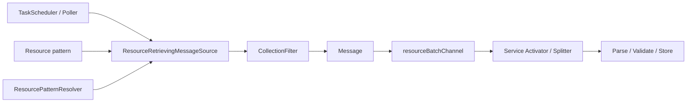
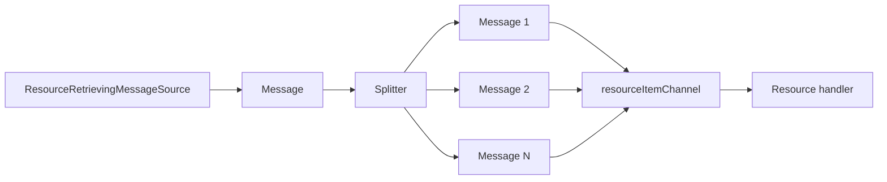

# Resource Inbound Channel Adapter in Spring Integration

## 1. Problem statement: reading multiple resource types with a single adapter

Suppose a Java service needs to periodically discover `*.properties` configuration files located on the classpath or in a deployment directory, and then pass the newly discovered resources into a unified processing flow. A file might reside directly on disk, inside a JAR, or be represented by Spring as a URL. If you write code that only accepts `java.io.File`, the application will run into trouble when resources are packaged into a JAR or when the runtime environment has no corresponding physical file path.

Spring Integration's **Resource inbound channel adapter** is built on the `org.springframework.core.io.Resource` abstraction. It periodically uses a `ResourcePatternResolver` to find resources matching a *pattern*, and then emits **a single Spring Message containing a collection of resources** to a `MessageChannel`. This differs from the **File inbound channel adapter**, which typically emits **one `File` object per message**.

This lesson belongs to the **SPRING_INTEGRATION_ADAPTERS** module: connecting external systems into Spring Integration using adapters, gateways, pollers, and `MessageChannel`; organizing message contracts, errors, and lifecycle. For **Adapter Resource**, we focus on discovering **resource handles** and handing them off downstream for processing, without automatically turning them into JSON content, parsed configuration, or an acknowledged transaction like JMS/Kafka.

### Learning objectives

1. Explain `Resource`, `ResourcePatternResolver`, `ResourceRetrievingMessageSource`, `SourcePollingChannelAdapter`, and `MessageChannel`.
2. Distinguish `classpath:`, `classpath*:`, and `file:` patterns as well as the limitations of using URLs or wildcards.
3. Configure the adapter using the standard XML namespace and Java configuration/`@InboundChannelAdapter`.
4. Understand the **`Resource[]`** payload, pollers, `maxMessagesPerPoll`, and how to split a batch into individual resources.
5. Design `CollectionFilter<Resource>` filtering, `AcceptOnceCollectionFilter`, safe stream reading, and reprocessing when files change.
6. Identify transaction boundaries, retries, downstream errors, resource lifecycle, security, and testing.

## 2. What is a Resource?

Spring Framework defines `Resource` as an abstract interface for working with multiple content sources. Common implementations include:

| Implementation | Resource example | Notes |
| --- | --- | --- |
| `ClassPathResource` | `classpath:rules/order.properties` | Can reside in the classes directory or inside a JAR. |
| `FileSystemResource` | `file:/opt/app/config/order.properties` | Corresponds to a filesystem path; `getFile()` can be used when appropriate. |
| `UrlResource` | URL to specific content | Depends on the protocol, network, and accessibility. |
| `ByteArrayResource` | Byte data in memory | Useful in unit tests; not a resource automatically discovered on the classpath. |
| `InputStreamResource` | Externally supplied stream | Note that the stream may not be readable multiple times. |

Commonly used methods:

```java
Resource resource = ...;

String name = resource.getFilename();
String description = resource.getDescription();
boolean exists = resource.exists();

try (InputStream stream = resource.getInputStream()) {
    // Read content from the resource via the stream.
}
```

**Do not call `resource.getFile()` by default.** A `ClassPathResource` inside a JAR can be read via `getInputStream()` but does not have a corresponding `java.io.File`. `resource.getURL()` and `lastModified()` also do not always have stable semantics across all source types.

**A Resource is a handle, not a data snapshot.** The adapter emits a `Resource` reference; by the time downstream opens the stream, the external content may have changed or been deleted. If a consistent snapshot is needed, the application must read and store the bytes/version at the appropriate time.

## 3. Architecture of the Resource inbound channel adapter



Components:

- **`SourcePollingChannelAdapter`:** the endpoint triggered by the Spring Integration scheduler according to the poller.
- **`ResourceRetrievingMessageSource`:** a `MessageSource<Resource[]>` that resolves the pattern and returns the selected `Resource` instances.
- **`ResourcePatternResolver`:** the strategy for finding resources from a location pattern; defaults to the current `ApplicationContext` when configured via XML namespace.
- **`CollectionFilter<Resource>`:** selects the subset of resources to emit in a poll; can prevent re-emission.
- **`MessageChannel`:** receives the Spring `Message<?>` containing the batch; behind it can be a `DirectChannel`, splitter, router, or handler.

### What does one poll produce?

For example, `classpath*:rules/*.properties` matches three resources:

```text
rules/shipping.properties
rules/tax.properties
rules/payment.properties
```

The adapter may emit:

```text
Message(
  payload = Resource[] {
    Resource("rules/shipping.properties"),
    Resource("rules/tax.properties"),
    Resource("rules/payment.properties")
  },
  headers = Spring MessageHeaders
)
```

**One message contains multiple resources**, not three messages just because there are three matches. The Javadoc of `ResourceRetrievingMessageSource` confirms the source type is `MessageSource<Resource[]>` and `doReceive()` returns `Resource[]`. The reference documentation calls this a *collection* in the sense of a set of resources. If the filter returns no eligible resources, the poller may emit no business message on that cycle.

## 4. Comparing Resource inbound and File inbound adapters

| Criterion | Resource inbound | File inbound |
| --- | --- | --- |
| Abstraction | `org.springframework.core.io.Resource` | `java.io.File` |
| Typical payload | **`Resource[]`** — multiple resources in one message | **`File`** — one file per message |
| Discovery mechanism | `ResourcePatternResolver` with a location pattern | Directory file scanner, usually `FileReadingMessageSource` |
| Suitable sources | Classpath, JAR, filesystem, suitable URLs | Filesystem directory |
| Splitting elements | Downstream processes the array or uses a `Splitter` | Each message already corresponds to one file |
| Filter | `CollectionFilter<Resource>` | `FileListFilter` implementations and File module scanners |
| File changes over time | Depends on pattern, resolver, filter, and environment | Better optimized for scanning/operating on individual files on disk |
| Moving files, locking, avoiding partial writes | Design yourself if needed | Better-suited options exist in the File module |

Choose **Resource inbound** if your goal is **discovering resources via the Spring abstraction** or initializing/reading configuration resources across multiple classpath roots. Choose **File inbound** if you are building a file ingestion pipeline that scans a directory, claims files, processes them one by one, and requires file-specific features.

Do not choose Resource inbound just because the name "resource" sounds more general: for HTTP sources with paginated REST APIs, S3 object events, or SFTP files requiring ack/lock, dedicated adapters or gateways are usually more appropriate.

## 5. Location patterns: classpath:, classpath*:, and file:

Spring's `ResourcePatternResolver` supports location patterns depending on the protocol and resolver. In `Resource inbound channel adapter`, the pattern is a configuration string, for example:

```text
classpath:things/thing1/*.properties
classpath*:rules/**/*.properties
file:/opt/app/inbound/*.json
file:/var/app/config/rules/**/*.yml
```

### 5.1. classpath:

`classpath:things/thing1/*.properties` targets resources on the classpath. When multiple JARs/directories on the classpath contain the same path, `classpath:` is not a reliable tool for enumerating every copy across all roots.

### 5.2. classpath*:

`classpath*:rules/**/*.properties` uses multi-classpath search via `PathMatchingResourcePatternResolver`, which is convenient when configuration lives across multiple libraries/JARs. In return, you must verify behavior with packaged JARs, nested JARs, the module path, and how the resolver actually enumerates resources.

**A packaged classpath is typically not a "hot folder" source.** Adding a file to a local directory after the application has already started from a JAR does not automatically make that file appear on the class loader's classpath.

### 5.3. file:

`file:/opt/app/inbound/*.json` targets the filesystem. For environment-specific paths, configure them externally rather than hardcoding host paths in source code. On Windows, you can use URIs like `file:/C:/data/inbound/*.json` or normalize the path via configuration.

### 5.4. URLs and wildcards

`Resource` can represent a URL such as `https://example.com/config.json` when the client environment allows it. However, **resolving a specific URL is different from wildcard matching in an HTTP directory**. Do not assume `https://example.com/config/*.json` will automatically crawl a remote server: standard HTTP does not provide glob-based directory listings.

For URLs:

- Define timeouts, authentication, TLS, and size limits.
- Never pass untrusted user-supplied URLs directly into the resolver (SSRF risk).
- Check caching, ETag/Last-Modified, and fetch semantics if version-based re-fetching is required.
- Do not assume that a URL returned in the resource list means its content has already been downloaded successfully.

### Ant-style wildcards

| Pattern | Typical meaning |
| --- | --- |
| `*.properties` | Files ending with `.properties` in a single directory level |
| `rules/*.yml` | `.yml` files directly inside `rules` |
| `rules/**/*.yml` | Search across multiple directory levels as supported by the resolver |
| `data/report-?.csv` | Single-character wildcard in the filename |

For complex patterns and multiple JARs, test the returned `Resource` list under the **exact packaging mode and class loader** used in production.

## 6. XML namespace: standard Resource inbound configuration

The official Spring Integration documentation illustrates the resource inbound channel adapter using Spring Integration Core's **`int`** namespace.

### 6.1. Complete example

```xml
<?xml version="1.0" encoding="UTF-8"?>
<beans xmlns="http://www.springframework.org/schema/beans"
       xmlns:xsi="http://www.w3.org/2001/XMLSchema-instance"
       xmlns:int="http://www.springframework.org/schema/integration"
       xsi:schemaLocation="
         http://www.springframework.org/schema/beans
         https://www.springframework.org/schema/beans/spring-beans.xsd
         http://www.springframework.org/schema/integration
         https://www.springframework.org/schema/integration/spring-integration.xsd">

    <int:channel id="resourceBatchChannel"/>

    <int:resource-inbound-channel-adapter
            id="resourceInbound"
            channel="resourceBatchChannel"
            pattern="classpath*:rules/*.properties">
        <int:poller fixed-delay="5000"
                    max-messages-per-poll="1"/>
    </int:resource-inbound-channel-adapter>

    <bean id="resourceBatchHandler"
          class="org.example.integration.ResourceBatchHandler"/>

    <int:service-activator
            input-channel="resourceBatchChannel"
            ref="resourceBatchHandler"
            method="handle"/>
</beans>
```

`ResourceBatchHandler` in the `org.example.integration` package is an **application class**, shown in Java later; Spring does not provide this class out of the box.

**Meaning of each configuration element:**

1. `pattern`: the pattern for finding resources interpreted by `ResourcePatternResolver`.
2. `channel`: the Spring Integration `MessageChannel` receiving the batch.
3. `int:poller`: trigger invoking the source with `fixed-delay="5000"` (5 seconds after the previous poll finishes, per scheduler semantics).
4. `max-messages-per-poll="1"`: limits **one message receive from the MessageSource per poll cycle**; it does not mean only one `Resource` is returned.
5. `service-activator`: invokes the application handler when a batch is emitted.

**Do not mistake this for a listener that fires automatically when the filesystem changes.** It is a poller: on each cycle the resolver re-scans the configured pattern, and then the filter decides which resources are emitted.

### 6.2. One poll does not equal one file

Suppose on the first run the resolver finds 20 resources. With the configuration above, the adapter may emit:

```text
Poll #1:
  Message<Resource[]> containing 20 Resources

Poll #2:
  No new resources per filter -> no new batch emitted
```

`max-messages-per-poll="1"` only controls the **number of `source.receive()` calls** the poller can process per round. If you want each resource to become an independent message, you must split the batch using a splitter.

## 7. Java configuration: ResourceRetrievingMessageSource and @InboundChannelAdapter

### 7.1. Dependencies

For a Spring Boot application using a compatible BOM:

```xml
<dependencies>
    <dependency>
        <groupId>org.springframework.boot</groupId>
        <artifactId>spring-boot-starter-integration</artifactId>
    </dependency>
</dependencies>
```

`ResourceRetrievingMessageSource` lives in Spring Integration Core and does not require `spring-integration-file` for Resource inbound functionality alone. Only add the File module if the application needs the dedicated File inbound adapter.

### 7.2. Organizing practice samples

Prepare under `src/main/resources/rules/`:

```text
src/main/resources/
└── rules/
    ├── shipping.properties
    ├── tax.properties
    └── payment.properties
```

Example contents of `shipping.properties`:

```properties
rule.id=shipping-standard
rule.version=1
rule.enabled=true
```

These files belong to the application classpath; do not assume they are editable data outside a runtime JAR.

### 7.3. Complete Java configuration

```java
import org.springframework.context.annotation.Bean;
import org.springframework.context.annotation.Configuration;
import org.springframework.core.io.Resource;
import org.springframework.integration.annotation.InboundChannelAdapter;
import org.springframework.integration.annotation.Poller;
import org.springframework.integration.channel.DirectChannel;
import org.springframework.integration.config.EnableIntegration;
import org.springframework.integration.core.MessageSource;
import org.springframework.integration.resource.ResourceRetrievingMessageSource;
import org.springframework.integration.util.AcceptOnceCollectionFilter;
import org.springframework.messaging.MessageChannel;

@Configuration
@EnableIntegration
public class ResourceInboundConfiguration {

    @Bean
    public MessageChannel resourceBatchChannel() {
        return new DirectChannel();
    }

    @Bean
    @InboundChannelAdapter(
        channel = "resourceBatchChannel",
        poller = @Poller(
            fixedDelay = "5000",
            maxMessagesPerPoll = "1"
        )
    )
    public MessageSource<Resource[]> resourceMessageSource() {
        ResourceRetrievingMessageSource source =
            new ResourceRetrievingMessageSource(
                "classpath*:rules/*.properties"
            );

        // Java configuration: explicitly declare the accept-once policy.
        source.setFilter(new AcceptOnceCollectionFilter<>());
        return source;
    }
}
```

**Explanation:**

- `resourceMessageSource()` is a `MessageSource<Resource[]>` bean; the `@InboundChannelAdapter` annotation creates a polling endpoint using that source.
- `@Poller(fixedDelay = "5000")` invokes the source periodically.
- `ResourceRetrievingMessageSource` is responsible for resolving `Resource` objects by pattern.
- `setFilter(new AcceptOnceCollectionFilter<>())` sets a policy not to re-emit `Resource` instances the filter considers already seen.
- `DirectChannel` dispatches messages synchronously to subscribers; with a synchronous handler, handler errors can affect the poll cycle.

**Note:** This Java configuration example is an **alternative** to the XML in section 6. Do not enable both the XML adapter and Java adapter for the same pattern/channel unless you intentionally want two independent pollers.

### 7.4. Handler processing the Resource[] batch

```java
import java.io.IOException;
import java.io.InputStream;
import java.io.InputStreamReader;
import java.nio.charset.StandardCharsets;
import java.util.Properties;

import org.springframework.core.io.Resource;
import org.springframework.integration.annotation.ServiceActivator;
import org.springframework.messaging.Message;
import org.springframework.stereotype.Component;

@Component
public class ResourceBatchHandler {

    @ServiceActivator(inputChannel = "resourceBatchChannel")
    public void handle(Message<Resource[]> message) throws IOException {
        Resource[] resources = message.getPayload();

        for (Resource resource : resources) {
            String filename = resource.getFilename();
            if (filename == null) {
                throw new IllegalArgumentException(
                    "Resource has no file name"
                );
            }

            Properties properties = new Properties();
            try (InputStream stream = resource.getInputStream();
                 InputStreamReader reader =
                     new InputStreamReader(
                         stream, StandardCharsets.UTF_8
                     )) {
                properties.load(reader);
            }

            String ruleId = properties.getProperty("rule.id");
            if (ruleId == null || ruleId.isBlank()) {
                throw new IllegalArgumentException(
                    "Missing rule.id in resource"
                );
            }

            System.out.printf(
                "Discovered ruleId=%s from %s%n",
                ruleId, filename
            );
            // TODO: validate version, persist/routing, idempotency.
        }
    }
}
```

**Here the adapter emits `Resource[]`, not `String[]` or the contents of the files.** The handler decides when to open streams, parse as UTF-8, and execute business logic.

The example assumes `*.properties` content is saved in UTF-8 and follows the `rule.id` contract. `Properties.load(Reader)` accepts a reader so it handles the chosen encoding. Do not call `Properties.load(InputStream)` and assume UTF-8 properties files; that API has different encoding semantics.

### 7.5. Handling size limits

A `Resource` may point to a large file or URL. Do not read unboundedly with `readAllBytes()` on input from untrusted sources. Example helper that reads at most 64 KiB:

```java
import java.io.IOException;
import java.io.InputStream;
import org.springframework.core.io.Resource;

public final class ResourceReader {

    private static final int MAX_BYTES = 64 * 1024;

    private ResourceReader() {}

    public static byte[] readLimited(Resource resource)
            throws IOException {
        try (InputStream in = resource.getInputStream()) {
            byte[] bytes = in.readNBytes(MAX_BYTES + 1);
            if (bytes.length > MAX_BYTES) {
                throw new IOException("Resource exceeds 64 KiB");
            }
            return bytes;
        }
    }
}
```

This is an **application-checked body limit**; it does not configure TCP timeouts, decompression limits, or file counts per poll. When reading resources over a network, add limits at the HTTP client/transport layer and security policies as well.

## 8. Splitting a batch into individual Resources with Java DSL

When each resource needs to be processed individually and routed by filename, you can use a `Splitter` in an integration flow:



The following Java DSL example replaces the `@InboundChannelAdapter` example in section 7; **do not declare two pollers simultaneously** for the same source unless you want to poll twice:

```java
import org.springframework.context.annotation.Bean;
import org.springframework.context.annotation.Configuration;
import org.springframework.integration.channel.DirectChannel;
import org.springframework.integration.dsl.IntegrationFlow;
import org.springframework.integration.dsl.Pollers;
import org.springframework.integration.resource.ResourceRetrievingMessageSource;
import org.springframework.integration.util.AcceptOnceCollectionFilter;
import org.springframework.messaging.MessageChannel;

@Configuration
public class ResourceSplitFlowConfiguration {

    @Bean
    public ResourceRetrievingMessageSource resourceSource() {
        ResourceRetrievingMessageSource source =
            new ResourceRetrievingMessageSource(
                "classpath*:rules/*.properties"
            );
        source.setFilter(new AcceptOnceCollectionFilter<>());
        return source;
    }

    @Bean
    public MessageChannel resourceItemChannel() {
        return new DirectChannel();
    }

    @Bean
    public IntegrationFlow resourceSplitFlow(
            ResourceRetrievingMessageSource resourceSource) {
        return IntegrationFlow
            .from(
                resourceSource,
                e -> e.poller(
                    Pollers.fixedDelay(5000)
                        .maxMessagesPerPoll(1)
                )
            )
            .split()
            .channel("resourceItemChannel")
            .get();
    }
}
```

Downstream can use:

```java
import org.springframework.core.io.Resource;
import org.springframework.integration.annotation.ServiceActivator;
import org.springframework.stereotype.Component;

@Component
public class ResourceItemHandler {

    @ServiceActivator(inputChannel = "resourceItemChannel")
    public void process(Resource resource) throws Exception {
        try (var input = resource.getInputStream()) {
            // Parse/validate a single resource, then commit business changes.
        }
    }
}
```

**A splitter does not change when a resource is marked as seen at the source.** If the filter already deduplicated items before the batch reached the splitter, a failure on item N **does not automatically roll back the filter state** for that resource. Retry after failure requires a separate checkpoint mechanism.

### maxMessagesPerPoll and batch size

A pattern matching 10,000 resources can still produce a large batch, even with `maxMessagesPerPoll(1)`. Therefore:

- Limit the number of resources during resolution/filtering when needed using a custom strategy.
- Avoid reading/parsing everything on a single poller thread if processing is slow.
- Use bounded queues/executors and monitor backpressure when splitting batches.
- Do not conflate **poll count**, **message count**, and **resource count**.

## 9. CollectionFilter and AcceptOnceCollectionFilter

`CollectionFilter<T>` is a strategy interface:

```java
public interface CollectionFilter<T> {
    Collection<T> filter(Collection<T> unfilteredElements);
}
```

For Resource inbound, the type is `CollectionFilter<Resource>`. The filter receives the resources found by the resolver and returns the subset to be emitted in the message.

### 9.1. Default XML policy

According to the Spring Integration reference, if you configure the **XML namespace** without specifying `filter`, the framework uses `AcceptOnceCollectionFilter`. It remembers elements passed across invocations according to the class's semantics to avoid resending the same resource.

```xml
<int:resource-inbound-channel-adapter
        id="resourceAdapter"
        channel="resourceBatchChannel"
        pattern="classpath*:rules/*.properties">
    <int:poller fixed-delay="5000"/>
</int:resource-inbound-channel-adapter>
```

With **Java configuration**, examples explicitly set `source.setFilter(new AcceptOnceCollectionFilter<>())` so the policy is easy to inspect, rather than implicitly assuming XML parser behavior.

### 9.2. Custom filters

When you only want resources whose filenames end with `.properties` and want to manage processed resources yourself:

```java
import org.springframework.core.io.Resource;
import org.springframework.integration.util.CollectionFilter;

CollectionFilter<Resource> nameFilter = elements ->
    elements.stream()
        .filter(r -> r.getFilename() != null)
        .filter(r -> r.getFilename().endsWith(".properties"))
        .toList();

source.setFilter(nameFilter);
```

This snippet illustrates the `setFilter(...)` API; `source` is the `ResourceRetrievingMessageSource` bean created earlier. **A custom filter replaces the accept-once filter**; it does not automatically stack the two filters. Therefore, the snippet above **may re-emit the same resources on every poll** without another checkpoint or filter.

### 9.3. Disabling the filter in XML

Per the reference, to disable even the default filter, set:

```xml
<int:resource-inbound-channel-adapter
        id="resourceAdapter"
        channel="resourceBatchChannel"
        pattern="classpath*:rules/*.properties"
        filter="">
    <int:poller fixed-delay="5000"/>
</int:resource-inbound-channel-adapter>
```

In this case, each poll can resend all resources currently matching the pattern. Use this when you **genuinely want reprocessing**, have an idempotent downstream, or run a program that periodically reloads configuration. Do not accidentally disable the filter in a pipeline requiring once-only processing.

## 10. Deduplication: Resource identity is not content-version identity

A resource can keep the same location while its content changes. `AcceptOnceCollectionFilter` should not be treated as a **content-version tracker** or **persistent checkpoint**:

- The filter operates within the bean's in-memory lifecycle; restarting the application can cause old resources to be emitted again.
- The same path may hold a new version while the `Resource` retains a similar identity; the filter does not necessarily detect content changes automatically.
- The same content can appear at two different URLs and be treated as two distinct resources.
- If the filter accepts a resource but the handler fails, the filter state does not automatically roll back with a DB transaction.
- Multi-pod deployments each have their own filter; pods may read/parse the same resource concurrently.

### Designing an appropriate identifier

One way to define a key:

```text
resourceIdentity = normalized-location
resourceVersion  = SHA-256(content bytes) or reliable object version/ETag
businessKey      = resourceIdentity + resourceVersion
```

There is no single standard applicable to every `Resource`. `lastModified()` may not exist, may have coarse resolution, or may not reflect actual content. Hashing content tracks changes accurately, but requires bounded reading of the full data.

### Processed-resource ledger in the DB

When reliability is required:

```text
POLL resources
   |
   v
Resolve + filter candidates
   |
   v
Read bounded content + calculate resourceIdentity/version
   |
   v
BEGIN DB TRANSACTION
  -> claim identity/version via UNIQUE constraint
  -> parse/validate/apply business logic
  -> mark PROCESSED
COMMIT
```

**Important caveat:** if the source filter permanently drops a resource **before** the ledger step succeeds, downstream has no chance to retry. For sources requiring replay after errors, use an appropriate filter, persist durable checkpoints, and allow candidates to be re-scanned; the DB claim/commit is what establishes business success.

### "At-most-once discovery" is not "exactly-once processing"

`AcceptOnceCollectionFilter` helps reduce duplicates at the resource discovery layer, but it **does not guarantee** exactly-once DB processing, is not a distributed lock, and does not guarantee all resources were read successfully. When multiple instances are involved, you need coordination or a shared durable idempotency store.

## 11. Customizing ResourcePatternResolver

The adapter uses `org.springframework.core.io.support.ResourcePatternResolver` to resolve patterns. By default in XML configuration, this is the current `ApplicationContext`; you can inject a custom implementation when specialized resource discovery is needed.

### XML with pattern-resolver

```xml
<int:resource-inbound-channel-adapter
        id="resourceAdapter"
        channel="resourceBatchChannel"
        pattern="file:/opt/app/rules/*.properties"
        pattern-resolver="customResourceResolver">
    <int:poller fixed-delay="5000"/>
</int:resource-inbound-channel-adapter>

<bean id="customResourceResolver"
      class="org.example.integration.CustomResourcePatternResolver"/>
```

`CustomResourcePatternResolver` is a class **the application must implement itself**, not a built-in Spring implementation. It must uphold the `ResourcePatternResolver` contract: return matching `Resource` instances, handle errors, and avoid unbounded scans.

### Java with an explicit resolver

```java
import org.springframework.core.io.support.PathMatchingResourcePatternResolver;
import org.springframework.integration.resource.ResourceRetrievingMessageSource;

ResourceRetrievingMessageSource source =
    new ResourceRetrievingMessageSource(
        "classpath*:rules/*.properties"
    );

source.setPatternResolver(
    new PathMatchingResourcePatternResolver()
);
```

This snippet demonstrates setting a specific resolver; in a Spring application with an `ApplicationContext`, this optional configuration is usually unnecessary.

**Do not treat a custom resolver as the default way to discover every kind of remote resource.** For S3, paginated HTTP endpoints, or a document store with its own API, a resolver would have to handle pagination, authentication, networking, consistency, and timeouts. Sometimes a dedicated adapter or custom `MessageSource` is a better fit.

## 12. Error handling and transaction boundaries

When using Resource inbound, errors can occur across multiple layers:

| Layer | Error example | Where to handle |
| --- | --- | --- |
| Poller / resolver | Invalid pattern, missing directory read permissions, classpath scan error | Poller error handling, logging/metrics; fix the source configuration. |
| Filter | Null/exception, memory pressure, incorrect identification logic | Fix the filter, check performance and state. |
| Resource access | `FileNotFoundException`, network timeout, stream cannot be opened | Handler/quarantine/bounded retry. |
| Parse | Invalid encoding/JSON/Properties | Domain validation, dead-letter/quarantine. |
| Channel dispatch | No subscriber, downstream rejection, timeout | Spring Integration error flow, channel/endpoint topology. |
| Business DB | DB unavailable, unique constraint, transaction rollback | Retry/idempotency/ledger in the DB. |

**There is no automatic atomic transaction between "source saw the resource" and "DB committed."** Pollers/adapters do not create a built-in multi-resource transaction spanning filesystem, JAR, HTTP URLs, and database.

### Source/filter marks seen before the handler succeeds

A failure pattern that easily loses processing opportunities:

```text
Poll #1:
  Resolver finds resource A
  AcceptOnce filter treats A as already seen
  Handler opens A -> parser error
Poll #2:
  Filter drops A
  -> handler is not automatically called again to retry
```

This is why you should **never use default accept-once as a retry guarantee**. For resources with critical data, design filters and durable checkpoints around your failure-recovery goals.

### Synchronous and asynchronous

| Topology | When can `send()` return? | Things to watch out for |
| --- | --- | --- |
| Resource adapter → `DirectChannel` → synchronous handler | After the handler returns | Exceptions can propagate back to the poller; filter state does not auto-rollback. |
| Resource adapter → `ExecutorChannel` → worker | When the task is accepted for async execution | The worker can still fail after the source moves to the next poll. |
| Resource adapter → `QueueChannel` | When the batch has been placed in the queue | If the queue is not durable, a crash can lose batches. |
| Resource adapter → splitter → multiple handlers | Each item has its own journey | The source batch may already be marked accept-once as a whole. |

If resource processing is slow, bound the queue, worker count, batch size, and read time. Do not increase `maxMessagesPerPoll` assuming throughput will scale without side effects.

## 13. Poller, performance, and lifecycle

### fixed-rate and fixed-delay

- `fixedDelay = "5000"`: the next cycle is scheduled after the previous work finishes, suitable when you want to avoid overlapping long scans on a simple scheduler.
- `fixedRate = "5000"`: targets a steady launch cadence; when scans take long, actual behavior depends on the scheduler/executor.
- `cron`: uses a scheduled expression when scanning is only needed during specific time windows.

**Resource inbound is a polling adapter.** There are no push events when a file inside a JAR or URL changes. If you need immediate reactions when files are created on the filesystem, consider the File adapter/watch-service or an appropriate event mechanism.

### maxMessagesPerPoll does not limit the number of Resources

`maxMessagesPerPoll=1` **does not mean 1 resource per cycle**. The resource source can return a `Resource[]` containing N resources, increasing memory usage and downstream processing time.

Some options:

- Keep patterns as narrow as possible.
- Split sources into separate flows/patterns if business rules are independent.
- Add list/size limits in a custom resolver or filter.
- Split batches, use bounded executors/queues, and checkpoint mechanisms.
- If the source is very large or changes continuously, choose a dedicated adapter with explicit pagination/cursors.

### Lifecycle

`SourcePollingChannelAdapter` is managed by Spring through its lifecycle. With `@InboundChannelAdapter` or the XML namespace, the framework creates and registers the poller endpoint. When stopping the application:

1. Stop discovering new resources as part of the shutdown sequence.
2. Allow running handlers/workers to finish within a bounded timeout.
3. Persist processing state if recovery after restart is needed.
4. Close streams using try-with-resources.

Do not treat `stop()` on a poller as rolling back all DB transactions or restoring resources already accepted by an accept-once filter.

## 14. Security: both resource patterns and content can be untrusted

A config file may contain secrets, internal access URLs, or unsafe expressions. Therefore:

1. **Never take raw patterns from external input** to scan the filesystem/classpath/URLs unboundedly.
2. Whitelist allowed directories and file extensions; do not open wildcards across the entire classpath or disk unnecessarily.
3. Restrict process read permissions and avoid scanning directories containing private keys and credentials.
4. Do not log raw `Resource.getDescription()` or URLs if they contain query tokens or userinfo.
5. Use `getInputStream()` with byte limits and timeouts appropriate to the resource type; always close streams.
6. For remote URLs, prevent SSRF: block requests to loopback, metadata services, or internal networks outside an allowlist.
7. Limit file sizes and resource counts per cycle to guard against overload or zip bombs.
8. Validate schema/content, and never deserialize arbitrary Java types from untrusted data.
9. If resources contain secrets, use a secret store instead of "scanning all properties on the classpath" and logging them.
10. Enforce permissions per environment and tenant; never let an adapter automatically load another tenant's resources.

**A Resource handle can change state between resolution and reading**: a filesystem symlink or URL redirect can point to different content. When path security matters, verify canonical locations, symlink/redirect policies, and data provenance before use.

## 15. Observability, troubleshooting, and testing

### 15.1. Metrics to monitor

| Metric | Why is it needed? |
| --- | --- |
| Poll success/failure count | Know whether the poller is still running and whether the resolver is failing. |
| Resources found by resolver | Evaluate whether the pattern is accurate or scanning too broadly. |
| Resources after filtering | Measure deduplication rate and new resource arrivals. |
| Batch size (Resource[] length) | Prevent large batches from stalling the poller. |
| Resolve/filter/parse duration | Identify slow stages. |
| Parse error / quarantined resources | Track data contract violations. |
| Resources committed by identity/version | Separate discovery from business processing. |
| Duplicates/replays after restart | Know whether persistent checkpointing needs improvement. |
| Active workers / queue depth | Detect backpressure and async failures. |

### 15.2. Troubleshooting table

| Symptom | Possible cause | How to check |
| --- | --- | --- |
| No messages on first run | Wrong pattern, missing classpath root, no matching resources | Use the resolver to inspect matches when the app is actually packaged. |
| Only one message received for multiple files | Payload is `Resource[]` | Use a splitter if individual items are needed. |
| `ClassPathResource#getFile()` throws after JAR packaging | Resource is not a physical `File` | Read using `getInputStream()`. |
| Poller runs but does not re-emit after file edit | `AcceptOnceCollectionFilter` does not track versions | Design a version-aware filter/checkpoint or intentionally disable the filter. |
| Old resources reappear after restart | Default filter keeps state in-memory | Use a processed-resource ledger if idempotency is required. |
| Resource processing failed without retry | Filter already marked the resource as seen | Fix retry/checkpoint policy; do not rely on the poller alone. |
| Classpath pattern works in IDE but fails in JAR | Different class loader / nested JAR resource traversal | Test with the fat JAR / packaged path and inspect the resolver. |
| Very slow scanning | Overly broad wildcard, many JARs, remote URLs, or many resources | Narrow the pattern, use valid caching, set timeouts, measure batches. |
| Resource URL download fails | 401, timeout, TLS, or URL does not support listing | Check credentials/client; do not assume URL wildcards work. |
| Worker handler fails while poller stays healthy | Async boundary | Add a downstream error flow and durable queue/checkpoint. |
| Multiple pods process the same content | Each pod has its own filter | Add coordination / unique constraints / durable inbox. |

### 15.3. Testing the resource resolver before attaching a poller

You can verify patterns independently using Spring's `PathMatchingResourcePatternResolver`:

```java
import org.springframework.core.io.Resource;
import org.springframework.core.io.support.PathMatchingResourcePatternResolver;

PathMatchingResourcePatternResolver resolver =
    new PathMatchingResourcePatternResolver();

Resource[] resources =
    resolver.getResources("classpath*:rules/*.properties");

System.out.println("Found: " + resources.length);
for (Resource resource : resources) {
    System.out.println(resource.getFilename());
}
```

This code needs to run in the corresponding classpath environment, handling `IOException` per method context. To verify exact behavior, compare IDE results with results when running the packaged JAR.

### 15.4. Unit testing the source with temporary files

JUnit 5 example focusing on `ResourceRetrievingMessageSource` behavior without running the full poller:

```java
import static org.junit.jupiter.api.Assertions.*;

import java.nio.charset.StandardCharsets;
import java.nio.file.Files;
import java.nio.file.Path;
import org.junit.jupiter.api.Test;
import org.junit.jupiter.api.io.TempDir;
import org.springframework.core.io.Resource;
import org.springframework.core.io.support.PathMatchingResourcePatternResolver;
import org.springframework.integration.resource.ResourceRetrievingMessageSource;
import org.springframework.integration.util.AcceptOnceCollectionFilter;
import org.springframework.messaging.Message;

class ResourceSourceTest {

    @TempDir
    Path tempDirectory;

    @Test
    void acceptsNewResourceAndAvoidsImmediateRepeat() throws Exception {
        Path file = tempDirectory.resolve("one.properties");
        Files.writeString(
            file, "rule.id=demo", StandardCharsets.UTF_8
        );

        String pattern =
            tempDirectory.toUri().toString() + "*.properties";

        ResourceRetrievingMessageSource source =
            new ResourceRetrievingMessageSource(pattern);
        source.setPatternResolver(
            new PathMatchingResourcePatternResolver()
        );
        source.setFilter(new AcceptOnceCollectionFilter<>());
        source.afterPropertiesSet();

        Message<Resource[]> first = source.receive();
        assertNotNull(first);
        assertEquals(1, first.getPayload().length);
        assertEquals("one.properties",
            first.getPayload()[0].getFilename());

        Message<Resource[]> second = source.receive();
        assertNull(second); // No new resources per filter.
    }
}
```

This is an illustrative test using JUnit Jupiter and compatible Spring Integration libraries. It only tests the source/filter within **a single JVM**, not resources after a restart, transaction rollbacks, concurrency, or data packaged in a JAR.

### 15.5. Integration test matrix

1. **Classpath resource:** verify a `classpath:rules/...` resource is found and read via stream.
2. **Multi-root classpath:** use `classpath*:rules/*.properties` in JAR/IDE and verify the match count.
3. **Filesystem:** create a new resource matching `file:...` and observe it after a poll cycle.
4. **Batch:** three matching files; confirm one message has a `Resource[]` of length 3.
5. **Splitter:** split the batch and verify downstream receives three `Resource` messages.
6. **Default filter:** repeated polls do not re-emit unchanged resources.
7. **Disable filter:** with `filter=""` in XML, observe resources can appear on every poll.
8. **File update:** modify content at the same location and verify re-emission policy per filter/version.
9. **Restart:** verify whether default filter state persists and whether the duplicate-processing ledger works properly.
10. **Vanishing resource:** delete a file between resolution and reading; verify the error is logged and retried/quarantined.
11. **Invalid content:** missing `rule.id`; ensure corrupt business data is not written.
12. **Oversized file:** exceeds byte limit; reject safely.
13. **Async handler:** use `ExecutorChannel` and simulate a worker failure after enqueueing.
14. **Multiple replicas:** both resolve concurrently; verify the unique constraint handles it properly.
15. **Security:** untrusted user patterns must not expand to sensitive paths/URLs.

## 16. Exercises with answers

**Exercise 1 — Payload.** Does the Resource inbound channel adapter emit a `File` or a `Resource[]`?

**Answer:** It emits a `Message` with a **`Resource[]`** payload (the set of resolved/filtered resources for that receive), not one `File` per message by default.

**Exercise 2 — Comparison.** Why should reading a classpath resource inside a JAR prefer `getInputStream()` over `getFile()`?

**Answer:** A resource inside a JAR does not necessarily have an independent physical file; `getFile()` can fail, whereas `getInputStream()` abstracts the source.

**Exercise 3 — Patterns.** How do `classpath:` and `classpath*:` differ?

**Answer:** `classpath*:` searches across multiple classpath locations; `classpath:` does not guarantee enumerating every copy across multiple roots/JARs.

**Exercise 4 — HTTP wildcards.** Does `https://host/config/*.json` automatically crawl every file on a web server?

**Answer:** No. The resolver requires a listing mechanism; standard HTTP URLs do not provide glob directory listings.

**Exercise 5 — Poller.** If `maxMessagesPerPoll=1` and the resolver finds 30 resources, will the application only receive one resource?

**Answer:** No. That setting limits the number of messages received per poll; a single message can contain all 30 `Resource` objects.

**Exercise 6 — Splitter.** What should you do if you want each resource to become an individual Spring message?

**Answer:** Pass the `Resource[]` batch through a `Splitter` or split/route it downstream yourself.

**Exercise 7 — XML filter.** What is the default when `filter` is omitted on an XML resource inbound adapter?

**Answer:** Per the reference, `AcceptOnceCollectionFilter`, to prevent re-emitting the same resources.

**Exercise 8 — Empty filter.** What does `filter=""` mean in XML?

**Answer:** Disables the default filter, allowing resources to be emitted again as long as they still match the pattern.

**Exercise 9 — Java filter.** Does `source.setFilter(customFilter)` automatically run `AcceptOnceCollectionFilter` behind it?

**Answer:** You should not assume so. Setting a filter selects the strategy; if you want to combine behaviors, you must design explicit composition.

**Exercise 10 — Content changes.** A resource keeps the same path while its bytes change. Does `AcceptOnceCollectionFilter` guarantee emitting the new version?

**Answer:** No. You need a version-aware key (hash/ETag/reliable metadata) and an appropriate reprocessing policy.

**Exercise 11 — Restart.** Does an in-memory filter guarantee resources won't be reprocessed after a restart?

**Answer:** No. Use a durable ledger/idempotency store if duplicate processing causes side effects.

**Exercise 12 — Handler failure.** The filter marked A as seen, but the parser for A throws an exception. Is A guaranteed to be reprocessed on the next poll?

**Answer:** No. You must design retry/checkpointing separately from accept-once state.

**Exercise 13 — Transaction.** Does JDBC `@Transactional` automatically roll back filter state and the filesystem source?

**Answer:** No. The DB, filter, and Resource resolver belong to different scopes.

**Exercise 14 — Async.** Does `ExecutorChannel.send()` returning true prove the worker has finished parsing and committing?

**Answer:** No. It may only indicate the task was accepted for asynchronous execution.

**Exercise 15 — Multiple instances.** Two pods use the same pattern, each with its own `AcceptOnceCollectionFilter`. Could both process the same resource?

**Answer:** Yes. The filter is per-instance state; coordination/unique constraints are needed to prevent duplicate business effects.

**Exercise 16 — Security.** Should you accept an arbitrary URL from an HTTP request and pass it to the Resource resolver?

**Answer:** No. That introduces SSRF/sensitive-file-read risks; allowlists, authentication, limits, and access policies are required.

**Exercise 17 — Purpose.** Does Resource inbound automatically parse `*.properties` into `Properties`?

**Answer:** No. The adapter emits `Resource`; a handler/transformer must open the stream, read, and parse the content.

**Exercise 18 — Strategy.** When you need to read each new file in a directory and manage file-locks/moving files after processing, which adapter should you choose?

**Answer:** Usually **File inbound adapter** is more suitable; Resource inbound is useful when you need the Spring Resource abstraction and batch discovery.

## 17. Key takeaways

**Resource inbound channel adapter** is a polling adapter backed by `ResourcePatternResolver`: each emission carries a **`Resource[]`** payload (a set of resource handles), unlike the File inbound adapter which typically emits one `File` at a time. Standard namespace configuration uses **`<int:resource-inbound-channel-adapter>`** with `pattern`, `channel`, `poller`, and optional `pattern-resolver` and `filter`. In Java, the core component is **`ResourceRetrievingMessageSource`** combined with `@InboundChannelAdapter` or Java DSL. `AcceptOnceCollectionFilter` helps reduce duplicates at the discovery layer, but it is **not a persistent checkpoint**, does not automatically detect content versions, and does not roll back when a handler fails. For reliable processing, choose the right location pattern, read `Resource#getInputStream()` with bounds, parse/validate content, handle batches/splitters, design durable idempotency/ledgers, and observe errors across each layer.

## References

- [Spring Integration Reference — Resource Support](https://docs.spring.io/spring-integration/reference/resource.html)
- [Spring Integration API — ResourceRetrievingMessageSource](https://docs.spring.io/spring-integration/api/org/springframework/integration/resource/ResourceRetrievingMessageSource.html)
- [Spring Integration API — AcceptOnceCollectionFilter](https://docs.spring.io/spring-integration/api/org/springframework/integration/util/AcceptOnceCollectionFilter.html)
- [Spring Integration API — CollectionFilter](https://docs.spring.io/spring-integration/api/org/springframework/integration/util/CollectionFilter.html)
- [Spring Integration Reference — Java DSL Inbound Adapters](https://docs.spring.io/spring-integration/reference/dsl/java-inbound-adapters.html)
- [Spring Framework Reference — Resources](https://docs.spring.io/spring-framework/reference/core/resources.html)
- [Spring Framework API — ResourcePatternResolver](https://docs.spring.io/spring-framework/docs/current/javadoc-api/org/springframework/core/io/support/ResourcePatternResolver.html)
