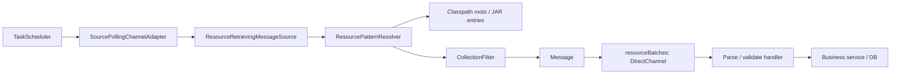
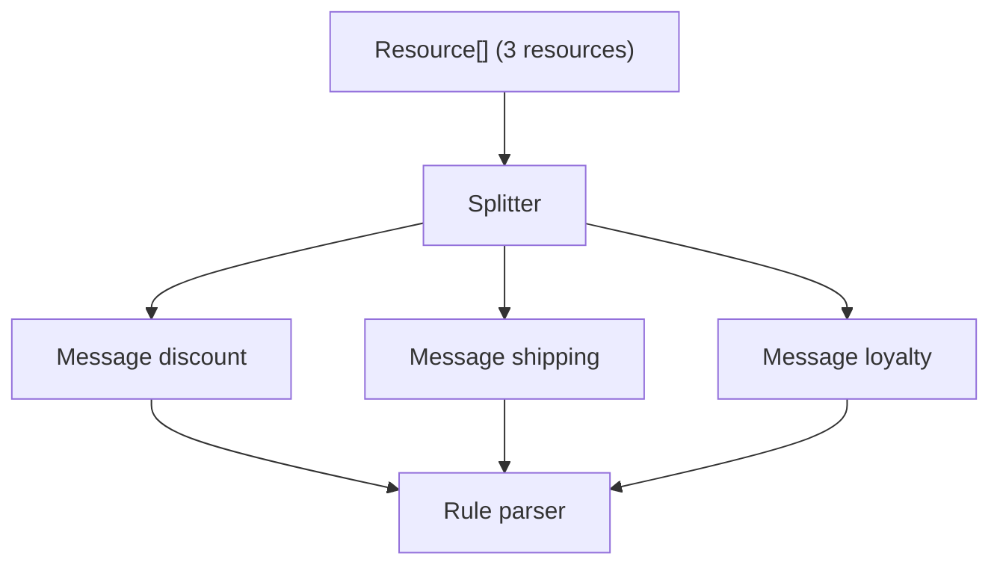
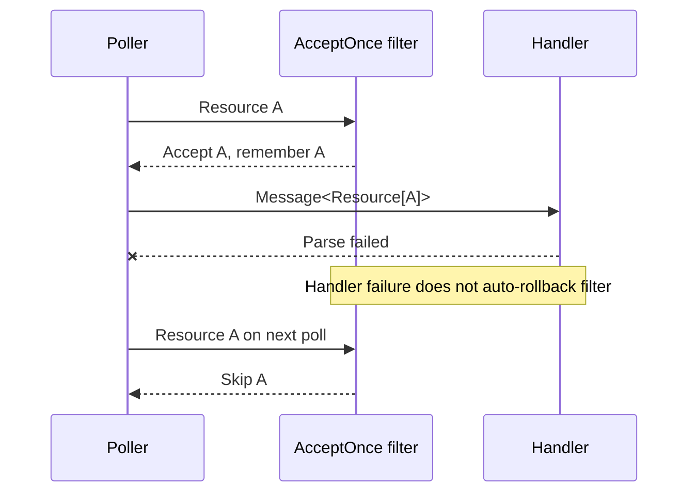
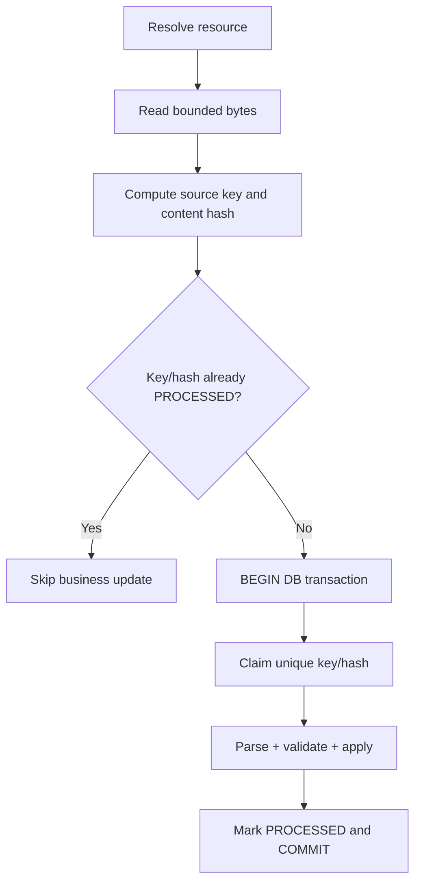

# Polling Classpath Resources in Spring Integration

## 1. Real-world scenario and objectives

An order-management Spring Boot application needs to read `.properties` rule files packaged under `src/main/resources/catalog/rules/`. An additional library may also contribute rule files inside its own JAR. The application wants to periodically discover matching files, decode each file, validate it, and then pass the data into the business flow via a `MessageChannel`.

A simple approach is writing a `Files.list(...)` loop inside a service, but that ties the data to a physical directory. When running an executable JAR, classpath resources can reside **inside the JAR** and cannot be handled like ordinary `java.io.File` objects.

Spring Integration provides **`ResourceRetrievingMessageSource`** to search for resources by pattern and a **polling inbound channel adapter** to periodically invoke the source. The source emits `Resource[]`, i.e., **a set of resource handles in a single Spring Message**, and downstream components then decide how to read and process the content.

This lesson belongs to the **Adapter Resource** chapter of the **SPRING_INTEGRATION_ADAPTERS** module: connecting external systems with Spring Integration via inbound/outbound adapters, gateways, pollers, and `MessageChannel`; handling message contracts, errors, and lifecycle. The topic here is **polling classpath resources**, not watching file changes with a watcher, handling an SFTP file, or acknowledging JMS/Kafka deliveries.

After this lesson, you will be able to:

1. Distinguish `classpath:` from `classpath*:`, wildcards, filesystem paths, and resources inside JARs.
2. Design `ResourceRetrievingMessageSource`, `@InboundChannelAdapter`, and `@Poller` to poll resources periodically.
3. Understand that `maxMessagesPerPoll` limits **receive calls**, not the number of elements in `Resource[]`.
4. Use `AcceptOnceCollectionFilter`, recognize cases where resources are not re-read, and understand reprocessing risks after restarts.
5. Open resources via `getInputStream()`, enforce size limits, parse UTF-8, and validate contracts.
6. Write unit tests for the resolver/filter, test packaged JARs, observe errors, and design checkpoints when high reliability is required.

## 2. Processing flow overview



Each component has a single responsibility:

| Component | Responsibility | Does not automatically do |
| --- | --- | --- |
| `TaskScheduler` / `@Poller` | Determines when to invoke the source | Watch for immediate file-change events |
| `ResourceRetrievingMessageSource` | Finds resources by location pattern and applies the filter | Open/parse JSON or properties into domain DTOs |
| `ResourcePatternResolver` | Returns `Resource` instances matching the pattern | Guarantee source immutability or business checkpoints |
| `CollectionFilter<Resource>` | Selects the subset to emit on a poll | Roll back DB transactions |
| `MessageChannel` | Delivers the Spring message to handlers | Guarantee idempotency or durability on its own |
| Handler/transformer | Reads streams, validates, transforms, and applies business logic | Change how the poller scans the classpath |

The Spring Integration documentation describes the Resource inbound channel adapter as a **polling adapter**. Unlike File inbound, it emits a **collection of `Resource` instances in one message**, instead of emitting one `File` per message by default.

## 3. A Resource is a handle, not already-read content

Spring Framework's `org.springframework.core.io.Resource` interface represents a data source. Common implementations include:

- `ClassPathResource`: a resource at a classpath path, which may reside in a classes directory or inside a JAR.
- `FileSystemResource`: a file on the filesystem.
- `UrlResource`: content accessed via a supported URL.
- `ByteArrayResource`: bytes in memory, convenient for tests.

A handler might receive:

```java
Resource resource = ...;

String name = resource.getFilename();
String description = resource.getDescription();
boolean present = resource.exists();

try (InputStream in = resource.getInputStream()) {
    // Read bytes from the actual source when the handler processes it.
}
```

**Do not assume `resource.getFile()` works.** In an IDE, `src/main/resources` is usually copied to a classes directory, so `getFile()` may succeed. However, when running a packaged executable JAR, a resource may be an entry inside the JAR and have no standalone `java.io.File`.

```text
When running in an IDE:
  build/classes/java/main/...
  build/resources/main/catalog/rules/discount.properties
  -> may have a physical file path

When running a JAR:
  application.jar
    └── BOOT-INF/classes/catalog/rules/discount.properties
  -> usually must be read via Resource#getInputStream()
```

Think of `Resource` as a **reference that can be opened for reading**. Placing a `Resource` into a Spring message does not prove the bytes have been read, the schema is valid, or the business transaction has committed.

## 4. Where do classpath: and classpath*: differ?

`ResourcePatternResolver` supports location patterns using `classpath:` or `classpath*:`.

### 4.1. classpath: — searching a single classpath space by base URL

Example:

```text
classpath:catalog/rules/*.properties
```

When a pattern includes a wildcard, the resolver typically takes the URL of the path segment **before the wildcard** as the root and searches for matching resources within that scope. If the same `catalog/rules/` directory exists across multiple classpath roots, `classpath:` may not find copies across every JAR.

If you know a single specific resource without wildcards, you can use:

```text
classpath:catalog/rules/discount.properties
```

This is a sensible approach when the application has **one required resource** and does not need to scan multiple sources.

### 4.2. classpath*: — collecting from multiple classpath roots

Example:

```text
classpath*:catalog/rules/*.properties
```

The `classpath*:` prefix tells the resolver to search across **multiple matching classpath locations**, including JARs and directories sharing the same base path as visible to the class loader. This fits a model where multiple libraries contribute resources by convention.

Suppose:

```text
application.jar:
  catalog/rules/discount.properties
  catalog/rules/shipping.properties

pricing-extension.jar:
  catalog/rules/pricing.properties

shipping-extension.jar:
  catalog/rules/priority.properties
```

With `classpath*:catalog/rules/*.properties`, we expect to resolve matching files from all roots visible to the class loader. **Do not assert the match count solely from JAR names**; test when packaged and running with the actual class loader/launcher.

### 4.3. Quick comparison

| Pattern | Purpose | What to verify |
| --- | --- | --- |
| `classpath:catalog/rules/discount.properties` | Read one specific resource | Does it exist on the runtime classpath? |
| `classpath:catalog/rules/*.properties` | Search pattern in the classpath under the selected base URL | Does it miss other libraries? |
| `classpath*:catalog/rules/*.properties` | Search across multiple classpath roots | Do nested JARs/class loaders enumerate properly? |
| `classpath*:catalog/**/*.yml` | Search across multiple directory levels | Broad scope, many JARs, and scan cost |
| `classpath*:*.properties` | Search at the classpath root | **Unreliable** with wildcards at JAR roots |

**Recommended choice for the hands-on exercise:** `classpath*:catalog/rules/*.properties`. It has a fixed root directory before the wildcard, is easy to control, and depends less on JAR-root scanning limitations.

## 5. Wildcards and class loader/JAR limitations

Spring Framework's `PathMatchingResourcePatternResolver` supports Ant-style patterns:

| Wildcard | Typical meaning | Example |
| --- | --- | --- |
| `*` | Matches multiple characters within one segment | `*.properties` |
| `?` | Matches one character within one segment | `rule-?.yml` |
| `**` | Matches multiple path levels | `catalog/**/*.properties` |

### 5.1. Always include a fixed directory before wildcards

Avoid:

```text
classpath*:*.xml
classpath*:**/*.json
```

With JARs, a wildcard without a specific root directory may fail to enumerate completely. Spring Framework recommends having at least **one fixed root directory before wildcards** when using `classpath*:` with Ant-style patterns.

Prefer:

```text
classpath*:catalog/rules/*.properties
classpath*:META-INF/my-service/*.json
```

### 5.2. Runtime classpath differences

Results can differ across:

1. IDE: multiple classes/resources directories live directly on the filesystem.
2. Test runner: adds `src/test/resources` and test dependencies.
3. Executable Spring Boot JAR: resources reside in `BOOT-INF/classes` or nested JARs.
4. Application server: custom class loaders / classpath hierarchy.
5. Java module path: search behavior also depends on the Framework version and packaging.

If resources are missing in production while working in the IDE, inspect the package layout, which files are actually packaged, the class loader, and resolver behavior. **Do not immediately replace `getInputStream()` with `getFile()`**, as that change usually makes matters worse.

### 5.3. Resource order is not business order

`getResources(...)` returns an array, but **you should not rely on the ordering across multiple JARs/classpath roots** to decide which rule takes precedence. If two libraries both contain `discount.properties`:

- `Resource#getFilename()` may collide.
- The URL/description location may differ.
- By default, there is no universal "whichever JAR comes first overrides" rule across all environments.

If ordering/priority is needed, declare `priority` or `rule.version` inside the content, handle conflicts explicitly, emit metrics, and fail fast on invalid cases.

## 6. Project structure for hands-on practice

Example Spring Boot + Spring Integration application:

```text
src/
  main/
    java/com/example/adapterresource/
      ResourcePollingConfiguration.java
      RuleResourceHandler.java
      RuleDefinition.java
    resources/
      catalog/rules/
        discount.properties
        shipping.properties
        loyalty.properties
  test/
    resources/
      fixture-rules/
        first.properties
        second.properties
```

Contents of `discount.properties`:

```properties
rule.id=discount-standard
rule.version=1
rule.enabled=true
rule.rate=0.05
```

Contents of `shipping.properties`:

```properties
rule.id=shipping-basic
rule.version=2
rule.enabled=true
rule.rate=0.00
```

Contents of `loyalty.properties`:

```properties
rule.id=loyalty-silver
rule.version=1
rule.enabled=false
rule.rate=0.02
```

This is an **application-defined data contract**; the Spring Resource adapter has no built-in knowledge of `rule.id`, `rule.version`, or `rule.rate`. The handler must parse/validate them and pass them to the domain service.

### Dependency

In a Maven project using a compatible Spring Boot BOM:

```xml
<dependencies>
    <dependency>
        <groupId>org.springframework.boot</groupId>
        <artifactId>spring-boot-starter-integration</artifactId>
    </dependency>
</dependencies>
```

For pure Resource inbound, the core classes are available in **Spring Integration Core** and Spring Framework Core. Only add File/SFTP/HTTP adapters when you actually need data sources of those types. The samples below use Java 17+ for `record` and try-with-resources.

## 7. Java configuration: MessageSource<Resource[]> and @Poller

Example using `@Bean` combined with `@InboundChannelAdapter`. This is the Spring Integration-supported approach for a bean returning `MessageSource`.

```java
package com.example.adapterresource;

import org.springframework.context.annotation.Bean;
import org.springframework.context.annotation.Configuration;
import org.springframework.core.io.Resource;
import org.springframework.integration.annotation.InboundChannelAdapter;
import org.springframework.integration.annotation.Poller;
import org.springframework.integration.channel.DirectChannel;
import org.springframework.integration.config.EnableIntegration;
import org.springframework.integration.core.MessageSource;
import org.springframework.integration.resource.ResourceRetrievingMessageSource;
import org.springframework.integration.util.AcceptOnceCollectionFilter;
import org.springframework.messaging.MessageChannel;

@Configuration
@EnableIntegration
public class ResourcePollingConfiguration {

    @Bean
    public MessageChannel resourceBatches() {
        return new DirectChannel();
    }

    @Bean
    @InboundChannelAdapter(
        channel = "resourceBatches",
        poller = @Poller(
            fixedDelay = "5000",
            initialDelay = "1000",
            maxMessagesPerPoll = "1"
        )
    )
    public MessageSource<Resource[]> classpathRuleSource() {
        ResourceRetrievingMessageSource source =
            new ResourceRetrievingMessageSource(
                "classpath*:catalog/rules/*.properties"
            );

        source.setFilter(new AcceptOnceCollectionFilter<>());
        return source;
    }
}
```

### Step-by-step explanation

1. `@EnableIntegration` activates the required Spring Integration infrastructure.
2. `resourceBatches()` creates an internal `DirectChannel` to carry messages.
3. `@InboundChannelAdapter` creates a `SourcePollingChannelAdapter` that calls `MessageSource.receive()` on a schedule.
4. `@Poller(fixedDelay="5000")` sets a **5-second** interval between polls using fixed-delay semantics.
5. `initialDelay="1000"` delays the first poll by roughly 1 second after the endpoint is scheduled to start.
6. `maxMessagesPerPoll="1"` limits each cycle to **at most one message received from the source**, not one file.
7. `ResourceRetrievingMessageSource` resolves the pattern via `ResourcePatternResolver`.
8. `AcceptOnceCollectionFilter` reduces re-emission of the same resources within the filter's lifecycle.

**Do not also declare an XML resource inbound adapter or another Java DSL flow for the same source in this demo.** Two independent pollers may scan and emit the same data twice, making the output confusing.

### Why declare the filter explicitly?

The Resource inbound documentation specifies **a default `AcceptOnceCollectionFilter` when using the XML namespace without specifying `filter`**. In this Java configuration, we set the filter explicitly to avoid relying on assumptions about another configuration style's defaults and to make the replay policy obvious to readers.

## 8. Output of a poll cycle: Resource[], not individual files

When the resolver finds three resources:

```text
classpath*:catalog/rules/*.properties
    |
    +-- discount.properties
    +-- shipping.properties
    +-- loyalty.properties
```

The result of the first poll might be:

```text
Source.receive() -> Message<Resource[]>
    payload.length = 3
    payload[0] = Resource(discount.properties)
    payload[1] = Resource(shipping.properties)
    payload[2] = Resource(loyalty.properties)
```

This is **a single message** with three elements; the element order is illustrative.

| Configuration | Number of receives in one cycle | Number of Resources that can be in one message |
| --- | --- | --- |
| `maxMessagesPerPoll=1` | At most 1 | 0, 1, or many resolved/filtered resources |
| `maxMessagesPerPoll=3` | At most 3, depending on availability | Each receive can produce a separate batch |
| `fixedDelay=5000` | Does not decide element count | Controls the interval between cycles |

Example with an accept-once filter:

```text
Poll 1: finds 3 resources -> filter accepts 3 -> Message<Resource[3]>
Poll 2: still 3 resources -> filter drops all 3 -> no new batch
Poll 3: still 3 resources -> filter drops all 3 -> no new batch
```

**Key point:** the poller **continues running** on poll 2 and poll 3 even though no messages are emitted. Therefore, an increasing `poll.count` metric does not mean more resources were processed.

## 9. Reading each resource safely via InputStream

To build the business contract, we define:

```java
package com.example.adapterresource;

import java.math.BigDecimal;

public record RuleDefinition(
    String id,
    int version,
    boolean enabled,
    BigDecimal rate
) {}
```

The handler receives `Message<Resource[]>` and reads the files. Example enforcing a **64 KiB/resource** limit before parsing:

```java
package com.example.adapterresource;

import java.io.ByteArrayInputStream;
import java.io.IOException;
import java.io.InputStream;
import java.io.InputStreamReader;
import java.math.BigDecimal;
import java.nio.charset.StandardCharsets;
import java.util.Properties;

import org.springframework.core.io.Resource;
import org.springframework.integration.annotation.ServiceActivator;
import org.springframework.messaging.Message;
import org.springframework.stereotype.Component;

@Component
public class RuleResourceHandler {

    private static final int MAX_RULE_BYTES = 64 * 1024;

    @ServiceActivator(inputChannel = "resourceBatches")
    public void receive(Message<Resource[]> batch) throws IOException {
        for (Resource resource : batch.getPayload()) {
            RuleDefinition rule = parse(resource);

            // TODO: pass rule to a domain service or DB.
            // Do not log the entire file as it may contain secrets.
            System.out.printf(
                "Loaded rule id=%s, version=%d%n",
                rule.id(), rule.version()
            );
        }
    }

    private RuleDefinition parse(Resource resource) throws IOException {
        byte[] data;

        try (InputStream in = resource.getInputStream()) {
            data = in.readNBytes(MAX_RULE_BYTES + 1);
        }
        if (data.length > MAX_RULE_BYTES) {
            throw new IOException(
                "Rule resource exceeds configured byte limit"
            );
        }

        Properties props = new Properties();
        try (InputStreamReader reader = new InputStreamReader(
                new ByteArrayInputStream(data),
                StandardCharsets.UTF_8
        )) {
            props.load(reader);
        }

        String id = props.getProperty("rule.id");
        if (id == null || id.isBlank()) {
            throw new IllegalArgumentException("Missing rule.id");
        }

        int version = Integer.parseInt(
            props.getProperty("rule.version", "0")
        );
        if (version <= 0) {
            throw new IllegalArgumentException(
                "rule.version must be positive"
            );
        }

        String enabledValue =
            props.getProperty("rule.enabled", "false");
        if (!"true".equals(enabledValue)
                && !"false".equals(enabledValue)) {
            throw new IllegalArgumentException(
                "Invalid rule.enabled"
            );
        }

        BigDecimal rate = new BigDecimal(
            props.getProperty("rule.rate", "0")
        );
        if (rate.signum() < 0 || rate.compareTo(BigDecimal.ONE) > 0) {
            throw new IllegalArgumentException(
                "rule.rate must be between 0 and 1"
            );
        }

        return new RuleDefinition(
            id,
            version,
            Boolean.parseBoolean(enabledValue),
            rate
        );
    }
}
```

### Why not use getFile()?

`Resource#getInputStream()` still works when a resource resides in a nested JAR or on the filesystem. `getFile()` can throw an exception when there is no corresponding physical file. Try-with-resources ensures the stream is closed whether parsing succeeds or fails.

### Why Properties.load(Reader)?

`Properties.load(InputStream)` has different encoding semantics compared to explicitly reading UTF-8. The example chooses `InputStreamReader(..., UTF_8)` and `Properties.load(Reader)` to codify that content is published in UTF-8. Both publisher and consumer must agree on the actual encoding.

### Why check size?

Do not call `resource.getInputStream().readAllBytes()` on an unbounded source. Even though the classpath is usually packaged by the development team, extensions or dependencies may contribute resources that violate the contract. `readNBytes(MAX + 1)` is enough to reject oversized resources before parsing; it does not replace overall memory limits, resource count caps, and dependency security.

**Note:** successful parsing does not mean the DB has been updated. The example only logs to illustrate the contract; production code should separate `RuleParser` and `RulePersistenceService` with explicit transactions, versions, and idempotency.

## 10. If each resource needs its own message: splitter

A `Message<Resource[]>` can be split into multiple `Message<Resource>` messages:



In an application, **as an alternative** to the annotation configuration in section 7, you can use Java DSL:

```java
import org.springframework.context.annotation.Bean;
import org.springframework.context.annotation.Configuration;
import org.springframework.integration.dsl.IntegrationFlow;
import org.springframework.integration.dsl.Pollers;
import org.springframework.integration.resource.ResourceRetrievingMessageSource;
import org.springframework.integration.util.AcceptOnceCollectionFilter;

@Configuration
public class ClasspathRuleSplitFlow {

    @Bean
    public ResourceRetrievingMessageSource ruleResources() {
        ResourceRetrievingMessageSource source =
            new ResourceRetrievingMessageSource(
                "classpath*:catalog/rules/*.properties"
            );
        source.setFilter(new AcceptOnceCollectionFilter<>());
        return source;
    }

    @Bean
    public IntegrationFlow ruleFlow(
            ResourceRetrievingMessageSource ruleResources,
            RuleItemService ruleItemService) {
        return IntegrationFlow
            .from(
                ruleResources,
                e -> e.poller(
                    Pollers.fixedDelay(5000)
                        .maxMessagesPerPoll(1)
                )
            )
            .split()
            .handle((payload, headers) -> {
                ruleItemService.process(
                    (org.springframework.core.io.Resource) payload
                );
                return null; // One-way handler.
            })
            .get();
    }
}
```

`RuleItemService` is an application-defined service with a `process(Resource)` method; it must perform parsing/validation/checkpointing and exception management. The DSL example is a **different** topology from `@InboundChannelAdapter` in section 7; do not enable both for the same pattern during testing.

**A splitter does not recreate a resource that was already dropped by the accept-once filter.** If the third item fails after the batch is created, the filter does not automatically roll back that item's "seen" state. Systems requiring retries must solve this at the checkpoint layer or adjust the filtering strategy.

## 11. Poller: fixed-delay, fixed-rate, initialDelay, and batches

### 11.1. fixed-delay

`@Poller(fixedDelay = "5000")` means subsequent triggers are scheduled after a delay following completion of the previous execution, according to the corresponding scheduler/poller. This suits classpath resolution that does not need to overlap continuously.

### 11.2. fixed-rate

`@Poller(fixedRate = "5000")` schedules launches on a steady cadence. If a resolution or handler takes longer than 5 seconds, actual timing depends on the `TaskScheduler` and thread count; do not assume the scheduler will run unlimited parallel executions automatically.

### 11.3. initialDelay

`initialDelay` delays the first poll, for instance to give downstream beans time to become ready before receiving batches. It does **not** replace readiness checks for external DBs or brokers.

### 11.4. maxMessagesPerPoll

`maxMessagesPerPoll = 1` only caps the maximum number of `MessageSource.receive()` calls the poller processes in a single cycle. A single `ResourceRetrievingMessageSource` can return **one message containing hundreds of `Resource` items**.

Example:

```text
T+1s:  poll #1
       source.resolve() -> 100 resources
       filter -> 100 resources
       channel.send(Message<Resource[100]>)

T+6s+: poll #2
       source.resolve() -> 100 resources
       accept-once -> 0 resources
       no new batch
```

**Do not infer exact timing like T+6s from configuration alone**: batch processing, scheduler contention, and resolution time can shift actual cycles relative to illustrative timestamps.

### When should you poll more frequently?

Classpath resources inside a JAR typically only change when **building/deploying a new version**. Polling every 100 ms does not make a JAR update itself and only repeats scan work. For resources that are immutable after startup, consider **loading once at startup** instead of frequent polling. A poller makes more sense when the source can legitimately change over the process lifecycle, such as an externally managed directory on a classpath root.

## 12. AcceptOnceCollectionFilter and "read once" semantics

`AcceptOnceCollectionFilter<Resource>` maintains state for resources already accepted based on the identity/equality semantics used by the filter. The Spring Integration documentation states that XML Resource inbound uses this filter by default when no filter is specified.

### 12.1. Three distinct states

| State | Meaning |
| --- | --- |
| **Resolved** | The resource matched the pattern and was returned by the resolver. |
| **Accepted** | The filter let the resource pass during a poll. |
| **Business-processed** | The handler parsed and committed to the DB per contract. |

These three states are **not identical**. The filter may accept a resource at `T1`, while the handler fails at `T2`.



### 12.2. Re-reading after file edits

With `AcceptOnceCollectionFilter`, changing **content** while keeping the same resource identity does not necessarily cause the resource to be emitted again. The filter is neither a content watcher nor a content-version tracker.

With an executable JAR, editing files **inside the JAR** while the application is running is not a reliable configuration update workflow. If hot reloading is required, use a proper mutable source such as `file:` on an external directory, a database, Config Server, or a dedicated event source with versioning/refresh policies.

### 12.3. Restarts can cause resources to be emitted again

The default accept-once state lives in the bean's memory. After a restart, it can "forget" previously received resources, and batches containing the same resources may reappear. Thus, the application must handle **duplicate business effects** if reloading data multiple times has side effects.

### 12.4. What if you want to re-read on every poll?

In the XML namespace, you can disable the default filter:

```xml
<int:resource-inbound-channel-adapter
        id="classpathResources"
        channel="resourceBatches"
        pattern="classpath*:catalog/rules/*.properties"
        filter="">
    <int:poller fixed-delay="5000"/>
</int:resource-inbound-channel-adapter>
```

When the filter is disabled, resources still matching the pattern can be emitted on every poll. **Only do this when downstream has version checks/idempotency** or when the problem inherently requires periodically re-checking configuration.

In Java, you can choose a custom `CollectionFilter<Resource>` to implement the right policy; do not assume calling `setFilter(customFilter)` automatically composes with accept-once.

## 13. How to process only when content actually changes?

An advanced requirement is **re-parsing only if the bytes differ from the already-processed version**. The pattern resolver is not responsible for detecting business versions; this must be built at the application layer.

### 13.1. Source key and version

Example:

```text
resourceId     = stable source identity
contentVersion = SHA-256(resource bytes)
businessKey    = resourceId + ":" + contentVersion
```

Do not rely solely on `resource.getFilename()`, as multiple JARs can contain the same filename. `resource.getURL()` can be helpful for observing provenance, but URLs/descriptions can vary across packaging modes or deployments; design a domain-stable identity.

### 13.2. Version-aware processing mechanism



**Boundary note:** if `AcceptOnceCollectionFilter` already blocked the resource upfront, the hash layer will never see that resource on subsequent polls. A system needing change detection must use a **version-aware** filter or let the source re-emit and decide at the content-hash/ledger layer.

### 13.3. At-most-once discovery vs. exactly-once processing

- **Discovery:** the source finds the resource and the filter lets it through.
- **Internal delivery:** Spring `MessageChannel` passes the reference to the handler.
- **Business outcome:** whether the DB/transaction has applied a given version.

An application cannot infer "processed exactly once" from an accept-once filter alone. If there are multiple replicas or a crash after commit, you need unique constraints, durable checkpoints, or an appropriate coordination mechanism.

## 14. Error handling from resolver to database

Errors in the flow can occur at multiple stages:

| Stage | Example error | Approach |
| --- | --- | --- |
| Resolve classpath | Wrong base path, resource missing in JAR, class loader does not expose directory | Verify packaging and runtime resolver; alert if a required source is empty. |
| Filter | Incorrect state, mistakenly dropping a new version | Review filter/identity policy; perform controlled resets. |
| Open stream | Resource cannot be opened, I/O exception | Bounded retry if the source is mutable; verify packaging/ACLs. |
| Decode | Inconsistent encoding | Standardize on UTF-8 or the defined contract. |
| Parse | Missing fields, invalid numbers, schema mismatch | Quarantine/validation error; do not infinitely retry malformed data. |
| Domain service | Version conflict, duplicate `rule.id` | Clear business rules, transactions/unique constraints. |
| DB | Timeout, deadlock, unavailable | Policy-driven retries and idempotency. |
| Async worker | Exception after the poller has already returned | Downstream error flow; do not expect the source to auto-rollback. |

### 14.1. A batch can fail on the Nth element

For example, batch `[A, B, C]`: the handler reads A successfully, saves B, and then fails parsing C. Without a transaction wrapping the business effects, partial results may already be persisted. With a JDBC transaction, it only rolls back **DB changes within that transaction's scope**, not `AcceptOnceCollectionFilter`.

Options:

1. Process the whole batch as one unit-of-work and roll back the DB if any resource fails (when business semantics permit).
2. Split into individual `Resource` items, each with its own transaction/identity.
3. Use a ledger tracking each resource version's status to retry only failed items.
4. Quarantine invalid resources and continue with valid ones according to a published policy.

**Do not assume a handler error causes the poller to retry a message already accepted once.** Explicitly design retries and checkpoints.

### 14.2. DirectChannel and async boundaries

In the main example, `DirectChannel` delivers messages synchronously to the handler; exceptions can propagate back to the poller. If switched to `ExecutorChannel` or `QueueChannel`:

- `send()` succeeding may only mean the task was handed to a worker or enqueued.
- Worker failures happen **after** the source/filter has already marked the resource.
- An in-memory queue can lose contents on process crash.
- You need bounded queues, worker-side error channels, and independent checkpoints.

### 14.3. Handling zero matching resources

For many applications, "0 resources" is normal. For a mandatory rule set, it is an operational error. `ResourceRetrievingMessageSource` does not know the business requirement "at least 3 rules." You need separate health checks/validation—such as checking the count of loaded rules after startup and alerting if the threshold is not met.

## 15. Special notes for pre-packaged resources

When resources actually reside inside an executable JAR:

- Content is usually **immutable until the next build/deploy**.
- Repeated polling mostly repeats enumeration/resolution and does not turn it into a file watcher.
- If you want to hot-reload a configuration file without redeploying, place it in a **source outside the packaged classpath** with a proper refresh contract.
- Scanning all JARs every few hundred milliseconds can burn CPU/IO and increase startup/GC latency when the resource count is large.
- `Resource#getInputStream()` is preferred over `Resource#getFile()` for compatibility with JAR entries.

### When should you not use a poller?

If the requirement is "read 3 immutable files **once at startup** to construct configuration beans," `@ConfigurationProperties`, `ResourceLoader`, or `ApplicationRunner` may be simpler.

If the requirement is "whenever a file in an external directory is replaced, process it immediately," use `file:` with an appropriate scanning/versioning mechanism or File inbound adapter/watch-service. If the requirement is "receive messages from Kafka/JMS," use the corresponding adapter—the classpath resolver does not replace a broker consumer.

## 16. XML namespace: alternative configuration

Java annotations are not mandatory. Spring Integration supports the XML resource inbound channel adapter:

```xml
<?xml version="1.0" encoding="UTF-8"?>
<beans xmlns="http://www.springframework.org/schema/beans"
       xmlns:xsi="http://www.w3.org/2001/XMLSchema-instance"
       xmlns:int="http://www.springframework.org/schema/integration"
       xsi:schemaLocation="
          http://www.springframework.org/schema/beans
          https://www.springframework.org/schema/beans/spring-beans.xsd
          http://www.springframework.org/schema/integration
          https://www.springframework.org/schema/integration/spring-integration.xsd">

    <int:channel id="resourceBatches"/>

    <int:resource-inbound-channel-adapter
            id="classpathResources"
            channel="resourceBatches"
            pattern="classpath*:catalog/rules/*.properties">
        <int:poller
                fixed-delay="5000"
                max-messages-per-poll="1"/>
    </int:resource-inbound-channel-adapter>

    <bean id="ruleResourceHandler"
          class="com.example.adapterresource.RuleResourceHandler"/>

    <int:service-activator
            input-channel="resourceBatches"
            ref="ruleResourceHandler"
            method="receive"/>
</beans>
```

This is an **alternative** to Java configuration; do not enable both versions in parallel scanning the same resource set. `RuleResourceHandler` is the application class from section 9. Per the Spring Integration reference, **the XML resource inbound adapter uses `AcceptOnceCollectionFilter` by default** when `filter` is omitted.

### Adding a custom filter/resolver

XML supports:

```xml
<int:resource-inbound-channel-adapter
        id="customClasspathResources"
        channel="resourceBatches"
        pattern="classpath*:catalog/rules/*.properties"
        pattern-resolver="customPatternResolver"
        filter="customResourceFilter">
    <int:poller fixed-delay="5000"/>
</int:resource-inbound-channel-adapter>
```

`customPatternResolver` must be a bean implementing `ResourcePatternResolver`, and `customResourceFilter` must implement `CollectionFilter<Resource>`; you must declare both beans yourself. These beans do not exist automatically just because XML references their names.

## 17. Testing classpath resolution before wiring the poller

Before running the flow, you should have a test that **checks only the resolver**, separating classpath/packaging issues from poller, channel, or handler issues.

### 17.1. Testing the resolver with JUnit 5

Create `src/test/resources/fixture-rules/first.properties` and `second.properties`. Example:

```java
import static org.junit.jupiter.api.Assertions.assertEquals;
import static org.junit.jupiter.api.Assertions.assertNotNull;

import java.util.Arrays;
import java.util.Set;
import java.util.stream.Collectors;

import org.junit.jupiter.api.Test;
import org.springframework.core.io.Resource;
import org.springframework.core.io.support.PathMatchingResourcePatternResolver;

class ClasspathResourceResolverTest {

    @Test
    void findsFixturesUnderDedicatedClasspathFolder() throws Exception {
        var resolver = new PathMatchingResourcePatternResolver();

        Resource[] found = resolver.getResources(
            "classpath*:fixture-rules/*.properties"
        );

        Set<String> names = Arrays.stream(found)
            .map(Resource::getFilename)
            .collect(Collectors.toSet());

        assertEquals(
            Set.of("first.properties", "second.properties"), names
        );
        for (Resource resource : found) {
            try (var stream = resource.getInputStream()) {
                assertNotNull(stream);
            }
        }
    }
}
```

Unit tests must place fixtures on the test classpath; match counts may differ if test dependencies happen to include the same directory and filenames. Choose project-specific fixture names to avoid collisions. The `InputStream` inside the loop is closed via try-with-resources.

### 17.2. Testing the source and accept-once filter

```java
import static org.junit.jupiter.api.Assertions.*;

import org.junit.jupiter.api.Test;
import org.springframework.core.io.Resource;
import org.springframework.core.io.support.PathMatchingResourcePatternResolver;
import org.springframework.integration.resource.ResourceRetrievingMessageSource;
import org.springframework.integration.util.AcceptOnceCollectionFilter;
import org.springframework.messaging.Message;

class ClasspathResourceSourceTest {

    @Test
    void emitsOneBatchThenNoRepeatInSameSourceInstance()
            throws Exception {
        var source = new ResourceRetrievingMessageSource(
            "classpath*:fixture-rules/*.properties"
        );
        source.setPatternResolver(
            new PathMatchingResourcePatternResolver()
        );
        source.setFilter(new AcceptOnceCollectionFilter<>());
        source.afterPropertiesSet();

        Message<Resource[]> first = source.receive();
        assertNotNull(first);
        assertEquals(2, first.getPayload().length);

        Message<Resource[]> second = source.receive();
        assertNull(second);
    }
}
```

This test verifies **the source/filter within the same JVM**. It does not run `TaskScheduler`, does not verify browser/JAR packaging, and does not verify DB commits. Further tests are needed at subsequent layers.

### 17.3. Integration testing the poller

In a Spring Boot integration test, enable `@EnableIntegration`, configure a short poller interval (e.g., 100–200 ms in tests), and use a `QueueChannel` or test handler to collect messages. Verify:

1. One batch containing `Resource[]` arrives after the first poll.
2. The batch only contains resources from the fixture directory.
3. The handler opens streams and parses successfully.
4. No further batches arrive once the accept-once filter has recorded the resources.
5. Parse exceptions are observed on the appropriate error flow.

Avoid asserting that each poll fires at exact millisecond N; schedulers and test runners have jitter, so await with a reasonable timeout.

## 18. Testing JAR packaging and multi-root environments

This step cannot be replaced by IDE unit tests alone.

### Minimum verification matrix

| Environment | What to verify |
| --- | --- |
| IDE / test runner | `classpath*:catalog/rules/*.properties` finds the expected fixtures and main resources. |
| Executable JAR | `getInputStream()` opens resources in `BOOT-INF/classes`. |
| Dependency JAR | Resources sharing the base path in a dependency are visible to the resolver. |
| Two JARs with same filename | Filename is not used as the sole business key; conflict policy works properly. |
| Root wildcard `classpath*:*.xml` | May miss resources inside JARs; avoid using. |
| Startup when rules are required | Fails/alerts if insufficient rules are loaded. |
| App restart | Accept-once state resets; duplicate ledger prevents duplicate side effects. |
| Error on Nth item | Failed items are not silently dropped once the batch is accepted. |

If running the packaged JAR yields different results than the test runner, check **whether resources are actually packaged**, whether the base path has a fixed directory, the launcher's class loader, and nested JAR enumeration support. Do not use `File#listFiles` on a path derived from `ClassPathResource#getFile()` as a workaround.

## 19. Observability and troubleshooting

| Symptom | Possible cause | How to check |
| --- | --- | --- |
| Poller runs with no batches | Wrong pattern, missing fixtures, filter dropped everything | Compare resolver count vs. filter count; inspect runtime classpath. |
| Only one message seen for many files | Payload is `Resource[]` | Log batch length; split if individual items are needed. |
| Cannot read JAR resource | Using `getFile()` or class loader does not support the pattern | Switch to `getInputStream()`; test in JAR. |
| Files in dependency do not appear | Using `classpath:` when multi-root search is needed | Try `classpath*:` and inspect package layout. |
| Not re-read after editing file | Accept-once does not track versions | Use a version-aware policy or disable the filter in a controlled way. |
| Rules processed twice after restart | In-memory filter lost state | Unique constraint/ledger keyed by rule ID/version/hash. |
| One failing resource stops entire batch | Handler iterates sequentially and throws | Split per item or define atomic batch / quarantine semantics. |
| Very short poll interval does not increase throughput | Classpath scan has no new data, handler is busy | Measure latency and adjust design/cadence. |
| Read results differ from IDE | Nested JAR/class loader/packaging differences | Run integration tests against the executable JAR. |
| New resources ignored when editing JAR at runtime | Packaged classpath is not a hot folder | Redeploy or use an external non-classpath source. |
| Multiple replicas load the same rules | Per-process source/filter | Central ledger / idempotency / coordination. |

### Recommended metrics

Record poll cycles, resources resolved, resources accepted by filter, `Resource[]` batch size, resolve duration, open/parse duration, resource versions committed, duplicate count, parse failures, and age of the latest rule version. Separate the milestones **discovery**, **accepted by filter**, **parsed**, and **committed**—avoid treating "connection/scheduler is running" as proof that data is valid.

### Security checks

- Scan only specific classpath directories; never accept raw patterns from untrusted input.
- Do not log raw configuration contents or URLs containing secrets.
- Bound individual resource sizes and total batch size.
- Validate schemas, versions, and rule-loading permissions before applying them to business logic.
- When multiple JARs contribute the same rule ID, enforce an explicit conflict policy.
- Do not rely on arbitrary resolver ordering to choose rule precedence.

## 20. Hands-on exercises with answers

**Exercise 1 — Abstraction.** Should a resource located inside a JAR be opened via `getFile()` or `getInputStream()`?

**Answer:** `getInputStream()`. Not every classpath resource has a separate physical file.

**Exercise 2 — Pattern.** When two dependency JARs both contain `catalog/rules/*.properties`, which prefix is appropriate to search across multiple roots?

**Answer:** Typically `classpath*:catalog/rules/*.properties`, then verify in the actual runtime.

**Exercise 3 — Root wildcard.** Why avoid `classpath*:*.xml` in packaged JARs?

**Answer:** Resolvers have limitations scanning wildcards at JAR roots; include a fixed base directory before the wildcard.

**Exercise 4 — Poller.** Does `fixedDelay="5000"` mean a listener is immediately pushed events by a broker when a file changes?

**Answer:** No. It configures a schedule for periodically calling `MessageSource.receive()`.

**Exercise 5 — Batch.** The resolver finds 30 resources; does `maxMessagesPerPoll="1"` mean only one resource is emitted?

**Answer:** No. One `Message<Resource[]>` can contain all 30 resources; this setting limits the number of messages received per cycle.

**Exercise 6 — Filter.** When a Java source has `setFilter(new AcceptOnceCollectionFilter<>())`, can the second poll emit no batch even while the poller keeps running?

**Answer:** Yes. The filter can drop all resources that have already been accepted.

**Exercise 7 — Content changes.** Does modifying a resource's bytes without changing its location guarantee the filter will emit it again?

**Answer:** No. Accept-once does not replace a content-version tracker.

**Exercise 8 — Restart.** Does restarting the application guarantee resources won't be emitted again when using an in-memory filter?

**Answer:** No. Durable checkpointing/idempotency is required if reprocessing is hazardous.

**Exercise 9 — Handler failure.** The filter accepted A, and then the parser threw an exception. Is A guaranteed to be retried on the next poll?

**Answer:** No. Filter state does not automatically roll back with handler or DB transactions.

**Exercise 10 — Splitter.** When you want each resource processed independently per transaction, what can you place after the source?

**Answer:** A `Splitter` to turn `Resource[]` into individual `Resource` messages, combined with per-item checkpointing/idempotency.

**Exercise 11 — Properties encoding.** Why does the example use `InputStreamReader(..., UTF_8)` with `Properties.load(Reader)`?

**Answer:** To express the UTF-8 contract explicitly and avoid encoding pitfalls of the `load(InputStream)` overload.

**Exercise 12 — Ordering.** Should you treat the first resource in the array returned from JARs as the highest-priority rule?

**Answer:** No. Resolver order is not business ordering; use explicit version/priority/conflict policies.

**Exercise 13 — Duplicate names.** Two JARs both have `discount.properties`. Should filename be used as the sole source key?

**Answer:** No. Use a more stable source identifier and explicit conflict resolution rules.

**Exercise 14 — Static JAR.** Will polling every 100 ms cause JAR contents to auto-hot-reload when rebuilding the artifact externally?

**Answer:** No. Packaged classpath sources are typically immutable for the app's lifetime; redeploy or use a supported mutable source.

**Exercise 15 — DB rollback.** Does `@Transactional` on the handler automatically revert a resource that already passed through the accept-once filter?

**Answer:** No. The filter and DB transaction maintain independent state.

**Exercise 16 — Async.** Does switching from `DirectChannel` to `ExecutorChannel` make `send()` wait until the worker commits?

**Answer:** No. The task may only be enqueued; separate downstream completion/error flows are required.

**Exercise 17 — Packaged JAR.** A test passes in the IDE, but the executable JAR cannot find the rules. What should you check?

**Answer:** Packaging, `BOOT-INF/classes`, base path, class loader, nested JAR resolution, and the `classpath*:` pattern.

**Exercise 18 — Adapter selection.** To scan an SFTP directory on another server and acknowledge downloaded files, should you just use the classpath Resource poller?

**Answer:** No. Use the SFTP adapter with session/file synchronization/remote operations; the classpath resolver does not manage SFTP.

**Exercise 19 — Testing.** Does unit testing `ResourceRetrievingMessageSource.receive()` prove that the poller and JAR packaging work?

**Answer:** No. It only tests the source/filter; scheduler and packaged JAR integration tests are still needed.

**Exercise 20 — Production.** When loading rules affecting billing, does using only an accept-once filter guarantee "exactly once business processing"?

**Answer:** No. Use version/unique keys, transactions, and a durable idempotency/ledger mechanism.

## 21. Key takeaways

**Polling classpath resources** in Spring Integration is the process where `ResourceRetrievingMessageSource` resolves a pattern via `ResourcePatternResolver`, filters `Resource` instances, and emits a **`Message<Resource[]>`** to a `MessageChannel` on a `@Poller` schedule. `classpath:` suits lookups under a selected classpath base; `classpath*:` is needed when searching across multiple classpath roots/JARs. Wildcards should have a fixed base directory and must be tested in an executable JAR, not just in the IDE. `maxMessagesPerPoll` limits the number of message receives, **not the number of resources in a batch**. `AcceptOnceCollectionFilter` can reduce duplicate emissions, but it does not detect new content automatically, does not survive restarts, and does not roll back on handler failures. For critical data, read via `getInputStream()`, enforce byte bounds, parse/validate explicitly, control batches/splitters, design version-aware checkpoints, and protect business commits with idempotency.

## References

- [Spring Integration Reference — Resource Support](https://docs.spring.io/spring-integration/reference/resource.html)
- [Spring Integration Javadoc — ResourceRetrievingMessageSource](https://docs.spring.io/spring-integration/api/org/springframework/integration/resource/ResourceRetrievingMessageSource.html)
- [Spring Integration Reference — Annotation Support](https://docs.spring.io/spring-integration/reference/configuration/annotations.html)
- [Spring Integration Reference — Polling Consumer](https://docs.spring.io/spring-integration/reference/endpoint/polling-consumer.html)
- [Spring Framework Reference — Resources](https://docs.spring.io/spring-framework/reference/core/resources.html)
- [Spring Framework Javadoc — PathMatchingResourcePatternResolver](https://docs.spring.io/spring-framework/docs/current/javadoc-api/org/springframework/core/io/support/PathMatchingResourcePatternResolver.html)
