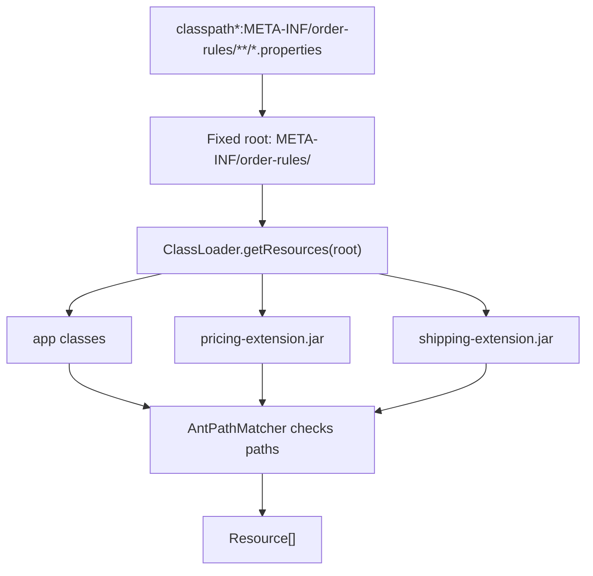
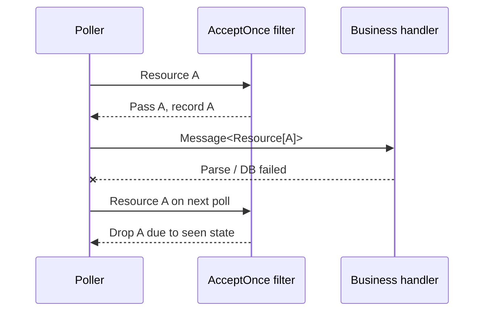
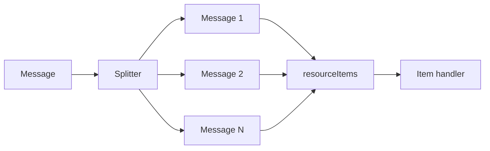

# ResourcePatternResolver and Multiple Resources in Spring Integration

## 1. Problem statement: multiple libraries contributing a shared set of resources

An order-processing application has pricing, shipping, and promotion rules distributed across multiple modules:

```text
order-service.jar
  BOOT-INF/classes/META-INF/order-rules/base.properties

pricing-extension.jar
  META-INF/order-rules/discount.properties
  META-INF/order-rules/seasonal.properties

shipping-extension.jar
  META-INF/order-rules/express.properties
```

Each module follows the `META-INF/order-rules/` directory convention. The application needs to **find all resources matching the pattern**, read them as `Resource` objects, and feed them into Spring Integration for validation, merging, or individual processing.

If you only use `ClassLoader.getResource("META-INF/order-rules/base.properties")`, you may get **one** URL. If you use `classpath:` with a wildcard, finding files across different classpath roots may also be incomplete. To discover multiple resources, Spring Framework provides the **`ResourcePatternResolver`** interface, commonly implemented by **`PathMatchingResourcePatternResolver`**; Spring Integration uses it inside **`ResourceRetrievingMessageSource`**.

This lesson belongs to the **Adapter Resource** chapter of the **SPRING_INTEGRATION_ADAPTERS** module. In this module, adapters and gateways connect external systems to `MessageChannel`, pollers control data retrieval, and the processing flow handles message contracts, errors, and lifecycle. The topic **"ResourcePatternResolver and multiple resources"** focuses on resolving multiple location patterns, discovering resources across multiple classpath roots/JARs/filesystems, and delivering **a collection of resources** via the Resource inbound channel adapter.

### After this lesson, you will be able to

1. Distinguish `ResourceLoader#getResource` from `ResourcePatternResolver#getResources`.
2. Use `classpath:`, `classpath*:`, `file:`, and Ant-style wildcards in the right contexts.
3. Understand how the resolver determines the root before wildcards, scans directories/JARs, and faces class loader limitations.
4. Handle multiple resources with **duplicate filenames from different sources**, results without business ordering, and version checks.
5. Configure `ResourceRetrievingMessageSource`, custom `ResourcePatternResolver`, `CollectionFilter<Resource>`, and polling endpoints.
6. Distinguish `Resource[]`/a single batch from multiple Spring messages, using `Splitter` when needed.
7. Design tests, security, performance, error handling, and checkpointing/idempotency.

## 2. Three abstractions to distinguish

### 2.1. Resource: object representing a content source

`org.springframework.core.io.Resource` has implementations such as `ClassPathResource`, `FileSystemResource`, `UrlResource`, and `ByteArrayResource`. It lets you inspect metadata and open content via `getInputStream()`.

```java
Resource resource = ...;

String filename = resource.getFilename();
String description = resource.getDescription();
boolean available = resource.exists();

try (InputStream input = resource.getInputStream()) {
    // Read data, then close the stream.
}
```

A `Resource` is **not** preloaded content. It is a *handle* to data that may fail to open or change between discovery time and when the handler reads it.

### 2.2. ResourceLoader: finding one resource by location

`ResourceLoader` has the method:

```java
Resource getResource(String location);
```

Example:

```java
Resource single = applicationContext.getResource(
    "classpath:META-INF/order-rules/base.properties"
);
```

`getResource` returns **one** `Resource` object representing the requested location. It is not a "find all matches" API for a glob.

### 2.3. ResourcePatternResolver: resolving a pattern into multiple resources

`ResourcePatternResolver` extends `ResourceLoader` and declares:

```java
Resource[] getResources(String locationPattern)
        throws IOException;
```

And the constant:

```java
ResourcePatternResolver.CLASSPATH_ALL_URL_PREFIX // "classpath*:"
```

Example:

```java
ResourcePatternResolver resolver =
    new PathMatchingResourcePatternResolver();

Resource[] all = resolver.getResources(
    "classpath*:META-INF/order-rules/*.properties"
);
```

**An API returning multiple results does not mean it has processed their content.** You still must verify the count, identity, read permissions, version, and business effects.

| API | Result | Purpose |
| --- | --- | --- |
| `ResourceLoader.getResource(location)` | `Resource` | Get a handle for a single location. |
| `ResourcePatternResolver.getResources(pattern)` | `Resource[]` | Find handles matching a pattern. |
| `Resource.getInputStream()` | `InputStream` | Read bytes of a single handle. |
| `ResourceRetrievingMessageSource.receive()` | `Message<Resource[]>` or no message | Emit the resolved/filtered batch into Spring Messaging. |

### An ApplicationContext can also be a resolver

In Spring Framework, `ApplicationContext` implements the `ResourcePatternResolver` interface. Therefore you can call:

```java
Resource[] resources = applicationContext.getResources(
    "classpath*:META-INF/order-rules/*.properties"
);
```

You do not have to create a new `PathMatchingResourcePatternResolver` if the application already has a suitable `ApplicationContext`. For standalone code outside a Spring context, that standalone implementation is especially convenient.

## 3. How does PathMatchingResourcePatternResolver work?

`PathMatchingResourcePatternResolver` is the standard implementation of `ResourcePatternResolver`. It combines `ResourceLoader`, `ClassLoader`, and `PathMatcher`, using different search strategies depending on the pattern.

### 3.1. Locations without wildcards

For locations like:

```text
classpath:META-INF/order-rules/base.properties
file:/opt/app/rules/default.properties
```

Without `classpath*:` or `PathMatcher` wildcards, the resolver typically returns a single resource via `ResourceLoader#getResource` without scanning the entire classpath.

In contrast, `classpath*:META-INF/order-rules/base.properties` means **find all resources with the same relative path** across multiple classpath roots (and the module path depending on Framework version), even without `*` characters in the filename.

### 3.2. Locations containing Ant-style wildcards

Suppose:

```text
classpath*:META-INF/order-rules/**/*.properties
```

The resolver needs to:

1. Determine the **non-wildcard root path prefix**, here `META-INF/order-rules/`.
2. With `classpath*:`, ask the class loader for URLs corresponding to all copies of this root.
3. For each root, scan directory/JAR entries depending on the URL and class loader type.
4. Use `PathMatcher` to match paths against the wildcard portion.
5. Return valid `Resource[]` within the resolver's capabilities.



This is a **conceptual model**, not a guarantee that every launcher/JAR exposes all URLs or traverses them in the exact same order. Spring Framework recommends testing wildcards in JARs under your specific deployment environment.

### 3.3. Ant-style wildcards

| Pattern | Example match | Meaning |
| --- | --- | --- |
| `*.properties` | `base.properties` | Files in a single directory level. |
| `rule-?.yml` | `rule-a.yml` | `?` matches a single character. |
| `**/*.properties` | `base.properties` and `region/eu.properties` | Search across multiple directory levels. |
| `*-rules.json` | `shipping-rules.json` | Filename prefix/suffix matching. |

Do not confuse Ant-style globs with **Java regex**. `*`, `?`, and `**` follow `PathMatcher` semantics, not `Pattern.compile(...)`.

## 4. classpath: and classpath*: with multiple sources

Suppose `pricing-extension.jar` and `shipping-extension.jar` both contain:

```text
META-INF/order-rules/config.properties
```

### `classpath:`: may pick a single root

```java
Resource[] resources = resolver.getResources(
    "classpath:META-INF/order-rules/*.properties"
);
```

With wildcards, the resolver may use the first URL found for the base directory via the class loader. The result is **not guaranteed to include every JAR sharing that base path**.

### `classpath*:`: searches across multiple roots

```java
Resource[] resources = resolver.getResources(
    "classpath*:META-INF/order-rules/*.properties"
);
```

The resolver searches all matching roots visible to the runtime class loader and evaluates the wildcard within each root. This is the common choice when **multiple JARs contribute resources**.

### Even without wildcards, multiple results can be returned

```java
Resource[] sameName = resolver.getResources(
    "classpath*:META-INF/order-rules/config.properties"
);
```

If two JARs both contain that relative path, the result may hold **two distinct `Resource` objects**, even though `getFilename()` is `config.properties` for both.

| Need | Recommended pattern | Note |
| --- | --- | --- |
| Need one known specific file | `classpath:META-INF/order-rules/base.properties` | Check `exists()`/read stream. |
| Need all copies at the same path | `classpath*:META-INF/order-rules/base.properties` | May return multiple files from multiple JARs. |
| Need all files with an extension | `classpath*:META-INF/order-rules/*.properties` | Keep a fixed root before the wildcard. |
| Need recursive search | `classpath*:META-INF/order-rules/**/*.properties` | Higher scan cost and portability considerations. |
| Need to scan an external directory outside classpath | `file:/opt/app/rules/*.properties` | Suitable for filesystem, does not rely on JARs. |

## 5. Limitations with JARs, module paths, and class loaders

### 5.1. Wildcards at JAR roots are not portable

Avoid patterns like:

```text
classpath*:*.xml
classpath*:**/*.json
```

Spring Framework Javadoc warns that **`classpath*:` + Ant wildcards are only reliable when there is at least one concrete root directory before the wildcard**, except for files residing on the filesystem. The issue stems from the class loader API used to resolve an empty root and how JAR entries are enumerated. The Framework mitigates this where possible, but cannot guarantee it across every environment.

Prefer:

```text
classpath*:META-INF/order-rules/*.properties
classpath*:com/example/rules/**/*.yaml
```

### 5.2. Wildcards inside JARs depend on packaging

To scan JARs, the resolver must handle `jar:` URLs or container/launcher variants. It may use `JarURLConnection` or corresponding URL/JAR entry parsing mechanisms. With custom class loaders, nested JARs, or application servers, behavior may differ from an IDE.

**Do not change code to `resource.getFile()` as a "fix"**: an entry inside a JAR usually is not a standalone physical file. Use `getInputStream()`.

### 5.3. Java Module System

Since Spring Framework 6.0, `classpath*:` lookups can also search **non-system modules in the boot module layer** before searching the classpath via class loader APIs. This does not make every resource inside a module public or always accessible: module configuration, class loaders, and packaging must still be considered.

### 5.4. Class loader hierarchy and visibility

`classpath*:` cannot see JARs that are **not present in the class loader/module path used by the resolver**. For example, an isolated plugin class loader may hold its own resources; the application must use the right loader or an explicit plugin contract.

If resources "go missing," check:

- Is the file actually inside the JAR after building?
- Does the base directory exist under the exact same path?
- Which JARs are visible to the current class loader?
- Does the pattern start a wildcard from an empty root?
- Are there differences between the test classpath and production classpath?
- Is the runtime an executable JAR, module path, or application server?

## 6. Multiple resources: set semantics, duplicate names, and ordering

The Javadoc for `ResourcePatternResolver#getResources` states the result should have **set semantics** and avoid entries pointing to the same physical resource **to the extent possible**. This does **not** mean:

- Two JARs with two same-named resources will collapse into one.
- Results are sorted by filename.
- Resources with identical bytes are automatically merged.
- Output order is stable across dev, test, and production machines.

### 6.1. Same name, different source

```text
pricing-extension.jar!/META-INF/order-rules/config.properties
shipping-extension.jar!/META-INF/order-rules/config.properties
```

Both may have `getFilename() == "config.properties"` yet be two different resources. If you populate a `filename -> Resource` map and overwrite unconditionally, one rule can silently vanish.

The right policy depends on business requirements:

| Requirement | Sensible policy |
| --- | --- |
| Every rule name must be unique | **Fail-fast** if the same logical rule ID appears from multiple sources. |
| Allow extensions to override defaults | Declare `priority`/`version` in the contract and resolve conflicts explicitly. |
| Every JAR contributes part of the config | Keep all and merge according to schema and deterministic rules. |
| Drop duplicate physical resources | Deduplicate by URL/URI identity when reliable, tested with your launcher. |
| Drop identical content | Hash bytes and compare, while still recording provenance and applying policy. |

### 6.2. Do not rely on array order

Avoid writing:

```java
Resource winner = resources[0]; // Wrong if treated as "highest priority".
```

`ResourcePatternResolver` makes no promise that element 0 is the "most important" resource. If you need a deterministic order **solely for stable logging within one runtime**, sort by an explicit metadata string. Never treat **sorting by filename/URL as an implicit business priority rule**.

### 6.3. Resource identity vs. business identity

| Identity type | Example | Used for |
| --- | --- | --- |
| Resource URI/description | URL of an entry inside a JAR | Diagnostics, inspecting physical origin. |
| `getFilename()` | `config.properties` | Display, extension filtering. |
| Logical rule ID | `pricing.discount.standard` | Business key for merging/tracing. |
| Content hash/version | SHA-256 or `rule.version` | Detecting content versions. |
| Spring `MessageHeaders.ID` | Message UUID | Tracing inside an integration flow. |

**Do not merge two logical rules just because their filenames match; nor assume two different URLs necessarily contain different business content.**

## 7. Practice 1 — calling ResourcePatternResolver independently of the poller

Before configuring an adapter, verify the resolver and real packaged files. Java snippet:

```java
import java.io.IOException;
import java.io.InputStream;
import java.util.ArrayList;
import java.util.Comparator;
import java.util.List;
import org.springframework.core.io.Resource;
import org.springframework.core.io.support.PathMatchingResourcePatternResolver;
import org.springframework.core.io.support.ResourcePatternResolver;

public final class ResourceDiscovery {

    private ResourceDiscovery() {}

    public static List<Resource> findResources() throws IOException {
        ResourcePatternResolver resolver =
            new PathMatchingResourcePatternResolver();

        Resource[] found = resolver.getResources(
            "classpath*:META-INF/order-rules/*.properties"
        );

        List<Resource> readable = new ArrayList<>();
        for (Resource resource : found) {
            if (!resource.exists() || !resource.isReadable()) {
                continue;
            }
            readable.add(resource);
        }

        // Only for more stable logging/testing within a runtime;
        // DO NOT define business priority by this order.
        readable.sort(
            Comparator.comparing(Resource::getDescription)
        );
        return readable;
    }

    public static void printNames() throws IOException {
        for (Resource resource : findResources()) {
            try (InputStream in = resource.getInputStream()) {
                int firstByte = in.read();
                System.out.printf(
                    "name=%s, empty=%s%n",
                    resource.getFilename(), firstByte == -1
                );
            }
        }
    }
}
```

Notes:

1. `getResources` does not necessarily throw an error when no resources are found; it may return an empty array. If all rules are required, the application must check and fail fast itself.
2. `exists()`/`isReadable()` are point-in-time accessibility checks and do **not** guarantee `getInputStream()` will succeed later.
3. `getDescription()` may contain internal paths, URLs, or data unsuitable for public logs; the example only prints the filename.
4. Open streams with try-with-resources. Do not call `getFile()` when resources may reside in JARs.
5. Sorting here does not solve version conflicts, deduplication, or authorization.

### When verifying sources at runtime

You can count resources, duplicate filenames, unreadable resources, and resolve duration. In tests, log filenames and non-sensitive metadata; in production, avoid logging full URLs containing tokens.

## 8. Practice 2 — explicitly checking duplicate filenames

An easy-to-enforce rule: **disallow duplicate filenames in a batch**, unless business rules define a specific merge strategy. Below is a helper that errors when two resources share the same name:

```java
import java.util.HashMap;
import java.util.Map;
import org.springframework.core.io.Resource;

public final class ResourceNameValidator {

    private ResourceNameValidator() {}

    public static void requireUniqueNames(Resource[] resources) {
        Map<String, Integer> frequencies = new HashMap<>();
        for (Resource resource : resources) {
            String name = resource.getFilename();
            if (name == null || name.isBlank()) {
                throw new IllegalArgumentException(
                    "Resource without a valid filename"
                );
            }
            frequencies.merge(name, 1, Integer::sum);
        }

        for (Map.Entry<String, Integer> entry
                : frequencies.entrySet()) {
            if (entry.getValue() > 1) {
                throw new IllegalStateException(
                    "Duplicate resource filename: "
                        + entry.getKey()
                );
            }
        }
    }
}
```

**This is only an example policy.** If libraries are allowed to share filenames across different namespaces, replace this with a business key like `moduleId + ruleId` or `tenantId + ruleId` instead of imposing a global filename ban.

### When priority-based overrides are desired

Each rule can declare:

```properties
rule.id=shipping.express
rule.priority=20
rule.version=3
rule.enabled=true
```

When resolving multiple copies, parse and validate the contract, then group by `rule.id`; the copy with higher `priority` wins per policy. If two copies share the same priority yet differ in content, **fail on conflict** rather than relying on array order. If auditing is required, record both the winning source and the superseded ones.

## 9. Batch contract in the Resource inbound channel adapter

Spring Integration's `ResourceRetrievingMessageSource` uses `ResourcePatternResolver` to produce `Resource[]` and emit it into a `MessageChannel` on a poller schedule:


For example, a pattern matches 7 resources, and 5 remain after filtering:

```text
Poll #1:
  resolve -> Resource[7]
  filter  -> Resource[5]
  source  -> Message<Resource[5]>
  channel -> 1 message

Poll #2:
  resolve -> Resource[7]
  filter  -> Resource[0]
  source  -> no new batch per accept-once filter
```

**One poll does not mean one resource.** `maxMessagesPerPoll=1` caps the number of messages the source receives per cycle, **not one array element**. If downstream needs to process each resource independently, use a `Splitter` or a loop with per-item checkpointing.

### Resource inbound vs. File inbound

| Characteristic | Resource inbound | File inbound |
| --- | --- | --- |
| Primary output | `Message<Resource[]>` | Usually `Message<File>` |
| Source discovery | `ResourcePatternResolver` | Scanner/`FileReadingMessageSource` |
| JARs and classpath | Natural via `Resource` | Not its primary target |
| Multi-root patterns | `classpath*:...` | Primarily scans filesystem directories |
| One message per file | Requires splitting | Normal default behavior |
| Reprocessing prevention | `CollectionFilter<Resource>` and business checkpoints | `FileListFilter` and File adapter mechanisms |

## 10. Practice 3 — Java config wiring the resolver into Spring Integration

This is a structurally self-contained example for Spring Boot/Java 17+ using Spring Integration Core. Resources reside on the classpath under `META-INF/order-rules/`.

### 10.1. Maven

If using a Spring Boot BOM to manage versions:

```xml
<dependencies>
    <dependency>
        <groupId>org.springframework.boot</groupId>
        <artifactId>spring-boot-starter-integration</artifactId>
    </dependency>
</dependencies>
```

Separate SFTP, JMS, or File adapter modules are not required to use `ResourceRetrievingMessageSource`. If the app also integrates with those systems, add the corresponding adapters as needed.

### 10.2. Configuring ResourcePatternResolver + MessageSource

```java
package com.example.resources;

import org.springframework.context.ApplicationContext;
import org.springframework.context.annotation.Bean;
import org.springframework.context.annotation.Configuration;
import org.springframework.core.io.Resource;
import org.springframework.integration.annotation.InboundChannelAdapter;
import org.springframework.integration.annotation.Poller;
import org.springframework.integration.channel.DirectChannel;
import org.springframework.integration.config.EnableIntegration;
import org.springframework.integration.core.MessageSource;
import org.springframework.integration.resource.ResourceRetrievingMessageSource;
import org.springframework.integration.util.AcceptOnceCollectionFilter;
import org.springframework.messaging.MessageChannel;

@Configuration
@EnableIntegration
public class MultiResourceInboundConfiguration {

    @Bean
    public MessageChannel resourceBatches() {
        return new DirectChannel();
    }

    @Bean
    @InboundChannelAdapter(
        channel = "resourceBatches",
        poller = @Poller(
            fixedDelay = "10000",
            initialDelay = "1000",
            maxMessagesPerPoll = "1"
        )
    )
    public MessageSource<Resource[]> resourceMessageSource(
            ApplicationContext applicationContext) {

        ResourceRetrievingMessageSource source =
            new ResourceRetrievingMessageSource(
                "classpath*:META-INF/order-rules/*.properties"
            );

        // ApplicationContext implements ResourcePatternResolver.
        // Explicitly declare the resolver source; XML namespace defaults to context.
        source.setPatternResolver(applicationContext);

        // Emit only resources considered new by the filter.
        source.setFilter(new AcceptOnceCollectionFilter<>());
        return source;
    }
}
```

Explanation:

1. `@EnableIntegration` enables Spring Integration infrastructure.
2. `ResourceRetrievingMessageSource(String)` accepts **one location pattern**.
3. `setPatternResolver(ResourcePatternResolver)` chooses the resolution strategy; here it uses the injected `ApplicationContext`.
4. `setFilter(CollectionFilter<Resource>)` selects the filtering policy. The accept-once filter is declared **explicitly** in Java.
5. `@InboundChannelAdapter` creates a polling endpoint emitting messages to `resourceBatches`.
6. `@Poller` controls scheduling; `initialDelay=1000` and `fixedDelay=10000` are both in milliseconds in this example.
7. `DirectChannel` sends messages synchronously to subscribers; it does not automatically create a multi-resource transaction.

**Note:** This is a Resource inbound channel adapter. It does not automatically deserialize each `Resource` into JSON or domain DTOs, nor is it an adapter that reads each file and puts a `File` onto a channel.

### 10.3. Handler reading the entire batch per contract

For example, each resource is a small `.properties` file containing `rule.id`, `rule.version`, and `rule.enabled`.

```java
package com.example.resources;

import java.io.ByteArrayInputStream;
import java.io.IOException;
import java.io.InputStream;
import java.io.InputStreamReader;
import java.nio.charset.StandardCharsets;
import java.util.HashSet;
import java.util.Properties;
import java.util.Set;

import org.springframework.core.io.Resource;
import org.springframework.integration.annotation.ServiceActivator;
import org.springframework.messaging.Message;
import org.springframework.stereotype.Component;

@Component
public class MultiResourceBatchHandler {

    private static final int MAX_BYTES_PER_RULE = 64 * 1024;

    @ServiceActivator(inputChannel = "resourceBatches")
    public void receive(Message<Resource[]> message) throws IOException {
        Resource[] resources = message.getPayload();
        ResourceNameValidator.requireUniqueNames(resources);

        Set<String> logicalIds = new HashSet<>();
        for (Resource resource : resources) {
            Properties props = parseResource(resource);

            String ruleId = props.getProperty("rule.id");
            if (ruleId == null || ruleId.isBlank()) {
                throw new IllegalArgumentException("Missing rule.id");
            }
            if (!logicalIds.add(ruleId)) {
                throw new IllegalStateException(
                    "Duplicate logical rule.id: " + ruleId
                );
            }

            int version = Integer.parseInt(
                props.getProperty("rule.version", "0")
            );
            if (version < 1) {
                throw new IllegalArgumentException(
                    "Invalid rule.version"
                );
            }

            // DEMO: in production, validate the full schema and
            // call a service to commit according to business policy.
            System.out.printf(
                "Rule accepted id=%s, version=%d%n",
                ruleId, version
            );
        }
    }

    private Properties parseResource(Resource resource)
            throws IOException {
        byte[] data;
        try (InputStream in = resource.getInputStream()) {
            data = in.readNBytes(MAX_BYTES_PER_RULE + 1);
        }
        if (data.length > MAX_BYTES_PER_RULE) {
            throw new IOException("Rule resource too large");
        }

        Properties properties = new Properties();
        try (InputStreamReader reader = new InputStreamReader(
                new ByteArrayInputStream(data),
                StandardCharsets.UTF_8)) {
            properties.load(reader);
        }
        return properties;
    }
}
```

`ResourceNameValidator` is the helper from section 8 and must be in the same package or properly imported when used. The class in section 10 is an **illustrative example of the mechanism** and does not automatically guarantee resource counts, system-wide uniqueness, or DB commits.

### Limitations of this example

- If business rules allow two libraries to share filenames, remove the `requireUniqueNames` policy and replace it with an explicit merge/version policy.
- The validate-and-log loop performs no DB transaction; several rules may be logged before a later rule fails.
- `Properties.load(Reader)` uses an explicitly configured UTF-8 decoder, unlike the `load(InputStream)` overload.
- `getInputStream()` must be closed; bounded byte reading prevents a single oversized file, but you also need limits on **total batch size** and resolve duration.
- With `AcceptOnceCollectionFilter`, already-accepted resources are not automatically re-queued after a handler error.

## 11. Practice 4 — XML namespace and custom pattern-resolver

Spring Integration provides `<int:resource-inbound-channel-adapter>`. Per the reference, the adapter **defaults to the current `ApplicationContext` for pattern resolution**, and a custom implementation can be specified via the `pattern-resolver` attribute.

### 11.1. Basic XML

```xml
<?xml version="1.0" encoding="UTF-8"?>
<beans xmlns="http://www.springframework.org/schema/beans"
       xmlns:xsi="http://www.w3.org/2001/XMLSchema-instance"
       xmlns:int="http://www.springframework.org/schema/integration"
       xsi:schemaLocation="
         http://www.springframework.org/schema/beans
         https://www.springframework.org/schema/beans/spring-beans.xsd
         http://www.springframework.org/schema/integration
         https://www.springframework.org/schema/integration/spring-integration.xsd">

    <int:channel id="resourceBatches"/>

    <int:resource-inbound-channel-adapter
            id="multiResources"
            channel="resourceBatches"
            pattern="classpath*:META-INF/order-rules/*.properties">
        <int:poller fixed-delay="10000"
                    max-messages-per-poll="1"/>
    </int:resource-inbound-channel-adapter>

</beans>
```

When `filter` is omitted in the **XML resource inbound namespace**, the default is `AcceptOnceCollectionFilter`. Per the Spring Integration reference, it attempts to avoid emitting the same resource again.

### 11.2. XML referencing a resolver bean

```xml
<bean id="explicitPatternResolver"
      class="org.springframework.core.io.support.PathMatchingResourcePatternResolver"/>

<int:resource-inbound-channel-adapter
        id="multiResourcesWithResolver"
        channel="resourceBatches"
        pattern="classpath*:META-INF/order-rules/*.properties"
        pattern-resolver="explicitPatternResolver">
    <int:poller fixed-rate="10000"/>
</int:resource-inbound-channel-adapter>
```

This is an **alternative** to the XML adapter in section 11.1. Do not use two adapters with the same pattern/channel in a demo unless you intend to have two independent polling sources.

### 11.3. When you genuinely need a custom implementation

A custom `ResourcePatternResolver` can:

- Select a dedicated, managed class loader.
- Restrict which location patterns are permitted.
- Apply caching or instrumentation per SLA.
- Resolve resources from a specialized store/registry **that actually exposes a listing API**.

However, do not casually write a custom resolver just to use `classpath*:` with wildcards: `PathMatchingResourcePatternResolver` already solves that common case.

**A custom resolver must honor the `ResourcePatternResolver` contract**, including `getResource(...)`, `getClassLoader()`, and `getResources(...)`. If writing a wrapper/decorator, forward all `ResourceLoader` behavior completely and handle `IOException` properly. Do not assume overriding only `getResources` satisfies the full interface.

## 12. One adapter pattern, multiple patterns: designing the right boundary

`ResourceRetrievingMessageSource`'s constructor takes **a single pattern string**:

```java
new ResourceRetrievingMessageSource(
    "classpath*:META-INF/order-rules/*.properties"
);
```

This does not mean any comma- or semicolon-delimited string is automatically parsed as multiple patterns. If you need to scan simultaneously:

```text
classpath*:META-INF/order-rules/*.properties
file:/opt/app/overrides/*.properties
```

Choose an explicit design:

1. **Two `ResourceRetrievingMessageSource` beans + two inbound adapters**, feeding the same channel and then merging/routing by source metadata. Simple, though it creates two independent poll schedules and two filter states.
2. **One custom `MessageSource<Resource[]>`**, calling the resolver for each pattern and merging by explicit policy/identity.
3. **One custom/decorator `ResourcePatternResolver`** that understands an application-specific pattern syntax; must be documented and contract-tested.

Do not rely on undocumented parser assumptions for mixed multi-pattern strings unless documented for your version.

### Example helper merging results from multiple patterns

The helper below performs **discovery only**, not a full `MessageSource`:

```java
import java.io.IOException;
import java.util.ArrayList;
import java.util.List;
import org.springframework.core.io.Resource;
import org.springframework.core.io.support.ResourcePatternResolver;

public final class MultiPatternDiscovery {

    private MultiPatternDiscovery() {}

    public static List<Resource> discover(
            ResourcePatternResolver resolver,
            List<String> approvedPatterns) throws IOException {

        List<Resource> all = new ArrayList<>();
        for (String pattern : approvedPatterns) {
            Resource[] found = resolver.getResources(pattern);
            for (Resource resource : found) {
                all.add(resource);
            }
        }
        return all;
    }
}
```

This snippet intentionally **does not deduplicate** resources: when two patterns overlap, one physical resource may appear twice. The business service needs a proper identity/deduplication policy—such as normalizing URIs by source **when URIs are reliable**, or content hash + logical key. Never use `Resource#getFilename()` alone for deduplication if multiple modules are allowed to share filenames.

## 13. CollectionFilter and multiple resources across poll cycles

`ResourceRetrievingMessageSource` provides the setter:

```java
void setFilter(CollectionFilter<Resource> filter)
```

With `CollectionFilter<Resource>`, the filter receives the resolved collection and returns a subset:

```java
Collection<Resource> filter(Collection<Resource> candidates);
```

### 13.1. AcceptOnceCollectionFilter

`AcceptOnceCollectionFilter<Resource>` remembers previously seen elements according to the filter's semantics to prevent re-emission. Example:

```java
source.setFilter(new AcceptOnceCollectionFilter<>());
```

| Poll # | Resolver sees | Filter emits (illustrative) |
| --- | --- | --- |
| 1 | A, B, C | A, B, C |
| 2 | A, B, C | No new elements |
| 3 | A, B, C, D | D |
| 4 | A, B, C, D with B's content changed | **Not guaranteed to re-emit B** |

**The filter is not a content-version tracker.** It is not required to check `lastModified`, ETags, or content hashes, and it does not form a transaction between "resource seen" and "processed successfully."

### 13.2. Handler failures do not roll back the filter



If retries after errors are needed, you must have another checkpoint mechanism or a filter that allows re-emission by policy. Do not assume `@Transactional` on the handler rolls back state inside `AcceptOnceCollectionFilter`.

### 13.3. Disabling the filter to re-read every poll

In the XML namespace, you can set:

```xml
<int:resource-inbound-channel-adapter
        id="unfilteredResources"
        channel="resourceBatches"
        pattern="classpath*:META-INF/order-rules/*.properties"
        filter="">
    <int:poller fixed-delay="10000"/>
</int:resource-inbound-channel-adapter>
```

Then resources still matching the pattern **can be emitted on every poll**. Only do this when downstream performs version checking or idempotent processing; avoid accidentally triggering duplicate DB writes.

### 13.4. A custom filter that strictly filters by name

```java
import org.springframework.core.io.Resource;
import org.springframework.integration.util.CollectionFilter;

CollectionFilter<Resource> propertyFiles = candidates ->
    candidates.stream()
        .filter(r -> r.getFilename() != null)
        .filter(r -> r.getFilename().endsWith(".properties"))
        .toList();

source.setFilter(propertyFiles);
```

**This replaces** the current filter with a different strategy; it does not automatically stack `AcceptOnceCollectionFilter`. It may pass the same resources on every poll. If you need multiple conditions, write an explicit composite filter and test state interactions.

## 14. Splitter and processing each resource independently

A single receive can produce:

```text
Message<Resource[]> with 100 elements
```

If each rule requires its own transaction/validation, downstream should split:



Java DSL example **replacing** `@InboundChannelAdapter` in section 10:

```java
import org.springframework.context.annotation.Bean;
import org.springframework.context.annotation.Configuration;
import org.springframework.integration.dsl.IntegrationFlow;
import org.springframework.integration.dsl.Pollers;
import org.springframework.integration.resource.ResourceRetrievingMessageSource;
import org.springframework.integration.util.AcceptOnceCollectionFilter;

@Configuration
public class MultiResourceSplitFlow {

    @Bean
    public ResourceRetrievingMessageSource splitSource() {
        ResourceRetrievingMessageSource source =
            new ResourceRetrievingMessageSource(
                "classpath*:META-INF/order-rules/*.properties"
            );
        source.setFilter(new AcceptOnceCollectionFilter<>());
        return source;
    }

    @Bean
    public IntegrationFlow splitResources(
            ResourceRetrievingMessageSource splitSource,
            ResourceItemService resourceItemService) {
        return IntegrationFlow
            .from(
                splitSource,
                e -> e.poller(
                    Pollers.fixedDelay(10000)
                        .maxMessagesPerPoll(1)
                )
            )
            .split()
            .handle((payload, headers) -> {
                resourceItemService.process(
                    (org.springframework.core.io.Resource) payload
                );
                return null;
            })
            .get();
    }
}
```

`ResourceItemService` is an **application-implemented interface/service** with a `process(Resource)` method. The example requires those beans in context and should not run concurrently with the adapter from section 10 unless two independent pollers are desired.

Even after splitting, there is no guarantee that a failed Nth item will automatically reappear once the source filter has recorded the whole batch. Reliable processing requires per-identity/version transactions or ledgers.

## 15. Reliability: from resource discovery to business commit

Finding a resource does not mean it has finished processing. There are at least four milestones:

```text
RESOLVED → ACCEPTED_BY_FILTER → DELIVERED_TO_CHANNEL → BUSINESS_COMMITTED
```

| Milestone | What happened | What is not yet guaranteed |
| --- | --- | --- |
| `RESOLVED` | Resolver returned `Resource` | Stream is readable, bytes are valid |
| `ACCEPTED_BY_FILTER` | Filter let the resource pass | Handler was called, transaction committed |
| `DELIVERED_TO_CHANNEL` | Channel received the message per topology | Async worker finished processing |
| `BUSINESS_COMMITTED` | Domain service durably persisted the result | Resolver/filter won't re-emit after restart |

### 15.1. Version-aware processing

Suppose a JAR is replaced with a build containing updated resources under the same names. If business logic must record versions, rely on an explicit key, for example:

```text
logicalRuleId = pricing.discount.standard
sourceModule  = pricing-extension
contentHash   = SHA-256(decoded resource bytes)
businessKey   = sourceModule + logicalRuleId + contentHash
```

Hashes must be computed on size-bounded bytes, with a clear policy when two sources collide on logical ID. A URL/description can change across launchers or deployments; do not blindly use absolute paths as durable business identities across all environments.

### 15.2. Ledger/Inbox to prevent duplicate side effects

A workflow might look like:

```text
Resolve resource candidates
  -> read bounded bytes
  -> parse + validate
  -> compute logicalId/version
  -> BEGIN DB
       claim (logicalId, version) via UNIQUE constraint
       write rule to DB
       mark PROCESSED
     COMMIT
```

Enforcing a unique constraint prevents multiple replicas from writing duplicate business effects. Calling `existsBy...` followed by `save()` without a constraint is vulnerable to race conditions.

### 15.3. Restarts and multiple instances

Each instance holds `AcceptOnceCollectionFilter` in RAM. Restarts can cause old resources to be emitted again; multiple pods may read the same resource simultaneously. If loading rules is idempotent, that may be acceptable. If there are side effects like issuing invoices or creating payments, durable checkpoints/inboxes are mandatory.

Do not treat Resource inbound as a queue with ACK/NACK. It has no delivery receipts like JMS/Kafka; retries and durability are the responsibility of the flow and business store.

## 16. Performance: scanning many JARs and large batches

`ResourcePatternResolver#getResources` can scan multiple classpath roots; the broader the pattern, the higher the CPU/IO cost and resource count.

| Risk | Symptom | Mitigation |
| --- | --- | --- |
| Overly broad pattern | Thousands of resources across many JARs | Restrict fixed prefixes and file extensions. |
| Polling too frequently | Scanning immutable classpath every few hundred ms | Load once or increase `fixed-delay`. |
| Huge batches | `Resource[]` contains tens of thousands of elements | Split sources/flows, limit resolver/filter, split with backpressure. |
| Reading resources sequentially for too long | Handler blocks the poller thread | Review topology, bounded executors, and checkpoints. |
| Same file read repeatedly | Filter disabled or multiple replicas | Version-aware idempotency, ledger. |
| Huge JARs or many nested JARs | Resolution time spikes | Profile on the real packaged executable JAR. |
| Unclosed streams | Handle/connection leaks | `try-with-resources` on every stream open. |

**`maxMessagesPerPoll=1` is not a one-resource limit.** Each `ResourceRetrievingMessageSource.receive()` call can return `Resource[]` with many elements; truly bounding batch sizes requires a pagination/partition strategy or custom source/filters.

### Loading once at startup may be enough

If resources reside inside the application's immutable JARs, loading them once via `ResourcePatternResolver` **at startup** is often better than a poller. A poller helps when the classpath root is genuinely a mutable directory or the system intentionally performs periodic scans. Do not expect editing a running JAR to be a reliable hot-reload mechanism.

## 17. Error handling and async boundaries

Errors can originate from different layers:

| Location | Example error | How to handle |
| --- | --- | --- |
| Resolver | Invalid pattern, class loader fails to enumerate, `IOException` | Logging/metrics, verify packaging, fail fast if required data is missing. |
| Resource access | Unreadable file/JAR entry, URL timeout | Appropriate retries and time/size limits. |
| Filter | Missed resources, wrong identity, or memory pressure | Test policy, checkpoint state, monitor accept-count. |
| Parser | Malformed Properties/JSON, encoding errors | Validation, quarantine, and alert the source owner. |
| Duplicate policy | Same logical rule ID from two JARs | Fail on conflict or merge with explicit ordering. |
| Channel | No subscriber, queue full, dispatch failure | Spring Integration error flow per endpoint/channel. |
| DB transaction | Timeout, deadlock, unique constraint | Bounded transaction retry and idempotency. |

### DirectChannel and ExecutorChannel

- `DirectChannel` invokes subscribers synchronously: downstream errors can propagate back to the poller/source path, depending on flow/error handling.
- `ExecutorChannel` hands off asynchronously to workers: `send()` can return **before** the worker processes/commits, and errors must be caught in a downstream error flow.
- `QueueChannel` buffers messages: with an in-memory queue, a process crash can lose unprocessed batches.

When using an accept-once filter, handler exceptions **do not automatically undo** filter state. If full retries are needed, the application must persist incomplete state by resource identity/version instead of hoping the poller re-runs it.

## 18. Security when resolving multiple sources

Resource patterns must never come directly from untrusted input. A string like `file:/**` or an arbitrary URL location can leak secrets, scan out-of-scope filesystems, or cause SSRF/DoS.

**Safeguards:**

1. Only allow pre-configured prefixes/paths; never accept runtime globs from a browser.
2. Do not scan the entire classpath with `**/*` without an explicit need.
3. Do not pass `https://.../*.json` expecting HTTP servers to support globs: a single URL is not a directory listing API.
4. For network resources, control redirects, DNS/IP ranges, TLS, timeouts, and byte limits.
5. Do not log full `Resource.getDescription()` strings if they contain URLs with tokens, userinfo, or sensitive paths.
6. Never deserialize arbitrary objects from unverified resources; parse using schemas/allowlists.
7. For JARs contributing resources, verify dependency provenance and build pipelines; do not treat every dependency JAR as implicitly trusted.
8. Cap resource counts per cycle and total bytes when multiple extensions are loaded together.
9. Prevent duplicate filenames/priorities from silently overriding security or policy rules.
10. In multi-tenant systems, logical rule IDs must bind to verified tenant/scopes; never let an extension inject rules for another tenant without authorization.

## 19. Testing the resolver, multiple JARs, and adapter

### 19.1. Unit testing without a Spring Integration context

Place fixtures:

```text
src/test/resources/META-INF/demo-rules/
  alpha.properties
  beta.properties
```

JUnit Jupiter:

```java
import static org.junit.jupiter.api.Assertions.assertEquals;
import static org.junit.jupiter.api.Assertions.assertTrue;

import java.io.InputStream;
import java.util.Arrays;
import java.util.Set;
import java.util.stream.Collectors;

import org.junit.jupiter.api.Test;
import org.springframework.core.io.Resource;
import org.springframework.core.io.support.PathMatchingResourcePatternResolver;

class MultiResourceResolverTest {

    @Test
    void findsResourcesWithStableRoot() throws Exception {
        var resolver = new PathMatchingResourcePatternResolver();
        Resource[] found = resolver.getResources(
            "classpath*:META-INF/demo-rules/*.properties"
        );

        Set<String> names = Arrays.stream(found)
            .map(Resource::getFilename)
            .collect(Collectors.toSet());

        assertEquals(
            Set.of("alpha.properties", "beta.properties"),
            names
        );

        for (Resource resource : found) {
            try (InputStream in = resource.getInputStream()) {
                assertTrue(in.read() != -1);
            }
        }
    }
}
```

The test above intentionally uses a **project-specific fixture path** to avoid external dependencies sharing the same directory. If the test classpath happens to contain extra files, results may vary; adjust fixture isolation/tests accordingly instead of hardcoding fragile expectations in shared environments.

### 19.2. Testing the source with AcceptOnceCollectionFilter

```java
import static org.junit.jupiter.api.Assertions.*;

import org.junit.jupiter.api.Test;
import org.springframework.core.io.Resource;
import org.springframework.integration.resource.ResourceRetrievingMessageSource;
import org.springframework.integration.util.AcceptOnceCollectionFilter;
import org.springframework.messaging.Message;

class MultiResourceSourceTest {

    @Test
    void emitsOneBatchThenFiltersPreviousResources() {
        var source = new ResourceRetrievingMessageSource(
            "classpath*:META-INF/demo-rules/*.properties"
        );
        source.setFilter(new AcceptOnceCollectionFilter<>());
        source.afterPropertiesSet();

        Message<Resource[]> first = source.receive();
        assertNotNull(first);
        assertEquals(2, first.getPayload().length);

        Message<Resource[]> second = source.receive();
        assertNull(second);
    }
}
```

This test only verifies semantics within **one source instance**; it does not prove the scheduler fires properly, does not test a JAR packaging multiple libraries, and does not guarantee business commits.

### 19.3. Testing multiple JARs sharing a relative path

Create **two fixture libraries** in an integration test environment:

```text
library-a.jar!/META-INF/demo-multi/shared.properties
library-b.jar!/META-INF/demo-multi/shared.properties
```

Start a class loader that actually sees both JARs and verify:

1. `getResources("classpath*:META-INF/demo-multi/shared.properties")` returns copies from both sources.
2. `getFilename()` can be identical even when content differs.
3. Duplicate filenames must not silently overwrite or resolve by array index.
4. If merging is desired, policies based on logical ID/priority/version are enforced.
5. Results after executable JAR packaging match IDE/test runtime expectations.

Do not place two same-named files in **one filesystem directory** to simulate two JARs—filesystems cannot hold two entries with the exact same name in one directory.

### 19.4. Integration test matrix

| Experiment | Expected verification |
| --- | --- |
| `classpath:...` single file | Receives one specific `Resource` and reads stream successfully. |
| `classpath*:...` no wildcard | Receives multiple copies at the same relative path from matching JARs. |
| `classpath*:.../*.properties` | Receives matching resources from multiple roots. |
| `classpath*:*.xml` | Not considered portable in JARs; add a check/warning if used. |
| Recursive `**` | Correct depth/extension matching, measure scan speed. |
| Multiple files in one poll | One `Message<Resource[]>` has exactly N elements. |
| Splitter | N `Resource` elements become N message items when needed. |
| Accept-once | Subsequent polls do not re-emit resources already seen by the filter. |
| Restart | Filter state is not treated as a durable checkpoint. |
| Changed bytes at same location | Version/hash policy detects changes when designed to do so. |
| Handler fails on item #3 | Quarantines/retries the exact item without assuming filter rollback. |
| Multiple pods | Ledger/unique constraint blocks duplicate business effects. |
| Two JARs with same logical ID | Conflict/priority policy is deterministic, not dependent on array order. |
| Oversized resource | Rejected before parsing without OOM. |
| Missing mandatory rules | Explicit readiness/fail-fast rather than silent acceptance. |

## 20. Observability and troubleshooting

| Symptom | Common cause | How to diagnose |
| --- | --- | --- |
| Only one resource despite multiple JARs | Using `classpath:` or class loader cannot see the JARs | Try `classpath*:`; inspect classpath/module path. |
| Found in IDE, missing in executable JAR | Nested JAR, packaging, root wildcard, or different loader | Inspect packaging and run tests under the actual launcher. |
| Same-named resources overwrite one another | Map keyed solely by filename | Use logical ID/module/version/conflict policy. |
| Unexpectedly huge batch size | Broad pattern, many JARs | Narrow the root, measure resource count, bound lists. |
| Only one message holds many files | Resource source returns `Resource[]` | Split if one message per item is needed. |
| `getFile()` throws exception | Resource is inside a JAR/URL | Use `getInputStream()`. |
| Handler fails yet next poll does not retry | AcceptOnce already accepted it | Design checkpoints/replay; do not treat the filter as a transaction. |
| Edited file is not reloaded | Filter does not track bytes/version | Use a version-aware policy or disable the filter in a controlled way. |
| New resources only seen after restart | Scanning immutable classpath, class loader cache, wrong mutable source | Use File adapter / external config source outside JARs for hot reload. |
| Wrong business precedence | Relied on resolver array order | Sort/merge based on business priority/version. |
| Remote URL pattern fails to resolve | HTTP does not support directory globs | Use a listing/pagination API or dedicated adapter. |
| Multiple instances process same resource | Per-JVM filter | Shared ledger, unique constraint/coordination. |

### Recommended metrics

Track poll cycles, resources returned by the resolver, post-filter counts, batch-size histograms, resolve latency, parse-failure counts, read duration, duplicate logical IDs, committed business versions, queue depth, and resource counts per module. When errors occur, distinguish **discovered**, **accepted**, **delivered**, and **committed**; never treat these milestones as synonymous.

## 21. Hands-on exercises with answers

**Exercise 1 — Definition.** By which key method does `ResourcePatternResolver` differ from `ResourceLoader`?

**Answer:** `getResources(String)` returns `Resource[]` for a location pattern; `ResourceLoader#getResource(String)` returns a single `Resource` handle.

**Exercise 2 — Multi-JAR classpath.** Two JARs both contain `META-INF/order-rules/config.properties`. Which prefix finds both?

**Answer:** `classpath*:META-INF/order-rules/config.properties`, followed by verifying with the runtime class loader.

**Exercise 3 — Wildcards.** What advantage does `classpath*:META-INF/order-rules/*.properties` have over `classpath*:*.properties`?

**Answer:** It has a fixed root before the wildcard, making JAR scanning much more reliable.

**Exercise 4 — JARs.** Why can `resource.getFile()` fail even when `getInputStream()` succeeds?

**Answer:** A resource inside a JAR does not necessarily have a standalone physical file.

**Exercise 5 — Module path.** Does `classpath*:` only search the traditional classpath across all Framework versions?

**Answer:** No. Since Spring Framework 6.0, the resolver also searches non-system modules in the boot module layer via the corresponding APIs.

**Exercise 6 — Ant-style.** Is `**/*.properties` a Java regular expression?

**Answer:** No. It is an Ant-style path pattern; `**` matches across multiple directory levels.

**Exercise 7 — Filenames.** Do two `Resource` objects from two JARs with the same `getFilename()` automatically refer to the same physical resource?

**Answer:** No. You must inspect origin/URL, business ID, content, or version.

**Exercise 8 — Set semantics.** Per Javadoc, `getResources` avoids overlapping entries. Does that mean files with identical bytes are automatically deduplicated?

**Answer:** No. Set semantics are not content-based deduplication.

**Exercise 9 — Ordering.** Should you treat `resources[0]` as the highest-priority rule?

**Answer:** No. Resolver results carry no business ordering; use a priority/version contract.

**Exercise 10 — Batches.** The poller sets `maxMessagesPerPoll=1`, and the resolver returns 20 resources. How many elements can be in the first message?

**Answer:** Potentially all 20 `Resource` items after filtering; `maxMessagesPerPoll` limits message count, not array length.

**Exercise 11 — Splitting.** If you want per-resource transactions, which component can you add?

**Answer:** You can use a `Splitter` to break `Resource[]` into individual `Resource` messages, with per-item processing/checkpointing.

**Exercise 12 — Filter.** Does `AcceptOnceCollectionFilter` automatically detect when a resource's bytes change at the same location?

**Answer:** Not guaranteed. You need a version-aware filter or replay combined with content hashing.

**Exercise 13 — Rollback.** The handler throws an exception after the filter accepts a resource. Does JDBC rollback restore the filter?

**Answer:** No. Filter state and DB transactions live in separate scopes.

**Exercise 14 — Restarts.** Why is idempotency still necessary even if the adapter uses AcceptOnce?

**Answer:** The filter usually lives in each instance's RAM; restarts or multiple replicas can cause re-emission.

**Exercise 15 — Multi-pattern.** Can you assume `ResourceRetrievingMessageSource("a;b")` parses two patterns?

**Answer:** No. The constructor takes a single location pattern; for multiple patterns, use separate sources or well-tested custom composition.

**Exercise 16 — Custom resolver.** When writing a custom implementation, is implementing `getResources` alone enough for the contract?

**Answer:** No. The interface extends `ResourceLoader`, so `getResource` and `getClassLoader` behavior are also required.

**Exercise 17 — Idempotency.** Two pods read the same rule; is checking `existsByKey` before saving sufficient to prevent races?

**Answer:** No. A unique constraint/transaction or reliable synchronous claim mechanism is needed.

**Exercise 18 — HTTP URLs.** Does `https://example.com/config/*.json` automatically produce a standard HTTP directory listing?

**Answer:** No. An explicit listing API or dedicated adapter is required.

**Exercise 19 — Async errors.** Does `ExecutorChannel.send()` returning true guarantee the DB has committed?

**Answer:** No. The worker may process later; separate completion/error flows are required.

**Exercise 20 — Caching and JARs.** Will a 100 ms poll reload newly added entries from a running JAR without redeploying?

**Answer:** Do not expect it to. A packaged classpath is typically immutable to the class loader during the app's lifetime.

**Exercise 21 — Security.** Why shouldn't a browser pass a raw pattern for the resolver to scan `file:/**`?

**Answer:** It can expose internal files, cause DoS, or read unauthorized data; use allowlists and fixed scopes.

**Exercise 22 — Production.** When 30 JARs contribute resources, what is the most important test?

**Answer:** An integration test in the real packaged runtime verifying resource counts, duplicates/conflicts, stream readability, performance, and lifecycle/restarts.

## 22. Key takeaways

**`ResourcePatternResolver`** extends `ResourceLoader` with `getResources(String)`, enabling discovery of **multiple `Resource` objects** from a location pattern. `PathMatchingResourcePatternResolver` supports `classpath:`, `classpath*:`, and Ant-style wildcards; across multiple JARs/classpath roots, `classpath*:` is usually more appropriate than `classpath:`. When using wildcards against JARs, include a fixed root directory before `*` and test under the real class loader/packaging. Results have set semantics without business priority order; duplicate filenames do not mean the same resource. In Spring Integration, `ResourceRetrievingMessageSource` uses a resolver and `CollectionFilter<Resource>` to emit **`Message<Resource[]>` on a poller schedule**, not one message per resource. For accurate processing, read `getInputStream()` with bounds, establish transparent duplicate/priority/version policies, split when needed, and build durable checkpoints/idempotency rather than relying solely on `AcceptOnceCollectionFilter`.

## References

- [Spring Framework — Resources and ResourcePatternResolver](https://docs.spring.io/spring-framework/reference/core/resources.html)
- [Spring Framework API — ResourcePatternResolver](https://docs.spring.io/spring-framework/docs/current/javadoc-api/org/springframework/core/io/support/ResourcePatternResolver.html)
- [Spring Framework API — PathMatchingResourcePatternResolver](https://docs.spring.io/spring-framework/docs/current/javadoc-api/org/springframework/core/io/support/PathMatchingResourcePatternResolver.html)
- [Spring Integration Reference — Resource Support](https://docs.spring.io/spring-integration/reference/resource.html)
- [Spring Integration API — ResourceRetrievingMessageSource](https://docs.spring.io/spring-integration/docs/current/api/org/springframework/integration/resource/ResourceRetrievingMessageSource.html)
- [Spring Integration API — CollectionFilter](https://docs.spring.io/spring-integration/docs/current/api/org/springframework/integration/util/CollectionFilter.html)
- [Spring Integration API — AcceptOnceCollectionFilter](https://docs.spring.io/spring-integration/docs/current/api/org/springframework/integration/util/AcceptOnceCollectionFilter.html)
