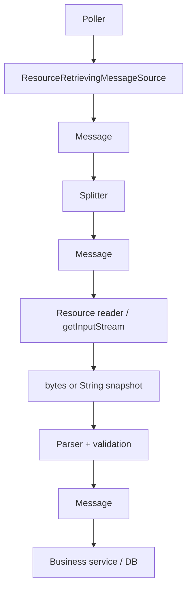
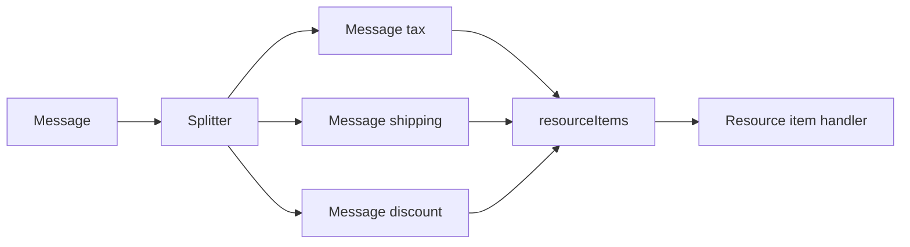
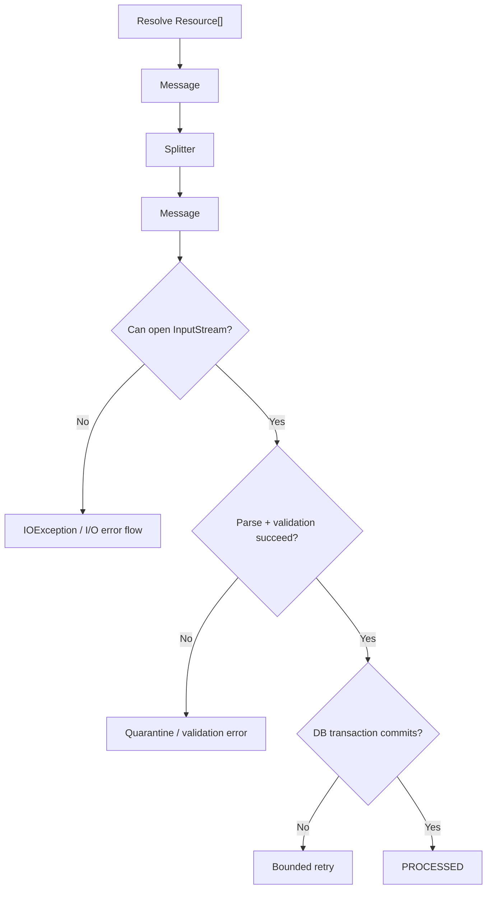

# Resource Objects in Spring Integration Message Payloads

## 1. Scenario: does a message carry data or an address to read data?

Suppose an order-processing application needs to periodically find `.properties` files on the classpath, validate promotion rules, and load them into a database. There are two ways to think about messages passing through Spring Integration:

1. **The message already contains content:** the payload is a `String`, `byte[]`, or `PromotionRule` DTO; downstream can immediately process the parsed data.
2. **The message contains a resource handle:** the payload is a `Resource` object; downstream **has not received the content yet**, only an object allowing it to inspect metadata and open a stream to read the content later.

The **Resource inbound channel adapter** uses the second approach: it discovers one or more `org.springframework.core.io.Resource` objects via a location pattern and sends those objects to a `MessageChannel`. An easily overlooked detail: **the payload emitted directly by `ResourceRetrievingMessageSource` is `Resource[]`**, i.e., an *array of Resources*, not a single `Resource`. If you want each resource in its own message, use a splitter or equivalent transformation step.

This lesson belongs to the **Adapter Resource** chapter in the **SPRING_INTEGRATION_ADAPTERS** module, where learners practice connecting external systems via inbound/outbound adapters, gateways, pollers, and `MessageChannel`, while managing message contracts, error handling, transactions, and connection lifecycles. The focus here is **Resource objects in message payloads**: when to keep a handle, when to read bytes/convert to a DTO, and why async boundaries or durable message storage change the design.

### Objectives

After this lesson, you will be able to:

1. Describe `Message<Resource[]>` versus `Message<Resource>`, `Message<byte[]>`, and `Message<RuleDocument>`.
2. Explain key `Resource` members: `getInputStream()`, `exists()`, `isReadable()`, `isOpen()`, `getFile()`, and metadata.
3. Create a Resource inbound adapter using Java annotations/XML; receive batches and split them into individual messages.
4. Read resource content from JARs/filesystems safely, with size limits and stream closing.
5. Design a transformation step from `Resource` into an immutable, serializable, testable business payload.
6. Handle exceptions, async handoffs, duplicates/restarts, SSRF risks, logging, and transactions.
7. Write tests verifying actual payloads instead of inferring from adapter names.

## 2. Message contract of the Resource inbound adapter

Spring Integration Resource support is built around **`ResourceRetrievingMessageSource`**. Its class signature is:

```java
public class ResourceRetrievingMessageSource
        extends AbstractMessageSource<Resource[]> {
    // ...
}
```

Conceptually, after a successful poll:

```text
SourcePollingChannelAdapter
    -> ResourceRetrievingMessageSource.receive()
    -> Message<Resource[]> {
           payload = [
               Resource("rules/tax.properties"),
               Resource("rules/shipping.properties"),
               Resource("rules/discount.properties")
           ],
           headers = { id, timestamp, ... }
       }
    -> resourceBatchChannel
```

The Spring Integration reference describes the payload as a **collection of Resource objects**. The concrete Java type exposed by `ResourceRetrievingMessageSource` is **`Resource[]`**. Do not write code expecting a single `Resource` directly from this source's output channel without a splitter/transformer step.

### Four payload forms to distinguish

| Payload in Spring Message | What is in the payload? | When to use? |
| --- | --- | --- |
| `Resource[]` | An array of resource handles | The source just resolved multiple resources and you want batch processing |
| `Resource` | A single resource handle | After a splitter, processing each resource individually |
| `byte[]` or `String` | Content already read into memory | Need a bytes/text snapshot, decoupling from the source |
| `RuleDocument` or other DTO | Parsed/validated business data | Downstream business services, persistence, and cross-system messaging |

### One Message with three Resources is still one Message

```text
Poll #1:
  Resolver finds 3 resources
  Filter accepts 3 resources
  Source creates 1 Message<Resource[3]>
  Channel receives 1 message

After Splitter:
  Message<Resource tax>
  Message<Resource shipping>
  Message<Resource discount>
```

`maxMessagesPerPoll = 1` does not limit the array to a single element. It controls **the number of messages the poller receives from the source per cycle**. If hundreds of resources match the pattern, one batch can still hold hundreds of elements.

## 3. Data path: from handle to DTO



**Every arrow is a design boundary.** The Resource inbound source only produces handles. The read step can encounter `IOException`; the parse step can encounter `IllegalArgumentException`; the DB write step can roll back. Those three failures are **not the same adapter error**.

When retry or auditing is needed, use explicit identifiers and content versions:

```text
sourceLocation  = normalized and allowed location
sourceVersion   = reliable version or byte checksum
businessRuleId  = rule identifier inside the content
eventId         = business key used for idempotency
```

Spring message's `MessageHeaders.ID` should not substitute for `businessRuleId` or `sourceVersion`.

## 4. Resource as a Spring Framework interface

`Resource` extends `InputStreamSource`. Common methods include:

```java
Resource resource = ...;

boolean exists = resource.exists();
boolean readable = resource.isReadable();
boolean open = resource.isOpen();
boolean fileBased = resource.isFile();

String filename = resource.getFilename();
String description = resource.getDescription();

try (InputStream in = resource.getInputStream()) {
    // Read content and close the stream.
}
```

| Method | Meaning | What must not be assumed |
| --- | --- | --- |
| `exists()` | Checks whether the resource exists at the moment of call | That reading later will succeed |
| `isReadable()` | Indicates whether the resource is considered readable | Does not replace try/catch when opening the stream |
| `isOpen()` | Whether the resource holds an already-open stream | `false` does not prove every source can be read infinitely |
| `isFile()` | Whether the resource represents a filesystem file | That `getFile()` succeeds across all providers |
| `getInputStream()` | Opens a stream to read content | That the stream auto-closes when the method returns |
| `getURL()` / `getURI()` | Location representation if supported by the implementation | Always safe to serialize/send to clients |
| `getFile()` | Requests a physical `java.io.File` when possible | That JAR entries are auto-extracted into files |
| `contentLength()` | May return content length | That it causes no I/O or has no side effects |
| `lastModified()` | May return modification timestamp | That the timestamp is accurate enough for idempotency |
| `getFilename()` | Filename/object name if present | Always non-null and unique |
| `getDescription()` | Diagnostic description | Never contains sensitive URLs/paths |

### 4.1. Why is getInputStream() the preferred operation?

A resource inside an executable JAR:

```text
order-service.jar
  BOOT-INF/classes/rules/discount.properties
```

Can be read via:

```java
try (InputStream in = resource.getInputStream()) {
    byte[] firstBytes = in.readNBytes(128);
}
```

However, `resource.getFile()` may throw `FileNotFoundException` or `IOException` because that entry has no standalone physical `File`. Passing in an IDE does not prove `getFile()`-based code will run inside a packaged JAR.

### 4.2. Does checking exists() first eliminate all errors?

No. Between two operations:

```text
T1: resource.exists() == true
T2: file deleted / permissions changed / remote server unresponsive
T3: resource.getInputStream() -> IOException
```

This is a *time-of-check/time-of-use* issue. With mutable/remote sources, you must handle read failures even if earlier metadata looked valid.

### 4.3. Why not rely solely on contentLength() for limits?

For some `Resource` implementations, calling `contentLength()` may open or read the stream; for single-use stream resources, metadata operations can have unintended side effects. Checking actual size while reading via a **bounded read** is more reliable for enforcing application payload limits.

## 5. Common implementations and consequences for messages

| Resource implementation | Source | Characteristics to note in payloads |
| --- | --- | --- |
| `ClassPathResource` | Classpath/JAR | Usually readable via stream; `getFile()` not guaranteed |
| `FileSystemResource` | Filesystem | File may be replaced/deleted after the message is created |
| `UrlResource` | URL | Reading may trigger network I/O, timeouts, auth, or redirects |
| `ByteArrayResource` | In-memory byte array | Each read creates a stream over `byte[]`; suited for bounded snapshots/tests |
| `InputStreamResource` | An already-open stream | Usually **single-read**, `isOpen() == true`; unsuitable for storing and re-reading |

### ByteArrayResource and InputStreamResource are not equivalent

```java
byte[] snapshot = "rule.id=demo\n".getBytes(
    java.nio.charset.StandardCharsets.UTF_8
);

Resource repeatable = new ByteArrayResource(snapshot);
Resource singleUse = new InputStreamResource(
    new java.io.ByteArrayInputStream(snapshot)
);
```

`ByteArrayResource` is useful once you have **finished reading** data and want downstream to be able to open streams multiple times. Still, snapshots consume RAM; do not use it to hold hundreds of large files unboundedly.

`InputStreamResource` wraps an already-open stream; after downstream reads/closes the stream, do not assume it can be reopened. In particular, avoid sending `InputStreamResource` over a `QueueChannel` or to async workers assuming upstream keeps the stream alive.

**Conclusion:** `Resource` is an *interface*, whereas re-readability, source lifecycle, and metadata depend on the implementation. Code should be defensive rather than assuming all `Resource` objects behave identically.

## 6. How Spring Message<T> wraps payload and headers

Spring Messaging provides:

```java
Message<T> message;
T payload = message.getPayload();
MessageHeaders headers = message.getHeaders();
```

For Resource inbound:

```java
Message<Resource[]> batchMessage = ...;
Resource[] resources = batchMessage.getPayload();

System.out.println("Batch size=" + resources.length);
System.out.println("Spring message id=" +
    batchMessage.getHeaders().getId());
```

### Headers you can use

- `MessageHeaders.ID`: identifier of the **Spring message**, usually a UUID, not the resource ID.
- `MessageHeaders.TIMESTAMP`: metadata when the message was created, not the resource's `lastModified`.
- Headers added by upstream/transformers: e.g., `sourceType`, `resourceVersion`, or `ruleId` if created and validated by your code.

**Do not assume Resource inbound automatically attaches** `file_name`, `file_originalFile`, `resourceUri`, `contentType`, or business `eventId`. Headers such as `FileHeaders.FILENAME` belong to other adapter/file workflows or only exist if you explicitly populate them.

### Headers that can coexist with a Resource payload

```java
Message<Resource> resourceMessage =
    MessageBuilder.withPayload(resource)
        .setHeader("sourceType", "classpath")
        .setHeader("correlationKey", "batch-2026-11")
        .build();
```

The example above assumes `resource` is an application-verified handle. `correlationKey` illustrates an application-defined correlation value; it should **not** be hardcoded for production. If a header carries a location, only include a normalized location free of tokens or secrets.

### Resource payloads are not portably serializable by default

A `Message<Resource>` can travel across a `DirectChannel` within the same JVM. However, if you send a raw `Resource` over Kafka/AMQP/JMS or into a persistent message store, serializers have no universal contract to:

- Transfer an open `InputStream`.
- Transfer a class loader/JAR entry from sender host to receiver host.
- Preserve URL permissions, credentials, and network access.
- Guarantee the resource is not modified or deleted after sending.

Across **process/host boundaries**, prefer sending **a DTO with parsed data** or **a controlled location ID with checksum/version**, rather than sending a raw `Resource` object expecting the consumer to open it.

## 7. Example 1 — configuring Resource inbound with a Resource[] payload

### 7.1. Sample files

Place in `src/main/resources/rules/`:

```text
src/main/resources/
  rules/
    tax.properties
    shipping.properties
    discount.properties
```

Example `discount.properties`:

```properties
rule.id=discount-standard
rule.version=1
rule.enabled=true
```

This is a **practice-defined schema**, not a format the adapter understands natively.

### 7.2. Maven dependencies

In a Spring Boot project using a compatible BOM:

```xml
<dependencies>
    <dependency>
        <groupId>org.springframework.boot</groupId>
        <artifactId>spring-boot-starter-integration</artifactId>
    </dependency>
</dependencies>
```

`ResourceRetrievingMessageSource` lives in Spring Integration Core; no separate File module is needed just to receive Spring `Resource` objects. If you need dedicated filesystem file processing, the File adapter may be a better fit depending on the problem.

### 7.3. Java configuration

```java
package com.example.resourceadapter;

import org.springframework.context.annotation.Bean;
import org.springframework.context.annotation.Configuration;
import org.springframework.core.io.Resource;
import org.springframework.integration.annotation.InboundChannelAdapter;
import org.springframework.integration.annotation.Poller;
import org.springframework.integration.channel.DirectChannel;
import org.springframework.integration.config.EnableIntegration;
import org.springframework.integration.core.MessageSource;
import org.springframework.integration.resource.ResourceRetrievingMessageSource;
import org.springframework.integration.util.AcceptOnceCollectionFilter;
import org.springframework.messaging.MessageChannel;

@Configuration
@EnableIntegration
public class ResourcePayloadConfiguration {

    @Bean
    public MessageChannel resourceBatches() {
        return new DirectChannel();
    }

    @Bean
    @InboundChannelAdapter(
        channel = "resourceBatches",
        poller = @Poller(
            fixedDelay = "5000",
            initialDelay = "1000",
            maxMessagesPerPoll = "1"
        )
    )
    public MessageSource<Resource[]> resourceSource() {
        ResourceRetrievingMessageSource source =
            new ResourceRetrievingMessageSource(
                "classpath*:rules/*.properties"
            );

        source.setFilter(new AcceptOnceCollectionFilter<>());
        return source;
    }
}
```

**Explanation:**

1. `@EnableIntegration` enables Spring Integration infrastructure.
2. `ResourceRetrievingMessageSource` finds resources matching the pattern.
3. `source.setFilter(...)` sets the re-emission policy at the discovery layer.
4. `@InboundChannelAdapter` creates the endpoint pulling from the source.
5. `@Poller` runs on a fixed schedule; `maxMessagesPerPoll` caps messages received from the source, not array length.
6. `DirectChannel` dispatches Spring messages synchronously to subscribers; a single call does not create a durable queue or automatic transaction.

Note: Java config explicitly sets `AcceptOnceCollectionFilter`. **The default filter of the XML Resource inbound adapter** is documented separately in the Spring Integration docs; do not assume every Java `MessageSource` bean receives a default filter automatically just because of similar naming.

## 8. Example 2 — reading a Resource[] batch in @ServiceActivator

If you want the whole batch validated as a unified rule set, the handler can accept `Message<Resource[]>`:

```java
package com.example.resourceadapter;

import org.springframework.core.io.Resource;
import org.springframework.integration.annotation.ServiceActivator;
import org.springframework.messaging.Message;
import org.springframework.stereotype.Component;

@Component
public class ResourceBatchInspector {

    @ServiceActivator(inputChannel = "resourceBatches")
    public void inspect(Message<Resource[]> message) {
        Resource[] payload = message.getPayload();

        System.out.println("Resources in batch: " + payload.length);
        for (Resource resource : payload) {
            String name = resource.getFilename();
            if (name == null || name.isBlank()) {
                throw new IllegalArgumentException(
                    "Resource has no valid filename"
                );
            }
            System.out.println("Resource filename: " + name);
        }
    }
}
```

This code **only reads metadata** without opening content. Hence a log line `"Resource filename: ..."` does not mean the rule has been parsed, validated, or saved to the DB.

### Can Resource[] be passed directly to the method?

A POJO service activator can also declare the payload parameter directly:

```java
@ServiceActivator(inputChannel = "resourceBatches")
public void inspectPayload(Resource[] resources) {
    for (Resource resource : resources) {
        // Process each resource in the same batch.
    }
}
```

**This is an alternative** to `inspect(Message<Resource[]>)` in the example; do not keep **two subscribers** on the same `DirectChannel` assuming every message runs through both. With multiple handlers on a `DirectChannel`, dispatching/round-robin semantics may invoke only one subscriber; if fan-out is needed, use `PublishSubscribeChannel` or define an explicit flow.

## 9. Example 3 — splitting a batch into Message<Resource>

If each resource needs its own processing path/transaction, add a splitter. Spring Integration supports splitting array payloads by default:



### 9.1. Java DSL replacing the topology in example 1

The example below defines **source and poller in the DSL**, instead of using `@InboundChannelAdapter` on the same source:

```java
package com.example.resourceadapter;

import org.springframework.context.annotation.Bean;
import org.springframework.context.annotation.Configuration;
import org.springframework.integration.dsl.IntegrationFlow;
import org.springframework.integration.dsl.Pollers;
import org.springframework.integration.resource.ResourceRetrievingMessageSource;
import org.springframework.integration.util.AcceptOnceCollectionFilter;

@Configuration
public class ResourceSplitFlowConfiguration {

    @Bean
    public ResourceRetrievingMessageSource splitResourceSource() {
        ResourceRetrievingMessageSource source =
            new ResourceRetrievingMessageSource(
                "classpath*:rules/*.properties"
            );
        source.setFilter(new AcceptOnceCollectionFilter<>());
        return source;
    }

    @Bean
    public IntegrationFlow resourceSplitFlow(
            ResourceRetrievingMessageSource splitResourceSource,
            ResourceItemProcessor processor) {

        return IntegrationFlow
            .from(
                splitResourceSource,
                endpoint -> endpoint.poller(
                    Pollers.fixedDelay(5000)
                        .maxMessagesPerPoll(1)
                )
            )
            .split()
            .handle((payload, headers) -> {
                processor.process(
                    (org.springframework.core.io.Resource) payload
                );
                return null; // One-way flow.
            })
            .get();
    }
}
```

`ResourceItemProcessor` is an application service with a `process(Resource)` method, shown in the next section. You **should not enable both** the Java annotation adapter and the DSL flow with the same pattern in one demo assuming only one poller runs.

### 9.2. Using @Splitter with an existing resourceBatches channel

Another approach is keeping the source from example 1, while **replacing the service activator from example 2** with:

```java
import org.springframework.core.io.Resource;
import org.springframework.integration.annotation.Splitter;
import org.springframework.stereotype.Component;

@Component
public class ResourceArraySplitter {

    @Splitter(
        inputChannel = "resourceBatches",
        outputChannel = "resourceItems"
    )
    public Resource[] split(Resource[] payload) {
        return payload;
    }
}
```

When a splitter processes an array, it emits each `Resource` element as the payload of output messages. You must declare `resourceItems` and a handler consuming that channel in the context. **`Resource[]` remains the upstream contract; `Resource` becomes the downstream contract after the splitter.**

### 9.3. Headers after splitting

Spring Integration's Splitter can add sequence headers such as `CORRELATION_ID`, `SEQUENCE_NUMBER`, and `SEQUENCE_SIZE` to support tracking/correlation or an aggregator. These are **Spring Integration flow metadata**, not the identity of the resource itself or a database transaction ID.

Do not use `SEQUENCE_NUMBER` as a business priority order across multiple JARs. To determine which rule takes precedence, include a `priority`/`version` field in the data.

## 10. Example 4 — reading a Resource into an immutable RuleDocument

A realistic pipeline should not carry `Resource` through every layer. After opening and validating the content, you can construct a DTO:

```java
package com.example.resourceadapter;

public record RuleDocument(
    String ruleId,
    int version,
    boolean enabled,
    String sourceName
) {}
```

Here `sourceName` only stores a validated display name; for durable resource identification, add a reliable source ID/version per the business contract.

### 10.1. Reader with size limits

```java
package com.example.resourceadapter;

import java.io.ByteArrayInputStream;
import java.io.IOException;
import java.io.InputStream;
import java.io.InputStreamReader;
import java.nio.charset.StandardCharsets;
import java.util.Properties;

import org.springframework.core.io.Resource;
import org.springframework.stereotype.Service;

@Service
public class ResourceItemProcessor {

    private static final int MAX_BYTES = 64 * 1024;

    public RuleDocument process(Resource resource)
            throws IOException {
        if (resource == null) {
            throw new IllegalArgumentException("Resource is null");
        }

        String filename = resource.getFilename();
        if (filename == null || filename.isBlank()) {
            throw new IllegalArgumentException(
                "Missing resource filename"
            );
        }

        byte[] data;
        try (InputStream stream = resource.getInputStream()) {
            data = stream.readNBytes(MAX_BYTES + 1);
        }

        if (data.length > MAX_BYTES) {
            throw new IOException("Rule resource exceeds 64 KiB");
        }

        Properties properties = new Properties();
        try (InputStreamReader reader = new InputStreamReader(
                new ByteArrayInputStream(data),
                StandardCharsets.UTF_8
        )) {
            properties.load(reader);
        }

        String ruleId = properties.getProperty("rule.id");
        if (ruleId == null || ruleId.isBlank()) {
            throw new IllegalArgumentException("Missing rule.id");
        }

        int version = Integer.parseInt(
            properties.getProperty("rule.version", "0")
        );
        if (version < 1) {
            throw new IllegalArgumentException(
                "rule.version must be positive"
            );
        }

        String enabledText =
            properties.getProperty("rule.enabled");
        if (!"true".equals(enabledText)
                && !"false".equals(enabledText)) {
            throw new IllegalArgumentException(
                "Invalid rule.enabled"
            );
        }

        return new RuleDocument(
            ruleId,
            version,
            Boolean.parseBoolean(enabledText),
            filename
        );
    }
}
```

**Technical notes:**

- `readNBytes(MAX + 1)` reads at most 65,537 bytes to detect oversized resources without loading arbitrary files into RAM.
- `Properties.load(Reader)` with `UTF_8` is used because the example specifies `.properties` files are packaged in UTF-8.
- `Integer.parseInt(...)` may throw `NumberFormatException` on contract-violating data; route to an error flow/quarantine rather than retrying infinitely.
- `getFilename()` is not a unique source key: two JARs may both contain `rules/discount.properties`.
- The DTO is created after reading; the source could change prior to reading if located on a filesystem/URL.

The demo creates a DTO and **does not yet write to a DB**. In a real environment, another service receives `RuleDocument`, checks authorization/tenant, executes a transaction, and records processing status by version.

### 10.2. Putting the DTO into a Spring Message

```java
Resource resource = ...;
RuleDocument rule = processor.process(resource);

Message<RuleDocument> result =
    MessageBuilder.withPayload(rule)
        .setHeader("resourceKind", "classpath")
        .setHeader("ruleVersion", rule.version())
        .build();
```

Here `processor` is an injected `ResourceItemProcessor` instance, and `MessageBuilder` is `org.springframework.messaging.support.MessageBuilder`. If the code sits inside a `@Transformer`, Spring Integration can wrap the return value into a message and propagate valid headers along the pipeline without manually constructing `MessageBuilder`.

## 11. @Transformer: converting Resource payloads into downstream DTOs

Another option is placing a transformer **after the splitter**:

```java
import java.io.IOException;

import org.springframework.core.io.Resource;
import org.springframework.integration.annotation.Transformer;
import org.springframework.stereotype.Component;

@Component
public class RuleResourceTransformer {

    private final ResourceItemProcessor processor;

    public RuleResourceTransformer(
            ResourceItemProcessor processor) {
        this.processor = processor;
    }

    @Transformer(
        inputChannel = "resourceItems",
        outputChannel = "validatedRules"
    )
    public RuleDocument toRule(Resource resource)
            throws IOException {
        return processor.process(resource);
    }
}
```

After this step:

```text
resourceItems:
    Message<Resource>
      payload=ClassPathResource(...)

validatedRules:
    Message<RuleDocument>
      payload=RuleDocument("discount-standard", 1, true, ...)
```

You must declare `resourceItems` and `validatedRules` in the application context or flow, along with a consumer for `validatedRules`. Do not attach both `@Transformer` and another handler to the same `DirectChannel` assuming both will run. Choose one explicit transformation flow.

### Why transform early?

Once you have a DTO:

- Downstream does not need a class loader or read permissions on the source.
- Schema, version, and logical ID can be validated once.
- Easy to test, audit, and serialize using your chosen JSON/Avro/Protobuf contract.
- Read/parsing errors are isolated in one observable place.
- Avoids keeping streams open across transactions or async queues.
- Prevents another downstream step from trying to reopen an already-consumed `InputStreamResource`.

**You do not always need to keep all bytes in the DTO.** For large files, the DTO can carry only verified metadata and an object key/checksum pointing to durable storage, provided appropriate retrieval mechanisms and permissions exist.

## 12. XML namespace: the same Resource[] contract

Spring Integration supports:

```xml
<?xml version="1.0" encoding="UTF-8"?>
<beans xmlns="http://www.springframework.org/schema/beans"
       xmlns:xsi="http://www.w3.org/2001/XMLSchema-instance"
       xmlns:int="http://www.springframework.org/schema/integration"
       xsi:schemaLocation="
           http://www.springframework.org/schema/beans
           https://www.springframework.org/schema/beans/spring-beans.xsd
           http://www.springframework.org/schema/integration
           https://www.springframework.org/schema/integration/spring-integration.xsd">

    <int:channel id="resourceBatches"/>

    <int:resource-inbound-channel-adapter
            id="resourceInbound"
            channel="resourceBatches"
            pattern="classpath*:rules/*.properties">
        <int:poller fixed-delay="5000"
                    max-messages-per-poll="1"/>
    </int:resource-inbound-channel-adapter>

    <bean id="resourceBatchInspector"
          class="com.example.resourceadapter.ResourceBatchInspector"/>

    <int:service-activator
            input-channel="resourceBatches"
            ref="resourceBatchInspector"
            method="inspect"/>
</beans>
```

This is an **alternative** to the Java configuration in section 7, not a configuration to run alongside it.

Per the Spring Integration reference, an XML Resource inbound adapter without a specified filter uses **`AcceptOnceCollectionFilter`** by default. You can use `filter="someFilter"` to reference a custom `CollectionFilter<Resource>` or `filter=""` to disable filtering when re-emission is desired.

Filter selection affects **which resources may appear in the payload**, without changing the `Resource[]` payload type into `byte[]` or a DTO.

## 13. Resource handles, lifecycle, and async boundaries

### 13.1. A Resource object can outlive its source

`Message<Resource>` may be enqueued on an `ExecutorChannel`/`QueueChannel` and handled by a worker later. Meanwhile:

1. A filesystem file is renamed or deleted.
2. A remote URL's token expires, its content changes, or it redirects/times out.
3. A plugin class loader is unloaded.
4. A single-use `InputStreamResource` has already been read or its stream closed.
5. Access permissions change.

When the worker calls `getInputStream()`, the data may **differ** from when the resolver discovered the resource. Therefore, if reading an immutable version is required, **snapshot/validate/checksum before the async handoff** or use an object store/versioned storage with an equivalent contract.

### 13.2. Is sending a Resource across a channel safe?

| Channel/topology | Can send Resource? | Risks |
| --- | --- | --- |
| `DirectChannel`, synchronous handling in same JVM | Usually suitable | Handler can still fail opening the stream; no auto-commit |
| `ExecutorChannel` with async workers in same process | Possible, needs policy | Resource changes or one-shot stream expires before worker reads |
| In-memory `QueueChannel` | Possible, not durable | Batches lost on process crash; resource handles may go stale |
| Publish-subscribe within one JVM | Possible, multiple subscribers may read same handle | Single-use `InputStreamResource`; contention and duplicate side effects |
| JMS/Kafka/AMQP or durable message store | **Should not pass raw Resource by default** | Not portable; serialization and source read access not guaranteed |

A sound pattern for critical content is typically:

```text
Resource -> bounded read -> checksum + validated DTO
    -> durable queue/outbox/event
    -> consumer with idempotency key
```

### 13.3. Never share an InputStream across subscribers

`InputStream` has a mutable read cursor. Two workers using the same instance can interleave reads, get incomplete bytes, or break its lifecycle. If two subscribers need the same data:

- Use `ByteArrayResource` for small snapshotted payloads or open two independent streams when the source supports it.
- Or parse into an immutable DTO and fan out the DTO.
- Avoid opening a stream before putting a message into the flow and expecting downstream to close it without a clear contract.

## 14. Error handling: distinguishing discovery, read, parse, and commit



| Error type | Example | Suggested action |
| --- | --- | --- |
| Resolver/poller | Invalid pattern, class loader misses JAR entry | Verify config/packaging; alert if resource is mandatory |
| Filter | AcceptOnce drops resource needing reprocessing | Review filter/version key; do not treat RAM state as a checkpoint |
| Opening resource | `FileNotFoundException`, URL timeout, permission denied | Bounded retry based on source nature, or quarantine |
| Over-limit read | Resource exceeds policy | Reject/quarantine; do not load fully into RAM |
| Parse | `NumberFormatException`, missing `rule.id`, bad encoding | Permanent data error: do not hot-retry infinitely |
| Dispatch | `DirectChannel` has no subscriber or handler fails | Endpoint's Spring Integration error flow |
| Business transaction | DB timeout, deadlock, unique constraint | Transaction retry and idempotency |

### 14.1. Accept-once filter does not imply successful processing

```text
T1: resolver finds Resource A
T2: AcceptOnceCollectionFilter accepts A, remembers A
T3: message is sent to handler
T4: handler reads A -> parser error
T5: next poll -> A may be skipped by filter
```

**Critical boundary:** Spring Integration does not automatically roll back `AcceptOnceCollectionFilter` state just because a downstream handler throws an exception. If business rules require retrying until commit, design a checkpoint and filter strategy that allows unprocessed resources to be emitted again.

### 14.2. Is @Transactional alone enough?

No. `@Transactional` on a handler usually only controls the participating DB transaction; it does **not** roll back resolver state, JAR contents, remote URLs, or the AcceptOnce filter.

Even if the DB rolls back cleanly, the source having "seen" the Resource does not mean it will invoke the handler again automatically. For critical systems, use a **durable ledger** keyed by logical resource ID + version, with a unique constraint and `PENDING/PROCESSED/FAILED` statuses.

### 14.3. Per-item failures vs. whole-batch failures

A batch `[A, B, C]` may be processed sequentially. If the handler commits A, commits B, and fails parsing C, the batch is **partially** processed. Three common strategies:

1. **Atomic batch:** validate everything first, then commit in one appropriate transaction.
2. **Per-resource transaction:** split and process each `Resource` with its own ledger entry.
3. **Quarantine:** store failed items in an inspection area and continue with valid items, backed by auditing and retry policies.

Choose the strategy based on your business contract; never assume a splitter or Java `for` loop provides atomicity automatically.

## 15. Resource identity and idempotency

Two resources can share the same filename at different locations:

```text
pricing.jar!/rules/default.properties
shipping.jar!/rules/default.properties
```

`resource.getFilename()` can be `default.properties` for both. Hence **filename is insufficient as a business primary key**.

### Key types

| Key | Purpose | Weakness |
| --- | --- | --- |
| Filename | Display and filtering | Can collide across JARs/directories |
| Resource URI/URL | Identifies physical location | May change on deploy/move, may contain secrets |
| Logical rule ID | Business identifier | Must be parsed/validated; can collide if data is bad |
| Content hash (SHA-256) | Identifies content version | Requires reading bytes; lacks context alone |
| `(sourceId, ruleId, version)` | Durable processing ledger | Requires stable contract and DB unique constraint |

### Deduplicating after parsing

A suitable strategy:

```text
Resource A
  -> bounded read + UTF-8 parse
  -> ruleId, version, checksum
  -> BEGIN DB TRANSACTION
       INSERT processed_rule(sourceId, ruleId, version) UNIQUE
       UPDATE domain configuration
     COMMIT
```

If two processes concurrently check "not seen yet" and then save, `existsById` before `save` alone **does not prevent races**. Use a DB-enforced unique constraint/transaction or claim mechanism. On conflict, decide explicitly whether it is an idempotent duplicate success or a version conflict.

### Restarts do not provide exactly-once

`AcceptOnceCollectionFilter` is per-instance state; after a restart, resources can be emitted again. `Resource[]` has no ACK/NACK like a broker queue. **Exactly-once business effects** must come from idempotency + transactions + appropriate data sources/ledgers, not from the `Resource` payload type.

## 16. Metadata, provenance, and security in messages

### 16.1. Do not put sensitive paths into headers

Example to avoid:

```java
// Do not do this with sources whose URLs contain credentials:
builder.setHeader(
    "resourceDescription", resource.getDescription()
);
```

`getDescription()` often contains URLs or physical paths, sometimes including query tokens, usernames, or internal hostnames. For monitoring, prefer **sanitized/allowlisted** metadata, for example:

```java
Message<RuleDocument> message =
    MessageBuilder.withPayload(rule)
        .setHeader("resourceKind", "classpath")
        .setHeader("sourceModule", "pricing")
        .setHeader("ruleVersion", rule.version())
        .build();
```

`rule` is a validated DTO; `sourceModule` must be confirmed by the backend rather than blindly trusting an unverified field inside the file.

### 16.2. SSRF and untrusted paths

If a `UrlResource` is constructed from a user-supplied URL, the application could read internal endpoints such as metadata services, localhost, or private-network resources. Therefore:

- Do not allow clients to pass arbitrary raw `classpath:`, `file:`, or `https:` locations.
- Enforce scheme/host/path allowlists and validate redirects/DNS per your security model.
- Bound connect/read timeouts and payload sizes.
- Never log tokens or PII inside `Resource.getDescription()`.
- For file paths, verify canonical locations, symlinks, and access permissions.
- Bound the number of resources in a batch when the resolver evaluates wildcards.

### 16.3. A Resource is not an arbitrarily trusted object

Classpath resources live inside dependency JARs. A new dependency or plugin could contribute malformed or malicious content. Validate schemas and permissions before applying content to business logic; never freely deserialize Java objects or execute scripts from a resource merely because it sits on the classpath.

## 17. Performance: batch size, streaming, and backpressure

| Issue | Why it happens | How to address |
| --- | --- | --- |
| Huge `Resource[]` | Pattern matches thousands of entries | Narrow pattern, partition sources, bound collections |
| Poller scans classpath continuously | Classpath/JARs are usually immutable between deploys | Load once or increase `fixed-delay` |
| Handler holds thread too long | Opens and parses many resources in one sync batch | Split, bounded worker pool, per-resource checkpoints |
| Memory spike | Calling `readAllBytes()` on large resources | Bounded reads, appropriate streaming parsers |
| File descriptors / HTTP connections grow | Streams not closed | Try-with-resources, timeouts, metrics |
| Async queue holds many Resource handles | Worker reads late; source may have changed | Snapshot content/DTO before queuing if consistency is required |
| Multiple subscribers re-read one-shot stream | `InputStreamResource` is not reusable | Immutable DTO or bounded `ByteArrayResource` |

**`maxMessagesPerPoll(1)` does not bound the number of Resources in a message.** That setting belongs to the poller, whereas **batch size** depends on the resolver/filter. If a poll finds 20,000 resources, one message can hold 20,000 handles even though the poller only called `receive()` once.

### Streaming or snapshot?

**Streaming** fits large resources when the handler processes immediately without re-reading, combined with timeouts, bounds, and lifecycle controls.

**Snapshotting** fits small payloads requiring consistency across an async handoff; after snapshotting, pass a DTO or a bounded `ByteArrayResource` with a checksum. Do not force every huge file into `byte[]` in RAM.

## 18. Observability and troubleshooting

| Symptom | Common cause | How to investigate |
| --- | --- | --- |
| `ClassCastException: Resource cannot be cast to Resource[]` | Confused post-splitter channel with batch source | Identify channel position; after splitter it is `Message<Resource>` |
| `ClassCastException: Resource[] cannot be cast to Resource` | Single-item handler wired directly to batch | Add a splitter or fix handler signature |
| Only one message received despite multiple files | One batch holds multiple `Resource` objects | Log `payload.length` or use a splitter |
| `getFile()` fails in executable JAR | Entry is not a physical file | Read via `getInputStream()` |
| `getInputStream()` fails after queue delay | File/URL changed or one-shot stream already consumed | Snapshot/validate early; control lifecycle |
| DTO content differs from scan time | Resource is a handle, not a snapshot | Compute version/checksum upon reading; use immutable sources |
| Resource re-emitted after restart | RAM filter state is non-durable | Processed-resource ledger / idempotency |
| Resource not retried after parse error | AcceptOnce already remembered the resource | Redesign filter/checkpoint and quarantine |
| `contentType`/`resourceUri` missing from headers | Adapter does not auto-attach custom metadata | Add headers per validated contract |
| Async worker fails while poller keeps running | Async boundary isolates downstream errors | Worker-side error channel/metrics |
| URI containing credentials appears in logs | Logging `getDescription()` or raw headers | Sanitize, restrict logging, rotate secrets if needed |
| Same filename overwrites another | Used filename as sole key | Use `sourceId`/`logicalId`/version with conflict policy |

### Metrics to measure

Measure poll count, resolved resources, post-filter resources, batch-size distribution, stream open successes/failures, parse duration, validation error count, committed resources by source/version, duplicate count, worker queue depth, and age of the last confirmed dataset. Separate **discovered**, **accepted by filter**, **message delivered**, and **business committed**.

## 19. Testing Resource payloads with JUnit 5

Examples focusing on `Resource` behavior and the `Message<Resource[]>` contract. They do not need to run a live poller.

### 19.1. Testing a Resource array inside a Spring Message

```java
import static org.junit.jupiter.api.Assertions.*;

import java.nio.charset.StandardCharsets;
import org.junit.jupiter.api.Test;
import org.springframework.core.io.ByteArrayResource;
import org.springframework.core.io.Resource;
import org.springframework.messaging.Message;
import org.springframework.messaging.support.MessageBuilder;

class ResourcePayloadTest {

    @Test
    void messageContainsArrayOfResourceHandles() throws Exception {
        Resource a = new ByteArrayResource(
            "rule.id=tax\n".getBytes(StandardCharsets.UTF_8)
        );
        Resource b = new ByteArrayResource(
            "rule.id=shipping\n".getBytes(StandardCharsets.UTF_8)
        );

        Message<Resource[]> batch = MessageBuilder
            .withPayload(new Resource[] { a, b })
            .build();

        assertEquals(2, batch.getPayload().length);
        assertNotNull(batch.getHeaders().getId());

        try (var input = batch.getPayload()[0].getInputStream()) {
            assertEquals('r', input.read());
        }
    }
}
```

In this test `ByteArrayResource` is constructed directly; **no resolver or poller is involved**. Passing only proves `Message<Resource[]>` can carry handles, not that an external adapter is running.

### 19.2. Testing ResourceItemProcessor with ByteArrayResource

```java
import static org.junit.jupiter.api.Assertions.*;

import java.nio.charset.StandardCharsets;
import org.junit.jupiter.api.Test;
import org.springframework.core.io.ByteArrayResource;
import org.springframework.core.io.Resource;

class RuleReaderTest {

    @Test
    void parsesResourceIntoImmutableRuleDocument() throws Exception {
        byte[] content = (
            "rule.id=discount-standard\n" +
            "rule.version=2\n" +
            "rule.enabled=true\n"
        ).getBytes(StandardCharsets.UTF_8);

        Resource input = new ByteArrayResource(
            content, "test-rule.properties"
        ) {
            @Override
            public String getFilename() {
                return "test-rule.properties";
            }
        };

        RuleDocument result =
            new ResourceItemProcessor().process(input);

        assertEquals("discount-standard", result.ruleId());
        assertEquals(2, result.version());
        assertTrue(result.enabled());
    }

    @Test
    void rejectsMissingRuleId() {
        Resource input = new ByteArrayResource(
            "rule.version=1\n".getBytes(StandardCharsets.UTF_8),
            "bad-rule.properties"
        ) {
            @Override
            public String getFilename() {
                return "bad-rule.properties";
            }
        };

        assertThrows(
            IllegalArgumentException.class,
            () -> new ResourceItemProcessor().process(input)
        );
    }
}
```

`ByteArrayResource` has a constructor accepting `byte[]` and a description, yet `getFilename()` may return `null` because description is not synonymous with filename. Both tests **override `getFilename()`** on the test resource so `ResourceItemProcessor` can read a filename and focus on testing parsing and validation. In a real project, you can use `FileSystemResource` pointing to JUnit's `@TempDir` to test filenames derived from real file paths.

### 19.3. Testing one-shot InputStreamResource

When understanding lifecycle, write a test using `InputStreamResource`, check `isOpen()`, and read only once. Do not rely on a specific exception on a second read for business logic design; the contract is **no guarantee of repeatable reads**, regardless of what a specific test implementation throws.

### 19.4. What else do integration tests need?

To test the entire flow:

1. Create fixtures in `src/test/resources/rules/`.
2. Configure `ResourceRetrievingMessageSource` with `classpath*:rules/*.properties`.
3. Attach a poller to the channel and collect payloads in a test subscriber/`QueueChannel`.
4. Verify the source emits `Resource[]` with length matching the fixtures.
5. Enable a splitter and verify downstream receives individual `Resource` messages.
6. Create a schema-invalid resource and verify parsing errors at the transformer/handler.
7. Test resources inside a **packaged executable JAR**, not just the IDE/test classpath.
8. Restart the context and verify filter behavior and the idempotency ledger.
9. For mutable sources, modify content between resolution and reading to verify your consistency policy.
10. If sending DTOs to a broker, test the serialization contract—do not send raw `Resource` objects.

## 20. Exercises and answers

**Exercise 1 — Source payload.** Does `ResourceRetrievingMessageSource` return a single `Resource` or `Resource[]`?

**Answer:** `Resource[]` inside a Spring message; the source retrieves a collection of resources in one receive.

**Exercise 2 — Single poll.** A pattern matches 15 resources, and `maxMessagesPerPoll=1`. How many elements can be in one message?

**Answer:** Potentially all 15 resources after filtering; `maxMessagesPerPoll` limits the number of messages received per poll cycle.

**Exercise 3 — After splitting.** What payload type does a splitter processing `Message<Resource[]>` normally produce?

**Answer:** `Resource` for each element, along with sequence/correlation headers when configured accordingly.

**Exercise 4 — getFile.** Why should a `ClassPathResource` inside an executable JAR not be read via `getFile()`?

**Answer:** An entry inside a JAR does not necessarily have a physical `java.io.File`; use `getInputStream()`.

**Exercise 5 — isOpen.** What does `InputStreamResource.isOpen() == true` indicate?

**Answer:** The resource wraps an already-open stream, typically single-read; do not have multiple subscribers reopen it.

**Exercise 6 — ByteArrayResource.** When is `ByteArrayResource` useful?

**Answer:** When small content is already snapshotted in RAM and needs fresh input streams for repeated reads or unit tests.

**Exercise 7 — Streams.** Who is responsible for closing the `InputStream` returned by `Resource.getInputStream()`?

**Answer:** The caller/handler reading the resource; use try-with-resources.

**Exercise 8 — contentLength.** Should you trust `contentLength()` to always avoid I/O or avoid affecting single-use streams?

**Answer:** No. Behavior is implementation-dependent, so enforce byte limits while reading.

**Exercise 9 — exists.** Does `exists() == true` guarantee `getInputStream()` will succeed a minute later?

**Answer:** No. Sources and access permissions can change.

**Exercise 10 — Headers.** Is `MessageHeaders.ID` a durable database identifier for a Resource?

**Answer:** No. That is the Spring message ID, not a business resource/version key.

**Exercise 11 — File headers.** Does Resource inbound automatically populate `FileHeaders.FILENAME` or `contentType` for every resource?

**Answer:** You should not assume so; metadata must be populated per the flow's contract.

**Exercise 12 — Serialization.** Should you put a raw `ClassPathResource` pointing to a JAR entry into a Kafka message expecting a consumer on another machine to open it?

**Answer:** No. Send DTOs/bytes or a versioned retrieval reference with explicit permissions and checksums.

**Exercise 13 — Async.** Can an `ExecutorChannel` hold a `Resource` in a queue after its underlying file has been deleted?

**Answer:** Yes. A Resource is a handle; use a snapshot/version policy if content consistency is required.

**Exercise 14 — Duplicate filenames.** Two JARs contain `default.properties`; should `getFilename()` be used as a unique key?

**Answer:** No. You need source identity, logical ID, and version/checksum.

**Exercise 15 — AcceptOnce.** The handler fails parsing after the filter already accepted the resource. Will the next poll definitely retry it?

**Answer:** No. Filter state does not auto-rollback on handler/DB failures.

**Exercise 16 — Restarts.** Does `AcceptOnceCollectionFilter` guarantee resources won't be re-emitted after a restart?

**Answer:** No. State is typically in-memory per instance; use durable idempotency/ledgers.

**Exercise 17 — Testing.** Why might a `ByteArrayResource` with description `"test.properties"` not return `"test.properties"` from `getFilename()`?

**Answer:** Description and filename are distinct metadata; if test logic needs a filename, override `getFilename()` or use `FileSystemResource`.

**Exercise 18 — Transformer.** Once parsed into `RuleDocument`, what advantages are there over passing `Resource` downstream?

**Answer:** Clear payload schema, easy validation/serialization/testing, and no downstream dependency on streams or class loaders.

**Exercise 19 — Security.** Why shouldn't you log raw `resource.getDescription()`?

**Answer:** It may contain URLs, tokens, filesystem paths, or sensitive infrastructure details.

**Exercise 20 — Production.** Does a Resource payload natively provide exactly-once processing or ACKs like a message broker?

**Answer:** No. Explicit design for transactions, checkpoints, durable sources, and idempotency is required.

## 21. Key takeaways

**A `Resource` in a payload is a *handle to read content*, not snapshotted bytes.** Spring Integration's Resource inbound adapter uses `ResourceRetrievingMessageSource` to emit **`Message<Resource[]>`** on a poller; only after a splitter does downstream typically receive **`Message<Resource>`**. A `Resource` lets you inspect metadata and open `getInputStream()`, but `getFile()` does not work for all JARs/URLs, `InputStreamResource` may be single-read, and the source can change before downstream reads it. To process safely, use bounded reads + try-with-resources, parse/validate into a DTO, attach sanitized metadata, design checkpoints/versions/idempotency, and do not serialize raw Resources across process boundaries or persistent message stores. `AcceptOnceCollectionFilter` only reduces duplicate emissions at the discovery layer and is **not a transaction or business acknowledgment**.

## References

- [Spring Integration Reference — Resource Support](https://docs.spring.io/spring-integration/reference/resource.html)
- [Spring Integration API — ResourceRetrievingMessageSource](https://docs.spring.io/spring-integration/api/org/springframework/integration/resource/ResourceRetrievingMessageSource.html)
- [Spring Integration Reference — Splitter](https://docs.spring.io/spring-integration/reference/splitter.html)
- [Spring Integration Reference — Java DSL Splitters](https://docs.spring.io/spring-integration/reference/dsl/java-splitters.html)
- [Spring Framework Reference — Resources](https://docs.spring.io/spring-framework/reference/core/resources.html)
- [Spring Framework API — Resource](https://docs.spring.io/spring-framework/docs/current/javadoc-api/org/springframework/core/io/Resource.html)
- [Spring Framework API — ByteArrayResource](https://docs.spring.io/spring-framework/docs/current/javadoc-api/org/springframework/core/io/ByteArrayResource.html)
- [Spring Framework API — InputStreamResource](https://docs.spring.io/spring-framework/docs/current/javadoc-api/org/springframework/core/io/InputStreamResource.html)
