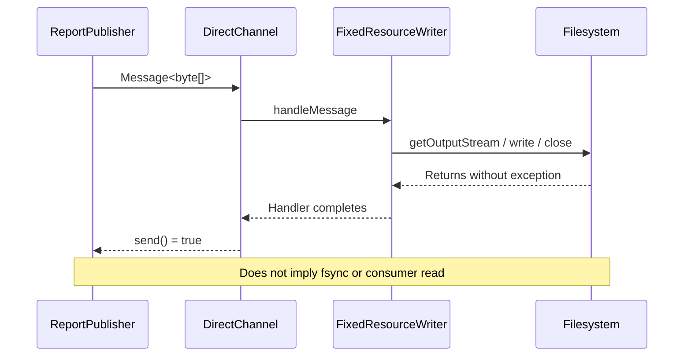
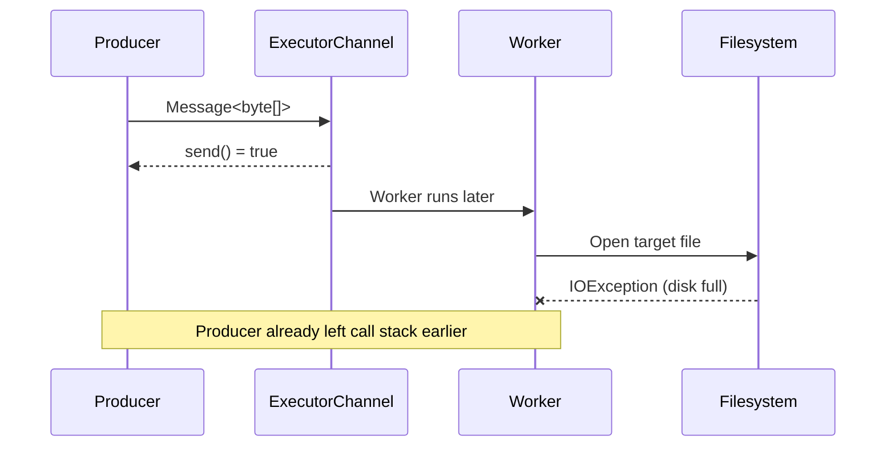
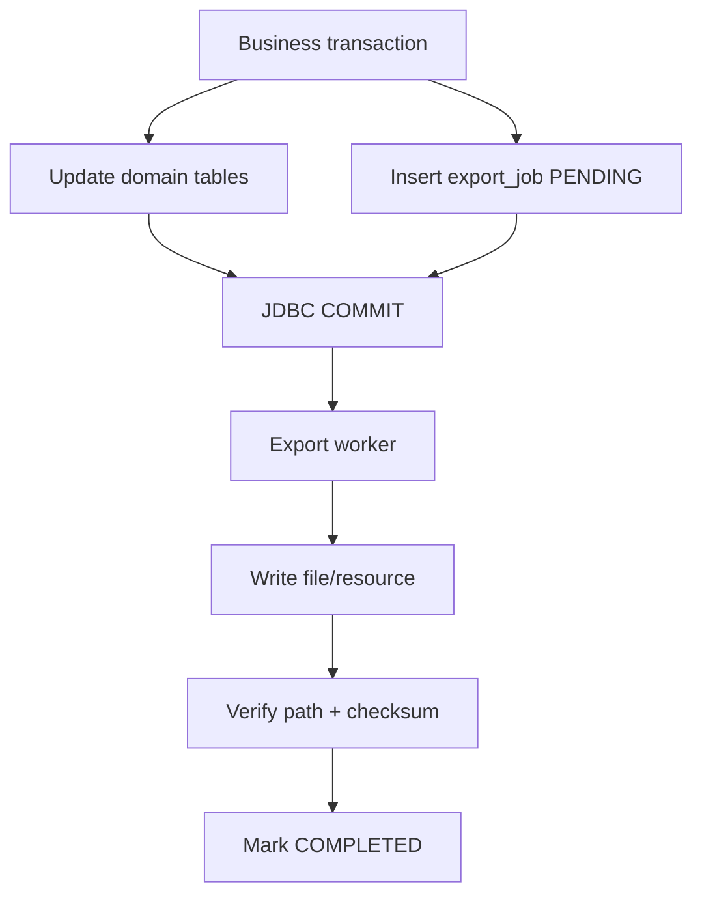

# Writing Message Content to a Resource in Spring Integration

## 1. Problem statement: from MessageChannel to a writable resource

An order-processing application generates reconciliation reports from a database. After validating and building the CSV content, the application sends the data as a Spring `Message<byte[]>` into a `MessageChannel`. The next requirement is to **write the exact payload content** into an application-managed file, such as `/var/app/exports/orders-2026-11.csv`, for another system to read.

Learners may ask: "Can I call `resource.getOutputStream()` to write?" or "Does Spring Integration have a Resource outbound channel adapter just like Resource inbound?" The answer requires distinguishing two layers:

- Spring Framework provides **`Resource` for reading** and **`WritableResource` for writing** via `OutputStream`. `FileSystemResource` is a writable implementation when the filesystem permits.
- Spring Integration provides a **generic outbound channel adapter** via `@ServiceActivator`/`<int:outbound-channel-adapter>` and the dedicated **File outbound channel adapter**. **There is no dedicated Resource outbound channel adapter** in the official endpoints table of current Spring Integration.

Therefore, **"Writing message content to a resource"** is an **outbound integration pattern**, not an invitation to invent a `ResourceOutboundChannelAdapter` class. We will implement the `MessageChannel → handler → WritableResource` protocol properly, and then compare it with `FileWritingMessageHandler` to select the right tool.

This lesson belongs to the **Adapter Resource** chapter of the **SPRING_INTEGRATION_ADAPTERS** module. The module practices connecting external systems via inbound/outbound adapters, gateways, pollers, and `MessageChannel`, while handling message contracts, errors, and connection lifecycles. This part focuses on the **outbound direction**: converting payloads into bytes/text, writing resources, controlling overwrites, consistency, I/O errors, retries, and idempotency.

### Learning objectives

After completing this lesson, you will be able to:

1. Explain why `Resource` does not imply `WritableResource`.
2. Write an outbound POJO/`MessageHandler` that consumes `Message<byte[]>`, writes via `WritableResource#getOutputStream()`, and closes streams safely.
3. Convert `String`/DTO/`Resource`/`Resource[]` into writable payloads while handling encoding and size limits.
4. Use `FileWritingMessageHandler`, `FileHeaders.FILENAME`, `FileExistsMode`, and configure File outbound in Java/XML.
5. Distinguish direct overwrites, temporary files, atomic moves, and crash durability.
6. Design error flows for `DirectChannel` and asynchronous channels, classifying transient vs. permanent errors.
7. Apply path controls, write permissions, payload limits, idempotency, and outboxes.
8. Write JUnit tests for content writing, filenames, overwrites, logical rollbacks, and error classification.

## 2. Overview model: payload is data, resource is destination


| Layer | Example | Responsibility |
| --- | --- | --- |
| **Payload** | `byte[]`, `String`, DTO | Content the application wants to write; must have an encoding/schema contract. |
| **Spring Message** | `Message<byte[]>` | Wraps payload and headers such as correlation ID and publication name. |
| **MessageChannel** | `DirectChannel` | Delivers messages from producer to outbound consumer per topology. |
| **Outbound endpoint** | `MessageHandler`/`@ServiceActivator` | Executes the I/O operation upon receiving a message. |
| **Writable target** | `FileSystemResource` | Provides an `OutputStream` to write data. |
| **External system** | Filesystem, remote API, broker | Where results are actually persisted or processed. |

**Do not confuse:** `MessageChannel.send(...)` succeeding and **the file being durable** are two different claims. With `DirectChannel` and a synchronous handler, `send()` only returns after the handler returns; however, `OutputStream.close()` does not automatically mean the data has been `fsync`'d to storage or read by another system.

### Resource inbound and writing are asymmetric

Spring Integration's `ResourceRetrievingMessageSource` takes a location pattern, resolves it into **`Resource[]`**, and emits a Spring message containing **multiple resource handles** on a poller schedule. That is the **inbound path**.

On the outbound side, you can:

- Write the payload into a `WritableResource` using an outbound POJO.
- Use the **File outbound adapter** for filesystems, which already includes a filename generator, file-existence policies, and temporary suffixes.
- Use **SFTP/HTTP/JMS/Kafka outbound** when the target is actually an external system on that protocol.

Do not try to use `ResourceRetrievingMessageSource` as a "writer"; it only discovers **inputs**.

## 3. Resource and WritableResource: reading differs from writing

Spring Framework provides:

```java
org.springframework.core.io.Resource;
org.springframework.core.io.WritableResource;
```

`WritableResource` **extends `Resource`** and adds:

```java
OutputStream getOutputStream() throws IOException;
boolean isWritable();
```

Example writing a byte array to a resource:

```java
import java.io.IOException;
import java.io.OutputStream;
import org.springframework.core.io.WritableResource;

public void save(WritableResource target, byte[] content)
        throws IOException {
    if (!target.isWritable()) {
        throw new IOException("Target reports not writable");
    }
    try (OutputStream output = target.getOutputStream()) {
        output.write(content);
    }
}
```

**`isWritable()` does not replace `try/catch`.** It can return true while opening or writing the stream still fails due to permissions, quotas, disk full, or races. For targets that do not yet exist, implementations may have specific `isWritable()` behavior; do not treat a metadata check as an absolute guarantee.

### Common implementations

| Resource | Readable? | Writable via `WritableResource`? | Notes |
| --- | --- | --- | --- |
| `FileSystemResource` | Yes | **Yes**, when path/permissions allow | Created from `Path` or `File`; suited for target-writing examples. |
| `FileUrlResource` | Yes | Yes for suitable file URLs | Does not imply `https://` URLs are writable. |
| `ClassPathResource` | Yes | **No** via `WritableResource` | An entry inside a JAR is not an arbitrarily modifiable output file. |
| `UrlResource` | Depends on URL | Not by default | For HTTP PUT/POST, use an HTTP client/adapter. |
| `ByteArrayResource` | Yes | Not via `WritableResource` | Snapshot data in RAM, suited for inputs/tests. |
| `InputStreamResource` | Yes, usually once | No | Cannot treat an input stream source as an output stream target. |

In Spring Framework 7.x, `PathResource` is deprecated in favor of `FileSystemResource` when working with `Path`. New examples in this lesson use `FileSystemResource(Path)` to avoid relying on a class slated for removal.

### Why not write into a classpath resource?

```text
application.jar
  BOOT-INF/classes/rules/discount.properties
```

A `ClassPathResource` coming from a file inside a JAR can be read via `getInputStream()` but **is not open by default for writing back into the JAR**. If you need to publish a new configuration version, create the file in a **separate output directory** or write through an authorized data store API.

## 4. Payload contract: String, byte[], InputStream, DTO

There is no automatic encoder for arbitrary Java objects going into a `WritableResource`; an outbound handler must pick **exactly how payloads become bytes**.

| Payload | Appropriate writing method | What to verify |
| --- | --- | --- |
| `byte[]` | `output.write(bytes)` | Size, out-of-band content-type, no automatic newlines added. |
| `String` | `text.getBytes(StandardCharsets.UTF_8)` | Charset/normalization/newlines and post-encode byte length. |
| DTO | Chosen JSON/CSV/XML serializer then write bytes | Schema, escaping, version, codec, and charset. |
| `InputStream` | `input.transferTo(output)` with proper policy | Lifecycle and byte limits; stream may be single-read. |
| `Resource` | `resource.getInputStream()`, read/stream then write | Handle may be stale, source distinct from target, close streams. |
| `Resource[]` | Split/iterate and issue per-resource write commands | An array does not correspond to a single valid file by default. |

### Same content, different encoding

```java
String csv = "orderId,total\n501,1000\n";
byte[] utf8 = csv.getBytes(StandardCharsets.UTF_8);
```

`csv.length()` is **not** the actual byte count across all languages/characters. For Vietnamese or Unicode characters, file size must be measured using **`utf8.length`**. In the Java examples below, we standardize the outbound payload as `byte[]` to cleanly separate content from I/O.

### Never write `resource.toString()` to output

`resource.toString()` and `getDescription()` usually reflect a **location description**, not the resource's bytes. If you want to copy **content**, open `getInputStream()` and transfer valid bytes.

## 5. Practice A — a Message<byte[]> writing to a fixed WritableResource

Minimal use case: each message carries the current report, and the backend **allows overwriting** the same `latest-report.csv` file. This is a valid use case for direct `WritableResource` usage, though unsuitable if you want to preserve historical exports.

### 5.1. Maven dependencies

With Spring Boot and a synchronized BOM:

```xml
<dependencies>
    <dependency>
        <groupId>org.springframework.boot</groupId>
        <artifactId>spring-boot-starter-integration</artifactId>
    </dependency>
</dependencies>
```

This flow only uses Spring Integration Core and Spring Framework Resource. You do not need `spring-integration-file` when writing to `WritableResource` via a POJO, but from section 9 onward, the **dedicated File outbound adapter** requires the File module.

### 5.2. Target configuration

Example `application.properties`:

```properties
app.export.latest-path=/var/app/exports/latest-report.csv
```

This is an **illustrative path**. In a real environment, configure an OS-appropriate path and ensure the parent directory already exists with proper write permissions. Never let external users arbitrarily set `app.export.latest-path`.

### 5.3. Easily testable plain Java writer class

```java
package com.example.resourcewrite;

import java.io.IOException;
import java.io.OutputStream;
import java.util.Objects;
import org.springframework.core.io.WritableResource;

public final class FixedResourceWriter {

    private final WritableResource target;

    public FixedResourceWriter(WritableResource target) {
        this.target = Objects.requireNonNull(target, "target");
    }

    public void write(byte[] bytes) throws IOException {
        Objects.requireNonNull(bytes, "bytes");
        if (bytes.length == 0) {
            throw new IllegalArgumentException("Empty payload");
        }

        try (OutputStream output = target.getOutputStream()) {
            output.write(bytes);
        }
    }
}
```

**Meaning:** the writer accepts already-encoded content, opens a stream for the **target**, and writes bytes. Try-with-resources closes the stream both on success and when I/O throws an exception. This is an application class, not a class provided by Spring Integration.

**Limitation:** with `FileSystemResource`, opening a normal write stream can **truncate/overwrite the old file**. If two threads call `write` concurrently, races or inconsistent data can occur. This writer does not yet guarantee atomic publication or exactly-once semantics.

### 5.4. Wiring the writer to MessageChannel via an outbound endpoint

```java
package com.example.resourcewrite;

import java.nio.file.Path;

import org.springframework.beans.factory.annotation.Value;
import org.springframework.context.annotation.Bean;
import org.springframework.context.annotation.Configuration;
import org.springframework.core.io.FileSystemResource;
import org.springframework.integration.annotation.ServiceActivator;
import org.springframework.integration.channel.DirectChannel;
import org.springframework.integration.config.EnableIntegration;
import org.springframework.messaging.MessageChannel;
import org.springframework.messaging.MessageHandler;
import org.springframework.messaging.MessageHandlingException;

@Configuration
@EnableIntegration
public class ResourceWriteConfiguration {

    @Bean
    public MessageChannel resourceWriteRequests() {
        return new DirectChannel();
    }

    @Bean
    public FixedResourceWriter latestReportWriter(
            @Value("${app.export.latest-path}") String configuredPath) {
        return new FixedResourceWriter(
            new FileSystemResource(Path.of(configuredPath))
        );
    }

    @Bean
    @ServiceActivator(inputChannel = "resourceWriteRequests")
    public MessageHandler resourceWriteHandler(
            FixedResourceWriter latestReportWriter) {
        return message -> {
            Object payload = message.getPayload();
            if (!(payload instanceof byte[] bytes)) {
                throw new MessageHandlingException(
                    message, "Expected byte[] payload"
                );
            }
            try {
                latestReportWriter.write(bytes);
            } catch (java.io.IOException exception) {
                throw new MessageHandlingException(
                    message, "Failed to write output resource", exception
                );
            }
        };
    }
}
```

**Why use `MessageHandlingException`?** `MessageHandler#handleMessage` receives a Spring message; when I/O fails with a checked `IOException`, the adapter wraps it in a runtime messaging exception bound to the failed message so upstream/error flows can observe it. `@ServiceActivator` on a `MessageHandler` bean registers the outbound consumer for the channel.

**No poller is needed** for `DirectChannel`: it is a subscribable channel, so the handler runs when a producer calls `send()`. If switched to `QueueChannel`, a polling consumer must pull messages from the queue; that is a different topology.

### 5.5. Producer sending Message<byte[]>

```java
package com.example.resourcewrite;

import java.nio.charset.StandardCharsets;

import org.springframework.beans.factory.annotation.Qualifier;
import org.springframework.messaging.MessageChannel;
import org.springframework.messaging.support.MessageBuilder;
import org.springframework.stereotype.Service;

@Service
public class ReportPublisher {

    private final MessageChannel channel;

    public ReportPublisher(
            @Qualifier("resourceWriteRequests") MessageChannel channel) {
        this.channel = channel;
    }

    public void publishCsv(String validatedCsv) {
        if (validatedCsv == null || validatedCsv.isBlank()) {
            throw new IllegalArgumentException("CSV must not be blank");
        }
        byte[] bytes = validatedCsv.getBytes(StandardCharsets.UTF_8);

        boolean accepted = channel.send(
            MessageBuilder.withPayload(bytes)
                .setHeader("contentType", "text/csv; charset=utf-8")
                .build()
        );
        if (!accepted) {
            throw new IllegalStateException(
                "Output channel rejected message"
            );
        }
    }
}
```

This example writes a **single snapshot file**, not a multi-file export job. `contentType` is merely an **application-set header**; the current `FixedResourceWriter` does not inspect it. To pass a dynamic filename/version or switch targets per message, design an explicit contract instead of hardcoding a single output path.

### 5.6. Success milestones



With `DirectChannel` and a synchronous handler, `send()` returns after the handler completes. However, if you insert an `ExecutorChannel`, `QueueChannel`, or another queue, return timing changes; `send() == true` then **does not guarantee the file write has finished**.

## 6. Practice B — choosing the destination resource per message

In many systems, each message needs to write **its own separate file**, for example:

```text
exports/order-501.json
exports/order-502.json
exports/order-503.json
```

In this case, do not inject a single fixed `WritableResource`. Instead, send a **write command** containing a validated filename, business ID, and bytes.

### 6.1. An outbound DTO with defensive copying

```java
package com.example.resourcewrite;

import java.util.Objects;

public record ResourceWriteCommand(
        String fileName,
        String eventId,
        byte[] content) {

    public ResourceWriteCommand {
        Objects.requireNonNull(fileName, "fileName");
        Objects.requireNonNull(eventId, "eventId");
        Objects.requireNonNull(content, "content");
        content = content.clone();
    }

    @Override
    public byte[] content() {
        return content.clone();
    }
}
```

`byte[]` is mutable. A record does not make an array immutable automatically; the constructor and accessor clone it to prevent callers from mutating bytes between enqueue and write time. For large payloads, cloning has memory cost; you can substitute a blob key/version in an object store.

### 6.2. WritableResourceSink creating a target FileSystemResource

```java
package com.example.resourcewrite;

import java.io.IOException;
import java.io.OutputStream;
import java.nio.file.Files;
import java.nio.file.LinkOption;
import java.nio.file.Path;

import org.springframework.beans.factory.annotation.Value;
import org.springframework.core.io.FileSystemResource;
import org.springframework.core.io.WritableResource;
import org.springframework.integration.annotation.ServiceActivator;
import org.springframework.stereotype.Component;

@Component
public class PerMessageResourceSink {

    private final Path rootDirectory;

    public PerMessageResourceSink(
            @Value("${app.export.directory}") String directory) {
        this.rootDirectory =
            Path.of(directory).toAbsolutePath().normalize();
    }

    @ServiceActivator(inputChannel = "perMessageWriteRequests")
    public void write(ResourceWriteCommand command) throws IOException {
        String name = command.fileName();
        if (!name.matches("[A-Za-z0-9][A-Za-z0-9._-]{0,127}")) {
            throw new IllegalArgumentException(
                "Output name is not an approved basename"
            );
        }
        if (command.eventId().isBlank()) {
            throw new IllegalArgumentException("Missing eventId");
        }

        if (!Files.isDirectory(
                rootDirectory, LinkOption.NOFOLLOW_LINKS)) {
            throw new IOException(
                "Output directory must exist and not be a symlink"
            );
        }

        Path destination = rootDirectory.resolve(name).normalize();
        if (!rootDirectory.equals(destination.getParent())) {
            throw new IllegalArgumentException("Output path escapes root");
        }

        WritableResource target = new FileSystemResource(destination);
        try (OutputStream output = target.getOutputStream()) {
            output.write(command.content());
        }
    }
}
```

Channel declaration:

```java
@Bean
public MessageChannel perMessageWriteRequests() {
    return new DirectChannel();
}
```

The `@Bean` method belongs in a `@Configuration` class with `@EnableIntegration` and matching imports (`Bean`, `MessageChannel`, `DirectChannel`). `PerMessageResourceSink` is registered via `@Component`, so do not create a second `@Bean` with the same name.

**Example limitations:** this is a minimal example for understanding `Message → WritableResource`, **not** a production implementation hardened against symlink races, non-atomic writes, or duplicate writes. Checking the parent and `NOFOLLOW_LINKS` on the directory is necessary but **insufficient** if an attacker can create/swap a child symlink while the writer opens the file. Use an isolated output root with strict permissions, and for real workloads choose the File outbound adapter or a tested safe publication workflow.

### 6.3. Sending the write command

```java
import java.nio.charset.StandardCharsets;
import org.springframework.messaging.MessageChannel;
import org.springframework.messaging.support.MessageBuilder;

ResourceWriteCommand request = new ResourceWriteCommand(
    "order-501.json",
    "evt-501",
    """
    {"eventId":"evt-501","orderId":501}
    """.getBytes(StandardCharsets.UTF_8)
);

MessageChannel channel = ...; // Inject perMessageWriteRequests.
channel.send(MessageBuilder.withPayload(request).build());
```

`eventId` is the business key for retries/idempotency, **not** a raw filename from user input. The JSON in the snippet is demo data, not advice to hand-assemble JSON via string concatenation; for real DTOs use a serializer (Jackson or equivalent) and schema validation.

## 7. Writing String, InputStream, and DTO: transforming before outbound

### 7.1. String with an explicit charset

```java
String text = "Order ID,Total\nORD-501,1000\n";
byte[] payload = text.getBytes(StandardCharsets.UTF_8);
```

Passing these bytes to the writer produces a UTF-8 file per contract. Avoid `String.getBytes()` without a charset when production requires deterministic bytes across different machines or environments.

### 7.2. InputStream: open only at the write point and close properly

If the source is already a `Resource`:

```java
import java.io.IOException;
import java.io.InputStream;
import java.io.OutputStream;
import org.springframework.core.io.Resource;
import org.springframework.core.io.WritableResource;

public void copy(
        Resource source, WritableResource target) throws IOException {
    if (source == target) {
        throw new IllegalArgumentException(
            "Source and target must be distinct"
        );
    }
    try (InputStream input = source.getInputStream();
         OutputStream output = target.getOutputStream()) {
        input.transferTo(output);
    }
}
```

This snippet is only suited for **backend-controlled sources and targets**, not arbitrary resources/URLs. `source == target` only catches **the exact same object reference**, not two distinct `Resource` objects pointing to the same file; if paths collide, opening the output stream before reading can truncate the source data. Production code must check true identity/canonical paths before copying.

`InputStream.transferTo()` can transfer arbitrarily large volumes; if the source is untrusted, use a **bounded copy** instead of relying solely on that method. For remote resources, configure separate timeouts and connection controls.

### 7.3. Byte-bounded copy

```java
import java.io.IOException;
import java.io.InputStream;
import java.io.OutputStream;

public final class BoundedResourceCopy {

    private static final long MAX_BYTES = 10L * 1024 * 1024;

    public static void transfer(InputStream input, OutputStream output)
            throws IOException {
        byte[] buffer = new byte[8192];
        long total = 0;
        int n;
        while ((n = input.read(buffer)) != -1) {
            total += n;
            if (total > MAX_BYTES) {
                throw new IOException("Resource exceeds 10 MiB");
            }
            output.write(buffer, 0, n);
        }
    }
}
```

**Important caveat:** if the limit is exceeded after writing part of the data, **the target file may be left partially written**. A safer pattern is copying into a **temporary/staging file**, verifying the whole payload, and then publishing the final name. Bounded copy caps resource consumption but does not provide atomicity on its own.

### 7.4. DTO to bytes, then write Resource

An event with contract:

```java
public record ExportedOrder(String eventId, long orderId) {}
```

Using Jackson `ObjectMapper`:

```java
import com.fasterxml.jackson.databind.ObjectMapper;

ExportedOrder order = new ExportedOrder("evt-501", 501L);
byte[] jsonBytes = objectMapper.writeValueAsBytes(order);
```

`objectMapper` must be a configured bean/object in the application; compatible JSON/Jackson dependencies must be present. This is a **DTO serialization step**, not built-in behavior of `WritableResource`.

## 8. Using File outbound channel adapter for filesystem targets

Writing a POJO over `WritableResource` clarifies the mechanics, yet when the target is a **filesystem directory**, Spring Integration already provides **`FileWritingMessageHandler`**. This is usually the better practical choice because it includes filename generators, existing-file modes, and temporary file suffixes.

**Reminder:** the current official endpoints table lists the Resource module as inbound-only, with no dedicated outbound adapter. `FileWritingMessageHandler` belongs to the **File module**, not an assumed "Resource outbound" package.

### 8.1. Which payloads does File outbound support?

| Payload to FileWritingMessageHandler | Supported? |
| --- | --- |
| `File` | Yes, copies file to destination |
| `String` | Yes, writes text using configured charset |
| `byte[]` | Yes |
| `InputStream` | Yes |
| Raw `Resource` | **No**, not one of the standard supported types |
| `Resource[]` | **No** |
| Arbitrary DTO | Requires a transformer/serializer first |

A `Resource` inside classpath/JAR must be **read** and converted into `byte[]` or `InputStream` per contract; a `Resource[]` must be **split** or merged per business rule before entering the writer.

### 8.2. Maven dependency

```xml
<dependencies>
    <dependency>
        <groupId>org.springframework.boot</groupId>
        <artifactId>spring-boot-starter-integration</artifactId>
    </dependency>
    <dependency>
        <groupId>org.springframework.integration</groupId>
        <artifactId>spring-integration-file</artifactId>
    </dependency>
</dependencies>
```

Spring Integration **7.x** uses `org.springframework.integration.file.outbound.FileWritingMessageHandler`. In **6.x**, the class lives at `org.springframework.integration.file.FileWritingMessageHandler`. Check the exact Javadoc for your project's BOM instead of mixing imports across major versions.

### 8.3. Java configuration (Spring Integration 7.x)

```java
package com.example.resourcewrite;

import java.io.File;

import org.springframework.beans.factory.annotation.Value;
import org.springframework.context.annotation.Bean;
import org.springframework.context.annotation.Configuration;
import org.springframework.integration.annotation.ServiceActivator;
import org.springframework.integration.channel.DirectChannel;
import org.springframework.integration.config.EnableIntegration;
import org.springframework.integration.file.outbound.FileWritingMessageHandler;
import org.springframework.integration.file.support.FileExistsMode;
import org.springframework.messaging.MessageChannel;
import org.springframework.messaging.MessageHandler;

@Configuration
@EnableIntegration
public class FileOutboundConfiguration {

    @Bean
    public MessageChannel fileExportRequests() {
        return new DirectChannel();
    }

    @Bean
    @ServiceActivator(inputChannel = "fileExportRequests")
    public MessageHandler fileExportHandler(
            @Value("${app.export.directory}") String directory) {

        FileWritingMessageHandler handler =
            new FileWritingMessageHandler(new File(directory));

        handler.setExpectReply(false);             // one-way adapter
        handler.setFileExistsMode(FileExistsMode.FAIL);
        handler.setAutoCreateDirectory(false);
        handler.setTemporaryFileSuffix(".writing");
        return handler;
    }
}
```

The `app.export.directory` folder must exist when initializing the endpoint if `setAutoCreateDirectory(false)` is set. If the app lacks write permissions, sending a message can throw an exception. This is an **alternative** to the `WritableResource` writer in sections 5–6; do not attach both to the same channel expecting a single send to write only one file.

### 8.4. Sending bytes with FileHeaders.FILENAME

```java
package com.example.resourcewrite;

import java.nio.charset.StandardCharsets;

import org.springframework.beans.factory.annotation.Qualifier;
import org.springframework.integration.file.FileHeaders;
import org.springframework.messaging.MessageChannel;
import org.springframework.messaging.support.MessageBuilder;
import org.springframework.stereotype.Service;

@Service
public class FileExportPublisher {

    private final MessageChannel channel;

    public FileExportPublisher(
            @Qualifier("fileExportRequests") MessageChannel channel) {
        this.channel = channel;
    }

    public void export(String eventId, String text) {
        if (!eventId.matches("[A-Za-z0-9_-]{1,64}")) {
            throw new IllegalArgumentException("Invalid eventId");
        }
        byte[] bytes = text.getBytes(StandardCharsets.UTF_8);

        boolean accepted = channel.send(
            MessageBuilder.withPayload(bytes)
                .setHeader(
                    FileHeaders.FILENAME,
                    "event-" + eventId + ".txt"
                )
                .build()
        );
        if (!accepted) {
            throw new IllegalStateException("File channel rejected data");
        }
    }
}
```

The File outbound handler checks `FileHeaders.FILENAME` by default; if missing and the payload is not a `File`, it may fall back to the Spring message ID with a `.msg` suffix. For auditable exports, always construct filenames from a **trusted business event ID** rather than relying on a random fallback as a long-term identifier.

**In production**, validate `eventId != null` and `text != null` before invoking the method, bound byte sizes, avoid OS-reserved filenames, protect the output directory, and tie export jobs to durable content/versions.

### 8.5. Equivalent XML namespace

```xml
<?xml version="1.0" encoding="UTF-8"?>
<beans xmlns="http://www.springframework.org/schema/beans"
       xmlns:xsi="http://www.w3.org/2001/XMLSchema-instance"
       xmlns:int="http://www.springframework.org/schema/integration"
       xmlns:int-file="http://www.springframework.org/schema/integration/file"
       xsi:schemaLocation="
           http://www.springframework.org/schema/beans
           https://www.springframework.org/schema/beans/spring-beans.xsd
           http://www.springframework.org/schema/integration
           https://www.springframework.org/schema/integration/spring-integration.xsd
           http://www.springframework.org/schema/integration/file
           https://www.springframework.org/schema/integration/file/spring-integration-file.xsd">

    <int:channel id="fileExportRequests"/>

    <int-file:outbound-channel-adapter
            id="fileWriter"
            channel="fileExportRequests"
            directory="${app.export.directory}"
            auto-create-directory="false"
            mode="FAIL"
            temporary-file-suffix=".writing"/>
</beans>
```

This is the **File outbound namespace** from the proper module. There is no corresponding official `<int-resource:outbound-channel-adapter>` XML namespace in the Resource module.

## 9. When to overwrite, append, fail, or ignore files?

`FileWritingMessageHandler` supports `FileExistsMode`:

| Mode | Behavior | Risks and scenarios |
| --- | --- | --- |
| `REPLACE` (default) | Overwrites existing file | Loses previous content unless versioned naming is used. |
| `FAIL` | Throws `MessageHandlingException` if file already exists | Retries after a successful write may need reconciliation. |
| `IGNORE` | Drops content if file exists | Can leave stale/incorrect content silently without raising a business error. |
| `APPEND` | Appends content, closes file after each message | Duplicate lines on retries; does not use temporary suffix. |
| `APPEND_NO_FLUSH` | Appends and keeps buffer/file open per flush policy | Unflushed data may be lost on crash; requires shutdown/flush policy. |
| `REPLACE_IF_MODIFIED` | Compares source/header timestamp per contract | Does not compare checksums; missing metadata may always replace. |

### Temporary suffix

When creating files in supported modes, File outbound writes to a temporary suffix (default **`.writing`**) and renames to the final name on completion. This reduces the risk of another system observing an in-progress file. However:

- **`APPEND`** writes directly to the existing file without a temporary suffix.
- A temporary suffix is **not** a shared database transaction or distributed lock.
- If the process crashes, temporary files may require cleanup/recovery.
- Renaming to the final filename **does not mean** data has been `fsync`'d to disk or consumed by an external reader.

### When to use a gateway?

If the flow needs to continue processing based on the **newly created `File`**, consider the **File outbound gateway** (request/reply). A one-way outbound adapter does not emit a reply telling downstream about the resulting file. Still, a gateway reply does not prove an external consumer has read the file.

## 10. Safer Resource writing: staging + atomic move

Calling `FileSystemResource#getOutputStream()` directly on the **final filename** can expose **incomplete** content to readers or truncate the previous file before writing completes. If your application builds its own writer, a better pattern is:

```text
Message<byte[]>
    -> validate filename + content
    -> write to temp file in same directory/filesystem
    -> close temp stream
    -> verify checksum/schema/size
    -> atomic move from temp to final name (if filesystem supports it)
    -> update export job status
```

### 10.1. Illustrative atomic replacement example

```java
package com.example.resourcewrite;

import java.io.IOException;
import java.io.OutputStream;
import java.nio.file.AtomicMoveNotSupportedException;
import java.nio.file.Files;
import java.nio.file.Path;
import java.nio.file.StandardCopyOption;

import org.springframework.core.io.FileSystemResource;
import org.springframework.core.io.WritableResource;

public final class StagedResourceWriter {

    private final Path directory;

    public StagedResourceWriter(Path directory) {
        this.directory = directory.toAbsolutePath().normalize();
    }

    public void replace(String approvedName, byte[] content)
            throws IOException {

        if (approvedName == null ||
                !approvedName.matches(
                    "[A-Za-z0-9][A-Za-z0-9._-]{0,127}"
                )) {
            throw new IllegalArgumentException("Unsafe basename");
        }
        if (content == null || content.length == 0) {
            throw new IllegalArgumentException("Empty content");
        }
        if (!Files.isDirectory(directory)) {
            throw new IOException("Export directory unavailable");
        }

        Path finalPath = directory.resolve(approvedName).normalize();
        if (!finalPath.getParent().equals(directory)) {
            throw new IOException("Target path escaped export root");
        }

        Path temporary = Files.createTempFile(
            directory, ".export-", ".writing"
        );
        try {
            WritableResource staging =
                new FileSystemResource(temporary);
            try (OutputStream output = staging.getOutputStream()) {
                output.write(content);
            }

            try {
                Files.move(
                    temporary,
                    finalPath,
                    StandardCopyOption.ATOMIC_MOVE,
                    StandardCopyOption.REPLACE_EXISTING
                );
            } catch (AtomicMoveNotSupportedException ex) {
                throw new IOException(
                    "Atomic move required for this target", ex
                );
            }
        } finally {
            Files.deleteIfExists(temporary);
        }
    }
}
```

**This is an illustrative logic sample, not a hardened filesystem library.** `ATOMIC_MOVE` only guarantees an atomic rename **if the filesystem supports it**. When combined with `REPLACE_EXISTING`, behavior on existing targets may depend on the implementation/filesystem per Java NIO contracts; test on the real target. When atomic move is unsupported, the code fails explicitly instead of silently falling back to a non-atomic copy that could expose partial files.

Additional production concerns for this pattern:

- An attacker with directory write access could introduce symlinks/races; never let an attacker control the output root.
- Closing a stream does not imply `fsync`; crash durability requires evaluating `FileChannel.force`, flushing directory metadata, and filesystem type.
- There is no unique job ID/checksum/lock between two concurrent writers to the same target.
- If `Files.move` succeeds but updating the DB fails, retries must reconcile rather than blindly overwriting endlessly.
- Deleting the temporary file in `finally` can throw its own exception; add proper logging and cleanup policies.
- For `APPEND` or huge files, staging the entire content differs from line-oriented appending.

### 10.2. When to use File outbound instead of hand-rolled staging?

For typical filesystem use cases, **File outbound handler already provides temporary suffixes and existing-file policies**, making it less error-prone than custom code. Only build a custom writer if your application has specialized contracts (checksum manifests, versioned directory swaps, snapshot outputs, custom storage) with matching tests and monitoring.

## 11. From inbound Resource[] to writable resources

A pipeline often starts with Resource inbound:

```text
ResourceRetrievingMessageSource
 -> Message<Resource[]>  (multiple handles in one message)
 -> Splitter
 -> Message<Resource>
 -> Transformer opening source.getInputStream()
 -> Message<byte[]> + fileName
 -> File outbound or WritableResource sink
```

### 11.1. Example Resource → byte[] transformer

```java
package com.example.resourcewrite;

import java.io.IOException;
import java.io.InputStream;

import org.springframework.core.io.Resource;
import org.springframework.integration.annotation.Transformer;
import org.springframework.integration.file.FileHeaders;
import org.springframework.messaging.Message;
import org.springframework.messaging.support.MessageBuilder;
import org.springframework.stereotype.Component;

@Component
public class ResourceToBytesTransformer {

    private static final int MAX_RESOURCE_BYTES = 64 * 1024;

    @Transformer(
        inputChannel = "oneResourceAtATime",
        outputChannel = "fileExportRequests"
    )
    public Message<byte[]> convert(Resource source)
            throws IOException {

        String name = source.getFilename();
        if (name == null ||
                !name.matches("[A-Za-z0-9][A-Za-z0-9._-]{0,127}")) {
            throw new IllegalArgumentException(
                "Resource filename not approved"
            );
        }

        byte[] content;
        try (InputStream input = source.getInputStream()) {
            content = input.readNBytes(MAX_RESOURCE_BYTES + 1);
        }
        if (content.length > MAX_RESOURCE_BYTES) {
            throw new IOException("Resource too large");
        }

        return MessageBuilder.withPayload(content)
            .setHeader(FileHeaders.FILENAME, name)
            .build();
    }
}
```

**Note:** this snippet uses `FileHeaders.FILENAME` and the File module (because the output is File outbound), even though the **input** is `Resource`. In a multi-module/JAR system, two resources can share a filename; the demo transformer does not resolve conflicts or business priority automatically. Build output filenames from backend-verified identities/versions.

### 11.2. Splitter

```java
import org.springframework.core.io.Resource;
import org.springframework.integration.annotation.Splitter;
import org.springframework.stereotype.Component;

@Component
public class ResourceArraySplitter {

    @Splitter(
        inputChannel = "resourceBatches",
        outputChannel = "oneResourceAtATime"
    )
    public Resource[] split(Resource[] resources) {
        return resources;
    }
}
```

The `resourceBatches` and `oneResourceAtATime` channels must have corresponding beans/flows. This **complements** the Resource inbound flow from earlier lessons; do not assume `ResourceRetrievingMessageSource` can pass `Resource[]` straight into a file writer.

### 11.3. A batch has no automatic rollback

If batch A, B, C is split into three messages and writing C fails after A and B succeeded, **A and B are not automatically deleted**. To publish an entire configuration set atomically by version, use a staging directory/manifest, validate everything before publishing, and checkpoint at the **batch version** level.

## 12. Error handling: where errors occur and how to route them

| Location | Example error | Appropriate action |
| --- | --- | --- |
| Payload | Wrong type, missing filename, missing eventId | Fail fast with a validation exception. |
| Encoding/serialization | Non-serializable DTO, invalid JSON schema | Fix producer or quarantine data. |
| Resolver/read input | `Resource.getInputStream()` fails | Classify I/O, bounded retry if source is mutable. |
| Open writable target | Permission denied, missing directory | Alert and fix config/ACLs; do not hot-retry infinitely. |
| Write bytes | Disk full, quota, I/O timeout | Keep job incomplete; retry with backoff and inspect partial files. |
| Filename conflict | `FileExistsMode.FAIL` | Reconcile by jobId/checksum; do not overwrite blindly. |
| Atomic move | Filesystem unsupported or target conflict | Explicit fallback policy or require supported filesystem. |
| Outbox update | File written but DB update fails | Idempotent reconciliation on retry. |
| Async worker | Worker fails after source channel returned true | Handle in worker error flow; do not treat enqueue as commit. |

### 12.1. DirectChannel: exceptions normally return to the caller

If `resourceWriteRequests` is a `DirectChannel` and the synchronous handler throws an exception, `channel.send(...)` can fail immediately. A `try/catch` can catch `MessagingException`:

```java
try {
    channel.send(
        MessageBuilder.withPayload(reportBytes).build()
    );
} catch (org.springframework.messaging.MessagingException error) {
    // Log category/jobId; never log raw reportBytes.
    throw error;
}
```

When a producer calls `channel.send` directly, a synchronous exception **is not automatically converted into an `ErrorMessage` on the global `errorChannel`**. Error routing depends on pollers, `ErrorMessagePublisher`, advice chains, and topology. Design explicit error channels when making flows asynchronous.

### 12.2. ExecutorChannel/QueueChannel: do not ACK business state too early



With async queues/workers, you must have **completion events**, outbox states, or worker-side error flows. Never mark `EXPORTED` immediately upon enqueue.

### 12.3. Transient retries vs. permanent errors

- **Transient:** temporary disk quota exhaustion, network-mounted filesystem timeout, storage service unavailable. Use bounded retries with backoff.
- **Permanent for the current message:** invalid filename, missing target permissions, invalid content schema, payload over limit. Fix input/configuration, quarantine, and alert.
- **Uncertain outcome:** writer finished writing but process crashed before updating job status. Inspect the file/checksum before deciding whether to rewrite.

A retry policy based solely on the `IOException` class is insufficient. For example, permission denied rarely heals itself in milliseconds; avoid infinite retries that amplify load.

## 13. Transactions and idempotency when writing resources

### 13.1. JDBC transactions do not span the filesystem

```text
BEGIN JDBC
  -> UPDATE orders
  -> write /var/app/exports/orders.csv
  -> JDBC error
ROLLBACK JDBC
```

A written file **does not automatically roll back** when the DB rolls back. Conversely, if the DB commits while the file write fails, the system reflects new business data without the exported report.

### 13.2. Transactional outbox is a solid option



An application-designed `export_job` table can include:

| Field | Role |
| --- | --- |
| `jobId` | Stable key across retries. |
| `eventId` | Links back to the originating business event. |
| `targetName` | Approved/backend-generated filename. |
| `contentHash` | Verifies output matches expected content. |
| `status` | `PENDING`, `IN_PROGRESS`, `COMPLETED`, `FAILED`. |
| `retryCount` | Bounds attempts and aids operations. |
| `updatedAt` | Reconciles stuck jobs. |

Workers can claim jobs with DB leases/locks. When a crash happens after writing the file but before marking `COMPLETED`, the next worker uses **the same job ID, targetName, and checksum** to reconcile.

### 13.3. Exactly-once does not come from FileExistsMode.FAIL

`FileExistsMode.FAIL` only detects that a file exists. It cannot distinguish on its own between:

- A file created by **this very job** before crashing (idempotent retry can accept).
- A file created by another job with the same name (real conflict).
- A file with the same name but wrong checksum or partial write.

Therefore you need **stable naming/versioning**, checksum or manifest verification, unique constraints, and business policies. Do not switch `FAIL` to `IGNORE` just to hide conflicts.

### 13.4. Multiple replicas

Two pods sharing a directory may try to write the same filename simultaneously. A `DirectChannel` within one JVM or `synchronized` in one instance **is not a distributed lock**. Use DB claims, leader election, a lock provider, or conditional object-store writes if the system requires a single global writer.

## 14. Security: writing files is a sensitive capability

Because a writer can create/overwrite files, untrusted input can turn into **path traversal or overwriting system data**.

### Checklist

1. Output root is backend-configured, never taken from arbitrary HTTP requests.
2. Never use raw `resource.getDescription()` or URLs containing tokens as filenames.
3. Filenames must be allowlisted basenames or server-generated UUIDs/eventIds.
4. Block path elements such as `../`, absolute paths, null bytes, slashes/backslashes, and control characters.
5. Application controls the root directory; the service account has minimal write permissions.
6. If attackers could modify the directory, address symlinks/hardlinks/TOCTOU with stricter storage design; `normalize()` alone is not enough.
7. Bound bytes per message and total active export jobs.
8. For `InputStream`/remote Resources, enforce byte/timeout limits and control URLs/redirects against SSRF.
9. Never log raw bytes, secrets, PII-containing reports, or sensitive exception paths.
10. In multi-tenant systems, verify authorization to write within the tenant/namespace before writing.
11. Control **overwrites** and **appends** per the business contract.
12. When replying to clients, return only job ID/status; never expose internal directory structures.

### Regex does not replace OS/filesystem testing

A pattern like `[A-Za-z0-9][A-Za-z0-9._-]{0,127}` rejects many dangerous filenames, yet you still must handle Windows reserved names, Unicode normalization, symlinks, and filesystem limits. When possible, name output files using **backend-generated UUIDs/job IDs** instead of user-supplied strings.

## 15. Performance, backpressure, and stream lifecycles

| Issue | Consequence | Mitigation |
| --- | --- | --- |
| Reading huge files into `byte[]` | Heap/GC pressure | Bounded streaming, chunking, or object storage. |
| Holding `InputStreamResource` in async queues | Stream may already be closed/read once | Snapshot or open stream in worker; manage lifecycle. |
| Slow `DirectChannel` write handler | Blocks producer | Bounded worker pool/queue if async; measure latency. |
| Unbounded queues | Memory pressure when target slows down | Bounded queues, backpressure/rejection policies. |
| `APPEND_NO_FLUSH` | Unflushed data loss | Flush intervals/triggers, shutdown and durability policies. |
| Filename collisions | Overwrites, conflicts, or duplicate appends | Unique job IDs, checksums, and `FileExistsMode`. |
| Tight retry loops when disk is full | Log storms, storage pressure | Backoff, alerting, and circuit breakers. |
| Too many staging files | Disk exhaustion or stale artifacts | Cleanup jobs and metrics on temp file age/count. |

### Closing streams is mandatory

`WritableResource#getOutputStream()` returns a stream owned by the caller. Use `try-with-resources` to close on both success and failure, while **never assuming close == fsync**. When copying from an `InputStream` source, close **both source and target** to avoid leaking file handles or network connections.

## 16. Monitoring and runbook

### Useful metrics

| Metric | Meaning |
| --- | --- |
| `resource_write_requests_total` | Messages entering the write flow. |
| `resource_write_success_total` | Write handler completions without exception. |
| `resource_write_failure_total{category}` | Failures categorized by payload/path/I/O/permission/conflict. |
| `resource_write_bytes_total` | Total bytes the writer successfully attempted to write. |
| `resource_write_latency` | Latency from handler entry to stream close/move. |
| `export_job_pending_age` | Age of unpublished jobs. |
| `export_job_retry_total` | Retries/reconciliations, highlighting recurring errors. |
| `staged_files_count` | Temp files not yet cleaned up. |
| `checksum_mismatch_total` | Outputs whose content differs from expectations. |
| `writer_queue_depth` | Backpressure if an async layer exists. |

These metric names are **application-chosen suggestions**, not a fixed list exported verbatim by Spring Integration.

### Symptom-based runbook

| Symptom | Common cause | Check |
| --- | --- | --- |
| `WritableResource.getOutputStream` not found on variable | Variable typed as `Resource` | Use `WritableResource` with a valid writable implementation. |
| Attempted to write back into JAR | Used `ClassPathResource` as target | Write to `FileSystemResource`/File outbound outside the JAR. |
| `ClassCast` when sending `Resource[]` | Skipped splitter/transformer | Convert `Resource[]` batch into bytes/File/String per handler. |
| File outbound rejects payload | Raw `Resource`/DTO unsupported | Add a transformer/serializer before the writer. |
| Unexpected file overwrites | Default `FileExistsMode.REPLACE` | Switch to `FAIL`/versioned naming per policy. |
| Hit `FAIL` after retry | File already exists from previous attempt | Compare checksum/job ID before declaring conflict. |
| Output directory does not exist | `autoCreateDirectory=false` | Provision directory before startup. |
| Output contains partial data | Wrote straight to final file then failed | Use appropriate staging/temp suffix/atomic publication. |
| DB rolled back yet file remains | JDBC and filesystem do not share a transaction | Outbox/reconciliation/compensation. |
| Handler returns true yet no file appears | Async queue/worker not finished | Monitor worker completion/error flows. |
| Duplicate exports across two pods | Missing coordination | Job claims / unique target+version / distributed policy. |
| Permission denied | OS ACLs, user, read-only volume | Fix permissions/config; do not hot-retry forever. |

## 17. Testing with JUnit 5 and @TempDir

### 17.1. Writer writes exact bytes

```java
package com.example.resourcewrite;

import static org.junit.jupiter.api.Assertions.*;

import java.nio.charset.StandardCharsets;
import java.nio.file.Files;
import java.nio.file.Path;

import org.junit.jupiter.api.Test;
import org.junit.jupiter.api.io.TempDir;
import org.springframework.core.io.FileSystemResource;

class FixedResourceWriterTest {

    @TempDir
    Path tempDir;

    @Test
    void writesExactBytes() throws Exception {
        Path output = tempDir.resolve("report.csv");
        FixedResourceWriter writer = new FixedResourceWriter(
            new FileSystemResource(output)
        );

        byte[] expected =
            "Order ID,Total\nORD-501,1000\n"
                .getBytes(StandardCharsets.UTF_8);

        writer.write(expected);

        assertArrayEquals(
            expected,
            Files.readAllBytes(output)
        );
    }

    @Test
    void rejectsEmptyPayload() {
        FixedResourceWriter writer = new FixedResourceWriter(
            new FileSystemResource(tempDir.resolve("empty.csv"))
        );

        assertThrows(
            IllegalArgumentException.class,
            () -> writer.write(new byte[0])
        );
    }
}
```

This test only exercises the plain Java writer; **it does not run `MessageChannel`**, nor test read-only filesystems, symlink races, or crash durability.

### 17.2. Testing direct overwrite behavior

```java
@Test
void directWriterOverwritesExistingFile() throws Exception {
    Path output = tempDir.resolve("latest.csv");
    Files.writeString(output, "old", StandardCharsets.UTF_8);

    FixedResourceWriter writer = new FixedResourceWriter(
        new FileSystemResource(output)
    );
    writer.write("new".getBytes(StandardCharsets.UTF_8));

    assertEquals(
        "new", Files.readString(output, StandardCharsets.UTF_8)
    );
}
```

This test belongs inside `FixedResourceWriterTest` with `@TempDir Path tempDir` and the imports from section 17.1. It verifies **normal implementation overwrite behavior**, not a configurable "REPLACE" feature on generic `WritableResource`.

### 17.3. Testing the staged writer

```java
@Test
void stagedWriterPublishesCompleteFile() throws Exception {
    StagedResourceWriter writer = new StagedResourceWriter(tempDir);
    byte[] content =
        "event=evt-501\n".getBytes(StandardCharsets.UTF_8);

    writer.replace("evt-501.txt", content);

    assertArrayEquals(
        content,
        Files.readAllBytes(tempDir.resolve("evt-501.txt"))
    );
}
```

Because `ATOMIC_MOVE` is not supported by every filesystem/provider, this test only passes in environments supporting the operation. If unsupported, the application must handle the exception per **policy**, never silently assuming tests run on the exact same filesystem as production.

### 17.4. End-to-end integration flow testing

An integration test with a Spring context should:

1. Initialize `DirectChannel` and the `@ServiceActivator` writer.
2. Point the output path to `@TempDir`.
3. Send `Message<byte[]>` and verify exact bytes.
4. Send an invalid payload type and verify the appropriate exception.
5. Verify a failing message is **not** marked `export_job.COMPLETED`.
6. If using File outbound, verify `FileHeaders.FILENAME` and `FileExistsMode.FAIL`.
7. If using `ExecutorChannel`, await worker completion and inspect error flows rather than asserting right after `send()`.
8. For retries, simulate completing the file write before updating DB status and verify checksum reconciliation.

Do not use writer unit tests alone to conclude the whole system achieves exactly-once semantics or atomic commits between DB and filesystem.

## 18. Hands-on exercises with answers

**Exercise 1 — Distinguishing abstractions.** Why does `Resource` lack `getOutputStream()` while `WritableResource` has it?

**Answer:** `Resource` is a read/metadata abstraction; `WritableResource` extends the contract for targets that support writing.

**Exercise 2 — Classpath.** Is a `ClassPathResource` inside a JAR a valid target for writing new content from a running app?

**Answer:** Not by default. Export to a directory outside the JAR or an authorized storage/transport target.

**Exercise 3 — Endpoints.** Does Spring Integration include a dedicated Resource outbound channel adapter?

**Answer:** No, per the official endpoints table; use a generic outbound POJO, File outbound, or the target protocol's adapter.

**Exercise 4 — Contracts.** When `Message<byte[]>` arrives at a writer, which stream must the caller close?

**Answer:** The `OutputStream` from `WritableResource#getOutputStream()`; use try-with-resources.

**Exercise 5 — Strings.** Why is `text.getBytes(StandardCharsets.UTF_8)` better than the default charset when the file format requires UTF-8?

**Answer:** It avoids depending on environment encodings; byte counts and outputs stay consistent per contract.

**Exercise 6 — Resource source.** Can you pass `Resource[]` directly into `FileWritingMessageHandler` to auto-create N files?

**Answer:** No. You must split and convert each element into a supported `File`, `String`, `byte[]`, or `InputStream`.

**Exercise 7 — File outbound payloads.** What are the four standard payload types supported by `FileWritingMessageHandler`?

**Answer:** `File`, `String`, `byte[]`, and `InputStream`.

**Exercise 8 — Filename.** Which standard header lets File outbound choose the filename?

**Answer:** `FileHeaders.FILENAME`.

**Exercise 9 — Overwriting.** Does using `FileSystemResource#getOutputStream()` directly guarantee the old file is only replaced once the new file is complete?

**Answer:** No. Opening the stream can truncate/overwrite immediately; to avoid partial visibility, use staging/temporary publishing.

**Exercise 10 — isWritable.** Does `target.isWritable() == true` guarantee no `IOException` when writing?

**Answer:** No. Permissions/quotas and filesystem state can change.

**Exercise 11 — One-way.** Does a `void` `@ServiceActivator` method receiving payloads from `DirectChannel` need a poller by default?

**Answer:** No. `DirectChannel` is subscribable and invokes handlers directly when messages are sent.

**Exercise 12 — Async.** Does `ExecutorChannel.send() == true` prove the file was completely published?

**Answer:** No. The worker may not have run yet or may fail after the producer leaves the call stack.

**Exercise 13 — FAIL mode.** Does `FileExistsMode.FAIL` always prove the current export is an invalid duplicate?

**Answer:** No. A previous attempt may have finished writing before crashing prior to updating status; reconcile by jobId/checksum.

**Exercise 14 — APPEND.** Why can retrying with `APPEND` corrupt report logic?

**Answer:** Content can be appended multiple times, creating duplicate lines/records; offsets/event IDs and idempotency policies are needed.

**Exercise 15 — Temporary suffix.** Does `.writing` make the DB transaction and filesystem atomic together?

**Answer:** No. It reduces exposure of half-written files, not create a shared transaction.

**Exercise 16 — Atomic move.** If the filesystem does not support `ATOMIC_MOVE`, can you silently fall back to copying and still claim atomic publication?

**Answer:** No. You must publish the actual policy, test safety, or fail when strict atomicity is required.

**Exercise 17 — Crashes.** File write finishes, then the app crashes before updating `export_job`. What should happen on retry?

**Answer:** Reconcile filename/checksum with the same job ID; if matching, mark idempotent success; if mismatched, handle conflict/quarantine.

**Exercise 18 — Security.** Is it safe to use `../../etc/hosts` from an HTTP request as an output filename?

**Answer:** No. Require backend-controlled names, allowlists, fixed roots, and traversal/symlink defenses.

**Exercise 19 — Filesystem quotas.** Disk full causes the writer to throw `IOException`. Should it retry continuously with no delay?

**Answer:** No. Use bounded retries/backoff, alerting, and partial-output verification before retrying.

**Exercise 20 — Source equals target.** When copying `Resource` to `WritableResource`, does checking `source == target` guarantee the two sides are different physical files?

**Answer:** No. Two different wrapper objects can still point to the same path; verify actual identity/canonical paths.

**Exercise 21 — Versions.** Resources from JARs are read and written to files sharing the same name across two modules. How do you avoid accidental overwrites?

**Answer:** Use source module/logical ID/version, conflict policies, and backend-generated output names rather than relying solely on `getFilename()`.

**Exercise 22 — Limits.** A bounded copy detects exceeding 10 MiB after writing several MB into the final file. Could the final file be left incomplete?

**Answer:** Yes. Use staging before publishing or prevalidation/snapshotting suitable for the data.

**Exercise 23 — Transactions.** Does JDBC `@Transactional` automatically delete created files on DB rollback?

**Answer:** No. Use outbox/reconciliation/compensation per the business contract.

**Exercise 24 — Testing.** Does JUnit `@TempDir` verifying a writer writes exact bytes prove production safety against symlink races and crashes?

**Answer:** No. Test against real OS/filesystems, permissions, concurrency, fsync/crash policies, and end-to-end integration.

## 19. Key takeaways

**Writing message content to a resource** means receiving payloads from a Spring `MessageChannel`, converting them to bytes/text per contract, and writing to a **writable target**. Spring Framework's `WritableResource#getOutputStream()` is the core abstraction for this operation; `FileSystemResource` supports filesystem writes, whereas `ClassPathResource`/`Resource` in general are not writable by default. Spring Integration has no dedicated Resource outbound adapter: you can use a **generic outbound `@ServiceActivator`/`MessageHandler`** to write to `WritableResource`, or prefer **`FileWritingMessageHandler`** when targeting a local directory. File outbound accepts `File`, `String`, `byte[]`, and `InputStream`, not raw `Resource[]`. With a Resource inbound source, split batches, perform bounded `getInputStream()` reads, convert payloads, and then write. **A successful write does not imply durable fsync, there is no automatic atomic transaction with the DB, and retries can produce duplicates.** Control filenames, write permissions, temporary publishing, backpressure, outboxes, checksums, and idempotency before using in critical systems.

## References

- [Spring Framework — WritableResource API](https://docs.spring.io/spring-framework/docs/current/javadoc-api/org/springframework/core/io/WritableResource.html)
- [Spring Framework — FileSystemResource API](https://docs.spring.io/spring-framework/docs/current/javadoc-api/org/springframework/core/io/FileSystemResource.html)
- [Spring Framework — Resources Reference](https://docs.spring.io/spring-framework/reference/core/resources.html)
- [Spring Integration — Integration Endpoints, Resource outbound = N](https://docs.spring.io/spring-integration/reference/endpoint-summary.html)
- [Spring Integration — Resource Support](https://docs.spring.io/spring-integration/reference/resource.html)
- [Spring Integration — Generic Outbound Channel Adapter](https://docs.spring.io/spring-integration/reference/channel-adapter.html)
- [Spring Integration — Writing Files](https://docs.spring.io/spring-integration/reference/file/writing.html)
- [Spring Integration — FileWritingMessageHandler API (7.x)](https://docs.spring.io/spring-integration/docs/current/api/org/springframework/integration/file/outbound/FileWritingMessageHandler.html)
- [Spring Integration — FileWritingMessageHandler API (6.x)](https://docs.spring.io/spring-integration/docs/6.4.2/api/org/springframework/integration/file/FileWritingMessageHandler.html)
