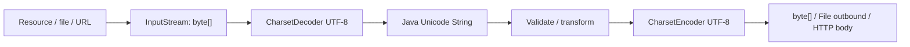
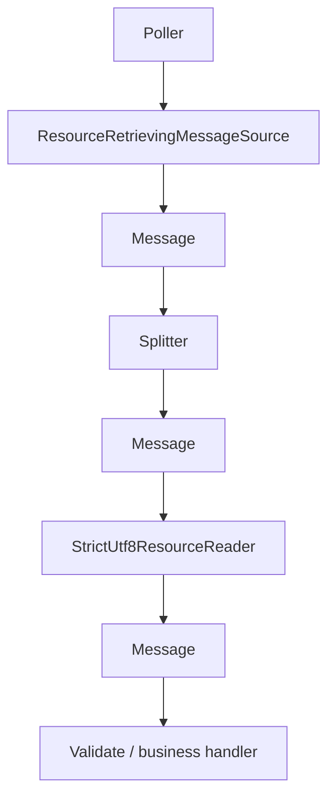
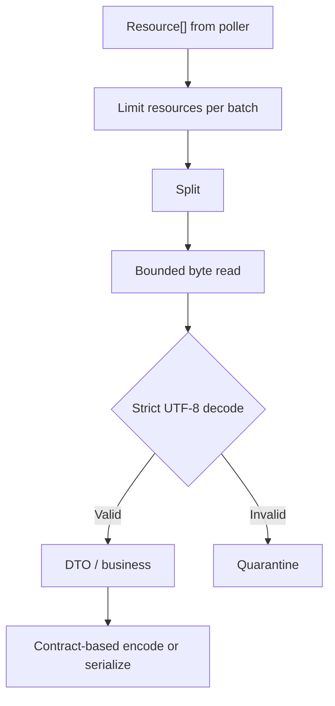

# Encoding and Charsets When Processing Resources in Spring Integration

## 1. Problem statement: same Resource, two ways of reading yield two different results

An order-processing service periodically loads `.properties` or `.csv` files from the classpath/JAR via Spring Integration. The files contain customer names, shipping addresses, and Vietnamese rule labels such as `"Đơn hàng"`, `"Miễn phí vận chuyển"`. When running in another environment, some lines appear with `�` characters or garbled text such as `"Ä�Æ¡n hàng"`; in a few cases, reconciliation keys or data signatures even break.

The root cause is usually not `MessageChannel` or the poller: **the byte data was decoded or encoded using a charset that mismatches the contract**. The Resource inbound adapter does not turn bytes into text on its own; it only places **`Resource` objects** into a Spring Message. The reader/transformer step and outbound writer decide how bytes are converted to characters.

In the **SPRING_INTEGRATION_ADAPTERS** module, adapters, gateways, pollers, and `MessageChannel` connect external systems to Spring Integration flows. The **Adapter Resource** chapter introduces discovering classpath, file, URL, or JAR resources; this lesson on **"Encoding and charsets"** focuses on the boundary between **byte streams, Java Strings, and file/message content** on both inbound and outbound sides.

### After this lesson, you will be able to

1. Distinguish **encoding/charset**, **byte**, **Unicode code point**, Java `String`, and `Content-Type`.
2. Explain why `Resource#getInputStream()` takes no charset parameter and why `Resource[]` is not decoded automatically.
3. Read UTF-8 resources explicitly, enforce size limits, and **fail on malformed bytes** instead of silently substituting characters.
4. Detect and handle a **UTF-8 BOM** according to application policy.
5. Compare `Properties.load(InputStream)` with `Properties.load(Reader)`, as well as CSV/JSON/XML reading scenarios.
6. Transform `Message<Resource[]>` into `Message<Resource>`, and then into `Message<DecodedTextResource>` in Spring Integration.
7. Write `String` payloads with File outbound using `setCharset("UTF-8")`, distinguishing `byte[]` payloads that are not transcoded.
8. Design tests covering Vietnamese text, BOMs, malformed UTF-8 bytes, legacy charsets, and errors in async flows.

## 2. Model: byte → decode → String → encode → byte



| Concept | Explanation | Example |
| --- | --- | --- |
| **Byte** | Unit of data stored/transmitted over files, streams, brokers | `0xC4 0x90` |
| **Charset** | Mapping rules between byte sequences and characters | `UTF-8`, `UTF-16LE`, `ISO-8859-1` |
| **Decode** | Converts bytes into Java characters | `new InputStreamReader(in, UTF_8)` |
| **Encode** | Converts a `String` into bytes for storage/transmission | `text.getBytes(UTF_8)` |
| **Java String** | Sequence of Unicode characters stored as UTF-16 units | `"Đơn hàng"` |
| **Content-Type** | Metadata describing media type and optionally charset | `text/plain; charset=UTF-8` |
| **Content-Encoding** | Representation transformation such as compression | `gzip` — **not a charset** |

**Encoding** is sometimes loosely used to refer to compression, encryption, or charsets. In this lesson, **character encoding** strictly means the **character ↔ byte** mapping. Gzip is compression, Base64 is text representation of bytes, and AES is encryption; none of them replace specifying UTF-8.

### A Vietnamese example

```java
import java.nio.charset.StandardCharsets;

String text = "Đơn hàng";
byte[] utf8 = text.getBytes(StandardCharsets.UTF_8);

System.out.println(text.length());
System.out.println(utf8.length);
```

The two numbers can differ: **`String.length()` counts UTF-16 code units**, whereas `utf8.length` counts bytes. For characters outside the Basic Multilingual Plane (e.g., emojis), a single Unicode code point can take **two** UTF-16 units and **four** UTF-8 bytes.

**Never use `String.length()` to infer content-length or file size limits.** I/O limits must measure actual bytes.

## 3. A Resource does not carry a mandatory charset attribute

Spring Framework defines:

```java
org.springframework.core.io.Resource;
org.springframework.core.io.InputStreamSource;
```

`Resource` provides:

```java
InputStream getInputStream() throws IOException;
```

`InputStream` returns **bytes**, not Java characters. The fact that a `ClassPathResource` is named `rules-vi.properties` or a `UrlResource` ends in `.csv` **does not prove the actual charset**.

```java
Resource resource = ...;
try (InputStream input = resource.getInputStream()) {
    // Still a byte stream, not text yet.
}
```

### Common Resource implementations

| Implementation | Where does content come from? | Charset risks |
| --- | --- | --- |
| `ClassPathResource` | Classes directory or entry inside a JAR | Build tools may copy files byte-for-byte; do not guess charset from runtime OS |
| `FileSystemResource` | Filesystem | May have been written by another app/tool in its own charset |
| `UrlResource` | URL | Requires HTTP content-type/charset contract, redirect, and size controls |
| `ByteArrayResource` | Byte array in RAM | Bytes supplied by caller; has no inherent UTF-8 awareness |
| `InputStreamResource` | Already-open stream | Usually single-read; requires lifecycle and byte-limit handling |

**Do not use `getFile()` to read JAR resources**, because an entry inside a JAR does not necessarily have a physical `java.io.File`. `getInputStream()` is preferred, and the caller must **close the stream** with try-with-resources.

### Where is the encoding decided?

A clear data contract specifies:

```text
Source pattern: classpath*:rules/*.properties
Content format: Java .properties
Charset: UTF-8
BOM policy: UTF-8 BOM accepted and stripped exactly once
Malformed bytes: REJECT / quarantine
Max input size: 256 KiB/resource
Line ending: LF preferred, CRLF accepted
Required fields: rule.id, rule.version
```

This is the **application's contract**. Resource inbound does not provide these policies out of the box.

## 4. Choosing a charset: not all are equivalent

| Charset | Characteristics | Notes |
| --- | --- | --- |
| **UTF-8** | Variable-length, ASCII-compatible for ASCII characters | Usually the default **that should be explicitly mandated** for new text data |
| `UTF-16LE` | Two bytes per UTF-16 code unit, little-endian | May include `FF FE` BOM; contract must be verified |
| `UTF-16BE` | Big-endian | Cannot be decoded correctly as UTF-8 |
| `ISO-8859-1` | Maps one byte per Latin-1 character | Does not directly support full Vietnamese; `Properties.load(InputStream)` uses this charset |
| `US-ASCII` | 7-bit character set | Unsuitable for storing raw Vietnamese without escapes |
| `windows-1258` | Legacy code page associated with Vietnamese | Use only when the provider confirms the format and the Java provider supports it |

The JDK's `StandardCharsets` exposes `UTF_8`, `UTF_16`, `UTF_16BE`, `UTF_16LE`, `ISO_8859_1`, and `US_ASCII`.

```java
import java.nio.charset.Charset;
import java.nio.charset.StandardCharsets;

Charset chosen = StandardCharsets.UTF_8;
// Only use legacy when required by an external contract:
Charset legacy = Charset.forName("windows-1258");
```

**Do not automatically try dozens of charsets and pick text that "looks right."** A charset like ISO-8859-1 can decode any byte value without throwing an error, even though the resulting text is wrong. If a provider lacks a clear contract, verify raw bytes with them rather than guessing and corrupting names/IDs in your database.

### UTF-8 is a contract choice, not an inherent property of every file

An older file might have been generated in Windows-1258 or a custom code page, while new documents have moved to UTF-8. Never silently assume a legacy file is UTF-8 just because its extension is `.csv`. For legacy sources, place a **dedicated input adapter/parser** with an explicit charset, convert to Unicode/DTO data, and emit UTF-8 per the new contract.

## 5. How do encoding errors manifest?

### 5.1. Mojibake

Mojibake occurs when bytes of charset A are decoded using charset B. Symptoms include text turning into `Ã`, `Â`, `Ä`, or unreadable sequences.

```text
Producer:
  String "Đơn hàng"
  -> UTF-8 bytes

Consumer (WRONG):
  decodes bytes with another charset
  -> corrupted text without necessarily throwing an exception
```

**Do not run `replace("Ã", ...)` across all strings.** Text-based "fixes" can corrupt already-valid data or data legitimately containing those characters. Find the **original bytes + source charset** and decode properly at the boundary.

### 5.2. Replacement character U+FFFD

Convenient JDK decoding APIs can replace invalid byte sequences with the **`�` (U+FFFD)** character:

```java
byte[] badUtf8 = {
    (byte) 0xC3,
    (byte) 0x28
};

String possiblyReplaced = new String(
    badUtf8,
    java.nio.charset.StandardCharsets.UTF_8
);
```

If an application uses **replacement-mode** decoding, original data can be silently lost without the business handler knowing. For people's names, customer IDs, signatures, or legal data, use **`CharsetDecoder` in `REPORT` mode** to quarantine resources when encoding is invalid.

### 5.3. Identical-looking text, different hashes

Two visually identical strings can use different **Unicode normalizations** (e.g., precomposed accented characters vs. base letter + combining marks). They can have different bytes despite looking alike.

If normalization is desired:

```java
import java.text.Normalizer;

String normalized = Normalizer.normalize(
    text, Normalizer.Form.NFC
);
```

Normalize only when required by the business contract, and explicitly decide whether to **hash raw bytes** or **normalized content**. Never normalize silently when verifying digital signatures, payload checksums, or case/format-sensitive identifiers.

## 6. Simple UTF-8 Resource reading

For small files known to be UTF-8 without strict validation requirements:

```java
import java.io.InputStream;
import java.io.InputStreamReader;
import java.io.Reader;
import java.nio.charset.StandardCharsets;
import org.springframework.core.io.Resource;

public void readText(Resource resource) throws Exception {
    try (InputStream in = resource.getInputStream();
         Reader reader = new InputStreamReader(
             in, StandardCharsets.UTF_8
         )) {
        char[] buffer = new char[4096];
        int count;
        while ((count = reader.read(buffer)) != -1) {
            // Process decoded characters.
        }
    }
}
```

**Note:** this snippet demonstrates `Reader` usage without bounding total bytes; `InputStreamReader` uses a decoder for the specified charset, which is not a guarantee that all malformed UTF-8 will be rejected. For data requiring strict correctness, use **`CharsetDecoder` with `CodingErrorAction.REPORT`** as in section 7.

If you only need to quickly read all content from a small, elsewhere-validated resource, you can use `StreamUtils` or `InputStream.readAllBytes()`, but **never read unboundedly** from untrusted URLs or files. Always cap max bytes or use a streaming parser.

## 7. Main example: StrictUtf8ResourceReader with size limits, BOM, and strict errors

Let us build a reader that takes a `Resource`, opens its stream, reads at most **256 KiB**, optionally allows a **UTF-8 BOM** per policy, and uses a strict decoder:

- `onMalformedInput(CodingErrorAction.REPORT)`: invalid UTF-8 byte sequences throw an exception.
- `onUnmappableCharacter(CodingErrorAction.REPORT)`: unmappable characters throw an exception per decoder contract.
- Creates a new `CharsetDecoder` per read: decoder instances are not thread-safe for concurrent use.
- Returns a result containing text, byte count, filename, and BOM flag; does **not** keep `InputStream` alive in a Spring message.

### 7.1. Decoded DTO

```java
package com.example.resourcecharset;

public record DecodedTextResource(
    String sourceName,
    String text,
    int originalBytes,
    boolean hadUtf8Bom
) {}
```

`sourceName` is display metadata, not a unique resource identity. Two JARs can both contain `rules.properties`. In production, add a logical source ID/version/checksum when using the DTO for business logic.

### 7.2. Complete reader

```java
package com.example.resourcecharset;

import java.io.IOException;
import java.io.InputStream;
import java.nio.ByteBuffer;
import java.nio.charset.CharsetDecoder;
import java.nio.charset.CodingErrorAction;
import java.nio.charset.StandardCharsets;
import org.springframework.core.io.Resource;

public final class StrictUtf8ResourceReader {

    private static final int MAX_BYTES = 256 * 1024;

    public DecodedTextResource read(Resource resource)
            throws IOException {

        if (resource == null) {
            throw new IllegalArgumentException("Missing Resource");
        }

        byte[] raw;
        try (InputStream input = resource.getInputStream()) {
            raw = input.readNBytes(MAX_BYTES + 1);
        }

        if (raw.length > MAX_BYTES) {
            throw new IOException("Resource exceeds 256 KiB");
        }

        boolean hasBom = raw.length >= 3
            && (raw[0] & 0xff) == 0xef
            && (raw[1] & 0xff) == 0xbb
            && (raw[2] & 0xff) == 0xbf;
        int offset = hasBom ? 3 : 0;

        CharsetDecoder decoder = StandardCharsets.UTF_8
            .newDecoder()
            .onMalformedInput(CodingErrorAction.REPORT)
            .onUnmappableCharacter(CodingErrorAction.REPORT);

        String text = decoder.decode(
            ByteBuffer.wrap(raw, offset, raw.length - offset)
        ).toString();

        String name = resource.getFilename();
        if (name == null || name.isBlank()) {
            name = "unnamed-resource";
        }

        return new DecodedTextResource(
            name, text, raw.length, hasBom
        );
    }
}
```

**Design choice here:** accept a **UTF-8 BOM at the start of the file** and strip exactly the three bytes `EF BB BF` before decoding. BOMs must not be stripped in the middle of a file. If your data forbids BOMs, replace that branch with a **throw** upon detection; **never** let different parsers across the system handle BOMs inconsistently.

`CharsetDecoder#decode(ByteBuffer)` can throw `CharacterCodingException` (an `IOException`) on malformed bytes. Callers can classify it specifically as an **encoding error**, quarantine the file, report the sanitized resource name, and avoid writing bad data to the DB.

### 7.3. Why use readNBytes(MAX + 1)?

`MAX_BYTES + 1` lets us detect that the file **exceeds the threshold** without loading a massive file into RAM. Because a single batch can still contain multiple resources, also bound **batch size**, concurrency, total bytes, and timeouts when sources are URLs/networked.

`MAX_BYTES` is measured in bytes **before stripping the BOM**. Decoding does not alter the size-limit decision.

### 7.4. This is not a universal charset detector

The reader **only accepts UTF-8**. If it encounters a UTF-16 BOM, it may throw an error or yield schema-invalid characters; we do **not** guess UTF-16 and retry. If the contract requires UTF-16LE/BE, build a separate parser or extend to an **allowlist of charsets** with policy-driven BOM/header checks.

## 8. BOM: the first three bytes can break an entire data key

Common **Byte Order Marks (BOM)**:

| Format | Leading bytes | Meaning |
| --- | --- | --- |
| UTF-8 BOM | `EF BB BF` | Optional marker at start of UTF-8 text; unnecessary for byte order |
| UTF-16LE BOM | `FF FE` | Little-endian |
| UTF-16BE BOM | `FE FF` | Big-endian |
| UTF-32LE BOM | `FF FE 00 00` | Little-endian (must consider order/length when detecting) |
| UTF-32BE BOM | `00 00 FE FF` | Big-endian |

A BOM is not an infallible "charset detector." Absence of a BOM **does not prove** UTF-8, and presence of a BOM does not guarantee all subsequent bytes are valid.

### Classic Properties bug

File bytes:

```text
EF BB BF 72 75 6C 65 2E 69 64 3D 64 65 6D 6F
```

This corresponds to a UTF-8 BOM followed by `rule.id=demo`. If the decoder retains the BOM as the `U+FEFF` character, `Properties` may parse the key as `\uFEFFrule.id`; calling `getProperty("rule.id")` then returns `null`.

The reader in section 7 strips the BOM **before** handing text to the parser, keeping the `rule.id` key valid. Never rely on `String.trim()` or `strip()` as a guaranteed fix for BOMs in keys: Java whitespace rules are not BOM handling.

### BOM with CSV

A CSV with a BOM can turn the first column name into `\uFEFForderId` instead of `orderId`. Agree on "is BOM allowed or rejected?" and strip the BOM only at the **start of the stream** before the CSV parser; do not blindly strip every `U+FEFF` character throughout the entire content.

## 9. Properties.load(InputStream) vs. Properties.load(Reader)

This is a **critical point for the Resource adapter** because exercises frequently read `*.properties`.

Per the Java API:

- `Properties.load(InputStream)` interprets the byte stream as **ISO-8859-1**, with other characters typically represented using **Unicode escapes** like `\u0110`.
- `Properties.load(Reader)` reads **characters already converted by a decoder**, so the charset is determined when creating the `Reader`.
- `Properties.store(OutputStream, ...)` and `store(Writer, ...)` also follow different output encoding rules.

### 9.1. A broken example with a UTF-8 file

```java
import java.util.Properties;

Properties props = new Properties();
try (var input = resource.getInputStream()) {
    props.load(input);  // ISO-8859-1, NOT UTF-8 by default.
}
```

If the file contains `rule.label=Đơn hàng` encoded as UTF-8 bytes, the result suffers mojibake. Worse, parsing can still "succeed" syntactically.

### 9.2. The right approach when the contract is UTF-8

After strictly reading with `StrictUtf8ResourceReader`:

```java
import java.io.StringReader;
import java.util.Properties;

StrictUtf8ResourceReader reader =
    new StrictUtf8ResourceReader();
DecodedTextResource decoded = reader.read(resource);

Properties props = new Properties();
try (StringReader chars = new StringReader(decoded.text())) {
    props.load(chars);
}

String label = props.getProperty("rule.label");
```

`StringReader` holds strictly decoded characters, so the parser does not guess any charset. If the file started with a BOM and the reader's policy allows BOMs, it has already been stripped before parsing.

### 9.3. A direct streaming approach when BOM logic is unnecessary

```java
import java.io.InputStreamReader;
import java.nio.charset.StandardCharsets;
import java.util.Properties;

Properties props = new Properties();
try (var input = resource.getInputStream();
     var reader = new InputStreamReader(
         input, StandardCharsets.UTF_8
     )) {
    props.load(reader);
}
```

This is fine for sources guaranteed to match the charset without BOMs, yet if you need **strict decoding**, construct `InputStreamReader` with a `CharsetDecoder` set to `REPORT` and handle BOMs separately. Do not confuse specifying a charset with rejecting malformed bytes.

### 9.4. When is ISO-8859-1 actually right?

If a provider truly publishes **traditional Java properties** in ISO-8859-1 using `\uXXXX` escapes for characters outside Latin-1, `Properties.load(InputStream)` matches the contract. **You do not have to force all `*.properties` files to UTF-8**; follow the verified source format and version.

## 10. JSON, XML, CSV: charset is part of the format contract

### JSON

In most modern systems, cross-system JSON uses UTF-8. With `byte[]` from a Resource, you can:

1. Strictly decode UTF-8 first and pass `String` to Jackson.
2. Pass bytes directly to a Jackson parser that handles encoding/BOM detection per the JSON contract.

**Pick one consistent approach and test it**; never decode bytes to `String` with charset A and re-encode with charset B before parsing.

```java
import com.fasterxml.jackson.databind.ObjectMapper;

ObjectMapper mapper = new ObjectMapper();
DecodedTextResource decoded =
    new StrictUtf8ResourceReader().read(resource);

OrderRuleDto dto = mapper.readValue(
    decoded.text(), OrderRuleDto.class
);
```

`OrderRuleDto` is an application-defined DTO; it requires the Jackson dependency and appropriate schema/validation. The code illustrates parsing and does not replace business rule validation.

### XML

XML declares its encoding at the top of the document, for example:

```xml
<?xml version="1.0" encoding="UTF-8"?>
<rules>
  <rule id="shipping">Miễn phí vận chuyển</rule>
</rules>
```

When running an XML parser directly on a **byte stream**, the parser handles BOM/declarations per the XML standard. If you already decoded into a `String`, the application must ensure there is no conflict with the declaration. For untrusted XML, configure the parser against **XXE/external entities**, and bound sizes and resources.

### CSV

CSV has **no universal default charset** across spreadsheet tools. Specify encoding, delimiter, quoting/escaping, and newlines:

```text
Format: CSV
Charset: UTF-8
BOM: absent (or required if consumer mandates it)
Delimiter: comma
Quote: double-quote
Line ending: LF
Header: orderId,customerName,total
```

Do not parse CSV with `String.split(",")` if values can contain commas or quotes; use a proper CSV library. Charsets only solve **byte ↔ text**, not CSV quoting.

## 11. Spring Integration Resource inbound: a Resource[] batch, not text

The Spring Integration documentation confirms the resource inbound channel adapter is a **polling adapter** that resolves a pattern via `ResourcePatternResolver` and emits a **Message containing a collection of Resources**. `ResourceRetrievingMessageSource` specifically uses payload type `Resource[]`.



If `classpath*:rules/*.properties` matches three files:

```text
Poll #1:
  Message<Resource[]>  // payload.length = 3

After Splitter:
  Message<Resource> tax.properties
  Message<Resource> shipping.properties
  Message<Resource> discount.properties

After Transformer:
  Message<DecodedTextResource>
    text = "rule.label=Miễn phí vận chuyển..."
```

**`maxMessagesPerPoll="1"` does not mean one Resource per poll.** It limits the number of messages received from the source in a poll cycle, not the number of resources inside a single message's array. If batches are huge, narrow the pattern or design separate partitioning/limits.

## 12. Java configuration: Resource inbound with a poller

### 12.1. Dependencies

A Spring Boot application using a synchronized BOM:

```xml
<dependencies>
    <dependency>
        <groupId>org.springframework.boot</groupId>
        <artifactId>spring-boot-starter-integration</artifactId>
    </dependency>
</dependencies>
```

This is Resource inbound from **Spring Integration Core**; `spring-integration-file` is not needed solely to discover `Resource` objects. If you later use the File outbound handler, add the File module as in section 16.

### 12.2. Beans creating MessageSource<Resource[]>

```java
package com.example.resourcecharset;

import org.springframework.context.annotation.Bean;
import org.springframework.context.annotation.Configuration;
import org.springframework.core.io.Resource;
import org.springframework.integration.annotation.InboundChannelAdapter;
import org.springframework.integration.annotation.Poller;
import org.springframework.integration.channel.DirectChannel;
import org.springframework.integration.config.EnableIntegration;
import org.springframework.integration.core.MessageSource;
import org.springframework.integration.resource.ResourceRetrievingMessageSource;
import org.springframework.integration.util.AcceptOnceCollectionFilter;
import org.springframework.messaging.MessageChannel;

@Configuration
@EnableIntegration
public class ResourceCharsetConfiguration {

    @Bean
    public MessageChannel resourceBatches() {
        return new DirectChannel();
    }

    @Bean
    public MessageChannel resourceItems() {
        return new DirectChannel();
    }

    @Bean
    public MessageChannel decodedText() {
        return new DirectChannel();
    }

    @Bean
    public StrictUtf8ResourceReader strictUtf8ResourceReader() {
        return new StrictUtf8ResourceReader();
    }

    @Bean
    @InboundChannelAdapter(
        channel = "resourceBatches",
        poller = @Poller(
            fixedDelay = "5000",
            maxMessagesPerPoll = "1"
        )
    )
    public MessageSource<Resource[]> resourceSource() {
        ResourceRetrievingMessageSource source =
            new ResourceRetrievingMessageSource(
                "classpath*:rules/*.properties"
            );
        source.setFilter(new AcceptOnceCollectionFilter<>());
        return source;
    }
}
```

`@InboundChannelAdapter` creates the polling endpoint. `@Poller` controls scheduling. `AcceptOnceCollectionFilter` reduces re-emission of the same resource during the bean's lifecycle; it **does not check content versions** and does not roll back when a downstream parser fails. This Java configuration declares the filter explicitly.

### 12.3. Why classpath*?

`classpath*:rules/*.properties` is suitable when multiple classpath roots/JARs contribute resources under `rules/`. If the data is always one specific file, `classpath:rules/default.properties` may be simpler. Wildcards in JARs depend on the class loader/packaging; test on the real executable JAR.

## 13. Splitter, Transformer, and handler: converting Resource to text

### 13.1. Splitting the array into individual Resources

```java
package com.example.resourcecharset;

import org.springframework.core.io.Resource;
import org.springframework.integration.annotation.Splitter;
import org.springframework.stereotype.Component;

@Component
public class ResourceArraySplitter {

    @Splitter(
        inputChannel = "resourceBatches",
        outputChannel = "resourceItems"
    )
    public Resource[] split(Resource[] resources) {
        return resources;
    }
}
```

### 13.2. Transformer enforcing UTF-8

```java
package com.example.resourcecharset;

import java.io.IOException;
import org.springframework.core.io.Resource;
import org.springframework.integration.annotation.Transformer;
import org.springframework.stereotype.Component;

@Component
public class Utf8ResourceTransformer {

    private final StrictUtf8ResourceReader reader;

    public Utf8ResourceTransformer(StrictUtf8ResourceReader reader) {
        this.reader = reader;
    }

    @Transformer(
        inputChannel = "resourceItems",
        outputChannel = "decodedText"
    )
    public DecodedTextResource transform(Resource resource)
            throws IOException {
        return reader.read(resource);
    }
}
```

### 13.3. Business handler receiving Unicode text

```java
package com.example.resourcecharset;

import java.io.StringReader;
import java.util.Properties;
import org.springframework.integration.annotation.ServiceActivator;
import org.springframework.stereotype.Component;

@Component
public class RuleTextHandler {

    @ServiceActivator(inputChannel = "decodedText")
    public void process(DecodedTextResource document)
            throws Exception {

        Properties props = new Properties();
        try (StringReader chars =
                 new StringReader(document.text())) {
            props.load(chars);
        }

        String id = props.getProperty("rule.id");
        String label = props.getProperty("rule.label");
        if (id == null || id.isBlank()) {
            throw new IllegalArgumentException("Missing rule.id");
        }
        if (label == null || label.isBlank()) {
            throw new IllegalArgumentException(
                "Missing rule.label"
            );
        }

        System.out.printf(
            "Accepted rule=%s (bytes=%d, bom=%s)%n",
            id, document.originalBytes(), document.hadUtf8Bom()
        );
        // TODO: persist an idempotent rule version in a transaction.
    }
}
```

**In a real context, register these beans only once**; do not add another transformer/handler onto the same subscribable `DirectChannel` assuming messages are broadcast to every subscriber. If fan-out is needed, use `PublishSubscribeChannel` or design the flow accordingly.

### Separation of responsibilities

| Layer | Receives | Emits / Effects |
| --- | --- | --- |
| `ResourceRetrievingMessageSource` | Location pattern | `Resource[]` |
| `ResourceArraySplitter` | `Resource[]` | One message per `Resource` |
| `Utf8ResourceTransformer` | `Resource` | Decoded `DecodedTextResource` or exception |
| `RuleTextHandler` | `DecodedTextResource` | Parses `Properties`, validates, and invokes business logic |

When the transformer throws `CharacterCodingException`, that is an **encoding error**, not "the broker failed to deliver the message." Error flows should classify it at the proper step.

## 14. XML namespace: Resource inbound has no generic charset attribute

Spring Integration supports Resource inbound via the `int` namespace:

```xml
<?xml version="1.0" encoding="UTF-8"?>
<beans xmlns="http://www.springframework.org/schema/beans"
       xmlns:xsi="http://www.w3.org/2001/XMLSchema-instance"
       xmlns:int="http://www.springframework.org/schema/integration"
       xsi:schemaLocation="
          http://www.springframework.org/schema/beans
          https://www.springframework.org/schema/beans/spring-beans.xsd
          http://www.springframework.org/schema/integration
          https://www.springframework.org/schema/integration/spring-integration.xsd">

    <int:channel id="resourceBatches"/>

    <int:resource-inbound-channel-adapter
        id="resourceInbound"
        channel="resourceBatches"
        pattern="classpath*:rules/*.properties">
        <int:poller fixed-delay="5000"
                    max-messages-per-poll="1"/>
    </int:resource-inbound-channel-adapter>
</beans>
```

**Do not invent a `charset="UTF-8"` attribute on the Resource inbound adapter expecting it to decode files.** The Resource inbound payload is `Resource[]`; characters only appear once a component opens the stream and decodes it. For an XML flow, route messages through a splitter + POJO/transformer that performs `UTF-8`, rather than altering the source contract with an undocumented attribute.

Per the docs, XML Resource inbound without a `filter` uses `AcceptOnceCollectionFilter` by default, which can be replaced with another `CollectionFilter<Resource>` or disabled with `filter=""`. The filter controls **which resources are emitted**, not the **charset of a resource**.

## 15. Outbound: String and byte[] take two different paths

Once you have a `DecodedTextResource`, the application may write out a UTF-8 file. There are two strategies:

**A. Convert to bytes beforehand:**

```java
String text = document.text();
byte[] payload = text.getBytes(StandardCharsets.UTF_8);
```

`Message<byte[]>` holds the chosen bytes; the writer writes **those exact bytes**. Check for unencodable errors if your application might produce invalid UTF-16 strings, or use the strict encoder in section 17.

**B. Keep `Message<String>`:** the outbound handler is configured with `setCharset("UTF-8")` and encodes the `String` when writing.

```text
Message<String> -> FileWritingMessageHandler.setCharset("UTF-8")
    -> UTF-8 bytes

Message<byte[]> -> FileWritingMessageHandler
    -> writes raw byte[] (no automatic transcoding)
```

**Do not expect a `Content-Type: ...; charset=...` header to transcode `byte[]` automatically** when File outbound writes. A binary payload's charset is already fixed by the producer; to change bytes, decode and re-encode explicitly in a transformer with a clear contract.

## 16. FileWritingMessageHandler and charset for String payloads

The Spring Integration File support docs note that `FileWritingMessageHandler` supports `File`, `String`, `byte[]`, and `InputStream`. **For `String`, a charset can be configured.**

### 16.1. Dependency

```xml
<dependency>
    <groupId>org.springframework.integration</groupId>
    <artifactId>spring-integration-file</artifactId>
</dependency>
```

Use dependency management/BOM compatible with your project's Spring Boot version. **Spring Integration 7.x** places the class at `org.springframework.integration.file.outbound.FileWritingMessageHandler`; for **6.x**, import `org.springframework.integration.file.FileWritingMessageHandler`. Do not mix packages across major versions.

### 16.2. Java configuration for a File outbound channel adapter

```java
package com.example.resourcecharset;

import java.io.File;
import org.springframework.beans.factory.annotation.Value;
import org.springframework.context.annotation.Bean;
import org.springframework.context.annotation.Configuration;
import org.springframework.integration.annotation.ServiceActivator;
import org.springframework.integration.channel.DirectChannel;
import org.springframework.integration.config.EnableIntegration;
import org.springframework.integration.file.outbound.FileWritingMessageHandler;
import org.springframework.integration.file.support.FileExistsMode;
import org.springframework.messaging.MessageChannel;
import org.springframework.messaging.MessageHandler;

@Configuration
@EnableIntegration
public class Utf8FileOutboundConfiguration {

    @Bean
    public MessageChannel writeUtf8Text() {
        return new DirectChannel();
    }

    @Bean
    @ServiceActivator(inputChannel = "writeUtf8Text")
    public MessageHandler utf8FileWriter(
            @Value("${app.export.directory}") String directory) {

        FileWritingMessageHandler handler =
            new FileWritingMessageHandler(new File(directory));

        handler.setExpectReply(false);
        handler.setCharset("UTF-8");
        handler.setAppendNewLine(false);
        handler.setFileExistsMode(FileExistsMode.FAIL);
        handler.setAutoCreateDirectory(false);
        return handler;
    }
}
```

With `setAutoCreateDirectory(false)`, the output directory must already exist and the app account needs write permission. `FileExistsMode.FAIL` is only an example to detect conflicts when a filename already exists, not an exactly-once mechanism.

### 16.3. Producer writing safe filenames

```java
package com.example.resourcecharset;

import org.springframework.beans.factory.annotation.Qualifier;
import org.springframework.integration.file.FileHeaders;
import org.springframework.messaging.MessageChannel;
import org.springframework.messaging.support.MessageBuilder;
import org.springframework.stereotype.Service;

@Service
public class Utf8FilePublisher {

    private final MessageChannel channel;

    public Utf8FilePublisher(
            @Qualifier("writeUtf8Text") MessageChannel channel) {
        this.channel = channel;
    }

    public void publish(String safeName, String text) {
        if (safeName == null || !safeName.matches(
                "[A-Za-z0-9][A-Za-z0-9._-]{0,127}")) {
            throw new IllegalArgumentException(
                "Output filename not approved"
            );
        }
        if (text == null) {
            throw new IllegalArgumentException("Missing text");
        }

        boolean accepted = channel.send(
            MessageBuilder.withPayload(text)
                .setHeader(FileHeaders.FILENAME, safeName)
                .build()
        );
        if (!accepted) {
            throw new IllegalStateException(
                "File outbound channel rejected message"
            );
        }
    }
}
```

`setCharset("UTF-8")` ensures **`String` payloads** are written in the configured charset. For `byte[]`, the writer does not decode and re-encode, so whether output is valid UTF-8 depends on the producer.

**Never put raw user paths in `FileHeaders.FILENAME`.** The regex is just an illustrative basename filter; production requires a backend-managed output root, symlink/path-traversal controls, and OS-safe filename policies.

### 16.4. XML File outbound

```xml
<?xml version="1.0" encoding="UTF-8"?>
<beans xmlns="http://www.springframework.org/schema/beans"
       xmlns:xsi="http://www.w3.org/2001/XMLSchema-instance"
       xmlns:int="http://www.springframework.org/schema/integration"
       xmlns:int-file="http://www.springframework.org/schema/integration/file"
       xsi:schemaLocation="
          http://www.springframework.org/schema/beans
          https://www.springframework.org/schema/beans/spring-beans.xsd
          http://www.springframework.org/schema/integration
          https://www.springframework.org/schema/integration/spring-integration.xsd
          http://www.springframework.org/schema/integration/file
          https://www.springframework.org/schema/integration/file/spring-integration-file.xsd">

    <int:channel id="writeUtf8Text"/>

    <int-file:outbound-channel-adapter
        id="utf8FileWriter"
        channel="writeUtf8Text"
        directory="${app.export.directory}"
        charset="UTF-8"
        mode="FAIL"
        auto-create-directory="false"/>
</beans>
```

This is an **XML alternative** to the Java configuration above; do not declare both endpoints on the same channel if you only want each message written once. The `int-file` namespace belongs to the File module—**there is no dedicated Resource outbound channel adapter** just because the earlier input was a Resource.

## 17. Strict UTF-8 encoding when writing Strings

Just like decoding, encoding a `String` to bytes via convenience APIs can use **replacement** for invalid UTF-16 character data (e.g., an unpaired surrogate). When you must reject rather than replace, use `CharsetEncoder` with `REPORT`.

```java
package com.example.resourcecharset;

import java.nio.ByteBuffer;
import java.nio.CharBuffer;
import java.nio.charset.CharacterCodingException;
import java.nio.charset.CodingErrorAction;
import java.nio.charset.StandardCharsets;

public final class StrictUtf8Encoder {

    private StrictUtf8Encoder() {}

    public static byte[] encode(String text)
            throws CharacterCodingException {
        if (text == null) {
            throw new IllegalArgumentException("Missing text");
        }

        ByteBuffer encoded = StandardCharsets.UTF_8
            .newEncoder()
            .onMalformedInput(CodingErrorAction.REPORT)
            .onUnmappableCharacter(CodingErrorAction.REPORT)
            .encode(CharBuffer.wrap(text));

        byte[] bytes = new byte[encoded.remaining()];
        encoded.get(bytes);
        return bytes;
    }
}
```

**Never share a mutable `CharsetEncoder` or `CharsetDecoder` across threads.** Creating a fresh encoder/decoder per call is safe for Spring Integration async consumers.

To bound output size, check **`bytes.length` after encoding** before sending. A very long `String` can still consume memory before encoding; production should bound payloads at the producer/parser stage as well.

### String payload via File outbound vs. strict byte[]?

| Requirement | Choice |
| --- | --- |
| Valid text from a service wanting a normal UTF-8 file | `Message<String>` + `setCharset("UTF-8")` |
| Must reject malformed UTF-16 instead of replacing | `StrictUtf8Encoder.encode(...)` → `Message<byte[]>` |
| Need byte-for-byte preservation | Keep bytes; do not decode/encode |
| Need conversion from a legacy charset | Decode source per verified charset, validate, then encode target |
| Need digital signatures/checksums | Specify hashing over exact bytes and normalization/encoding timing |

## 18. HTTP, SFTP, JMS, and Kafka: charsets must be clear at transport boundaries

The **SPRING_INTEGRATION_ADAPTERS** module also connects to HTTP, SFTP, JMS, AMQP, and Kafka. General principle: **text charset handling** must be defined wherever bytes become Strings or Strings become bytes; transport adapters do not automatically understand your business data.

### HTTP

An HTTP response might declare:

```text
Content-Type: text/csv; charset=UTF-8
Content-Encoding: gzip
```

Here:

1. The HTTP client handles `gzip` per content-encoding when configured.
2. Decompressed data is **CSV bytes**.
3. A decoder applies `UTF-8` to produce text.
4. A CSV parser handles delimiters, quoting, and headers per format.

If charset is missing or misreported by the server, rely on the **API contract** rather than guessing from filenames or the local machine's charset. Only accept an allowlisted set of charsets.

### SFTP/File

SFTP and filesystems fundamentally carry **bytes**; a file `orders.csv` carries no reliable embedded charset metadata. Producer and consumer must agree on UTF-8/BOM/newlines. Writing with charset A via a file writer and reading with B on the receiving side corrupts data even when SFTP transfer succeeds.

### JMS/AMQP/Kafka

A `TextMessage` (JMS) or JSON converter may provide string abstractions, yet when passing byte payloads or communicating across heterogeneous clients/frameworks, check converters/schemas/encodings. **Never treat topic/queue names as proof of charset**, nor call `new String(bytes)` without a charset expecting portability.

### STOMP

A STOMP frame's `content-type` may specify a `charset`; `content-length` is in **bytes**, not `String.length()`. With binary payloads and frame codecs, respect framing and never compute byte length from Java character counts. Broker receipts/ACKs do not confirm downstream decoded text properly.

## 19. Encoding and lifecycle: snapshots, async, retries

A `Message<Resource>` may sit in a queue before a handler opens its stream:

```text
T1: Poller resolves Resource A
T2: Message<Resource> is enqueued
T3: File A is modified to a different version or deleted
T4: Worker finally calls getInputStream()
```

Bytes at `T4` may **differ from content at `T1`**. If auditing is required, read/snapshot/version before the handoff or store in durable storage, then send a **decoded DTO** or **object key + content hash**.

### Resource[] and filters can lose retry opportunities

`AcceptOnceCollectionFilter` remembers resources already accepted at the source. If a transformer detects broken UTF-8 and throws an exception, **the filter does not automatically roll back**. Therefore after a producer/handler failure, the next poll may **not emit that resource again**.

Designing reliable processing:

1. Separate resource detection from business commits.
2. Derive `sourceId + contentVersion` from reliable metadata/hashes.
3. Persist `PENDING/QUARANTINED/PROCESSED` state in a DB/ledger when needed.
4. For permanent encoding errors, quarantine + alert; do not hot-retry infinitely.
5. For transient I/O errors, use bounded retries/backoff with the same idempotency key.
6. For async workers, monitor worker completion/error flows; never treat enqueue as commit.

**There is no default atomic transaction** spanning the in-memory filter, file/JAR/URL, Spring Channel, and JDBC transaction. `@Transactional` on a handler does not undo the filter having seen a resource.

## 20. Classifying encoding, I/O, parser, and business errors

| Error layer | Common exceptions/signals | How to handle |
| --- | --- | --- |
| **I/O input** | `FileNotFoundException`, `IOException`, URL timeout | Check source/ACLs/timeouts; retry if recoverable |
| **Byte limit** | `IOException("Resource exceeds ...")` from reader | Reject/quarantine; stop reading unboundedly |
| **Charset decode** | `MalformedInputException`, `UnmappableCharacterException`, `CharacterCodingException` | Quarantine raw bytes safely; investigate charset |
| **BOM policy** | UTF-16 BOM on a UTF-8-only stream | Reject or route to an allowlisted parser |
| **Format parse** | `IllegalArgumentException`, properties/CSV/JSON errors | Fix data or route to dead-letter/quarantine |
| **Business validate** | Missing `rule.id`, duplicate version, wrong tenant | Reject at domain layer; do not misclassify as charset error |
| **Output encode** | `CharacterCodingException` from strict encoder | Reject invalid text; inspect upstream source |
| **File outbound** | Directory unwritable, `FileExistsMode.FAIL`, disk full | Fix ACL/quota or reconcile; bounded retry |
| **Async handler** | Worker exception after `send()` succeeded | Worker-side error flow/metrics |

### Do not log raw payloads indiscriminately

To debug encoding issues, you do not need to log entire bodies containing PII. Log:

```text
category=MALFORMED_UTF8
resourceId=rule-bundle:pricing-v3
bytes=1430
hadUtf8Bom=false
sourceKind=classpath
action=QUARANTINED
```

These fields are **application-generated metadata**. Never log raw `Resource.getDescription()` if URLs contain query tokens or credentials. For corrupted bytes, store raw artifacts only in a quarantine area with proper encryption, ACLs, and retention when investigation is needed.

### Why not catch all exceptions and return an empty String?

If a converter catches `CharacterCodingException` and returns `""`, downstream might treat empty data as valid or overwrite good data. For critical information, **fail fast + quarantine** is far safer than silently replacing or dropping bytes.

## 21. Unicode normalization, line endings, and checksums

Charsets and business data are related but distinct:

| Concern | Example | Decision required |
| --- | --- | --- |
| Charset | UTF-8 vs. UTF-16LE | Decode/encode bytes per format |
| BOM | UTF-8 `EF BB BF` | Allow/strip or reject |
| Line ending | LF `\n` vs. CRLF `\r\n` | Preserve or normalize for output |
| Unicode normalization | NFC vs. NFD | Whether to normalize text before comparing/hashing |
| Case folding | `Order` vs. `order` | Define explicitly for business keys |
| Whitespace | Space, NBSP, tab | Do not trim meaningful data arbitrarily |
| Checksum | SHA-256 | Hash raw bytes or canonical text/bytes? |

### Example intentional line-ending normalization

```java
String normalizedLf = text
    .replace("\r\n", "\n")
    .replace("\r", "\n");
```

**Only do this if the contract permits.** Changing newlines alters bytes and can affect digital signatures, audits, diffs, or file formats requiring CRLF. Never normalize arbitrary binary messages as text.

### At which step should hashes be computed?

A system may keep **two hashes**:

- `rawSha256` of input bytes for auditing/reconciling the original file.
- `canonicalSha256` of text after decoding, normalizing per rules, and encoding as UTF-8.

Both hashes serve distinct purposes. `AcceptOnceCollectionFilter` not seeing content changes does not replace your hashing/checkpointing.

## 22. Performance: when to decode and how to bound



| Risk | Consequence | Mitigation |
| --- | --- | --- |
| Many resources in one `Resource[]` | Single poll produces huge batch | Narrow pattern, limit batches/partition sources |
| Uncontrolled `readAllBytes()` from URL | Heap/GC spikes or OOM | `readNBytes(MAX+1)`, streaming parsers, timeouts |
| Huge intermediate `String` | Doubles/triples memory footprint | Pass bytes directly if text editing is unnecessary |
| Re-reading the same resource repeatedly | Extra I/O; data may drift | Snapshot or use versioned sources |
| Shared decoder across workers | Data races, corrupted output | Create a new decoder per call |
| Infinitely retrying malformed data | CPU/log storm | Quarantine, fix source, retry budgets |
| Writing very large files | Partial files and high latency | Staging/temporary suffixes and bounded streaming |
| Sending raw Resource over message brokers | Not portable across processes | Controlled DTOs/bytes/object keys |

**Proper optimization** does not mean skipping UTF-8 validation for speed—it means doing work in the right place: decode only when text is needed; for binary files or byte-for-byte transfers, **do not decode** and compute checksums on the raw bytes.

## 23. Testing with JUnit 5: Vietnamese, BOM, and invalid UTF-8

### 23.1. Testing strict decoding from FileSystemResource

```java
package com.example.resourcecharset;

import static org.junit.jupiter.api.Assertions.*;

import java.nio.charset.StandardCharsets;
import java.nio.file.Files;
import java.nio.file.Path;
import org.junit.jupiter.api.Test;
import org.junit.jupiter.api.io.TempDir;
import org.springframework.core.io.FileSystemResource;

class StrictUtf8ResourceReaderTest {

    @TempDir
    Path tempDir;

    private final StrictUtf8ResourceReader reader =
        new StrictUtf8ResourceReader();

    @Test
    void decodesVietnameseTextExactly() throws Exception {
        Path path = tempDir.resolve("rule.properties");
        String original =
            "rule.id=shipping\nrule.label=Miễn phí vận chuyển\n";
        Files.write(path, original.getBytes(StandardCharsets.UTF_8));

        DecodedTextResource decoded = reader.read(
            new FileSystemResource(path)
        );

        assertEquals(original, decoded.text());
        assertEquals(
            original.getBytes(StandardCharsets.UTF_8).length,
            decoded.originalBytes()
        );
        assertFalse(decoded.hadUtf8Bom());
    }

    @Test
    void stripsUtf8BomOnlyAtTheBeginning() throws Exception {
        byte[] content =
            "rule.id=demo\n".getBytes(StandardCharsets.UTF_8);
        byte[] raw = new byte[content.length + 3];
        raw[0] = (byte) 0xef;
        raw[1] = (byte) 0xbb;
        raw[2] = (byte) 0xbf;
        System.arraycopy(content, 0, raw, 3, content.length);

        Path path = tempDir.resolve("with-bom.properties");
        Files.write(path, raw);

        DecodedTextResource decoded = reader.read(
            new FileSystemResource(path)
        );

        assertEquals("rule.id=demo\n", decoded.text());
        assertTrue(decoded.hadUtf8Bom());
        assertEquals(raw.length, decoded.originalBytes());
    }
}
```

### 23.2. Testing that malformed UTF-8 bytes are rejected

```java
import static org.junit.jupiter.api.Assertions.assertThrows;

import java.nio.charset.MalformedInputException;
import java.nio.file.Files;
import java.nio.file.Path;
import org.junit.jupiter.api.Test;
import org.junit.jupiter.api.io.TempDir;
import org.springframework.core.io.FileSystemResource;

class InvalidUtf8Test {

    @TempDir
    Path tempDir;

    @Test
    void rejectsMalformedUtf8() throws Exception {
        Path path = tempDir.resolve("broken.txt");
        Files.write(path, new byte[] {
            (byte) 0xc3, (byte) 0x28
        });

        assertThrows(
            MalformedInputException.class,
            () -> new StrictUtf8ResourceReader().read(
                new FileSystemResource(path)
            )
        );
    }
}
```

`MalformedInputException` is a subtype of `CharacterCodingException` and `IOException`. This test ensures the flow **does not silently replace broken bytes with U+FFFD**.

### 23.3. Testing Properties.load(InputStream) vs. Reader

```java
import static org.junit.jupiter.api.Assertions.*;

import java.io.ByteArrayInputStream;
import java.io.StringReader;
import java.nio.charset.StandardCharsets;
import java.util.Properties;
import org.junit.jupiter.api.Test;

class PropertiesEncodingTest {

    @Test
    void latin1OverloadDoesNotDecodeRawUtf8Correctly()
            throws Exception {
        String original = "rule.label=Đơn hàng\n";
        byte[] utf8 =
            original.getBytes(StandardCharsets.UTF_8);

        Properties wrong = new Properties();
        wrong.load(new ByteArrayInputStream(utf8));

        Properties correct = new Properties();
        correct.load(new StringReader(
            new String(utf8, StandardCharsets.UTF_8)
        ));

        assertEquals("Đơn hàng", correct.getProperty("rule.label"));
        assertNotEquals(
            correct.getProperty("rule.label"),
            wrong.getProperty("rule.label")
        );
    }
}
```

This test demonstrates the difference between **ISO-8859-1** and **UTF-8** for Unicode data. It does not replace `StrictUtf8ResourceReader` in production, because `new String(byte[], UTF_8)` may substitute malformed input instead of failing.

### 23.4. Testing strict encoder

```java
import static org.junit.jupiter.api.Assertions.*;

import java.nio.charset.MalformedInputException;
import java.nio.charset.StandardCharsets;
import org.junit.jupiter.api.Test;

class Utf8EncoderTest {

    @Test
    void encodesVietnameseRoundTrip() throws Exception {
        String original = "Miễn phí vận chuyển";
        byte[] bytes = StrictUtf8Encoder.encode(original);
        assertEquals(
            original, new String(bytes, StandardCharsets.UTF_8)
        );
    }

    @Test
    void rejectsUnpairedSurrogate() {
        String invalidUtf16 = "\uD800";
        assertThrows(
            MalformedInputException.class,
            () -> StrictUtf8Encoder.encode(invalidUtf16)
        );
    }
}
```

**Note:** these are standalone tests for the reader/encoder and do not run the full Spring Integration context. If a build uses a different BOM/plugins, verify compatibility with Java 17+ and your project's Spring Integration version during QA.

## 24. Integration testing: exact bytes before and after File outbound

An integration test should run the flow:

```text
classpath UTF-8 resource
  -> ResourceRetrievingMessageSource
  -> Resource[] batch
  -> splitter
  -> strict UTF-8 transformer
  -> business handler / String publisher
  -> FileWritingMessageHandler setCharset("UTF-8")
  -> output file bytes
```

**Mandatory test cases:**

1. UTF-8 resources containing Vietnamese text and emojis round-trip cleanly.
2. UTF-8 resources with a BOM are accepted/stripped per exact policy.
3. Malformed UTF-8 bytes are quarantined and do **not** create rules in the DB.
4. UTF-16 files with a BOM are not accidentally treated as valid UTF-8.
5. Legacy ISO-8859-1 files are only accepted through an explicitly configured legacy parser.
6. `Properties.load(InputStream)` and `load(Reader)` are compared on the same Vietnamese fixture.
7. When using File outbound with `Message<String>`, output files contain **UTF-8** bytes.
8. When using `Message<byte[]>`, output files preserve **exact bytes** without auto-transcoding.
9. `String.length()` differs from UTF-8 byte count; file limits are enforced in bytes.
10. Packaged JAR entries are opened via `getInputStream()`, without relying on `getFile()`.
11. Two resources sharing a filename across different classpath roots are not treated as the same logical rule ID.
12. Transformer fails after source filter accepts: retries/checkpoints do not lose the item.
13. Switch to `ExecutorChannel`: worker errors route to the downstream error flow rather than just waiting on producer `send()`.
14. Data exceeding byte limits is rejected before parsers allocate large objects.
15. Colliding output filenames are handled per `FileExistsMode` and idempotency policies.
16. No raw credentials/PII appear in logs when encoding fails.

### A simple output test with @TempDir

To separately test encoded bytes before sending to File outbound:

```java
import static org.junit.jupiter.api.Assertions.assertArrayEquals;

import java.nio.charset.StandardCharsets;
import java.nio.file.Files;
import java.nio.file.Path;
import org.junit.jupiter.api.Test;
import org.junit.jupiter.api.io.TempDir;

class Utf8OutputBytesTest {

    @TempDir
    Path tempDir;

    @Test
    void writesExactUtf8Bytes() throws Exception {
        String text = "Mã đơn,Tổng tiền\nĐH-501,1000\n";
        byte[] bytes = StrictUtf8Encoder.encode(text);
        Path output = tempDir.resolve("report.csv");
        Files.write(output, bytes);

        assertArrayEquals(
            text.getBytes(StandardCharsets.UTF_8),
            Files.readAllBytes(output)
        );
    }
}
```

This is a **unit test of the encoder + `Files.write`**, not a File outbound adapter integration test. To verify `FileWritingMessageHandler#setCharset("UTF-8")` works with real configuration, initialize the Spring context/handler, send `Message<String>` over the channel, and assert output file bytes after the handler completes.

## 25. Encoding/charset troubleshooting table

| Symptom | Possible cause | Resolution |
| --- | --- | --- |
| `Đơn hàng` becomes `Ä�Æ¡n hàng` | UTF-8 bytes decoded with a different charset | Check the source's true charset; decode properly from original bytes |
| Text contains `�` | Decoder in replacement mode hit bad bytes | Use strict decoder `REPORT`; quarantine raw bytes |
| `rule.id` not found only on first line | UTF-8 BOM retained as `U+FEFF` inside key | Strip BOM at start of stream before `Properties.load` |
| `Properties.load(InputStream)` misreads Vietnamese | This overload assumes ISO-8859-1 | Decode UTF-8 then use `Properties.load(Reader)` |
| Inbound data is fine but output file is garbled | Writer picked a different charset | Configure `setCharset("UTF-8")` for `String`, or encode bytes explicitly |
| `byte[]` file unchanged despite `setCharset` | File writer does not transcode `byte[]` | Transform `byte[]` before sending if contract requires |
| UTF-16 BOM breaks UTF-8 reader | File source violates contract | Use an allowlisted UTF-16 parser or reject |
| Output byte count differs from `String.length()` | UTF-8 is variable-length | Use `byte[].length` or byte buffer remaining |
| Looks identical yet checksum differs | Different Unicode normalization/newlines/BOM | Define raw vs. canonical checksum policy |
| Reader sees different text after queue delay | Resource handle points to mutable source | Snapshot/version before async handoff |
| Reprocessing fails after encoding error | Accept-once filter retained state | Durable checkpoints, quarantine, and replay policies |
| High CPU scanning classpath every second | JAR resources are usually immutable | Narrow patterns, reduce poll frequency, or load once |
| URL Resource reads very slowly | Unbounded network timeout/redirects/size | Client configs, allowlists, bounded reads |
| Partial output file written | Wrote directly then threw exception | Staging/temporary suffix and recovery |
| Kafka/HTTP consumer misreads text | Mismatched charset/schema across systems | Align Content-Type/serializer/encoder contracts |

## 26. Hands-on exercises with answers

**Exercise 1 — Nature of Resource.** Does `Resource#getInputStream()` return text or bytes?

**Answer:** It returns an `InputStream` of **bytes**. Charsets only apply when the application decodes bytes into characters.

**Exercise 2 — Inbound payload.** Does `ResourceRetrievingMessageSource` emit a single `Resource` or `Resource[]`?

**Answer:** It emits `Message<Resource[]>`; use a splitter if individual `Message<Resource>` messages are needed.

**Exercise 3 — maxMessagesPerPoll.** Setting `maxMessagesPerPoll=1`, the resolver finds 50 resources. Will only one resource be decoded?

**Answer:** No. One batch can hold all 50 `Resource` objects; the limit bounds the number of messages received from the source in a poll cycle.

**Exercise 4 — Charset.** Why is `new InputStreamReader(in, StandardCharsets.UTF_8)` clearer than the constructor without a charset?

**Answer:** Because the encoding is explicit in code and contract, independent of runtime defaults.

**Exercise 5 — Silent corruption.** What is the risk of `new String(bytes, UTF_8)` when bytes are invalid?

**Answer:** It can replace malformed data with `�`, losing information without throwing an exception.

**Exercise 6 — Decoder.** Which two methods put `CharsetDecoder` into error-reporting mode?

**Answer:** `onMalformedInput(CodingErrorAction.REPORT)` and `onUnmappableCharacter(CodingErrorAction.REPORT)`.

**Exercise 7 — Concurrency.** Should one `CharsetDecoder` instance be shared across 20 workers?

**Answer:** No. Decoders hold mutable state and are not thread-safe; create new instances or isolate per worker.

**Exercise 8 — BOM.** What do the leading bytes `EF BB BF` mean?

**Answer:** A UTF-8 BOM. The application must enforce a policy: allow stripping it exactly once at the start of the file, or reject.

**Exercise 9 — Properties.** Which charset does `Properties.load(InputStream)` use?

**Answer:** ISO-8859-1 with Unicode escapes; not UTF-8 by default.

**Exercise 10 — UTF-8 Properties.** How do you properly read `rule.label=Miễn phí`?

**Answer:** Decode bytes as UTF-8 per policy and then call `Properties.load(Reader)` or `StringReader`.

**Exercise 11 — UTF-16.** Should a file starting with BOM `FF FE` just be read as UTF-8?

**Answer:** No. If the contract only accepts UTF-8, reject it; if UTF-16LE is allowed, use the corresponding decoder and verify format.

**Exercise 12 — Legacy.** A provider exports CSV in Windows-1258. Should you silently decode it as UTF-8 because the new app uses UTF-8?

**Answer:** No. Use the confirmed charset at a dedicated input boundary, convert/validate, and then output UTF-8 if needed.

**Exercise 13 — File outbound.** Which payload does `setCharset("UTF-8")` affect?

**Answer:** `String` payloads when `FileWritingMessageHandler` encodes them to bytes; it does not transcode `byte[]`.

**Exercise 14 — Binary.** A `byte[]` payload is a JPEG image. Should it be decoded as UTF-8 before File outbound writes it?

**Answer:** No. It is binary data and must preserve exact bytes.

**Exercise 15 — Size.** Why is `String.length()` not the content-length?

**Answer:** It counts UTF-16 code units, whereas UTF-8 bytes vary in length per character.

**Exercise 16 — BOM & Properties.** Why can the first key become `\uFEFFrule.id`?

**Answer:** The UTF-8 BOM was decoded into the `U+FEFF` character and not stripped before parsing the file.

**Exercise 17 — Invalid bytes.** When does the reader in section 7 throw an exception?

**Answer:** When exceeding the byte limit or encountering invalid UTF-8 byte sequences under the `REPORT` decoder (or when source I/O fails).

**Exercise 18 — Normalization.** Should you apply NFC normalization to every payload before checking digital signatures?

**Answer:** No. Normalization changes bytes; both parties must agree on a canonicalization contract.

**Exercise 19 — Retries.** The transformer detects malformed UTF-8 after the AcceptOnce filter accepted the resource. Is the next poll guaranteed to retry it?

**Answer:** No. Filter state does not roll back on handler failures; separate replay/checkpoint/quarantine mechanisms are needed.

**Exercise 20 — Async.** Does `ExecutorChannel.send()==true` guarantee the file was written with the right charset?

**Answer:** No. The worker may not have run or finished yet; observe completion/error flows.

**Exercise 21 — HTTP.** Does `Content-Encoding:gzip` replace `charset=UTF-8`?

**Answer:** No. Gzip is compression; charset specifies how to interpret text bytes.

**Exercise 22 — Logging.** Should you log the raw resource body if UTF-8 is invalid?

**Answer:** Not by default. It may contain PII/secrets; log safe metadata and store raw bytes in controlled quarantine.

**Exercise 23 — JARs.** Why can `ClassPathResource#getFile()` fail even though the resource is readable?

**Answer:** An entry inside a JAR is not a physical `File`; use `getInputStream()`.

**Exercise 24 — Testing.** Does a test checking only a Vietnamese String parser prove File outbound encodes output correctly?

**Answer:** No. Assert actual output file bytes after sending `Message<String>` through the handler configured with the real charset.

## 27. Key takeaways

**A `Resource` is a handle to bytes, not text carrying an inherent charset.** In Spring Integration, Resource inbound produces **`Message<Resource[]>`** on a poller; only when a splitter/transformer opens `Resource#getInputStream()` are bytes decoded into text. To prevent losing Vietnamese characters or encountering silent corruption, **specify charsets at every boundary**, use explicit UTF-8 for new data where appropriate, use **`CharsetDecoder` with `REPORT`** when malformed input must be rejected, and define a BOM policy. For `*.properties`, remember **`Properties.load(InputStream)` expects ISO-8859-1**, while `Properties.load(Reader)` reads characters you already decoded. When writing via File outbound, **`setCharset("UTF-8")` applies to `String` payloads; `byte[]` is written as raw bytes** without transcoding. Bound payloads in **bytes**, distinguish charsets from compression/`Content-Type`, protect `Resource` lifecycles, manage filters/retries, and test **byte-for-byte** before assuming data integrity.

## References

- [Spring Integration Reference — Resource Support](https://docs.spring.io/spring-integration/reference/resource.html)
- [Spring Integration Reference — File Support](https://docs.spring.io/spring-integration/reference/file.html)
- [Spring Integration Reference — Writing Files](https://docs.spring.io/spring-integration/reference/file/writing.html)
- [Spring Integration API — ResourceRetrievingMessageSource](https://docs.spring.io/spring-integration/docs/current/api/org/springframework/integration/resource/ResourceRetrievingMessageSource.html)
- [Spring Integration API — FileWritingMessageHandler (7.x)](https://docs.spring.io/spring-integration/docs/current/api/org/springframework/integration/file/outbound/FileWritingMessageHandler.html)
- [Spring Framework Reference — Resources](https://docs.spring.io/spring-framework/reference/core/resources.html)
- [Java SE 17 API — CharsetDecoder](https://docs.oracle.com/en/java/javase/17/docs/api/java.base/java/nio/charset/CharsetDecoder.html)
- [Java SE 17 API — CharsetEncoder](https://docs.oracle.com/en/java/javase/17/docs/api/java.base/java/nio/charset/CharsetEncoder.html)
- [Java SE 17 API — Properties.load(Reader/InputStream)](https://docs.oracle.com/en/java/javase/17/docs/api/java.base/java/util/Properties.html)
- [Unicode Standard — FAQ: UTF & BOM](https://www.unicode.org/faq/utf_bom.html)
